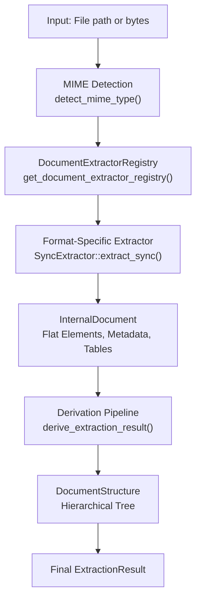
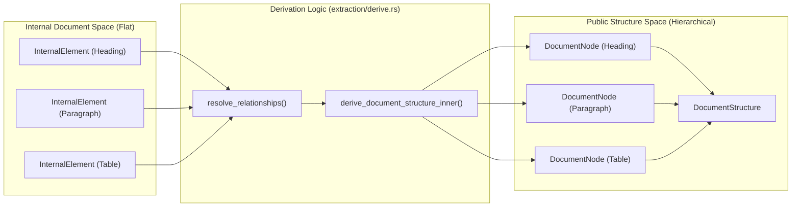
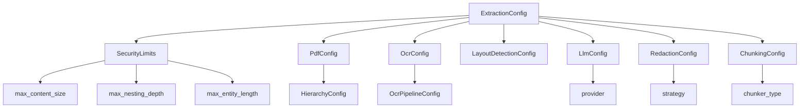
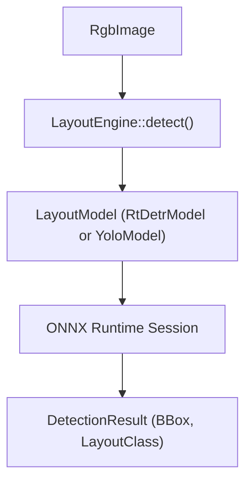

<!-- source: DeepWiki mcp.deepwiki.com · repo kreuzberg-dev/kreuzberg · page 3 Core Concepts · fetched 2026-10-27 -->

# Core Concepts

Relevant source files

The following files were used as context for generating this wiki page:

- [crates/kreuzberg/src/core/config/captioning.rs](crates/kreuzberg/src/core/config/captioning.rs)
- [crates/kreuzberg/src/core/config/classification.rs](crates/kreuzberg/src/core/config/classification.rs)
- [crates/kreuzberg/src/core/config/extraction/core.rs](crates/kreuzberg/src/core/config/extraction/core.rs)
- [crates/kreuzberg/src/core/config/llm.rs](crates/kreuzberg/src/core/config/llm.rs)
- [crates/kreuzberg/src/core/config/mod.rs](crates/kreuzberg/src/core/config/mod.rs)
- [crates/kreuzberg/src/core/config/ocr.rs](crates/kreuzberg/src/core/config/ocr.rs)
- [crates/kreuzberg/src/core/config/translation.rs](crates/kreuzberg/src/core/config/translation.rs)
- [crates/kreuzberg/src/diff/mod.rs](crates/kreuzberg/src/diff/mod.rs)
- [crates/kreuzberg/src/diff/types.rs](crates/kreuzberg/src/diff/types.rs)
- [crates/kreuzberg/src/extraction/mod.rs](crates/kreuzberg/src/extraction/mod.rs)
- [crates/kreuzberg/src/extractors/mod.rs](crates/kreuzberg/src/extractors/mod.rs)
- [crates/kreuzberg/src/extractors/security.rs](crates/kreuzberg/src/extractors/security.rs)
- [crates/kreuzberg/src/lib.rs](crates/kreuzberg/src/lib.rs)
- [crates/kreuzberg/src/plugins/processor/builtin/ner.rs](crates/kreuzberg/src/plugins/processor/builtin/ner.rs)
- [crates/kreuzberg/src/text/ner/mod.rs](crates/kreuzberg/src/text/ner/mod.rs)
- [crates/kreuzberg/src/text/redaction/engine.rs](crates/kreuzberg/src/text/redaction/engine.rs)
- [crates/kreuzberg/src/types/revisions.rs](crates/kreuzberg/src/types/revisions.rs)
- [crates/kreuzberg/tests/image_classification.rs](crates/kreuzberg/tests/image_classification.rs)
- [docs/concepts/architecture.md](docs/concepts/architecture.md)
- [docs/concepts/extraction-pipeline.md](docs/concepts/extraction-pipeline.md)
- [docs/concepts/plugin-system.md](docs/concepts/plugin-system.md)
- [docs/ecosystem.md](docs/ecosystem.md)
- [docs/guides/image-captions.md](docs/guides/image-captions.md)
- [docs/guides/ner.md](docs/guides/ner.md)
- [docs/guides/page-classification.md](docs/guides/page-classification.md)
- [docs/guides/qr-codes.md](docs/guides/qr-codes.md)
- [docs/guides/redaction.md](docs/guides/redaction.md)
- [docs/guides/summarization.md](docs/guides/summarization.md)
- [docs/guides/translation.md](docs/guides/translation.md)
- [docs/llms.txt](docs/llms.txt)
- [zensical.toml](zensical.toml)

This document explains the fundamental architectural concepts behind Kreuzberg's document processing engine. It covers the extraction pipeline, internal representation, configuration hierarchy, and threading model. For detailed implementation of specific subsystems, see [Document Processing Pipeline](#3.1), [PDF Processing Details](#3.2), [MIME Type Detection](#3.3), [Configuration System](#3.4), and [Error Handling and Types](#3.5).

## Extraction Flow

Kreuzberg processes documents through a multi-stage pipeline that transforms raw bytes into structured text, metadata, tables, and optional chunks. The flow is designed to be format-agnostic while allowing format-specific optimizations.

### High-Level Extraction Pipeline

**Sources:** [crates/kreuzberg/src/lib.rs:197-205](), [crates/kreuzberg/src/extractors/mod.rs:8-12](), [crates/kreuzberg/src/extraction/derive.rs:1-10]()

### Core Data Structures

Kreuzberg uses a multi-stage data representation. Extractors output a flat `InternalDocument` which is then transformed into a hierarchical `DocumentStructure` and a public `ExtractionResult`.

| Structure | Purpose | Key Fields | File Location |
|-----------|---------|------------|---------------|
| `InternalDocument` | Internal flat representation optimized for extraction performance. | `elements`, `relationships`, `metadata`, `tables`, `images` | [crates/kreuzberg/src/types/internal.rs:131-180]() |
| `ExtractionConfig` | Controls all extraction behavior. | `ocr`, `chunking`, `pdf_options`, `postprocessor`, `security_limits` | [crates/kreuzberg/src/core/config/mod.rs:24-47]() |
| `ExtractionResult` | Public-facing container for all extracted data. | `content`, `metadata`, `tables`, `chunks`, `pages` | [crates/kreuzberg/src/lib.rs:116-121]() |
| `InternalElement` | Individual unit of content (Paragraph, Heading, Image, etc.). | `id`, `kind`, `text`, `bbox`, `page` | [crates/kreuzberg/src/types/internal.rs:10-16]() |

**Sources:** [crates/kreuzberg/src/types/internal.rs:131-180](), [crates/kreuzberg/src/core/config/mod.rs:24-47]()

## Document Representation

Kreuzberg bridges the gap between raw file bytes and semantic document structures.

### From Flat Elements to Code Entities

This diagram shows how the internal flat elements produced by extractors like `PdfExtractor` or `DocxExtractor` map to the semantic tree used by the library.

**Sources:** [crates/kreuzberg/src/extraction/derive.rs:1-10](), [crates/kreuzberg/src/types/internal.rs:1-16]()

## Configuration and Security

The `ExtractionConfig` struct is the central authority for extraction behavior. It includes `SecurityLimits` to protect against common document-based attacks.

### Configuration Hierarchy

**Sources:** [crates/kreuzberg/src/core/config/mod.rs:24-47](), [crates/kreuzberg/src/extractors/security.rs:13-50](), [crates/kreuzberg/src/core/config/llm.rs:1-10](), [crates/kreuzberg/src/core/config/redaction.rs:1-10](), [crates/kreuzberg/src/core/config/processing.rs:1-10]()

### Security Mechanisms

Kreuzberg implements several safeguards:
- **ZIP Bomb Detection**: `ZipBombValidator` checks compression ratios and file counts. [crates/kreuzberg/src/extractors/security.rs:155-184]()
- **XML Protection**: Limits on entity expansion and nesting depth to prevent "billion laughs" attacks. [crates/kreuzberg/src/extractors/security.rs:32-37]()
- **Resource Caps**: `max_table_cells` and `max_content_size` prevent memory exhaustion. [crates/kreuzberg/src/extractors/security.rs:48-50]()

## Layout and OCR Intelligence

For visual documents (PDFs, Images), Kreuzberg employs advanced layout detection and OCR backends.

### Layout Engine Architecture

The `LayoutEngine` uses ONNX Runtime to perform high-level page analysis.

**Sources:** [crates/kreuzberg/src/layout/engine.rs:82-89](), [crates/kreuzberg/src/layout/models/rtdetr.rs:30-33]()

## Page Management

For multi-page documents, Kreuzberg tracks content per page using `PageContent`. This includes assigning hierarchy, tables, and images to their respective page numbers.

| Component | Responsibility | Source |
|-----------|----------------|--------|
| `assign_hierarchy_to_pages` | Maps headings to page-level hierarchy blocks. | [crates/kreuzberg/src/extractors/pdf/pages.rs:14-58]() |
| `assign_tables_and_images_to_pages` | Associates tables and images with `PageContent` using Arc sharing. | [crates/kreuzberg/src/extractors/pdf/pages.rs:80-111]() |
| `InternalElement.page` | Stores the 1-indexed page number for an element. | [crates/kreuzberg/src/types/internal.rs:68-72]() |

**Sources:** [crates/kreuzberg/src/extractors/pdf/pages.rs:1-111]()

## Threading and Memory

- **Global Singletons**: Components like `PDFIUM_SINGLETON` or `CACHED_ENGINE` use `OnceLock` or `ModelCache` to ensure resources are initialized once and shared across threads. [crates/kreuzberg/src/layout/mod.rs:57-63]()
- **Arc-Based Sharing**: Tables and images are wrapped in `Arc` to allow zero-copy sharing between the flat document list and page-specific content. [crates/kreuzberg/src/extractors/pdf/pages.rs:65-70]()
- **FFI Safety**: `InternalElementId` provides deterministic 48-bit identifiers (via Blake3) that enable consistent referencing across language boundaries. [crates/kreuzberg/src/types/internal.rs:33-40]()

---

For details on the multi-stage pipeline, see [Document Processing Pipeline](#3.1).
For PDF-specific details, see [PDF Processing Details](#3.2).
For MIME type detection logic, see [MIME Type Detection](#3.3).
For configuration management, see [Configuration System](#3.4).
For error classification, see [Error Handling and Types](#3.5).
For LLM integration, see [LLM Integration](#3.6).
For code analysis, see [Code Intelligence](#3.7).

---

