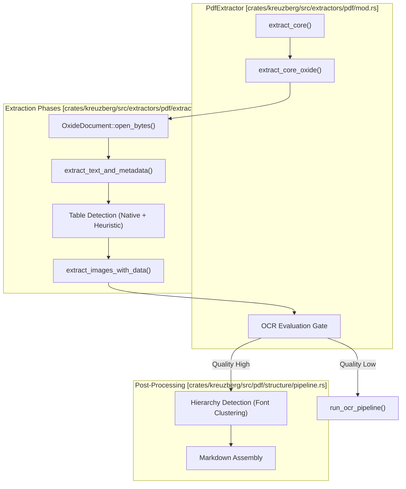
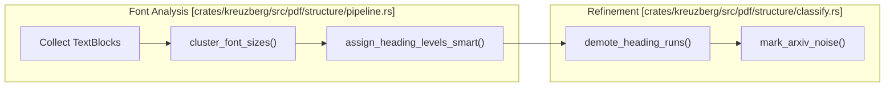
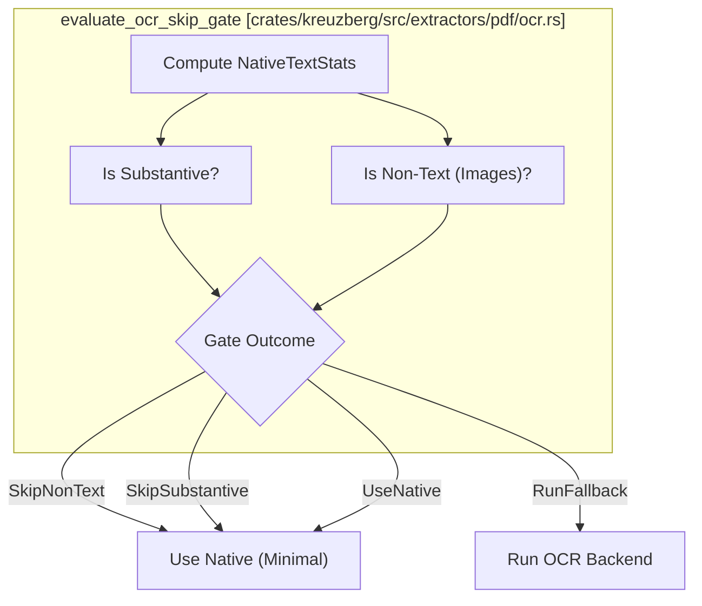

<!-- source: DeepWiki mcp.deepwiki.com · repo kreuzberg-dev/kreuzberg · page 3.2 PDF Processing Details · fetched 2026-10-27 -->

# PDF Processing Details

Relevant source files

The following files were used as context for generating this wiki page:

- [crates/kreuzberg-cli/src/commands/tree_sitter.rs](crates/kreuzberg-cli/src/commands/tree_sitter.rs)
- [crates/kreuzberg/src/core/path_resolver.rs](crates/kreuzberg/src/core/path_resolver.rs)
- [crates/kreuzberg/src/extraction/image.rs](crates/kreuzberg/src/extraction/image.rs)
- [crates/kreuzberg/src/extraction/pptx/content_builder.rs](crates/kreuzberg/src/extraction/pptx/content_builder.rs)
- [crates/kreuzberg/src/extractors/image.rs](crates/kreuzberg/src/extractors/image.rs)
- [crates/kreuzberg/src/extractors/pdf/extraction.rs](crates/kreuzberg/src/extractors/pdf/extraction.rs)
- [crates/kreuzberg/src/extractors/pdf/layout_hints.rs](crates/kreuzberg/src/extractors/pdf/layout_hints.rs)
- [crates/kreuzberg/src/extractors/pdf/layout_runner.rs](crates/kreuzberg/src/extractors/pdf/layout_runner.rs)
- [crates/kreuzberg/src/extractors/pdf/mod.rs](crates/kreuzberg/src/extractors/pdf/mod.rs)
- [crates/kreuzberg/src/extractors/pdf/ocr.rs](crates/kreuzberg/src/extractors/pdf/ocr.rs)
- [crates/kreuzberg/src/ocr/hocr_parser.rs](crates/kreuzberg/src/ocr/hocr_parser.rs)
- [crates/kreuzberg/src/pdf/bookmarks.rs](crates/kreuzberg/src/pdf/bookmarks.rs)
- [crates/kreuzberg/src/pdf/embedded_files.rs](crates/kreuzberg/src/pdf/embedded_files.rs)
- [crates/kreuzberg/src/pdf/error.rs](crates/kreuzberg/src/pdf/error.rs)
- [crates/kreuzberg/src/pdf/metadata.rs](crates/kreuzberg/src/pdf/metadata.rs)
- [crates/kreuzberg/src/pdf/mod.rs](crates/kreuzberg/src/pdf/mod.rs)
- [crates/kreuzberg/src/pdf/oxide/hierarchy.rs](crates/kreuzberg/src/pdf/oxide/hierarchy.rs)
- [crates/kreuzberg/src/pdf/oxide/images.rs](crates/kreuzberg/src/pdf/oxide/images.rs)
- [crates/kreuzberg/src/pdf/oxide/mod.rs](crates/kreuzberg/src/pdf/oxide/mod.rs)
- [crates/kreuzberg/src/pdf/oxide/table.rs](crates/kreuzberg/src/pdf/oxide/table.rs)
- [crates/kreuzberg/src/pdf/oxide/text.rs](crates/kreuzberg/src/pdf/oxide/text.rs)
- [crates/kreuzberg/src/pdf/oxide_text.rs](crates/kreuzberg/src/pdf/oxide_text.rs)
- [crates/kreuzberg/src/pdf/structure/adapters.rs](crates/kreuzberg/src/pdf/structure/adapters.rs)
- [crates/kreuzberg/src/pdf/structure/assembly.rs](crates/kreuzberg/src/pdf/structure/assembly.rs)
- [crates/kreuzberg/src/pdf/structure/classify.rs](crates/kreuzberg/src/pdf/structure/classify.rs)
- [crates/kreuzberg/src/pdf/structure/constants.rs](crates/kreuzberg/src/pdf/structure/constants.rs)
- [crates/kreuzberg/src/pdf/structure/layout_classify.rs](crates/kreuzberg/src/pdf/structure/layout_classify.rs)
- [crates/kreuzberg/src/pdf/structure/mod.rs](crates/kreuzberg/src/pdf/structure/mod.rs)
- [crates/kreuzberg/src/pdf/structure/paragraphs.rs](crates/kreuzberg/src/pdf/structure/paragraphs.rs)
- [crates/kreuzberg/src/pdf/structure/pipeline.rs](crates/kreuzberg/src/pdf/structure/pipeline.rs)
- [crates/kreuzberg/src/pdf/structure/regions/table_recognition.rs](crates/kreuzberg/src/pdf/structure/regions/table_recognition.rs)
- [crates/kreuzberg/src/pdf/structure/regions/tables.rs](crates/kreuzberg/src/pdf/structure/regions/tables.rs)
- [crates/kreuzberg/src/pdf/table_reconstruct.rs](crates/kreuzberg/src/pdf/table_reconstruct.rs)
- [crates/kreuzberg/src/pdf/text.rs](crates/kreuzberg/src/pdf/text.rs)
- [crates/kreuzberg/src/rendering/html_styled.rs](crates/kreuzberg/src/rendering/html_styled.rs)
- [crates/kreuzberg/tests/layout_for_markdown.rs](crates/kreuzberg/tests/layout_for_markdown.rs)
- [crates/kreuzberg/tests/pdf_glyph_spacing_issue_962.rs](crates/kreuzberg/tests/pdf_glyph_spacing_issue_962.rs)
- [crates/kreuzberg/tests/pdf_heuristic_tables.rs](crates/kreuzberg/tests/pdf_heuristic_tables.rs)
- [crates/kreuzberg/tests/pdf_image_extraction_tests.rs](crates/kreuzberg/tests/pdf_image_extraction_tests.rs)
- [crates/kreuzberg/tests/pdf_markdown_regression.rs](crates/kreuzberg/tests/pdf_markdown_regression.rs)
- [tools/benchmark-harness/guardrails.json](tools/benchmark-harness/guardrails.json)

## Purpose and Scope

This page covers the technical implementation of PDF processing in Kreuzberg. The system has transitioned from a PDFium-based architecture to a pure-Rust pipeline powered by `pdf_oxide`. This architecture provides high-performance text extraction, native and heuristic table detection, and advanced layout analysis for structured output like Markdown. For OCR-specific logic, see [OCR Backends](#5.3).

## PDF Extraction Architecture

The `PdfExtractor` serves as the primary entry point for PDF processing. It orchestrates text extraction, metadata parsing, table reconstruction, and optional OCR fallback when native text quality is insufficient.

### Core Extraction Flow

**Key Implementation Details:**
- **Backend:** Uses `pdf_oxide` for a memory-safe, pure-Rust implementation [crates/kreuzberg/src/extractors/pdf/extraction.rs:49]().
- **Single Pass:** Text and metadata are extracted in a single pass to optimize performance [crates/kreuzberg/src/pdf/oxide/text.rs:28-40]().
- **Thread Safety:** The extractor implements `DocumentExtractor`, supporting both byte-based and file-based async extraction [crates/kreuzberg/src/extractors/pdf/mod.rs:125-147]().

Sources: [crates/kreuzberg/src/extractors/pdf/mod.rs:154-170](), [crates/kreuzberg/src/extractors/pdf/extraction.rs:38-60](), [crates/kreuzberg/src/pdf/oxide/text.rs:28-40]()

## Text and Hierarchy Detection

Kreuzberg employs a sophisticated structure pipeline to convert flat PDF text into semantic hierarchies.

### Font-Size Clustering for Headings

Because PDFs do not inherently store heading levels (H1, H2, etc.), Kreuzberg uses K-means clustering on font sizes to infer document structure.

**Algorithm Characteristics:**
- **Adaptive K-Clamping:** For short documents, the number of clusters ($k$) is automatically reduced to prevent noisy centroids from misclassifying body text as headings [crates/kreuzberg/src/pdf/structure/pipeline.rs:91-97]().
- **Smart Assignment:** Heading levels are assigned based on font size ratios and gaps, ensuring consistent hierarchy even in documents with non-standard font scales [crates/kreuzberg/src/pdf/structure/pipeline.rs:100-125]().
- **Structure Tree Support:** If the PDF contains a built-in structure tree (Tagged PDF), Kreuzberg can bypass heuristics and use assigned roles directly [crates/kreuzberg/src/pdf/structure/pipeline.rs:140-160]().

Sources: [crates/kreuzberg/src/pdf/structure/pipeline.rs:28-132](), [crates/kreuzberg/src/pdf/hierarchy.rs]()

## Table Reconstruction

Table extraction uses a dual-strategy approach to handle both "ruled" (with borders) and "unruled" (white-space delimited) tables.

| Strategy | Mechanism | Target Use Case |
|----------|-----------|-----------------|
| **Native** | Grid detector using explicit PDF path/line instructions. | Forms, invoices, and bordered data tables. |
| **Heuristic** | Spatial reconstruction based on text alignment and gaps. | Financial statements and multi-column layouts without lines. |

The results are merged at the per-page level, ensuring that a document with mixed table styles is processed correctly [crates/kreuzberg/src/extractors/pdf/extraction.rs:74-84]().

Sources: [crates/kreuzberg/src/extractors/pdf/extraction.rs:69-84]()

## OCR Fallback Decision Logic

A critical feature of the PDF pipeline is the "OCR Skip Gate," which determines if a page is a "scanned" image requiring OCR or a "native" text page.

### Quality Evaluation Metrics

The `NativeTextStats` struct tracks several metrics to judge text quality [crates/kreuzberg/src/extractors/pdf/ocr.rs:15-32]():
- **Alnum Ratio:** Ratio of alphanumeric characters to whitespace.
- **Garbage Character Count:** Detection of `U+FFFD` replacement characters indicating encoding failures [crates/kreuzberg/src/extractors/pdf/ocr.rs:98-100]().
- **Fragmented Word Ratio:** Fraction of words with 1-2 characters, indicating garbled extraction [crates/kreuzberg/src/extractors/pdf/ocr.rs:129-134]().
- **Consecutive Repeat Ratio:** Detects column-scrambling where the same words are repeated due to incorrect reading order [crates/kreuzberg/src/extractors/pdf/ocr.rs:139-144]().

### The OCR Skip Gate

Sources: [crates/kreuzberg/src/extractors/pdf/ocr.rs:64-88](), [crates/kreuzberg/src/extractors/pdf/ocr.rs:92-163]()

## Metadata and Image Handling

### PDF-Specific Metadata
Kreuzberg extracts both standard document info and PDF-specific technical details:
- **PdfMetadata:** Version, producer, encryption status, and page dimensions [crates/kreuzberg/src/pdf/metadata.rs:17-41]().
- **PdfExtractionMetadata:** Aggregates title, authors, keywords, and creation dates into a unified structure [crates/kreuzberg/src/pdf/metadata.rs:48-83]().

### Image and Annotation Extraction
- **Images:** The pipeline can extract image data and their spatial positions on the page [crates/kreuzberg/src/extractors/pdf/extraction.rs:95-100]().
- **OCR Inline:** If enabled, extracted images are passed through the OCR processor (e.g., Tesseract or PaddleOCR) to recover text from diagrams or embedded scans [crates/kreuzberg/src/extractors/pdf/extraction.rs:112-145]().
- **Annotations:** PDF comments and annotations are recovered when configured [crates/kreuzberg/src/extractors/pdf/extraction.rs:87-92]().

Sources: [crates/kreuzberg/src/pdf/metadata.rs:1-98](), [crates/kreuzberg/src/extractors/pdf/extraction.rs:87-120]()

## Text Repair and Normalization

Extracted PDF text often contains artifacts from font encoding or layout conversion. The pipeline applies several repair stages:
- **Control Character Fix:** Replaces problematic control characters (e.g., `U+0001`) with hyphens if they appear between word characters, fixing broken `ToUnicode` mappings [crates/kreuzberg/src/pdf/text.rs:17-43]().
- **Ligature Repair:** Expands ligatures and repairs spaces absorbed during extraction [crates/kreuzberg/src/pdf/structure/pipeline.rs:19-21]().
- **HTML Detection:** Detects if the text layer contains embedded HTML (common in web-to-PDF conversions) and converts it to Markdown [crates/kreuzberg/src/pdf/text.rs:50-74]().

Sources: [crates/kreuzberg/src/pdf/text.rs:1-74](), [crates/kreuzberg/src/pdf/structure/pipeline.rs:19-21]()

---

