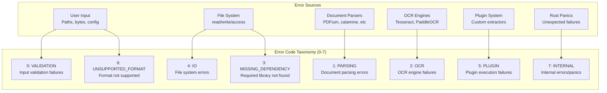
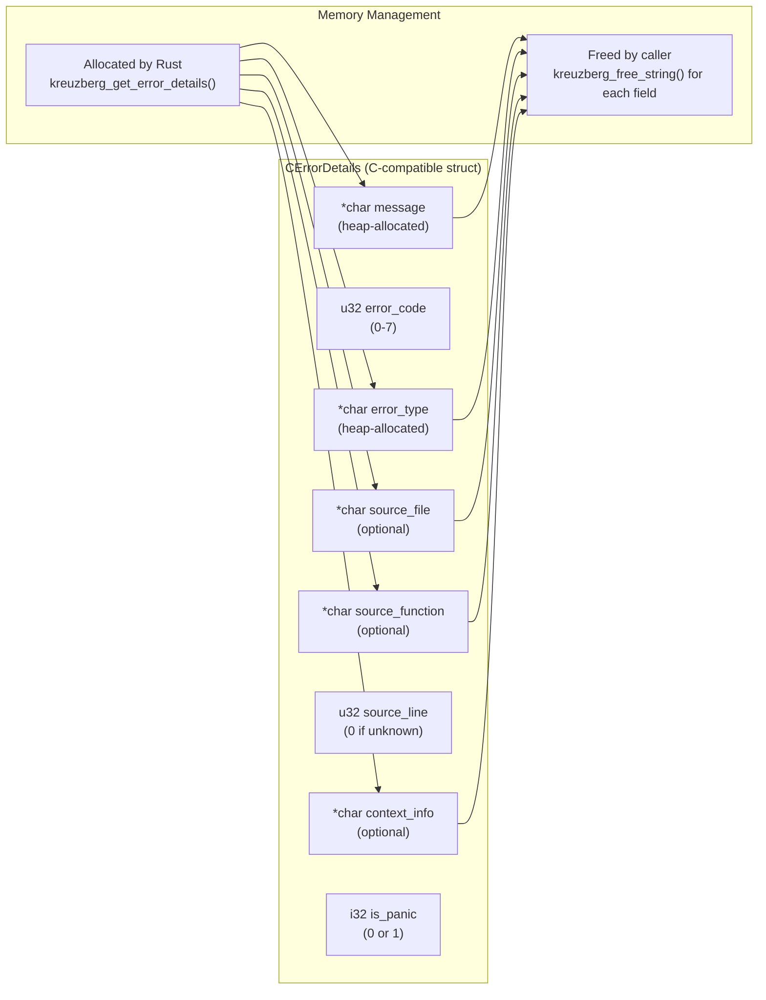
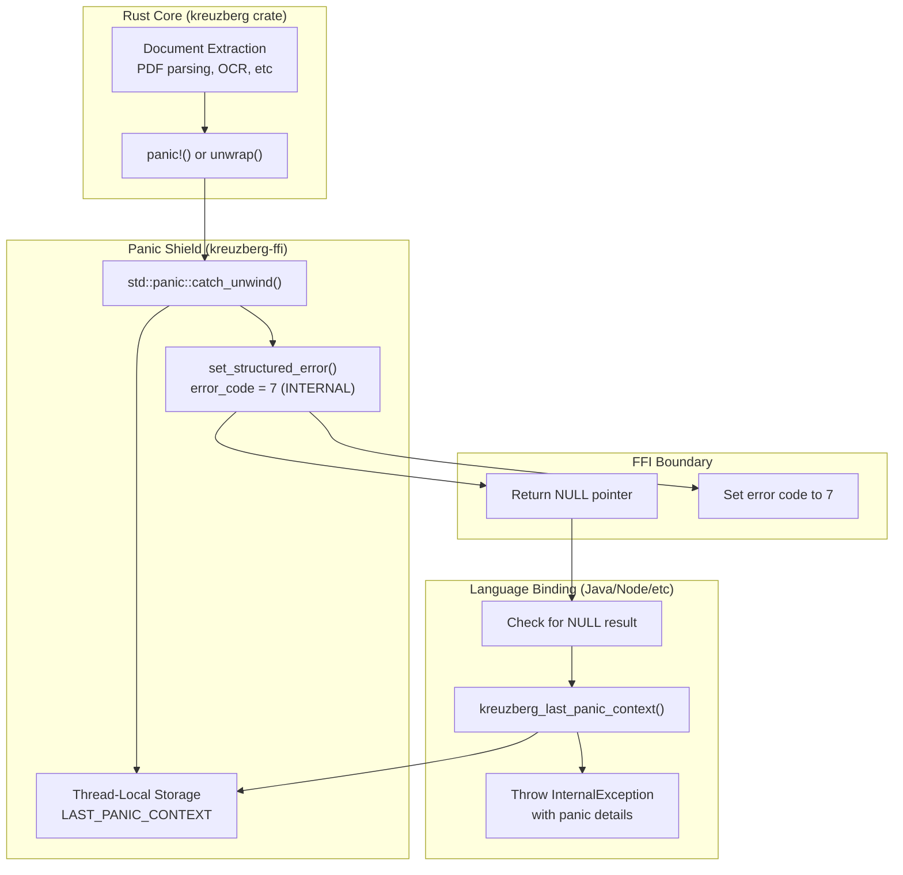
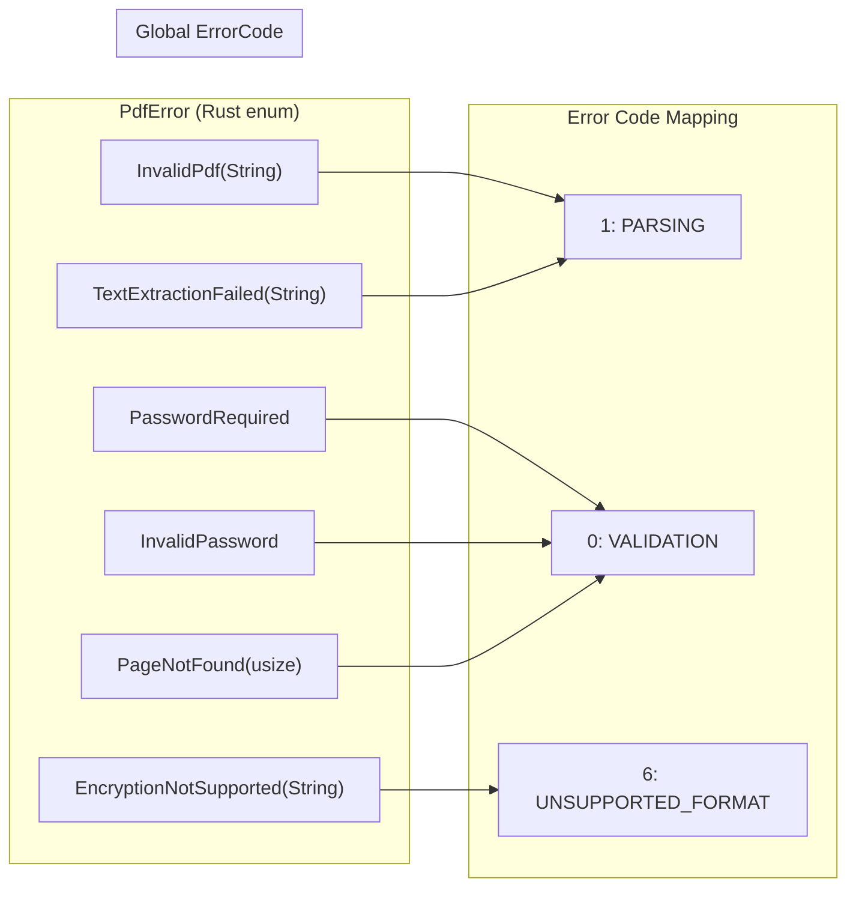
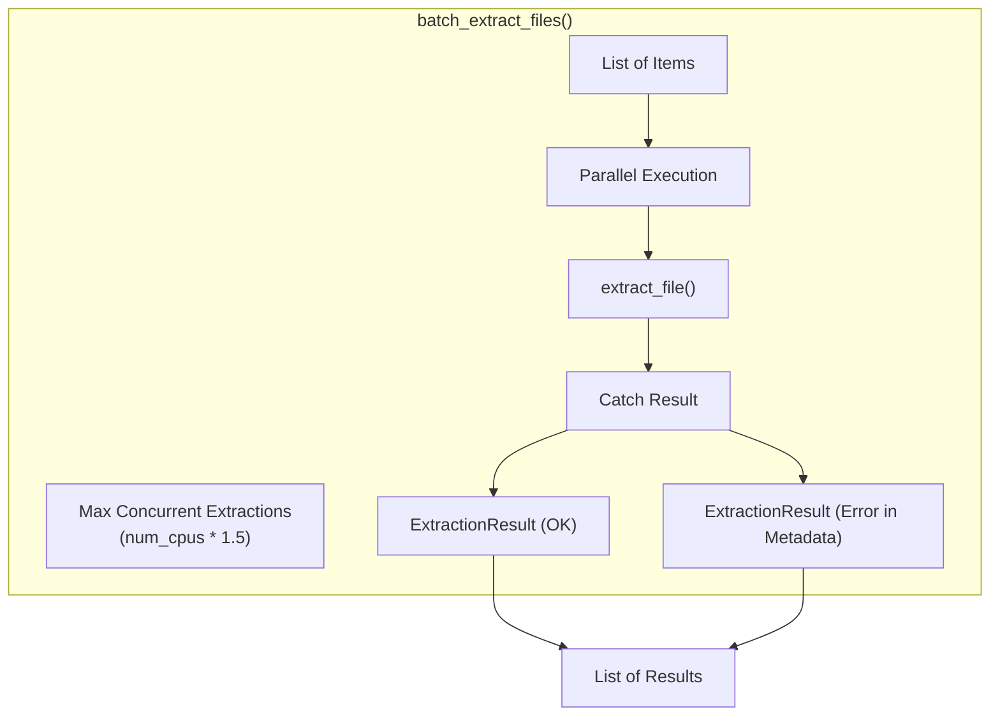

<!-- source: DeepWiki mcp.deepwiki.com · repo kreuzberg-dev/kreuzberg · page 3.5 Error Handling and Types · fetched 2026-10-27 -->

# Error Handling and Types

Relevant source files

The following files were used as context for generating this wiki page:

- [audit-notes/csharp.md](audit-notes/csharp.md)
- [audit-notes/dart.md](audit-notes/dart.md)
- [audit-notes/elixir.md](audit-notes/elixir.md)
- [audit-notes/go.md](audit-notes/go.md)
- [audit-notes/java.md](audit-notes/java.md)
- [audit-notes/kotlin-android.md](audit-notes/kotlin-android.md)
- [audit-notes/node.md](audit-notes/node.md)
- [audit-notes/other-bindings.md](audit-notes/other-bindings.md)
- [audit-notes/php.md](audit-notes/php.md)
- [audit-notes/python.md](audit-notes/python.md)
- [audit-notes/r.md](audit-notes/r.md)
- [audit-notes/ruby.md](audit-notes/ruby.md)
- [audit-notes/swift.md](audit-notes/swift.md)
- [audit-notes/zig.md](audit-notes/zig.md)
- [crates/kreuzberg-cli/src/commands/cache.rs](crates/kreuzberg-cli/src/commands/cache.rs)
- [crates/kreuzberg-ffi/tests/email_attachment_data_len.rs](crates/kreuzberg-ffi/tests/email_attachment_data_len.rs)
- [crates/kreuzberg/src/core/config/extraction/file_config.rs](crates/kreuzberg/src/core/config/extraction/file_config.rs)
- [crates/kreuzberg/src/core/config/extraction/loaders.rs](crates/kreuzberg/src/core/config/extraction/loaders.rs)
- [crates/kreuzberg/src/core/io.rs](crates/kreuzberg/src/core/io.rs)
- [crates/kreuzberg/src/error.rs](crates/kreuzberg/src/error.rs)
- [crates/kreuzberg/src/extractors/code.rs](crates/kreuzberg/src/extractors/code.rs)
- [crates/kreuzberg/src/keywords/config.rs](crates/kreuzberg/src/keywords/config.rs)
- [crates/kreuzberg/src/ocr/tessdata_manager.rs](crates/kreuzberg/src/ocr/tessdata_manager.rs)
- [docker/Dockerfile.cli](docker/Dockerfile.cli)
- [docker/Dockerfile.musl-build](docker/Dockerfile.musl-build)
- [docker/Dockerfile.musl-ffi](docker/Dockerfile.musl-ffi)
- [docker/Dockerfile.musl-rustler](docker/Dockerfile.musl-rustler)
- [docs/reference/api-c.md](docs/reference/api-c.md)
- [docs/reference/api-csharp.md](docs/reference/api-csharp.md)
- [docs/reference/api-elixir.md](docs/reference/api-elixir.md)
- [docs/reference/api-go.md](docs/reference/api-go.md)
- [docs/reference/api-java.md](docs/reference/api-java.md)
- [docs/reference/api-php.md](docs/reference/api-php.md)
- [docs/reference/api-python.md](docs/reference/api-python.md)
- [docs/reference/api-r.md](docs/reference/api-r.md)
- [docs/reference/api-ruby.md](docs/reference/api-ruby.md)
- [docs/reference/api-rust.md](docs/reference/api-rust.md)
- [docs/reference/api-typescript.md](docs/reference/api-typescript.md)
- [docs/reference/api-wasm.md](docs/reference/api-wasm.md)
- [docs/reference/configuration.md](docs/reference/configuration.md)
- [docs/reference/errors.md](docs/reference/errors.md)
- [docs/reference/types.md](docs/reference/types.md)
- [scripts/ci/r/vendor-kreuzberg-core.py](scripts/ci/r/vendor-kreuzberg-core.py)
- [scripts/ci/ruby/vendor-kreuzberg-core.py](scripts/ci/ruby/vendor-kreuzberg-core.py)
- [scripts/install.sh](scripts/install.sh)

This page explains Kreuzberg's error handling architecture, focusing on how errors are classified, propagated across FFI boundaries, and mapped to language-specific exceptions. Error handling is critical in a polyglot system where Rust panics must be safely caught before crossing into C, Java, Node.js, and other language runtimes.

For plugin-related error handling, see [Plugin System](#5). For configuration validation errors, see [Configuration System](#3.4).

## Error Classification System

Kreuzberg categorizes all errors into eight structured error codes, enabling consistent error handling across all language bindings. Each error code represents a distinct failure category with specific semantics.

### Error Code Enumeration

**Sources:** [docs/reference/errors.md:1-1](), [packages/java/src/main/java/dev/kreuzberg/KreuzbergException.java:15-30]()

### Error Code Constants

The FFI layer exposes error code constants as functions to avoid ABI compatibility issues across compilers. These are used by the code generation tool `alef` to synchronize types across the workspace.

| Function | Code | Description | Example Triggers |
|----------|------|-------------|------------------|
| `kreuzberg_error_code_validation()` | 0 | Input validation error | Invalid MIME type, invalid paths [docs/reference/api-csharp.md:25-25]() |
| `kreuzberg_error_code_parsing()` | 1 | Document parsing failed | Malformed PDF, corrupted DOCX |
| `kreuzberg_error_code_ocr()` | 2 | OCR operation failed | Tesseract crash, invalid image format |
| `kreuzberg_error_code_missing_dependency()` | 3 | Required library missing | PDFium not found, ONNX Runtime missing |
| `kreuzberg_error_code_io()` | 4 | I/O operation failed | File not found, permission denied [docs/reference/api-go.md:64-64]() |
| `kreuzberg_error_code_plugin()` | 5 | Plugin execution error | Custom extractor threw exception |
| `kreuzberg_error_code_unsupported_format()` | 6 | Format not supported | Unknown MIME type, disabled feature [docs/reference/api-java.md:26-26]() |
| `kreuzberg_error_code_internal()` | 7 | Internal error | Rust panic, assertion failure |

**Sources:** [docs/reference/errors.md:1-1](), [docs/reference/api-python.md:25-26](), [docs/reference/api-rust.md:25-26]()

## Structured Error Details

Kreuzberg provides rich error metadata through the `CErrorDetails` structure, enabling diagnostic information to flow across FFI boundaries without data loss.

### CErrorDetails Structure

**Sources:** [docs/reference/api-c.md:1-1](), [packages/java/src/main/java/dev/kreuzberg/KreuzbergFFI.java:382-386]()

## Panic Shield Mechanism

The panic shield catches Rust panics at the FFI boundary, preventing undefined behavior when panics propagate into foreign language runtimes.

### Panic Handling Architecture

**Sources:** [docs/reference/errors.md:1-1](), [packages/java/src/main/java/dev/kreuzberg/KreuzbergFFI.java:382-396]()

## Language-Specific Error Mapping

Each language binding maps Kreuzberg error codes to idiomatic exception types. The code generation system ensures that error types are generated consistently across Python, Node, Ruby, and other targets.

### Java Exception Hierarchy

In Java, errors are mapped to a `record` or `class` based on the `workspace.dto` configuration.

```mermaid
graph TB
    KreuzbergException["KreuzbergException<br/>(base class)"]
    
    ValidationException["ValidationException<br/>ErrorCode.VALIDATION"]
    ParsingException["ParsingException<br/>ErrorCode.PARSING"]
    OcrException["OcrException<br/>ErrorCode.OCR"]
    MissingDependencyException["MissingDependencyException<br/>ErrorCode.MISSING_DEPENDENCY"]
    IOException["IOException<br/>ErrorCode.IO"]
    PluginException["PluginException<br/>ErrorCode.PLUGIN"]
    UnsupportedFormatException["UnsupportedFormatException<br/>ErrorCode.UNSUPPORTED_FORMAT"]
    InternalException["InternalException<br/>ErrorCode.INTERNAL"]
    
    KreuzbergException --> ValidationException
    KreuzbergException --> ParsingException
    KreuzbergException --> OcrException
    KreuzbergException --> MissingDependencyException
    KreuzbergException --> IOException
    KreuzbergException --> PluginException
    KreuzbergException --> UnsupportedFormatException
    KreuzbergException --> InternalException
```

**Sources:** [docs/reference/errors.md:1-1](), [packages/java/src/main/java/dev/kreuzberg/KreuzbergException.java:14-48]()

### Language Binding Strategies

| Language | DTO Style | Async Strategy | Source Citation |
|----------|-----------|----------------|-----------------|
| Python | `dataclass` | `asyncio` | [audit-notes/python.md:1-1]() |
| Node.js | `interface` | `Promise` | [audit-notes/node.md:1-1]() |
| Ruby | `struct` | Synchronous | [audit-notes/ruby.md:1-1]() |
| Java | `record` | `CompletableFuture` | [audit-notes/java.md:1-1]() |
| C# | `record` | `Task` | [audit-notes/csharp.md:1-1]() |
| Go | `struct` | `error` return | [audit-notes/go.md:1-1]() |
| Elixir | `struct` | `{:ok, result} | {:error, reason}` | [audit-notes/elixir.md:1-1]() |
| PHP | `class` | `DeferredResult` | [audit-notes/php.md:1-1]() |
| R | `list` | Synchronous | [audit-notes/r.md:1-1]() |
| Swift | `struct` | `async/await` | [audit-notes/swift.md:1-1]() |
| Dart | `class` | `Future` | [audit-notes/dart.md:1-1]() |
| Kotlin | `data class` | `suspend` | [audit-notes/kotlin-android.md:1-1]() |
| Zig | `struct` | `error` return | [audit-notes/zig.md:1-1]() |

**Sources:** [audit-notes/python.md:1-1](), [audit-notes/node.md:1-1](), [audit-notes/ruby.md:1-1](), [audit-notes/java.md:1-1](), [audit-notes/csharp.md:1-1](), [audit-notes/go.md:1-1](), [audit-notes/elixir.md:1-1](), [audit-notes/php.md:1-1](), [audit-notes/r.md:1-1](), [audit-notes/swift.md:1-1](), [audit-notes/dart.md:1-1](), [audit-notes/kotlin-android.md:1-1](), [audit-notes/zig.md:1-1]()

## Format-Specific Error Types

Individual document processors define their own error types that are mapped to the global error classification.

### PDF Error Handling

PDF extraction uses PDFium and can fail due to missing dependencies, password protection, or malformed content.

**Sources:** [crates/kreuzberg/src/error.rs:1-1](), [docs/reference/api-rust.md:62-65]()

## Error Recovery Patterns

### Batch Extraction Error Isolation

Batch operations such as `batch_extract_files` capture individual file errors in the result metadata, preventing a single failure from aborting the entire batch [docs/reference/api-csharp.md:217-218]().

**Sources:** [docs/reference/api-python.md:217-218](), [docs/reference/api-go.md:217-218](), [docs/reference/api-java.md:217-218]()

### Synchronous Wrappers and Runtime Errors

For languages like Java and Python, synchronous wrappers (e.g., `extract_file_sync`) utilize a global Tokio runtime to avoid the overhead of creating a new runtime per call [docs/reference/api-java.md:92-93](). If a runtime cannot be initialized, an `Internal` error is propagated.

**Sources:** [docs/reference/api-python.md:92-93](), [docs/reference/api-rust.md:92-93]()

---

