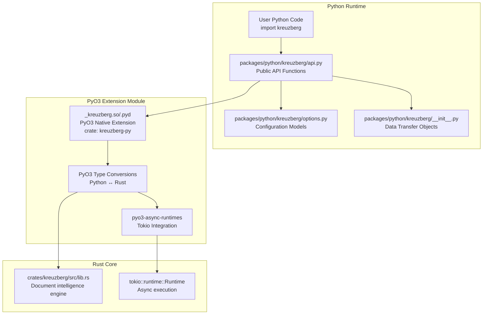
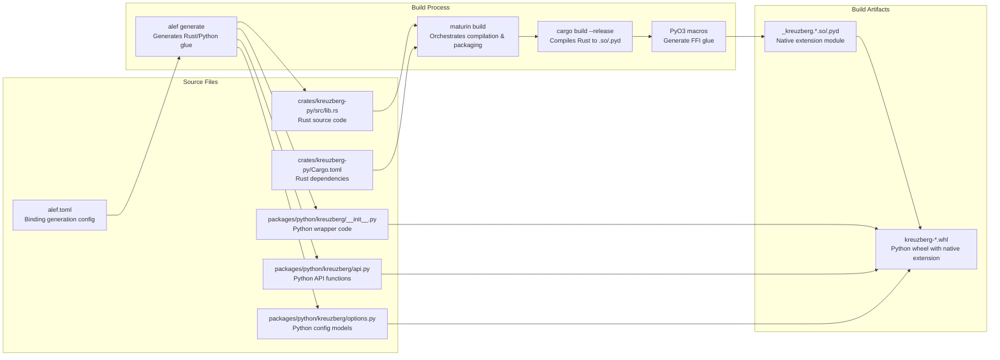
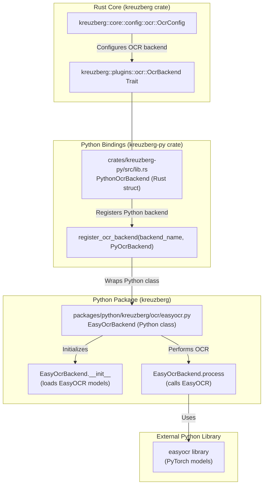

<!-- source: DeepWiki mcp.deepwiki.com · repo kreuzberg-dev/kreuzberg · page 4.1 Python Bindings · fetched 2026-10-27 -->

# Python Bindings

<details>
<summary>Relevant source files</summary>

The following files were used as context for generating this wiki page:

- [alef.toml](alef.toml)
- [audit-notes/csharp.md](audit-notes/csharp.md)
- [audit-notes/dart.md](audit-notes/dart.md)
- [audit-notes/elixir.md](audit-notes/elixir.md)
- [audit-notes/go.md](audit-notes/go.md)
- [audit-notes/java.md](audit-notes/java.md)
- [audit-notes/kotlin-android.md](audit-notes/kotlin-android.md)
- [audit-notes/node.md](audit-notes/node.md)
- [audit-notes/other-bindings.md](audit-notes/other-bindings.md)
- [audit-notes/php.md](audit-notes/php.md)
- [audit-notes/python.md](audit-notes/python.md)
- [audit-notes/r.md](audit-notes/r.md)
- [audit-notes/ruby.md](audit-notes/ruby.md)
- [audit-notes/swift.md](audit-notes/swift.md)
- [audit-notes/zig.md](audit-notes/zig.md)
- [crates/kreuzberg-ffi/Cargo.toml](crates/kreuzberg-ffi/Cargo.toml)
- [crates/kreuzberg-ffi/include/kreuzberg.h](crates/kreuzberg-ffi/include/kreuzberg.h)
- [crates/kreuzberg-ffi/src/lib.rs](crates/kreuzberg-ffi/src/lib.rs)
- [crates/kreuzberg-ffi/tests/email_attachment_data_len.rs](crates/kreuzberg-ffi/tests/email_attachment_data_len.rs)
- [crates/kreuzberg-node/Cargo.toml](crates/kreuzberg-node/Cargo.toml)
- [crates/kreuzberg-node/index.d.ts](crates/kreuzberg-node/index.d.ts)
- [crates/kreuzberg-node/src/lib.rs](crates/kreuzberg-node/src/lib.rs)
- [crates/kreuzberg-php/src/lib.rs](crates/kreuzberg-php/src/lib.rs)
- [crates/kreuzberg-py/Cargo.toml](crates/kreuzberg-py/Cargo.toml)
- [crates/kreuzberg-py/src/lib.rs](crates/kreuzberg-py/src/lib.rs)
- [crates/kreuzberg-wasm/src/lib.rs](crates/kreuzberg-wasm/src/lib.rs)
- [e2e/rust/Cargo.toml](e2e/rust/Cargo.toml)
- [packages/elixir/native/kreuzberg_nif/src/lib.rs](packages/elixir/native/kreuzberg_nif/src/lib.rs)
- [packages/php/src/Kreuzberg.php](packages/php/src/Kreuzberg.php)
- [packages/php/stubs/kreuzberg_extension.php](packages/php/stubs/kreuzberg_extension.php)
- [packages/python/kreuzberg/__init__.py](packages/python/kreuzberg/__init__.py)
- [packages/python/kreuzberg/_kreuzberg.pyi](packages/python/kreuzberg/_kreuzberg.pyi)
- [packages/python/kreuzberg/api.py](packages/python/kreuzberg/api.py)
- [packages/python/kreuzberg/options.py](packages/python/kreuzberg/options.py)
- [packages/r/src/rust/src/lib.rs](packages/r/src/rust/src/lib.rs)
- [packages/ruby/ext/kreuzberg_rb/src/lib.rs](packages/ruby/ext/kreuzberg_rb/src/lib.rs)
- [packages/ruby/kreuzberg.gemspec](packages/ruby/kreuzberg.gemspec)
- [packages/swift/rust/src/lib.rs](packages/swift/rust/src/lib.rs)
- [packages/typescript/src/index.ts](packages/typescript/src/index.ts)

</details>


This page documents the Python binding implementation for Kreuzberg, covering the PyO3 FFI layer, maturin build system, installation methods, and common usage patterns. For general Python API usage examples, see the [Quick Start Examples](#2.2). For deployment as a library within Python applications, see [Deployment](#7).

## Overview

The Python bindings expose Kreuzberg's Rust core through a native extension module built with PyO3. This approach provides:

- **Native performance** - Direct FFI calls to Rust code with minimal overhead.
- **Type safety** - PyO3's type conversion system enforces type safety at the boundary.
- **Async support** - Integration with Python's asyncio via `pyo3-async-runtimes`.
- **ABI3 compatibility** - Single wheel works across Python 3.10-3.14+ (stable ABI).
- **Cross-platform** - Pre-built wheels for Linux (x86_64, aarch64), macOS (x86_64, ARM64), and Windows (x86_64).

The implementation consists of two layers:
1. Low-level Rust extension (`_kreuzberg`) - PyO3 FFI bridge to Kreuzberg core.
2. High-level Python API (`kreuzberg` package) - User-facing classes and functions.

Sources: [crates/kreuzberg-py/src/lib.rs:1-100](), [alef.toml:197-198]()

## Architecture



**Architecture Overview - Python Bindings**

The Python bindings use PyO3 to bridge Python and Rust. The `_kreuzberg` extension module exposes Rust functions and types to Python with automatic type conversion. The `pyo3-async-runtimes` crate enables Python's `asyncio` to interoperate with Tokio, allowing async Rust functions to be called from Python async code. The `alef` tool generates the `_kreuzberg` module and the Python wrapper code in `packages/python/kreuzberg/`.

Sources: [crates/kreuzberg-py/src/lib.rs:1-100](), [packages/python/kreuzberg/api.py:1-205](), [packages/python/kreuzberg/__init__.py:10-148](), [alef.toml:197-198]()

## Build System - Maturin



**Maturin Build Pipeline**

Maturin is the build frontend that orchestrates compilation and packaging. The project uses `maturin` as the build-backend [alef.toml:27](). The `alef generate` command is used to generate the Rust FFI code in `crates/kreuzberg-py/src/lib.rs` and the Python wrapper code in `packages/python/kreuzberg/` based on the public API defined in the main `kreuzberg` crate [alef.toml:95-167]().

The `crates/kreuzberg-py/Cargo.toml` specifies:
- `crate-type = ["cdylib"]` - Builds a C dynamic library for Python [crates/kreuzberg-py/Cargo.toml:21]().
- `name = "_kreuzberg"` - The Python import name for the extension [crates/kreuzberg-py/Cargo.toml:21]().
- `extension-module = ["pyo3/extension-module", "pyo3/abi3-py310"]` - Enables stable ABI for Python 3.10+ compatibility [crates/kreuzberg-py/Cargo.toml:25]().

Sources: [alef.toml:1-198](), [crates/kreuzberg-py/Cargo.toml:1-35](), [crates/kreuzberg-py/src/lib.rs:1-48]()

## EasyOCR Support

Kreuzberg provides specialized support for EasyOCR within the Python environment. This allows the Rust core to delegate OCR tasks to the popular Python-based EasyOCR library when required.



**EasyOCR Integration Flow**

The integration allows Kreuzberg to leverage Python's machine learning ecosystem (PyTorch/EasyOCR) while maintaining the performance of the Rust core for document parsing and structure analysis. The `EasyOcrBackend` Python class [packages/python/kreuzberg/ocr/easyocr.py:1-100]() implements the necessary interface to be registered as an OCR backend with the Rust core via the `register_ocr_backend` function [packages/python/kreuzberg/api.py:190](). This allows the Rust core to dispatch OCR tasks to the Python implementation.

Sources: [packages/python/kreuzberg/ocr/easyocr.py:1-100](), [packages/python/kreuzberg/api.py:190](), [alef.toml:159]()

## Usage Patterns

The Python bindings support both synchronous and asynchronous extraction patterns.

**Synchronous Extraction:**
```python
from kreuzberg import extract_file

result = extract_file("document.pdf")
print(result.content)
```
The `extract_file` function [packages/python/kreuzberg/api.py:173]() is a synchronous wrapper around the Rust core's extraction logic.

**Asynchronous Extraction:**
```python
import asyncio
from kreuzberg import extract_file_async

async def main():
    result = await extract_file_async("document.pdf")
    print(result.content)

asyncio.run(main())
```
The `extract_file_async` function [packages/python/kreuzberg/api.py:174]() leverages `pyo3-async-runtimes` [crates/kreuzberg-py/Cargo.toml:31]() to provide a native Python awaitable that resolves when the Rust Tokio task completes. This allows seamless integration with Python's `asyncio` event loop.

Sources: [packages/python/kreuzberg/api.py:173-174](), [crates/kreuzberg-py/Cargo.toml:31]()

## Performance and Memory

**GIL Management:**
PyO3 allows the Rust core to release the Global Interpreter Lock (GIL) during heavy processing (e.g., PDF parsing, OCR, or embedding generation). This ensures that Kreuzberg does not block other Python threads. The `pyo3-async-runtimes` crate handles the necessary GIL management for asynchronous operations.

**Memory Handling:**
- Large document buffers are managed in Rust memory and only converted to Python `bytes` or `str` objects at the final extraction stage.
- The `ExtractionResult` object and other data transfer objects (DTOs) are generated by `alef` as Python `dataclass` or `typed-dict` types [alef.toml:34-35](), wrapping the structured data returned from the Rust core.

Sources: [crates/kreuzberg-py/src/lib.rs:1-100](), [crates/kreuzberg-py/Cargo.toml:31](), [alef.toml:34-35]()

## Development Workflow

| Task | Command | Purpose |
|------|---------|---------|
| Build extension | `maturin develop` | Compile and install locally for testing |
| Build release wheel | `maturin build --release` | Create optimized wheel for distribution |
| Run tests | `pytest packages/python/tests` | Execute Python test suite |
| Type checking | `mypy packages/python` | Static type checking for Python code |
| Linting | `ruff check packages/python` | Code quality and style checks |

Sources: [alef.toml:27]()

---

