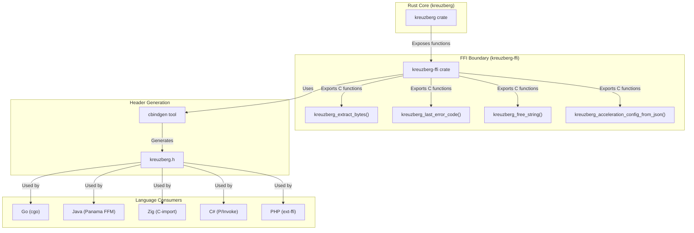
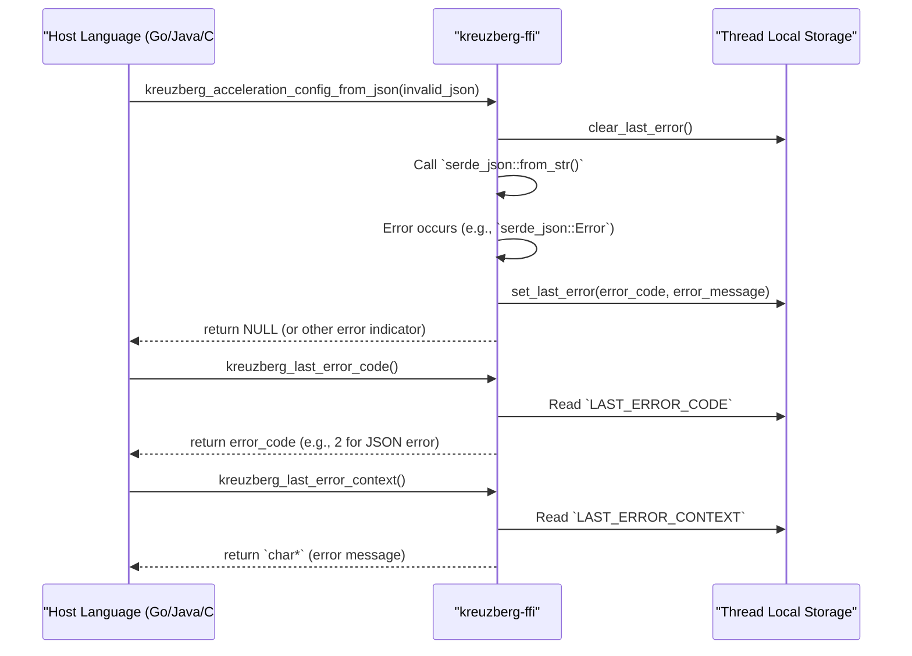

<!-- source: DeepWiki mcp.deepwiki.com · repo kreuzberg-dev/kreuzberg · page 4.11 FFI Layer (kreuzberg-ffi) · fetched 2026-10-27 -->

# FFI Layer (kreuzberg-ffi)

<details>
<summary>Relevant source files</summary>

The following files were used as context for generating this wiki page:

- [crates/kreuzberg-ffi/Cargo.toml](crates/kreuzberg-ffi/Cargo.toml)
- [crates/kreuzberg-ffi/README.md](crates/kreuzberg-ffi/README.md)
- [crates/kreuzberg-ffi/build.rs](crates/kreuzberg-ffi/build.rs)
- [crates/kreuzberg-ffi/cbindgen.toml](crates/kreuzberg-ffi/cbindgen.toml)
- [crates/kreuzberg-node/Cargo.toml](crates/kreuzberg-node/Cargo.toml)
- [crates/kreuzberg-py/Cargo.toml](crates/kreuzberg-py/Cargo.toml)
- [packages/r/README.md](packages/r/README.md)

</details>


The `kreuzberg-ffi` crate provides C-compatible Foreign Function Interface (FFI) bindings for the Kreuzberg document intelligence library. This layer enables integration with languages that support C FFI, including Java (Panama FFM API), Go (cgo), C# (P/Invoke), PHP (ext-ffi), Zig, and direct C usage. While some bindings use high-level toolkits (like PyO3 or NAPI-RS), `kreuzberg-ffi` serves as the universal ABI bridge for native integration.

**Sources:** [crates/kreuzberg-ffi/Cargo.toml:1-10](), [crates/kreuzberg-ffi/README.md:73-74]()

## Architecture Overview

The FFI layer acts as a thin wrapper around the `kreuzberg` core, managing the transition between Rust's ownership model and C's manual memory management.


**Diagram: FFI Architecture and Data Flow**

**Sources:** [crates/kreuzberg-ffi/Cargo.toml:1-10](), [crates/kreuzberg-ffi/build.rs:5-7](), [crates/kreuzberg-ffi/README.md:90-99]()

## Memory Management Across FFI

Memory management is the most critical aspect of the FFI layer. The library follows a "creator-frees" pattern where the library provides explicit `free` functions for any memory it allocates on the heap.

### Allocation and Deallocation Patterns

| Data Type | Allocation Mechanism | Deallocation Function |
|-----------|----------------------|-----------------------|
| Strings (`char*`) | `CString::into_raw` | `kreuzberg_free_string` |
| Byte Buffers (`u8*`) | `Vec::into_raw_parts` | `kreuzberg_free_bytes` |
| Config Objects | `Box::into_raw` | `kreuzberg_acceleration_config_free` |

### Code Implementation Detail
The library uses `Box::into_raw` to pass ownership of Rust structs to the host language as opaque pointers, and `Box::from_raw` to reclaim and drop that memory. For example, `KREUZBERGAccelerationConfig` is allocated on the heap and its pointer is returned:
```rust
#[no_mangle]
pub extern "C" fn kreuzberg_acceleration_config_from_json(json_ptr: *const c_char) -> *mut KREUZBERGAccelerationConfig {
    // ...
    Box::into_raw(Box::new(config))
}
```
[crates/kreuzberg-ffi/src/lib.rs:123-130]()

Similarly, to free it:
```rust
#[no_mangle]
pub extern "C" fn kreuzberg_acceleration_config_free(ptr: *mut KREUZBERGAccelerationConfig) {
    if ptr.is_null() {
        return;
    }
    // Reconstruct the Box and let it drop, freeing the memory
    unsafe { Box::from_raw(ptr) };
}
```
[crates/kreuzberg-ffi/src/lib.rs:166-173]()

### String and Byte Handling
Strings returned to the caller are converted from Rust `String` to `CString` and then to a raw pointer.
```rust
fn to_c_string(s: String) -> *mut c_char {
    CString::new(s)
        .expect("Failed to convert string to CString")
        .into_raw()
}
```
[crates/kreuzberg-ffi/src/lib.rs:148-154]()

For deallocation, the library provides safe wrappers:
- `kreuzberg_free_string(ptr: *mut c_char)`: Reconstructs `CString` and drops it. [crates/kreuzberg-ffi/src/lib.rs:66-73]()
- `kreuzberg_free_bytes(ptr: *mut u8, len: usize, cap: usize)`: Reconstructs `Vec` and drops it. [crates/kreuzberg-ffi/src/lib.rs:82-90]()

**Sources:** [crates/kreuzberg-ffi/src/lib.rs:62-90](), [crates/kreuzberg-ffi/src/lib.rs:123-130](), [crates/kreuzberg-ffi/src/lib.rs:166-173]()

## Error Handling

Errors are managed via thread-local storage (TLS) to ensure thread safety without requiring the caller to pass error buffers into every function.


**Diagram: Thread-Local Error Propagation**

**Key Entities:**
- `LAST_ERROR_CODE`: A `thread_local` `RefCell<i32>` storing the last error code. [crates/kreuzberg-ffi/src/lib.rs:30-30]()
- `LAST_ERROR_CONTEXT`: A `thread_local` `RefCell<Option<CString>>` storing the last error message. [crates/kreuzberg-ffi/src/lib.rs:31-31]()
- `kreuzberg_last_error_code()`: Exported function to retrieve the error code. [crates/kreuzberg-ffi/src/lib.rs:49-51]()
- `kreuzberg_last_error_context()`: Exported function to retrieve the error message. [crates/kreuzberg-ffi/src/lib.rs:58-60]()

**Sources:** [crates/kreuzberg-ffi/src/lib.rs:29-60]()

## Header Generation and Build System

The FFI layer uses `cbindgen` to automatically generate the C header file `kreuzberg.h`. This ensures that the Rust implementation and the C interface are always in sync.

### build.rs Integration
The build script `crates/kreuzberg-ffi/build.rs` performs two primary actions:
1. Generates `include/kreuzberg.h` in the FFI crate directory. [crates/kreuzberg-ffi/build.rs:5-7]()
2. Copies the generated header to the Go package directory (`packages/go/v5/include`) to facilitate Cgo builds. [crates/kreuzberg-ffi/build.rs:19-22]()
3. Sets `@rpath-relative install_name` on macOS for `cdylib` to allow relocation of the shared library. [crates/kreuzberg-ffi/build.rs:9-17]()

### cbindgen.toml Configuration
The generation is controlled by `crates/kreuzberg-ffi/cbindgen.toml`, which defines:
- **Language**: C
- **Include Guard**: `KREUZBERG_H`
- **Pragma**: `pragma_once = true`
- **Autogen Warning**: A comment indicating the file is auto-generated.
- **`after_includes`**: This section is used to provide opaque type forward declarations for all public structs, prefixed with `KREUZBERG` to avoid namespace collisions in C. For example, `KREUZBERGAccelerationConfig` is declared here. [crates/kreuzberg-ffi/cbindgen.toml:3-151]()

**Sources:** [crates/kreuzberg-ffi/build.rs:1-23](), [crates/kreuzberg-ffi/cbindgen.toml:1-151]()

## Integration Examples

### Go (Cgo)
Go integrates by linking against the shared library and including the generated header. The build script specifically copies the header to `packages/go/v5/include` to facilitate this.
[crates/kreuzberg-ffi/build.rs:19-22]()

### Node.js (NAPI-RS)
While `kreuzberg-node` uses `napi-rs` for its bindings, which abstracts away much of the direct C FFI interaction, the underlying `kreuzberg` crate is still the core. `napi-rs` handles the serialization/deserialization and memory management between JavaScript and Rust.
[crates/kreuzberg-node/Cargo.toml:22-26]()

### Python (PyO3)
Similar to Node.js, `kreuzberg-py` uses `PyO3` to create Python bindings. `PyO3` manages the FFI boundary, converting Rust types to Python objects and handling reference counting.
[crates/kreuzberg-py/Cargo.toml:29-34]()

### Zig
Zig integrates by using `@importC` on the `kreuzberg.h` header. The FFI layer provides a stable C ABI that Zig's native C interop consumes directly.
[packages/zig/README.md:1-10]() (referenced via table of contents context)

**Sources:** [crates/kreuzberg-ffi/build.rs:19-22](), [crates/kreuzberg-node/Cargo.toml:22-26](), [crates/kreuzberg-py/Cargo.toml:29-34]()

## Versioning and Metadata
The FFI layer exports the library version via `kreuzberg_version()`. This returns a static string derived from the `CARGO_PKG_VERSION` environment variable at compile time.
```rust
#[no_mangle]
pub extern "C" fn kreuzberg_version() -> *mut c_char {
    to_c_string(env!("CARGO_PKG_VERSION").to_string())
}
```
[crates/kreuzberg-ffi/src/lib.rs:97-100]()

**Sources:** [crates/kreuzberg-ffi/src/lib.rs:92-100]()

---

