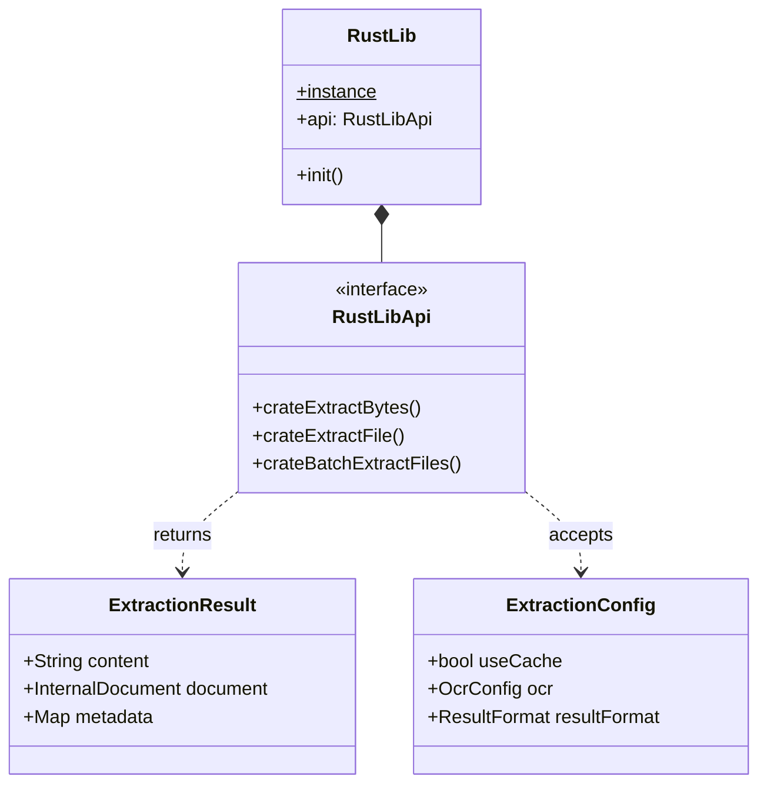

<!-- source: DeepWiki mcp.deepwiki.com · repo kreuzberg-dev/kreuzberg · page 4.13 Dart/Flutter Bindings · fetched 2026-10-27 -->

# Dart/Flutter Bindings

<details>
<summary>Relevant source files</summary>

The following files were used as context for generating this wiki page:

- [e2e/dart/test/plugin_api_test.dart](e2e/dart/test/plugin_api_test.dart)
- [packages/dart/README.md](packages/dart/README.md)
- [packages/dart/lib/src/kreuzberg.dart](packages/dart/lib/src/kreuzberg.dart)
- [packages/dart/lib/src/kreuzberg_bridge_generated/frb_generated.dart](packages/dart/lib/src/kreuzberg_bridge_generated/frb_generated.dart)
- [packages/dart/lib/src/kreuzberg_bridge_generated/frb_generated.io.dart](packages/dart/lib/src/kreuzberg_bridge_generated/frb_generated.io.dart)
- [packages/dart/lib/src/kreuzberg_bridge_generated/frb_generated.web.dart](packages/dart/lib/src/kreuzberg_bridge_generated/frb_generated.web.dart)
- [packages/dart/lib/src/kreuzberg_bridge_generated/lib.dart](packages/dart/lib/src/kreuzberg_bridge_generated/lib.dart)
- [packages/dart/lib/src/kreuzberg_bridge_generated/lib.freezed.dart](packages/dart/lib/src/kreuzberg_bridge_generated/lib.freezed.dart)
- [packages/dart/lib/src/traits.dart](packages/dart/lib/src/traits.dart)
- [packages/dart/pubspec.yaml](packages/dart/pubspec.yaml)
- [packages/dart/rust/src/frb_generated.rs](packages/dart/rust/src/frb_generated.rs)
- [packages/dart/rust/src/lib.rs](packages/dart/rust/src/lib.rs)
- [packages/php/composer.lock](packages/php/composer.lock)
- [packages/swift/README.md](packages/swift/README.md)
- [packages/zig/README.md](packages/zig/README.md)

</details>


The Kreuzberg Dart and Flutter bindings provide a high-performance document intelligence interface for Dart applications and Flutter mobile/desktop apps. It leverages `flutter_rust_bridge` (FRB) to provide a type-safe, asynchronous bridge to the Rust core, enabling complex document extraction, OCR, and metadata analysis directly on-device or in server-side Dart environments.

## Integration Architecture

The integration is built on `flutter_rust_bridge` version 2.12.0 [packages/dart/rust/src/frb_generated.rs:41-41](). This architecture avoids manual FFI boilerplate by generating Dart classes and Rust wrappers that handle data serialization (using SSE or DCO codecs) and cross-thread communication [packages/dart/rust/src/frb_generated.rs:36-40]().

### System Data Flow

The following diagram illustrates how a request from a Flutter UI or Dart script traverses the bridge to the Rust core and back.

**Dart to Rust Execution Flow**
```mermaid
graph TD
    subgraph "Dart Space"
        "UI/App" --> "KreuzbergBridge"
        "KreuzbergBridge" --> "RustLib.instance.api"
        "RustLib.instance.api" -- "SseCodec" --> "frb_generated.dart"
    end

    subgraph "FFI Layer"
        "frb_generated.dart" -- "Native FFI Call" --> "wire_funcs"
    end

    subgraph "Rust Space"
        "wire_funcs" -- "Deserialization" --> "crate_functions"
        "crate_functions" --> "kreuzberg_core"
        "kreuzberg_core" -- "InternalDocument" --> "crate_functions"
        "crate_functions" -- "Serialization" --> "wire_funcs"
    end

    "wire_funcs" -- "Dart_PostCObject" --> "RustLib.instance.api"
```
Sources: [packages/dart/lib/src/kreuzberg_bridge_generated/frb_generated.dart:15-34](), [packages/dart/rust/src/frb_generated.rs:50-91](), [packages/dart/lib/src/kreuzberg_bridge_generated/lib.dart:31-39]()

## Core API Components

The bindings expose the full power of the `kreuzberg` crate through the `KreuzbergBridge` class and generated API surface.

### Extraction Interface
The primary entry points for processing documents are:

*   **`extractBytes`**: Processes in-memory document data. It validates MIME types, selects the appropriate extractor, and runs the post-processing pipeline [packages/dart/lib/src/kreuzberg.dart:48-50]().
*   **`extractFile`**: Processes files from the local filesystem. This method includes automatic MIME detection and integrated caching support [packages/dart/lib/src/kreuzberg.dart:88-90]().
*   **`batchExtractFiles`**: Parallelized extraction for multiple files, optimized for performance via the global Tokio runtime [packages/dart/lib/src/kreuzberg_bridge_generated/lib.dart:120-125]().

### Configuration Mapping
Rust's `ExtractionConfig` is mirrored into Dart, allowing granular control over the pipeline [packages/dart/rust/src/lib.rs:184-185]().

| Dart/Rust Field | Type | Description |
| :--- | :--- | :--- |
| `ocr` | `OcrConfig?` | Configures backend (Tesseract/Paddle) and language [packages/dart/rust/src/lib.rs:216-226](). |
| `layout` | `LayoutDetectionConfig?` | Controls table and structure detection [packages/dart/rust/src/lib.rs:150-156](). |
| `structuredExtraction` | `StructuredExtractionConfig?` | Enables LLM-based extraction into JSON schemas [packages/dart/rust/src/lib.rs:169-177](). |
| `includeDocumentStructure` | `bool` | Whether to return a hierarchical node tree [packages/dart/rust/src/lib.rs:64-64](). |

Sources: [packages/dart/rust/src/lib.rs:184-185](), [packages/dart/lib/src/kreuzberg.dart:48-50](), [packages/dart/lib/src/kreuzberg.dart:88-90]()

## Code Entity Mapping

The following diagram maps the high-level system components to the specific code entities implementing the bridge.

**Bridge Implementation Mapping**

Sources: [packages/dart/lib/src/kreuzberg_bridge_generated/frb_generated.dart:15-78](), [packages/dart/rust/src/lib.rs:184-185](), [packages/dart/lib/src/kreuzberg.dart:48-50](), [packages/dart/lib/src/kreuzberg.dart:88-90]()

## Flutter Plugin Packaging

### Native Dependencies
The Dart package bundles the Rust core as a native library (`.so` for Android, `.dylib` for macOS/iOS, `.dll` for Windows). The build process uses the `kreuzberg_dart` stem to generate the shared library [packages/dart/lib/src/kreuzberg_bridge_generated/frb_generated.dart:167-167]().

### Initialization
Before usage in a Flutter app, the bridge must be initialized. This loads the native library and sets up the FRB handlers:

```dart
import 'package:kreuzberg/src/kreuzberg_bridge_generated/frb_generated.dart';

void main() async {
  await RustLib.init(); // Loads native binary [packages/dart/lib/src/kreuzberg_bridge_generated/frb_generated.dart:117-130]
  runApp(MyApp());
}
```
Sources: [packages/dart/lib/src/kreuzberg_bridge_generated/frb_generated.dart:117-130]()

### Async Patterns
All major API calls return `Future` objects. While the Rust core is multi-threaded, the Dart bindings provide both async and sync wrappers. The sync wrappers (e.g., `extractFileSync`) use a global Tokio runtime to prevent thread blocking while maintaining high performance [packages/dart/lib/src/kreuzberg.dart:114-116]().

Sources: [packages/dart/lib/src/kreuzberg.dart:114-116]()

## Platform Distribution

The package is designed for distribution via **pub.dev**.

1.  **Android/iOS**: Native binaries are compiled for `aarch64` and `x86_64` and packaged within the plugin's `android/src/main/jniLibs` and iOS framework structures. The `_alefResolveExternalLibrary` function attempts to locate the native library in platform-specific directories based on the Runtime Identifier (RID) [packages/dart/lib/src/kreuzberg_bridge_generated/frb_generated.dart:60-81]().
2.  **Desktop**: Supports Windows, macOS, and Linux via native FFI loading. The `_alefResolveExternalLibrary` function checks for `libkreuzberg_dart.dylib`, `libkreuzberg_dart.so`, and `kreuzberg_dart.dll` in various locations, including environment variables and package-installed paths [packages/dart/lib/src/kreuzberg_bridge_generated/frb_generated.dart:43-55]().
3.  **WASM**: Support for Dart Web is provided through `frb_generated.web.dart`, though certain filesystem-dependent features (like `extractFile`) are unavailable in this environment [packages/dart/lib/src/kreuzberg_bridge_generated/frb_generated.dart:14-14]().

Sources: [packages/dart/lib/src/kreuzberg_bridge_generated/frb_generated.dart:14-14](), [packages/dart/lib/src/kreuzberg_bridge_generated/frb_generated.dart:43-55](), [packages/dart/lib/src/kreuzberg_bridge_generated/frb_generated.dart:60-81]()

---

