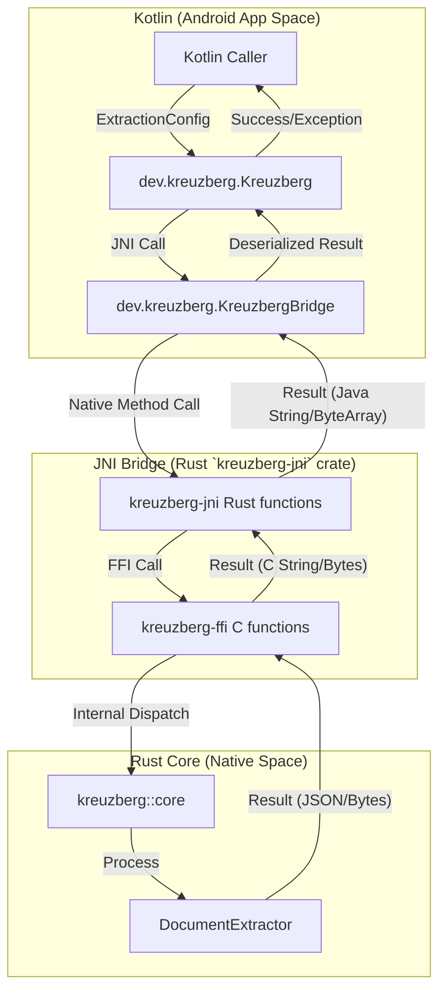
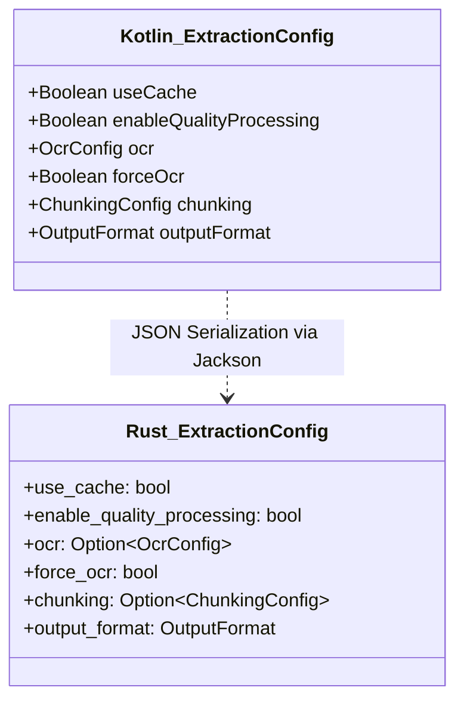

<!-- source: DeepWiki mcp.deepwiki.com · repo kreuzberg-dev/kreuzberg · page 4.14 Kotlin (Android) Bindings · fetched 2026-10-27 -->

# Kotlin (Android) Bindings

<details>
<summary>Relevant source files</summary>

The following files were used as context for generating this wiki page:

- [crates/kreuzberg-jni/Cargo.toml](crates/kreuzberg-jni/Cargo.toml)
- [crates/kreuzberg-jni/src/lib.rs](crates/kreuzberg-jni/src/lib.rs)
- [e2e/kotlin_android/src/test/kotlin/dev/kreuzberg/e2e/ContractTest.kt](e2e/kotlin_android/src/test/kotlin/dev/kreuzberg/e2e/ContractTest.kt)
- [e2e/kotlin_android/src/test/kotlin/dev/kreuzberg/e2e/EmbedAsyncPendingTest.kt](e2e/kotlin_android/src/test/kotlin/dev/kreuzberg/e2e/EmbedAsyncPendingTest.kt)
- [packages/kotlin-android/src/main/kotlin/dev/kreuzberg/ChunkingConfig.kt](packages/kotlin-android/src/main/kotlin/dev/kreuzberg/ChunkingConfig.kt)
- [packages/kotlin-android/src/main/kotlin/dev/kreuzberg/DocumentNode.kt](packages/kotlin-android/src/main/kotlin/dev/kreuzberg/DocumentNode.kt)
- [packages/kotlin-android/src/main/kotlin/dev/kreuzberg/FormatMetadata.kt](packages/kotlin-android/src/main/kotlin/dev/kreuzberg/FormatMetadata.kt)
- [packages/kotlin-android/src/main/kotlin/dev/kreuzberg/Kreuzberg.kt](packages/kotlin-android/src/main/kotlin/dev/kreuzberg/Kreuzberg.kt)
- [packages/kotlin-android/src/main/kotlin/dev/kreuzberg/KreuzbergBridge.kt](packages/kotlin-android/src/main/kotlin/dev/kreuzberg/KreuzbergBridge.kt)
- [packages/kotlin-android/src/main/kotlin/dev/kreuzberg/OutputFormat.kt](packages/kotlin-android/src/main/kotlin/dev/kreuzberg/OutputFormat.kt)

</details>


The Kotlin (Android) bindings for Kreuzberg provide a high-performance document intelligence interface for mobile applications. These bindings leverage the Rust core via the Java Native Interface (JNI), allowing Android developers to perform complex document extraction, OCR, and MIME detection directly on-device.

## Overview and JNI Integration

Kreuzberg's Android support is built upon a JNI bridge that connects the Kotlin/Java layer to the `kreuzberg-ffi` crate. This architecture ensures that memory-intensive operations like PDF parsing and OCR are handled by the optimized Rust core while remaining accessible through standard Kotlin classes.

### Data Flow Architecture

The following diagram illustrates the lifecycle of an extraction request from a Kotlin caller down to the Rust core and back.

**Android Extraction Flow**

Sources: [crates/kreuzberg-jni/src/lib.rs:134-141](), [packages/kotlin-android/src/main/kotlin/dev/kreuzberg/Kreuzberg.kt:109-111](), [packages/kotlin-android/src/main/kotlin/dev/kreuzberg/KreuzbergBridge.kt:18-19]()

## Gradle Build Configuration

Integrating Kreuzberg into an Android project requires configuring the Gradle build system to include the native shared libraries (`.so` files) for the target architectures (typically `arm64-v8a`, `armeabi-v7a`, `x86_64`).

### Dependency Management

The library is distributed as an Android Archive (AAR), which bundles both the compiled Kotlin classes and the platform-specific native binaries.

| Component | Description |
| :--- | :--- |
| `dev.kreuzberg:kreuzberg-android` | The primary AAR dependency containing Kotlin bindings and JNI logic. |
| `kreuzberg_jni` | Bundled `.so` files for various ABIs (Application Binary Interfaces), loaded via `System.loadLibrary("kreuzberg_jni")`. |
| `Tokio Runtime` | The underlying Rust core uses a Tokio runtime for asynchronous operations. |

Sources: [crates/kreuzberg-jni/Cargo.toml:13-14](), [packages/kotlin-android/src/main/kotlin/dev/kreuzberg/KreuzbergBridge.kt:16]()

## Core API Usage

The Kotlin API mirrors the core Kreuzberg functionality, providing both synchronous and asynchronous extraction methods.

### Extraction Entry Points

The primary interface is the `dev.kreuzberg.Kreuzberg` object, which provides static methods for document processing:

*   `extractBytes`: Processes in-memory byte arrays. [packages/kotlin-android/src/main/kotlin/dev/kreuzberg/Kreuzberg.kt:109-111]()
*   `extractBytesAsync`: Asynchronous version of `extractBytes` using `kotlinx.coroutines.Dispatchers.IO`. [packages/kotlin-android/src/main/kotlin/dev/kreuzberg/Kreuzberg.kt:134-135]()
*   `extractFile`: Processes files from the Android filesystem. [packages/kotlin-android/src/main/kotlin/dev/kreuzberg/Kreuzberg.kt:158-160]()
*   `extractFileAsync`: Asynchronous version of `extractFile`. [packages/kotlin-android/src/main/kotlin/dev/kreuzberg/Kreuzberg.kt:183-184]()

Example usage:
```kotlin
// e2e/kotlin_android/src/test/kotlin/dev/kreuzberg/e2e/ContractTest.kt:26-32
@Test
fun testApiBatchBytesAsync() = runBlocking {
    // Tests async batch bytes extraction API (batch_extract_bytes)
    val result = Kreuzberg.extractFile("pdf/fake_memo.pdf", null, Config())
    assertEquals("application/pdf", result.mimeType.trim())
    assertTrue(result.content.length >= 10, "expected length >= 10")
    assertTrue(result.content.contains("May 5, 2023") || result.content.contains("Mallori"), "expected to contain at least one of the specified values")
}
```

### Configuration Mapping

Kotlin developers interact with configuration data classes like `ExtractionConfig`, `OcrConfig`, `ChunkingConfig`, etc., which are serialized to JSON and passed to the Rust core.

**Entity Mapping: Kotlin to Rust**

Sources: [packages/kotlin-android/src/main/kotlin/dev/kreuzberg/Kreuzberg.kt:109-110](), [packages/kotlin-android/src/main/kotlin/dev/kreuzberg/ChunkingConfig.kt:34-96](), [packages/kotlin-android/src/main/kotlin/dev/kreuzberg/OutputFormat.kt:35-53]()

## Android-Specific Deployment Considerations

### Memory Management
Android environments are resource-constrained. The `kreuzberg-jni` crate uses `jbyteArray` and `jstring` for data transfer. For byte arrays, the Kotlin wrapper encodes bytes as Base64 strings to pass through JNI, which is then decoded in Rust. This avoids direct `ByteBuffer` manipulation across the FFI boundary for simplicity, but adds a Base64 encoding/decoding overhead.
[crates/kreuzberg-jni/src/lib.rs:158-161]()

### Native Library Loading
The `KreuzbergBridge` object handles the internal `System.loadLibrary("kreuzberg_jni")` call in its `init` block. [packages/kotlin-android/src/main/kotlin/dev/kreuzberg/KreuzbergBridge.kt:16]() Developers should ensure that their ProGuard/R8 rules do not strip the JNI native methods or the classes they reference.

### OCR Backends
On Android, the Tesseract OCR backend is typically preferred over PaddleOCR due to the smaller footprint of Tesseract's native binaries and the lack of ONNX Runtime acceleration on some mobile chipsets. The `OcrConfig` should be tuned accordingly:

| Config Field | Android Recommendation |
| :--- | :--- |
| `backend` | `OcrBackendType.TESSERACT` |
| `useCache` | `true` (to avoid redundant processing in mobile UI loops) |
| `threads` | Limited to 2-4 to avoid thermal throttling |

## Error Handling

Exceptions from the Rust core (such as `UnsupportedFormat` or `OcrError`) are caught at the JNI layer and re-thrown as `dev.kreuzberg.KreuzbergBridgeException`. [crates/kreuzberg-jni/src/lib.rs:45-52]()

| Rust Error | Kotlin Exception | Description |
| :--- | :--- | :--- |
| `KreuzbergError::Io` | `KreuzbergBridgeException` | Triggered if the file path is inaccessible on Android. |
| `KreuzbergError::Validation` | `KreuzbergBridgeException` | Triggered by invalid MIME types or malformed config. |

Sources: [crates/kreuzberg-jni/src/lib.rs:45-52](), [packages/kotlin-android/src/main/kotlin/dev/kreuzberg/KreuzbergBridge.kt:18]()

---

