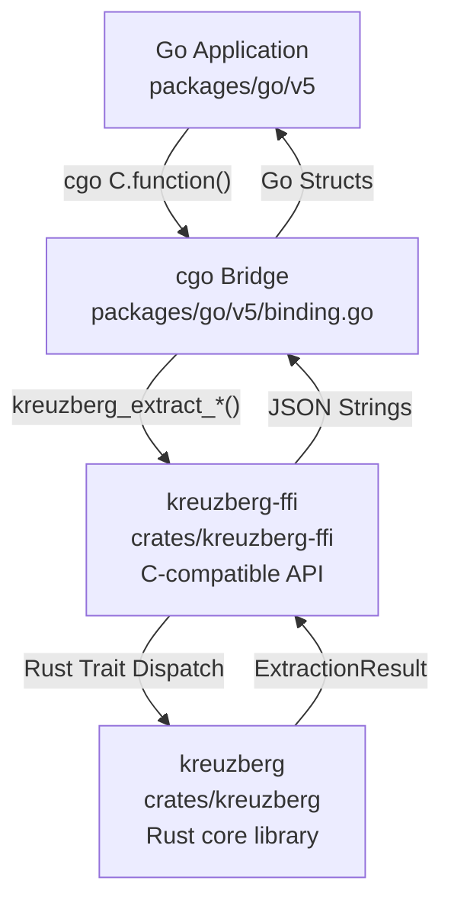
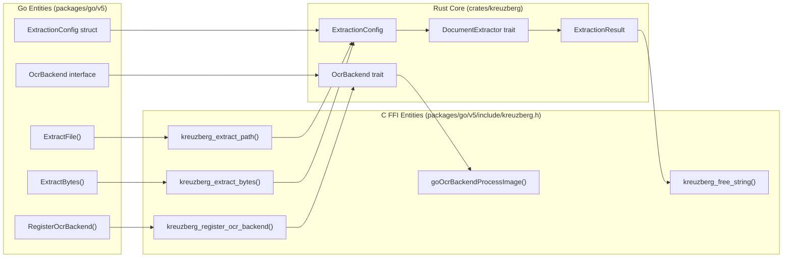
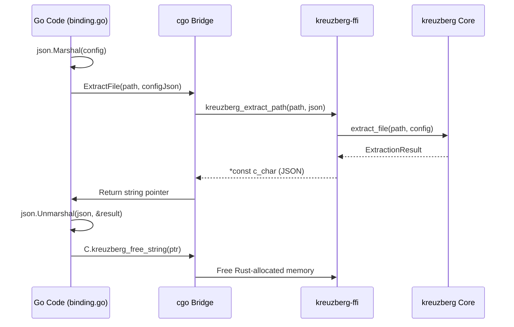

<!-- source: DeepWiki mcp.deepwiki.com · repo kreuzberg-dev/kreuzberg · page 4.5 Go Bindings · fetched 2026-10-27 -->

# Go Bindings

<details>
<summary>Relevant source files</summary>

The following files were used as context for generating this wiki page:

- [e2e/elixir/test/plugin_api_test.exs](e2e/elixir/test/plugin_api_test.exs)
- [e2e/elixir/test_syntax_check.exs](e2e/elixir/test_syntax_check.exs)
- [e2e/go/go.mod](e2e/go/go.mod)
- [e2e/java/src/test/java/dev/kreuzberg/e2e/PluginApiTest.java](e2e/java/src/test/java/dev/kreuzberg/e2e/PluginApiTest.java)
- [e2e/php/tests/PluginApiTest.php](e2e/php/tests/PluginApiTest.php)
- [e2e/ruby/spec/plugin_api_spec.rb](e2e/ruby/spec/plugin_api_spec.rb)
- [e2e/rust/tests/plugin_api_test.rs](e2e/rust/tests/plugin_api_test.rs)
- [packages/elixir/lib/kreuzberg/html_theme.ex](packages/elixir/lib/kreuzberg/html_theme.ex)
- [packages/elixir/lib/kreuzberg/ocr_bounding_geometry.ex](packages/elixir/lib/kreuzberg/ocr_bounding_geometry.ex)
- [packages/elixir/lib/kreuzberg/table_model.ex](packages/elixir/lib/kreuzberg/table_model.ex)
- [packages/go/v5/binding.go](packages/go/v5/binding.go)
- [packages/go/v5/include/kreuzberg.h](packages/go/v5/include/kreuzberg.h)
- [packages/go/v5/trait_bridges.go](packages/go/v5/trait_bridges.go)

</details>


This page documents the Go language bindings for Kreuzberg, which provide access to the document intelligence framework through `cgo` and the C FFI layer. The bindings enable Go applications to extract text, metadata, and structured information from over 75 document formats.

For information about the underlying C FFI layer used by all language bindings, see [FFI Layer (kreuzberg-ffi)](#4.11).

## Architecture Overview

The Go bindings connect to Kreuzberg's Rust core through a three-layer architecture utilizing the `kreuzberg-ffi` crate.

### System Architecture Diagram


Unlike Python (PyO3) [crates/kreuzberg-py/src/lib.rs:53-56](), Node.js (NAPI-RS) [crates/kreuzberg-node/src/lib.rs:49-52](), or Ruby (Magnus) [packages/ruby/ext/kreuzberg_rb/src/lib.rs:25-29](), which use high-level language-specific FFI frameworks, Go bindings utilize `cgo` to call exported C functions. This requires:

1. The `kreuzberg-ffi` shared library (`.so`, `.dylib`, or `.dll`) to be built and accessible at runtime.
2. C header files generated by `cbindgen` from the FFI crate.
3. Proper `LDFLAGS` and `CPPFLAGS` configuration in the Go source.

**Sources:** [packages/go/v5/binding.go:1-20](), [e2e/go/go.mod:1-11]()

## Package Structure and Integration

The Go package is located at `packages/go/v5`. It provides a high-level wrapper over the raw C calls, handling JSON serialization/deserialization and memory management.

### Code Entity Association


The `packages/go/v5/binding.go` file contains the `cgo` directives for linking against the `kreuzberg_ffi` library, specifying different library paths for various operating systems and architectures [packages/go/v5/binding.go:10-15](). This file is auto-generated by `alef` [packages/go/v5/binding.go:1-3]().

The `packages/go/v5/trait_bridges.go` file, also auto-generated, defines the Go interfaces for various plugin traits (e.g., `OcrBackend`, `PostProcessor`, `Validator`, `EmbeddingBackend`, `DocumentExtractor`, `Renderer`) and the C functions that bridge calls from Rust back into Go implementations of these interfaces [packages/go/v5/trait_bridges.go:1-73](). This enables Go to implement and register custom plugins with the Rust core. A `handleRegistry` is used to manage `cgo.Handle` instances for registered plugins, ensuring proper cleanup and preventing use-after-free issues [packages/go/v5/trait_bridges.go:84-129]().

**Sources:** [packages/go/v5/binding.go:5-30](), [e2e/go/go.mod:10-10](), [packages/go/v5/trait_bridges.go:1-129]()

## Data Flow and Memory Management

The Go bindings follow a specific pattern for handling data across the FFI boundary:

1.  **Configuration**: Go structs (like `ExtractionConfig`) are serialized to JSON strings before being passed to C.
2.  **Execution**: The FFI layer invokes the Rust core [crates/kreuzberg-node/src/lib.rs:57-62]().
3.  **Result Handling**: The FFI layer returns a `*const c_char` containing a JSON representation of the `ExtractionResult`.
4.  **Memory Cleanup**: Go code copies the string into Go-managed memory and immediately calls `kreuzberg_free_string()` to prevent memory leaks in the Rust heap.

The `unmarshalBytes` function is used to convert a C byte buffer (treated as a NUL-terminated string) into a Go `[]byte` slice [packages/go/v5/binding.go:47-52](). For binary payloads that might contain interior NULs, the FFI should expose an explicit length parameter.

### Sequence Diagram: Document Extraction


**Sources:** [crates/kreuzberg-node/src/lib.rs:103-127](), [packages/ruby/ext/kreuzberg_rb/src/lib.rs:30-62](), [packages/go/v5/binding.go:47-52]()

## Go-Specific Error Handling

Errors from the Rust core are propagated through the FFI layer as part of the JSON response or via specific return codes. The Go bindings map these to a structured `error` type. The `lastError()` function retrieves the last error code and context message from the FFI layer [packages/go/v5/binding.go:29-40]().

The `kreuzberg` package defines a set of predefined error variables (e.g., `ErrIo`, `ErrParsing`, `ErrOcr`) [packages/go/v5/binding.go:65-96]() and a generic `Error` struct for structured error details [packages/go/v5/binding.go:99-103]().

| Rust Error Type | Go Mapping | Description |
|-----------------|------------|-------------|
| `IoError` | `kreuzberg.ErrIo` | Filesystem or network IO failures |
| `ParsingError` | `kreuzberg.ErrParsing` | Document format corruption or parsing logic failure |
| `OcrError` | `kreuzberg.ErrOcr` | Failures in Tesseract or PaddleOCR backends |
| `Validation` | `kreuzberg.ErrValidation` | Validation error |
| `Cache` | `kreuzberg.ErrCache` | Cache error |
| `ImageProcessing` | `kreuzberg.ErrImageProcessing` | Image processing error |
| `Serialization` | `kreuzberg.ErrSerialization` | Serialization error |
| `MissingDependency` | `kreuzberg.ErrMissingDependency` | Missing dependency |
| `Plugin` | `kreuzberg.ErrPlugin` | Plugin error |
| `LockPoisoned` | `kreuzberg.ErrLockPoisoned` | Lock poisoned |
| `UnsupportedFormatError` | `kreuzberg.ErrUnsupportedFormat` | File type not supported by any registered extractor |
| `Embedding` | `kreuzberg.ErrEmbedding` | Embedding error |
| `Timeout` | `kreuzberg.ErrTimeout` | Extraction timed out |
| `Cancelled` | `kreuzberg.ErrCancelled` | Extraction cancelled |
| `Security` | `kreuzberg.ErrSecurity` | Security violation |
| `Other` | `kreuzberg.ErrOther` | Other unspecified error |

**Sources:** [packages/python/kreuzberg/__init__.py:92-127](), [crates/kreuzberg-node/src/lib.rs:122-126](), [packages/go/v5/binding.go:29-40](), [packages/go/v5/binding.go:65-103]()

## Platform Support and Constraints

### Windows MinGW Constraints
Go's `cgo` on Windows typically requires the MinGW toolchain. There is a known constraint regarding ONNX Runtime (used for embeddings and layout detection): ONNX Runtime's Windows distribution is optimized for MSVC.

When building the Go bindings on Windows:
1.  Use the `core` feature flag to exclude heavy ONNX dependencies if using MinGW.
2.  Ensure `libkreuzberg_ffi.dll` is in the system `PATH` or the same directory as the Go binary.

**Sources:** [packages/r/src/rust/src/lib.rs:28-33](), [crates/kreuzberg-wasm/src/lib.rs:51-54]()

## Example Usage

```go
package main

import (
    "fmt"
    "github.com/kreuzberg-dev/kreuzberg/v5/packages/go/v5"
)

func main() {
    config := kreuzberg.DefaultExtractionConfig()
    config.Ocr.Enabled = true
    
    // Extract text from a local PDF
    result, err := kreuzberg.ExtractFile("document.pdf", config)
    if err != nil {
        panic(err)
    }
    
    fmt.Printf("Extracted Text: %s\n", result.Content)
    fmt.Printf("MIME Type: %s\n", result.Metadata.MimeType)
}
```

**Sources:** [e2e/go/go.mod:1-11](), [packages/go/v5/binding.go:1-15]()

---

