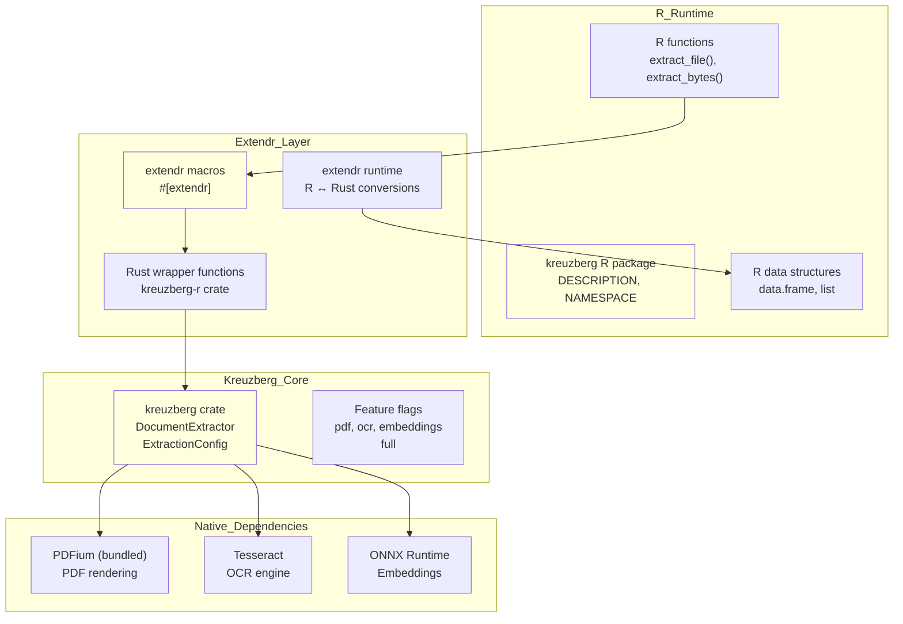
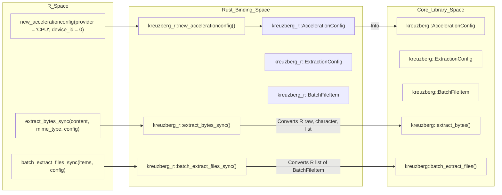

<!-- source: DeepWiki mcp.deepwiki.com · repo kreuzberg-dev/kreuzberg · page 4.9 R Bindings · fetched 2026-10-27 -->

# R Bindings

<details>
<summary>Relevant source files</summary>

The following files were used as context for generating this wiki page:

- [e2e/php/composer.json](e2e/php/composer.json)
- [e2e/rust/Cargo.lock](e2e/rust/Cargo.lock)
- [packages/r/NAMESPACE](packages/r/NAMESPACE)
- [packages/r/R/extendr-wrappers.R](packages/r/R/extendr-wrappers.R)
- [packages/r/src/rust/Cargo.lock](packages/r/src/rust/Cargo.lock)
- [packages/r/src/rust/Cargo.toml](packages/r/src/rust/Cargo.toml)
- [packages/ruby/lib/kreuzberg.rb](packages/ruby/lib/kreuzberg.rb)

</details>


This document describes the R language bindings for Kreuzberg, which enable R users to access Kreuzberg's document intelligence capabilities through an idiomatic R API. For information about other language bindings, see [Language Bindings](#4). For details about the underlying Rust core library, see [Overview](#1).

## Purpose and Scope

The R bindings provide native integration between R and the Kreuzberg Rust core library using the `extendr` framework. This enables R users to:

- Extract text, metadata, and structured data from 75+ document formats.
- Process documents with OCR capabilities (Tesseract, PaddleOCR).
- Generate embeddings and perform text chunking.
- Use sync APIs with R-native data structures (async is handled via the global Tokio runtime).
- Deploy precompiled binaries across Linux, macOS, and Windows platforms via r-universe.

The R bindings follow idiomatic R conventions while maintaining API parity with other language bindings.

**Sources:** [packages/r/src/rust/Cargo.toml:1-48](), [packages/r/src/rust/src/lib.rs:1-128]()

## Architecture Overview



The R bindings use a direct Rust integration strategy via `extendr`, avoiding the overhead of C FFI. This architecture provides type-safe conversions where `extendr` automatically handles the mapping between R's `SEXP` types and Rust types.

**Sources:** [packages/r/src/rust/Cargo.toml:15-43](), [packages/r/src/rust/src/lib.rs:19-26]()

## Extendr Integration and Type Mapping

### Framework Usage
The `kreuzberg-r` crate uses the `extendr-api` to expose Rust structs and functions to R. The `#[extendr]` macro is applied to structs like `ExtractionConfig` and `AccelerationConfig` to make them available as R classes.

**Sources:** [packages/r/src/rust/src/lib.rs:26-36](), [packages/r/src/rust/src/lib.rs:167-200]()

### Type Mapping Table

| R Type | Rust Type | Conversion Method / Usage |
|--------|-----------|-------------------|
| `character` | `String` | Used for `provider` in `new_accelerationconfig` [packages/r/src/rust/src/lib.rs:39-43]() |
| `integer` | `i32` | Used for `device_id` [packages/r/src/rust/src/lib.rs:32]() |
| `logical` | `bool` | Used for `use_cache` [packages/r/src/rust/src/lib.rs:170]() |
| `raw` | `Vec<u8>` | Standard `extendr` mapping for binary data |
| `list` | `Option<T>` | Used for optional nested configs like `ocr` [packages/r/src/rust/src/lib.rs:174]() |

## Package Structure

The R package is organized into a standard R structure with a Rust core:

- **`packages/r/NAMESPACE`**: Defines exported functions and S3 methods for R classes. This file is generated by `alef`. [packages/r/NAMESPACE:1-198]()
- **`packages/r/R/extendr-wrappers.R`**: Contains the R-side wrappers generated by `extendr`. This file binds the Rust functions to R-callable functions and class environments. [packages/r/R/extendr-wrappers.R:1-175162]()
- **`packages/r/src/rust/`**: The Rust crate (`kreuzberg-r`) that links to the core library.

### Rust Crate Configuration
The `Cargo.toml` for the R bindings enables a wide array of features to ensure full functionality within the R environment, including `pdf`, `ocr`, `embeddings`, and `tokio-runtime`.

**Sources:** [packages/r/src/rust/Cargo.toml:15-42]()

## Data Flow: R to Rust

The following diagram bridges the R function calls to the underlying Rust entities.



**Sources:** [packages/r/src/rust/src/lib.rs:28-50](), [packages/r/R/extendr-wrappers.R:28-30](), [packages/r/R/extendr-wrappers.R:85-85]()

## Key Data Structures

The R bindings expose various configuration and result structures as R S3 objects, allowing for idiomatic R usage with `$` and `[[` operators. These are automatically generated and exported in the `NAMESPACE` file.

### ExtractionConfig
The primary configuration object in the R bindings. It mirrors the core `ExtractionConfig` but uses `i32` for integer fields to remain compatible with R's default integer type.

| Field | Type | Description |
|-------|------|-------------|
| `use_cache` | `bool` | Enable/disable result caching [packages/r/src/rust/src/lib.rs:170]() |
| `ocr` | `Option<OcrConfig>` | OCR settings [packages/r/src/rust/src/lib.rs:174]() |
| `force_ocr_pages` | `Option<Vec<i32>>` | Specific pages to OCR [packages/r/src/rust/src/lib.rs:183]() |
| `disable_ocr` | `bool` | Skip OCR for all documents [packages/r/src/rust/src/lib.rs:193]() |

### AccelerationConfig
Controls hardware acceleration for ONNX models (Layout detection/Embeddings).

| Field | Type | Description |
|-------|------|-------------|
| `provider` | `ExecutionProviderType` | CPU, CUDA, CoreML, etc. [packages/r/src/rust/src/lib.rs:30]() |
| `device_id` | `i32` | GPU ID [packages/r/src/rust/src/lib.rs:32]() |

### BatchBytesItem and BatchFileItem
These structures are used for batch processing, allowing individual items in a batch to have their own configuration overrides.

| Field | Type | Description |
|-------|------|-------------|
| `content` | `Raw vector` | Raw bytes of the document (for `BatchBytesItem`) [packages/r/R/extendr-wrappers.R:92]() |
| `path` | `character` | Path to the file (for `BatchFileItem`) [packages/r/R/extendr-wrappers.R:88]() |
| `mime_type` | `character` | Optional MIME type override [packages/r/R/extendr-wrappers.R:92]() |
| `config` | `FileExtractionConfig` | Optional per-item configuration [packages/r/R/extendr-wrappers.R:93]() |

**Sources:** [packages/r/src/rust/src/lib.rs:28-33](), [packages/r/src/rust/src/lib.rs:168-193](), [packages/r/NAMESPACE:85-90]()

## Distribution and Installation

### r-universe
Kreuzberg R bindings are distributed via `r-universe`, which provides precompiled binaries for:
- **Windows**: x64
- **macOS**: Intel and Apple Silicon (ARM64)
- **Linux**: Various distributions via standard R package builds

This removes the requirement for users to have the Rust toolchain installed.

### Installation Command
```r
install.packages("kreuzberg", repos = "https://kreuzberg-dev.r-universe.dev")
```

## Error Handling

The R bindings use `extendr_api::Result` to propagate errors from Rust to R. When a Rust function returns an `Err` variant, `extendr` converts it into an R error (stop), providing the error message to the R console.

**Sources:** [packages/r/src/rust/src/lib.rs:19-20]()

## Comparison with Other Bindings

Unlike the Node.js or Python bindings which use dedicated worker pools or `asyncio` [crates/kreuzberg-node/src/lib.rs:57-62](), the R bindings rely on the `tokio-runtime` feature in the Rust core to manage concurrency synchronously from the R user's perspective while still utilizing multi-threaded performance internally. The `tokio-runtime` feature is explicitly enabled in the `kreuzberg-r` crate's `Cargo.toml`. [packages/r/src/rust/Cargo.toml:37-46]()

**Sources:** [packages/r/src/rust/Cargo.toml:37-46](), [crates/kreuzberg-node/src/lib.rs:57-62]()

---

