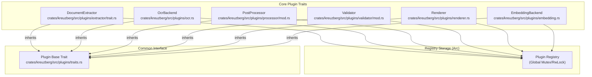
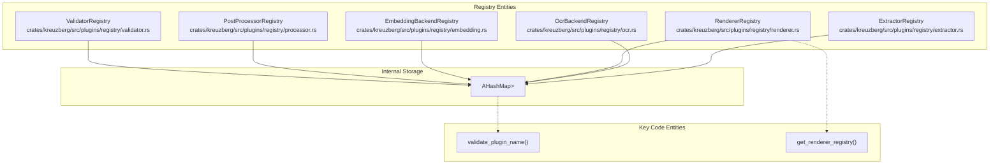
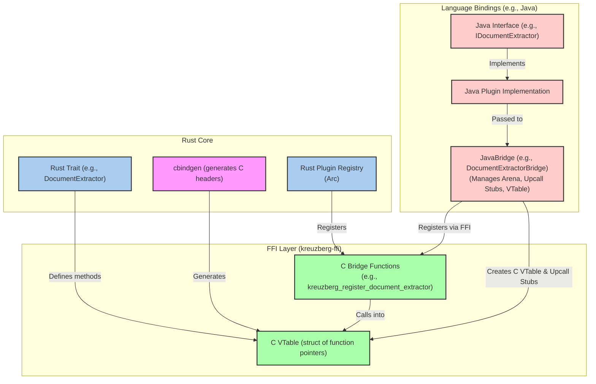
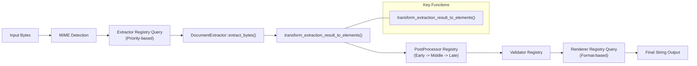

<!-- source: DeepWiki mcp.deepwiki.com · repo kreuzberg-dev/kreuzberg · page 5.1 Plugin Architecture · fetched 2026-10-27 -->

# Plugin Architecture

Relevant source files

The following files were used as context for generating this wiki page:

- [crates/kreuzberg/src/core/pipeline/tests.rs](crates/kreuzberg/src/core/pipeline/tests.rs)
- [crates/kreuzberg/src/extractors/djot_format/conversion.rs](crates/kreuzberg/src/extractors/djot_format/conversion.rs)
- [crates/kreuzberg/src/plugins/embedding.rs](crates/kreuzberg/src/plugins/embedding.rs)
- [crates/kreuzberg/src/plugins/extractor/mod.rs](crates/kreuzberg/src/plugins/extractor/mod.rs)
- [crates/kreuzberg/src/plugins/extractor/registry.rs](crates/kreuzberg/src/plugins/extractor/registry.rs)
- [crates/kreuzberg/src/plugins/extractor/trait.rs](crates/kreuzberg/src/plugins/extractor/trait.rs)
- [crates/kreuzberg/src/plugins/mod.rs](crates/kreuzberg/src/plugins/mod.rs)
- [crates/kreuzberg/src/plugins/ocr.rs](crates/kreuzberg/src/plugins/ocr.rs)
- [crates/kreuzberg/src/plugins/processor/mod.rs](crates/kreuzberg/src/plugins/processor/mod.rs)
- [crates/kreuzberg/src/plugins/registry/extractor.rs](crates/kreuzberg/src/plugins/registry/extractor.rs)
- [crates/kreuzberg/src/plugins/registry/ocr.rs](crates/kreuzberg/src/plugins/registry/ocr.rs)
- [crates/kreuzberg/src/plugins/registry/renderer.rs](crates/kreuzberg/src/plugins/registry/renderer.rs)
- [crates/kreuzberg/src/plugins/renderer.rs](crates/kreuzberg/src/plugins/renderer.rs)
- [crates/kreuzberg/src/plugins/validator/mod.rs](crates/kreuzberg/src/plugins/validator/mod.rs)
- [e2e/go/embed_async_pending_test.go](e2e/go/embed_async_pending_test.go)
- [e2e/java/src/test/java/dev/kreuzberg/e2e/EmbedAsyncPendingTest.java](e2e/java/src/test/java/dev/kreuzberg/e2e/EmbedAsyncPendingTest.java)
- [e2e/node/tests/embed_async_pending.test.ts](e2e/node/tests/embed_async_pending.test.ts)
- [e2e/php/tests/CodeTest.php](e2e/php/tests/CodeTest.php)
- [e2e/php/tests/EmbedAsyncPendingTest.php](e2e/php/tests/EmbedAsyncPendingTest.php)
- [e2e/php/tests/EmbedExtraTest.php](e2e/php/tests/EmbedExtraTest.php)
- [e2e/python/pyproject.toml](e2e/python/pyproject.toml)
- [e2e/python/tests/test_embed_async_pending.py](e2e/python/tests/test_embed_async_pending.py)
- [e2e/ruby/spec/embed_async_pending_spec.rb](e2e/ruby/spec/embed_async_pending_spec.rb)
- [e2e/ruby/spec/embed_extra_spec.rb](e2e/ruby/spec/embed_extra_spec.rb)
- [e2e/rust/tests/embed_async_pending_test.rs](e2e/rust/tests/embed_async_pending_test.rs)
- [e2e/zig/src/embed_async_pending_test.zig](e2e/zig/src/embed_async_pending_test.zig)
- [fixtures/batch/batch_extract_bytes_size_cap.json](fixtures/batch/batch_extract_bytes_size_cap.json)
- [fixtures/embed_async_pending/embed_texts_async_empty_input.json](fixtures/embed_async_pending/embed_texts_async_empty_input.json)
- [fixtures/embed_async_pending/embed_texts_async_happy.json](fixtures/embed_async_pending/embed_texts_async_happy.json)
- [fixtures/embed_async_pending/embed_texts_async_preset_switch.json](fixtures/embed_async_pending/embed_texts_async_preset_switch.json)
- [packages/java/dev/kreuzberg/DocumentExtractorBridge.java](packages/java/dev/kreuzberg/DocumentExtractorBridge.java)
- [packages/java/dev/kreuzberg/EmbeddingBackendBridge.java](packages/java/dev/kreuzberg/EmbeddingBackendBridge.java)
- [packages/java/dev/kreuzberg/OcrBackendBridge.java](packages/java/dev/kreuzberg/OcrBackendBridge.java)
- [packages/java/dev/kreuzberg/PostProcessorBridge.java](packages/java/dev/kreuzberg/PostProcessorBridge.java)
- [packages/java/dev/kreuzberg/RendererBridge.java](packages/java/dev/kreuzberg/RendererBridge.java)
- [packages/java/dev/kreuzberg/ValidatorBridge.java](packages/java/dev/kreuzberg/ValidatorBridge.java)

This page describes the extensible plugin architecture in Kreuzberg, covering the core plugin types (`DocumentExtractor`, `OcrBackend`, `PostProcessor`, `Validator`, `Renderer`, `EmbeddingBackend`) and the registry system that manages them across all language bindings.

## Purpose and Scope

The plugin system enables runtime extensibility without modifying core code. Users can register custom implementations through a unified registry API available in all language bindings. This architecture supports:

- Adding support for new document formats via `DocumentExtractor` [crates/kreuzberg/src/plugins/extractor/trait.rs:15-18]().
- Integrating custom OCR engines or cloud services via `OcrBackend` [crates/kreuzberg/src/plugins/ocr.rs:30-35]().
- Implementing document-specific transformations via `PostProcessor` [crates/kreuzberg/src/plugins/mod.rs:12]().
- Enforcing quality and validation rules via `Validator` [crates/kreuzberg/src/plugins/mod.rs:13]().
- Defining custom output formats via `Renderer` [crates/kreuzberg/src/plugins/renderer.rs:12-18]().
- Providing custom embedding models via `EmbeddingBackend` [crates/kreuzberg/src/plugins/mod.rs:10]().

Sources: [crates/kreuzberg/src/plugins/mod.rs:1-13](), [crates/kreuzberg/src/plugins/ocr.rs:30-35](), [crates/kreuzberg/src/plugins/extractor/trait.rs:15-18](), [crates/kreuzberg/src/plugins/renderer.rs:12-18]()

## Plugin Type Hierarchy

**Plugin Type Classification**: Every plugin must implement the base `Plugin` trait, which defines lifecycle methods like `initialize()` and `shutdown()` [crates/kreuzberg/src/plugins/mod.rs:79-85](). Plugins are stored in thread-safe registries using `Arc<dyn Trait>` [crates/kreuzberg/src/plugins/mod.rs:24-25]().

Sources: [crates/kreuzberg/src/plugins/mod.rs:1-13](), [crates/kreuzberg/src/plugins/mod.rs:24-25](), [crates/kreuzberg/src/plugins/mod.rs:79-85](), [crates/kreuzberg/src/plugins/renderer.rs:47-62]()

## Registry System Architecture

The registry system uses thread-safe collections (typically `AHashMap` protected by `RwLock` or `Mutex`) to manage plugin instances.

**Registry Implementation**:
- **Thread Safety**: Registries are designed for concurrent access [crates/kreuzberg/src/plugins/registry/ocr.rs:14-16]().
- **Validation**: Plugin names are validated during registration to ensure compatibility [crates/kreuzberg/src/plugins/registry/ocr.rs:166]().
- **Defaults**: Most registries automatically register built-in providers (e.g., Tesseract for OCR, Markdown for Rendering) unless initialized as empty [crates/kreuzberg/src/plugins/registry/ocr.rs:62-127](), [crates/kreuzberg/src/plugins/registry/renderer.rs:118-126]().

Sources: [crates/kreuzberg/src/plugins/registry/ocr.rs:14-16](), [crates/kreuzberg/src/plugins/registry/ocr.rs:28-30](), [crates/kreuzberg/src/plugins/registry/ocr.rs:62-127](), [crates/kreuzberg/src/plugins/registry/ocr.rs:166](), [crates/kreuzberg/src/plugins/registry/renderer.rs:87-89](), [crates/kreuzberg/src/plugins/registry/renderer.rs:118-126](), [crates/kreuzberg/src/plugins/registry/renderer.rs:149-156]()

## Core Plugin Protocols

### DocumentExtractor
Handles file format detection and content extraction. It returns an `InternalDocument`, which the pipeline later transforms into the public `ExtractionResult` [crates/kreuzberg/src/plugins/extractor/trait.rs:21-24]().

| Method | Purpose | Source |
|--------|---------|--------|
| `extract_bytes` | Core extraction from memory | [crates/kreuzberg/src/plugins/extractor/trait.rs:102-107]() |
| `extract_file` | Extraction from a file path | [crates/kreuzberg/src/plugins/extractor/trait.rs:127-144]() |
| `supported_mime_types` | MIME types or patterns (e.g., `image/*`) | [crates/kreuzberg/src/plugins/extractor/trait.rs:155]() |
| `priority` | Resolution when multiple extractors match (Default: 50) | [crates/kreuzberg/src/plugins/extractor/trait.rs:173]() |
| `can_handle` | Optional: More sophisticated detection beyond MIME types | [crates/kreuzberg/src/plugins/extractor/trait.rs:190-192]() |

### OcrBackend
Performs optical character recognition. It supports both raw bytes and file paths (via a default `tokio` implementation) [crates/kreuzberg/src/plugins/ocr.rs:161-190]().

| Method | Purpose | Source |
|--------|---------|--------|
| `process_image` | OCR on raw image data | [crates/kreuzberg/src/plugins/ocr.rs:161]() |
| `process_image_file` | OCR on an image file | [crates/kreuzberg/src/plugins/ocr.rs:176-190]() |
| `supports_language` | Check ISO 639-2/3 support | [crates/kreuzberg/src/plugins/ocr.rs:192]() |
| `backend_type` | Returns `OcrBackendType` enum | [crates/kreuzberg/src/plugins/ocr.rs:204]() |

### EmbeddingBackend
Provides text embedding capabilities.

| Method | Purpose | Source |
|--------|---------|--------|
| `dimensions` | Returns the dimension of the embeddings produced | [crates/kreuzberg/src/plugins/embedding.rs:100]() |
| `embed` | Embeds a list of texts into vectors | [crates/kreuzberg/src/plugins/embedding.rs:112]() |

### Renderer
Converts the `InternalDocument` AST into a final output string [crates/kreuzberg/src/plugins/renderer.rs:12-18]().

| Method | Purpose | Source |
|--------|---------|--------|
| `render` | Transform AST to String (Markdown, HTML, etc.) | [crates/kreuzberg/src/plugins/renderer.rs:61]() |

Sources: [crates/kreuzberg/src/plugins/extractor/trait.rs:80-201](), [crates/kreuzberg/src/plugins/ocr.rs:87-205](), [crates/kreuzberg/src/plugins/renderer.rs:47-62](), [crates/kreuzberg/src/plugins/embedding.rs:100](), [crates/kreuzberg/src/plugins/embedding.rs:112]()

## Lifecycle and Thread Safety

All plugins must be `Send + Sync` because they are stored in `Arc<dyn Trait>` and accessed concurrently [crates/kreuzberg/src/plugins/mod.rs:138-142]().

### Lifecycle Stages
1. **Creation**: Instance is created in Rust or via FFI bridge.
2. **Registration**: `register()` is called on the registry. This internally calls the plugin's `initialize()` method [crates/kreuzberg/src/plugins/registry/ocr.rs:168]().
3. **Execution**: The pipeline invokes trait methods (e.g., `extract_bytes`) via shared references (`&self`).
4. **Shutdown**: When removed from the registry or during system teardown, `shutdown()` is invoked [crates/kreuzberg/src/plugins/registry/renderer.rs:96]().

### Interior Mutability
Since plugins are accessed via `&self`, any mutable state must use interior mutability patterns such as `Mutex<T>`, `RwLock<T>`, or `Atomic` types [crates/kreuzberg/src/plugins/mod.rs:144-148]().

Sources: [crates/kreuzberg/src/plugins/mod.rs:52-63](), [crates/kreuzberg/src/plugins/mod.rs:150-176](), [crates/kreuzberg/src/plugins/registry/ocr.rs:162-173](), [crates/kreuzberg/src/plugins/registry/renderer.rs:96]()

## Cross-Language Plugin Bridges

Kreuzberg's plugin architecture supports implementing plugins in languages other than Rust, leveraging its FFI layer. This is achieved by defining C-compatible virtual tables (vtables) for each plugin trait.

**Mechanism**:
1.  **Rust Trait Definition**: Each plugin type is defined as a Rust trait (e.g., `DocumentExtractor` [crates/kreuzberg/src/plugins/extractor/trait.rs:80-201](), `OcrBackend` [crates/kreuzberg/src/plugins/ocr.rs:87-205](), `EmbeddingBackend` [crates/kreuzberg/src/plugins/embedding.rs:87-120](), `PostProcessor` [crates/kreuzberg/src/plugins/processor/mod.rs:60-128](), `Validator` [crates/kreuzberg/src/plugins/validator/mod.rs:60-108]()).
2.  **C VTable Generation**: `cbindgen` is used to generate C header files that define a C-compatible vtable (a struct of function pointers) for each trait.
3.  **Language-Specific Bridge**: For each language binding (e.g., Java), a bridge class (e.g., `DocumentExtractorBridge` [packages/java/dev/kreuzberg/DocumentExtractorBridge.java:20-38](), `OcrBackendBridge` [packages/java/dev/kreuzberg/OcrBackendBridge.java:20-38](), `EmbeddingBackendBridge` [packages/java/dev/kreuzberg/EmbeddingBackendBridge.java:20-38](), `PostProcessorBridge` [packages/java/dev/kreuzberg/PostProcessorBridge.java:20-38](), `ValidatorBridge` [packages/java/dev/kreuzberg/ValidatorBridge.java:20-38]()) is created.
    *   This bridge implements the language-native interface (e.g., `IDocumentExtractor` in Java).
    *   It allocates a native `Arena` [packages/java/dev/kreuzberg/DocumentExtractorBridge.java:40]() to manage memory for the C vtable and upcall stubs.
    *   It uses the language's FFI capabilities (e.g., Java Panama FFM `Linker.upcallStub` [packages/java/dev/kreuzberg/DocumentExtractorBridge.java:46-50]()) to create "upcall stubs" – native function pointers that, when called from Rust, will execute the corresponding method in the Java plugin implementation.
    *   The bridge then populates the C vtable with these upcall stubs.
4.  **Registration**: The language binding calls a Rust FFI function (e.g., `kreuzberg_register_document_extractor`) passing the pointer to the generated C vtable. The Rust core then wraps this C vtable in an `Arc<dyn Trait>` and registers it in its internal registry.

This allows plugins written in other languages to be treated identically to native Rust plugins within the Kreuzberg core, enabling seamless extensibility.

Sources: [crates/kreuzberg/src/plugins/extractor/trait.rs:80-201](), [crates/kreuzberg/src/plugins/ocr.rs:87-205](), [crates/kreuzberg/src/plugins/embedding.rs:87-120](), [crates/kreuzberg/src/plugins/processor/mod.rs:60-128](), [crates/kreuzberg/src/plugins/validator/mod.rs:60-108](), [packages/java/dev/kreuzberg/DocumentExtractorBridge.java:20-38](), [packages/java/dev/kreuzberg/DocumentExtractorBridge.java:40](), [packages/java/dev/kreuzberg/DocumentExtractorBridge.java:46-50](), [packages/java/dev/kreuzberg/OcrBackendBridge.java:20-38](), [packages/java/dev/kreuzberg/EmbeddingBackendBridge.java:20-38](), [packages/java/dev/kreuzberg/PostProcessorBridge.java:20-38](), [packages/java/dev/kreuzberg/ValidatorBridge.java:20-38]()

## Processing Pipeline Integration

The pipeline orchestrates plugins in a specific sequence to transform raw bytes into structured output.

**Pipeline Flow**:
1.  **Selection**: The `ExtractorRegistry` selects the extractor with the highest `priority()` for the detected MIME type [crates/kreuzberg/src/plugins/extractor/trait.rs:28-34]().
2.  **Transformation**: Raw extraction results are converted into semantic elements (headings, tables, etc.) using `transform_extraction_result_to_elements` [crates/kreuzberg/src/extraction/transform/mod.rs:48]().
3.  **Post-Processing**: `PostProcessor` plugins run in three stages: `Early` (cleanup), `Middle` (analysis), and `Late` (final shaping) [crates/kreuzberg/src/plugins/processor/mod.rs:100-102]().
4.  **Validation**: `Validator` plugins perform quality checks and ensure extracted content meets certain criteria [crates/kreuzberg/src/core/pipeline/tests.rs:27-31]().
5.  **Rendering**: The final `InternalDocument` is passed to the `RendererRegistry` to produce the requested format [crates/kreuzberg/src/plugins/registry/renderer.rs:186-189]().

Sources: [crates/kreuzberg/src/extraction/transform/mod.rs:48-152](), [crates/kreuzberg/src/plugins/extractor/trait.rs:28-34](), [crates/kreuzberg/src/plugins/processor/mod.rs:100-102](), [crates/kreuzberg/src/plugins/registry/renderer.rs:186-189](), [crates/kreuzberg/src/core/pipeline/tests.rs:27-31]()

---

