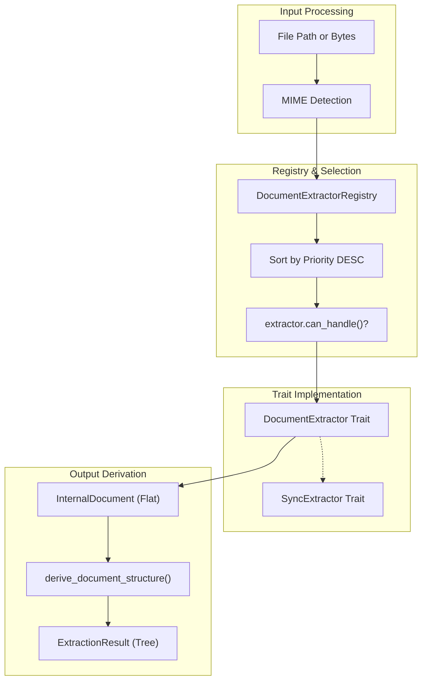
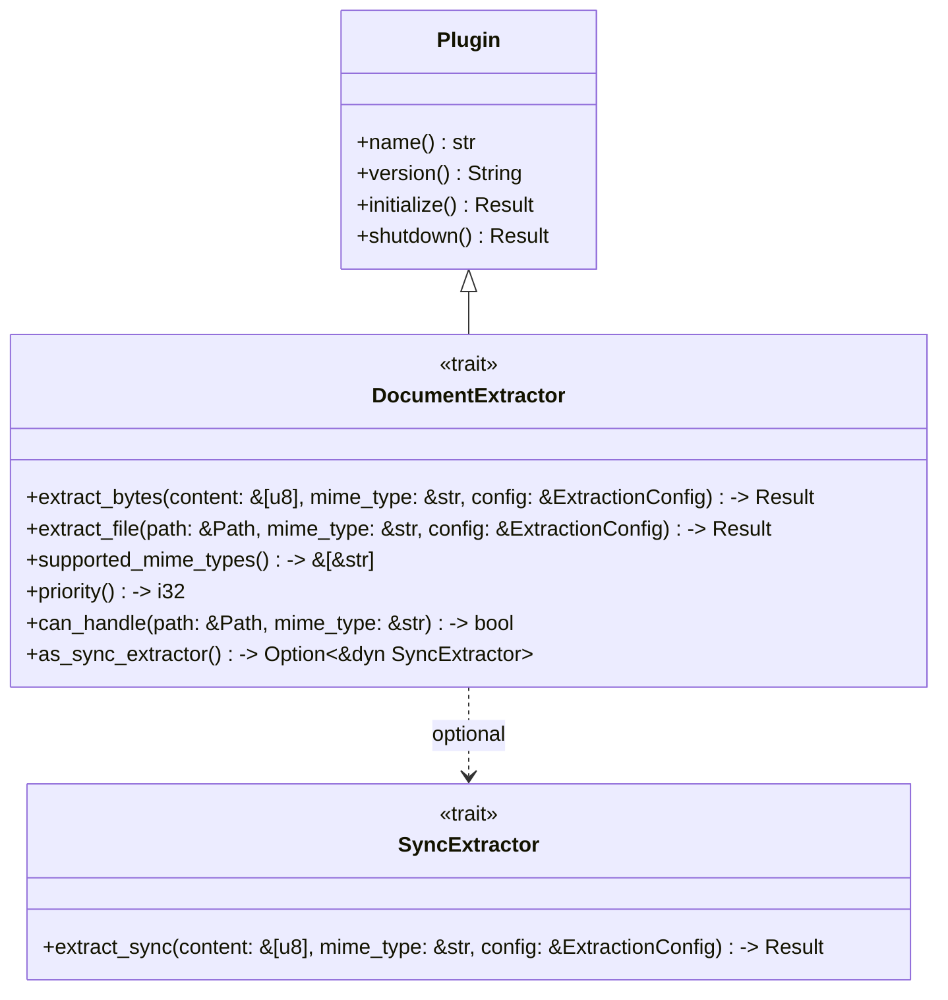
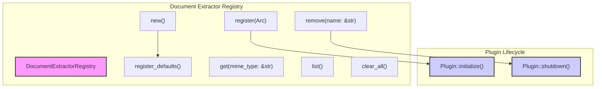

<!-- source: DeepWiki mcp.deepwiki.com · repo kreuzberg-dev/kreuzberg · page 5.2 Document Extractors · fetched 2026-10-27 -->

# Document Extractors

Relevant source files

The following files were used as context for generating this wiki page:

- [crates/kreuzberg/src/core/pipeline/tests.rs](crates/kreuzberg/src/core/pipeline/tests.rs)
- [crates/kreuzberg/src/extraction/mod.rs](crates/kreuzberg/src/extraction/mod.rs)
- [crates/kreuzberg/src/extractors/djot_format/conversion.rs](crates/kreuzberg/src/extractors/djot_format/conversion.rs)
- [crates/kreuzberg/src/extractors/mod.rs](crates/kreuzberg/src/extractors/mod.rs)
- [crates/kreuzberg/src/extractors/security.rs](crates/kreuzberg/src/extractors/security.rs)
- [crates/kreuzberg/src/plugins/embedding.rs](crates/kreuzberg/src/plugins/embedding.rs)
- [crates/kreuzberg/src/plugins/extractor/mod.rs](crates/kreuzberg/src/plugins/extractor/mod.rs)
- [crates/kreuzberg/src/plugins/extractor/registry.rs](crates/kreuzberg/src/plugins/extractor/registry.rs)
- [crates/kreuzberg/src/plugins/extractor/trait.rs](crates/kreuzberg/src/plugins/extractor/trait.rs)
- [crates/kreuzberg/src/plugins/mod.rs](crates/kreuzberg/src/plugins/mod.rs)
- [crates/kreuzberg/src/plugins/ocr.rs](crates/kreuzberg/src/plugins/ocr.rs)
- [crates/kreuzberg/src/plugins/processor/mod.rs](crates/kreuzberg/src/plugins/processor/mod.rs)
- [crates/kreuzberg/src/plugins/registry/extractor.rs](crates/kreuzberg/src/plugins/registry/extractor.rs)
- [crates/kreuzberg/src/plugins/registry/ocr.rs](crates/kreuzberg/src/plugins/registry/ocr.rs)
- [crates/kreuzberg/src/plugins/registry/renderer.rs](crates/kreuzberg/src/plugins/registry/renderer.rs)
- [crates/kreuzberg/src/plugins/renderer.rs](crates/kreuzberg/src/plugins/renderer.rs)
- [crates/kreuzberg/src/plugins/validator/mod.rs](crates/kreuzberg/src/plugins/validator/mod.rs)

## Purpose and Scope

Document Extractors are plugins that handle format-specific extraction logic for the 75+ file formats supported by Kreuzberg. Each extractor implements the `DocumentExtractor` trait [crates/kreuzberg/src/plugins/extractor/trait.rs:80-201]() and is responsible for parsing a specific MIME type, converting it to text/markdown, and extracting metadata, tables, and images into an `InternalDocument` [crates/kreuzberg/src/types/internal.rs:132-180]().

This page covers the extractor registry, priority-based selection, MIME type registration, and implementation of custom extractors.

**Sources:** [crates/kreuzberg/src/plugins/extractor/trait.rs:1-201](), [crates/kreuzberg/src/types/internal.rs:1-180]()

## Extractor Architecture

Document extractors operate within a registry-based routing system that maps MIME types to format-specific extraction logic. The pipeline converts the raw `InternalDocument` into the public-facing `ExtractionResult` through a derivation step [crates/kreuzberg/src/extraction/derive.rs:1-10]().

**Sources:** [crates/kreuzberg/src/plugins/extractor/trait.rs:80-201](), [crates/kreuzberg/src/extraction/derive.rs:1-10](), [crates/kreuzberg/src/extractors/mod.rs:47-63]()

## Built-in Extractors

Kreuzberg provides native Rust extractors for all supported formats. These are registered via the `EXTRACTORS_INITIALIZED` guard [crates/kreuzberg/src/extractors/mod.rs:285-288]().

| Extractor Class | MIME Types | Implementation Detail |
|-----------|-----------|----------------|
| `PdfExtractor` | `application/pdf` | PDFium-based [crates/kreuzberg/src/extractors/mod.rs:267]() |
| `ExcelExtractor` | `application/vnd.ms-excel`, `.xlsx` | Calamine-based [crates/kreuzberg/src/extractors/mod.rs:202]() |
| `DocxExtractor` | `application/vnd...wordprocessingml` | Office Open XML [crates/kreuzberg/src/extractors/mod.rs:229]() |
| `ImageExtractor` | `image/*` | OCR routing [crates/kreuzberg/src/extractors/mod.rs:190]() |
| `PlainTextExtractor` | `text/plain` | Lossy UTF-8 [crates/kreuzberg/src/extractors/mod.rs:187]() |
| `ZipExtractor`, `TarExtractor`, `GzipExtractor`, `SevenZExtractor` | `application/zip`, `.tar`, `.7z` | Recursive extraction [crates/kreuzberg/src/extractors/mod.rs:193]() |
| `HwpExtractor` | `application/x-hwp` | Hancom Word [crates/kreuzberg/src/extractors/mod.rs:205]() |
| `HtmlExtractor` | `text/html` | HTML parsing [crates/kreuzberg/src/extractors/mod.rs:218]() |
| `MarkdownExtractor` | `text/markdown` | Markdown parsing [crates/kreuzberg/src/extractors/mod.rs:186]() |
| `EmailExtractor` | `message/rfc822` | Email parsing [crates/kreuzberg/src/extractors/mod.rs:195]() |
| `PstExtractor` | `application/vnd.ms-outlook-pst` | Outlook PST parsing [crates/kreuzberg/src/extractors/mod.rs:199]() |
| `CodeExtractor` | `text/x-c`, `application/javascript`, etc. | Tree-sitter based [crates/kreuzberg/src/extractors/mod.rs:182]() |
| `CsvExtractor` | `text/csv` | CSV parsing [crates/kreuzberg/src/extractors/mod.rs:184]() |
| `StructuredExtractor` | `application/json`, `application/yaml` | JSON/YAML parsing [crates/kreuzberg/src/extractors/mod.rs:185]() |
| `DjotExtractor` | `text/x-djot` | Djot parsing [crates/kreuzberg/src/extractors/mod.rs:238]() |
| `MdxExtractor` | `text/x-mdx` | MDX parsing [crates/kreuzberg/src/extractors/mod.rs:240]() |
| `RstExtractor` | `text/x-rst` | reStructuredText parsing [crates/kreuzberg/src/extractors/mod.rs:243]() |
| `LatexExtractor` | `application/x-latex` | LaTeX parsing [crates/kreuzberg/src/extractors/mod.rs:246]() |
| `JupyterExtractor` | `application/x-ipynb+json` | Jupyter Notebook parsing [crates/kreuzberg/src/extractors/mod.rs:249]() |
| `OrgModeExtractor` | `text/x-org` | Org Mode parsing [crates/kreuzberg/src/extractors/mod.rs:252]() |
| `OdtExtractor` | `application/vnd.oasis.opendocument.text` | OpenDocument Text parsing [crates/kreuzberg/src/extractors/mod.rs:255]() |
| `OpmlExtractor` | `text/x-opml+xml` | OPML parsing [crates/kreuzberg/src/extractors/mod.rs:261]() |
| `TypstExtractor` | `application/x-typst` | Typst parsing [crates/kreuzberg/src/extractors/mod.rs:264]() |
| `JatsExtractor` | `application/jats+xml` | JATS XML parsing [crates/kreuzberg/src/extractors/mod.rs:258]() |
| `PptExtractor` | `application/vnd.ms-powerpoint` | PowerPoint parsing [crates/kreuzberg/src/extractors/mod.rs:270]() |
| `PptxExtractor` | `application/vnd.openxmlformats-officedocument.presentationml.presentation` | PowerPoint XML parsing [crates/kreuzberg/src/extractors/mod.rs:273]() |
| `RtfExtractor` | `application/rtf` | RTF parsing [crates/kreuzberg/src/extractors/mod.rs:276]() |
| `XmlExtractor` | `application/xml`, `text/xml` | Generic XML parsing [crates/kreuzberg/src/extractors/mod.rs:279]() |
| `DocbookExtractor` | `application/docbook+xml` | DocBook XML parsing [crates/kreuzberg/src/extractors/mod.rs:282]() |
| `BibtexExtractor` | `application/x-bibtex` | BibTeX parsing [crates/kreuzberg/src/extractors/mod.rs:221]() |
| `CitationExtractor` | `application/vnd.citationstyles.csl+json` | Citation Style Language JSON parsing [crates/kreuzberg/src/extractors/mod.rs:224]() |
| `DbfExtractor` | `application/x-dbf` | DBF parsing [crates/kreuzberg/src/extractors/mod.rs:227]() |
| `EpubExtractor` | `application/epub+zip` | EPUB parsing [crates/kreuzberg/src/extractors/mod.rs:232]() |
| `FictionBookExtractor` | `application/x-fictionbook+xml` | FictionBook parsing [crates/kreuzberg/src/extractors/mod.rs:235]() |
| `HwpxExtractor` | `application/x-hwpx` | Hancom Word XML parsing [crates/kreuzberg/src/extractors/mod.rs:208]() |
| `KeynoteExtractor`, `NumbersExtractor`, `PagesExtractor` | `application/x-iwork-keynote`, `application/x-iwork-numbers`, `application/x-iwork-pages` | Apple iWork parsing [crates/kreuzberg/src/extractors/mod.rs:211]() |

**Sources:** [crates/kreuzberg/src/extractors/mod.rs:178-288]()

## Priority-Based Selection

When multiple extractors register for the same MIME type, the registry selects the one with the highest priority [crates/kreuzberg/src/plugins/extractor/trait.rs:26-34]().

**Priority Guidelines [crates/kreuzberg/src/plugins/extractor/trait.rs:162-175]():**
- **0-25**: Fallback/low-quality extractors.
- **26-49**: Alternative extractors.
- **50**: Default priority (built-in extractors).
- **51-75**: Premium/enhanced extractors.
- **76-100**: Specialized/high-priority extractors.

**Sources:** [crates/kreuzberg/src/plugins/extractor/trait.rs:157-175]()

## Custom Extractor Implementation

### DocumentExtractor Trait

To implement a custom extractor, implement the `DocumentExtractor` trait [crates/kreuzberg/src/plugins/extractor/trait.rs:80-201](). For environments without an async runtime (like WASM), implement the `SyncExtractor` trait [crates/kreuzberg/src/extractors/mod.rs:47-63]().

**Sources:** [crates/kreuzberg/src/plugins/extractor/trait.rs:80-201](), [crates/kreuzberg/src/extractors/mod.rs:47-63]()

### Security and Validation

Extractors must adhere to `SecurityLimits` to prevent Denial of Service (DoS) attacks, such as ZIP bombs or XML entity expansion [crates/kreuzberg/src/extractors/security.rs:17-50]().

**Default Security Limits [crates/kreuzberg/src/extractors/security.rs:52-74]():**
- `max_archive_size`: 500 MB.
- `max_compression_ratio`: 100:1.
- `max_nesting_depth`: 1024 levels.
- `max_entity_length`: 1 MiB (XML).
- `max_content_size`: 100 MB.
- `max_iterations`: 10,000,000.
- `max_xml_depth`: 1024.
- `max_table_cells`: 100,000.

**Sources:** [crates/kreuzberg/src/extractors/security.rs:1-153]()

## Output Derivation

The `InternalDocument` [crates/kreuzberg/src/types/internal.rs:132-180]() produced by extractors is a flat, append-only structure. The pipeline resolves relationships and reconstructs the tree into a `DocumentStructure` [crates/kreuzberg/src/extraction/derive.rs:71-72]().

1.  **Relationship Resolution**: `RelationshipTarget::Key` anchors are resolved to numeric indices [crates/kreuzberg/src/extraction/derive.rs:35-60]().
2.  **Tree Reconstruction**: Container markers like `ListStart`/`ListEnd` are used to build the hierarchy [crates/kreuzberg/src/extraction/derive.rs:103-145]().
3.  **Deterministic IDs**: Elements are assigned `InternalElementId` generated via Blake3 hashing of content and position [crates/kreuzberg/src/types/internal.rs:68-82]().

**Sources:** [crates/kreuzberg/src/extraction/derive.rs:1-160](), [crates/kreuzberg/src/types/internal.rs:1-116]()

## Registry Management

The `DocumentExtractorRegistry` manages document extractors.

-   **Registration**: Plugins are wrapped in `Arc<dyn Trait>` for thread-safe shared access [crates/kreuzberg/src/plugins/mod.rs:24-63](). The `register` method [crates/kreuzberg/src/plugins/registry/extractor.rs:150-161]() handles adding new extractors to the registry.
-   **Thread Safety**: All plugins must be `Send + Sync` as they are accessed concurrently from multiple threads [crates/kreuzberg/src/plugins/mod.rs:138-142]().
-   **Management**: The API provides `clear_document_extractors` [crates/kreuzberg/src/plugins/extractor/mod.rs:20-26]() and `register_document_extractor` [crates/kreuzberg/src/plugins/extractor/mod.rs:10-18]() for lifecycle control. The `DocumentExtractorRegistry` also includes methods for listing, retrieving, and removing extractors [crates/kreuzberg/src/plugins/registry/extractor.rs:163-209]().

**Sources:** [crates/kreuzberg/src/plugins/mod.rs:1-200](), [crates/kreuzberg/src/plugins/registry/extractor.rs:1-209](), [crates/kreuzberg/src/plugins/extractor/mod.rs:1-26]()

---

