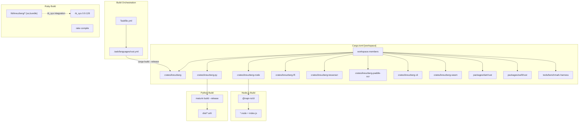
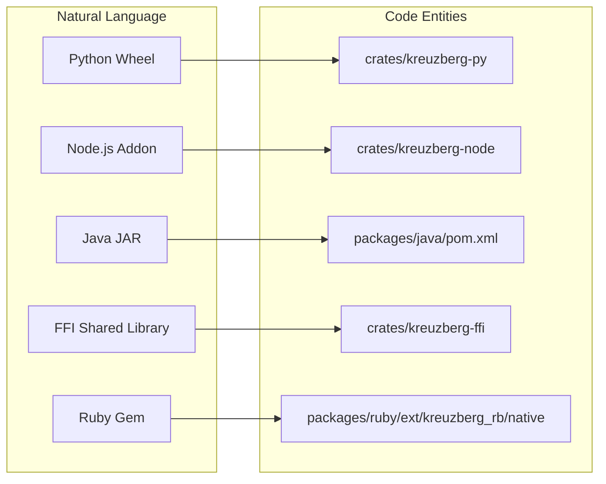

<!-- source: DeepWiki mcp.deepwiki.com · repo kreuzberg-dev/kreuzberg · page 6.3 Building from Source · fetched 2026-10-27 -->

# Building from Source

<details>
<summary>Relevant source files</summary>

The following files were used as context for generating this wiki page:

- [.dockerignore](.dockerignore)
- [.github/actions/setup-paddle-ocr-models/README.md](.github/actions/setup-paddle-ocr-models/README.md)
- [.github/actions/setup-paddle-ocr-models/action.yml](.github/actions/setup-paddle-ocr-models/action.yml)
- [.gitignore](.gitignore)
- [.pre-commit-config.yaml](.pre-commit-config.yaml)
- [.task/config/vars.yml](.task/config/vars.yml)
- [.task/languages/rust.yml](.task/languages/rust.yml)
- [CHANGELOG.md](CHANGELOG.md)
- [Cargo.lock](Cargo.lock)
- [Cargo.toml](Cargo.toml)
- [crates/kreuzberg-ffi/Cargo.toml](crates/kreuzberg-ffi/Cargo.toml)
- [crates/kreuzberg-node/Cargo.toml](crates/kreuzberg-node/Cargo.toml)
- [crates/kreuzberg-node/package.json](crates/kreuzberg-node/package.json)
- [crates/kreuzberg-py/Cargo.toml](crates/kreuzberg-py/Cargo.toml)
- [crates/kreuzberg-wasm/package.json](crates/kreuzberg-wasm/package.json)
- [crates/kreuzberg/Cargo.toml](crates/kreuzberg/Cargo.toml)
- [crates/kreuzberg/build.rs](crates/kreuzberg/build.rs)
- [crates/kreuzberg/tests/paddle_ocr_integration.rs](crates/kreuzberg/tests/paddle_ocr_integration.rs)
- [docker/Dockerfile.core](docker/Dockerfile.core)
- [docker/Dockerfile.full](docker/Dockerfile.full)
- [package.json](package.json)
- [packages/ruby/Gemfile.lock](packages/ruby/Gemfile.lock)
- [packages/ruby/ext/kreuzberg_rb/native/Cargo.lock](packages/ruby/ext/kreuzberg_rb/native/Cargo.lock)
- [packages/ruby/ext/kreuzberg_rb/native/Cargo.toml](packages/ruby/ext/kreuzberg_rb/native/Cargo.toml)
- [pnpm-lock.yaml](pnpm-lock.yaml)
- [pyproject.toml](pyproject.toml)
- [scripts/stage_csharp_native_local.sh](scripts/stage_csharp_native_local.sh)
- [uv.lock](uv.lock)

</details>


This page provides comprehensive instructions for building Kreuzberg from source across all supported platforms and language bindings. It covers the Rust core library, the FFI layer, and the multi-language binding architecture.

## Build System Architecture

Kreuzberg uses a multi-layered build system that coordinates Rust compilation with language-specific tooling. The root `Cargo.toml` defines a workspace containing the core library, specialized OCR crates, and various language binding crates.

**Cargo Workspace Structure**



**Sources:** [Cargo.toml:1-16](), [crates/kreuzberg/Cargo.toml:1-15](), [crates/kreuzberg-ffi/Cargo.toml:1-10](), [crates/kreuzberg-py/Cargo.toml:1-10](), [crates/kreuzberg-node/Cargo.toml:1-10](), [packages/ruby/ext/kreuzberg_rb/native/Cargo.lock:1-5]()

## Prerequisites

### Core Requirements

All builds require:
- **Rust 1.91+** (Edition 2024) - Enforced in workspace metadata [Cargo.toml:27-29]().
- **Cargo** - Bundled with Rust.
- **Task CLI** - Orchestrates the multi-language build process.
- **pnpm** - Required for Node.js and WASM workspace management [pnpm-lock.yaml:10-12]().
- **uv** - Required for Python dependency management and workspace isolation [pyproject.toml:36-47]().

### Language-Specific Toolchains

| Language | Required Version | Build System | Key Dependency |
|----------|------------------|--------------|----------------|
| Python   | 3.10+ [pyproject.toml:71]() | maturin [pyproject.toml:2]() | PyO3 |
| Node.js  | 18+ [crates/kreuzberg-node/package.json:49]() | napi-rs [crates/kreuzberg-node/package.json:51]() | @napi-rs/cli |
| Ruby     | 3.0+ | rake-compiler | rb_sys 0.9.128 [packages/ruby/Gemfile.lock:72]() |
| Java     | 25 | Maven 3.9.11 | Panama FFM API |

**Sources:** [Cargo.toml:27-29](), [pyproject.toml:1-3](), [crates/kreuzberg-node/package.json:49-51](), [packages/ruby/Gemfile.lock:72](), [pyproject.toml:71]()

## Building the Core Rust Library

### Feature Flags

The `kreuzberg` crate uses extensive feature flags to manage its large dependency tree and target-specific requirements.

| Feature | Description | Key Dependencies |
|---------|-------------|------------------|
| `pdf` | PDF extraction support | `pdf_oxide`, `lopdf`, `image` [crates/kreuzberg/Cargo.toml:44]() |
| `ocr` | Tesseract OCR support | `kreuzberg-tesseract`, `image`, `tiff` [crates/kreuzberg/Cargo.toml:91-100]() |
| `paddle-ocr` | PaddleOCR via ONNX Runtime | `kreuzberg-paddle-ocr`, `ort`, `ndarray` [crates/kreuzberg/Cargo.toml:105-118]() |
| `embeddings` | Text embeddings via ORT | `ort`, `tokenizers`, `ndarray` [crates/kreuzberg/Cargo.toml:177-186]() |
| `office` | Office document formats | `cfb`, `zip`, `roxmltree` [crates/kreuzberg/Cargo.toml:50-60]() |
| `wasm-target` | Bundle for WASM environments | `no-ort-target`, `excel-wasm`, `ocr-wasm` [crates/kreuzberg/Cargo.toml:239]() |

**Sources:** [crates/kreuzberg/Cargo.toml:34-244]()

### Release Profile

The workspace is optimized for performance with LTO enabled and aggressive optimization levels.

```toml
[profile.release]
lto = "thin"
codegen-units = 1
opt-level = 3
strip = true
```

Specific packages like `sevenz-rust2` and `zip` use `opt-level = 1` or `opt-level = 2` to avoid known miscompilation issues on certain architectures [Cargo.toml:126-139]().

**Sources:** [Cargo.toml:126-139]()

## Language Binding Builds

### Python Bindings

The Python package is built using `maturin` and `uv`. The `pyproject.toml` defines the workspace members and dependency groups.

```bash
# Setup environment
uv sync

# Build development extension
maturin develop
```

**Sources:** [pyproject.toml:1-3](), [pyproject.toml:36-47]()

### Node.js Bindings

The Node.js bindings utilize `napi-rs` to generate a native addon. The build targets include Linux, macOS, and Windows for both x86_64 and aarch64 [crates/kreuzberg-node/package.json:33-41]().

```bash
cd crates/kreuzberg-node
pnpm build
```

**Sources:** [crates/kreuzberg-node/package.json:9-20](), [crates/kreuzberg-node/package.json:33-41]()

### Java Bindings

Java bindings use the Panama FFM API, requiring Java 25. The build is managed via Maven.

```bash
cd packages/java
mvn clean package
```

The `pom.xml` configures the `maven-compiler-plugin` with `--enable-preview` to support the FFM API.

**Sources:** [packages/java/pom.xml:142-150]()

### Ruby Bindings

Ruby uses `rb_sys` and `rake-compiler` to build native extensions.

```bash
cd packages/ruby
bundle exec rake compile
```

**Sources:** [packages/ruby/Gemfile.lock:64-72]()

## Native Dependency Handling

### ONNX Runtime (ORT)

For features like `paddle-ocr`, `embeddings`, and `layout-detection`, Kreuzberg depends on ONNX Runtime. The `ort-bundled` feature downloads pre-compiled binaries from Microsoft [crates/kreuzberg/Cargo.toml:131]() and the `ort-dynamic` feature configures ORT to load dynamically at runtime [crates/kreuzberg/Cargo.toml:134-135]().

### Tesseract OCR

Tesseract is handled by the `kreuzberg-tesseract` crate. It supports both static linking (building from source) and dynamic linking against system libraries [crates/kreuzberg/Cargo.toml:91-100]().

### PDFium

PDF processing relies on PDFium. The build system supports three modes: bundled, static, and system, controlled via features in the `pdf` module [crates/kreuzberg/Cargo.toml:44]().

**Sources:** [crates/kreuzberg/Cargo.toml:44](), [crates/kreuzberg/Cargo.toml:91-100](), [crates/kreuzberg/Cargo.toml:131](), [crates/kreuzberg/Cargo.toml:134-135]()

## Cross-Platform Considerations

Kreuzberg implements target-specific logic for environments that cannot support heavy native dependencies like ONNX Runtime (e.g., WASM or Android emulators). The `no-ort-target` feature serves as a foundation for these builds [crates/kreuzberg/Cargo.toml:212-237](). Conditional compilation is used extensively, for example, to exclude `ner::llm` on Android x86_64 emulator targets [CHANGELOG.md:29-30]() or Windows [CHANGELOG.md:30]().

**Entity Mapping: Build Space to Code Space**



**Sources:** [crates/kreuzberg-py/Cargo.toml:1-5](), [crates/kreuzberg-node/Cargo.toml:1-5](), [packages/java/pom.xml:1-10](), [crates/kreuzberg-ffi/Cargo.toml:1-5](), [packages/ruby/ext/kreuzberg_rb/native/Cargo.toml:1-5]()

---

