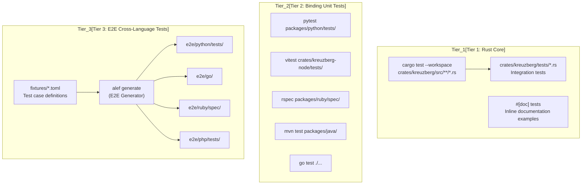
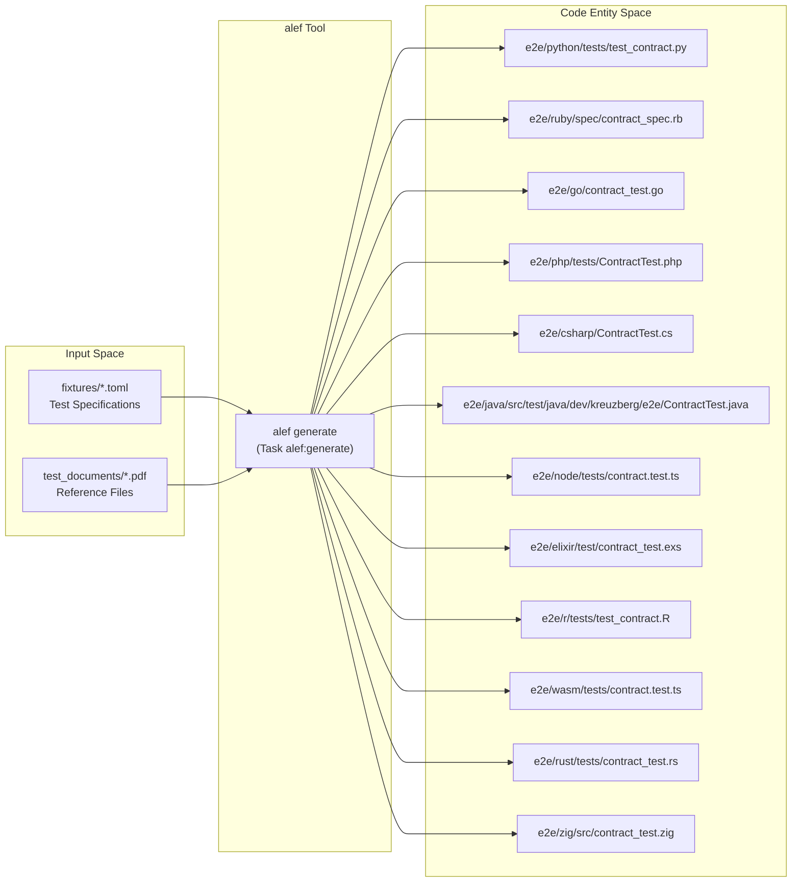

<!-- source: DeepWiki mcp.deepwiki.com · repo kreuzberg-dev/kreuzberg · page 6.4 Testing Strategy · fetched 2026-10-27 -->

# Testing Strategy

Relevant source files

The following files were used as context for generating this wiki page:

- [.github/actionlint.yaml](.github/actionlint.yaml)
- [.github/documentation/runners.md](.github/documentation/runners.md)
- [.github/workflows/ci-docs.yaml](.github/workflows/ci-docs.yaml)
- [.github/workflows/ci-e2e.yaml](.github/workflows/ci-e2e.yaml)
- [.github/workflows/ci-gpu.yaml](.github/workflows/ci-gpu.yaml)
- [.github/workflows/ci-lint.yaml](.github/workflows/ci-lint.yaml)
- [.github/workflows/ci-mobile.yaml](.github/workflows/ci-mobile.yaml)
- [.github/workflows/validate-issues.yml](.github/workflows/validate-issues.yml)
- [.github/workflows/validate-pr.yml](.github/workflows/validate-pr.yml)
- [.task/tools/fixtures.yml](.task/tools/fixtures.yml)
- [crates/kreuzberg/src/extraction/image_ocr.rs](crates/kreuzberg/src/extraction/image_ocr.rs)
- [crates/kreuzberg/tests/docx_ocr_integration_test.rs](crates/kreuzberg/tests/docx_ocr_integration_test.rs)
- [crates/kreuzberg/tests/gpu_acceleration.rs](crates/kreuzberg/tests/gpu_acceleration.rs)
- [e2e/go/contract_test.go](e2e/go/contract_test.go)
- [e2e/go/embed_async_pending_test.go](e2e/go/embed_async_pending_test.go)
- [e2e/java/src/test/java/dev/kreuzberg/e2e/EmbedAsyncPendingTest.java](e2e/java/src/test/java/dev/kreuzberg/e2e/EmbedAsyncPendingTest.java)
- [e2e/node/tests/embed_async_pending.test.ts](e2e/node/tests/embed_async_pending.test.ts)
- [e2e/php/tests/AsyncTest.php](e2e/php/tests/AsyncTest.php)
- [e2e/php/tests/BatchTest.php](e2e/php/tests/BatchTest.php)
- [e2e/php/tests/CodeTest.php](e2e/php/tests/CodeTest.php)
- [e2e/php/tests/ContractTest.php](e2e/php/tests/ContractTest.php)
- [e2e/php/tests/DetectionTest.php](e2e/php/tests/DetectionTest.php)
- [e2e/php/tests/EmbedAsyncPendingTest.php](e2e/php/tests/EmbedAsyncPendingTest.php)
- [e2e/php/tests/EmbedExtraTest.php](e2e/php/tests/EmbedExtraTest.php)
- [e2e/php/tests/ErrorTest.php](e2e/php/tests/ErrorTest.php)
- [e2e/php/tests/FormatSpecificTest.php](e2e/php/tests/FormatSpecificTest.php)
- [e2e/php/tests/RegistryOperationsTest.php](e2e/php/tests/RegistryOperationsTest.php)
- [e2e/php/tests/RegistryTest.php](e2e/php/tests/RegistryTest.php)
- [e2e/php/tests/SmokeTest.php](e2e/php/tests/SmokeTest.php)
- [e2e/python/pyproject.toml](e2e/python/pyproject.toml)
- [e2e/python/tests/test_contract.py](e2e/python/tests/test_contract.py)
- [e2e/python/tests/test_embed_async_pending.py](e2e/python/tests/test_embed_async_pending.py)
- [e2e/ruby/spec/contract_spec.rb](e2e/ruby/spec/contract_spec.rb)
- [e2e/ruby/spec/embed_async_pending_spec.rb](e2e/ruby/spec/embed_async_pending_spec.rb)
- [e2e/ruby/spec/embed_extra_spec.rb](e2e/ruby/spec/embed_extra_spec.rb)
- [e2e/ruby/spec/pdf_spec.rb](e2e/ruby/spec/pdf_spec.rb)
- [e2e/ruby/spec/smoke_spec.rb](e2e/ruby/spec/smoke_spec.rb)
- [e2e/rust/tests/contract_test.rs](e2e/rust/tests/contract_test.rs)
- [e2e/rust/tests/embed_async_pending_test.rs](e2e/rust/tests/embed_async_pending_test.rs)
- [e2e/zig/src/embed_async_pending_test.zig](e2e/zig/src/embed_async_pending_test.zig)
- [fixtures/batch/batch_extract_bytes_size_cap.json](fixtures/batch/batch_extract_bytes_size_cap.json)
- [fixtures/embed_async_pending/embed_texts_async_empty_input.json](fixtures/embed_async_pending/embed_texts_async_empty_input.json)
- [fixtures/embed_async_pending/embed_texts_async_happy.json](fixtures/embed_async_pending/embed_texts_async_happy.json)
- [fixtures/embed_async_pending/embed_texts_async_preset_switch.json](fixtures/embed_async_pending/embed_texts_async_preset_switch.json)
- [tools/generate_test_fixtures/README.md](tools/generate_test_fixtures/README.md)
- [tools/generate_test_fixtures/pyproject.toml](tools/generate_test_fixtures/pyproject.toml)
- [tools/generate_test_fixtures/src/generate_test_fixtures/__init__.py](tools/generate_test_fixtures/src/generate_test_fixtures/__init__.py)
- [tools/generate_test_fixtures/src/generate_test_fixtures/__main__.py](tools/generate_test_fixtures/src/generate_test_fixtures/__main__.py)
- [tools/generate_test_fixtures/src/generate_test_fixtures/diff_pairs.py](tools/generate_test_fixtures/src/generate_test_fixtures/diff_pairs.py)
- [tools/generate_test_fixtures/src/generate_test_fixtures/docx_revisions.py](tools/generate_test_fixtures/src/generate_test_fixtures/docx_revisions.py)
- [tools/generate_test_fixtures/src/generate_test_fixtures/gt_schema.py](tools/generate_test_fixtures/src/generate_test_fixtures/gt_schema.py)
- [tools/generate_test_fixtures/src/generate_test_fixtures/odt_revisions.py](tools/generate_test_fixtures/src/generate_test_fixtures/odt_revisions.py)
- [tools/generate_test_fixtures/src/generate_test_fixtures/pptx_comments.py](tools/generate_test_fixtures/src/generate_test_fixtures/pptx_comments.py)

## Purpose and Scope

This document describes Kreuzberg's comprehensive testing strategy across its multi-language architecture. It covers the three-tier testing approach (unit tests, integration tests, E2E tests), the fixture-driven E2E test generation system, and language-specific test execution patterns in CI/CD pipelines.

For information about the CI/CD pipeline orchestration and release process, see **CI Pipeline Overview (8.1)**. For details on language-specific build processes, see **Building from Source (6.3)**.

---

## Testing Philosophy and Architecture

Kreuzberg implements a three-tier testing strategy designed to ensure correctness across 12+ language bindings while maintaining a single source of truth for test expectations.

**Three-Tier Testing Strategy**

Sources: [.github/workflows/ci-e2e.yaml:151-193](), [.github/workflows/ci-lint.yaml:18-98]()

### Test Framework Mapping

| Language | Test Framework | Test Command | E2E Location |
|----------|---------------|--------------|---------------|
| Rust | built-in `#[test]` | `cargo test` | [e2e/rust/tests/contract_test.rs]() |
| Python | pytest | `python3 -m pytest` | [e2e/python/tests/test_contract.py]() |
| Node.js | vitest | `npx vitest run` | `e2e/node/` |
| Ruby | rspec | `bundle exec rspec` | [e2e/ruby/spec/smoke_spec.rb]() |
| Java | JUnit 5 | `mvn test` | `e2e/java/` |
| Go | testify | `go test ./...` | [e2e/go/contract_test.go]() |
| PHP | PHPUnit | `vendor/bin/phpunit` | [e2e/php/tests/ContractTest.php]() |
| WASM | wasm-pack / npm | `wasm-pack build && npm test` | `e2e/wasm/` |
| R | testthat | `Rscript run_tests.R` | `e2e/r/` |
| C# | dotnet test | `dotnet test` | `e2e/csharp/` |
| Elixir | ExUnit | `mix test` | `e2e/elixir/` |

Sources: [.github/workflows/ci-e2e.yaml:151-193]()

---

## Rust Core Testing

### Unit and Integration Tests

Rust tests are the primary defense for the core extraction logic. They are divided into library unit tests and workspace integration tests.

**Key Integration Test Files**:
- **Format Parity**: [crates/kreuzberg/tests/cross_format_parity.rs]() ensures consistent output across different input formats.
- **Hierarchy Detection**: [crates/kreuzberg/tests/pdf_hierarchy_detection.rs:22-133]() validates font-size clustering and heading identification in PDFs.
- **Feature Config**: [crates/kreuzberg/tests/config_features.rs:17-48]() tests chunking, language detection, and token reduction.
- **GPU Acceleration**: [crates/kreuzberg/tests/gpu_acceleration.rs]() (triggered via [.github/workflows/ci-gpu.yaml:67-113]()) validates CUDA-based OCR and layout detection.

### Core Extraction Logic

The core extraction entry points are tested heavily to ensure configuration options like `force_ocr` or `extraction_timeout_secs` are respected.

| Function | File | Description |
|----------|------|-------------|
| `extract_file` | [crates/kreuzberg/src/core/extractor/file.rs:67-160]() | Orchestrates file-based extraction, including MIME detection and cache lookups. |
| `extract_bytes` | [crates/kreuzberg/src/core/extractor/bytes.rs:66-146]() | Orchestrates in-memory byte array extraction. |
| `extract_file_with_extractor` | [crates/kreuzberg/src/core/extractor/file.rs:162-200]() | Internal routing to specific plugin extractors. |

Sources: [crates/kreuzberg/src/core/extractor/file.rs:67-160](), [crates/kreuzberg/src/core/extractor/bytes.rs:66-146]()

---

## Fixture-Based E2E Generation (alef)

Kreuzberg uses a tool called `alef` to maintain API parity across all language bindings. `alef` reads test definitions and generates native test files for every supported language.

### The Generation Workflow

Sources: [e2e/ruby/spec/smoke_spec.rb:1-5](), [e2e/python/tests/test_contract.py:1-5](), [e2e/go/contract_test.go:1-5](), [.github/workflows/ci-lint.yaml:90-92]()

### Contract Validation Examples

Generated tests ensure that high-level configurations behave identically. For example, the `config_document_structure_with_headings` test case is implemented across:
- **Ruby**: [e2e/ruby/spec/contract_spec.rb:70-76]()
- **Python**: [e2e/python/tests/test_contract.py:119-128]()
- **Go**: [e2e/go/contract_test.go:22-41]()
- **PHP**: [e2e/php/tests/ContractTest.php:124-132]()

These tests verify that setting `include_document_structure: true` in `ExtractionConfig` correctly populates the `document.nodes` field in the `ExtractionResult`.

---

## CI/CD Pipeline Integration

### E2E Matrix Execution

The `CI E2E` workflow runs a massive matrix of language environments on ARM64 runners.

| Language | Runner | Key Commands |
|----------|--------|--------------|
| Python | ubuntu-24.04-arm | `maturin develop --release && pytest` |
| Node.js | ubuntu-24.04-arm | `npm run build && npx vitest run` |
| Java | ubuntu-24.04-arm | `mvn package -DskipTests && mvn test` |
| PHP | ubuntu-24.04-arm | `cargo build --release && phpunit` |
| WASM | ubuntu-24.04-arm | `wasm-pack build --release --target web --out-dir ../../packages/wasm/pkg && npm install && npm test` |
| R | ubuntu-24.04-arm | `Rscript run_tests.R` |
| C# | ubuntu-24.04-arm | `dotnet test` |
| Elixir | ubuntu-24.04-arm | `KREUZBERG_BUILD=true mix deps.get && KREUZBERG_BUILD=true mix test` |
| Go | ubuntu-24.04-arm | `go test ./... -count=1 -v` |
| Ruby | ubuntu-24.04-arm | `bundle install && bundle exec rake compile && bundle install && bundle exec rspec` |
| Rust | ubuntu-24.04-arm | `cargo test` |

Sources: [.github/workflows/ci-e2e.yaml:151-193]()

### GPU and Hardware Testing

Specialized hardware testing is handled via `ci-gpu.yaml`, which utilizes `runner-gpu-l4` runners to execute CUDA-accelerated tests.

**GPU Test Steps**:
1. **Build**: Compiles a specific test binary `gpu-acceleration-test` with features `paddle-ocr,layout-detection,embeddings,pdf,ocr,ort-dynamic` [ci-gpu.yaml:52-59]().
2. **Verify**: Runs `nvidia-smi` to ensure hardware presence [ci-gpu.yaml:79-87]().
3. **Execute**: Runs the Rust test with `RUST_LOG=kreuzberg=debug` to monitor model loading and inference [ci-gpu.yaml:106-113]().

Sources: [.github/workflows/ci-gpu.yaml:52-113]()

### Code Quality and Linting

The `CI Lint` workflow ensures all code follows project standards using the `prek` tool.

**Key Checks**:
- **Rust**: Clippy and rustfmt.
- **C Headers**: Validates that `kreuzberg.h` is up to date with the FFI implementation [.github/workflows/ci-lint.yaml:105-113]().
- **Helm**: Validates Kubernetes charts using `kubeconform` [.github/workflows/ci-lint.yaml:95-96]().
- **Multi-language Linters**: Runs linters for Python, Node, Go, Java, Elixir, Ruby, PHP, .NET, and R [.github/workflows/ci-lint.yaml:36-85]().

Sources: [.github/workflows/ci-lint.yaml:18-113]()

---

