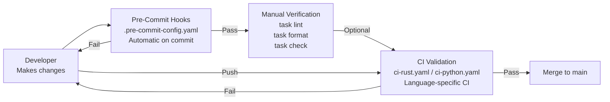
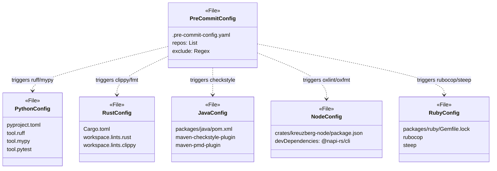
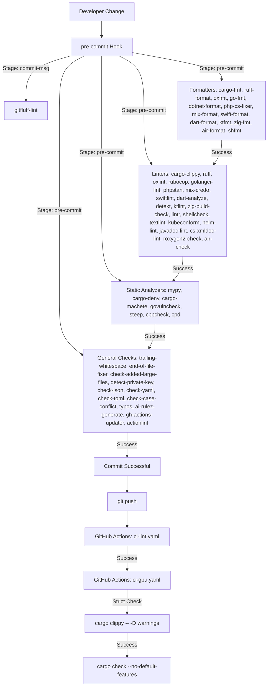

<!-- source: DeepWiki mcp.deepwiki.com · repo kreuzberg-dev/kreuzberg · page 6.5 Code Quality and Pre-Commit Hooks · fetched 2026-10-27 -->

# Code Quality and Pre-Commit Hooks

<details>
<summary>Relevant source files</summary>

The following files were used as context for generating this wiki page:

- [.github/actionlint.yaml](.github/actionlint.yaml)
- [.github/documentation/runners.md](.github/documentation/runners.md)
- [.github/workflows/ci-docs.yaml](.github/workflows/ci-docs.yaml)
- [.github/workflows/ci-e2e.yaml](.github/workflows/ci-e2e.yaml)
- [.github/workflows/ci-gpu.yaml](.github/workflows/ci-gpu.yaml)
- [.github/workflows/ci-lint.yaml](.github/workflows/ci-lint.yaml)
- [.github/workflows/ci-mobile.yaml](.github/workflows/ci-mobile.yaml)
- [.github/workflows/validate-issues.yml](.github/workflows/validate-issues.yml)
- [.github/workflows/validate-pr.yml](.github/workflows/validate-pr.yml)
- [.gitignore](.gitignore)
- [.pre-commit-config.yaml](.pre-commit-config.yaml)
- [CHANGELOG.md](CHANGELOG.md)
- [Cargo.lock](Cargo.lock)
- [Cargo.toml](Cargo.toml)
- [crates/kreuzberg-node/package.json](crates/kreuzberg-node/package.json)
- [crates/kreuzberg-wasm/package.json](crates/kreuzberg-wasm/package.json)
- [crates/kreuzberg/Cargo.toml](crates/kreuzberg/Cargo.toml)
- [crates/kreuzberg/src/extraction/image_ocr.rs](crates/kreuzberg/src/extraction/image_ocr.rs)
- [crates/kreuzberg/tests/docx_ocr_integration_test.rs](crates/kreuzberg/tests/docx_ocr_integration_test.rs)
- [crates/kreuzberg/tests/gpu_acceleration.rs](crates/kreuzberg/tests/gpu_acceleration.rs)
- [package.json](package.json)
- [packages/ruby/Gemfile.lock](packages/ruby/Gemfile.lock)
- [packages/ruby/ext/kreuzberg_rb/native/Cargo.lock](packages/ruby/ext/kreuzberg_rb/native/Cargo.lock)
- [packages/ruby/ext/kreuzberg_rb/native/Cargo.toml](packages/ruby/ext/kreuzberg_rb/native/Cargo.toml)
- [pnpm-lock.yaml](pnpm-lock.yaml)
- [pyproject.toml](pyproject.toml)
- [uv.lock](uv.lock)

</details>


## Purpose and Scope

This document describes Kreuzberg's code quality infrastructure, including pre-commit hooks, linters, formatters, and static analysis tools used across its polyglot codebase. It covers how to configure and run these tools locally, their integration into the development workflow, and how they enforce quality standards across Rust, Python, Node.js/TypeScript, Ruby, Java, Go, C#, PHP, Elixir, and R.

For information about running tests, see [Testing Strategy](#6.4). For CI/CD pipeline details, see [CI Pipeline Overview](#8.1).

---

## Multi-Language Quality Enforcement Strategy

Kreuzberg enforces code quality at multiple stages: pre-commit hooks for immediate feedback, Task CLI commands for manual verification, and CI workflows for automated enforcement. Each language uses best-in-class tools appropriate to its ecosystem, with consistent command patterns managed by the task orchestration system.

### Quality Enforcement Stages



**Quality Gate Characteristics:**
- **Pre-commit**: Fast, blocking, auto-fixing where possible. Configured in `.pre-commit-config.yaml` [.pre-commit-config.yaml:1-202]().
- **Manual checks**: Comprehensive, developer-initiated via `Taskfile.yml`.
- **CI**: Authoritative, non-fixing, enforces strict standards like promoting warnings to errors.

Sources: [.pre-commit-config.yaml:1-202](), [.github/workflows/ci-lint.yaml:1-100]()

---

## Pre-Commit Hook System

Kreuzberg uses the `pre-commit` framework (managed via `prek` in the Python environment) to enforce quality standards automatically before commits. The configuration defines hooks for commit message validation, general file hygiene, and language-specific analysis.

### Pre-Commit Configuration Structure

```mermaid
graph TB
    subgraph "Hook Types"
        PreCommitType["pre-commit<br/>Runs before commit"]
        CommitMsgType["commit-msg<br/>Validates commit message"]
    end
    
    subgraph "Universal Hooks"
        GitFluff["gitfluff-lint<br/>Commit message linting"]
        PreCommitHooks["pre-commit-hooks<br/>trailing-whitespace<br/>end-of-file-fixer<br/>detect-private-key<br/>check-json/yaml/toml"]
        AIRulez["ai-rulez-generate<br/>Auto-generate AI configs"]
        Typos["typos<br/>Spell checking"]
    end
    
    subgraph "Language-Specific Hooks"
        Ruff["ruff / ruff-format<br/>Python"]
        Mypy["mypy<br/>Python type checking"]
        RustHooks["cargo-fmt / cargo-clippy<br/>Rust"]
        Oxlint["oxlint / oxfmt<br/>Node.js / TS"]
        Rubocop["rubocop / steep<br/>Ruby"]
        JavaVerify["java-verify / checkstyle<br/>Java"]
        GoHooks["go-fmt / golangci-lint<br/>Go"]
        Dotnet["dotnet-format<br/>C#"]
        PHPHooks["php-cs-fixer / phpstan<br/>PHP"]
        MixHooks["mix-format / mix-credo<br/>Elixir"]
        SwiftHooks["swift-format / swiftlint<br/>Swift"]
        DartHooks["dart-format / dart-analyze<br/>Dart"]
        ZigHooks["zig-fmt / zig-build-check<br/>Zig"]
        RHooks["air-format / lintr<br/>R"]
        KotlinHooks["ktfmt / detekt<br/>Kotlin"]
    end
    
    CommitMsgType --> GitFluff
    PreCommitType --> AIRulez
    PreCommitType --> PreCommitHooks
    PreCommitType --> Ruff
    PreCommitType --> RustHooks
    PreCommitType --> Oxlint
    PreCommitType --> Rubocop
    PreCommitType --> JavaVerify
    PreCommitType --> GoHooks
    PreCommitType --> Dotnet
    PreCommitType --> PHPHooks
    PreCommitType --> MixHooks
    PreCommitType --> SwiftHooks
    PreCommitType --> DartHooks
    PreCommitType --> ZigHooks
    PreCommitType --> RHooks
    PreCommitType --> KotlinHooks
    PreCommitType --> Typos
```



Sources: [.pre-commit-config.yaml:1-202]()

### Commit Message Validation

The project uses `gitfluff` to enforce commit message standards during the `commit-msg` stage [.pre-commit-config.yaml:8-15]().

### General File Hygiene

Standard hooks ensure basic file quality across the repository:
- `trailing-whitespace`: Trims whitespace at the end of lines [.pre-commit-config.yaml:21-21]().
- `end-of-file-fixer`: Ensures files end with a newline [.pre-commit-config.yaml:22-22]().
- `check-added-large-files`: Prevents committing massive binaries, excluding `uv.lock` and `docs/benchmarks/app/` [.pre-commit-config.yaml:24-26]().
- `detect-private-key`: Scans for accidental inclusion of private keys [.pre-commit-config.yaml:27-27]().
- `check-json`, `check-yaml`, `check-toml`, `check-case-conflict`: Validate common configuration and data file formats [.pre-commit-config.yaml:28-35]().
- `typos`: Checks for common spelling errors [.pre-commit-config.yaml:199-201]().

### Binding Verification (Alef)

As Kreuzberg generates multiple language bindings, it uses `alef` to ensure consistency. These hooks are temporarily disabled in the provided `.pre-commit-config.yaml` but are part of the overall strategy:
- `alef-verify`: Validates that generated bindings match the source definitions [.pre-commit-config.yaml:196-196]().
- `alef-sync-versions`: Ensures version numbers are synchronized across all package manifests [.pre-commit-config.yaml:197-197]().

Sources: [.pre-commit-config.yaml:8-35](), [.pre-commit-config.yaml:196-201]()

---

## Language-Specific Quality Tools

### Rust: Cargo Toolchain

Rust quality is enforced through the standard toolchain and configured globally in the workspace.

| Tool | Hook ID | Configuration |
|------|---------|---------------|
| `rustfmt` | `cargo-fmt` | Enforces standard Rust formatting with `--all` [.pre-commit-config.yaml:40-42](). |
| `clippy` | `cargo-clippy` | Workspace-wide linting with `--fix` enabled for local hooks, promoting warnings to errors (`-D warnings`) [.pre-commit-config.yaml:55-73](). Excludes FFI and binding crates. |
| `cargo-deny` | `cargo-deny` | Checks licenses, vulnerabilities, and duplicate dependencies [.pre-commit-config.yaml:79-81](). |
| `cargo-machete` | `cargo-machete` | Finds unused dependencies in `Cargo.toml` files within `crates/`, `packages/`, and `tools/` directories [.pre-commit-config.yaml:74-78](). |
| `cargo-sort` | `cargo-sort` | Sorts `Cargo.toml` files, excluding binding crates where `Cargo.toml` might be generated or have specific ordering requirements [.pre-commit-config.yaml:37-39](). |

**Workspace Lints:**
The workspace `Cargo.toml` defines global lint levels:
- `unsafe_code = "deny"` [.Cargo.toml:36-36]()
- `unexpected_cfgs = { level = "warn", check-cfg = ['cfg(alef)'] }` [.Cargo.toml:37-37]()
- `clippy.all = "warn"` [.Cargo.toml:40-40]()

Sources: [.pre-commit-config.yaml:37-81](), [Cargo.toml:35-40]()

### Python: Ruff and Mypy

Python quality relies on `ruff` for speed and `mypy` for strict typing.

**Ruff Configuration:**
- `target-version = "py310"` [pyproject.toml:71-71]()
- `line-length = 120` [pyproject.toml:72-72]()
- `src = [ "packages/python/*" ]` [pyproject.toml:73-73]()
- `lint.select = ["ALL"]` [pyproject.toml:76-76]()
- `lint.ignore`: A comprehensive list of ignored lint rules for specific contexts like benchmarks and tests [pyproject.toml:77-199]().
- `ruff` and `ruff-format` hooks are used for linting and auto-formatting Python files [.pre-commit-config.yaml:35-36]().

**Mypy Strictness:**
- `packages = [ "kreuzberg" ]` [pyproject.toml:212-212]()
- `python_version = "3.10"` [pyproject.toml:214-214]()
- `strict = true` [pyproject.toml:218-218]()
- Missing imports are ignored for specific libraries like `keybert`, `easyocr`, `torch`, and internal bindings [pyproject.toml:221-234]().
- The `mypy` hook is configured to run on Python files, excluding `e2e/`, `tests/`, and `scripts/` directories [.pre-commit-config.yaml:108-111]().

Sources: [pyproject.toml:70-234](), [.pre-commit-config.yaml:35-36](), [.pre-commit-config.yaml:108-111]()

### Node.js/TypeScript: Oxlint

The Node.js ecosystem uses the Rust-based `oxlint` and `oxfmt` for extremely fast linting and formatting, replacing traditional ESLint/Prettier setups [.pre-commit-config.yaml:182-183]().

Sources: [.pre-commit-config.yaml:182-183]()

### Java: Maven and Checkstyle

Java quality is integrated into the Maven lifecycle:
- `checkstyle`: Uses a custom configuration at `packages/java/checkstyle.xml` and properties from `packages/java/checkstyle.properties` [.pre-commit-config.yaml:98-104]().
- `javadoc-lint`: Lints Javadoc comments in Java source files [.pre-commit-config.yaml:105-106]().
- `java-verify`: Specific hook for verifying Java binding integrity, running on files within `packages/java/` [.pre-commit-config.yaml:107-108]().

Sources: [.pre-commit-config.yaml:98-108]()

### Go: `go-fmt`, `golangci-lint`, `govulncheck`

Go code quality is maintained using:
- `go-fmt`: Standard Go formatting tool [.pre-commit-config.yaml:113-114]().
- `golangci-lint`: A fast Go linters aggregation tool [.pre-commit-config.yaml:115-116]().
- `govulncheck`: Checks for known vulnerabilities in Go modules [.pre-commit-config.yaml:117-118]().
All Go hooks exclude `e2e/`, `test_apps/`, and `tools/` directories.

Sources: [.pre-commit-config.yaml:113-118]()

### Ruby: Rubocop and Steep

Ruby code quality is enforced with:
- `rubocop`: A Ruby static code analyzer and formatter [.pre-commit-config.yaml:119-120]().
- `rubocop-lint`: Specifically for linting Ruby files, including `.rbs` type definition files [.pre-commit-config.yaml:121-122]().
- `steep`: A static type checker for Ruby [.pre-commit-config.yaml:123-124]().

Sources: [.pre-commit-config.yaml:119-124]()

### C#: `dotnet-format`

C# code is formatted using `dotnet-format` to ensure consistent style:
- `dotnet-format`: Auto-formats C# files [.pre-commit-config.yaml:125-126]().
- `dotnet-format-check`: Checks for formatting issues without applying fixes [.pre-commit-config.yaml:127-128]().
- `cs-xmldoc-lint`: Lints XML documentation comments in C# files [.pre-commit-config.yaml:129-130]().

Sources: [.pre-commit-config.yaml:125-130]()

### PHP: `php-cs-fixer` and `phpstan`

PHP code quality is maintained with:
- `php-cs-fixer`: Automatically fixes PHP coding standards issues [.pre-commit-config.yaml:131-132]().
- `phpstan`: A static analysis tool for PHP to find bugs without running code [.pre-commit-config.yaml:133-134]().
- `phpdoc-lint`: Lints PHPDoc comments [.pre-commit-config.yaml:135-136]().

Sources: [.pre-commit-config.yaml:131-136]()

### Elixir: `mix format` and `mix credo`

Elixir code quality is ensured by:
- `mix-format`: The standard Elixir code formatter [.pre-commit-config.yaml:137-138]().
- `mix-credo`: A static code analysis tool for Elixir with a focus on code consistency and correctness [.pre-commit-config.yaml:139-140]().

Sources: [.pre-commit-config.yaml:137-140]()

### R: `roxygen2-check`, `air-format`, `air-check`, `lintr`

R code quality is managed by:
- `roxygen2-check`: Checks Roxygen2 documentation in R files [.pre-commit-config.yaml:141-142]().
- `air-format`: Formats R files [.pre-commit-config.yaml:143-144]().
- `air-check`: Checks R files for style and common issues [.pre-commit-config.yaml:145-146]().
- `lintr`: A static analysis tool for R code [.pre-commit-config.yaml:147-148]().

Sources: [.pre-commit-config.yaml:141-148]()

### Swift: `swift-format` and `swiftlint`

Swift code quality is maintained using:
- `swift-format`: The official Swift code formatter [.pre-commit-config.yaml:160-161]().
- `swiftlint`: A tool to enforce Swift style and conventions [.pre-commit-config.yaml:162-163]().

Sources: [.pre-commit-config.yaml:160-163]()

### Dart: `dart-format`, `dart-analyze`, `dart-doc-lint`

Dart code quality is ensured by:
- `dart-format`: The official Dart code formatter [.pre-commit-config.yaml:164-165]().
- `dart-analyze`: Runs the Dart analyzer to find errors and warnings [.pre-commit-config.yaml:166-167]().
- `dart-doc-lint`: Lints Dart documentation comments, excluding generated Rust binding files [.pre-commit-config.yaml:168-170]().

Sources: [.pre-commit-config.yaml:164-170]()

### Kotlin: `ktfmt`, `detekt`, `ktlint`

Kotlin code quality is maintained using:
- `ktfmt`: A Kotlin code formatter, using the Kotlinlang style [.pre-commit-config.yaml:150-152]().
- `detekt`: A static code analysis tool for Kotlin [.pre-commit-config.yaml:153-156]().
- `ktlint`: Another Kotlin linter [.pre-commit-config.yaml:157-158]().

Sources: [.pre-commit-config.yaml:150-158]()

### Zig: `zig-fmt`, `zig-build-check`

Zig code quality is ensured by:
- `zig-fmt`: The standard Zig code formatter [.pre-commit-config.yaml:171-172]().
- `zig-build-check`: Checks the Zig build system for errors [.pre-commit-config.yaml:173-174]().

Sources: [.pre-commit-config.yaml:171-174]()

### Shell Scripts: `shfmt`, `shellcheck`

Shell scripts are formatted and linted using:
- `shfmt`: Formats shell scripts with a 2-space indent [.pre-commit-config.yaml:82-86]().
- `shellcheck`: A static analysis tool for shell scripts [.pre-commit-config.yaml:87-89]().

Sources: [.pre-commit-config.yaml:82-89]()

### Helm Charts: `helm-lint`, `kubeconform`

Helm charts are validated for correctness and adherence to Kubernetes best practices:
- `helm-lint`: Lints Helm charts [.pre-commit-config.yaml:175-177]().
- `kubeconform`: Validates Kubernetes manifests against schemas, ensuring strictness and providing a summary [.pre-commit-config.yaml:178-181]().

Sources: [.pre-commit-config.yaml:175-181]()

### Documentation: `textlint`

Markdown documentation files are linted for style and consistency:
- `textlint`: Lints Markdown files in the `docs/` directory, excluding reference and snippet files, using a configuration from `.textlintrc.json` [.pre-commit-config.yaml:184-190]().

Sources: [.pre-commit-config.yaml:184-190]()

---

## CI/CD Quality Gates

Quality enforcement is a mandatory step in the CI pipeline. In `ci-lint.yaml`, a comprehensive set of linters and formatters are run.

```yaml
# .github/workflows/ci-lint.yaml
jobs:
  lint:
    name: Lint
    runs-on: ubuntu-latest
    steps:
      - uses: actions/checkout@v4
      - uses: actions/setup-python@v5
        with:
          python-version: '3.11'
      - name: Install prek
        run: pip install prek
      - name: Run pre-commit hooks
        run: prek run --all-files
```
[.github/workflows/ci-lint.yaml:1-100]()

The `ci-lint.yaml` workflow runs `prek run --all-files` to execute all pre-commit hooks on all files, ensuring that the entire codebase adheres to the defined quality standards.

In `ci-gpu.yaml`, the Rust `clippy` tool is run with warnings promoted to errors to ensure no regressions are merged.

```bash
cargo clippy --workspace --exclude kreuzberg-ffi --exclude kreuzberg-py --exclude kreuzberg-node --exclude kreuzberg-wasm --exclude kreuzberg-dart --exclude kreuzberg-swift --exclude kreuzberg_nif -- -D warnings
```
[.github/workflows/ci-gpu.yaml:100-102]()

The `ci-gpu.yaml` pipeline also verifies that the library can be built with minimal features:
```bash
cargo check -p kreuzberg --no-default-features
```
[.github/workflows/ci-gpu.yaml:110-112]()

### Dependency Management

The project uses multiple lockfiles to ensure reproducible builds and quality checks across ecosystems:
- `Cargo.lock`: Rust dependencies [Cargo.lock:1-3]()
- `uv.lock`: Python dependencies [uv.lock:1-3]()
- `pnpm-lock.yaml`: Node.js dependencies [pnpm-lock.yaml:1-3]()
- `Gemfile.lock`: Ruby dependencies [packages/ruby/Gemfile.lock:1-6]()
- `packages/ruby/ext/kreuzberg_rb/native/Cargo.lock`: Ruby native extension Rust dependencies [packages/ruby/ext/kreuzberg_rb/native/Cargo.lock:1-3]()

Sources: [.github/workflows/ci-lint.yaml:1-100](), [.github/workflows/ci-gpu.yaml:100-112](), [Cargo.lock:1-3](), [uv.lock:1-3](), [pnpm-lock.yaml:1-3](), [packages/ruby/Gemfile.lock:1-6](), [packages/ruby/ext/kreuzberg_rb/native/Cargo.lock:1-3]()

---

## Code Entity Mapping

The following diagram bridges the high-level quality concepts to the specific configuration entities in the codebase.



Sources: [.pre-commit-config.yaml:1-202](), [pyproject.toml:1-239](), [Cargo.toml:1-148](), [crates/kreuzberg-node/package.json:1-52](), [packages/ruby/Gemfile.lock:1-165]()

### Quality Hook Execution Flow

This diagram illustrates how a code change travels through the quality validation layers.



Sources: [.pre-commit-config.yaml:1-202](), [.github/workflows/ci-lint.yaml:1-100](), [.github/workflows/ci-gpu.yaml:100-112]()

---

