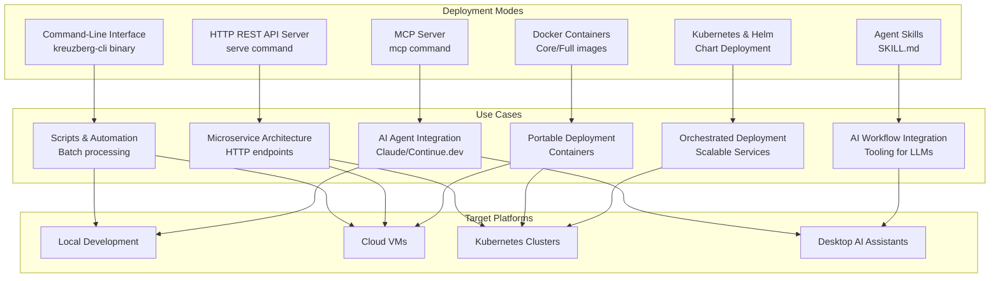
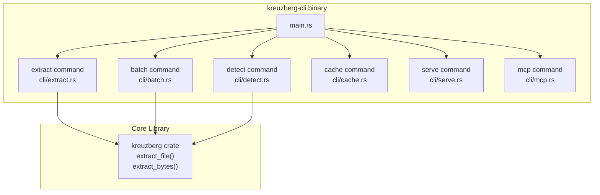
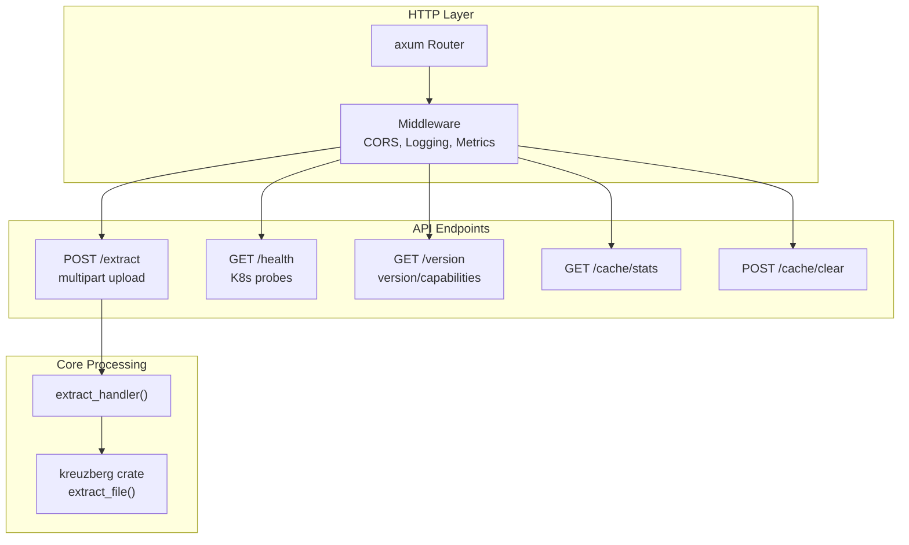
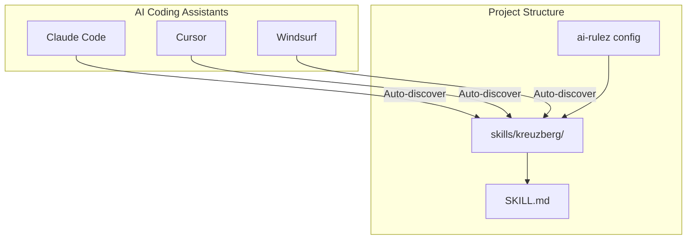

<!-- source: DeepWiki mcp.deepwiki.com · repo kreuzberg-dev/kreuzberg · page 7 Deployment · fetched 2026-10-27 -->

# Deployment

<details>
<summary>Relevant source files</summary>

The following files were used as context for generating this wiki page:

- [.dockerignore](.dockerignore)
- [.github/actions/setup-paddle-ocr-models/README.md](.github/actions/setup-paddle-ocr-models/README.md)
- [.github/actions/setup-paddle-ocr-models/action.yml](.github/actions/setup-paddle-ocr-models/action.yml)
- [.task/config/vars.yml](.task/config/vars.yml)
- [.task/languages/rust.yml](.task/languages/rust.yml)
- [CONTRIBUTING.md](CONTRIBUTING.md)
- [crates/kreuzberg/build.rs](crates/kreuzberg/build.rs)
- [crates/kreuzberg/tests/api_openweb.rs](crates/kreuzberg/tests/api_openweb.rs)
- [crates/kreuzberg/tests/paddle_ocr_integration.rs](crates/kreuzberg/tests/paddle_ocr_integration.rs)
- [docker/Dockerfile.core](docker/Dockerfile.core)
- [docker/Dockerfile.full](docker/Dockerfile.full)
- [docs/contributing.md](docs/contributing.md)
- [docs/css/extra.css](docs/css/extra.css)
- [docs/features.md](docs/features.md)
- [docs/getting-started/installation.md](docs/getting-started/installation.md)
- [docs/guides/agent-skills.md](docs/guides/agent-skills.md)
- [docs/guides/docker.md](docs/guides/docker.md)
- [docs/guides/kubernetes.md](docs/guides/kubernetes.md)
- [docs/index.md](docs/index.md)
- [docs/integrations/index.md](docs/integrations/index.md)
- [docs/integrations/openwebui.md](docs/integrations/openwebui.md)
- [docs/integrations/surrealdb.md](docs/integrations/surrealdb.md)
- [scripts/stage_csharp_native_local.sh](scripts/stage_csharp_native_local.sh)

</details>


This document covers the various deployment modes and integration patterns for Kreuzberg. Each mode serves different use cases and can be deployed across various platforms.

**Deployment modes covered:**
- Command-Line Interface (CLI)
- HTTP REST API Server
- MCP Server for AI Agents
- Docker Deployment
- Agent Skills for AI Assistants
- Kubernetes and Helm Chart

For initial installation and setup, see [Installation](#2.1). For language-specific API details, see the Language Bindings section ([Python Bindings](#4.1), [Node.js/TypeScript Bindings](#4.2), [Ruby Bindings](#4.3), etc.).

---

## Deployment Modes Overview

Kreuzberg provides multiple distinct deployment modes from a single codebase, each optimized for different integration patterns:



Sources: [docs/index.md:48-51](), [docs/features.md:108-129]()

---

## Command-Line Interface

The CLI deployment mode provides the `kreuzberg` binary for command-line usage, scripting, and batch processing workflows. This mode is ideal for local development, one-off tasks, or integration into shell scripts. For details, see [Command-Line Interface](#7.1).

The `kreuzberg` CLI offers commands like `extract`, `batch`, `detect`, and `cache` to perform document processing operations directly from the terminal.

### CLI Binary Structure



Sources: [docs/getting-started/installation.md:11-31](), [.task/languages/rust.yml:68-71]()

---

## HTTP REST API Server

The API server deployment mode exposes Kreuzberg as a RESTful HTTP service. This allows other applications to interact with Kreuzberg over a network, making it suitable for microservice architectures. It includes features like health checks, request/response formats, and CORS configuration. For details, see [HTTP REST API Server](#7.2).

The server can be started using the `kreuzberg serve` command and configured via command-line arguments or environment variables.

### API Server Architecture



Sources: [docs/guides/docker.md:48-64](), [docker/Dockerfile.full:161-162]()

---

## MCP Server for AI Agents

The MCP (Model Context Protocol) server mode enables integration with AI coding assistants like Claude Desktop and Continue.dev. It communicates over standard I/O (stdio) using a JSON-RPC 2.0 protocol, allowing AI agents to invoke Kreuzberg's document processing capabilities as tools. For details, see [MCP Server for AI Agents](#7.3).

This mode is activated using the `kreuzberg mcp` command.

### MCP Server Architecture

```mermaid
graph TB
    subgraph "AI Assistant"
        Claude["Claude Desktop"]
        Continue["Continue.dev"]
    end
    
    subgraph "kreuzberg mcp"
        StdioTransport["stdio Transport<br/>JSON-RPC 2.0"]
        McpHandler["MCP Handler"]
        Tools["MCP Tools"]
    end
    
    subgraph "MCP Tools"
        ExtractFile["extract_file<br/>path → result"]
        ExtractBytes["extract_bytes<br/>base64 → result"]
        BatchExtract["batch_extract<br/>paths[] → results[]"]
    end
    
    subgraph "Core"
        Core["kreuzberg crate<br/>extract_file()"]
    end
    
    Claude -->|stdio| StdioTransport
    Continue -->|stdio| StdioTransport
    
    StdioTransport --> McpHandler
    McpHandler --> Tools
    
    Tools --> ExtractFile
    Tools --> ExtractBytes
    Tools --> BatchExtract
    
    ExtractFile --> Core
    ExtractBytes --> Core
    BatchExtract --> Core
```

Sources: [docs/guides/docker.md:89-98]()

---

## Docker Deployment

Docker deployment provides containerized Kreuzberg, offering portability and consistent environments. Two primary image variants are available: `core` and `full`, along with a `cli` image. These images support multi-architecture builds and are optimized for size. For details, see [Docker Deployment](#7.4).

The Docker images can run Kreuzberg in API server, CLI, or MCP server modes.

### Image Variants

| Variant | Image Name | Size | Tesseract OCR | PaddleOCR/Embeddings | Purpose |
|---------|------------|------|---------------|----------------------|---------|
| `core` | `ghcr.io/kreuzberg-dev/kreuzberg:core` | ~1.0–1.3 GB | 12 languages | On-demand download | Optimized for production, smaller size |
| `full` | `ghcr.io/kreuzberg-dev/kreuzberg:latest` | ~1.5–2.1 GB | 12 languages | Pre-cached | Complete feature set, all models pre-downloaded |
| `cli` | `ghcr.io/kreuzberg-dev/kreuzberg-cli:latest` | N/A | N/A | N/A | Optimized for ephemeral CLI tasks |

Sources: [docs/getting-started/installation.md:33-44](), [docs/guides/docker.md:33-46](), [docker/Dockerfile.core:1-163](), [docker/Dockerfile.full:1-163]()

---

## Agent Skills for AI Assistants

Agent Skills enable AI coding assistants to automatically discover and use Kreuzberg correctly through structured knowledge files, typically `SKILL.md`. This integration pattern helps AI tools understand Kreuzberg's capabilities and how to invoke them. For details, see [Agent Skills for AI Assistants](#7.5).

This approach leverages `ai-rulez` configuration to guide AI assistants in using Kreuzberg effectively.

### Agent Skills Architecture



Sources: [docs/guides/agent-skills.md:1-243]()

---

## Kubernetes and Helm Chart

For production deployments requiring scalability, resilience, and orchestration, Kreuzberg provides an official Helm chart. This chart simplifies deploying Kreuzberg as a service within a Kubernetes cluster, supporting features like Horizontal Pod Autoscaling (HPA), Pod Disruption Budgets (PDB), and Persistent Volume Claims (PVC) for caching. For details, see [Kubernetes and Helm Chart](#7.6).

The Helm chart facilitates OCI artifact distribution and adheres to production deployment patterns.

Sources: [docs/guides/kubernetes.md:1-50]()

---

