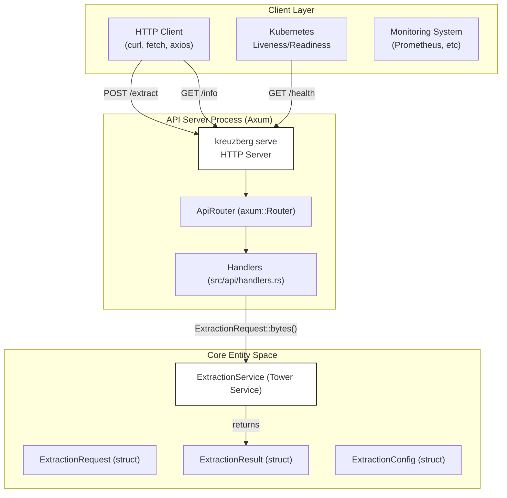
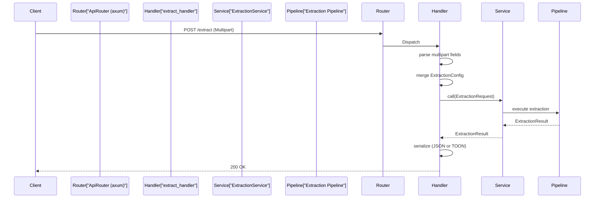

<!-- source: DeepWiki mcp.deepwiki.com · repo kreuzberg-dev/kreuzberg · page 7.2 HTTP REST API Server · fetched 2026-10-27 -->

# HTTP REST API Server

<details>
<summary>Relevant source files</summary>

The following files were used as context for generating this wiki page:

- [crates/kreuzberg-cli/README.md](crates/kreuzberg-cli/README.md)
- [crates/kreuzberg/src/api/error.rs](crates/kreuzberg/src/api/error.rs)
- [crates/kreuzberg/src/api/handlers.rs](crates/kreuzberg/src/api/handlers.rs)
- [crates/kreuzberg/src/api/mod.rs](crates/kreuzberg/src/api/mod.rs)
- [crates/kreuzberg/src/api/openapi.rs](crates/kreuzberg/src/api/openapi.rs)
- [crates/kreuzberg/src/api/openweb.rs](crates/kreuzberg/src/api/openweb.rs)
- [crates/kreuzberg/src/api/router.rs](crates/kreuzberg/src/api/router.rs)
- [crates/kreuzberg/src/api/types.rs](crates/kreuzberg/src/api/types.rs)
- [crates/kreuzberg/src/chunking/validation.rs](crates/kreuzberg/src/chunking/validation.rs)
- [crates/kreuzberg/src/core/config_validation/dependencies.rs](crates/kreuzberg/src/core/config_validation/dependencies.rs)
- [crates/kreuzberg/src/core/server_config/mod.rs](crates/kreuzberg/src/core/server_config/mod.rs)
- [crates/kreuzberg/tests/api_chunk.rs](crates/kreuzberg/tests/api_chunk.rs)
- [crates/kreuzberg/tests/api_embed.rs](crates/kreuzberg/tests/api_embed.rs)
- [crates/kreuzberg/tests/api_large_pdf_extraction.rs](crates/kreuzberg/tests/api_large_pdf_extraction.rs)
- [crates/kreuzberg/tests/api_large_pdf_extraction_diagnostics.rs](crates/kreuzberg/tests/api_large_pdf_extraction_diagnostics.rs)
- [crates/kreuzberg/tests/api_tests.rs](crates/kreuzberg/tests/api_tests.rs)
- [docs/cli/usage.md](docs/cli/usage.md)
- [docs/getting-started/quickstart.md](docs/getting-started/quickstart.md)
- [docs/guides/advanced.md](docs/guides/advanced.md)
- [docs/guides/api-server.md](docs/guides/api-server.md)
- [docs/guides/configuration.md](docs/guides/configuration.md)
- [docs/guides/extraction.md](docs/guides/extraction.md)
- [docs/guides/layout-detection.md](docs/guides/layout-detection.md)
- [docs/guides/ocr.md](docs/guides/ocr.md)
- [docs/guides/plugins.md](docs/guides/plugins.md)
- [docs/reference/environment-variables.md](docs/reference/environment-variables.md)
- [docs/reference/file-size-limits.md](docs/reference/file-size-limits.md)
- [docs/reference/formats.md](docs/reference/formats.md)
- [docs/snippets/cli/batch_basic.md](docs/snippets/cli/batch_basic.md)
- [docs/snippets/cli/extract_basic.md](docs/snippets/cli/extract_basic.md)
- [docs/snippets/cli/ocr_basic.md](docs/snippets/cli/ocr_basic.md)

</details>


The HTTP REST API Server provides a production-ready RESTful interface for document extraction. It wraps the core extraction engine in an HTTP service, enabling document processing from any HTTP client without language-specific bindings.

This page covers the server's architecture, endpoints, request/response formats, and deployment patterns. For command-line usage, see [7.1](). For AI agent integration via Model Context Protocol, see [7.3](). For containerized deployment options, see [7.4]().

---

## Architecture Overview

The API server is implemented in the `kreuzberg` crate and exposed via the `kreuzberg-cli` binary using the `serve` subcommand. It uses the `axum` framework for routing and request handling [crates/kreuzberg/src/api/router.rs:1-20]().

### API Server Component Diagram

**Sources:** [crates/kreuzberg/src/api/router.rs:1-40](), [crates/kreuzberg/src/api/handlers.rs:1-138](), [crates/kreuzberg/src/service/mod.rs:1-50]()

---

## Execution Modes

The API server is one of three primary execution modes provided by the CLI:

| Mode | Command | Implementation | Transport |
|------|---------|----------------|-----------|
| **API Server** | `kreuzberg serve` | `src/api/router.rs` | HTTP/1.1 & HTTP/2 |
| CLI | `kreuzberg extract` | `src/main.rs` | Local I/O |
| MCP Server | `kreuzberg mcp` | `src/mcp/server.rs` | stdio / HTTP |

**Sources:** [docs/guides/api-server.md:1-36](), [crates/kreuzberg/src/mcp/server.rs:25-36]()

---

## API Endpoints

### POST /extract
Extracts text from uploaded files via multipart form data [docs/guides/api-server.md:39-41]().

**Request Fields:**
| Field | Type | Required | Description |
|-------|------|----------|-------------|
| `files` | Binary | Yes | Files to extract (repeatable) [docs/guides/api-server.md:45]() |
| `config` | JSON String | No | ExtractionConfig overrides [docs/guides/api-server.md:46]() |
| `output_format` | String | No | `plain`, `markdown`, `djot`, or `html` [docs/guides/api-server.md:47]() |

**Response Wire Formats:**
The server supports two wire formats for responses:
1. **JSON**: Default. `Content-Type: application/json`.
2. **TOON**: A token-efficient binary/text format requested via `Accept: application/toon` header [crates/kreuzberg/src/api/handlers.rs:68-74]().

**Sources:** [docs/guides/api-server.md:39-74](), [crates/kreuzberg/src/api/handlers.rs:134-184]()

---

### POST /embed
Generates vector embeddings for a list of strings [docs/guides/api-server.md:76-78]().

**Request Body:**
```json
{
  "texts": ["text 1", "text 2"],
  "config": { "preset": "balanced" }
}
```
**Presets:** `fast` (384d), `balanced` (768d), `quality` (1024d), `multilingual` (768d) [docs/guides/api-server.md:91-96]().

**Sources:** [docs/guides/api-server.md:76-97](), [crates/kreuzberg/tests/api_embed.rs:20-56]()

---

### POST /chunk
Chunks text for RAG pipelines [docs/guides/api-server.md:99-100]().

**Request Body:**
```json
{
  "text": "Long text...",
  "chunker_type": "text",
  "config": {
    "max_characters": 1000,
    "overlap": 50
  }
}
```
**Parameters:**
- `text`: Text to chunk [docs/guides/api-server.md:103]().
- `chunker_type`: `"text"` (default), `"markdown"`, `"yaml"`, or `"semantic"` [docs/guides/api-server.md:104]().
- `config.max_characters`: Max characters per chunk (default: 2000) [docs/guides/api-server.md:105]().
- `config.overlap`: Overlap between chunks (default: 100) [docs/guides/api-server.md:106]().

**Sources:** [docs/guides/api-server.md:99-113](), [crates/kreuzberg/tests/api_chunk.rs:20-56]()

---

### POST /extract-structured
Extracts typed JSON from a document using an LLM (requires `liter-llm` feature) [docs/guides/api-server.md:143-145]().

**Parameters:**
- `file`: The document [docs/guides/api-server.md:149]().
- `schema`: JSON Schema string for output [docs/guides/api-server.md:150]().
- `model`: LLM identifier (e.g., `openai/gpt-4o`) [docs/guides/api-server.md:151]().
- `api_key`: LLM provider API key [docs/guides/api-server.md:152]().
- `prompt`: Custom Jinja2 prompt template [docs/guides/api-server.md:153]().
- `schema_name`: Schema identifier (default: `extraction`) [docs/guides/api-server.md:154]().
- `strict`: `"true"` / `"false"` for OpenAI strict mode [docs/guides/api-server.md:155]().
- `config`: Extraction config overrides as a JSON string [docs/guides/api-server.md:156]().

**Sources:** [docs/guides/api-server.md:143-179](), [crates/kreuzberg/src/api/handlers.rs:240-300]()

---

### System & Health Endpoints
| Endpoint | Method | Response |
|----------|--------|----------|
| `/health` | `GET` | `HealthResponse` including plugin status [crates/kreuzberg/src/api/handlers.rs:33-47]() |
| `/info` | `GET` | Version and backend info [crates/kreuzberg/src/api/handlers.rs:61-66]() |
| `/version` | `GET` | `{"version":"4.6.3"}` [docs/guides/api-server.md:186]() |
| `/detect` | `POST` | MIME type detection (multipart) [docs/guides/api-server.md:187]() |
| `/cache/stats` | `GET` | Cache statistics [docs/guides/api-server.md:187]() |
| `/cache/warm` | `POST` | Pre-download models [docs/guides/api-server.md:188]() |
| `/cache/manifest` | `GET` | Model manifest with checksums [docs/guides/api-server.md:189]() |
| `/cache/clear` | `DELETE` | Invalidates all cached extractions [docs/guides/api-server.md:190]() |

**Sources:** [docs/guides/api-server.md:181-190](), [crates/kreuzberg/src/api/handlers.rs:21-66]()

---

## Request Processing Flow

The server uses a `Tower` service stack to process requests.

### Data Flow Diagram

**Sources:** [crates/kreuzberg/src/api/handlers.rs:134-200](), [crates/kreuzberg/src/service/mod.rs:80-100]()

---

## Deployment & Kubernetes Integration

### Docker Images
Kreuzberg provides two primary Docker variants [docs/getting-started/installation.md:33-45]():
- `kreuzberg-cli`: Lightweight, for CLI/batch usage.
- `kreuzberg`: Full image including API server and all OCR backends.

### Kubernetes Probes
The `/health` endpoint is specifically designed for Kubernetes `livenessProbe` and `readinessProbe`. It validates not just the HTTP server, but also the health of registered plugins [crates/kreuzberg/src/api/handlers.rs:34-45]().

**Example Helm/K8s Config:**
```yaml
livenessProbe:
  httpGet:
    path: /health
    port: 8000
readinessProbe:
  httpGet:
    path: /health
    port: 8000
```

### Resource Limits
Request body size limits are enforced at the router layer [crates/kreuzberg/src/api/handlers.rs:102-110]():
- **Total Request**: Default 100 MB (`KREUZBERG_MAX_REQUEST_BODY_BYTES`) [crates/kreuzberg/src/api/types.rs:55-57]().
- **Multipart Field**: Default 100 MB (`KREUZBERG_MAX_MULTIPART_FIELD_BYTES`) [crates/kreuzberg/src/api/types.rs:59-61]().
These are configurable via environment variables or CLI flags [docs/cli/usage.md:41-58]().

**Sources:** [docs/guides/api-server.md:5-36](), [crates/kreuzberg/src/api/handlers.rs:21-47](), [docs/getting-started/installation.md:33-45](), [crates/kreuzberg/src/api/types.rs:11-73](), [docs/reference/file-size-limits.md:1-10]()

---

## Configuration Discovery

The API server uses `ExtractionConfig::discover()` to locate a `kreuzberg.toml`, `kreuzberg.yaml`, or `kreuzberg.json` file in the environment upon startup [crates/kreuzberg/src/mcp/server.rs:61-73](). If no file is found, it falls back to internal defaults [docs/guides/configuration.md:86-89]().

**Sources:** [docs/guides/configuration.md:39-84](), [crates/kreuzberg/src/mcp/server.rs:55-76]()

---

