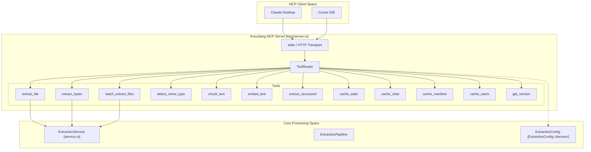
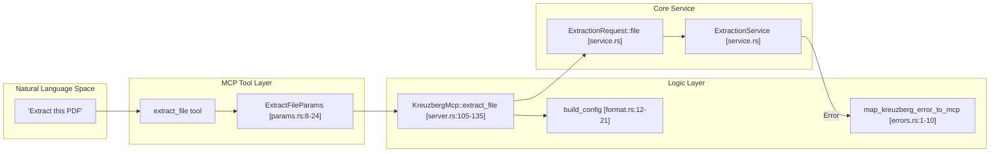

<!-- source: DeepWiki mcp.deepwiki.com · repo kreuzberg-dev/kreuzberg · page 7.3 MCP Server for AI Agents · fetched 2026-10-27 -->

# MCP Server for AI Agents

<details>
<summary>Relevant source files</summary>

The following files were used as context for generating this wiki page:

- [crates/kreuzberg-cli/Cargo.toml](crates/kreuzberg-cli/Cargo.toml)
- [crates/kreuzberg-cli/src/commands/extract.rs](crates/kreuzberg-cli/src/commands/extract.rs)
- [crates/kreuzberg-cli/src/commands/mod.rs](crates/kreuzberg-cli/src/commands/mod.rs)
- [crates/kreuzberg-cli/src/commands/overrides.rs](crates/kreuzberg-cli/src/commands/overrides.rs)
- [crates/kreuzberg-cli/src/main.rs](crates/kreuzberg-cli/src/main.rs)
- [crates/kreuzberg-cli/tests/commands_test.rs](crates/kreuzberg-cli/tests/commands_test.rs)
- [crates/kreuzberg-cli/tests/config_discovery_test.rs](crates/kreuzberg-cli/tests/config_discovery_test.rs)
- [crates/kreuzberg-cli/tests/server_test.rs](crates/kreuzberg-cli/tests/server_test.rs)
- [crates/kreuzberg/src/chunking/processor.rs](crates/kreuzberg/src/chunking/processor.rs)
- [crates/kreuzberg/src/language_detection/processor.rs](crates/kreuzberg/src/language_detection/processor.rs)
- [crates/kreuzberg/src/mcp/format.rs](crates/kreuzberg/src/mcp/format.rs)
- [crates/kreuzberg/src/mcp/mod.rs](crates/kreuzberg/src/mcp/mod.rs)
- [crates/kreuzberg/src/mcp/params.rs](crates/kreuzberg/src/mcp/params.rs)
- [crates/kreuzberg/src/mcp/server.rs](crates/kreuzberg/src/mcp/server.rs)
- [crates/kreuzberg/src/text/quality_processor.rs](crates/kreuzberg/src/text/quality_processor.rs)
- [crates/kreuzberg/tests/test_batch_extract_schema.rs](crates/kreuzberg/tests/test_batch_extract_schema.rs)

</details>


This page documents Kreuzberg's Model Context Protocol (MCP) server implementation, which enables AI assistants to extract text, tables, and metadata from documents through a standardized tool interface. The MCP server exposes document intelligence capabilities as callable tools over stdio or HTTP transport, allowing integration with Claude Desktop, Cursor, and other MCP-compatible AI agents.

## Model Context Protocol Overview

The Model Context Protocol (MCP) is an open standard that defines how AI assistants interact with external tools and data sources. Kreuzberg implements an MCP server that encapsulates its multi-stage extraction pipeline (MIME detection, format-specific extraction, OCR, and post-processing) into a set of discrete tools.

The server operates primarily over `stdio` transport using JSON-RPC 2.0, where the AI assistant launches the `kreuzberg-cli` as a subprocess. It also supports HTTP transport when the `mcp-http` feature is enabled.

**Sources:** [crates/kreuzberg/src/mcp/mod.rs:1-19](), [crates/kreuzberg/src/mcp/server.rs:7-13]()

## System Architecture

The MCP server is built around the `KreuzbergMcp` struct, which acts as a router for incoming tool calls. It leverages the `rmcp` crate for protocol handling and the internal `ExtractionService` for document processing.



**Diagram: MCP Server Component Interaction**

The server maintains a `default_config` loaded via `ExtractionConfig::discover()`, which searches for `kreuzberg.toml`, `.yaml`, or `.json` in the current and parent directories [crates/kreuzberg/src/mcp/server.rs:55-73]().

**Sources:** [crates/kreuzberg/src/mcp/server.rs:25-36](), [crates/kreuzberg/src/mcp/server.rs:61-76](), [crates/kreuzberg/src/mcp/server.rs:83-91]()

## Core Implementation Details

### The KreuzbergMcp Struct
The `KreuzbergMcp` struct [crates/kreuzberg/src/mcp/server.rs:25-36]() holds the state required for tool execution:
- `tool_router`: Dispatches calls to specific methods [crates/kreuzberg/src/mcp/server.rs:27]().
- `default_config`: An `Arc<ExtractionConfig>` used as the base for all requests [crates/kreuzberg/src/mcp/server.rs:29]().
- `extraction_service`: A `Mutex<BoxCloneService>` that wraps the core extraction logic with tracing and metrics layers [crates/kreuzberg/src/mcp/server.rs:31-34]().

### Request Handling Flow
When a tool like `extract_file` is called:
1. **Parameter Parsing**: Parameters are received as `ExtractFileParams` [crates/kreuzberg/src/mcp/server.rs:105-107]().
2. **Config Merging**: The `build_config` helper merges any per-request overrides into the `default_config` [crates/kreuzberg/src/mcp/format.rs:12-21]().
3. **Service Invocation**: An `ExtractionRequest` is created and passed to the `extraction_service` [crates/kreuzberg/src/mcp/server.rs:121-131]().
4. **Result Formatting**: The `ExtractionResult` is serialized into either JSON or TOON format based on the `response_format` parameter [crates/kreuzberg/src/mcp/format.rs:44-50]().

**Sources:** [crates/kreuzberg/src/mcp/server.rs:105-135](), [crates/kreuzberg/src/mcp/format.rs:12-21]()

## Exposed Tools

The server exposes a comprehensive suite of tools for document intelligence. These tools are defined in `crates/kreuzberg/src/mcp/params.rs` and implemented as methods on the `KreuzbergMcp` struct in `crates/kreuzberg/src/mcp/server.rs`.

| Tool Name | Function | Parameters (from `crates/kreuzberg/src/mcp/params.rs`) |
|-----------|----------|------------|
| `extract_file` | Extracts content from a local file path | `ExtractFileParams` [crates/kreuzberg/src/mcp/params.rs:8-24]() |
| `extract_bytes` | Extracts content from base64 data | `ExtractBytesParams` [crates/kreuzberg/src/mcp/params.rs:27-43]() |
| `batch_extract_files` | Parallel extraction for multiple files | `BatchExtractFilesParams` [crates/kreuzberg/src/mcp/params.rs:46-64]() |
| `detect_mime_type` | Identifies file type without extraction | `DetectMimeTypeParams` [crates/kreuzberg/src/mcp/params.rs:67-75]() |
| `chunk_text` | Splits text using configured chunkers | `ChunkTextParams` [crates/kreuzberg/src/mcp/params.rs:158-180]() |
| `embed_text` | Generates vector embeddings | `EmbedTextParams` [crates/kreuzberg/src/mcp/params.rs:103-121]() |
| `extract_structured` | LLM-based structured data extraction | `ExtractStructuredParams` [crates/kreuzberg/src/mcp/params.rs:130-153]() |
| `cache_stats` | Returns cache usage metrics | `EmptyParams` [crates/kreuzberg/src/mcp/params.rs:85-86]() |
| `cache_clear` | Clears the cache | `EmptyParams` [crates/kreuzberg/src/mcp/params.rs:85-86]() |
| `cache_manifest` | Get model manifest with checksums | `EmptyParams` [crates/kreuzberg/src/mcp/params.rs:85-86]() |
| `cache_warm` | Downloads model files for offline use | `CacheWarmParams` [crates/kreuzberg/src/mcp/params.rs:90-98]() |
| `get_version` | Get Kreuzberg version info | `EmptyParams` [crates/kreuzberg/src/mcp/params.rs:85-86]() |

**Sources:** [crates/kreuzberg/src/mcp/mod.rs:8-19](), [crates/kreuzberg/src/mcp/server.rs:105-135](), [crates/kreuzberg/src/mcp/server.rs:148-180](), [crates/kreuzberg/src/mcp/params.rs:8-180]()

## Data Flow: Tool Invocation to Code Entity

This diagram maps the high-level tool concepts to the specific code entities that handle them.



**Diagram: Entity Mapping for Tool Execution**

**Sources:** [crates/kreuzberg/src/mcp/server.rs:105-135](), [crates/kreuzberg/src/mcp/params.rs:1-55](), [crates/kreuzberg/src/mcp/errors.rs:1-10]()

## Integration with Claude Desktop

Claude Desktop integrates with Kreuzberg by launching it as a subprocess. The configuration is typically stored in `claude_desktop_config.json`.

### Example Configuration
```json
{
  "mcpServers": {
    "kreuzberg": {
      "command": "kreuzberg",
      "args": ["mcp"],
      "env": {
        "KREUZBERG_CONFIG": "/path/to/config.toml"
      }
    }
  }
}
```

### Protocol Mechanics
- **Transport**: `stdio` (stdin for requests, stdout for responses).
- **Serialization**: The server ensures 1:1 parity with API/CLI output by using `serde_json` or `serde_toon` for formatting [crates/kreuzberg/src/mcp/format.rs:27-39]().
- **Async Execution**: Extraction always runs asynchronously within a Tokio runtime to avoid nested runtime panics [crates/kreuzberg/src/mcp/server.rs:98-100]().

**Sources:** [crates/kreuzberg/src/mcp/server.rs:98-100](), [crates/kreuzberg/src/mcp/format.rs:23-50]()

## Post-Processing Integration

MCP tools automatically benefit from the post-processor registry. When a tool call is made, the `ExtractionService` invokes registered plugins based on the `ExtractionConfig`.

- **QualityProcessor**: Calculates quality scores in the `Early` stage [crates/kreuzberg/src/text/quality_processor.rs:74]().
- **LanguageDetector**: Identifies document languages [crates/kreuzberg/src/language_detection/processor.rs:10-16]().
- **ChunkingProcessor**: Handles text segmentation in the `Middle` stage [crates/kreuzberg/src/chunking/processor.rs:12-19]().

These processors are triggered if the corresponding fields are enabled in the merged `ExtractionConfig` [crates/kreuzberg/src/chunking/processor.rs:73-75]().

**Sources:** [crates/kreuzberg/src/text/quality_processor.rs:61-76](), [crates/kreuzberg/src/chunking/processor.rs:52-81](), [crates/kreuzberg/src/language_detection/processor.rs:50-77]()

---

