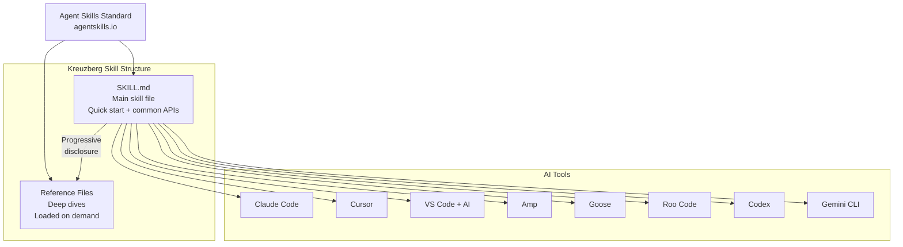
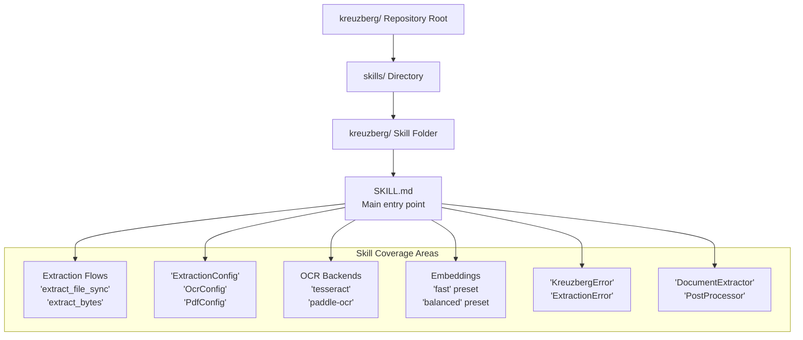
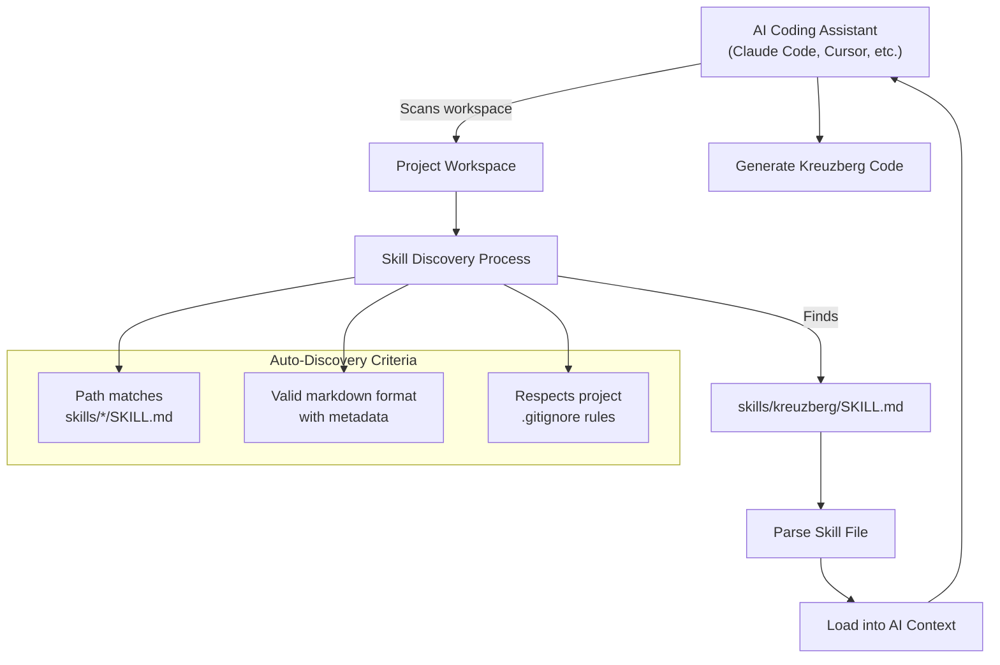

<!-- source: DeepWiki mcp.deepwiki.com · repo kreuzberg-dev/kreuzberg · page 7.5 Agent Skills for AI Assistants · fetched 2026-10-27 -->

# Agent Skills for AI Assistants

<details>
<summary>Relevant source files</summary>

The following files were used as context for generating this wiki page:

- [CONTRIBUTING.md](CONTRIBUTING.md)
- [crates/kreuzberg/tests/api_openweb.rs](crates/kreuzberg/tests/api_openweb.rs)
- [docs/contributing.md](docs/contributing.md)
- [docs/css/extra.css](docs/css/extra.css)
- [docs/features.md](docs/features.md)
- [docs/getting-started/installation.md](docs/getting-started/installation.md)
- [docs/guides/agent-skills.md](docs/guides/agent-skills.md)
- [docs/guides/docker.md](docs/guides/docker.md)
- [docs/guides/kubernetes.md](docs/guides/kubernetes.md)
- [docs/index.md](docs/index.md)
- [docs/integrations/index.md](docs/integrations/index.md)
- [docs/integrations/openwebui.md](docs/integrations/openwebui.md)
- [docs/integrations/surrealdb.md](docs/integrations/surrealdb.md)
- [skills/kreuzberg/SKILL.md](skills/kreuzberg/SKILL.md)
- [skills/kreuzberg/references/advanced-features.md](skills/kreuzberg/references/advanced-features.md)
- [skills/kreuzberg/references/cli-reference.md](skills/kreuzberg/references/cli-reference.md)
- [skills/kreuzberg/references/configuration.md](skills/kreuzberg/references/configuration.md)
- [skills/kreuzberg/references/nodejs-api.md](skills/kreuzberg/references/nodejs-api.md)
- [skills/kreuzberg/references/other-bindings.md](skills/kreuzberg/references/other-bindings.md)
- [skills/kreuzberg/references/python-api.md](skills/kreuzberg/references/python-api.md)
- [skills/kreuzberg/references/rust-api.md](skills/kreuzberg/references/rust-api.md)
- [skills/kreuzberg/references/supported-formats.md](skills/kreuzberg/references/supported-formats.md)

</details>


## Purpose and Scope

This page documents Kreuzberg's Agent Skill system, which teaches AI coding assistants how to use the library correctly across all language bindings. Agent Skills provide structured, AI-optimized knowledge files that are automatically discovered by AI coding tools, enabling them to generate accurate code examples, suggest correct APIs, and guide developers through common workflows. For general CLI usage, see [Command-Line Interface](#7.1). For programmatic AI integration via the Model Context Protocol, see [MCP Server for AI Agents](#7.3).

**Sources:** [docs/guides/agent-skills.md:1-25](), [skills/kreuzberg/SKILL.md:1-20]()

---

## Agent Skills Standard

Agent Skills follow the open [Agent Skills](https://agentskills.io) standard, which defines a file format and discovery protocol for packaging library knowledge for AI consumption. Unlike traditional documentation, skills use progressive disclosure: a concise main file (`SKILL.md`) covers common patterns and APIs, with detailed reference files loaded only when the AI needs deeper context.

### Knowledge Flow Diagram
Title: "Bridging Natural Language Requests to Kreuzberg Code Entities"


**Sources:** [docs/guides/agent-skills.md:5-23](), [skills/kreuzberg/SKILL.md:1-15]()

---

## Skill File Organization

Kreuzberg's skill files are located in the repository root under `skills/kreuzberg/`. The main entry point is `SKILL.md`, which provides quick-start guidance for Python, Node.js/TypeScript, Rust, and CLI interfaces.

### Skill Hierarchy and Code Entity Mapping
Title: "Mapping SKILL.md Sections to Library Code Entities"


The `SKILL.md` file contains:
- **Language-specific quick starts** for Python, Node.js, Rust, and CLI.
- **Common API patterns** including async/sync extraction, batch processing, configuration.
- **OCR configuration** examples for Tesseract, PaddleOCR, and EasyOCR.
- **Error handling** patterns with proper exception catching.
- **Plugin registration** for validators, post-processors, and OCR backends.

**Sources:** [docs/guides/agent-skills.md:22-45](), [skills/kreuzberg/SKILL.md:25-150]()

---

## Auto-Discovery Mechanism

AI coding assistants that support the Agent Skills standard automatically discover and load skills when they are present in the current project or workspace.

### Discovery Logic


**Discovery Requirements:**

| Requirement | Description | Verification |
|------------|-------------|--------------|
| **File Location** | `skills/<package-name>/SKILL.md` | AI scans workspace for this pattern |
| **File Format** | Markdown with frontmatter metadata | Validates syntax during discovery |
| **Access Control** | Respects `.gitignore` and project boundaries | Only loaded for active workspace |
| **Standard Compliance** | Follows Agent Skills spec | AI validates structure before loading |

**Sources:** [docs/guides/agent-skills.md:5-23](), [skills/kreuzberg/SKILL.md:1-10]()

---

## Installation and Configuration

The Kreuzberg skill can be added to a project via the Skills CLI or by manually placing the `skills/` directory.

### Integration with ai-rulez
For tools like Cursor or Claude Code, Kreuzberg provides `ai-rulez` configuration to enforce specific coding standards (e.g., "always use async variants in web handlers").

**Installation Command:**
```bash
npx skills add kreuzberg-dev/kreuzberg
```

### Reference File Structure
The skill utilizes multiple specialized reference files to avoid context bloat:
- `references/configuration.md`: Detailed `ExtractionConfig` fields.
- `references/python-api.md`: Python-specific signatures.
- `references/nodejs-api.md`: TypeScript/Node.js worker thread patterns.
- `references/supported-formats.md`: MIME type and capability matrix.

**Sources:** [docs/guides/agent-skills.md:1-10](), [skills/kreuzberg/SKILL.md:180-200](), [skills/kreuzberg/references/configuration.md](), [skills/kreuzberg/references/python-api.md](), [skills/kreuzberg/references/nodejs-api.md](), [skills/kreuzberg/references/supported-formats.md]()

---

## Coverage Areas

### Extraction Workflows
The skill teaches AI the differences between synchronous and asynchronous calls across bindings.

| Binding | Sync Function | Async Function |
|---------|---------------|----------------|
| **Python** | `extract_file_sync()` | `extract_file()` |
| **Node.js** | `extractFileSync()` | `extractFile()` |
| **Rust** | `extract_file_sync()` | `extract_file()` |
| **CLI** | `kreuzberg extract` | N/A |

### Configuration Topics
The skill provides templates for:
- **OCR:** Setting `OcrConfig` with `backend: "tesseract"` or `"paddle-ocr"`.
- **PDF:** Using `PdfConfig` for password-protected files.
- **Chunking:** Configuring `ChunkingConfig` for RAG pipelines.

### Error Handling
The skill maps library errors to language-specific idioms:
- **Python:** Catching `KreuzbergError`.
- **Node.js:** Handling rejected Promises with specific error codes.
- **Rust:** Matching on `KreuzbergError` variants.

**Sources:** [skills/kreuzberg/SKILL.md:40-120](), [skills/kreuzberg/references/python-api.md](), [skills/kreuzberg/references/nodejs-api.md]()

---

## Supported AI Assistants

| AI Assistant | Skill Support | Integration Method |
|--------------|---------------|--------------------|
| **Claude Code** | ✅ Native | Auto-discovery of `skills/` |
| **Cursor** | ✅ Native | Auto-discovery + `.cursorrules` |
| **VS Code (Copilot)** | ✅ Via rules | Custom `.github/copilot-instructions.md` |
| **Gemini CLI** | ✅ Native | Auto-discovery |
| **Amp** | ✅ Native | Auto-discovery |
| **Goose** | ✅ Native | Auto-discovery |
| **Roo Code** | ✅ Native | Auto-discovery |
| **Codex** | ✅ Native | Auto-discovery |

**Sources:** [docs/guides/agent-skills.md:9-20](), [skills/kreuzberg/SKILL.md:1-10]()

---

