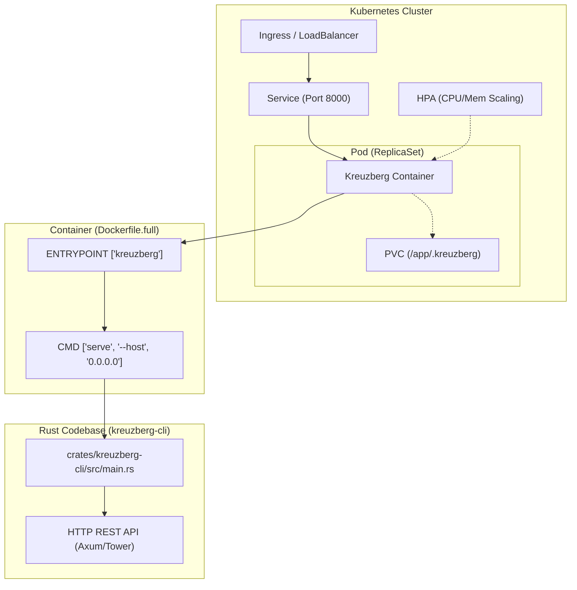
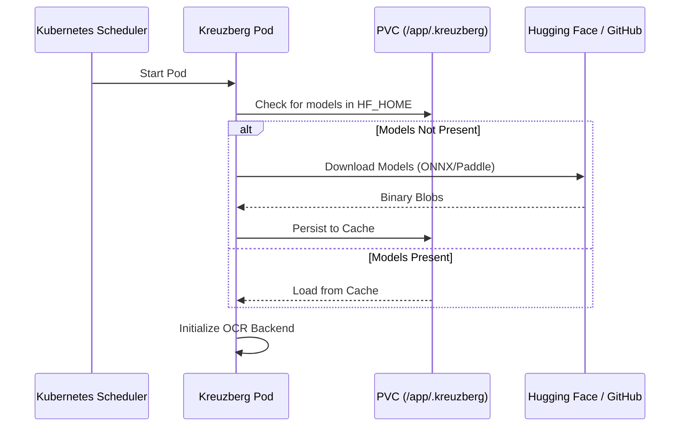

<!-- source: DeepWiki mcp.deepwiki.com · repo kreuzberg-dev/kreuzberg · page 7.6 Kubernetes and Helm Chart · fetched 2026-10-27 -->

# Kubernetes and Helm Chart

Relevant source files

The following files were used as context for generating this wiki page:

- [.dockerignore](.dockerignore)
- [.github/actions/setup-paddle-ocr-models/README.md](.github/actions/setup-paddle-ocr-models/README.md)
- [.github/actions/setup-paddle-ocr-models/action.yml](.github/actions/setup-paddle-ocr-models/action.yml)
- [.task/config/vars.yml](.task/config/vars.yml)
- [.task/languages/rust.yml](.task/languages/rust.yml)
- [CONTRIBUTING.md](CONTRIBUTING.md)
- [crates/kreuzberg/build.rs](crates/kreuzberg/build.rs)
- [crates/kreuzberg/tests/api_openweb.rs](crates/kreuzberg/tests/api_openweb.rs)
- [crates/kreuzberg/tests/paddle_ocr_integration.rs](crates/kreuzberg/tests/paddle_ocr_integration.rs)
- [docker/Dockerfile.core](docker/Dockerfile.core)
- [docker/Dockerfile.full](docker/Dockerfile.full)
- [docs/contributing.md](docs/contributing.md)
- [docs/css/extra.css](docs/css/extra.css)
- [docs/features.md](docs/features.md)
- [docs/getting-started/installation.md](docs/getting-started/installation.md)
- [docs/guides/agent-skills.md](docs/guides/agent-skills.md)
- [docs/guides/docker.md](docs/guides/docker.md)
- [docs/guides/kubernetes.md](docs/guides/kubernetes.md)
- [docs/index.md](docs/index.md)
- [docs/integrations/index.md](docs/integrations/index.md)
- [docs/integrations/openwebui.md](docs/integrations/openwebui.md)
- [docs/integrations/surrealdb.md](docs/integrations/surrealdb.md)
- [scripts/stage_csharp_native_local.sh](scripts/stage_csharp_native_local.sh)

Kreuzberg provides first-class support for Kubernetes deployments, primarily targeting the execution of the [HTTP REST API Server](7.2) and [MCP Server](7.3). Deployment is facilitated via OCI-compliant Docker images and a structured Helm chart designed for production-grade scalability and reliability.

## Helm Chart Structure

The Kreuzberg Helm chart (distributed via OCI registry) follows a standard cloud-native pattern, encapsulating the necessary resources to run the `kreuzberg serve` command in a containerized environment.

### Core Resources
The chart manages the following Kubernetes primitives:
*   **Deployment**: Manages the `kreuzberg` pods, typically running the `serve` command [docker/Dockerfile.full:161-162]().
*   **Service**: Provides a stable endpoint (ClusterIP or LoadBalancer) for the REST API on port `8000` [docker/Dockerfile.full:153-162]().
*   **HorizontalPodAutoscaler (HPA)**: Scales replicas based on CPU/Memory utilization, critical for OCR-heavy workloads.
*   **PodDisruptionBudget (PDB)**: Ensures high availability during cluster maintenance.
*   **PersistentVolumeClaim (PVC)**: Optional storage for model caching and persistent document buffers.

### Data Flow and Code Mapping

The following diagram illustrates how Kubernetes resources map to the underlying container execution and code entry points.

**Kubernetes to Code Mapping**

Sources: [docker/Dockerfile.full:153-162](), [docs/guides/docker.md:48-64]()

## Values.yaml Configuration

The `values.yaml` file allows for fine-grained control over the deployment. Key configuration areas include:

### Image Selection
Users can choose between `core` and `full` image variants:
*   **Full Image**: Includes pre-downloaded PaddleOCR and layout detection models [docker/Dockerfile.full:118-122](). Recommended for production to avoid egress traffic at startup.
*   **Core Image**: Smaller footprint, downloads models on-demand [docker/Dockerfile.core:120-122]().

### Resource Limits
Because Kreuzberg is optimized for performance with native PDFium and SIMD [docs/index.md:28-30](), it can be CPU-intensive during extraction.
*   **CPU**: High limits are recommended for OCR/PaddleOCR.
*   **Memory**: Ensure sufficient overhead for ONNX Runtime and large document buffers.

### Environment Variables
The chart maps several critical environment variables used by the Rust core:
*   `KREUZBERG_CACHE_DIR`: Set to `/app/.kreuzberg` to store models and temporary files [docker/Dockerfile.full:146-150]().
*   `HF_HOME`: Directs Hugging Face model downloads [docker/Dockerfile.full:147-150]().
*   `RUST_LOG`: Controls logging verbosity (default: `info`) [docker/Dockerfile.full:148-150]().

Sources: [docker/Dockerfile.full:146-151](), [docker/Dockerfile.core:139-150](), [docs/index.md:28-35]()

## Production Deployment Patterns

### Model Caching with PVC
To prevent repeated model downloads across pod restarts in the `core` image, a `PersistentVolumeClaim` should be mounted at `/app/.kreuzberg`.

**Model Persistence Flow**

Sources: [docker/Dockerfile.full:118-122](), [docker/Dockerfile.core:120-123]()

### High Availability (HPA & PDB)
For production workloads, an `HorizontalPodAutoscaler` is essential. Kreuzberg's performance scales linearly with CPU cores due to its parallelized Rust core [docs/index.md:28-31]().
*   **Scaling Metric**: Target CPU utilization at 70-80%.
*   **PDB**: `maxUnavailable: 1` is recommended to ensure the API remains responsive during node upgrades.

### Health Probes
The Helm chart utilizes the built-in health check capability of the binary:
*   **Liveness/Readiness**: Executed via `/usr/local/bin/kreuzberg --version` or by polling the HTTP `/health` endpoint [docker/Dockerfile.full:156-157](), [docs/guides/docker.md:153-157]()

## OCI Artifact Distribution

Kreuzberg distributes its Helm charts and Docker images as OCI artifacts via the GitHub Container Registry (`ghcr.io`).

| Artifact | Registry Path |
| :--- | :--- |
| **Full Image** | `ghcr.io/kreuzberg-dev/kreuzberg:latest` |
| **Core Image** | `ghcr.io/kreuzberg-dev/kreuzberg:latest-core` |
| **CLI Image** | `ghcr.io/kreuzberg-dev/kreuzberg-cli:latest` |

The release process is automated via GitHub Actions, ensuring that every tagged release (e.g., `v4.3.6`) has corresponding immutable OCI images and Helm charts [docs/contributing.md:188-194]().

Sources: [docs/getting-started/installation.md:33-44](), [docs/contributing.md:188-194](), [docker/Dockerfile.full:64-67]()

---

