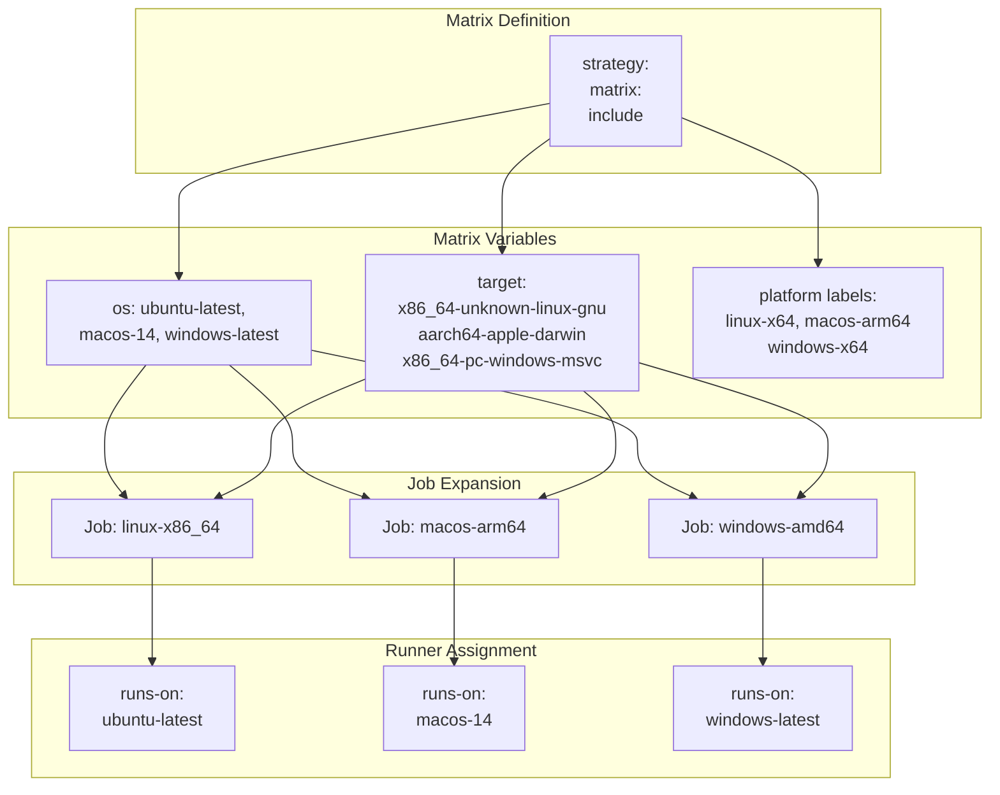
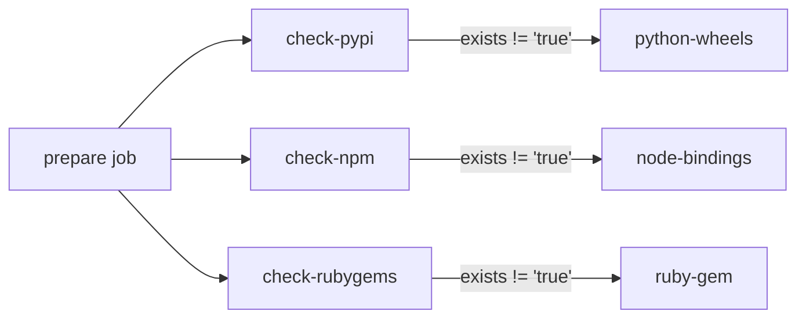
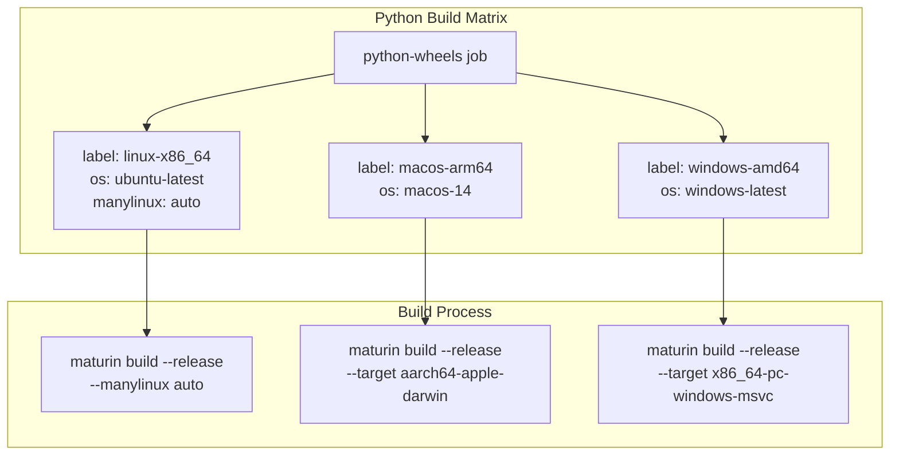
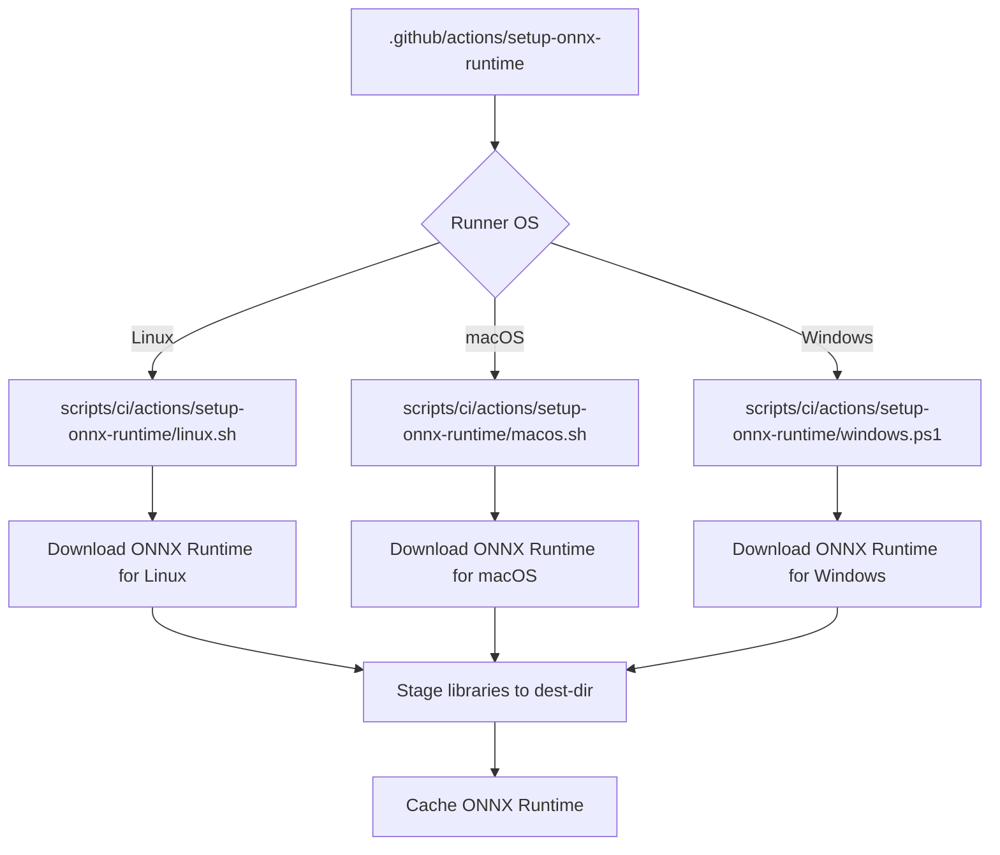

<!-- source: DeepWiki mcp.deepwiki.com · repo kreuzberg-dev/kreuzberg · page 8.2 Multi-Platform Build Matrix · fetched 2026-10-27 -->

# Multi-Platform Build Matrix

Relevant source files

The following files were used as context for generating this wiki page:

- [.github/actions/install-system-deps/action.yml](.github/actions/install-system-deps/action.yml)
- [.github/actions/setup-onnx-runtime/action.yml](.github/actions/setup-onnx-runtime/action.yml)
- [.github/workflows/benchmarks.yaml](.github/workflows/benchmarks.yaml)
- [.github/workflows/ci-docker.yaml](.github/workflows/ci-docker.yaml)
- [.github/workflows/ci-rust.yaml](.github/workflows/ci-rust.yaml)
- [.github/workflows/profiling.yaml](.github/workflows/profiling.yaml)
- [.github/workflows/publish.yaml](.github/workflows/publish.yaml)
- [e2e/java/pom.xml](e2e/java/pom.xml)
- [packages/csharp/Kreuzberg/Kreuzberg.csproj](packages/csharp/Kreuzberg/Kreuzberg.csproj)
- [packages/java/pom.xml](packages/java/pom.xml)
- [packages/python/pyproject.toml](packages/python/pyproject.toml)
- [scripts/ci/install-system-deps/install-linux.sh](scripts/ci/install-system-deps/install-linux.sh)
- [scripts/ci/install-system-deps/install-macos.sh](scripts/ci/install-system-deps/install-macos.sh)
- [scripts/ci/install-system-deps/install-windows.ps1](scripts/ci/install-system-deps/install-windows.ps1)

## Purpose and Scope

This document describes Kreuzberg's multi-platform build matrix strategy, detailing how the project compiles native binaries and language bindings across different operating systems and CPU architectures. The build matrix orchestrates parallel compilation jobs that produce artifacts for 16 target ecosystems, including Python, Node.js, Ruby, Java, Go, C#, PHP, Elixir, Dart, Swift, Zig, and Kotlin.

For information about the overall CI/CD pipeline, see [CI Pipeline Overview](#8.1). For details on package distribution channels, see [Package Distribution Channels](#8.4). For platform-specific considerations, see [Platform-Specific Considerations](#9).

## Platform Support Overview

The Kreuzberg build matrix targets the following platforms:

| Component | Linux x64 | Linux ARM64 | macOS ARM64 | macOS x64 | Windows x64 (MSVC) | Windows x64 (MinGW) |
|-----------|-----------|-------------|-------------|-----------|---------------------|---------------------|
| **Python** | ✓ | ✓ | ✓ | ✗ | ✓ | ✗ |
| **Node.js** | ✓ | ✓ | ✓ | ✗ | ✓ | ✗ |
| **Ruby** | ✓ | ✗ (TODO) | ✓ | ✗ | ✗ (TODO) | ✗ |
| **CLI** | ✓ | ✓ | ✓ | ✗ | ✓ | ✗ |
| **Java** | ✓ | ✗ (TODO) | ✓ | ✗ | ✓ | ✗ |
| **Go** | ✓ | ✓ | ✓ | ✗ | ✗ | ✗ |
| **C#** | ✓ | ✗ (TODO) | ✓ | ✗ | ✓ | ✗ |
| **PHP** | ✓ | ✗ (TODO) | ✓ | ✗ | ✗ | ✗ |
| **Elixir** | ✓ | ✗ (TODO) | ✓ | ✗ | ✗ (TODO) | ✗ |
| **WASM** | N/A | N/A | N/A | N/A | N/A | N/A |

**Notes:**
- Linux ARM64 builds use GitHub's native `ubuntu-24.04-arm` runners [benchmarks.yaml:47-47]().
- macOS x64 targets are not prioritized; builds focus on `macos-14` (Apple Silicon) [publish.yaml:416-416]().
- Ruby, Java, C#, PHP, and Elixir ARM64 support marked as TODO due to cargo fingerprint issues on ARM64.
- Go Windows builds are disabled in certain contexts because cgo requires MinGW but ONNX Runtime primarily provides MSVC `.lib` files.
- WASM targets (WebAssembly) are architecture-independent [publish.yaml:86-86]().

**Sources:** [publish.yaml:5-8](), [publish.yaml:394-427](), [benchmarks.yaml:47-47]().

## Build Matrix Strategy

### Matrix Expansion in GitHub Actions

The build matrix uses GitHub Actions' `strategy.matrix` feature to parallelize builds across platforms. Each language binding defines its own matrix configuration.

**Sources:** [publish.yaml:394-427](), [publish.yaml:638-658]().

### Conditional Job Execution

The `publish` workflow uses a `prepare` job to determine which artifacts need building, checking package registries to avoid rebuilding existing versions.

**Sources:** [publish.yaml:60-94](), [publish.yaml:141-187]().

## Language-Specific Build Matrices

### Python Wheels (PyO3 + maturin)

Python wheels are built using `maturin` with platform-specific configurations. Linux builds utilize `manylinux_2_28` containers. The `pyproject.toml` specifies `abi3-py310` to produce a single wheel per platform that loads on Python 3.10+, avoiding a per-Python-version build matrix [packages/python/pyproject.toml:31-32]().

**Sources:** [publish.yaml:394-427](), [publish.yaml:499-522](), [packages/python/pyproject.toml:31-32]().

### Node.js Native Modules (NAPI-RS)

Node.js bindings use `@napi-rs/cli` to build native addons across targets including `x86_64-unknown-linux-gnu`, `aarch64-apple-darwin`, and `x86_64-pc-windows-msvc`.

**Sources:** [publish.yaml:638-658]().

### Ruby Native Extensions (Magnus + rb_sys)

Ruby gems are built with `magnus` and `rb_sys`. The Windows build requires a specific MSYS2 UCRT64 toolchain to bridge GNU ABIs.

**Sources:** [publish.yaml:998-1017]().

### Go Bindings (cgo + FFI)

Go bindings utilize `cgo` to link against the `kreuzberg-ffi` C-layer.

**Critical Constraint:** Windows Go builds often use MinGW because `cgo` requires a GCC-compatible toolchain. However, since ONNX Runtime primarily provides MSVC `.lib` files, Windows Go builds are often restricted to `core` features that exclude heavy ML dependencies.

**Sources:** [publish.yaml:85-85]().

### Java Bindings (Panama FFM API)

Java bindings are built using Maven. The `pom.xml` configures the `maven-compiler-plugin` to enable preview features and native access for the Panama FFM API [packages/java/pom.xml:140-148](). The `maven-surefire-plugin` is configured to pass `java.library.path` to locate the native library [packages/java/pom.xml:155-156]().

**Sources:** [packages/java/pom.xml:140-148](), [packages/java/pom.xml:155-156](), [e2e/java/pom.xml:91-92]().

### C# Bindings (P/Invoke)

C# bindings are built as a .NET SDK project. The `Kreuzberg.csproj` includes `runtimes/**` to package platform-specific native libraries [packages/csharp/Kreuzberg/Kreuzberg.csproj:18-18]().

**Sources:** [packages/csharp/Kreuzberg/Kreuzberg.csproj:18-18]().

## System Dependency Installation

Build jobs require native dependencies like Tesseract OCR and OpenSSL. These are managed via platform-specific scripts.

### Linux Dependencies
Linux builds use `apt-get` to install `tesseract-ocr`, `libssl-dev`, `pkg-config`, `build-essential`, `cmake`, `libmagic-dev`, `libuv1-dev`, `php-cli`, and `php-dev` [scripts/ci/install-system-deps/install-linux.sh:16-32](). The installation process includes retries and timeout handling [scripts/ci/install-system-deps/install-linux.sh:12-14]().

**Sources:** [scripts/ci/install-system-deps/install-linux.sh:12-14](), [scripts/ci/install-system-deps/install-linux.sh:16-32]().

### macOS Dependencies
macOS builds use `brew` to install `cmake`, `tesseract`, and `libmagic`.

**Sources:** [scripts/ci/install-system-deps/install-macos.sh:22-68]().

### Windows Dependencies
Windows builds use `choco` (Chocolatey) to install `llvm` (required for `bindgen`), `cmake`, and `php`. The installation script checks for cache hits for Tesseract, LLVM, and CMake to avoid re-installation [actions/install-system-deps/action.yml:102-104]().

**Sources:** [scripts/ci/install-system-deps/install-windows.ps1](), [actions/install-system-deps/action.yml:102-104]().

## Cross-Compilation and Target Triples

| Platform | Target Triple | Runner |
|----------|---------------|--------|
| Linux x64 | `x86_64-unknown-linux-gnu` | `ubuntu-latest` |
| Linux ARM64 | `aarch64-unknown-linux-gnu` | `ubuntu-24.04-arm` |
| macOS ARM64 | `aarch64-apple-darwin` | `macos-14` |
| Windows x64 | `x86_64-pc-windows-msvc` | `windows-latest` |

**Sources:** [publish.yaml:394-427](), [benchmarks.yaml:47-47]().

## MUSL Variants

For Linux, `kreuzberg` supports both `glibc` and `musl` variants. `musl` builds are typically used for creating statically linked binaries, which are beneficial for Docker images and environments where `glibc` compatibility might be an issue. The `ci-docker.yaml` workflow builds `core`, `full`, and `cli` Docker images [ci-docker.yaml:26-27](). These images often leverage `musl` for smaller, more portable binaries.

**Sources:** [ci-docker.yaml:26-27]().

## Platform-Specific Dependencies

### ONNX Runtime

ONNX Runtime (ORT) is a key dependency for features like embeddings and PaddleOCR. The `setup-onnx-runtime` action downloads and stages ORT libraries based on the runner's OS and architecture [actions/setup-onnx-runtime/action.yml:27-46](). It supports both `system` (dynamic linking) and `bundled` (static linking via `ort-bundled` Cargo feature) strategies [actions/setup-onnx-runtime/action.yml:16-18]().

**Sources:** [actions/setup-onnx-runtime/action.yml:27-46](), [actions/setup-onnx-runtime/action.yml:16-18]().

### Tesseract OCR

Tesseract OCR is installed as a system dependency. The `install-system-deps` action handles caching and installation for macOS, Linux, and Windows [actions/install-system-deps/action.yml:16-106]().

**Sources:** [actions/install-system-deps/action.yml:16-106]().

### OpenSSL

OpenSSL is a common dependency for secure communication. The `setup-openssl` action ensures it's available on all platforms.

**Sources:** [ci-rust.yaml:73-74](), [benchmarks.yaml:68-69](), [profiling.yaml:53-54]().

## Matrix Optimization Techniques

### Caching Strategy
The build matrix utilizes `sccache` and GitHub Actions caching to minimize redundant compilation.
- **Tesseract Data**: Cached across runs to avoid large downloads [actions/install-system-deps/action.yml:22-36]().
- **Rust Targets**: Managed via `kreuzberg-dev/actions/setup-rust` with `use-sccache: true` [benchmarks.yaml:72-76]().
- **ONNX Runtime**: Cached based on OS, architecture, and version [actions/setup-onnx-runtime/action.yml:23-32]().

**Sources:** [actions/install-system-deps/action.yml:22-36](), [benchmarks.yaml:72-76](), [actions/setup-onnx-runtime/action.yml:23-32]().

### Disk Space Management
Linux runners frequently perform a "Free disk space" step to accommodate large ONNX models and build artifacts [benchmarks.yaml:59-60](). This is crucial for preventing build failures due to insufficient disk space.

**Sources:** [benchmarks.yaml:59-60]().

### Conditional Execution
Jobs are skipped if the target version already exists in the destination registry (e.g., PyPI, npm) [publish.yaml:141-155](). This prevents unnecessary rebuilds and deployments.

**Sources:** [publish.yaml:141-155]().

---

