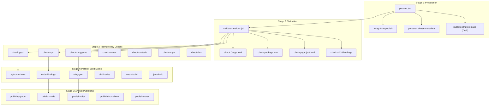
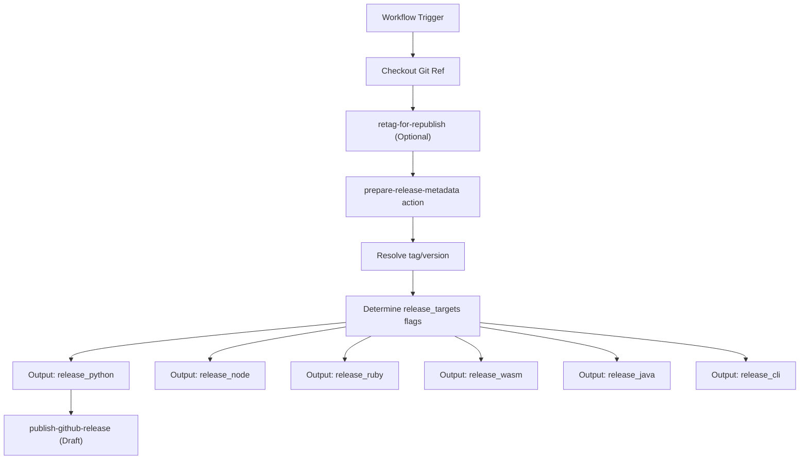

<!-- source: DeepWiki mcp.deepwiki.com · repo kreuzberg-dev/kreuzberg · page 8.3 Release Orchestration · fetched 2026-10-27 -->

# Release Orchestration

<details>
<summary>Relevant source files</summary>

The following files were used as context for generating this wiki page:

- [.github/workflows/benchmarks.yaml](.github/workflows/benchmarks.yaml)
- [.github/workflows/ci-docker.yaml](.github/workflows/ci-docker.yaml)
- [.github/workflows/ci-rust.yaml](.github/workflows/ci-rust.yaml)
- [.github/workflows/profiling.yaml](.github/workflows/profiling.yaml)
- [.github/workflows/publish.yaml](.github/workflows/publish.yaml)
- [e2e/java/pom.xml](e2e/java/pom.xml)
- [packages/csharp/Kreuzberg/Kreuzberg.csproj](packages/csharp/Kreuzberg/Kreuzberg.csproj)
- [packages/java/pom.xml](packages/java/pom.xml)
- [packages/python/pyproject.toml](packages/python/pyproject.toml)

</details>


This document describes the automated release pipeline that builds, tests, and publishes Kreuzberg packages across 16 language targets and multiple distribution channels. The release orchestration system implements a prepare-check-build-publish pattern with conditional execution to ensure idempotent, multi-platform releases.

For information about the CI pipeline that validates code changes, see [CI Pipeline Overview](8.1). For details on the multi-platform build matrix, see [Multi-Platform Build Matrix](8.2). For information about distribution channels, see [Package Distribution Channels](8.4).

## Workflow Architecture

The release orchestration is implemented in the `publish.yaml` workflow, which coordinates builds across multiple operating systems, architectures, and language ecosystems. The workflow is triggered by manual dispatch, GitHub release events, or repository dispatch.

**Workflow Stages**


Sources: [.github/workflows/publish.yaml:1-60](), [.github/workflows/publish.yaml:122-124]()

## Prepare Job: Metadata Generation

The `prepare` job computes release metadata and determines which language targets to build based on the `targets` input (defaulting to "all").

**Prepare Job Flow**


Sources: [.github/workflows/publish.yaml:60-93](), [.github/workflows/publish.yaml:101-111](), [.github/workflows/publish.yaml:112-121]()

**Key Outputs**

| Output | Purpose | Example |
|--------|---------|---------|
| `tag` | Git tag to build | `v5.0.0-rc.1` |
| `version` | Semantic version | `5.0.0-rc.1` |
| `npm_tag` | npm dist tag | `latest`, `rc`, `beta` |
| `dry_run` | Prepare artifacts without publishing | `true`/`false` |
| `release_python` | Build/Publish Python targets | `true`/`false` |
| `release_c_ffi` | Build/Publish C FFI headers/libs | `true`/`false` |

Sources: [.github/workflows/publish.yaml:64-93]()

## Version Validation

The `validate-versions` job ensures consistency across all language manifest files. This prevents publishing with mismatched versions across the polyglot workspace.

**Version Consistency Check**
The `validate-versions` action verifies the version string computed in the `prepare` job against:
- `Cargo.toml` (Workspace version)
- `packages/python/pyproject.toml` [packages/python/pyproject.toml:7]()
- `crates/kreuzberg-node/package.json`
- `packages/ruby/kreuzberg.gemspec`
- `packages/java/pom.xml` [packages/java/pom.xml:9]()
- `packages/php/composer.json`
- `packages/csharp/Kreuzberg/Kreuzberg.csproj` [packages/csharp/Kreuzberg/Kreuzberg.csproj:6]()

Sources: [.github/workflows/publish.yaml:122-138](), [packages/python/pyproject.toml:7](), [packages/java/pom.xml:9](), [packages/csharp/Kreuzberg/Kreuzberg.csproj:6]()

## Registry Existence Checks

To ensure idempotency, the workflow queries target registries before starting expensive build jobs. If a version already exists and `force_republish` is false, the build and publish steps for that target are skipped.

**Registry Check Jobs**

| Job | Registry | Action |
|-----|----------|--------|
| `check-pypi` | PyPI | `kreuzberg-dev/actions/check-registry@v1` |
| `check-npm` | npm | Checks `@kreuzberg/node` and `@kreuzberg/wasm` |
| `check-rubygems` | RubyGems | Checks `kreuzberg` gem |
| `check-cratesio` | crates.io | Checks core crates (e.g., `kreuzberg-cli`) |
| `check-maven` | Maven Central | Checks `dev.kreuzberg:kreuzberg` |
| `check-nuget` | NuGet | Checks `Kreuzberg` package |
| `check-hex` | Hex.pm | Checks `kreuzberg` package |

Sources: [.github/workflows/publish.yaml:141-187](), [.github/workflows/publish.yaml:227-248](), [.github/workflows/publish.yaml:189-200](), [.github/workflows/publish.yaml:202-213](), [.github/workflows/publish.yaml:215-226]()

## Build Jobs: Multi-Platform Execution

Build jobs execute in parallel across a matrix of operating systems and architectures.

### Python Wheels
Uses `maturin` to build PEP 600 (manylinux) and macOS/Windows wheels.
- **Matrix**: `ubuntu-latest` (x86_64/aarch64), `macos-latest` (universal2), `windows-latest` (x64).
- **Dependencies**: Includes `pdfium` and `tesseract` binaries where required.

Sources: [.github/workflows/publish.yaml:370-551]()

### Node.js Bindings
Uses `napi-rs` to build native addons.
- **Targets**: `x86_64-unknown-linux-gnu`, `aarch64-apple-darwin`, `x86_64-pc-windows-msvc`, etc.
- **Artifacts**: Produces `.node` binaries and TypeScript definitions.

Sources: [.github/workflows/publish.yaml:605-754]()

### Ruby Gems
Uses `rb-sys` and `magnus` for native extension building.
- **Vendoring**: Core Rust code is vendored into the gem using `scripts/ci/ruby/vendor-kreuzberg-core.py`.
- **Matrix**: Includes `linux`, `macos`, and `windows` targets.

Sources: [.github/workflows/publish.yaml:972-1144]()

### Java Bindings
The Java bindings are built using Maven. The `pom.xml` [packages/java/pom.xml:1-100]() specifies the project metadata, dependencies, and build configuration.
- **Build Process**: The `maven-compiler-plugin` [packages/java/pom.xml:141-149]() is used for compilation, enabling preview features and targeting Java 25.
- **Native Library Path**: The `maven-surefire-plugin` [packages/java/pom.xml:152-157]() configures the `java.library.path` to locate the native Rust library (`../../target/release`).
- **Source Directory**: The `sourceDirectory` [packages/java/pom.xml:99]() is set to the package root to accommodate the `alef` backend's source file layout.

Sources: [.github/workflows/publish.yaml:800-969](), [packages/java/pom.xml:1-100](), [packages/java/pom.xml:141-149](), [packages/java/pom.xml:152-157](), [packages/java/pom.xml:99]()

### C# Bindings
The C# bindings are built using .NET SDK. The `Kreuzberg.csproj` [packages/csharp/Kreuzberg/Kreuzberg.csproj:1-24]() defines the project.
- **Target Framework**: `net10.0` [packages/csharp/Kreuzberg/Kreuzberg.csproj:3]().
- **Packaging**: Includes the `LICENSE` file and runtime-specific native libraries from the `runtimes/` directory [packages/csharp/Kreuzberg/Kreuzberg.csproj:17-18]() into the NuGet package.
- **Source Files**: All `.cs` files under `../src/` are compiled [packages/csharp/Kreuzberg/Kreuzberg.csproj:21]().

Sources: [.github/workflows/publish.yaml:1600-1769](), [packages/csharp/Kreuzberg/Kreuzberg.csproj:1-24](), [packages/csharp/Kreuzberg/Kreuzberg.csproj:3](), [packages/csharp/Kreuzberg/Kreuzberg.csproj:17-18](), [packages/csharp/Kreuzberg/Kreuzberg.csproj:21]()

## Artifact Publishing

Publish jobs are gated by the results of build jobs and existence checks.

**Conditional Publishing Logic**
```yaml
if: |
  always() &&
  needs.prepare.outputs.dry_run != 'true' &&
  needs.prepare.outputs.is_tag == 'true' &&
  needs.prepare.outputs.release_python == 'true' &&
  (needs.prepare.outputs.force_republish == 'true' || needs.check-pypi.outputs.exists != 'true')
```
Sources: [.github/workflows/publish.yaml:1183-1189]()

### Distribution Channels
- **PyPI**: `twine` upload of wheels and sdist.
- **npm**: `npm publish` with dynamic `--tag` (e.g., `latest` or `rc`).
- **RubyGems**: `gem push` for platform-specific gems.
- **Maven Central**: `mvn deploy` for Java artifacts.
- **NuGet**: `dotnet nuget push` for C# packages.
- **Hex.pm**: `mix hex.publish` for Elixir packages.
- **Homebrew**: Updates formula in `kreuzberg-dev/homebrew-tap` with new SHA256 hashes and bottle URLs.
- **GitHub Releases**: Draft release is updated with CLI binaries, WASM bundles, and FFI headers.

Sources: [.github/workflows/publish.yaml:1182-1267](), [.github/workflows/publish.yaml:1449-1488](), [.github/workflows/publish.yaml:1270-1355](), [.github/workflows/publish.yaml:1600-1769](), [.github/workflows/publish.yaml:1772-1937]()

## Benchmarking and Profiling

While not strictly part of the publishing "push", release orchestration includes benchmark validation to ensure no performance regressions are released.

- **Benchmarks**: The `benchmarks.yaml` workflow runs the `benchmark-harness` across different pipelines (`baseline`, `layout`, `paddle-ocr`) and output formats. The `setup` job [.github/workflows/benchmarks.yaml:45-122]() builds the harness and native libraries, then uploads them as artifacts. Subsequent `bench-rust` [.github/workflows/benchmarks.yaml:124-200]() and `bench-docling` [.github/workflows/benchmarks.yaml:202-215]() jobs download these artifacts and execute benchmarks.
- **Profiling**: The `profiling.yaml` workflow generates flamegraphs for key fixtures (e.g., `pdf_medium`, `image_table`) to identify hotspots before a release is finalized. The `setup` job [.github/workflows/profiling.yaml:31-91]() builds the harness and native libraries with profiling enabled (`ENABLE_PROFILING: "true"` [.github/workflows/profiling.yaml:75-76]()), and subsequent `bench-native` [.github/workflows/profiling.yaml:93-164]() and `bench-python-sync` [.github/workflows/profiling.yaml:166-243]() jobs run the profiled benchmarks.

Sources: [.github/workflows/benchmarks.yaml:1-35](), [.github/workflows/benchmarks.yaml:131-136](), [.github/workflows/profiling.yaml:1-17](), [.github/workflows/benchmarks.yaml:45-122](), [.github/workflows/benchmarks.yaml:124-200](), [.github/workflows/benchmarks.yaml:202-215](), [.github/workflows/profiling.yaml:31-91](), [.github/workflows/profiling.yaml:75-76](), [.github/workflows/profiling.yaml:93-164](), [.github/workflows/profiling.yaml:166-243]()

## Summary of Release Metadata
The `prepare` job's `release-metadata.json` serves as the single source of truth for the entire pipeline, ensuring that every job from `check-pypi` to `publish-homebrew` operates on the same versioning and target logic.

Sources: [.github/workflows/publish.yaml:108-111]()

---

