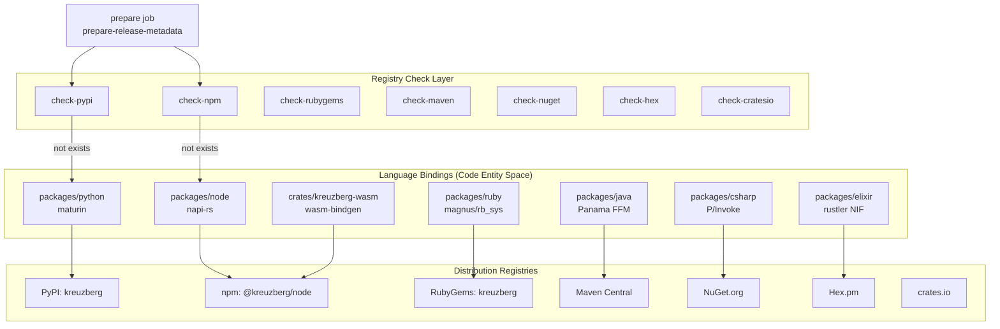
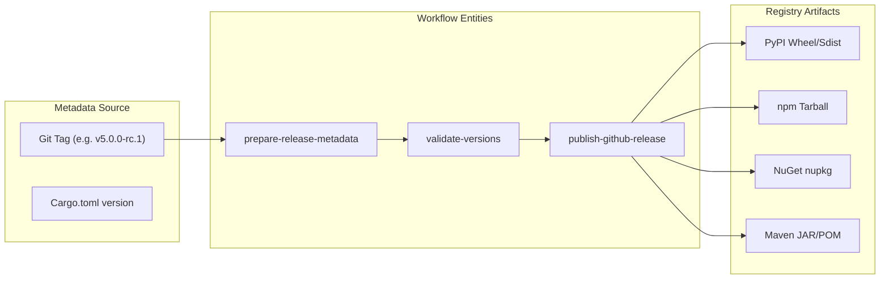

<!-- source: DeepWiki mcp.deepwiki.com · repo kreuzberg-dev/kreuzberg · page 8.4 Package Distribution Channels · fetched 2026-10-27 -->

# Package Distribution Channels

Relevant source files

The following files were used as context for generating this wiki page:

- [.github/workflows/benchmarks.yaml](.github/workflows/benchmarks.yaml)
- [.github/workflows/ci-docker.yaml](.github/workflows/ci-docker.yaml)
- [.github/workflows/ci-rust.yaml](.github/workflows/ci-rust.yaml)
- [.github/workflows/profiling.yaml](.github/workflows/profiling.yaml)
- [.github/workflows/publish-docker.yaml](.github/workflows/publish-docker.yaml)
- [.github/workflows/publish-helm.yaml](.github/workflows/publish-helm.yaml)
- [.github/workflows/publish.yaml](.github/workflows/publish.yaml)
- [.lychee.toml](.lychee.toml)
- [.task/tools/demo.yml](.task/tools/demo.yml)
- [.task/tools/docs.yml](.task/tools/docs.yml)
- [.typos.toml](.typos.toml)
- [e2e/java/pom.xml](e2e/java/pom.xml)
- [packages/csharp/Kreuzberg/Kreuzberg.csproj](packages/csharp/Kreuzberg/Kreuzberg.csproj)
- [packages/java/pom.xml](packages/java/pom.xml)
- [packages/python/pyproject.toml](packages/python/pyproject.toml)
- [scripts/ci/docs/build.sh](scripts/ci/docs/build.sh)

This document describes how Kreuzberg artifacts are published to seventeen package registries and distribution channels. It covers the registry check system that prevents duplicate publishes, the specific steps for each distribution channel, and how versioning is managed across platforms.

For information about building the artifacts themselves, see [Multi-Platform Build Matrix](#8.2). For details on how the release workflow orchestrates builds across languages, see [Release Orchestration](#8.3).

## Distribution Channel Overview

The `publish.yaml` workflow manages distribution channels for crates, python, node, wasm, ruby, php, cli, homebrew, go, c-ffi, java, csharp, elixir, dart, swift, zig, and kotlin [[.github/workflows/publish.yaml:5-7]](). R is distributed automatically via R-Universe [[.github/workflows/publish.yaml:8]]().

**Diagram: Distribution Architecture (Registry Mapping)**

**Sources:** [.github/workflows/publish.yaml:1-93](), [packages/python/pyproject.toml:1-10](), [packages/csharp/Kreuzberg/Kreuzberg.csproj:1-10]()

## Registry Check System

Before building artifacts, the workflow queries each package registry to determine if the target version already exists. This prevents wasted build time and duplicate publish errors [[.github/workflows/publish.yaml:139-140]]().

### Check Jobs

Each registry has a dedicated check job that executes a shared composite action `kreuzberg-dev/actions/check-registry@v1` [[.github/workflows/publish.yaml:150-152]]().

| Registry | Check Job | Package Name | Output | Line Reference |
|----------|-----------|--------------|--------|----------------|
| PyPI | `check-pypi` | `kreuzberg` | `exists` | [[.github/workflows/publish.yaml:141-155]]() |
| npm | `check-npm` | `@kreuzberg/node` | `node_exists`, `wasm_exists` | [[.github/workflows/publish.yaml:157-173]]() |
| RubyGems | `check-rubygems` | `kreuzberg` | `exists` | [[.github/workflows/publish.yaml:175-189]]() |
| Maven Central | `check-maven` | `dev.kreuzberg:kreuzberg` | `exists` | [[.github/workflows/publish.yaml:191-205]]() |
| NuGet | `check-nuget` | `Goldziher.Kreuzberg` | `exists` | [[.github/workflows/publish.yaml:207-221]]() |
| Hex.pm | `check-hex` | `kreuzberg` | `exists` | [[.github/workflows/publish.yaml:333-347]]() |

The `check-npm` job is unique as it verifies both the Node.js native bindings and the WebAssembly package simultaneously [[.github/workflows/publish.yaml:171-173]]().

**Sources:** [.github/workflows/publish.yaml:141-347]()

## Python Distribution (PyPI)

The Python package `kreuzberg` is distributed as platform-specific binary wheels and a source distribution [[.github/workflows/publish.yaml:6-11]]().

### Build and Metadata
- **Build System**: `maturin` [[packages/python/pyproject.toml:2-3]]().
- **Python Support**: 3.10 to 3.14 [[packages/python/pyproject.toml:10-18]]().
- **ABI Strategy**: Uses `abi3-py310` to produce a single wheel per platform that loads on Python 3.10+, reducing the build matrix size [[packages/python/pyproject.toml:28-30]]().

**Sources:** [packages/python/pyproject.toml:1-32]()

## Node.js and WebAssembly Distribution (npm)

Both the N-API native bindings (`@kreuzberg/node`) and the WebAssembly target (`@kreuzberg/wasm`) are distributed via npm [[.github/workflows/publish.yaml:169-172]]().

- **Node.js Bindings**: Built using `napi-rs` to provide native performance.
- **WASM Bindings**: Built from `crates/kreuzberg-wasm` using `wasm-bindgen` [[.github/workflows/publish.yaml:86]](). The `ocr-wasm` feature enables Tesseract via `TesseractWasmBackend` for the WASM target.

**Sources:** [.github/workflows/publish.yaml:157-173]()

## Java Distribution (Maven Central)

The Java package `dev.kreuzberg:kreuzberg` is published to Maven Central [[.github/workflows/publish.yaml:83]]().

- **Implementation**: Uses the Java 25 Panama FFM (Foreign Function & Memory) API [[e2e/java/pom.xml:12-13]]().
- **Native Access**: Requires `--enable-native-access=ALL-UNNAMED` and a configured `java.library.path` to load the native FFI library [[e2e/java/pom.xml:92]]().
- **Artifacts**: Includes the main JAR, sources, and Javadoc as required by Sonatype/Maven Central standards.

**Sources:** [e2e/java/pom.xml:1-98](), [.github/workflows/publish.yaml:191-205]()

## .NET Distribution (NuGet)

The C# bindings are distributed via NuGet.org as the `Kreuzberg` package [[packages/csharp/Kreuzberg/Kreuzberg.csproj:5]]().

- **Target Framework**: `net10.0` [[packages/csharp/Kreuzberg/Kreuzberg.csproj:3]]().
- **Native Packaging**: The package includes native runtimes in the `runtimes/` folder, which are preserved and copied to the output directory during build [[packages/csharp/Kreuzberg/Kreuzberg.csproj:17]]().
- **Interop**: Uses P/Invoke with `AllowUnsafeBlocks` enabled [[packages/csharp/Kreuzberg/Kreuzberg.csproj:11]]().

**Sources:** [packages/csharp/Kreuzberg/Kreuzberg.csproj:1-23]()

## Ruby Distribution (RubyGems)

The `kreuzberg` gem is published to RubyGems [[.github/workflows/publish.yaml:79]]().

- **Architecture**: Built using Magnus and `rb_sys` to bridge Ruby and Rust.
- **Distribution**: Ships as precompiled native gems for major platforms (Linux, macOS, Windows) to eliminate the need for a Rust toolchain on the consumer's machine.

**Sources:** [.github/workflows/publish.yaml:175-189]()

## Elixir Distribution (Hex.pm)

The Elixir binding is distributed via Hex.pm [[.github/workflows/publish.yaml:88]]().

- **NIF Integration**: Uses Rustler to implement Native Implemented Functions (NIFs).
- **Recent Changes**: The `kreuzberg_gleam` package was recently removed from Hex distribution to reduce maintenance overhead, as Gleam users can use the Elixir package via Erlang interop.

**Sources:** [.github/workflows/publish.yaml:333-347]()

## Release Orchestration and Versioning

The `Publish Release` workflow coordinates all distribution channels [[.github/workflows/publish.yaml:1-13]]().

**Diagram: Release Metadata and Artifact Flow**

### Version Consistency
The project adheres to Semantic Versioning. The `validate-versions` job ensures that the version specified in the release tag matches the version defined in the various language manifest files (e.g., `pyproject.toml`, `package.json`, `pom.xml`) [[.github/workflows/publish.yaml:122-138]]().

**Sources:** [.github/workflows/publish.yaml:1-138]()

## Distribution Channel Summary

| Language | Registry | Build Tool | Native Interop |
|----------|----------|------------|----------------|
| Rust | crates.io | cargo | Native |
| Python | PyPI | maturin | PyO3 |
| Node.js | npm | napi-rs | N-API |
| Java | Maven Central | maven | Panama FFM |
| C# | NuGet | dotnet | P/Invoke |
| Ruby | RubyGems | rake/rb_sys | Magnus |
| Elixir | Hex.pm | mix | Rustler NIF |
| WASM | npm | wasm-pack | wasm-bindgen |

**Sources:** [.github/workflows/publish.yaml:5-8](), [packages/python/pyproject.toml:2-3](), [e2e/java/pom.xml:12-13](), [packages/csharp/Kreuzberg/Kreuzberg.csproj:1-13]()

---

