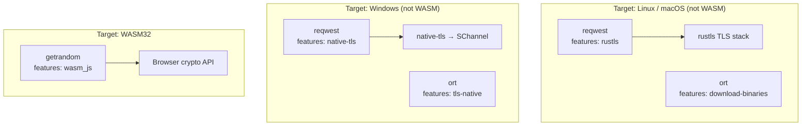
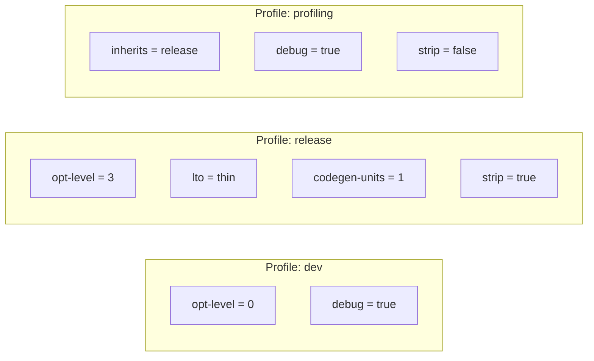

<!-- source: DeepWiki mcp.deepwiki.com · repo kreuzberg-dev/kreuzberg · page 9.1 Cross-Platform Build Configuration · fetched 2026-10-27 -->

# Cross-Platform Build Configuration

Relevant source files

The following files were used as context for generating this wiki page:

- [.dockerignore](.dockerignore)
- [.github/actions/setup-paddle-ocr-models/README.md](.github/actions/setup-paddle-ocr-models/README.md)
- [.github/actions/setup-paddle-ocr-models/action.yml](.github/actions/setup-paddle-ocr-models/action.yml)
- [.gitignore](.gitignore)
- [.pre-commit-config.yaml](.pre-commit-config.yaml)
- [.task/config/vars.yml](.task/config/vars.yml)
- [.task/languages/rust.yml](.task/languages/rust.yml)
- [CHANGELOG.md](CHANGELOG.md)
- [Cargo.lock](Cargo.lock)
- [Cargo.toml](Cargo.toml)
- [crates/kreuzberg-node/package.json](crates/kreuzberg-node/package.json)
- [crates/kreuzberg-wasm/package.json](crates/kreuzberg-wasm/package.json)
- [crates/kreuzberg/Cargo.toml](crates/kreuzberg/Cargo.toml)
- [crates/kreuzberg/build.rs](crates/kreuzberg/build.rs)
- [crates/kreuzberg/tests/paddle_ocr_integration.rs](crates/kreuzberg/tests/paddle_ocr_integration.rs)
- [docker/Dockerfile.core](docker/Dockerfile.core)
- [docker/Dockerfile.full](docker/Dockerfile.full)
- [package.json](package.json)
- [packages/ruby/Gemfile.lock](packages/ruby/Gemfile.lock)
- [packages/ruby/ext/kreuzberg_rb/native/Cargo.lock](packages/ruby/ext/kreuzberg_rb/native/Cargo.lock)
- [packages/ruby/ext/kreuzberg_rb/native/Cargo.toml](packages/ruby/ext/kreuzberg_rb/native/Cargo.toml)
- [pnpm-lock.yaml](pnpm-lock.yaml)
- [pyproject.toml](pyproject.toml)
- [scripts/stage_csharp_native_local.sh](scripts/stage_csharp_native_local.sh)
- [uv.lock](uv.lock)

This document describes the cross-platform build configuration system that enables Kreuzberg to compile for 12+ programming languages across Linux x86_64/aarch64, macOS ARM64, Windows x86_64, and WebAssembly. It covers target triple selection, conditional dependency resolution, feature flag architecture, and compilation strategies.

For platform-specific build requirements and quirks, see [Windows Considerations](#9.2), [macOS Apple Silicon Builds](#9.3), and [Linux manylinux Compatibility](#9.4). For external dependency management, see [External Dependencies](#10.1).

---

## Supported Target Triples

Kreuzberg supports compilation for the following target triples, each requiring specific linker configuration and dependency resolution:

| Target Triple | Platform | Architecture | Libc | Primary Use |
|---------------|----------|--------------|------|-------------|
| `x86_64-unknown-linux-gnu` | Linux | x86_64 | glibc | Python wheels, Node.js, Ruby, CLI |
| `aarch64-unknown-linux-gnu` | Linux | ARM64 | glibc | Python wheels, Node.js, Ruby, CLI |
| `x86_64-unknown-linux-musl` | Linux | x86_64 | musl | Static CLI binaries, Alpine Docker |
| `aarch64-unknown-linux-musl` | Linux | ARM64 | musl | Static CLI binaries, Alpine Docker |
| `aarch64-apple-darwin` | macOS | ARM64 | Darwin libc | Python wheels, Node.js, Ruby, CLI |
| `x86_64-pc-windows-msvc` | Windows | x86_64 | MSVCRT | Python wheels, Node.js, C#, CLI |
| `wasm32-unknown-unknown` | Browser/Edge | WASM | - | WASM package, Deno, Cloudflare Workers |

**Node.js NAPI-RS Targets:**
The Node.js bindings explicitly target a wide range of triples including `x86_64-unknown-linux-gnu`, `aarch64-unknown-linux-gnu`, `x86_64-unknown-linux-musl`, `aarch64-unknown-linux-musl`, `x86_64-apple-darwin`, `aarch64-apple-darwin`, `x86_64-pc-windows-msvc`, and `aarch64-pc-windows-msvc` [crates/kreuzberg-node/package.json:33-42]().

**Sources:** [crates/kreuzberg-node/package.json:33-42](), [Cargo.toml:29](), [crates/kreuzberg/Cargo.toml:203-214]()

---

## Cargo Feature Flag Architecture

The `kreuzberg` crate uses Cargo feature flags to enable selective compilation of format extractors, OCR backends, and runtime dependencies. This reduces compile times and binary size for deployment scenarios that don't require the full feature set.

**Title: Feature Flag Dependency Graph**

```mermaid
graph TB
    full["full"]
    wasm_target["wasm-target"]
    android_target["android-target"]
    
    pdf["pdf"]
    excel["excel"]
    excel_wasm["excel-wasm"]
    office["office"]
    email["email"]
    html["html"]
    xml["xml"]
    archives["archives"]
    mdx["mdx"]
    
    ocr["ocr"]
    ocr_wasm["ocr-wasm"]
    paddle_ocr["paddle-ocr"]
    
    chunking["chunking"]
    embeddings["embeddings"]
    quality["quality"]
    language_detection["language-detection"]
    keywords["keywords"]
    
    server["server"]
    cli["cli"]
    
    tokio_runtime["tokio-runtime"]
    
    full --> pdf
    full --> excel
    full --> office
    full --> email
    full --> html
    full --> xml
    full --> archives
    full --> ocr
    full --> paddle_ocr
    full --> language_detection
    full --> chunking
    full --> embeddings
    full --> quality
    full --> keywords
    full --> mdx
    full --> server
    full --> cli
    
    wasm_target --> pdf
    wasm_target --> html
    wasm_target --> xml
    wasm_target --> email
    wasm_target --> language_detection
    wasm_target --> chunking
    wasm_target --> quality
    wasm_target --> office
    wasm_target --> mdx
    wasm_target --> excel_wasm
    wasm_target --> archives
    
    android_target --> excel
    android_target --> ocr
    android_target --> server
    android_target --> cli
    
    office --> html
    ocr --> html
    paddle_ocr --> html
    paddle_ocr --> tokio_runtime
    paddle_ocr --> ocr
    
    excel --> tokio_runtime
    embeddings --> tokio_runtime
    embeddings --> chunking
    server --> tokio_runtime
    server --> chunking
    cli --> tokio_runtime
```

**Feature flag definitions:**

- **Format extractors:** `pdf`, `excel`, `office` (DOCX/PPTX/ODT), `email` (EML/MSG), `html`, `xml`, `archives` (ZIP/TAR/7z), `mdx` [crates/kreuzberg/Cargo.toml:50-78]().
- **OCR backends:** `ocr` (Tesseract with native deps), `ocr-wasm` (Minimal Tesseract for WASM), `paddle-ocr` (ONNX Runtime) [crates/kreuzberg/Cargo.toml:91-129]().
- **Text processing:** `chunking`, `embeddings`, `language-detection`, `quality`, `keywords` [crates/kreuzberg/Cargo.toml:158-193]().
- **Platform/Target subsets:** `wasm-target` (WASM-safe subset), `android-target` (Android-safe subset) [crates/kreuzberg/Cargo.toml:226-231]().
- **Specialized:** `ner-llm` (LLM-driven zero-shot NER), `ner-onnx` (gline-rs ONNX backend) [crates/kreuzberg/Cargo.toml:202-203]().

**Platform-specific feature selection:**

- **WASM builds:** Uses `wasm-target` which includes `excel-wasm`, `tree-sitter-wasm`, and `ocr-wasm` [crates/kreuzberg/Cargo.toml:225-226]().
- **Android builds:** Uses `android-target` which excludes ORT-dependent features (like `paddle-ocr` and `embeddings`) but includes core extraction and OCR capabilities [crates/kreuzberg/Cargo.toml:227-230]().
- **CLI:** Defaults to `crates/kreuzberg` and `crates/kreuzberg-cli` [Cargo.toml:23]().

**Sources:** [crates/kreuzberg/Cargo.toml:35-231](), [Cargo.toml:23]()

---

## Conditional Dependency Strategy

Kreuzberg resolves dependencies conditionally based on the target platform to avoid build failures on platforms with limited toolchain support and to optimize for platform-native implementations.

**Title: Platform-Specific Dependency Resolution**

**Conditional dependency configuration:**

**Non-Windows, non-WASM targets (Linux, macOS):**
- `reqwest`: Uses `rustls` backend in most contexts to ensure portability across Linux distributions.
- `ort`: Uses `download-binaries` via `ort-bundled` to include CoreML (macOS) or CUDA (Linux) [crates/kreuzberg/Cargo.toml:132]().

**Windows targets:**
- `reqwest`: Often defaults to `native-tls` to avoid `aws-lc-sys` CMake build issues common in Windows environments.
- `ort`: Uses `tls-native` when bundled to leverage system certificate stores [crates/kreuzberg/Cargo.toml:132]().

**WASM32 targets:**
- `getrandom`: Enabled with `wasm_js` feature to allow entropy generation in browser environments [Cargo.toml:57]().
- `excel-wasm`: Specific variant for WASM that avoids `tokio-runtime` dependencies [crates/kreuzberg/Cargo.toml:52]().

**Sources:** [crates/kreuzberg/Cargo.toml:132-135](), [Cargo.toml:57](), [crates/kreuzberg/Cargo.toml:52]()

---

## Build Profiles and Compiler Flags

Kreuzberg uses custom Cargo profiles to optimize for different build contexts: local development, release artifacts, and specialized profiling.

**Title: Build Profile Configuration**

**Profile definitions:**

**`dev` profile:**
- `opt-level = 0`: Fast compilation [Cargo.toml:141]().
- `debug = true`: Full debug symbols [Cargo.toml:142]().

**`release` profile:**
- `opt-level = 3`: Maximum optimization [Cargo.toml:124]().
- `lto = "thin"`: Thin LTO for cross-crate optimization [Cargo.toml:122]().
- `codegen-units = 1`: Single codegen unit for better optimization [Cargo.toml:123]().
- `strip = true`: Remove symbols to reduce binary size [Cargo.toml:125]().

**`profiling` profile:**
- Inherits from `release` [Cargo.toml:145]().
- `debug = true` and `strip = false` to enable meaningful profiling data [Cargo.toml:146-147]().

**Platform-specific Profile Overrides:**
- On macOS ARM64, `sevenz-rust2` is restricted to `opt-level = 1` and `zip` is restricted to `opt-level = 2` to prevent miscompilation and SIGBUS crashes [Cargo.toml:130-134]().
- `kreuzberg-wasm` uses `opt-level = "z"` for size optimization [Cargo.toml:138]().

**Sources:** [Cargo.toml:121-148]()

---

## Fastembed and ONNX Runtime Configuration

ONNX Runtime (ORT) is a critical native dependency for embeddings and advanced OCR.

**ORT Feature configuration:**

- `ort-bundled`: Downloads and bundles ORT binaries (includes CoreML on macOS, CUDA on Linux) [crates/kreuzberg/Cargo.toml:132]().
- `ort-dynamic`: Configures ORT to load the library dynamically at runtime [crates/kreuzberg/Cargo.toml:135]().

**Fastembed Integration:**
The `embeddings` feature in the core library enables `hf-hub`, `ort`, `ndarray`, and `tokenizers` [crates/kreuzberg/Cargo.toml:178-187](). It is explicitly gated to be WASM-incompatible [crates/kreuzberg/Cargo.toml:176]().

**Sources:** [crates/kreuzberg/Cargo.toml:130-135](), [crates/kreuzberg/Cargo.toml:176-187]()

---

## Language Binding Build Systems

Kreuzberg uses language-specific build tools to wrap the Rust core:

- **Python:** Uses `maturin` as the build backend [pyproject.toml:2]().
- **Node.js:** Uses `@napi-rs/cli` for building native modules [crates/kreuzberg-node/package.json:51]().
- **Ruby:** Uses `rb_sys` and `rake-compiler` [packages/ruby/Gemfile.lock:5, 66]().
- **WASM:** Uses `wasm-bindgen` for browser and Node.js WASM targets [Cargo.toml:103]().
- **Dart:** Uses `flutter_rust_bridge` (FRB) for cross-platform Flutter support [CHANGELOG.md:25]().

**Sources:** [pyproject.toml:1-3](), [crates/kreuzberg-node/package.json:51](), [packages/ruby/Gemfile.lock:5-66](), [Cargo.toml:103](), [CHANGELOG.md:25]()

---

