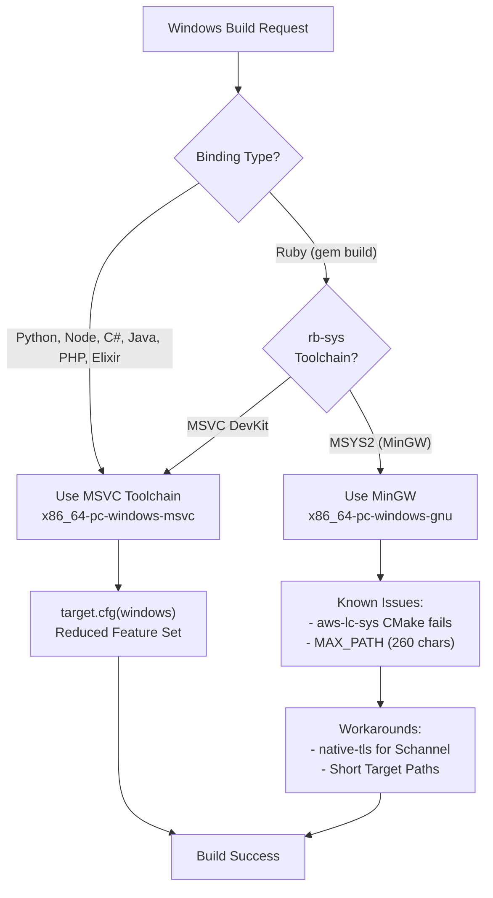
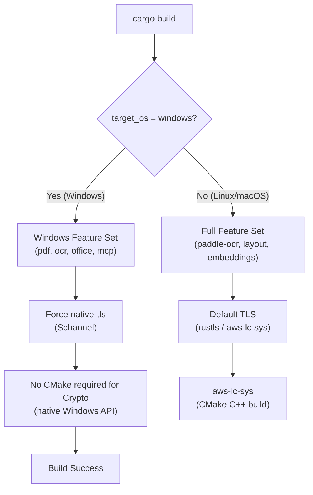

<!-- source: DeepWiki mcp.deepwiki.com · repo kreuzberg-dev/kreuzberg · page 9.2 Windows Considerations · fetched 2026-10-27 -->

# Windows Considerations

Relevant source files

The following files were used as context for generating this wiki page:

- [.github/workflows/benchmarks.yaml](.github/workflows/benchmarks.yaml)
- [.github/workflows/ci-docker.yaml](.github/workflows/ci-docker.yaml)
- [.github/workflows/ci-rust.yaml](.github/workflows/ci-rust.yaml)
- [.github/workflows/profiling.yaml](.github/workflows/profiling.yaml)
- [.github/workflows/publish.yaml](.github/workflows/publish.yaml)
- [crates/kreuzberg-ffi/Cargo.toml](crates/kreuzberg-ffi/Cargo.toml)
- [crates/kreuzberg-node/Cargo.toml](crates/kreuzberg-node/Cargo.toml)
- [crates/kreuzberg-py/Cargo.toml](crates/kreuzberg-py/Cargo.toml)
- [e2e/java/pom.xml](e2e/java/pom.xml)
- [packages/csharp/Kreuzberg/Kreuzberg.csproj](packages/csharp/Kreuzberg/Kreuzberg.csproj)
- [packages/java/pom.xml](packages/java/pom.xml)
- [packages/python/pyproject.toml](packages/python/pyproject.toml)

## Purpose and Scope

This document describes Windows-specific build and runtime considerations for Kreuzberg, including:

- **MinGW toolchain support** and known limitations.
- **native-tls configuration** to avoid `aws-lc-sys` CMake build failures.
- **Platform-Specific Feature Sets** for Windows-compatible functionality.
- **Windows-specific dependency resolution** for core libraries.

The primary Windows toolchain is **MSVC** (`x86_64-pc-windows-msvc`). MinGW support (`x86_64-pc-windows-gnu`) is maintained primarily for Ruby gem compatibility via `rb-sys`.

For cross-platform build configuration including Linux and macOS, see [Cross-Platform Build Configuration](9.1). For Ruby-specific Windows build issues, see [Ruby Bindings](4.3).

---

## Windows Toolchain Strategy

Kreuzberg supports two Windows toolchains with differing levels of compatibility:

| Toolchain | Target Triple | Status | Bindings Support | Notes |
|-----------|--------------|--------|------------------|-------|
| **MSVC** | `x86_64-pc-windows-msvc` | ✅ Primary | Python, Node.js, Java, C#, PHP, Elixir | Recommended for all native bindings |
| **GNU/MinGW** | `x86_64-pc-windows-gnu` | ⚠️ Limited | Ruby (partial) | Maintained for RubyInstaller compatibility |

### MSVC as Primary Toolchain
The MSVC toolchain is the **primary and recommended** target. It provides native Windows ABI compatibility for FFI bindings and avoids complex CMake/MinGW environment issues. For instance, the Java bindings specifically configure the `java.library.path` to point to the `target/release` directory where MSVC-built DLLs are expected [packages/java/pom.xml:156-156]().

**Sources:** [packages/java/pom.xml:156-156](), [crates/kreuzberg-ffi/Cargo.toml:42-43]()

---

## Diagram: Windows Toolchain Decision Flow

**Sources:** [crates/kreuzberg-ffi/Cargo.toml:42-43](), [packages/python/pyproject.toml:33-33]()

---

## MinGW Limitations and Known Issues

### 1. aws-lc-sys CMake Build Failures
The `aws-lc-sys` crate (a transitive dependency of many Rust crates using `rustls`) requires CMake compilation of AWS LibCrypto. MinGW's CMake integration often fails in CI environments due to toolchain mismatch.

- **Root Cause:** `aws-lc-sys` uses CMake to build C++ cryptographic code, which conflicts with MinGW's toolchain expectations.
- **Workaround:** Kreuzberg is configured to prefer `native-tls` (Windows Schannel API) on Windows targets to bypass the need for a C++ compiler for crypto primitives.

**Sources:** [crates/kreuzberg-ffi/Cargo.toml:42-43]()

### 2. Feature Set Limitations
On Windows, certain advanced features like `paddle-ocr` and `layout-detection` are currently excluded from the default FFI build to ensure stability and reduce build complexity [crates/kreuzberg-ffi/Cargo.toml:42-43]().

- **Windows FFI Features:** Includes `pdf`, `ocr`, `chunking`, `html`, `office`, `mcp`, and `quality` [crates/kreuzberg-ffi/Cargo.toml:43-43]().
- **Excluded:** Features like `paddle-ocr-types` and `layout-types` are currently omitted from the Windows-specific dependency block [crates/kreuzberg-ffi/Cargo.toml:42-43]().

**Sources:** [crates/kreuzberg-ffi/Cargo.toml:42-43]()

---

## Diagram: Windows TLS and Feature Selection

**Sources:** [crates/kreuzberg-ffi/Cargo.toml:36-43]()

---

## Platform-Specific Build Configuration

### Python Wheel Strategy
For Python, Kreuzberg uses `maturin` with the `abi3-py310` feature [packages/python/pyproject.toml:33-33](). This produces a single wheel per platform (e.g., `win_amd64` for MSVC) that is compatible with Python 3.10 and newer, simplifying distribution on Windows.

**Sources:** [packages/python/pyproject.toml:31-33]()

### Java FFM API and Library Path
The Java bindings utilize the Panama FFM API. In Windows environments, the `maven-surefire-plugin` is configured to include the Rust release target in the `java.library.path` so the JVM can locate the compiled DLLs [packages/java/pom.xml:156-156]().

**Sources:** [packages/java/pom.xml:156-156]()

---

## Platform-Specific Test Considerations

### Environment Setup
Windows CI runs utilize specific environment variables to handle large stack requirements and ensure consistent behavior across toolchains:
- `RUST_MIN_STACK`: Set to `16777216` (16MB) to prevent stack overflows during complex document parsing [.github/workflows/ci-rust.yaml:31-31]().
- `ORT_VERSION`: Explicitly pinned to `1.24.2` for ONNX Runtime compatibility [.github/workflows/ci-rust.yaml:32-32]().

### Test Skips
Certain tests involving POSIX-specific file permissions or complex symlink behavior are typically skipped or modified for Windows runners.

**Sources:** [.github/workflows/ci-rust.yaml:30-35](), [.github/workflows/benchmarks.yaml:24-25]()

---

## Summary Table: Windows Support by Binding

| Binding | Toolchain | CI Target | Notes |
|---------|-----------|-----------|-------|
| **Python** | MSVC | `windows-latest` | PyO3/Maturin ABI3 [packages/python/pyproject.toml:33-33]() |
| **Node.js** | MSVC | `windows-latest` | NAPI-RS [crates/kreuzberg-node/Cargo.toml:25-26]() |
| **Java** | MSVC | `windows-latest` | Panama FFM [packages/java/pom.xml:156-156]() |
| **C#** | MSVC | `windows-latest` | P/Invoke [packages/csharp/Kreuzberg/Kreuzberg.csproj:11-11]() |
| **FFI (C)** | MSVC/MinGW| `windows-latest` | `cbindgen` generated [crates/kreuzberg-ffi/Cargo.toml:47-47]() |

**Sources:** [packages/python/pyproject.toml:33-33](), [packages/java/pom.xml:156-156](), [crates/kreuzberg-node/Cargo.toml:25-26]()

---

