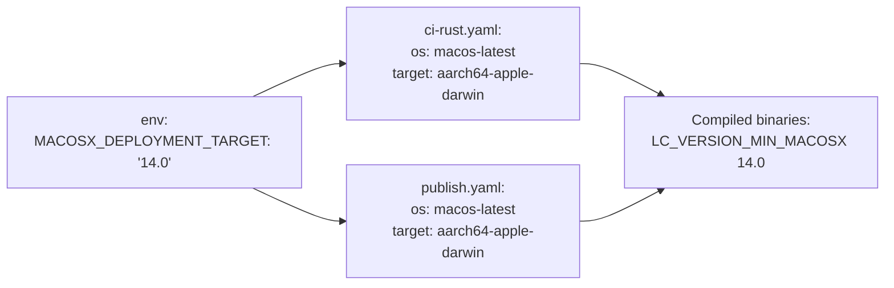
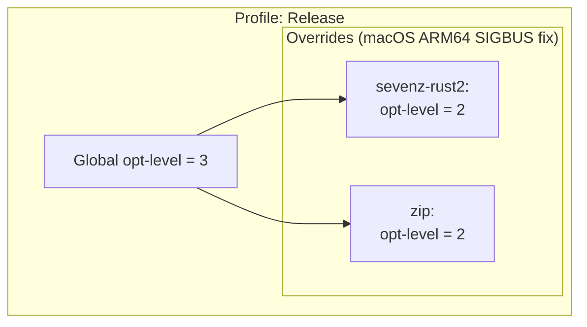
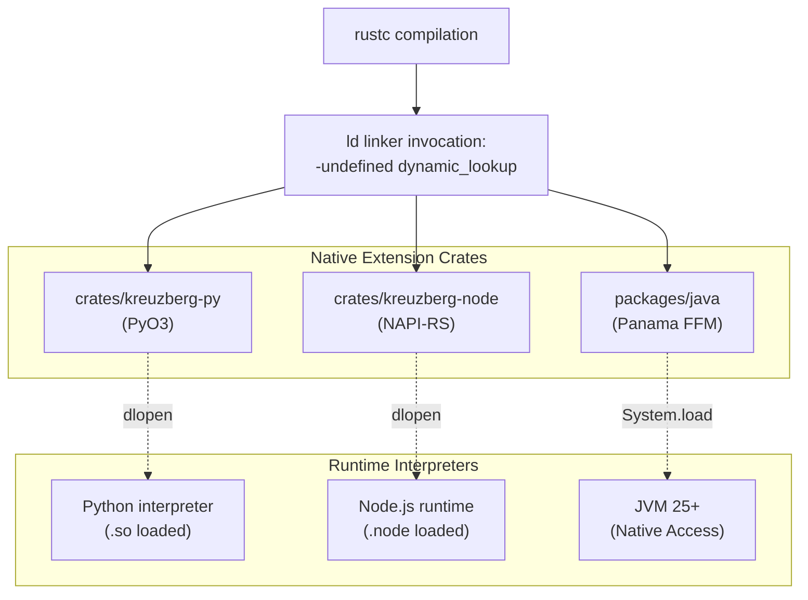

<!-- source: DeepWiki mcp.deepwiki.com · repo kreuzberg-dev/kreuzberg · page 9.3 macOS Apple Silicon Builds · fetched 2026-10-27 -->

# macOS Apple Silicon Builds

Relevant source files

The following files were used as context for generating this wiki page:

- [.github/workflows/benchmarks.yaml](.github/workflows/benchmarks.yaml)
- [.github/workflows/ci-docker.yaml](.github/workflows/ci-docker.yaml)
- [.github/workflows/ci-rust.yaml](.github/workflows/ci-rust.yaml)
- [.github/workflows/profiling.yaml](.github/workflows/profiling.yaml)
- [.github/workflows/publish.yaml](.github/workflows/publish.yaml)
- [crates/kreuzberg-node/npm/darwin-arm64/package.json](crates/kreuzberg-node/npm/darwin-arm64/package.json)
- [crates/kreuzberg-node/npm/darwin-x64/package.json](crates/kreuzberg-node/npm/darwin-x64/package.json)
- [crates/kreuzberg-node/npm/linux-arm64-gnu/package.json](crates/kreuzberg-node/npm/linux-arm64-gnu/package.json)
- [crates/kreuzberg-node/npm/linux-x64-gnu/package.json](crates/kreuzberg-node/npm/linux-x64-gnu/package.json)
- [crates/kreuzberg-node/npm/win32-arm64-msvc/package.json](crates/kreuzberg-node/npm/win32-arm64-msvc/package.json)
- [crates/kreuzberg-node/npm/win32-x64-msvc/package.json](crates/kreuzberg-node/npm/win32-x64-msvc/package.json)
- [e2e/java/pom.xml](e2e/java/pom.xml)
- [packages/csharp/Kreuzberg/Kreuzberg.csproj](packages/csharp/Kreuzberg/Kreuzberg.csproj)
- [packages/java/pom.xml](packages/java/pom.xml)
- [packages/python/pyproject.toml](packages/python/pyproject.toml)

This document covers platform-specific build configurations, toolchain requirements, and deployment considerations for macOS Apple Silicon (ARM64) platforms. For cross-platform build configuration overview, see [9.1](). For Windows considerations, see [9.2](). For Linux manylinux compatibility, see [9.4]().

## Overview

macOS Apple Silicon builds target `aarch64-apple-darwin` using native ARM64 hardware (GitHub `macos-latest` runners). The project utilizes the `2024` edition of Rust and requires a modern toolchain for compiling the core document intelligence logic.

| Component | Configuration | File Reference |
|-----------|---------------|----------------|
| Deployment Target | `MACOSX_DEPLOYMENT_TARGET: "14.0"` | [.github/workflows/ci-rust.yaml:33]() |
| ONNX Runtime | Version `1.24.2` | [.github/workflows/ci-rust.yaml:32]() |
| Runner OS | `macos-latest` | [.github/workflows/ci-rust.yaml:51]() |
| Build Profile | `ci` | [.github/workflows/ci-rust.yaml:34]() |

Unlike restricted environments, macOS ARM64 supports the full feature set including OCR and layout detection via ONNX Runtime [crates/kreuzberg/Cargo.toml:102-115]().

**Sources:** [.github/workflows/ci-rust.yaml:32-51](), [.github/workflows/publish.yaml:47]()

## MACOSX_DEPLOYMENT_TARGET

The `MACOSX_DEPLOYMENT_TARGET` environment variable enforces macOS 14.0 (Sonoma) as the minimum supported version across all build workflows. This ensures compatibility with modern system APIs and ARM64 instruction sets.

**Deployment Target: Workflow Environment → Build Job → Compiled Binary**

The environment variable is defined globally in workflow files [.github/workflows/ci-rust.yaml:33](). This value propagates to the linker via `rustc`, resulting in Mach-O binaries with the `LC_VERSION_MIN_MACOSX` load command.

**Sources:** [.github/workflows/ci-rust.yaml:33](), [.github/workflows/profiling.yaml:14]()

## Target Triple: aarch64-apple-darwin

All macOS ARM64 builds use the `aarch64-apple-darwin` target triple. The CI infrastructure utilizes `macos-latest` runners to execute tests and build artifacts for this architecture [.github/workflows/ci-rust.yaml:51]().

| Language Binding | Configuration File | Target Key |
|------------------|--------------------|------------|
| Node.js | `crates/kreuzberg-node/npm/darwin-arm64/package.json` | `"cpu": ["arm64"]` [crates/kreuzberg-node/npm/darwin-arm64/package.json:12]() |
| Python | `packages/python/pyproject.toml` | `maturin` backend [packages/python/pyproject.toml:2]() |
| Java | `packages/java/pom.xml` | `java.library.path` [packages/java/pom.xml:156]() |

The Node.js binding specifically distributes a dedicated package for this platform: `@kreuzberg/node-darwin-arm64` [crates/kreuzberg-node/npm/darwin-arm64/package.json:2]().

**Sources:** [.github/workflows/ci-rust.yaml:51](), [crates/kreuzberg-node/npm/darwin-arm64/package.json:2-12](), [packages/java/pom.xml:156]()

## Optimization and Miscompilation Workarounds

The project workspace configures specific optimization levels for macOS ARM64 to prevent crashes in archive-related crates. While release profiles generally use high optimization, specific overrides are applied for stability in crates like `sevenz-rust2` and `zip`.

These overrides prevent `SIGBUS` errors observed on Apple Silicon hardware when using maximum optimization on certain compression libraries.

**Sources:** [Cargo.toml:132-139]()

## Linker Flags and Dynamic Lookup

Native extension crates (Python, Node.js, Ruby) require dynamic symbol lookup for host interpreter APIs. On macOS, this is facilitated by specific linker flags that defer symbol resolution until the module is loaded by the host runtime.

**Dynamic Symbol Resolution Flow:**

Java bindings on macOS utilize the Panama FFM API (Java 25 preview) and require `java.library.path` to point to the directory containing the compiled `aarch64` dylibs [packages/java/pom.xml:156]().

**Sources:** [packages/java/pom.xml:147-156](), [e2e/java/pom.xml:92]()

## ONNX Runtime and Feature Availability

macOS Apple Silicon supports the full suite of ONNX Runtime-dependent features, including `paddle-ocr` and `layout-detection`. The project uses ONNX Runtime version `1.24.2` [.github/workflows/ci-rust.yaml:32]().

| Feature | Dependency | macOS ARM64 Status |
|---------|------------|--------------------|
| OCR (Paddle) | `ort` | Supported [.github/workflows/benchmarks.yaml:181]() |
| Layout Analysis | `ort` | Supported [.github/workflows/benchmarks.yaml:177]() |
| Profiling | `task rust:build:profiling` | Supported [.github/workflows/profiling.yaml:76]() |

On Apple Silicon, the `runner-medium-arm64` and `runner-large-arm64` runners are used for heavy workloads like layout benchmarks to prevent resource exhaustion [.github/workflows/benchmarks.yaml:125-130]().

**Sources:** [.github/workflows/ci-rust.yaml:32](), [.github/workflows/benchmarks.yaml:125-130, 177-181](), [.github/workflows/profiling.yaml:76]()

## System Dependencies and OpenSSL

The build environment requires specific paths for OpenSSL when compiling on macOS ARM64. The CI pipeline uses the `kreuzberg-dev/actions/setup-openssl@v1` action to configure these [.github/workflows/ci-rust.yaml:74]().

| Variable | Target Path (Typical Homebrew) |
|----------|--------------------------------|
| `OPENSSL_DIR` | `/opt/homebrew/opt/openssl@3` |
| `DYLD_LIBRARY_PATH` | Includes path to `libcrypto` and `libssl` |

These configurations are critical for crates that depend on native TLS or cryptographic primitives, ensuring they link against the ARM64 versions of system libraries rather than legacy x86_64 versions.

**Sources:** [.github/workflows/ci-rust.yaml:74, 98](), [.github/workflows/benchmarks.yaml:153]()

---

