# Page: Overview

# Overview

<details>
<summary>Relevant source files</summary>

The following files were used as context for generating this wiki page:

- [.gitignore](.gitignore)
- [.pre-commit-config.yaml](.pre-commit-config.yaml)
- [CHANGELOG.md](CHANGELOG.md)
- [CONTRIBUTING.md](CONTRIBUTING.md)
- [Cargo.lock](Cargo.lock)
- [Cargo.toml](Cargo.toml)
- [README.md](README.md)
- [crates/kreuzberg-node/README.md](crates/kreuzberg-node/README.md)
- [crates/kreuzberg-node/package.json](crates/kreuzberg-node/package.json)
- [crates/kreuzberg-wasm/README.md](crates/kreuzberg-wasm/README.md)
- [crates/kreuzberg-wasm/package.json](crates/kreuzberg-wasm/package.json)
- [crates/kreuzberg/Cargo.toml](crates/kreuzberg/Cargo.toml)
- [crates/kreuzberg/README.md](crates/kreuzberg/README.md)
- [crates/kreuzberg/tests/api_openweb.rs](crates/kreuzberg/tests/api_openweb.rs)
- [docs/contributing.md](docs/contributing.md)
- [docs/css/extra.css](docs/css/extra.css)
- [docs/features.md](docs/features.md)
- [docs/getting-started/installation.md](docs/getting-started/installation.md)
- [docs/guides/agent-skills.md](docs/guides/agent-skills.md)
- [docs/guides/docker.md](docs/guides/docker.md)
- [docs/guides/kubernetes.md](docs/guides/kubernetes.md)
- [docs/index.md](docs/index.md)
- [docs/integrations/index.md](docs/integrations/index.md)
- [docs/integrations/openwebui.md](docs/integrations/openwebui.md)
- [docs/integrations/surrealdb.md](docs/integrations/surrealdb.md)
- [package.json](package.json)
- [packages/csharp/README.md](packages/csharp/README.md)
- [packages/elixir/README.md](packages/elixir/README.md)
- [packages/go/v4/README.md](packages/go/v4/README.md)
- [packages/java/README.md](packages/java/README.md)
- [packages/php/README.md](packages/php/README.md)
- [packages/python/README.md](packages/python/README.md)
- [packages/ruby/Gemfile.lock](packages/ruby/Gemfile.lock)
- [packages/ruby/README.md](packages/ruby/README.md)
- [packages/ruby/ext/kreuzberg_rb/native/Cargo.lock](packages/ruby/ext/kreuzberg_rb/native/Cargo.lock)
- [packages/ruby/ext/kreuzberg_rb/native/Cargo.toml](packages/ruby/ext/kreuzberg_rb/native/Cargo.toml)
- [pnpm-lock.yaml](pnpm-lock.yaml)
- [pyproject.toml](pyproject.toml)
- [uv.lock](uv.lock)

</details>


This document provides a comprehensive introduction to Kreuzberg, a high-performance document intelligence platform built in Rust with native bindings for 15+ programming languages. It covers the system architecture, supported formats, deployment models, and language binding strategies.

For detailed information about specific subsystems:
- System architecture details → [System Architecture](#1.1)
- Format support and feature matrix → [Supported Formats and Features](#1.2)
- Installation procedures → [Installation](#2.1)
- Core processing pipeline → [Document Processing Pipeline](#3.1)

## What is Kreuzberg

Kreuzberg is a document intelligence library that extracts text, metadata, tables, and code intelligence from 90+ file formats including PDFs, Office documents, images, emails, archives, and academic formats. The system is built around a high-performance Rust core (`kreuzberg` crate) that provides document extraction, OCR, text processing, and metadata extraction capabilities.

The platform serves multiple use cases:
- **Library integration**: Import as a native dependency in application code (15+ languages supported).
- **Command-line processing**: Batch document extraction via `kreuzberg-cli`.
- **REST API server**: HTTP endpoints for microservice architectures using Axum.
- **MCP server**: Model Context Protocol integration for AI assistants like Claude Desktop.
- **Container deployment**: Docker images for portable deployments (Core and Full variants).

Sources: [README.md:1-92](), [crates/kreuzberg/Cargo.toml:1-15](), [Cargo.toml:1-23]()

## Core Architecture

```mermaid
graph TD
    subgraph "Rust Core (crates/kreuzberg)"
        Core["'kreuzberg' crate<br/>Document Extraction Pipeline<br/>Plugin Registry"]
        Tesseract["'kreuzberg-tesseract'<br/>Tesseract OCR Backend"]
        PaddleOCR["'kreuzberg-paddle-ocr'<br/>PaddleOCR (ONNX)"]
        LiterLLM["'liter-llm'<br/>VLM OCR & Embeddings"]
    end
    
    subgraph "Native Bindings Layer"
        PyO3["'kreuzberg-py'<br/>PyO3 → Python"]
        NAPI["'kreuzberg-node'<br/>NAPI-RS → Node.js"]
        Magnus["'kreuzberg_rb'<br/>Magnus → Ruby"]
        Rustler["'kreuzberg_nif'<br/>Rustler → Elixir"]
        Extendr["'kreuzberg' (R)<br/>extendr → R"]
        WASM["'kreuzberg-wasm'<br/>wasm-bindgen → JS/TS"]
    end
    
    subgraph "FFI Layer (crates/kreuzberg-ffi)"
        FFI["'kreuzberg-ffi'<br/>C FFI / cbindgen"]
        Go["Go (cgo)"]
        Java["Java (Panama FFM)"]
        CSharp["C# (P/Invoke)"]
        PHP["PHP (ext-ffi)"]
        Swift["Swift (swift-bridge)"]
        Dart["Dart (FRB)"]
    end
    
    Core --> Tesseract
    Core --> PaddleOCR
    Core --> LiterLLM
    
    Core --> PyO3
    Core --> NAPI
    Core --> Magnus
    Core --> Rustler
    Core --> Extendr
    Core --> WASM
    
    Core --> FFI
    FFI --> Go
    FFI --> Java
    FFI --> CSharp
    FFI --> PHP
    FFI --> Swift
    FFI --> Dart
```

**Architecture: Rust Core with Multi-Language Bindings**

The system uses two primary integration strategies:

1.  **Direct Rust integration** (`kreuzberg` → binding crate): PyO3 (Python), NAPI-RS (Node.js), Magnus (Ruby), Rustler (Elixir), extendr (R), wasm-bindgen (WebAssembly). These provide zero-copy APIs and maximum performance.
2.  **C FFI layer** (`kreuzberg` → `kreuzberg-ffi` → language): `cbindgen` generates C headers from Rust code, enabling interoperability with Go (cgo), Java (Panama FFM API), C# (P/Invoke), PHP (ext-ffi), Swift, and Dart.

The core `kreuzberg` crate at [crates/kreuzberg/Cargo.toml:1-15]() implements format-specific extractors, OCR backends, and post-processing. It leverages `tree-sitter-language-pack` for code intelligence across 300+ programming languages [README.md:94]().

Sources: [Cargo.toml:1-16](), [crates/kreuzberg/Cargo.toml:31-235](), [README.md:96]()

## Document Format Support

Kreuzberg supports 90+ file formats organized into major categories:

| Category | Formats | Implementation Highlights |
|----------|---------|---------------------------|
| **PDF** | `.pdf` | `pdf_oxide` for text, `ocr` for scans, heuristic table extraction |
| **Office** | `.docx`, `.xlsx`, `.pptx`, `.hwp`, `.hwpx` | `calamine` (Excel), `roxmltree`, `unhwp` [crates/kreuzberg/Cargo.toml:45-59]() |
| **Images** | `.png`, `.jpg`, `.tiff`, `.webp`, `.jp2` | `image` crate, `hayro-jpeg2000`, `hayro-jbig2` [crates/kreuzberg/Cargo.toml:91-99]() |
| **Email** | `.eml`, `.msg`, `.pst` | `mail-parser`, `outlook-pst`, `chardetng` encoding detection [crates/kreuzberg/Cargo.toml:68-74]() |
| **Web** | `.html`, `.xml` | `html-to-markdown-rs`, `quick-xml` [crates/kreuzberg/Cargo.toml:69-70]() |
| **Archives** | `.zip`, `.tar`, `.7z` | `zip`, `tar`, `sevenz-rust2` [crates/kreuzberg/Cargo.toml:77]() |
| **Code** | 300+ languages | `tree-sitter-language-pack` [README.md:94]() |

For details, see [Supported Formats and Features](#1.2).

Sources: [README.md:97](), [crates/kreuzberg/Cargo.toml:44-77](), [README.md:94]()

## Deployment Models

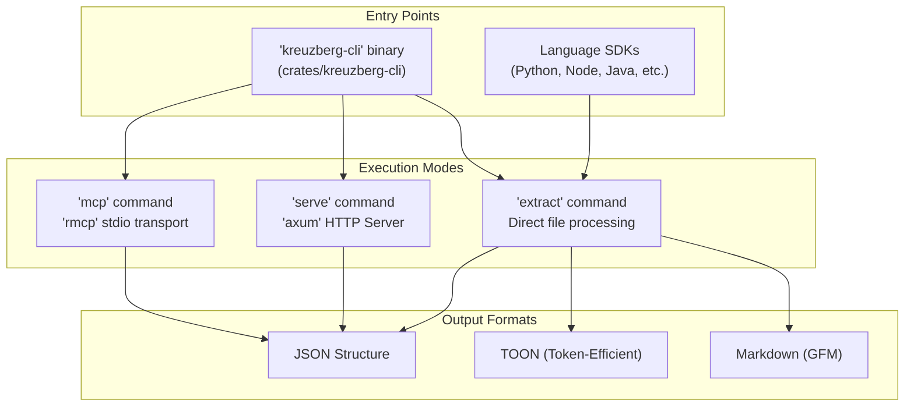

**Deployment Models and Execution Modes**

The system supports four distinct deployment patterns:

1.  **Library SDK**: Import into application code across 15+ languages.
2.  **CLI**: The `kreuzberg-cli` crate provides `extract`, `batch`, `detect`, and `cache` commands [README.md:109]().
3.  **REST API Server**: Enabled with `api` feature, uses `axum` for HTTP endpoints.
4.  **MCP Server**: Implements Model Context Protocol via `rmcp` for AI assistant integration.

Sources: [README.md:109-110](), [crates/kreuzberg/Cargo.toml:194]()

## Language Binding Strategy

Kreuzberg provides two integration paths:

**Direct Native Bindings**:
-   **Python**: PyO3-based with `maturin` build system [pyproject.toml:1-3]().
-   **Node.js**: NAPI-RS native bindings [crates/kreuzberg-node/package.json:30-42]().
-   **Ruby**: Magnus and `rb-sys` integration [packages/ruby/Gemfile.lock:4-5]().
-   **Elixir**: Rustler NIFs.
-   **WASM**: `wasm-bindgen` for browsers/Cloudflare Workers [crates/kreuzberg/Cargo.toml:103]().

**FFI Bridge** (`kreuzberg-ffi`):
-   Exports C ABI functions with `#[no_mangle]`.
-   Memory management uses arena allocation (Auto/Confined/Global) to prevent leaks across FFI boundaries.
-   Supports **Java** (Panama FFM), **Go** (cgo), **C#** (P/Invoke), **PHP** (ext-ffi), **Swift**, and **Dart**.

For details, see [System Architecture](#1.1) and the specific language binding pages.

Sources: [Cargo.toml:1-16](), [pyproject.toml:1-3](), [packages/ruby/Gemfile.lock:4-5](), [crates/kreuzberg-node/package.json:30-42](), [crates/kreuzberg/Cargo.toml:103]()

## Key System Components

-   **Document Processing Pipeline**: Multi-stage extraction with pluggable renderers (Markdown, HTML, Djot, Plain) [README.md:102-103]().
-   **Code Intelligence**: Semantic chunking and symbol extraction using `tree-sitter` [README.md:94]().
-   **OCR Backends**: Supports Tesseract, PaddleOCR (via ONNX Runtime), and VLM OCR (GPT-4o, Claude, etc.) via `liter-llm` [README.md:98-99]().
-   **Plugin System**: Cross-language trait bridges for custom `DocumentExtractor` and `Renderer` implementations.
-   **Build System**: Cargo workspace with feature flags like `pdf`, `ocr`, `embeddings`, `full`, `server`, `cli`, and platform-specific features [crates/kreuzberg/Cargo.toml:31-196]().

Sources: [README.md:94-106](), [crates/kreuzberg/Cargo.toml:31-196]()

---

# Page: System Architecture

# System Architecture

<details>
<summary>Relevant source files</summary>

The following files were used as context for generating this wiki page:

- [alef.toml](alef.toml)
- [crates/kreuzberg-ffi/Cargo.toml](crates/kreuzberg-ffi/Cargo.toml)
- [crates/kreuzberg-ffi/include/kreuzberg.h](crates/kreuzberg-ffi/include/kreuzberg.h)
- [crates/kreuzberg-ffi/src/lib.rs](crates/kreuzberg-ffi/src/lib.rs)
- [crates/kreuzberg-node/Cargo.toml](crates/kreuzberg-node/Cargo.toml)
- [crates/kreuzberg-node/index.d.ts](crates/kreuzberg-node/index.d.ts)
- [crates/kreuzberg-node/src/lib.rs](crates/kreuzberg-node/src/lib.rs)
- [crates/kreuzberg-php/src/lib.rs](crates/kreuzberg-php/src/lib.rs)
- [crates/kreuzberg-py/Cargo.toml](crates/kreuzberg-py/Cargo.toml)
- [crates/kreuzberg-py/src/lib.rs](crates/kreuzberg-py/src/lib.rs)
- [crates/kreuzberg-wasm/src/lib.rs](crates/kreuzberg-wasm/src/lib.rs)
- [docs/concepts/architecture.md](docs/concepts/architecture.md)
- [docs/concepts/extraction-pipeline.md](docs/concepts/extraction-pipeline.md)
- [docs/concepts/plugin-system.md](docs/concepts/plugin-system.md)
- [docs/ecosystem.md](docs/ecosystem.md)
- [docs/guides/image-captions.md](docs/guides/image-captions.md)
- [docs/guides/ner.md](docs/guides/ner.md)
- [docs/guides/page-classification.md](docs/guides/page-classification.md)
- [docs/guides/qr-codes.md](docs/guides/qr-codes.md)
- [docs/guides/redaction.md](docs/guides/redaction.md)
- [docs/guides/summarization.md](docs/guides/summarization.md)
- [docs/guides/translation.md](docs/guides/translation.md)
- [docs/llms.txt](docs/llms.txt)
- [e2e/rust/Cargo.toml](e2e/rust/Cargo.toml)
- [packages/elixir/native/kreuzberg_nif/src/lib.rs](packages/elixir/native/kreuzberg_nif/src/lib.rs)
- [packages/php/src/Kreuzberg.php](packages/php/src/Kreuzberg.php)
- [packages/php/stubs/kreuzberg_extension.php](packages/php/stubs/kreuzberg_extension.php)
- [packages/python/kreuzberg/__init__.py](packages/python/kreuzberg/__init__.py)
- [packages/python/kreuzberg/_kreuzberg.pyi](packages/python/kreuzberg/_kreuzberg.pyi)
- [packages/python/kreuzberg/api.py](packages/python/kreuzberg/api.py)
- [packages/python/kreuzberg/options.py](packages/python/kreuzberg/options.py)
- [packages/r/src/rust/src/lib.rs](packages/r/src/rust/src/lib.rs)
- [packages/ruby/ext/kreuzberg_rb/src/lib.rs](packages/ruby/ext/kreuzberg_rb/src/lib.rs)
- [packages/ruby/kreuzberg.gemspec](packages/ruby/kreuzberg.gemspec)
- [packages/swift/rust/src/lib.rs](packages/swift/rust/src/lib.rs)
- [packages/typescript/src/index.ts](packages/typescript/src/index.ts)
- [zensical.toml](zensical.toml)

</details>


## Purpose and Scope

This document describes the overall system architecture of Kreuzberg, focusing on how the Rust core library integrates with 12+ language bindings and deployment targets. It covers the workspace structure, binding strategies (direct Rust integration vs. FFI), feature flag system, and how native dependencies are managed across platforms.

For specific information about:
- Document processing pipeline internals, see [Document Processing Pipeline](#3.1)
- Individual language binding implementations, see [Language Bindings](#4)
- Build and CI/CD orchestration, see [CI/CD and Release Process](#8)
- Deployment modes and execution environments, see [Deployment](#7)

---

## High-Level Architecture

```mermaid
graph TB
    subgraph "Rust Workspace"
        Core["kreuzberg<br/>(main library)"]
        FFI["kreuzberg-ffi<br/>(C bindings)"]
        Tesseract["kreuzberg-tesseract<br/>(OCR engine)"]
        PaddleOCR["kreuzberg-paddle-ocr<br/>(ONNX-based OCR)"]
        CLI["kreuzberg-cli<br/>(binary)"]
        Node["kreuzberg-node<br/>(NAPI-RS)"]
        WASM["kreuzberg-wasm<br/>(wasm-bindgen)"]
        PyBindings["kreuzberg-py<br/>(PyO3)"]
        PHPBindings["kreuzberg-php<br/>(ext-ffi)"]
        DartBindings["kreuzberg-dart<br/>(flutter_rust_bridge)"]
        SwiftBindings["kreuzberg-swift<br/>(swift-bridge)"]
        KotlinAndroidBindings["kreuzberg-kotlin-android<br/>(JNI)"]
        ZigBindings["kreuzberg-zig<br/>(C-interop)"]
    end
    
    subgraph "Direct Rust Bindings"
        Python["Python<br/>via PyO3"]
        NodeJS["Node.js<br/>via NAPI-RS"]
        Ruby["Ruby<br/>Magnus/rb_sys"]
        Elixir["Elixir<br/>Rustler NIFs"]
        R["R<br/>extendr"]
        Dart["Dart/Flutter<br/>flutter_rust_bridge"]
        Swift["Swift<br/>swift-bridge"]
        KotlinAndroid["Kotlin (Android)<br/>JNI"]
    end
    
    subgraph "FFI-Based Bindings"
        Go["Go<br/>cgo"]
        Java["Java<br/>Panama FFM"]
        CSharp["C#<br/>P/Invoke"]
        PHP["PHP<br/>ext-ffi"]
        C["C<br/>Direct"]
        Zig["Zig<br/>C-interop"]
    end
    
    subgraph "Browser/Edge"
        Browser["Browser/Deno<br/>Cloudflare Workers"]
    end
    
    Core --> FFI
    Core --> CLI
    Core --> PyBindings
    Core --> Node
    Core --> WASM
    Core --> Tesseract
    Core --> PaddleOCR
    
    PyBindings --> Python
    Node --> NodeJS
    Ruby --> FFI
    Elixir --> FFI
    R --> FFI
    DartBindings --> Dart
    SwiftBindings --> Swift
    KotlinAndroidBindings --> KotlinAndroid
    
    FFI --> Go
    FFI --> Java
    FFI --> CSharp
    PHPBindings --> PHP
    FFI --> C
    ZigBindings --> Zig
    
    WASM --> Browser
```

**Sources:** [alef.toml:3-18]()

The architecture uses a **hub-and-spoke model** with the `kreuzberg` crate at the center. Two primary integration strategies enable polyglot support:

1. **Direct Rust Integration:** Python (PyO3), Node.js (NAPI-RS), Ruby (Magnus), Elixir (Rustler), R (extendr), Swift (swift-bridge), Dart (flutter_rust_bridge), and Kotlin (JNI) compile Rust code directly into native extensions or link via specific bridge generators.
2. **C FFI Layer:** Go, Java, C#, PHP, and Zig consume the `kreuzberg-ffi` C-compatible library via platform-specific FFI mechanisms.

---

## Cargo Workspace Structure

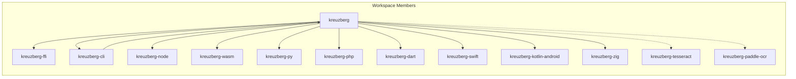

**Sources:** [alef.toml:1-19]()

The workspace is defined in the root `alef.toml` [alef.toml:1-19]() and contains:

| Crate | Type | Purpose |
|-------|------|---------|
| `kreuzberg` | Library | Core extraction engine with feature flags |
| `kreuzberg-ffi` | cdylib/staticlib | C-compatible bindings for FFI languages |
| `kreuzberg-tesseract` | Library | OCR engine with C++ build system |
| `kreuzberg-paddle-ocr` | Library | ONNX-based OCR |
| `kreuzberg-cli` | Binary | Command-line interface |
| `kreuzberg-node` | cdylib | NAPI-RS native module |
| `kreuzberg-wasm` | cdylib | WebAssembly bindings |
| `kreuzberg-py` | cdylib | PyO3 Python bindings |
| `kreuzberg-php` | cdylib | PHP FFI wrapper |
| `kreuzberg-dart` | cdylib | Dart FFI / flutter_rust_bridge support |
| `kreuzberg-swift` | cdylib | Swift bridge support |
| `kreuzberg-kotlin-android` | cdylib | Kotlin (Android) JNI support |
| `kreuzberg-zig` | cdylib | Zig C-interop support |

Workspace-level configurations are managed by `alef.toml`, including language-specific DTO styles [alef.toml:34-45]() and binding generation control [alef.toml:50-59]().

**Sources:** [alef.toml:1-19](), [alef.toml:34-45](), [alef.toml:50-59]()

---

## Feature Flag Architecture

The `kreuzberg` crate uses extensive feature flags for modular compilation:

```mermaid
graph TD
    subgraph "kreuzberg Crate Features"
        direction LR
        F_full["full"]
        F_pdf["pdf"]
        F_ocr["ocr"]
        F_paddle_ocr["paddle-ocr"]
        F_embeddings["embeddings"]
        F_chunking["chunking"]
        F_keywords_yake["keywords-yake"]
        F_keywords_rake["keywords-rake"]
        F_language_detection["language-detection"]
        F_html["html"]
        F_tree_sitter["tree-sitter"]
        F_office["office"]
        F_email["email"]
        F_archives["archives"]
        F_stopwords["stopwords"]
        F_auto_rotate["auto-rotate"]
        F_tokio_runtime["tokio-runtime"]
        F_api["api"]
        F_mcp["mcp"]
        F_liter_llm["liter-llm"]
        F_quality["quality"]
        F_layout_detection["layout-detection"]
        F_paddle_ocr_types["paddle-ocr-types"]
        F_layout_types["layout-types"]
        F_embedding_presets["embedding-presets"]
        F_auto_rotate_types["auto-rotate-types"]
        F_android_target["android-target"]
    end

    subgraph "Binding Crate Dependencies"
        Py_kreuzberg["kreuzberg-py<br/>(Cargo.toml)"]
        Node_kreuzberg["kreuzberg-node<br/>(Cargo.toml)"]
        FFI_kreuzberg["kreuzberg-ffi<br/>(Cargo.toml)"]
        Rust_e2e_kreuzberg["kreuzberg-e2e-rust<br/>(Cargo.toml)"]
    end

    Py_kreuzberg --> F_full
    Py_kreuzberg --> F_pdf
    Py_kreuzberg --> F_ocr
    Py_kreuzberg --> F_paddle_ocr
    Py_kreuzberg --> F_paddle_ocr_types
    Py_kreuzberg --> F_layout_detection
    Py_kreuzberg --> F_layout_types
    Py_kreuzberg --> F_embeddings
    Py_kreuzberg --> F_embedding_presets
    Py_kreuzberg --> F_chunking
    Py_kreuzberg --> F_keywords_yake
    Py_kreuzberg --> F_keywords_rake
    Py_kreuzberg --> F_language_detection
    Py_kreuzberg --> F_html
    Py_kreuzberg --> F_tree_sitter
    Py_kreuzberg --> F_office
    Py_kreuzberg --> F_email
    Py_kreuzberg --> F_archives
    Py_kreuzberg --> F_stopwords
    Py_kreuzberg --> F_auto_rotate
    Py_kreuzberg --> F_auto_rotate_types
    Py_kreuzberg --> F_tokio_runtime
    Py_kreuzberg --> F_api
    Py_kreuzberg --> F_mcp
    Py_kreuzberg --> F_liter_llm
    Py_kreuzberg --> F_quality

    Node_kreuzberg --> F_full
    Node_kreuzberg --> F_pdf
    Node_kreuzberg --> F_ocr
    Node_kreuzberg --> F_paddle_ocr
    Node_kreuzberg --> F_paddle_ocr_types
    Node_kreuzberg --> F_layout_detection
    Node_kreuzberg --> F_layout_types
    Node_kreuzberg --> F_embeddings
    Node_kreuzberg --> F_embedding_presets
    Node_kreuzberg --> F_chunking
    Node_kreuzberg --> F_keywords_yake
    Node_kreuzberg --> F_keywords_rake
    Node_kreuzberg --> F_language_detection
    Node_kreuzberg --> F_html
    Node_kreuzberg --> F_tree_sitter
    Node_kreuzberg --> F_office
    Node_kreuzberg --> F_email
    Node_kreuzberg --> F_archives
    Node_kreuzberg --> F_stopwords
    Node_kreuzberg --> F_auto_rotate
    Node_kreuzberg --> F_auto_rotate_types
    Node_kreuzberg --> F_tokio_runtime
    Node_kreuzberg --> F_api
    Node_kreuzberg --> F_mcp
    Node_kreuzberg --> F_liter_llm
    Node_kreuzberg --> F_quality

    FFI_kreuzberg --> F_full
    FFI_kreuzberg --> F_pdf
    FFI_kreuzberg --> F_ocr
    FFI_kreuzberg --> F_paddle_ocr
    FFI_kreuzberg --> F_paddle_ocr_types
    FFI_kreuzberg --> F_layout_detection
    FFI_kreuzberg --> F_layout_types
    FFI_kreuzberg --> F_embeddings
    FFI_kreuzberg --> F_embedding_presets
    FFI_kreuzberg --> F_chunking
    FFI_kreuzberg --> F_keywords_yake
    FFI_kreuzberg --> F_keywords_rake
    FFI_kreuzberg --> F_language_detection
    FFI_kreuzberg --> F_html
    FFI_kreuzberg --> F_tree_sitter
    FFI_kreuzberg --> F_office
    FFI_kreuzberg --> F_email
    FFI_kreuzberg --> F_archives
    FFI_kreuzberg --> F_stopwords
    FFI_kreuzberg --> F_auto_rotate
    FFI_kreuzberg --> F_auto_rotate_types
    FFI_kreuzberg --> F_tokio_runtime
    FFI_kreuzberg --> F_api
    FFI_kreuzberg --> F_mcp
    FFI_kreuzberg --> F_liter_llm
    FFI_kreuzberg --> F_quality
    FFI_kreuzberg -- "target.'cfg(all(target_os = \"android\", target_arch = \"x86_64\"))'.dependencies" --> F_android_target
    FFI_kreuzberg -- "target.'cfg(target_os = \"windows\")'.dependencies" --> F_pdf
    FFI_kreuzberg -- "target.'cfg(target_os = \"windows\")'.dependencies" --> F_ocr
    FFI_kreuzberg -- "target.'cfg(target_os = \"windows\")'.dependencies" --> F_chunking
    FFI_kreuzberg -- "target.'cfg(target_os = \"windows\")'.dependencies" --> F_keywords_yake
    FFI_kreuzberg -- "target.'cfg(target_os = \"windows\")'.dependencies" --> F_keywords_rake
    FFI_kreuzberg -- "target.'cfg(target_os = \"windows\")'.dependencies" --> F_language_detection
    FFI_kreuzberg -- "target.'cfg(target_os = \"windows\")'.dependencies" --> F_html
    FFI_kreuzberg -- "target.'cfg(target_os = \"windows\")'.dependencies" --> F_tree_sitter
    FFI_kreuzberg -- "target.'cfg(target_os = \"windows\")'.dependencies" --> F_office
    FFI_kreuzberg -- "target.'cfg(target_os = \"windows\")'.dependencies" --> F_email
    FFI_kreuzberg -- "target.'cfg(target_os = \"windows\")'.dependencies" --> F_archives
    FFI_kreuzberg -- "target.'cfg(target_os = \"windows\")'.dependencies" --> F_stopwords
    FFI_kreuzberg -- "target.'cfg(target_os = \"windows\")'.dependencies" --> F_auto_rotate
    FFI_kreuzberg -- "target.'cfg(target_os = \"windows\")'.dependencies" --> F_auto_rotate_types
    FFI_kreuzberg -- "target.'cfg(target_os = \"windows\")'.dependencies" --> F_tokio_runtime
    FFI_kreuzberg -- "target.'cfg(target_os = \"windows\")'.dependencies" --> F_api
    FFI_kreuzberg -- "target.'cfg(target_os = \"windows\")'.dependencies" --> F_mcp
    FFI_kreuzberg -- "target.'cfg(target_os = \"windows\")'.dependencies" --> F_quality

    Rust_e2e_kreuzberg --> F_full
    Rust_e2e_kreuzberg --> F_pdf
    Rust_e2e_kreuzberg --> F_ocr
    Rust_e2e_kreuzberg --> F_paddle_ocr
    Rust_e2e_kreuzberg --> F_paddle_ocr_types
    Rust_e2e_kreuzberg --> F_layout_detection
    Rust_e2e_kreuzberg --> F_layout_types
    Rust_e2e_kreuzberg --> F_embeddings
    Rust_e2e_kreuzberg --> F_embedding_presets
    Rust_e2e_kreuzberg --> F_chunking
    Rust_e2e_kreuzberg --> F_keywords_yake
    Rust_e2e_kreuzberg --> F_keywords_rake
    Rust_e2e_kreuzberg --> F_language_detection
    Rust_e2e_kreuzberg --> F_html
    Rust_e2e_kreuzberg --> F_tree_sitter
    Rust_e2e_kreuzberg --> F_office
    Rust_e2e_kreuzberg --> F_email
    Rust_e2e_kreuzberg --> F_archives
    Rust_e2e_kreuzberg --> F_stopwords
    Rust_e2e_kreuzberg --> F_auto_rotate
    Rust_e2e_kreuzberg --> F_auto_rotate_types
    Rust_e2e_kreuzberg --> F_tokio_runtime
    Rust_e2e_kreuzberg --> F_api
    Rust_e2e_kreuzberg --> F_mcp
    Rust_e2e_kreuzberg --> F_liter_llm
    Rust_e2e_kreuzberg --> F_quality
```

**Sources:** [alef.toml:168-195](), [crates/kreuzberg-py/Cargo.toml:29-30](), [crates/kreuzberg-node/Cargo.toml:24](), [crates/kreuzberg-ffi/Cargo.toml:37-43](), [e2e/rust/Cargo.toml:16]()

### Key Feature Categories

**Format Extractors**:
- `pdf`: Enables `pdf_oxide` and `lopdf` based extraction.
- `office`: Word/PowerPoint/Excel via `roxmltree`, `zip`, `quick-xml`, `calamine`.
- `email`: Email parsing.
- `html`: HTML parsing.
- `archives`: ZIP/TAR/7z support.
- `tree-sitter`: Code intelligence for 300+ languages.

**OCR & AI**:
- `ocr`: Full Tesseract with image preprocessing.
- `paddle-ocr`: ONNX Runtime-based OCR.
- `layout-detection`: YOLO/RT-DETR based layout analysis via ONNX Runtime.
- `auto-rotate`: PP-LCNet based orientation detection.
- `embeddings`: Full embedding generation via ONNX Runtime.
- `liter-llm`: LLM integration for various tasks.

**Text Processing**:
- `chunking`: Document chunking strategies.
- `keywords-yake`, `keywords-rake`: Keyword extraction algorithms.
- `language-detection`: Language identification.
- `quality`: Quality scoring for extracted content.

**Deployment Targets**:
- `wasm-target`: Preset for WebAssembly (excludes ORT/native C++ deps).
- `android-target`: Preset for Android (excludes ORT-dependent features).

**Sources:** [alef.toml:168-195]()

---

## Language Binding Strategies

### Direct Rust Integration

#### PyO3 (Python)

```mermaid
graph TD
    PythonApp["Python Application"]
    PyPackage["kreuzberg<br/>(Python package)"]
    PyCrate["kreuzberg-py<br/>(Rust crate)"]
    CoreLib["kreuzberg<br/>(core library)"]
    
    PythonApp -->|imports| PyPackage
    PyPackage -->|calls Python API<br/>(e.g., `extract_file`)| PyCrate
    PyCrate -->|Rust FFI calls| CoreLib
    
    subgraph "Python Binding Details"
        PyCrate_lib_rs["crates/kreuzberg-py/src/lib.rs"]
        PyPackage_init_py["packages/python/kreuzberg/__init__.py"]
        PyPackage_api_py["packages/python/kreuzberg/api.py"]
        PyPackage_options_py["packages/python/kreuzberg/options.py"]
        PyPackage_pyi["packages/python/kreuzberg/_kreuzberg.pyi"]
    end

    PyCrate_lib_rs -- "defines PyO3 modules" --> PyPackage
    PyPackage_init_py -- "re-exports symbols" --> PythonApp
    PyPackage_api_py -- "Python wrappers" --> PyPackage
    PyPackage_options_py -- "Python DTOs" --> PyPackage
    PyPackage_pyi -- "type hints" --> PyPackage

    PyCrate -- "uses `pyo3`" --> PyCrate_lib_rs
    PyCrate_lib_rs -- "calls `kreuzberg` functions" --> CoreLib
```

**Implementation:** The Python bindings are built using `PyO3` [crates/kreuzberg-py/Cargo.toml:30](). The `alef` tool generates the Rust code for the Python module [crates/kreuzberg-py/src/lib.rs:1-3]() and Python stubs [packages/python/kreuzberg/__init__.py:1-8](), [packages/python/kreuzberg/_kreuzberg.pyi](). `maturin` is used for the build system [pyproject.toml:1-3](). Asynchronous operations are handled via `pyo3-async-runtimes` [crates/kreuzberg-py/Cargo.toml:31]().

**Sources:** [crates/kreuzberg-py/src/lib.rs:1-3](), [packages/python/kreuzberg/__init__.py:1-8](), [packages/python/kreuzberg/_kreuzberg.pyi](), [pyproject.toml:1-3](), [crates/kreuzberg-py/Cargo.toml:30-31]()

#### NAPI-RS (Node.js)

```mermaid
graph TD
    NodeJSApp["Node.js Application"]
    NPM["@kreuzberg/node<br/>(npm package)"]
    NodeCrate["kreuzberg-node<br/>(Rust crate)"]
    CoreLib["kreuzberg<br/>(core library)"]
    
    NodeJSApp -->|imports| NPM
    NPM -->|calls Node.js API<br/>(e.g., `extractFile`)| NodeCrate
    NodeCrate -->|Rust FFI calls| CoreLib
    
    subgraph "Node.js Binding Details"
        NodeCrate_lib_rs["crates/kreuzberg-node/src/lib.rs"]
        NPM_index_ts["packages/typescript/src/index.ts"]
        NPM_d_ts["crates/kreuzberg-node/index.d.ts"]
    end

    NodeCrate_lib_rs -- "defines NAPI modules" --> NPM
    NPM_index_ts -- "TypeScript wrappers" --> NodeJSApp
    NPM_d_ts -- "TypeScript definitions" --> NodeJSApp

    NodeCrate -- "uses `napi-rs`" --> NodeCrate_lib_rs
    NodeCrate_lib_rs -- "calls `kreuzberg` functions" --> CoreLib
```

**Implementation:** The Node.js bindings are built using `napi-rs` [crates/kreuzberg-node/Cargo.toml:25](). The `alef` tool generates the Rust code for the NAPI module [crates/kreuzberg-node/src/lib.rs:1-3]() and TypeScript definitions [crates/kreuzberg-node/index.d.ts](). A multi-threaded Tokio runtime is used for asynchronous operations [crates/kreuzberg-node/src/lib.rs:57-62]().

**Sources:** [crates/kreuzberg-node/src/lib.rs:1-3](), [crates/kreuzberg-node/Cargo.toml:25](), [crates/kreuzberg-node/src/lib.rs:57-62](), [crates/kreuzberg-node/index.d.ts]()

#### Magnus (Ruby)

**Implementation:** Ruby integration uses `Magnus` and `rb-sys`. The extension is located in [packages/ruby/ext/kreuzberg_rb/native/Cargo.toml](). It manages native dependencies via `rb_sys` to ensure compatibility with the Ruby runtime. The `alef` tool generates the Rust code for the Ruby extension [packages/ruby/ext/kreuzberg_rb/src/lib.rs:1-3]().

**Sources:** [packages/ruby/kreuzberg.gemspec:21](), [packages/ruby/ext/kreuzberg_rb/src/lib.rs:1-3]()

#### Rustler (Elixir)

**Implementation:** Elixir bindings are implemented using `Rustler` NIFs. The `alef` tool generates the Rust code for the NIF module [packages/elixir/native/kreuzberg_nif/src/lib.rs:1-3]().

**Sources:** [packages/elixir/native/kreuzberg_nif/src/lib.rs:1-3]()

#### extendr (R)

**Implementation:** R bindings are built using the `extendr` framework. The `alef` tool generates the Rust code for the R extension [packages/r/src/rust/src/lib.rs:1-3]().

**Sources:** [packages/r/src/rust/src/lib.rs:1-3]()

#### swift-bridge (Swift)

**Implementation:** Swift bindings are generated using `swift-bridge`. The `alef` tool generates the Rust code for the Swift bridge [packages/swift/rust/src/lib.rs:1-3]().

**Sources:** [packages/swift/rust/src/lib.rs:1-3]()

#### flutter_rust_bridge (Dart/Flutter)

**Implementation:** Dart/Flutter bindings leverage `flutter_rust_bridge`. The `alef` tool generates the Rust code for the Dart FFI [packages/dart/rust/src/lib.rs:1-3]().

**Sources:** [packages/dart/rust/src/lib.rs:1-3]()

#### JNI (Kotlin/Android)

**Implementation:** Kotlin (Android) bindings use JNI. The `alef` tool generates the Rust code for the JNI interface [packages/kotlin-android/rust/src/lib.rs:1-3]().

**Sources:** [packages/kotlin-android/rust/src/lib.rs:1-3]()

### FFI-Based Bindings

```mermaid
graph TD
    App["Application (Go, Java, C#, PHP, Zig)"]
    FFI_Layer["kreuzberg-ffi<br/>(C-compatible library)"]
    CoreLib["kreuzberg<br/>(core library)"]
    
    App -->|FFI calls (e.g., `kreuzberg_extract_file`)| FFI_Layer
    FFI_Layer -->|Rust FFI calls| CoreLib
    
    subgraph "FFI Layer Details"
        FFI_lib_rs["crates/kreuzberg-ffi/src/lib.rs"]
        FFI_header["crates/kreuzberg-ffi/include/kreuzberg.h"]
        FFI_Cargo_toml["crates/kreuzberg-ffi/Cargo.toml"]
    end

    FFI_lib_rs -- "defines C functions" --> FFI_Layer
    FFI_lib_rs -- "error handling, memory management" --> FFI_Layer
    FFI_header -- "generated by `cbindgen`" --> FFI_Layer
    FFI_Cargo_toml -- "builds `cdylib`, `staticlib`" --> FFI_Layer

    FFI_Layer -- "uses `kreuzberg`" --> CoreLib
```

**C Header Generation:** `cbindgen` generates C-compatible headers for `kreuzberg-ffi`. The `alef` tool manages the synchronization of these bindings across languages [alef.toml:51-58](). The `kreuzberg-ffi` crate is configured to build as a `cdylib` and `staticlib` [crates/kreuzberg-ffi/Cargo.toml:25](). It includes functions for error handling (`kreuzberg_last_error_code`, `kreuzberg_last_error_context`) and memory management (`kreuzberg_free_string`, `kreuzberg_free_bytes`) [crates/kreuzberg-ffi/src/lib.rs:60-106]().

**Sources:** [alef.toml:51-58](), [crates/kreuzberg-ffi/Cargo.toml:25](), [crates/kreuzberg-ffi/src/lib.rs:60-106]()

#### CGo (Go)

**Implementation:** Go bindings use `cgo` to interact with the `kreuzberg-ffi` library. The `alef` tool generates the Go code [packages/go/v5/go.mod]().

**Sources:** [packages/go/v5/go.mod]()

#### Panama FFM API (Java)

**Implementation:** Java bindings utilize the Panama Foreign Function & Memory (FFM) API. The `alef` tool generates the Java code [packages/java/src/main/java/dev/kreuzberg/Kreuzberg.java]().

**Sources:** [packages/java/src/main/java/dev/kreuzberg/Kreuzberg.java]()

#### P/Invoke (C#)

**Implementation:** C# bindings use P/Invoke to call functions from the `kreuzberg-ffi` library. The `alef` tool generates the C# code [packages/csharp/Kreuzberg.cs]().

**Sources:** [packages/csharp/Kreuzberg.cs]()

#### ext-ffi (PHP)

```mermaid
graph TD
    PHPApp["PHP Application"]
    PHPPackage["Kreuzberg<br/>(Composer package)"]
    PHPBindings["kreuzberg-php<br/>(Rust crate)"]
    CoreLib["kreuzberg<br/>(core library)"]
    
    PHPApp -->|uses| PHPPackage
    PHPPackage -->|calls PHP API<br/>(e.g., `extractFile`)| PHPBindings
    PHPBindings -->|Rust FFI calls| CoreLib
    
    subgraph "PHP Binding Details"
        PHPBindings_lib_rs["crates/kreuzberg-php/src/lib.rs"]
        PHPPackage_php["packages/php/src/Kreuzberg.php"]
        PHPPackage_stubs["packages/php/stubs/kreuzberg_extension.php"]
    end

    PHPBindings_lib_rs -- "defines PHP classes/functions" --> PHPPackage
    PHPPackage_php -- "PHP wrappers" --> PHPApp
    PHPPackage_stubs -- "PHP stubs" --> PHPApp

    PHPBindings -- "uses `ext-php-rs`" --> PHPBindings_lib_rs
    PHPBindings_lib_rs -- "calls `kreuzberg` functions" --> CoreLib
```

**Implementation:** PHP bindings are built using `ext-php-rs` [crates/kreuzberg-php/src/lib.rs:27](). The `alef` tool generates the Rust code for the PHP extension [crates/kreuzberg-php/src/lib.rs:1-3]() and PHP stubs [packages/php/stubs/kreuzberg_extension.php](). A Tokio runtime is used for asynchronous operations [crates/kreuzberg-php/src/lib.rs:57-62]().

**Sources:** [crates/kreuzberg-php/src/lib.rs:1-3](), [crates/kreuzberg-php/src/lib.rs:27](), [crates/kreuzberg-php/src/lib.rs:57-62](), [packages/php/stubs/kreuzberg_extension.php]()

#### C-interop (Zig)

**Implementation:** Zig bindings use C-interop with the `kreuzberg-ffi` library. The `alef` tool generates the Zig code [packages/zig/src/kreuzberg.zig]().

**Sources:** [packages/zig/src/kreuzberg.zig]()

---

## Native Dependencies

### ONNX Runtime (ORT)

Kreuzberg relies heavily on ONNX Runtime for OCR, layout detection, and embeddings. 

- **Version:** Pinned to `2.0.0-rc.12` in the workspace `Cargo.toml`.
- **Bundling:** The `ort-bundled` feature enables downloading pre-built binaries (CoreML on macOS, CUDA on Linux).
- **Dynamic Loading:** The `ort-dynamic` feature allows loading the library at runtime.

**Sources:** [Cargo.toml:76-79]()

### Tesseract OCR

The `kreuzberg-tesseract` crate provides the bridge to the Tesseract engine. It is a core dependency for the `ocr` feature.

**Sources:** [alef.toml:170]()

---

## Build and Versioning Orchestration

### Version Synchronization

The `alef` tool synchronizes versions across the entire polyglot workspace.

**Versioned Files:**
- `Cargo.toml` (Workspace root) [alef.toml:82]()
- `packages/python/kreuzberg/__init__.py` [alef.toml:75]()
- `packages/ruby/lib/kreuzberg/version.rb` [alef.toml:76]()
- `crates/kreuzberg-node/package.json` [alef.toml:78]()
- `packages/go/v5/go.mod` [alef.toml:81]()
- `packages/ruby/ext/kreuzberg_rb/native/Cargo.toml` [alef.toml:77]()

**Sources:** [alef.toml:73-83]()

### Pre-Commit Hooks

The repository uses `pre-commit` to maintain code quality across all languages.

- **Rust:** `cargo-fmt`, `cargo-clippy`, `cargo-machete`, `cargo-deny`.
- **Python:** `mypy`, `ruff`.
- **Node.js:** `oxlint`, `oxfmt`.
- **Java:** `checkstyle`, `java-verify`.
- **Ruby:** `rubocop`, `steep`.

**Sources:** [alef.toml:63-71]()

---

# Page: Supported Formats and Features

# Supported Formats and Features

<details>
<summary>Relevant source files</summary>

The following files were used as context for generating this wiki page:

- [CONTRIBUTING.md](CONTRIBUTING.md)
- [README.md](README.md)
- [crates/kreuzberg-node/README.md](crates/kreuzberg-node/README.md)
- [crates/kreuzberg-wasm/README.md](crates/kreuzberg-wasm/README.md)
- [crates/kreuzberg/README.md](crates/kreuzberg/README.md)
- [crates/kreuzberg/src/extraction/mod.rs](crates/kreuzberg/src/extraction/mod.rs)
- [crates/kreuzberg/src/extractors/mod.rs](crates/kreuzberg/src/extractors/mod.rs)
- [crates/kreuzberg/src/extractors/security.rs](crates/kreuzberg/src/extractors/security.rs)
- [crates/kreuzberg/tests/api_openweb.rs](crates/kreuzberg/tests/api_openweb.rs)
- [docs/contributing.md](docs/contributing.md)
- [docs/css/extra.css](docs/css/extra.css)
- [docs/features.md](docs/features.md)
- [docs/getting-started/installation.md](docs/getting-started/installation.md)
- [docs/guides/agent-skills.md](docs/guides/agent-skills.md)
- [docs/guides/docker.md](docs/guides/docker.md)
- [docs/guides/kubernetes.md](docs/guides/kubernetes.md)
- [docs/index.md](docs/index.md)
- [docs/integrations/index.md](docs/integrations/index.md)
- [docs/integrations/openwebui.md](docs/integrations/openwebui.md)
- [docs/integrations/surrealdb.md](docs/integrations/surrealdb.md)
- [packages/csharp/README.md](packages/csharp/README.md)
- [packages/elixir/README.md](packages/elixir/README.md)
- [packages/go/v4/README.md](packages/go/v4/README.md)
- [packages/java/README.md](packages/java/README.md)
- [packages/php/README.md](packages/php/README.md)
- [packages/python/README.md](packages/python/README.md)
- [packages/ruby/README.md](packages/ruby/README.md)

</details>


This page documents all file formats supported by Kreuzberg and the feature availability across language bindings. Kreuzberg supports 90+ formats across 8 major categories through native Rust extractors. For architectural details about the extraction pipeline, see [Document Processing Pipeline](3.1). For OCR-specific configuration, see [OCR Backends](5.3).

## Format Categories Overview

Kreuzberg organizes supported formats into eight primary categories, each handled by specialized native extractors:

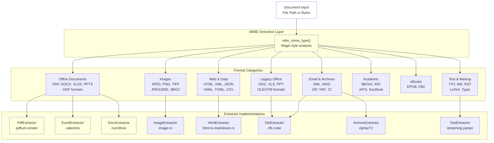
Sources: [README.md:83-91](), [docs/features.md:9-102](), [docs/index.md:32-35]()

## Office Documents

### Microsoft Office Formats

| Format | Extensions | MIME Type | Extractor | OCR Support | Special Features |
|--------|-----------|-----------|-----------|-------------|------------------|
| **PDF** | `.pdf` | `application/pdf` | `PdfExtractor` [crates/kreuzberg/src/extractors/pdf.rs]() | Yes | Text layer detection, metadata, image extraction, hierarchy detection |
| **Excel (Modern)** | `.xlsx`, `.xlsm`, `.xlsb` | `application/vnd.openxmlformats-officedocument.spreadsheetml.sheet` | `ExcelExtractor` [crates/kreuzberg/src/extractors/excel.rs]() | No | Multi-sheet, formulas, cell metadata |
| **Excel (Legacy)** | `.xls`, `.xla`, `.xlam`, `.xltm` | `application/vnd.ms-excel` | `ExcelExtractor` [crates/kreuzberg/src/extractors/excel.rs]() | No | Binary format support |
| **Word (Modern)** | `.docx` | `application/vnd.openxmlformats-officedocument.wordprocessingml.document` | `DocxExtractor` [crates/kreuzberg/src/extractors/docx.rs]() | No | Formatting, tables, metadata |
| **Word (Legacy)** | `.doc` | `application/msword` | `DocExtractor` [crates/kreuzberg/src/extractors/doc.rs]() | Yes | Native OLE/CFB parsing |
| **PowerPoint (Modern)** | `.pptx`, `.pptm`, `.ppsx` | `application/vnd.openxmlformats-officedocument.presentationml.presentation` | `PptxExtractor` [crates/kreuzberg/src/extractors/pptx.rs]() | Yes (images) | Slides, speaker notes, embedded images |
| **PowerPoint (Legacy)** | `.ppt` | `application/vnd.ms-powerpoint` | `PptExtractor` [crates/kreuzberg/src/extractors/ppt.rs]() | Yes | Native OLE/CFB parsing |

### OpenDocument and Apple Formats

| Format | Extensions | MIME Type | Extractor | Special Features |
|--------|-----------|-----------|-----------|------------------|
| **OpenDocument Text** | `.odt` | `application/vnd.oasis.opendocument.text` | `OdtExtractor` [crates/kreuzberg/src/extractors/odt.rs]() | Full ODF specification support |
| **OpenDocument Spreadsheet** | `.ods` | `application/vnd.oasis.opendocument.spreadsheet` | `ExcelExtractor` [crates/kreuzberg/src/extractors/excel.rs]() | Multi-sheet support |
| **Pages** | `.pages` | `application/x-iwork-pages-sffpages` | `PagesExtractor` [crates/kreuzberg/src/extractors/iwork/pages.rs]() | Native Apple iWork support |
| **Numbers** | `.numbers` | `application/x-iwork-numbers-sffnumbers` | `NumbersExtractor` [crates/kreuzberg/src/extractors/iwork/numbers.rs]() | Native Apple iWork support |
| **Keynote** | `.key` | `application/x-iwork-keynote-sffkey` | `KeynoteExtractor` [crates/kreuzberg/src/extractors/iwork/keynote.rs]() | Native Apple iWork support |
| **Hangul Word** | `.hwp`, `.hwpx` | `application/x-hwp` | `HwpExtractor` [crates/kreuzberg/src/extractors/hwp.rs]() / `HwpxExtractor` [crates/kreuzberg/src/extractors/hwpx.rs]() | Korean document support |
Sources: [docs/features.md:13-41](), [crates/kreuzberg/src/extractors/hwpx.rs:1-50](), [README.md:83-83]()

## Images

Kreuzberg supports comprehensive image format extraction with optional OCR capabilities through multiple backends.

### Image Format Support

| Category | Formats | MIME Types | Decoder | OCR Support | Features |
|----------|---------|-----------|---------|-------------|----------|
| **Common Raster** | `.png`, `.jpg`, `.jpeg`, `.gif`, `.webp`, `.bmp` | `image/png`, `image/jpeg`, etc. | `ImageExtractor` [crates/kreuzberg/src/extractors/image.rs]() | Yes | EXIF metadata, dimensions, color space |
| **TIFF** | `.tiff`, `.tif` | `image/tiff` | `ImageExtractor` [crates/kreuzberg/src/extractors/image.rs]() | Yes | Multi-page support, EXIF |
| **JPEG 2000** | `.jp2`, `.jpx`, `.jpm`, `.mj2` | `image/jp2` | `ImageExtractor` [crates/kreuzberg/src/extractors/image.rs]() | Yes | Advanced compression |
| **JBIG2** | `.jbig2` | `image/x-jbig2` | `ImageExtractor` [crates/kreuzberg/src/extractors/image.rs]() | Yes | Monochrome compression |
| **Portable Formats** | `.pnm`, `.pbm`, `.pgm`, `.ppm` | `image/x-portable-*` | `ImageExtractor` [crates/kreuzberg/src/extractors/image.rs]() | Yes | Simple formats |

### OCR Backend Integration

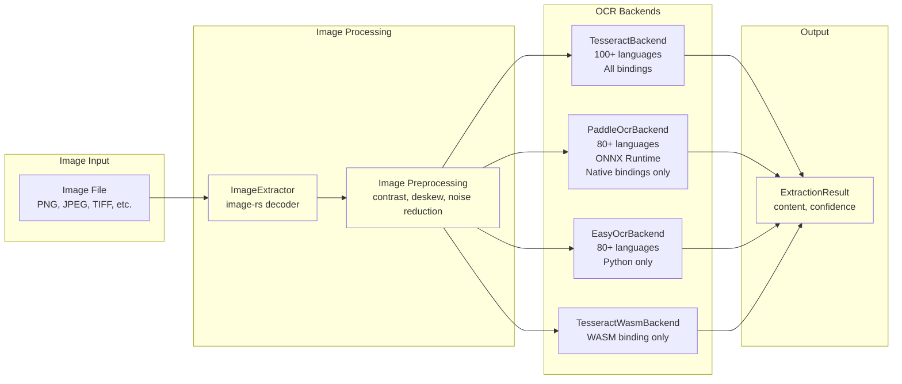
Sources: [docs/features.md:43-55](), [docs/features.md:137-150](), [README.md:85-85]()

## Web & Data Formats

### Markup and Web

| Format | Extensions | MIME Type | Extractor | Special Features |
|--------|-----------|-----------|-----------|------------------|
| **HTML** | `.html`, `.htm`, `.xhtml` | `text/html` | `HtmlExtractor` [crates/kreuzberg/src/extractors/html.rs]() | HTML-to-Markdown passthrough |
| **XML** | `.xml` | `application/xml` | `XmlExtractor` [crates/kreuzberg/src/extractors/xml.rs]() | Element tracking |
| **SVG** | `.svg` | `image/svg+xml` | `XmlExtractor` [crates/kreuzberg/src/extractors/xml.rs]() | DOM parsing, embedded text |

### Structured Data and Text

| Format | Extensions | MIME Type | Parser | Special Features |
|--------|-----------|-----------|--------|------------------|
| **JSON** | `.json` | `application/json` | `StructuredExtractor` [crates/kreuzberg/src/extractors/structured.rs]() | Schema detection |
| **YAML** | `.yaml` | `application/x-yaml` | `StructuredExtractor` [crates/kreuzberg/src/extractors/structured.rs]() | Multi-document support |
| **TOML** | `.toml` | `application/toml` | `StructuredExtractor` [crates/kreuzberg/src/extractors/structured.rs]() | Configuration parsing |
| **CSV / TSV** | `.csv`, `.tsv` | `text/csv` | `CsvExtractor` [crates/kreuzberg/src/extractors/csv.rs]() | Delimiter detection |
| **Markdown** | `.md`, `.mdx` | `text/markdown` | `MarkdownExtractor` [crates/kreuzberg/src/extractors/markdown.rs]() | GFM-quality output |
| **Djot** | `.djot` | `text/x-djot` | `DjotExtractor` [crates/kreuzberg/src/extractors/djot_format.rs]() | Modern markup |
| **reStructuredText**| `.rst` | `text/x-rst` | `RstExtractor` [crates/kreuzberg/src/extractors/rst.rs]() | Directive parsing |
Sources: [docs/features.md:64-80](), [README.md:89-90](), [docs/index.md:32-35]()

## Email & Archives

| Format | Extensions | MIME Type | Handler | Special Features |
|--------|-----------|-----------|---------|------------------|
| **EML** | `.eml` | `message/rfc822` | `EmailExtractor` [crates/kreuzberg/src/extractors/email.rs]() | Headers, body, attachments |
| **MSG** | `.msg` | `application/vnd.ms-outlook` | `PstExtractor` [crates/kreuzberg/src/extractors/pst.rs]() | Outlook binary format |
| **ZIP** | `.zip` | `application/zip` | `ZipExtractor` [crates/kreuzberg/src/extractors/archive.rs]() | Recursive extraction |
| **TAR** | `.tar`, `.tgz` | `application/x-tar` | `TarExtractor` [crates/kreuzberg/src/extractors/archive.rs]() | Streaming extraction |
| **7-Zip** | `.7z` | `application/x-7z-compressed` | `SevenZExtractor` [crates/kreuzberg/src/extractors/archive.rs]() | High compression support |
Sources: [docs/features.md:57-62](), [docs/features.md:81-88](), [README.md:83-83]()

## Academic & Scientific Formats

| Format | Extensions | MIME Type | Parser | Special Features |
|--------|-----------|-----------|--------|------------------|
| **EPUB** | `.epub` | `application/epub+zip` | `EpubExtractor` [crates/kreuzberg/src/extractors/epub.rs]() | eBook navigation |
| **BibTeX / RIS** | `.bib`, `.ris` | `application/x-bibtex` | `BibtexExtractor` [crates/kreuzberg/src/extractors/bibtex.rs]() / `CitationExtractor` [crates/kreuzberg/src/extractors/citation.rs]() | Structured citations |
| **LaTeX** | `.tex` | `text/x-tex` | `LatexExtractor` [crates/kreuzberg/src/extractors/latex.rs]() | Command extraction |
| **Typst** | `.typ` | `text/x-typst` | `TypstExtractor` [crates/kreuzberg/src/extractors/typst.rs]() | Modern typesetting |
| **JATS** | `.jats` | `application/jats+xml` | `JatsExtractor` [crates/kreuzberg/src/extractors/jats.rs]() | Journal article structure |
| **DocBook** | `.docbook` | `application/docbook+xml` | `DocbookExtractor` [crates/kreuzberg/src/extractors/docbook.rs]() | Technical documentation |
Sources: [docs/features.md:90-102](), [README.md:83-83]()

## Feature Matrix Across Language Bindings

### Core Extraction and OCR

| Feature | Python | Node.js | WASM | Ruby | Java | Go | C# | PHP | Elixir | Rust |
|---------|--------|---------|------|------|------|----|----|-----|--------|------|
| **Text Extraction** | ✅ | ✅ | ✅ | ✅ | ✅ | ✅ | ✅ | ✅ | ✅ | ✅ |
| **Table Extraction** | ✅ | ✅ | ✅ | ✅ | ✅ | ✅ | ✅ | ✅ | ✅ | ✅ |
| **Code Intelligence** | ✅ | ✅ | ✅ | ✅ | ✅ | ✅ | ✅ | ✅ | ✅ | ✅ |
| **Tesseract OCR** | ✅ | ✅ | ✅ | ✅ | ✅ | ✅ | ✅ | ✅ | ✅ | ✅ |
| **PaddleOCR** | ✅ | ✅ | ❌ | ✅ | ✅ | ✅ | ✅ | ✅ | ✅ | ✅ |
| **EasyOCR** | ✅ | ❌ | ❌ | ❌ | ❌ | ❌ | ❌ | ❌ | ❌ | ❌ |
| **VLM OCR** | ✅ | ✅ | ✅ | ✅ | ✅ | ✅ | ✅ | ✅ | ✅ | ✅ |

### Advanced Capabilities

| Feature | Python | Node.js | WASM | Ruby | Java | Go | C# | PHP | Elixir | Rust |
|---------|--------|---------|------|------|------|----|----|-----|--------|------|
| **Embeddings** | ✅ | ✅ | ❌ | ✅ | ✅ | ✅ | ✅ | ✅ | ✅ | ✅ |
| **Semantic Chunking** | ✅ | ✅ | ✅ | ✅ | ✅ | ✅ | ✅ | ✅ | ✅ | ✅ |
| **Layout Detection** | ✅ | ✅ | ❌ | ✅ | ✅ | ✅ | ✅ | ✅ | ✅ | ✅ |
| **Async API** | ✅ | ✅ | ✅ | ✅ | ✅ | ✅ | ✅ | ✅ | ✅ | ✅ |
| **Worker Pool** | ❌ | ✅ | ❌ | ❌ | ❌ | ❌ | ❌ | ❌ | ❌ | ❌ |

**Notes:**
- **WASM Constraints:** Only ORT-dependent features (PaddleOCR, layout detection, embeddings, auto-rotate) are unavailable in the WebAssembly binding [crates/kreuzberg-wasm/README.md:96-97]().
- **EasyOCR:** Exclusive to Python due to PyTorch dependency [docs/features.md:143-150]().
- **Code Intelligence:** Supports 300+ programming languages via tree-sitter across all bindings [README.md:94-95]().
- **Tesseract OCR:** Tesseract is supported in WASM via `Tesseract-WASM` [crates/kreuzberg-wasm/README.md:110-110]().

Sources: [README.md:80-85](), [docs/index.md:63-83](), [crates/kreuzberg-wasm/README.md:112-114](), [docs/features.md:143-150](), [crates/kreuzberg-wasm/README.md:110-110]()

## Extraction Method Architecture

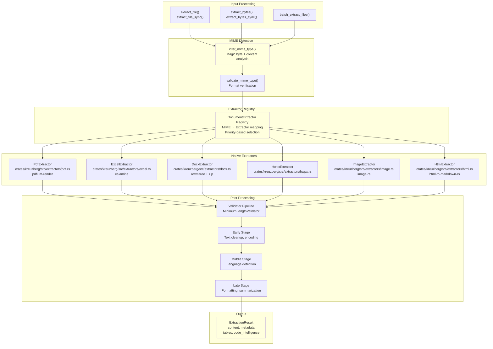
Sources: [docs/features.md:112-121](), [crates/kreuzberg/src/extractors/mod.rs:1-100](), [crates/kreuzberg/src/extraction/mod.rs:1-100]()

## Performance and Deployment

### Throughput and Hardware

- **GPU Requirement:** None. Kreuzberg is optimized for CPU-bound performance using SIMD and Rust's safe parallelism [README.md:100-101]().
- **AVX/AVX2 Requirement:** Bundled ONNX Runtime (used for PaddleOCR, layout detection, and embeddings) requires AVX/AVX2 on x86_64 CPUs [docs/getting-started/installation.md:51-53]().
- **Memory Efficiency:** Uses streaming parsers to handle multi-GB files without loading entire documents into memory [README.md:105-105]().

### Deployment Variants

| Mode | Use Case | Implementation |
|------|----------|----------------|
| **Library** | Embedded in application | Native bindings (17 languages) [README.md:96-97]() |
| **CLI** | Shell scripts, batch jobs | `kreuzberg-cli` crate [docs/getting-started/installation.md:29-31]() |
| **REST API** | Microservice architecture | Actix-web based server [docs/index.md:128-129]() |
| **MCP Server** | AI Agent integration | Model Context Protocol [docs/index.md:128-129]() |
| **Docker** | Containerized workloads | `ghcr.io/kreuzberg-dev/kreuzberg` [docs/getting-started/installation.md:43-44]() |
Sources: [README.md:87-87](), [docs/index.md:28-56](), [docs/getting-started/installation.md:51-53](), [README.md:100-101](), [README.md:105-105](), [README.md:96-97](), [docs/getting-started/installation.md:29-31](), [docs/index.md:128-129](), [docs/getting-started/installation.md:43-44]()

---

# Page: Getting Started

# Getting Started

<details>
<summary>Relevant source files</summary>

The following files were used as context for generating this wiki page:

- [CONTRIBUTING.md](CONTRIBUTING.md)
- [crates/kreuzberg-cli/README.md](crates/kreuzberg-cli/README.md)
- [crates/kreuzberg/tests/api_openweb.rs](crates/kreuzberg/tests/api_openweb.rs)
- [docs/cli/usage.md](docs/cli/usage.md)
- [docs/contributing.md](docs/contributing.md)
- [docs/css/extra.css](docs/css/extra.css)
- [docs/features.md](docs/features.md)
- [docs/getting-started/installation.md](docs/getting-started/installation.md)
- [docs/getting-started/quickstart.md](docs/getting-started/quickstart.md)
- [docs/guides/advanced.md](docs/guides/advanced.md)
- [docs/guides/agent-skills.md](docs/guides/agent-skills.md)
- [docs/guides/api-server.md](docs/guides/api-server.md)
- [docs/guides/configuration.md](docs/guides/configuration.md)
- [docs/guides/docker.md](docs/guides/docker.md)
- [docs/guides/extraction.md](docs/guides/extraction.md)
- [docs/guides/kubernetes.md](docs/guides/kubernetes.md)
- [docs/guides/layout-detection.md](docs/guides/layout-detection.md)
- [docs/guides/ocr.md](docs/guides/ocr.md)
- [docs/guides/plugins.md](docs/guides/plugins.md)
- [docs/index.md](docs/index.md)
- [docs/integrations/index.md](docs/integrations/index.md)
- [docs/integrations/openwebui.md](docs/integrations/openwebui.md)
- [docs/integrations/surrealdb.md](docs/integrations/surrealdb.md)
- [docs/reference/environment-variables.md](docs/reference/environment-variables.md)
- [docs/reference/formats.md](docs/reference/formats.md)
- [docs/snippets/cli/batch_basic.md](docs/snippets/cli/batch_basic.md)
- [docs/snippets/cli/extract_basic.md](docs/snippets/cli/extract_basic.md)
- [docs/snippets/cli/ocr_basic.md](docs/snippets/cli/ocr_basic.md)

</details>


This document serves as a high-level guide for installing and using the Kreuzberg document intelligence library across various programming languages. Kreuzberg provides a unified interface for extracting text, metadata, and code intelligence from 91+ file formats [docs/index.md:29-30]().

## Installation

Kreuzberg is designed with a Rust core and native bindings for 17 languages [docs/getting-started/installation.md:7](). Most packages ship with **prebuilt binaries** for Linux (x86_64/aarch64), macOS (Apple Silicon/Intel), and Windows, eliminating the need for a local compilation step [docs/getting-started/installation.md:7-8]().

### Package Overview

| Runtime/Environment | Package | Performance | Best For |
|:--------------------|:--------|:------------|:---------|
| **Node.js** | `@kreuzberg/node` | Native | Server-side applications [docs/index.md:91]() |
| **Browser / Edge** | `@kreuzberg/wasm` | WASM | Client-side, Workers, Deno [docs/index.md:93]() |
| **Python** | `kreuzberg` | Native | AI/ML pipelines, general purpose [docs/index.md:70]() |
| **Rust** | `kreuzberg` | Native | Systems programming [docs/index.md:73]() |
| **Go** | `github.com/kreuzberg-dev/kreuzberg/v5` | Native | High-concurrency services [docs/index.md:74]() |
| **Java / Kotlin** | `dev.kreuzberg:kreuzberg` | Native | Enterprise JVM apps [docs/index.md:75-76]() |
| **Ruby** | `kreuzberg` | Native | Idiomatic Ruby apps [docs/index.md:78]() |
| **PHP** | `kreuzberg/kreuzberg` | Native | Modern PHP apps [docs/index.md:79]() |
| **C# / .NET** | `Kreuzberg` | Native | .NET applications [docs/index.md:77]() |

For detailed installation instructions, including native dependencies and runtime requirements, see [Installation](#2.1).

### System Requirements & Constraints

While binaries are prebuilt, certain features have hardware requirements:
- **AVX/AVX2 Instructions**: Required for x86_64 CPUs to use **PaddleOCR**, **layout detection**, and **embeddings** via ONNX Runtime [docs/getting-started/installation.md:51-53]().
- **Dynamic Linking**: Go, Elixir, and C/C++ on Windows require `onnxruntime.dll` to be present on the system `PATH` [docs/getting-started/installation.md:55-57]().

Sources: [docs/getting-started/installation.md:7-57](), [docs/index.md:67-95]()

## Quick Start Examples

Kreuzberg provides both synchronous and asynchronous APIs depending on the language's idiomatic patterns. Below are high-level examples of basic document extraction.

### Python
```python
import asyncio
from kreuzberg import extract_file, ExtractionConfig

async def main():
    # Basic extraction with caching enabled
    config = ExtractionConfig(use_cache=True)
    result = await extract_file("document.pdf", config=config)
    print(result.content)

asyncio.run(main())
```
Sources: [docs/snippets/python/api/extract_file_sync.md]()

### TypeScript (Node.js)
```typescript
import { extractFile } from "@kreuzberg/node";

const result = await extractFile("document.pdf");
console.log(result.content);
```
Sources: [docs/snippets/typescript/getting-started/extract_file_sync.md]()

### Java
```java
import dev.kreuzberg.Kreuzberg;
import dev.kreuzberg.ExtractionResult;

public class Main {
    public static void main(String[] args) throws Exception {
        ExtractionResult result = Kreuzberg.extractFile("document.pdf");
        System.out.println(result.getContent());
    }
}
```
Sources: [docs/snippets/java/api/extract_file_sync.md]()

For more language-specific code snippets and advanced usage patterns, see [Quick Start Examples](#2.2).

## Architecture Overview

The following diagrams illustrate how Kreuzberg bridges the gap between high-level language requests and the underlying Rust engine.

### Data Flow: Language Binding to Rust Core

This diagram shows how a call in a host language (e.g., Python or Node.js) traverses the system.

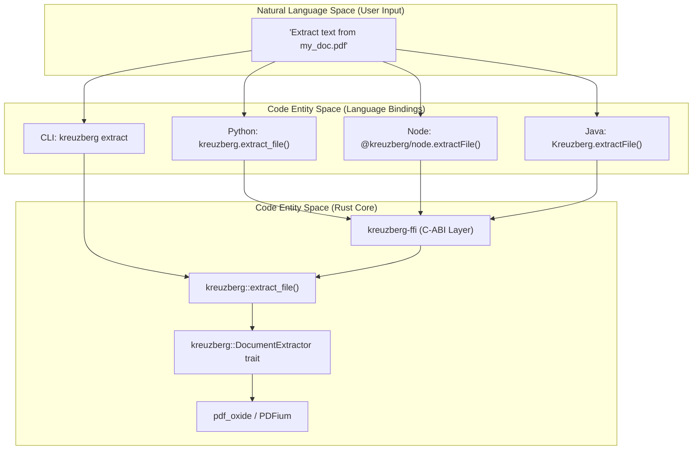
Sources: [docs/features.md:112-121](), [docs/guides/extraction.md:1-8](), [docs/cli/usage.md:71-79]()

### The Extraction Pipeline

The internal processing logic used by all bindings to transform raw bytes into structured intelligence.

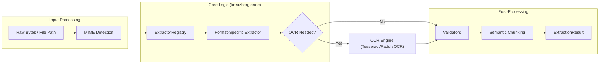
Sources: [docs/features.md:112-121](), [docs/guides/ocr.md:1-5]()

## Next Steps

To dive deeper into specific areas of Kreuzberg, explore these sections:

- **[Core Concepts](#3)**: Understand the extraction pipeline, MIME detection, and PDF handling.
- **[Language Bindings](#4)**: Detailed guides for all 17 supported languages.
- **[Plugin System](#5)**: Learn how to extend Kreuzberg with custom OCR backends or post-processors.
- **[Deployment](#7)**: Running Kreuzberg as a CLI tool, REST API, or MCP server.

Sources: [docs/index.md:95-133]()

---

# Page: Installation

# Installation

<details>
<summary>Relevant source files</summary>

The following files were used as context for generating this wiki page:

- [.github/actions/install-system-deps/action.yml](.github/actions/install-system-deps/action.yml)
- [.github/actions/setup-onnx-runtime/action.yml](.github/actions/setup-onnx-runtime/action.yml)
- [CONTRIBUTING.md](CONTRIBUTING.md)
- [crates/kreuzberg/tests/api_openweb.rs](crates/kreuzberg/tests/api_openweb.rs)
- [docs/contributing.md](docs/contributing.md)
- [docs/css/extra.css](docs/css/extra.css)
- [docs/features.md](docs/features.md)
- [docs/getting-started/installation.md](docs/getting-started/installation.md)
- [docs/guides/agent-skills.md](docs/guides/agent-skills.md)
- [docs/guides/docker.md](docs/guides/docker.md)
- [docs/guides/kubernetes.md](docs/guides/kubernetes.md)
- [docs/index.md](docs/index.md)
- [docs/integrations/index.md](docs/integrations/index.md)
- [docs/integrations/openwebui.md](docs/integrations/openwebui.md)
- [docs/integrations/surrealdb.md](docs/integrations/surrealdb.md)
- [scripts/ci/install-system-deps/install-linux.sh](scripts/ci/install-system-deps/install-linux.sh)
- [scripts/ci/install-system-deps/install-macos.sh](scripts/ci/install-system-deps/install-macos.sh)
- [scripts/ci/install-system-deps/install-windows.ps1](scripts/ci/install-system-deps/install-windows.ps1)

</details>


This document covers installation of Kreuzberg across all supported language bindings and runtime environments. For runtime configuration options, see the [Configuration Reference](../reference/configuration.md). For deployment scenarios including Docker and API servers, see [Docker Deployment](../guides/docker.md) and [HTTP REST API Server](../guides/api-server.md).

## Overview

Kreuzberg is distributed through language-specific package managers, with pre-built binaries available for most platforms. Installation methods vary by binding strategy:

-   **Native bindings** (Python, Node.js, Ruby, Elixir, R): Direct integration via language-specific build systems (PyO3, NAPI-RS, Magnus, Rustler, extendr).
-   **FFI bindings** (Java, Go, C#, PHP, C, Zig): Use the C FFI layer with platform-specific runtime loading.
-   **WebAssembly**: Pure WASM modules for browser, Deno, and Cloudflare Workers.
-   **CLI/Docker**: Standalone binaries and container images.

Sources: [docs/index.md:62-84](), [docs/getting-started/installation.md:5-58]()

---

## Package Manager Installation

### Python

Kreuzberg for Python is distributed via PyPI with pre-built wheels. The package uses `maturin` for building PyO3 bindings.

```bash
# Using pip
pip install kreuzberg

# Install with optional dependencies
pip install kreuzberg[easyocr]  # EasyOCR backend
```

**Platform support:**
- Linux: `manylinux2014` (glibc), `musllinux` (Alpine)
- macOS: x86_64, arm64 (Apple Silicon)
- Windows: x86_64

**Python version:** `>=3.10` (specified in [docs/contributing.md:45]())

Sources: [docs/getting-started/installation.md:63-72](), [docs/index.md:70]()

---

### Node.js / TypeScript

Two packages are available for JavaScript/TypeScript environments:

#### @kreuzberg/node (Native)
Native Node.js bindings via NAPI-RS for maximum performance. Use for Node.js servers and CLI tools.

```bash
# Using npm
npm install @kreuzberg/node
```

#### @kreuzberg/wasm (WebAssembly)
WASM bindings for browser, Deno, and edge runtimes.

```bash
npm install @kreuzberg/wasm
```

Sources: [docs/getting-started/installation.md:74-94](), [docs/index.md:71-72]()

---

### Ruby

Kreuzberg for Ruby uses Magnus (rb-sys) for native bindings:

```bash
gem install kreuzberg
```

**Requirements:**
- Ruby `3.2+` (specified in [docs/contributing.md:47]())

Sources: [docs/getting-started/installation.md:140-150](), [docs/index.md:78]()

---

### Java & Kotlin

Java bindings use the Panama FFM API (Foreign Function & Memory API), distributed via Maven Central:

```gradle
// Java
implementation 'dev.kreuzberg:kreuzberg:5.0.0-rc.1'

// Kotlin
implementation 'dev.kreuzberg:kreuzberg-kotlin:5.0.0-rc.1'
```

**Requirements:**
- Java `25+` (specified in [docs/contributing.md:49]())

Sources: [docs/getting-started/installation.md:118-138](), [docs/index.md:75-76]()

---

### Go

Go bindings use cgo to interface with the C FFI layer:

```bash
go get github.com/kreuzberg-dev/kreuzberg/v5@latest
```

**Requirements:**
- Go `1.26+` (specified in [docs/contributing.md:48]())

Sources: [docs/getting-started/installation.md:107-116](), [docs/index.md:74]()

---

### C# / .NET

C# bindings use P/Invoke for interop, distributed via NuGet:

```bash
dotnet add package Kreuzberg
```

**Requirements:**
- .NET `10+` (specified in [docs/contributing.md:50]())

Sources: [docs/getting-started/installation.md:162-171](), [docs/index.md:77]()

---

### PHP

PHP bindings leverage `ext-ffi` for integration:

```bash
composer require kreuzberg/kreuzberg
```

**Requirements:**
- PHP `8.1+` (specified in [docs/contributing.md:51]())

Sources: [docs/getting-started/installation.md:173-183](), [docs/index.md:79]()

---

### Elixir

Elixir bindings use Rustler NIFs:

```elixir
{:kreuzberg, "~> 5.0.0-rc.1"}
```

**Requirements:**
- Elixir `1.14+` (specified in [docs/contributing.md:52]())
- OTP `25+`

Sources: [docs/getting-started/installation.md:185-195](), [docs/index.md:80]()

---

### R

R bindings are built using the `extendr` framework and distributed via r-universe:

```r
install.packages("kreuzberg",
  repos = "https://kreuzberg-dev.r-universe.dev")
```

**Requirements:**
- R `4.1+` (specified in [docs/contributing.md:53]())

Sources: [docs/getting-started/installation.md:197-206](), [docs/index.md:81]()

---

### Swift

Swift bindings use `swift-bridge` for integration:

```swift
.package(url: "https://github.com/kreuzberg-dev/kreuzberg.git", from: "5.0.0-rc.1")
```

Sources: [docs/getting-started/installation.md:152-161](), [docs/index.md:83]()

---

### Dart / Flutter

Dart/Flutter bindings use `flutter_rust_bridge` (FRB) and Dart FFI:

```bash
dart pub add kreuzberg
```

Sources: [docs/getting-started/installation.md:218-227](), [docs/index.md:82]()

---

### Zig

Zig bindings utilize Zig's C-interop with `kreuzberg-ffi`:

```bash
zig fetch --save https://github.com/kreuzberg-...
```

Sources: [docs/getting-started/installation.md:229-238](), [docs/index.md:84]()

---

### C / C++

The C/C++ bindings are provided through the `kreuzberg-ffi` crate, which generates a C header and shared library.

```bash
cargo build -p kreuzberg-ffi
```

Sources: [docs/getting-started/installation.md:208-217](), [docs/index.md:85]()

---

## Language Support Matrix

### Binding Strategy and Package Names

The following diagram maps the relationship between language-specific code entities and the core Rust implementation.

**Language Binding to Code Entity Mapping**
```mermaid
graph TD
    subgraph "Language Space"
        PY["Python: kreuzberg"]
        TS_NODE["Node.js: @kreuzberg/node"]
        TS_WASM["WASM: @kreuzberg/wasm"]
        RB["Ruby: kreuzberg"]
        JV["Java: dev.kreuzberg:kreuzberg"]
        GO["Go: github.com/kreuzberg-dev/kreuzberg"]
        CS["C#: Kreuzberg"]
        PHP["PHP: kreuzberg/kreuzberg"]
        ELIXIR["Elixir: {:kreuzberg, ~> 5.0.0-rc.1}"]
        R["R: kreuzberg"]
        SWIFT["Swift: kreuzberg.git"]
        DART["Dart: kreuzberg"]
        ZIG["Zig: kreuzberg"]
        C_CPP["C/C++: kreuzberg-ffi"]
    end

    subgraph "Bridge Layer"
        PYO3["PyO3"]
        NAPI["NAPI-RS"]
        WASM_BIND["wasm-bindgen"]
        MAGNUS["Magnus (rb-sys)"]
        PANAMA["Java Panama FFM API"]
        CGO["CGo"]
        PINVOKE["P/Invoke"]
        EXT_FFI["ext-ffi"]
        RUSTLER["Rustler NIFs"]
        EXTENDR["extendr"]
        SWIFT_BRIDGE["swift-bridge"]
        FRB["flutter_rust_bridge"]
        ZIG_C_INTEROP["Zig C-interop"]
        CBINDGEN["cbindgen"]
    end

    subgraph "Core Entity Space"
        CORE["kreuzberg core crate"]
        FFI["kreuzberg-ffi (C-Headers)"]
    end

    PY --> PYO3 --> CORE
    TS_NODE --> NAPI --> CORE
    TS_WASM --> WASM_BIND --> CORE
    RB --> MAGNUS --> CORE
    JV --> PANAMA --> FFI
    GO --> CGO --> FFI
    CS --> PINVOKE --> FFI
    PHP --> EXT_FFI --> FFI
    ELIXIR --> RUSTLER --> FFI
    R --> EXTENDR --> FFI
    SWIFT --> SWIFT_BRIDGE --> FFI
    DART --> FRB --> FFI
    ZIG --> ZIG_C_INTEROP --> FFI
    C_CPP --> CBINDGEN --> FFI
    FFI --> CORE
```
Sources: [docs/index.md:62-84](), [docs/getting-started/installation.md:59-228](), [scripts/ci/ruby/vendor-kreuzberg-core.py:1-11]()

---

## Native Dependencies & Runtime Requirements

### Hardware Requirements
**x86_64 CPUs:** Support for **AVX/AVX2** instruction sets is required for ONNX-dependent features:
- PaddleOCR
- Layout detection
- Embeddings

CPUs without AVX (e.g., older Intel Atoms or pre-2011 processors) will crash when these features are invoked. Text extraction and Tesseract OCR are unaffected. ARM platforms (aarch64) have no such restriction [docs/getting-started/installation.md:51-53]().

### OCR Backends
Kreuzberg supports three OCR engines with varying installation requirements:

| Backend | Requirements | Best For |
| :--- | :--- | :--- |
| **Tesseract** | System package `tesseract-ocr` | Broad language coverage (100+) |
| **PaddleOCR** | ONNX Runtime (Bundled in Python) | CJK, high accuracy |
| **EasyOCR** | `pip install kreuzberg[easyocr]` | GPU-accelerated (Python only) |

Sources: [docs/features.md:143-150](), [docs/getting-started/installation.md:51-53]()

### Windows Specifics
For Go, Elixir, and C/C++ on Windows, `onnxruntime.dll` must be present in the system `PATH` at runtime. This DLL can be downloaded from the [ONNX Runtime releases](https://github.com/microsoft/onnxruntime/releases) (e.g., `onnxruntime-win-x64-1.24.1.zip`) [docs/getting-started/installation.md:55-57]().

### WASM Builds
For WASM builds, the [WASI SDK](https://github.com/WebAssembly/wasi-sdk/releases) is required. It provides a wasm-capable C/C++ compiler necessary for `tree-sitter` and `tesseract` compilation. It should be installed to `$HOME/wasi-sdk` or its path specified via the `WASI_SDK_PATH` environment variable [docs/contributing.md:38-41]().

Sources: [docs/getting-started/installation.md:55-57](), [docs/features.md:143-150](), [docs/contributing.md:38-41]()

---

## System Installation Pipeline

The following diagram illustrates the data flow and system dependencies involved during the installation of system-level tools via CI scripts.

**System Dependency Installation Flow**
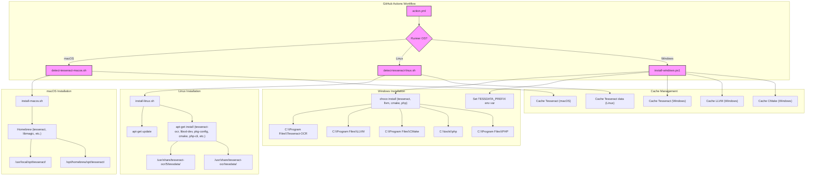
Sources: [.github/actions/install-system-deps/action.yml:16-105](), [scripts/ci/install-system-deps/install-linux.sh:1-137](), [scripts/ci/install-system-deps/install-windows.ps1:1-220]()

---

## CLI & Docker

### Standalone CLI
The CLI can be installed via an install script, Homebrew, or Cargo.

```bash
# Install script
curl -fsSL https://raw.githubusercontent.com/kreuzberg-dev/kreuzberg/main/scripts/install.sh | bash

# Homebrew
brew install kreuzberg-dev/tap/kreuzberg

# Cargo
cargo install kreuzberg-cli
```

Sources: [docs/getting-started/installation.md:15-31]()

### Docker
Two Docker image variants are provided:
1.  **CLI Image**: `ghcr.io/kreuzberg-dev/kreuzberg-cli:latest` - Optimized for terminal usage.
2.  **Full Image**: `ghcr.io/kreuzberg-dev/kreuzberg:latest` - Includes all dependencies for API/MCP server usage.

```bash
docker pull ghcr.io/kreuzberg-dev/kreuzberg:latest
```

Sources: [docs/getting-started/installation.md:33-44](), [docs/guides/docker.md:35-36]()

---

# Page: Quick Start Examples

# Quick Start Examples

<details>
<summary>Relevant source files</summary>

The following files were used as context for generating this wiki page:

- [crates/kreuzberg-cli/README.md](crates/kreuzberg-cli/README.md)
- [docs/cli/usage.md](docs/cli/usage.md)
- [docs/getting-started/quickstart.md](docs/getting-started/quickstart.md)
- [docs/guides/advanced.md](docs/guides/advanced.md)
- [docs/guides/api-server.md](docs/guides/api-server.md)
- [docs/guides/configuration.md](docs/guides/configuration.md)
- [docs/guides/extraction.md](docs/guides/extraction.md)
- [docs/guides/layout-detection.md](docs/guides/layout-detection.md)
- [docs/guides/ocr.md](docs/guides/ocr.md)
- [docs/guides/plugins.md](docs/guides/plugins.md)
- [docs/reference/api-c.md](docs/reference/api-c.md)
- [docs/reference/api-csharp.md](docs/reference/api-csharp.md)
- [docs/reference/api-elixir.md](docs/reference/api-elixir.md)
- [docs/reference/api-go.md](docs/reference/api-go.md)
- [docs/reference/api-java.md](docs/reference/api-java.md)
- [docs/reference/api-php.md](docs/reference/api-php.md)
- [docs/reference/api-python.md](docs/reference/api-python.md)
- [docs/reference/api-r.md](docs/reference/api-r.md)
- [docs/reference/api-ruby.md](docs/reference/api-ruby.md)
- [docs/reference/api-rust.md](docs/reference/api-rust.md)
- [docs/reference/api-typescript.md](docs/reference/api-typescript.md)
- [docs/reference/api-wasm.md](docs/reference/api-wasm.md)
- [docs/reference/configuration.md](docs/reference/configuration.md)
- [docs/reference/environment-variables.md](docs/reference/environment-variables.md)
- [docs/reference/errors.md](docs/reference/errors.md)
- [docs/reference/formats.md](docs/reference/formats.md)
- [docs/reference/types.md](docs/reference/types.md)
- [docs/snippets/cli/batch_basic.md](docs/snippets/cli/batch_basic.md)
- [docs/snippets/cli/extract_basic.md](docs/snippets/cli/extract_basic.md)
- [docs/snippets/cli/ocr_basic.md](docs/snippets/cli/ocr_basic.md)

</details>


This page provides minimal working examples for extracting text from documents in each supported language binding. These examples demonstrate the simplest path from installation to first extraction, using the most common entry points in each language's API.

For detailed installation instructions and system requirements, see [Installation](#2.1). For comprehensive API documentation and advanced features, see the language-specific API reference pages under section 11.

## Overview of Extraction Entry Points

All language bindings expose the same core extraction functionality through language-idiomatic APIs. The following table maps the primary extraction functions across bindings:

| Language | Entry Point Function | Sync/Async |
|----------|---------------------|------------|
| Python | `extract_file()` | Async [docs/reference/api-python.md:49-49]() |
| Python | `extract_file_sync()` | Sync [docs/reference/api-python.md:90-90]() |
| TypeScript/Node.js | `extractFile()` | Async [docs/reference/api-typescript.md:49-49]() |
| TypeScript/Node.js | `extractFileSync()` | Sync [docs/reference/api-typescript.md:90-90]() |
| WASM | `extractFile()` | Async [docs/reference/api-wasm.md:49-49]() |
| Ruby | `extract_file_sync()` | Sync [docs/reference/api-ruby.md:90-90]() |
| Java | `extractFile()` | Sync [docs/reference/api-java.md:50-50]() |
| Go | `ExtractFile()` | Sync [docs/reference/api-go.md:50-50]() |
| C# | `ExtractFileAsync()` | Async [docs/reference/api-csharp.md:50-50]() |
| C# | `ExtractFileSync()` | Sync [docs/reference/api-csharp.md:106-106]() |
| Elixir | `extract_file()` | Async [docs/reference/api-elixir.md:75-75]() |
| Elixir | `extract_file_sync()` | Sync [docs/reference/api-elixir.md:109-109]() |
| R | `extract_file()` | Async [docs/reference/api-r.md:49-49]() |
| R | `extract_file_sync()` | Sync [docs/reference/api-r.md:90-90]() |
| Rust | `extract_file()` | Async [docs/reference/api-rust.md:74-74]() |
| Rust | `extract_file_sync()` | Sync [docs/reference/api-rust.md:106-106]() |
| C | `kreuzberg_extract_file()` | Sync [docs/reference/api-c.md:50-50]() |
| Dart | `extractFile()` | Async [docs/reference/api-dart.md:49-49]() |
| Dart | `extractFileSync()` | Sync [docs/reference/api-dart.md:90-90]() |
| Kotlin | `extractFile()` | Sync [docs/reference/api-kotlin.md:50-50]() |
| Zig | `extractFile()` | Sync [docs/reference/api-zig.md:50-50]() |

Sources: [docs/getting-started/quickstart.md:9-76](), [docs/reference/api-c.md:50-50](), [docs/reference/api-csharp.md:50-50](), [docs/reference/api-csharp.md:106-106](), [docs/reference/api-dart.md:49-49](), [docs/reference/api-dart.md:90-90](), [docs/reference/api-elixir.md:75-75](), [docs/reference/api-elixir.md:109-109](), [docs/reference/api-go.md:50-50](), [docs/reference/api-java.md:50-50](), [docs/reference/api-kotlin.md:50-50](), [docs/reference/api-python.md:49-49](), [docs/reference/api-python.md:90-90](), [docs/reference/api-r.md:49-49](), [docs/reference/api-r.md:90-90](), [docs/reference/api-ruby.md:90-90](), [docs/reference/api-rust.md:74-74](), [docs/reference/api-rust.md:106-106](), [docs/reference/api-typescript.md:49-49](), [docs/reference/api-typescript.md:90-90](), [docs/reference/api-wasm.md:49-49](), [docs/reference/api-zig.md:50-50]()

## Extraction Flow Architecture

The diagram below bridges the "Natural Language Space" (User Intent) to the "Code Entity Space" (Core Rust logic and FFI bindings).

### Language Binding to Rust Core Data Flow
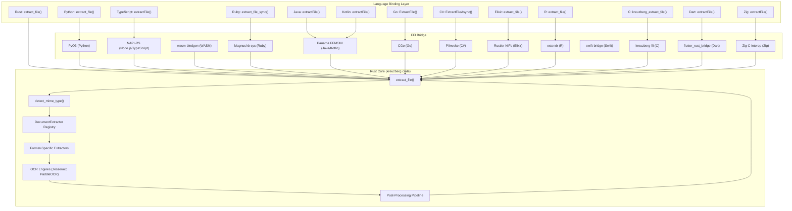
Sources: [docs/reference/api-c.md:10-20](), [docs/reference/api-csharp.md:10-20](), [docs/reference/api-dart.md:10-20](), [docs/reference/api-elixir.md:10-20](), [docs/reference/api-go.md:10-20](), [docs/reference/api-java.md:10-20](), [docs/reference/api-kotlin.md:10-20](), [docs/reference/api-python.md:10-20](), [docs/reference/api-r.md:10-20](), [docs/reference/api-ruby.md:10-20](), [docs/reference/api-rust.md:10-20](), [docs/reference/api-typescript.md:10-20](), [docs/reference/api-wasm.md:10-20](), [docs/reference/api-zig.md:10-20]()

## Your First Extraction

This section demonstrates the basic usage of `extract_file_sync` (or its async equivalent) in various languages. This function takes a file path and an optional `ExtractionConfig` and returns an `ExtractionResult`.

### Python
```python
import asyncio
from kreuzberg import extract_file_sync, ExtractionConfig

# Create a dummy file for demonstration
with open("document.pdf", "w") as f:
    f.write("This is a dummy PDF content.")

# Basic synchronous extraction
result = extract_file_sync("document.pdf", config=ExtractionConfig())
print(result.content)
print(f"MIME: {result.mime_type}")
```
Sources: [docs/getting-started/quickstart.md:39-41](), [docs/reference/api-python.md:90-90]()

### TypeScript
```typescript
import { extractFileSync, ExtractionConfig } from '@kreuzberg/node';
import * as fs from 'fs';

// Create a dummy file for demonstration
fs.writeFileSync("document.docx", "This is a dummy DOCX content.");

// Basic synchronous extraction
const result = extractFileSync('document.docx', null, new ExtractionConfig());
console.log(result.content);
console.log(`MIME: ${result.mimeType}`);
```
Sources: [docs/getting-started/quickstart.md:63-63](), [docs/reference/api-typescript.md:90-90]()

### C#
```csharp
using Kreuzberg;
using System;
using System.IO;
using System.Threading.Tasks;

public class QuickStart
{
    public static async Task Main(string[] args)
    {
        // Create a dummy file for demonstration
        await File.WriteAllTextAsync("document.pdf", "This is a dummy PDF content.");

        // Basic synchronous extraction
        ExtractionResult result = KreuzbergClient.ExtractFileSync("document.pdf", null, new ExtractionConfig());
        Console.WriteLine(result.Content);
        Console.WriteLine($"MIME: {result.MimeType}");
    }
}
```
Sources: [docs/getting-started/quickstart.md:19-19](), [docs/reference/api-csharp.md:106-106]()

### Go
```go
package main

import (
	"fmt"
	"os"
	"github.com/kreuzberg/kreuzberg-go"
)

func main() {
	// Create a dummy file for demonstration
	os.WriteFile("document.pdf", []byte("This is a dummy PDF content."), 0644)

	// Basic synchronous extraction
	config := kreuzberg.ExtractionConfig{}
	result, err := kreuzberg.ExtractFileSync("document.pdf", nil, config)
	if err != nil {
		fmt.Printf("Error extracting file: %v\n", err)
		return
	}
	fmt.Println(result.Content)
	fmt.Printf("MIME: %s\n", result.MimeType)
}
```
Sources: [docs/getting-started/quickstart.md:27-27](), [docs/reference/api-go.md:106-106]()

### Java
```java
import dev.kreuzberg.Kreuzberg;
import dev.kreuzberg.ExtractionConfig;
import dev.kreuzberg.ExtractionResult;
import java.io.IOException;
import java.nio.file.Files;
import java.nio.file.Paths;

public class QuickStart {
    public static void main(String[] args) throws IOException {
        // Create a dummy file for demonstration
        Files.write(Paths.get("document.pdf"), "This is a dummy PDF content.".getBytes());

        // Basic synchronous extraction
        ExtractionResult result = Kreuzberg.extractFileSync("document.pdf", null, new ExtractionConfig());
        System.out.println(result.getContent());
        System.out.println("MIME: " + result.getMimeType());
    }
}
```
Sources: [docs/getting-started/quickstart.md:31-31](), [docs/reference/api-java.md:106-106]()

### Ruby
```ruby
require 'kreuzberg'

# Create a dummy file for demonstration
File.write("document.pdf", "This is a dummy PDF content.")

# Basic synchronous extraction
result = Kreuzberg.extract_file_sync("document.pdf", nil, Kreuzberg::ExtractionConfig.new)
puts result.content
puts "MIME: #{result.mime_type}"
```
Sources: [docs/getting-started/quickstart.md:43-43](), [docs/reference/api-ruby.md:90-90]()

### Rust
```rust
use kreuzberg::{extract_file_sync, ExtractionConfig};
use std::fs;
use std::path::PathBuf;

fn main() -> anyhow::Result<()> {
    // Create a dummy file for demonstration
    fs::write("document.pdf", "This is a dummy PDF content.")?;

    // Basic synchronous extraction
    let result = extract_file_sync(PathBuf::from("document.pdf"), None, ExtractionConfig::default())?;
    println!("Extracted: {}", result.content);
    println!("MIME: {}", result.mime_type);
    Ok(())
}
```
Sources: [docs/getting-started/quickstart.md:51-51](), [docs/reference/api-rust.md:106-106]()

### Elixir
```elixir
# Create a dummy file for demonstration
File.write!("document.pdf", "This is a dummy PDF content.")

# Basic synchronous extraction
{:ok, result} = Kreuzberg.extract_file_sync("document.pdf", nil, %Kreuzberg.ExtractionConfig{})
IO.puts(result.content)
IO.puts("MIME: #{result.mime_type}")
```
Sources: [docs/getting-started/quickstart.md:59-59](), [docs/reference/api-elixir.md:109-109]()

### R
```r
# Create a dummy file for demonstration
writeLines("This is a dummy PDF content.", "document.pdf")

# Basic synchronous extraction
result <- kreuzberg::extract_file_sync("document.pdf", NULL, kreuzberg::ExtractionConfig$new())
print(result$content)
print(paste("MIME:", result$mime_type))
```
Sources: [docs/getting-started/quickstart.md:47-47](), [docs/reference/api-r.md:90-90]()

### CLI
```bash
# Create a dummy file for demonstration
echo "This is a dummy PDF content." > document.pdf

# Extract text content to stdout
kreuzberg extract document.pdf
```
Sources: [docs/cli/usage.md:74-74](), [docs/snippets/cli/extract_basic.md:1-6]()

## Handle Errors

Robust applications should always include error handling. Kreuzberg provides specific error types for common issues like missing files, parse failures, or OCR problems.

### Python
```python
from kreuzberg import extract_file_sync, ExtractionConfig, Error

try:
    result = extract_file_sync("non_existent.pdf", config=ExtractionConfig())
    print(result.content)
except Error as e:
    print(f"Error during extraction: {e.error_type} - {e.message}")
```
Sources: [docs/getting-started/quickstart.md:109-109](), [docs/reference/api-python.md:45-46]()

### TypeScript
```typescript
import { extractFileSync, ExtractionConfig, Error } from '@kreuzberg/node';

try {
    const result = extractFileSync('non_existent.pdf', null, new ExtractionConfig());
    console.log(result.content);
} catch (e: any) {
    if (e instanceof Error) {
        console.error(`Error during extraction: ${e.errorType} - ${e.message}`);
    } else {
        console.error(`Unknown error: ${e}`);
    }
}
```
Sources: [docs/getting-started/quickstart.md:132-132](), [docs/reference/api-typescript.md:45-46]()

### C#
```csharp
using Kreuzberg;
using System;
using System.IO;
using System.Threading.Tasks;

public class ErrorHandling
{
    public static async Task Main(string[] args)
    {
        try
        {
            ExtractionResult result = KreuzbergClient.ExtractFileSync("non_existent.pdf", null, new ExtractionConfig());
            Console.WriteLine(result.Content);
        }
        catch (KreuzbergError e)
        {
            Console.WriteLine($"Error during extraction: {e.ErrorType} - {e.Message}");
        }
        catch (Exception e)
        {
            Console.WriteLine($"Unknown error: {e.Message}");
        }
    }
}
```
Sources: [docs/getting-started/quickstart.md:89-89](), [docs/reference/api-csharp.md:45-46]()

### Go
```go
package main

import (
	"fmt"
	"github.com/kreuzberg/kreuzberg-go"
)

func main() {
	config := kreuzberg.ExtractionConfig{}
	_, err := kreuzberg.ExtractFileSync("non_existent.pdf", nil, config)
	if err != nil {
		fmt.Printf("Error during extraction: %v\n", err)
	}
}
```
Sources: [docs/getting-started/quickstart.md:96-96](), [docs/reference/api-go.md:45-46]()

### Java
```java
import dev.kreuzberg.Kreuzberg;
import dev.kreuzberg.ExtractionConfig;
import dev.kreuzberg.ErrorException;

public class ErrorHandling {
    public static void main(String[] args) {
        try {
            Kreuzberg.extractFileSync("non_existent.pdf", null, new ExtractionConfig());
        } catch (ErrorException e) {
            System.err.println("Error during extraction: " + e.getErrorType() + " - " + e.getMessage());
        } catch (Exception e) {
            System.err.println("Unknown error: " + e.getMessage());
        }
    }
}
```
Sources: [docs/getting-started/quickstart.md:100-100](), [docs/reference/api-java.md:45-46]()

### Ruby
```ruby
require 'kreuzberg'

begin
  result = Kreuzberg.extract_file_sync("non_existent.pdf", nil, Kreuzberg::ExtractionConfig.new)
  puts result.content
rescue Kreuzberg::Error => e
  puts "Error during extraction: #{e.error_type} - #{e.message}"
rescue StandardError => e
  puts "Unknown error: #{e.message}"
end
```
Sources: [docs/getting-started/quickstart.md:112-112](), [docs/reference/api-ruby.md:45-46]()

### Rust
```rust
use kreuzberg::{extract_file_sync, ExtractionConfig, Error};
use std::path::PathBuf;

fn main() {
    let result = extract_file_sync(PathBuf::from("non_existent.pdf"), None, ExtractionConfig::default());
    match result {
        Ok(res) => println!("Extracted: {}", res.content),
        Err(Error::Io(e)) => println!("IO Error: {}", e),
        Err(e) => println!("Other Error: {:?}", e),
    }
}
```
Sources: [docs/getting-started/quickstart.md:120-120](), [docs/reference/api-rust.md:45-46]()

### Elixir
```elixir
case Kreuzberg.extract_file_sync("non_existent.pdf", nil, %Kreuzberg.ExtractionConfig{}) do
  {:ok, result} ->
    IO.puts(result.content)
  {:error, %Kreuzberg.Error{error_type: type, message: msg}} ->
    IO.puts("Error during extraction: #{type} - #{msg}")
  {:error, reason} ->
    IO.puts("Unknown error: #{inspect(reason)}")
end
```
Sources: [docs/getting-started/quickstart.md:128-128](), [docs/reference/api-elixir.md:45-46]()

### R
```r
tryCatch({
  result <- kreuzberg::extract_file_sync("non_existent.pdf", NULL, kreuzberg::ExtractionConfig$new())
  print(result$content)
}, error = function(e) {
  if (inherits(e, "KreuzbergError")) {
    print(paste("Error during extraction:", e$error_type, "-", e$message))
  } else {
    print(paste("Unknown error:", e$message))
  }
})
```
Sources: [docs/getting-started/quickstart.md:116-116](), [docs/reference/api-r.md:45-46]()

## OCR for Scanned Documents

Kreuzberg automatically performs OCR when it detects an image or a scanned PDF. You can also explicitly enable or force OCR using the `OcrConfig` within `ExtractionConfig`.

### Python
```python
from kreuzberg import extract_file_sync, ExtractionConfig, OcrConfig

# Create a dummy image file for demonstration
with open("scanned_document.png", "w") as f:
    f.write("This is a dummy image content.")

config = ExtractionConfig(
    ocr=OcrConfig(backend="tesseract", language="eng"),
    force_ocr=True
)

result = extract_file_sync("scanned_document.png", config=config)
print(result.content)
```
Sources: [docs/getting-started/quickstart.md:171-174](), [docs/guides/configuration.md:131-133](), [docs/reference/configuration.md:89-92]()

### TypeScript
```typescript
import { extractFileSync, ExtractionConfig, OcrConfig } from '@kreuzberg/node';
import * as fs from 'fs';

// Create a dummy image file for demonstration
fs.writeFileSync("scanned_document.png", "This is a dummy image content.");

const config = new ExtractionConfig({
    ocr: new OcrConfig({ backend: "tesseract", language: "eng" }),
    forceOcr: true
});

const result = extractFileSync('scanned_document.png', null, config);
console.log(result.content);
```
Sources: [docs/getting-started/quickstart.md:197-197](), [docs/guides/configuration.md:134-136]()

### C#
```csharp
using Kreuzberg;
using System;
using System.IO;
using System.Threading.Tasks;

public class OcrExtraction
{
    public static async Task Main(string[] args)
    {
        // Create a dummy image file for demonstration
        await File.WriteAllTextAsync("scanned_document.png", "This is a dummy image content.");

        var config = new ExtractionConfig
        {
            Ocr = new OcrConfig { Backend = "tesseract", Language = "eng" },
            ForceOcr = true
        };

        ExtractionResult result = KreuzbergClient.ExtractFileSync("scanned_document.png", null, config);
        Console.WriteLine(result.Content);
    }
}
```
Sources: [docs/getting-started/quickstart.md:153-153](), [docs/guides/configuration.md:29-29]()

### Go
```go
package main

import (
	"fmt"
	"os"
	"github.com/kreuzberg/kreuzberg-go"
)

func main() {
	// Create a dummy image file for demonstration
	os.WriteFile("scanned_document.png", []byte("This is a dummy image content."), 0644)

	config := kreuzberg.ExtractionConfig{
		Ocr: &kreuzberg.OcrConfig{Backend: "tesseract", Language: "eng"},
		ForceOcr: true,
	}

	result, err := kreuzberg.ExtractFileSync("scanned_document.png", nil, config)
	if err != nil {
		fmt.Printf("Error extracting file: %v\n", err)
		return
	}
	fmt.Println(result.Content)
}
```
Sources: [docs/getting-started/quickstart.md:161-161](), [docs/guides/configuration.md:22-24]()

### Java
```java
import dev.kreuzberg.Kreuzberg;
import dev.kreuzberg.ExtractionConfig;
import dev.kreuzberg.OcrConfig;
import dev.kreuzberg.ExtractionResult;
import java.io.IOException;
import java.nio.file.Files;
import java.nio.file.Paths;

public class OcrExtraction {
    public static void main(String[] args) throws IOException {
        // Create a dummy image file for demonstration
        Files.write(Paths.get("scanned_document.png"), "This is a dummy image content.".getBytes());

        ExtractionConfig config = new ExtractionConfig();
        config.setOcr(new OcrConfig("tesseract", "eng"));
        config.setForceOcr(true);

        ExtractionResult result = Kreuzberg.extractFileSync("scanned_document.png", null, config);
        System.out.println(result.getContent());
    }
}
```
Sources: [docs/getting-started/quickstart.md:165-165](), [docs/guides/configuration.md:25-27]()

### Ruby
```ruby
require 'kreuzberg'

# Create a dummy image file for demonstration
File.write("scanned_document.png", "This is a dummy image content.")

config = Kreuzberg::ExtractionConfig.new(
  ocr: Kreuzberg::OcrConfig.new(backend: "tesseract", language: "eng"),
  force_ocr: true
)

result = Kreuzberg.extract_file_sync("scanned_document.png", nil, config)
puts result.content
```
Sources: [docs/getting-started/quickstart.md:175-175](), [docs/guides/configuration.md:32-34]()

### Rust
```rust
use kreuzberg::{extract_file_sync, ExtractionConfig, OcrConfig};
use std::fs;
use std::path::PathBuf;

fn main() -> anyhow::Result<()> {
    // Create a dummy image file for demonstration
    fs::write("scanned_document.png", "This is a dummy image content.")?;

    let config = ExtractionConfig {
        ocr: Some(OcrConfig {
            backend: Some("tesseract".to_string()),
            language: Some("eng".to_string()),
            ..Default::default()
        }),
        force_ocr: true,
        ..Default::default()
    };

    let result = extract_file_sync(PathBuf::from("scanned_document.png"), None, config)?;
    println!("Extracted: {}", result.content);
    Ok(())
}
```
Sources: [docs/getting-started/quickstart.md:183-183](), [docs/guides/configuration.md:18-20]()

### Elixir
```elixir
# Create a dummy image file for demonstration
File.write!("scanned_document.png", "This is a dummy image content.")

config = %Kreuzberg.ExtractionConfig{
  ocr: %Kreuzberg.OcrConfig{backend: "tesseract", language: "eng"},
  force_ocr: true
}

{:ok, result} = Kreuzberg.extract_file_sync("scanned_document.png", nil, config)
IO.puts(result.content)
```
Sources: [docs/getting-started/quickstart.md:192-192]()

### R
```r
# Create a dummy image file for demonstration
writeLines("This is a dummy image content.", "scanned_document.png")

config <- kreuzberg::ExtractionConfig$new(
  ocr = kreuzberg::OcrConfig$new(backend = "tesseract", language = "eng"),
  force_ocr = TRUE
)

result <- kreuzberg::extract_file_sync("scanned_document.png", NULL, config)
print(result$content)
```
Sources: [docs/getting-started/quickstart.md:179-179](), [docs/guides/configuration.md:35-37]()

### CLI
```bash
# Create a dummy image file for demonstration
echo "This is a dummy image content." > scanned_document.png

# Enable OCR and force it to run
kreuzberg extract scanned_document.png --ocr true --force-ocr true
```
Sources: [docs/cli/usage.md:164-178](), [docs/snippets/cli/ocr_basic.md:1-6]()

## Process Multiple Files

The `batch_extract_files_sync` function allows processing multiple files concurrently, optimizing performance by managing concurrency automatically.

### Python
```python
from kreuzberg import batch_extract_files_sync, BatchFileItem, ExtractionConfig

# Create dummy files
with open("doc1.pdf", "w") as f: f.write("Content of document 1.")
with open("doc2.txt", "w") as f: f.write("Content of document 2.")

items = [
    BatchFileItem(path="doc1.pdf"),
    BatchFileItem(path="doc2.txt")
]

results = batch_extract_files_sync(items, ExtractionConfig())
for result in results:
    print(result.content)
```
Sources: [docs/getting-started/quickstart.md:240-240](), [docs/reference/api-python.md:152-152]()

### TypeScript
```typescript
import { batchExtractFilesSync, BatchFileItem, ExtractionConfig } from '@kreuzberg/node';
import * as fs from 'fs';

// Create dummy files
fs.writeFileSync("doc1.pdf", "Content of document 1.");
fs.writeFileSync("doc2.txt", "Content of document 2.");

const items = [
    new BatchFileItem({ path: "doc1.pdf" }),
    new BatchFileItem({ path: "doc2.txt" })
];

const results = batchExtractFilesSync(items, new ExtractionConfig());
results.forEach(result => console.log(result.content));
```
Sources: [docs/getting-started/quickstart.md:265-265](), [docs/reference/api-typescript.md:152-152]()

### C#
```csharp
using Kreuzberg;
using System;
using System.Collections.Generic;
using System.IO;
using System.Threading.Tasks;

public class BatchExtraction
{
    public static async Task Main(string[] args)
    {
        // Create dummy files
        await File.WriteAllTextAsync("doc1.pdf", "Content of document 1.");
        await File.WriteAllTextAsync("doc2.txt", "Content of document 2.");

        var items = new List<BatchFileItem>
        {
            new BatchFileItem { Path = "doc1.pdf" },
            new BatchFileItem { Path = "doc2.txt" }
        };

        List<ExtractionResult> results = KreuzbergClient.BatchExtractFilesSync(items, new ExtractionConfig());
        foreach (var result in results)
        {
            Console.WriteLine(result.Content);
        }
    }
}
```
Sources: [docs/getting-started/quickstart.md:221-221](), [docs/reference/api-csharp.md:161-161]()

### Go
```go
package main

import (
	"fmt"
	"os"
	"github.com/kreuzberg/kreuzberg-go"
)

func main() {
	// Create dummy files
	os.WriteFile("doc1.pdf", []byte("Content of document 1."), 0644)
	os.WriteAllText("doc2.txt", "Content of document 2.")

	items := []kreuzberg.BatchFileItem{
		{Path: "doc1.pdf"},
		{Path: "doc2.txt"},
	}

	results, err := kreuzberg.BatchExtractFilesSync(items, kreuzberg.ExtractionConfig{})
	if err != nil {
		fmt.Printf("Error batch extracting files: %v\n", err)
		return
	}
	for _, result := range results {
		fmt.Println(result.Content)
	}
}
```
Sources: [docs/getting-started/quickstart.md:229-229](), [docs/reference/api-go.md:161-161]()

### Java
```java
import dev.kreuzberg.Kreuzberg;
import dev.kreuzberg.ExtractionConfig;
import dev.kreuzberg.BatchFileItem;
import dev.kreuzberg.ExtractionResult;
import java.io.IOException;
import java.nio.file.Files;
import java.nio.file.Paths;
import java.util.Arrays;
import java.util.List;

public class BatchExtraction {
    public static void main(String[] args) throws IOException {
        // Create dummy files
        Files.write(Paths.get("doc1.pdf"), "Content of document 1.".getBytes());
        Files.write(Paths.get("doc2.txt"), "Content of document 2.".getBytes());

        List<BatchFileItem> items = Arrays.asList(
            new BatchFileItem("doc1.pdf", null),
            new BatchFileItem("doc2.txt", null)
        );

        List<ExtractionResult> results = Kreuzberg.batchExtractFilesSync(items, new ExtractionConfig());
        for (ExtractionResult result : results) {
            System.out.println(result.getContent());
        }
    }
}
```
Sources: [docs/getting-started/quickstart.md:233-233](), [docs/reference/api-java.md:161-161]()

### Ruby
```ruby
require 'kreuzberg'

# Create dummy files
File.write("doc1.pdf", "Content of document 1.")
File.write("doc2.txt", "Content of document 2.")

items = [
  Kreuzberg::BatchFileItem.new(path: "doc1.pdf"),
  Kreuzberg::BatchFileItem.new(path: "doc2.txt")
]

results = Kreuzberg.batch_extract_files_sync(items, Kreuzberg::ExtractionConfig.new)
results.each do |result|
  puts result.content
end
```
Sources: [docs/getting-started/quickstart.md:244-244](), [docs/reference/api-ruby.md:161-161]()

### Rust
```rust
use kreuzberg::{batch_extract_files_sync, BatchFileItem, ExtractionConfig};
use std::fs;
use std::path::PathBuf;

fn main() -> anyhow::Result<()> {
    // Create dummy files
    fs::write("doc1.pdf", "Content of document 1.")?;
    fs::write("doc2.txt", "Content of document 2.")?;

    let items = vec![
        BatchFileItem { path: PathBuf::from("doc1.pdf"), config: None },
        BatchFileItem { path: PathBuf::from("doc2.txt"), config: None },
    ];

    let results = batch_extract_files_sync(items, ExtractionConfig::default())?;
    for result in results {
        println!("{}", result.content);
    }
    Ok(())
}
```
Sources: [docs/getting-started/quickstart.md:252-252](), [docs/reference/api-rust.md:161-161]()

### Elixir
```elixir
# Create dummy files
File.write!("doc1.pdf", "Content of document 1.")
File.write!("doc2.txt", "Content of document 2.")

items = [
  %Kreuzberg.BatchFileItem{path: "doc1.pdf"},
  %Kreuzberg.BatchFileItem{path: "doc2.txt"}
]

{:ok, results} = Kreuzberg.batch_extract_files_sync(items, %Kreuzberg.ExtractionConfig{})
Enum.each(results, fn result -> IO.puts(result.content) end)
```
Sources: [docs/getting-started/quickstart.md:261-261](), [docs/reference/api-elixir.md:161-161]()

### R
```r
# Create dummy files
writeLines("Content of document 1.", "doc1.pdf")
writeLines("Content of document 2.", "doc2.txt")

items <- list(
  kreuzberg::BatchFileItem$new(path = "doc1.pdf"),
  kreuzberg::BatchFileItem$new(path = "doc2.txt")
)

results <- kreuzberg::batch_extract_files_sync(items, kreuzberg::ExtractionConfig$new())
lapply(results, function(result) print(result$content))
```
Sources: [docs/getting-started/quickstart.md:248-248](), [docs/reference/api-r.md:161-161]()

### CLI
```bash
# Create dummy files
echo "Content of document 1." > doc1.pdf
echo "Content of document 2." > doc2.txt

# Batch extract from multiple files
kreuzberg batch doc1.pdf doc2.txt
```
Sources: [docs/cli/usage.md:83-83](), [docs/snippets/cli/batch_basic.md:1-7]()

## Read Document Metadata

Every `ExtractionResult` includes format-specific metadata, such as page count for PDFs, sheet names for Excel, or dimensions for images.

### Python
```python
from kreuzberg import extract_file_sync, ExtractionConfig

# Create a dummy file for demonstration
with open("document.pdf", "w") as f:
    f.write("This is a dummy PDF content.")

result = extract_file_sync("document.pdf", config=ExtractionConfig())
print(f"Page Count: {result.metadata.get('page_count')}")
print(f"Author: {result.metadata.get('author')}")
```
Sources: [docs/getting-started/quickstart.md:310-310](), [docs/reference/types.md:32-32]()

### TypeScript
```typescript
import { extractFileSync, ExtractionConfig } from '@kreuzberg/node';
import * as fs from 'fs';

// Create a dummy file for demonstration
fs.writeFileSync("document.pdf", "This is a dummy PDF content.");

const result = extractFileSync('document.pdf', null, new ExtractionConfig());
console.log(`Page Count: ${result.metadata.pageCount}`);
console.log(`Author: ${result.metadata.author}`);
```
Sources: [docs/getting-started/quickstart.md:335-335](), [docs/reference/types.md:32-32]()

### C#
```csharp
using Kreuzberg;
using System;
using System.IO;
using System.Threading.Tasks;

public class MetadataExtraction
{
    public static async Task Main(string[] args)
    {
        // Create a dummy file for demonstration
        await File.WriteAllTextAsync("document.pdf", "This is a dummy PDF content.");

        ExtractionResult result = KreuzbergClient.ExtractFileSync("document.pdf", null, new ExtractionConfig());
        Console.WriteLine($"Page Count: {result.Metadata.PageCount}");
        Console.WriteLine($"Author: {result.Metadata.Author}");
    }
}
```
Sources: [docs/getting-started/quickstart.md:291-291](), [docs/reference/types.md:32-32]()

### Go
```go
package main

import (
	"fmt"
	"os"
	"github.com/kreuzberg/kreuzberg-go"
)

func main() {
	// Create a dummy file for demonstration
	os.WriteFile("document.pdf", []byte("This is a dummy PDF content."), 0644)

	config := kreuzberg.ExtractionConfig{}
	result, err := kreuzberg.ExtractFileSync("document.pdf", nil, config)
	if err != nil {
		fmt.Printf("Error extracting file: %v\n", err)
		return
	}
	fmt.Printf("Page Count: %d\n", result.Metadata.PageCount)
	fmt.Printf("Author: %s\n", result.Metadata.Author)
}
```
Sources: [docs/getting-started/quickstart.md:298-298](), [docs/reference/types.md:32-32]()

### Java
```java
import dev.kreuzberg.Kreuzberg;
import dev.kreuzberg.ExtractionConfig;
import dev.kreuzberg.ExtractionResult;
import java.io.IOException;
import java.nio.file.Files;
import java.nio.file.Paths;

public class MetadataExtraction {
    public static void main(String[] args) throws IOException {
        // Create a dummy file for demonstration
        Files.write(Paths.get("document.pdf"), "This is a dummy PDF content.".getBytes());

        ExtractionResult result = Kreuzberg.extractFileSync("document.pdf", null, new ExtractionConfig());
        System.out.println("Page Count: " + result.getMetadata().getPageCount());
        System.out.println("Author: " + result.getMetadata().getAuthor());
    }
}
```
Sources: [docs/getting-started/quickstart.md:302-302](), [docs/reference/types.md:32-32]()

### Ruby
```ruby
require 'kreuzberg'

# Create a dummy file for demonstration
File.write("document.pdf", "This is a dummy PDF content.")

result = Kreuzberg.extract_file_sync("document.pdf", nil, Kreuzberg::ExtractionConfig.new)
puts "Page Count: #{result.metadata.page_count}"
puts "Author: #{result.metadata.author}"
```
Sources: [docs/getting-started/quickstart.md:313-313](), [docs/reference/types.md:32-32]()

### Rust
```rust
use kreuzberg::{extract_file_sync, ExtractionConfig};
use std::fs;
use std::path::PathBuf;

fn main() -> anyhow::Result<()> {
    // Create a dummy file for demonstration
    fs::write("document.pdf", "This is a dummy PDF content.")?;

    let result = extract_file_sync(PathBuf::from("document.pdf"), None, ExtractionConfig::default())?;
    println!("Page Count: {:?}", result.metadata.page_count);
    println!("Author: {:?}", result.metadata.author);
    Ok(())
}
```
Sources: [docs/getting-started/quickstart.md:322-322](), [docs/reference/types.md:32-32]()

### Elixir
```elixir
# Create a dummy file for demonstration
File.write!("document.pdf", "This is a dummy PDF content.")

{:ok, result} = Kreuzberg.extract_file_sync("document.pdf", nil, %Kreuzberg.ExtractionConfig{})
IO.puts("Page Count: #{result.metadata.page_count}")
IO.puts("Author: #{result.metadata.author}")
```
Sources: [docs/getting-started/quickstart.md:330-330](), [docs/reference/types.md:32-32]()

### R
```r
# Create a dummy file for demonstration
writeLines("This is a dummy PDF content.", "document.pdf")

result <- kreuzberg::extract_file_sync("document.pdf", NULL, kreuzberg::ExtractionConfig$new())
print(paste("Page Count:", result$metadata$page_count))
print(paste("Author:", result$metadata$author))
```
Sources: [docs/getting-started/quickstart.md:317-317](), [docs/reference/types.md:32-32]()

### CLI
```bash
# Create a dummy file for demonstration
echo "This is a dummy PDF content." > document.pdf

# Extract with metadata (JSON format includes metadata)
kreuzberg extract document.pdf --format json
```
Sources: [docs/getting-started/quickstart.md:348-349](), [docs/cli/usage.md:127-131]()

## Result Structure Pattern

Every language binding returns a standardized result object derived from the core `ExtractionResult`. This object contains the extracted content, MIME type, and various metadata fields.

### ExtractionResult Structure
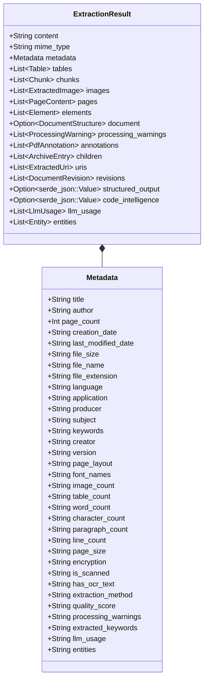
Sources: [docs/reference/types.md:23-53](), [docs/reference/types.md:13-19]()

## Common Configuration Pattern

Configuration objects are used to control OCR, caching, and filtering. The `ExtractionConfig` is the primary configuration object, containing nested configurations for specific features like OCR, chunking, and content filtering.

### Configuration Fields and Their Purpose
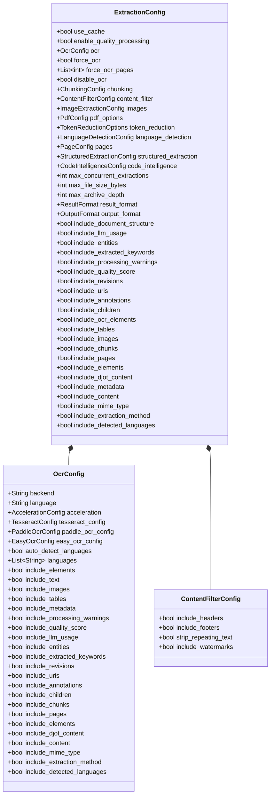
Sources: [docs/reference/configuration.md:80-100](), [docs/reference/configuration.md:48-66](), [docs/reference/configuration.md:10-20]()

---

# Page: Core Concepts

# Core Concepts

<details>
<summary>Relevant source files</summary>

The following files were used as context for generating this wiki page:

- [crates/kreuzberg/src/core/config/captioning.rs](crates/kreuzberg/src/core/config/captioning.rs)
- [crates/kreuzberg/src/core/config/classification.rs](crates/kreuzberg/src/core/config/classification.rs)
- [crates/kreuzberg/src/core/config/extraction/core.rs](crates/kreuzberg/src/core/config/extraction/core.rs)
- [crates/kreuzberg/src/core/config/llm.rs](crates/kreuzberg/src/core/config/llm.rs)
- [crates/kreuzberg/src/core/config/mod.rs](crates/kreuzberg/src/core/config/mod.rs)
- [crates/kreuzberg/src/core/config/ocr.rs](crates/kreuzberg/src/core/config/ocr.rs)
- [crates/kreuzberg/src/core/config/translation.rs](crates/kreuzberg/src/core/config/translation.rs)
- [crates/kreuzberg/src/diff/mod.rs](crates/kreuzberg/src/diff/mod.rs)
- [crates/kreuzberg/src/diff/types.rs](crates/kreuzberg/src/diff/types.rs)
- [crates/kreuzberg/src/extraction/mod.rs](crates/kreuzberg/src/extraction/mod.rs)
- [crates/kreuzberg/src/extractors/mod.rs](crates/kreuzberg/src/extractors/mod.rs)
- [crates/kreuzberg/src/extractors/security.rs](crates/kreuzberg/src/extractors/security.rs)
- [crates/kreuzberg/src/lib.rs](crates/kreuzberg/src/lib.rs)
- [crates/kreuzberg/src/plugins/processor/builtin/ner.rs](crates/kreuzberg/src/plugins/processor/builtin/ner.rs)
- [crates/kreuzberg/src/text/ner/mod.rs](crates/kreuzberg/src/text/ner/mod.rs)
- [crates/kreuzberg/src/text/redaction/engine.rs](crates/kreuzberg/src/text/redaction/engine.rs)
- [crates/kreuzberg/src/types/revisions.rs](crates/kreuzberg/src/types/revisions.rs)
- [crates/kreuzberg/tests/image_classification.rs](crates/kreuzberg/tests/image_classification.rs)
- [docs/concepts/architecture.md](docs/concepts/architecture.md)
- [docs/concepts/extraction-pipeline.md](docs/concepts/extraction-pipeline.md)
- [docs/concepts/plugin-system.md](docs/concepts/plugin-system.md)
- [docs/ecosystem.md](docs/ecosystem.md)
- [docs/guides/image-captions.md](docs/guides/image-captions.md)
- [docs/guides/ner.md](docs/guides/ner.md)
- [docs/guides/page-classification.md](docs/guides/page-classification.md)
- [docs/guides/qr-codes.md](docs/guides/qr-codes.md)
- [docs/guides/redaction.md](docs/guides/redaction.md)
- [docs/guides/summarization.md](docs/guides/summarization.md)
- [docs/guides/translation.md](docs/guides/translation.md)
- [docs/llms.txt](docs/llms.txt)
- [zensical.toml](zensical.toml)

</details>


This document explains the fundamental architectural concepts behind Kreuzberg's document processing engine. It covers the extraction pipeline, internal representation, configuration hierarchy, and threading model. For detailed implementation of specific subsystems, see [Document Processing Pipeline](#3.1), [PDF Processing Details](#3.2), [MIME Type Detection](#3.3), [Configuration System](#3.4), and [Error Handling and Types](#3.5).

## Extraction Flow

Kreuzberg processes documents through a multi-stage pipeline that transforms raw bytes into structured text, metadata, tables, and optional chunks. The flow is designed to be format-agnostic while allowing format-specific optimizations.

### High-Level Extraction Pipeline

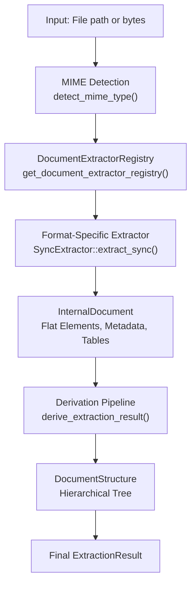

**Sources:** [crates/kreuzberg/src/lib.rs:197-205](), [crates/kreuzberg/src/extractors/mod.rs:8-12](), [crates/kreuzberg/src/extraction/derive.rs:1-10]()

### Core Data Structures

Kreuzberg uses a multi-stage data representation. Extractors output a flat `InternalDocument` which is then transformed into a hierarchical `DocumentStructure` and a public `ExtractionResult`.

| Structure | Purpose | Key Fields | File Location |
|-----------|---------|------------|---------------|
| `InternalDocument` | Internal flat representation optimized for extraction performance. | `elements`, `relationships`, `metadata`, `tables`, `images` | [crates/kreuzberg/src/types/internal.rs:131-180]() |
| `ExtractionConfig` | Controls all extraction behavior. | `ocr`, `chunking`, `pdf_options`, `postprocessor`, `security_limits` | [crates/kreuzberg/src/core/config/mod.rs:24-47]() |
| `ExtractionResult` | Public-facing container for all extracted data. | `content`, `metadata`, `tables`, `chunks`, `pages` | [crates/kreuzberg/src/lib.rs:116-121]() |
| `InternalElement` | Individual unit of content (Paragraph, Heading, Image, etc.). | `id`, `kind`, `text`, `bbox`, `page` | [crates/kreuzberg/src/types/internal.rs:10-16]() |

**Sources:** [crates/kreuzberg/src/types/internal.rs:131-180](), [crates/kreuzberg/src/core/config/mod.rs:24-47]()

## Document Representation

Kreuzberg bridges the gap between raw file bytes and semantic document structures.

### From Flat Elements to Code Entities

This diagram shows how the internal flat elements produced by extractors like `PdfExtractor` or `DocxExtractor` map to the semantic tree used by the library.

```mermaid
flowchart LR
    subgraph "Internal Document Space (Flat)"
        IE1["InternalElement (Heading)"]
        IE2["InternalElement (Paragraph)"]
        IE3["InternalElement (Table)"]
    end

    subgraph "Derivation Logic (extraction/derive.rs)"
        Resolve["resolve_relationships()"]
        Build["derive_document_structure_inner()"]
    end

    subgraph "Public Structure Space (Hierarchical)"
        DS["DocumentStructure"]
        DN1["DocumentNode (Heading)"]
        DN2["DocumentNode (Paragraph)"]
        DN3["DocumentNode (Table)"]
    end

    IE1 --> Resolve
    IE2 --> Resolve
    IE3 --> Resolve
    Resolve --> Build
    Build --> DN1
    Build --> DN2
    Build --> DN3
    DN1 --> DS
    DN2 --> DS
    DN3 --> DS
```

**Sources:** [crates/kreuzberg/src/extraction/derive.rs:1-10](), [crates/kreuzberg/src/types/internal.rs:1-16]()

## Configuration and Security

The `ExtractionConfig` struct is the central authority for extraction behavior. It includes `SecurityLimits` to protect against common document-based attacks.

### Configuration Hierarchy

```mermaid
flowchart TD
    Root["ExtractionConfig"]
    Security["SecurityLimits"]
    PDF["PdfConfig"]
    OCR["OcrConfig"]
    Layout["LayoutDetectionConfig"]
    LLM["LlmConfig"]
    Redaction["RedactionConfig"]
    Chunking["ChunkingConfig"]
    
    Root --> Security
    Root --> PDF
    Root --> OCR
    Root --> Layout
    Root --> LLM
    Root --> Redaction
    Root --> Chunking
    
    Security --> MaxSize["max_content_size"]
    Security --> MaxNesting["max_nesting_depth"]
    Security --> MaxEntities["max_entity_length"]
    
    PDF --> PDFHier["HierarchyConfig"]
    OCR --> OCRPipeline["OcrPipelineConfig"]
    LLM --> LLMProvider["provider"]
    Redaction --> RedactionStrategy["strategy"]
    Chunking --> ChunkerType["chunker_type"]
```

**Sources:** [crates/kreuzberg/src/core/config/mod.rs:24-47](), [crates/kreuzberg/src/extractors/security.rs:13-50](), [crates/kreuzberg/src/core/config/llm.rs:1-10](), [crates/kreuzberg/src/core/config/redaction.rs:1-10](), [crates/kreuzberg/src/core/config/processing.rs:1-10]()

### Security Mechanisms

Kreuzberg implements several safeguards:
- **ZIP Bomb Detection**: `ZipBombValidator` checks compression ratios and file counts. [crates/kreuzberg/src/extractors/security.rs:155-184]()
- **XML Protection**: Limits on entity expansion and nesting depth to prevent "billion laughs" attacks. [crates/kreuzberg/src/extractors/security.rs:32-37]()
- **Resource Caps**: `max_table_cells` and `max_content_size` prevent memory exhaustion. [crates/kreuzberg/src/extractors/security.rs:48-50]()

## Layout and OCR Intelligence

For visual documents (PDFs, Images), Kreuzberg employs advanced layout detection and OCR backends.

### Layout Engine Architecture

The `LayoutEngine` uses ONNX Runtime to perform high-level page analysis.

```mermaid
flowchart TD
    Img["RgbImage"]
    Engine["LayoutEngine::detect()"]
    Model["LayoutModel (RtDetrModel or YoloModel)"]
    ORT["ONNX Runtime Session"]
    Results["DetectionResult (BBox, LayoutClass)"]
    
    Img --> Engine
    Engine --> Model
    Model --> ORT
    ORT --> Results
```

**Sources:** [crates/kreuzberg/src/layout/engine.rs:82-89](), [crates/kreuzberg/src/layout/models/rtdetr.rs:30-33]()

## Page Management

For multi-page documents, Kreuzberg tracks content per page using `PageContent`. This includes assigning hierarchy, tables, and images to their respective page numbers.

| Component | Responsibility | Source |
|-----------|----------------|--------|
| `assign_hierarchy_to_pages` | Maps headings to page-level hierarchy blocks. | [crates/kreuzberg/src/extractors/pdf/pages.rs:14-58]() |
| `assign_tables_and_images_to_pages` | Associates tables and images with `PageContent` using Arc sharing. | [crates/kreuzberg/src/extractors/pdf/pages.rs:80-111]() |
| `InternalElement.page` | Stores the 1-indexed page number for an element. | [crates/kreuzberg/src/types/internal.rs:68-72]() |

**Sources:** [crates/kreuzberg/src/extractors/pdf/pages.rs:1-111]()

## Threading and Memory

- **Global Singletons**: Components like `PDFIUM_SINGLETON` or `CACHED_ENGINE` use `OnceLock` or `ModelCache` to ensure resources are initialized once and shared across threads. [crates/kreuzberg/src/layout/mod.rs:57-63]()
- **Arc-Based Sharing**: Tables and images are wrapped in `Arc` to allow zero-copy sharing between the flat document list and page-specific content. [crates/kreuzberg/src/extractors/pdf/pages.rs:65-70]()
- **FFI Safety**: `InternalElementId` provides deterministic 48-bit identifiers (via Blake3) that enable consistent referencing across language boundaries. [crates/kreuzberg/src/types/internal.rs:33-40]()

---

For details on the multi-stage pipeline, see [Document Processing Pipeline](#3.1).
For PDF-specific details, see [PDF Processing Details](#3.2).
For MIME type detection logic, see [MIME Type Detection](#3.3).
For configuration management, see [Configuration System](#3.4).
For error classification, see [Error Handling and Types](#3.5).
For LLM integration, see [LLM Integration](#3.6).
For code analysis, see [Code Intelligence](#3.7).

---

# Page: Document Processing Pipeline

# Document Processing Pipeline

<details>
<summary>Relevant source files</summary>

The following files were used as context for generating this wiki page:

- [crates/kreuzberg-cli/src/style.rs](crates/kreuzberg-cli/src/style.rs)
- [crates/kreuzberg-ffi/tests/vtable_bytes_len.rs](crates/kreuzberg-ffi/tests/vtable_bytes_len.rs)
- [crates/kreuzberg/src/cache/mod.rs](crates/kreuzberg/src/cache/mod.rs)
- [crates/kreuzberg/src/cache/utilities.rs](crates/kreuzberg/src/cache/utilities.rs)
- [crates/kreuzberg/src/chunking/builder.rs](crates/kreuzberg/src/chunking/builder.rs)
- [crates/kreuzberg/src/chunking/core.rs](crates/kreuzberg/src/chunking/core.rs)
- [crates/kreuzberg/src/chunking/mod.rs](crates/kreuzberg/src/chunking/mod.rs)
- [crates/kreuzberg/src/chunking/yaml_section.rs](crates/kreuzberg/src/chunking/yaml_section.rs)
- [crates/kreuzberg/src/core/mime.rs](crates/kreuzberg/src/core/mime.rs)
- [crates/kreuzberg/src/core/pipeline/cache.rs](crates/kreuzberg/src/core/pipeline/cache.rs)
- [crates/kreuzberg/src/core/pipeline/features.rs](crates/kreuzberg/src/core/pipeline/features.rs)
- [crates/kreuzberg/src/core/pipeline/format.rs](crates/kreuzberg/src/core/pipeline/format.rs)
- [crates/kreuzberg/src/core/pipeline/mod.rs](crates/kreuzberg/src/core/pipeline/mod.rs)
- [crates/kreuzberg/src/embeddings/mod.rs](crates/kreuzberg/src/embeddings/mod.rs)
- [crates/kreuzberg/src/extraction/mod.rs](crates/kreuzberg/src/extraction/mod.rs)
- [crates/kreuzberg/src/extractors/mod.rs](crates/kreuzberg/src/extractors/mod.rs)
- [crates/kreuzberg/src/extractors/security.rs](crates/kreuzberg/src/extractors/security.rs)
- [crates/kreuzberg/src/ocr/mod.rs](crates/kreuzberg/src/ocr/mod.rs)
- [crates/kreuzberg/src/ocr/tesseract_backend.rs](crates/kreuzberg/src/ocr/tesseract_backend.rs)
- [crates/kreuzberg/src/ocr/tesseract_wasm_backend.rs](crates/kreuzberg/src/ocr/tesseract_wasm_backend.rs)
- [crates/kreuzberg/src/ocr/types.rs](crates/kreuzberg/src/ocr/types.rs)
- [crates/kreuzberg/src/rendering/common.rs](crates/kreuzberg/src/rendering/common.rs)
- [crates/kreuzberg/src/table_core.rs](crates/kreuzberg/src/table_core.rs)
- [crates/kreuzberg/src/text/token_reduction/semantic.rs](crates/kreuzberg/src/text/token_reduction/semantic.rs)
- [crates/kreuzberg/src/utils/json_utils.rs](crates/kreuzberg/src/utils/json_utils.rs)
- [crates/kreuzberg/src/utils/mod.rs](crates/kreuzberg/src/utils/mod.rs)
- [crates/kreuzberg/src/utils/pool_sizing.rs](crates/kreuzberg/src/utils/pool_sizing.rs)
- [crates/kreuzberg/tests/docx_mime_detection_test.rs](crates/kreuzberg/tests/docx_mime_detection_test.rs)
- [crates/kreuzberg/tests/issue_350_regression_test.rs](crates/kreuzberg/tests/issue_350_regression_test.rs)
- [crates/kreuzberg/tests/pdf_chunk_page_metadata.rs](crates/kreuzberg/tests/pdf_chunk_page_metadata.rs)

</details>


This document describes Kreuzberg's multi-stage document processing pipeline, from input normalization through format-specific extraction, OCR integration, post-processing, and advanced feature generation. The pipeline is designed for extensibility through a plugin system while maintaining consistent behavior across 75+ file formats and 12+ language bindings.

For information about the plugin architecture that enables custom extractors and processors, see [Plugin System](#5). For configuration options and discovery mechanisms, see [Configuration System](#3.4).

## Pipeline Overview

The document processing pipeline consists of six distinct stages executed in sequence:

```mermaid
graph LR
    Input["Input Normalization<br/>extract_file()<br/>extract_bytes()"]
    MIME["MIME Detection<br/>detect_or_validate()"]
    Route["Format Routing<br/>get_extractor()"]
    Extract["Format Extraction<br/>SyncExtractor<br/>InternalDocument"]
    OCR["OCR Integration<br/>process_images_with_ocr()"]
    Derive["Derivation<br/>derive_extraction_result()"]
    PostProc["Post-Processing<br/>run_pipeline() stages"]
    Output["ExtractionResult<br/>content, metadata<br/>chunks, embeddings"]
    
    Input --> MIME
    MIME --> Route
    Route --> Extract
    Extract --> OCR
    OCR --> Derive
    Derive --> PostProc
    PostProc --> Output
```

**Sources:** [crates/kreuzberg/src/core/pipeline/mod.rs:58-58](), [crates/kreuzberg/src/core/pipeline/mod.rs:137-140]()

## Input Normalization

The pipeline accepts three primary input modes, all normalized to an `ExtractionConfig` and raw data before processing. The `extract_file` function handles filesystem paths, while `extract_bytes` handles in-memory data.

| Input Mode | Function | Use Case | Implementation |
|------------|----------|----------|----------------|
| File Path | `extract_file()` | Local file extraction | Validates existence, detects MIME, handles caching [crates/kreuzberg/src/core/extractor/file.rs:67-122]() |
| Byte Array | `extract_bytes()` | In-memory documents | Direct processing, validates provided MIME [crates/kreuzberg/src/core/extractor/bytes.rs:66-108]() |
| Synchronous | `extract_sync()` | Blocking contexts | Uses `SyncExtractor` trait without async runtime [crates/kreuzberg/src/extractors/mod.rs:47-63]() |

```mermaid
graph TB
    subgraph "EntryPoints"
        FilePath["extract_file(path, config)"]
        Bytes["extract_bytes(data, mime, config)"]
    end
    
    subgraph "NormalizationLayer"
        FileIO["validate_file_exists()<br/>blake3_hash_file()"]
        MIMEDetect["detect_or_validate()<br/>detect_mime_type_from_bytes()"]
        CacheCheck["get_extraction_cache()<br/>cache_key generation"]
    end
    
    subgraph "InternalState"
        NormalizedInput["(bytes: &[u8], mime: String, config: ExtractionConfig)"]
    end
    
    FilePath --> FileIO
    FileIO --> MIMEDetect
    MIMEDetect --> CacheCheck
    CacheCheck --> NormalizedInput
    
    Bytes --> MIMEDetect
    MIMEDetect --> NormalizedInput
```

**Sources:** [crates/kreuzberg/src/core/extractor/file.rs:67-160](), [crates/kreuzberg/src/core/extractor/bytes.rs:66-146](), [crates/kreuzberg/src/extractors/mod.rs:14-23]()

## Format-Specific Extraction

Once the MIME type is determined, the `get_extractor` helper retrieves the appropriate implementation from the registry. All extractors return an `InternalDocument`, which is a flat, append-only structure optimized for performance. The `SyncExtractor` trait defines the synchronous extraction interface for WASM targets and other environments where async runtimes are not available or desirable [crates/kreuzberg/src/extractors/mod.rs:47-63]().

```mermaid
graph TB
    Registry["get_document_extractor_registry().get_extractor(mime_type)"]
    
    subgraph "Extractors"
        PDF["PdfExtractor<br/>crates/kreuzberg/src/extractors/pdf.rs"]
        Office["DocxExtractor / ExcelExtractor<br/>crates/kreuzberg/src/extractors/docx.rs"]
        Text["PlainTextExtractor<br/>crates/kreuzberg/src/extractors/text.rs"]
        Image["ImageExtractor<br/>crates/kreuzberg/src/extractors/image.rs"]
        Code["CodeExtractor<br/>crates/kreuzberg/src/extractors/code.rs"]
        Csv["CsvExtractor<br/>crates/kreuzberg/src/extractors/csv.rs"]
        Html["HtmlExtractor<br/>crates/kreuzberg/src/extractors/html.rs"]
        Markdown["MarkdownExtractor<br/>crates/kreuzberg/src/extractors/markdown.rs"]
        Structured["StructuredExtractor<br/>crates/kreuzberg/src/extractors/structured.rs"]
        Archive["ZipExtractor / TarExtractor<br/>crates/kreuzberg/src/extractors/archive.rs"]
        Email["EmailExtractor / PstExtractor<br/>crates/kreuzberg/src/extractors/email.rs"]
        IWork["KeynoteExtractor / NumbersExtractor / PagesExtractor<br/>crates/kreuzberg/src/extractors/iwork.rs"]
        Hwp["HwpExtractor / HwpxExtractor<br/>crates/kreuzberg/src/extractors/hwp.rs"]
        Djot["DjotExtractor<br/>crates/kreuzberg/src/extractors/djot_format.rs"]
        Mdx["MdxExtractor<br/>crates/kreuzberg/src/extractors/mdx.rs"]
        Rst["RstExtractor<br/>crates/kreuzberg/src/extractors/rst.rs"]
        Latex["LatexExtractor<br/>crates/kreuzberg/src/extractors/latex.rs"]
        Jupyter["JupyterExtractor<br/>crates/kreuzberg/src/extractors/jupyter.rs"]
        OrgMode["OrgModeExtractor<br/>crates/kreuzberg/src/extractors/orgmode.rs"]
        Odt["OdtExtractor<br/>crates/kreuzberg/src/extractors/odt.rs"]
        Opml["OpmlExtractor<br/>crates/kreuzberg/src/extractors/opml.rs"]
        Typst["TypstExtractor<br/>crates/kreuzberg/src/extractors/typst.rs"]
        Xml["XmlExtractor / JatsExtractor / DocbookExtractor<br/>crates/kreuzberg/src/extractors/xml.rs"]
        Ppt["PptExtractor / PptxExtractor<br/>crates/kreuzberg/src/extractors/ppt.rs"]
        Rtf["RtfExtractor<br/>crates/kreuzberg/src/extractors/rtf.rs"]
        Bibtex["BibtexExtractor<br/>crates/kreuzberg/src/extractors/bibtex.rs"]
        Citation["CitationExtractor<br/>crates/kreuzberg/src/extractors/citation.rs"]
        Dbf["DbfExtractor<br/>crates/kreuzberg/src/extractors/dbf.rs"]
        Epub["EpubExtractor<br/>crates/kreuzberg/src/extractors/epub.rs"]
        FictionBook["FictionBookExtractor<br/>crates/kreuzberg/src/extractors/fictionbook.rs"]
    end
    
    subgraph "Output"
        InternalDoc["InternalDocument<br/>elements: Vec&lt;InternalElement&gt;<br/>metadata: Metadata<br/>images: Vec&lt;ExtractedImage&gt;"]
    end
    
    Registry --> PDF
    Registry --> Office
    Registry --> Text
    Registry --> Image
    Registry --> Code
    Registry --> Csv
    Registry --> Html
    Registry --> Markdown
    Registry --> Structured
    Registry --> Archive
    Registry --> Email
    Registry --> IWork
    Registry --> Hwp
    Registry --> Djot
    Registry --> Mdx
    Registry --> Rst
    Registry --> Latex
    Registry --> Jupyter
    Registry --> OrgMode
    Registry --> Odt
    Registry --> Opml
    Registry --> Typst
    Registry --> Xml
    Registry --> Ppt
    Registry --> Rtf
    Registry --> Bibtex
    Registry --> Citation
    Registry --> Dbf
    Registry --> Epub
    Registry --> FictionBook

    PDF --> InternalDoc
    Office --> InternalDoc
    Text --> InternalDoc
    Image --> InternalDoc
    Code --> InternalDoc
    Csv --> InternalDoc
    Html --> InternalDoc
    Markdown --> InternalDoc
    Structured --> InternalDoc
    Archive --> InternalDoc
    Email --> InternalDoc
    IWork --> InternalDoc
    Hwp --> InternalDoc
    Djot --> InternalDoc
    Mdx --> InternalDoc
    Rst --> InternalDoc
    Latex --> InternalDoc
    Jupyter --> InternalDoc
    OrgMode --> InternalDoc
    Odt --> InternalDoc
    Opml --> InternalDoc
    Typst --> InternalDoc
    Xml --> InternalDoc
    Ppt --> InternalDoc
    Rtf --> InternalDoc
    Bibtex --> InternalDoc
    Citation --> InternalDoc
    Dbf --> InternalDoc
    Epub --> InternalDoc
    FictionBook --> InternalDoc
```

The `InternalDocument` uses deterministic `InternalElementId` (Blake3) to enable caching and diffing. It stores relationships separately from elements to keep iteration compact.

**Sources:** [crates/kreuzberg/src/extractors/mod.rs:66-282](), [crates/kreuzberg/src/extractors/mod.rs:284-289](), [crates/kreuzberg/src/plugins/registry.rs:1-10]()

## OCR Integration Layer

OCR can be triggered either by specific extractors (like `ImageExtractor`) or as a pipeline step for documents containing images (like PDFs).

1.  **Format-Level OCR**: `ImageExtractor` uses the configured `OcrBackend` directly during the extraction phase.
2.  **Pipeline-Level OCR**: The `run_pipeline` function checks if `InternalDocument` contains images and if OCR is configured. It calls `process_images_with_ocr` to update the document [crates/kreuzberg/src/core/pipeline/mod.rs:66-73]().

```mermaid
graph TB
    Input["InternalDocument (with images)"]
    Config{"config.ocr.is_some()?"}
    
    subgraph "OCRProcessing"
        Process["process_images_with_ocr()<br/>crates/kreuzberg/src/extraction/image_ocr.rs"]
        Semaphore["EMBED_SEMAPHORE<br/>Concurrency limit"]
        Engine["OcrBackend implementation<br/>TesseractBackend / PaddleOcrBackend"]
    end
    
    Warnings["ProcessingWarning<br/>'image_ocr' source"]
    UpdatedDoc["InternalDocument (updated images)"]
    
    Input --> Config
    Config -->|Yes| Process
    Config -->|No| UpdatedDoc
    
    Process --> Semaphore
    Semaphore --> Engine
    Engine --> UpdatedDoc
    Engine --"On Error"--> Warnings
```

**Sources:** [crates/kreuzberg/src/core/pipeline/mod.rs:59-81](), [crates/kreuzberg/src/embeddings/mod.rs:89-93](), [crates/kreuzberg/src/ocr/tesseract_backend.rs:28-31]()

## Derivation and Hierarchy

The bridge between the internal flat representation and the public-facing `ExtractionResult` is the **Derivation Pipeline**. This stage reconstructs the document tree and resolves relationships.

-   **Relationship Resolution**: Converts `RelationshipTarget::Key` (anchors) to `RelationshipTarget::Index` (vector offsets) [crates/kreuzberg/src/extraction/derive.rs:35-60]().
-   **Tree Reconstruction**: Flat elements are nested into a hierarchical `DocumentStructure` based on container markers (e.g., `ListStart`, `Heading`) [crates/kreuzberg/src/extraction/derive.rs:71-150]().
-   **PDF Hierarchy**: Uses font size clustering (K-Means) to detect H1-H6 levels in PDFs [crates/kreuzberg/tests/pdf_hierarchy_detection.rs:46-51]().

**Sources:** [crates/kreuzberg/src/extraction/derive.rs:1-10](), [crates/kreuzberg/src/extraction/derive.rs:128-131](), [crates/kreuzberg/tests/pdf_hierarchy_detection.rs:22-61]()

## Post-Processing and Features

The `run_pipeline` function orchestrates the final processing steps after derivation:

1.  **Post-Processors**: Executes registered plugins in `Early`, `Middle`, and `Late` stages [crates/kreuzberg/src/core/pipeline/mod.rs:159-167]().
2.  **Chunking**: Splits text into segments for RAG. If `Markdown` chunking is used, the pipeline pre-renders markdown to provide heading context [crates/kreuzberg/src/core/pipeline/mod.rs:88-99](). The `chunk_text` function in `crates/kreuzberg/src/chunking/core.rs` is the primary API for this [crates/kreuzberg/src/chunking/core.rs:53-59]().
3.  **Language Detection**: Uses `execute_language_detection` to populate `detected_languages` [crates/kreuzberg/src/core/pipeline/mod.rs:179]().
4.  **Token Reduction**: Applies summarization or filtering [crates/kreuzberg/src/core/pipeline/mod.rs:180]().
5.  **Validators**: Final check to ensure extraction quality [crates/kreuzberg/src/core/pipeline/mod.rs:181]().

### Advanced Feature: Embeddings
Embeddings are generated using ONNX models (via `fastembed-rs`). The system supports multiple presets (`fast`, `balanced`, `quality`, `multilingual`) [crates/kreuzberg/src/embeddings/mod.rs:118-161]() and limits concurrent inference via `EMBED_SEMAPHORE` to prevent resource exhaustion [crates/kreuzberg/src/embeddings/mod.rs:89-93]().

**Sources:** [crates/kreuzberg/src/core/pipeline/mod.rs:149-181](), [crates/kreuzberg/src/embeddings/mod.rs:89-115](), [crates/kreuzberg/src/embeddings/mod.rs:118-161](), [crates/kreuzberg/src/chunking/core.rs:53-59]()

## Output Format Application

The final step in the pipeline is `apply_output_format`. This function swaps the pre-rendered content (produced during derivation) into the main `content` field [crates/kreuzberg/src/core/pipeline/format.rs:29-47]().

```mermaid
graph TB
    Result["ExtractionResult"]
    Format["OutputFormat (Markdown, HTML, Djot, etc.)"]
    
    subgraph "SwapLogic"
        HasFormatted{"formatted_content.is_some()?"}
        Swap["content = formatted_content.take()"]
    end
    
    Final["Final ExtractionResult<br/>metadata.output_format updated"]
    
    Result --> Format
    Format --> HasFormatted
    HasFormatted -->|Yes| Swap
    Swap --> Final
    HasFormatted -->|No| Final
```

**Sources:** [crates/kreuzberg/src/core/pipeline/format.rs:29-47](), [crates/kreuzberg/src/core/pipeline/mod.rs:186]()

---

# Page: PDF Processing Details

# PDF Processing Details

<details>
<summary>Relevant source files</summary>

The following files were used as context for generating this wiki page:

- [crates/kreuzberg-cli/src/commands/tree_sitter.rs](crates/kreuzberg-cli/src/commands/tree_sitter.rs)
- [crates/kreuzberg/src/core/path_resolver.rs](crates/kreuzberg/src/core/path_resolver.rs)
- [crates/kreuzberg/src/extraction/image.rs](crates/kreuzberg/src/extraction/image.rs)
- [crates/kreuzberg/src/extraction/pptx/content_builder.rs](crates/kreuzberg/src/extraction/pptx/content_builder.rs)
- [crates/kreuzberg/src/extractors/image.rs](crates/kreuzberg/src/extractors/image.rs)
- [crates/kreuzberg/src/extractors/pdf/extraction.rs](crates/kreuzberg/src/extractors/pdf/extraction.rs)
- [crates/kreuzberg/src/extractors/pdf/layout_hints.rs](crates/kreuzberg/src/extractors/pdf/layout_hints.rs)
- [crates/kreuzberg/src/extractors/pdf/layout_runner.rs](crates/kreuzberg/src/extractors/pdf/layout_runner.rs)
- [crates/kreuzberg/src/extractors/pdf/mod.rs](crates/kreuzberg/src/extractors/pdf/mod.rs)
- [crates/kreuzberg/src/extractors/pdf/ocr.rs](crates/kreuzberg/src/extractors/pdf/ocr.rs)
- [crates/kreuzberg/src/ocr/hocr_parser.rs](crates/kreuzberg/src/ocr/hocr_parser.rs)
- [crates/kreuzberg/src/pdf/bookmarks.rs](crates/kreuzberg/src/pdf/bookmarks.rs)
- [crates/kreuzberg/src/pdf/embedded_files.rs](crates/kreuzberg/src/pdf/embedded_files.rs)
- [crates/kreuzberg/src/pdf/error.rs](crates/kreuzberg/src/pdf/error.rs)
- [crates/kreuzberg/src/pdf/metadata.rs](crates/kreuzberg/src/pdf/metadata.rs)
- [crates/kreuzberg/src/pdf/mod.rs](crates/kreuzberg/src/pdf/mod.rs)
- [crates/kreuzberg/src/pdf/oxide/hierarchy.rs](crates/kreuzberg/src/pdf/oxide/hierarchy.rs)
- [crates/kreuzberg/src/pdf/oxide/images.rs](crates/kreuzberg/src/pdf/oxide/images.rs)
- [crates/kreuzberg/src/pdf/oxide/mod.rs](crates/kreuzberg/src/pdf/oxide/mod.rs)
- [crates/kreuzberg/src/pdf/oxide/table.rs](crates/kreuzberg/src/pdf/oxide/table.rs)
- [crates/kreuzberg/src/pdf/oxide/text.rs](crates/kreuzberg/src/pdf/oxide/text.rs)
- [crates/kreuzberg/src/pdf/oxide_text.rs](crates/kreuzberg/src/pdf/oxide_text.rs)
- [crates/kreuzberg/src/pdf/structure/adapters.rs](crates/kreuzberg/src/pdf/structure/adapters.rs)
- [crates/kreuzberg/src/pdf/structure/assembly.rs](crates/kreuzberg/src/pdf/structure/assembly.rs)
- [crates/kreuzberg/src/pdf/structure/classify.rs](crates/kreuzberg/src/pdf/structure/classify.rs)
- [crates/kreuzberg/src/pdf/structure/constants.rs](crates/kreuzberg/src/pdf/structure/constants.rs)
- [crates/kreuzberg/src/pdf/structure/layout_classify.rs](crates/kreuzberg/src/pdf/structure/layout_classify.rs)
- [crates/kreuzberg/src/pdf/structure/mod.rs](crates/kreuzberg/src/pdf/structure/mod.rs)
- [crates/kreuzberg/src/pdf/structure/paragraphs.rs](crates/kreuzberg/src/pdf/structure/paragraphs.rs)
- [crates/kreuzberg/src/pdf/structure/pipeline.rs](crates/kreuzberg/src/pdf/structure/pipeline.rs)
- [crates/kreuzberg/src/pdf/structure/regions/table_recognition.rs](crates/kreuzberg/src/pdf/structure/regions/table_recognition.rs)
- [crates/kreuzberg/src/pdf/structure/regions/tables.rs](crates/kreuzberg/src/pdf/structure/regions/tables.rs)
- [crates/kreuzberg/src/pdf/table_reconstruct.rs](crates/kreuzberg/src/pdf/table_reconstruct.rs)
- [crates/kreuzberg/src/pdf/text.rs](crates/kreuzberg/src/pdf/text.rs)
- [crates/kreuzberg/src/rendering/html_styled.rs](crates/kreuzberg/src/rendering/html_styled.rs)
- [crates/kreuzberg/tests/layout_for_markdown.rs](crates/kreuzberg/tests/layout_for_markdown.rs)
- [crates/kreuzberg/tests/pdf_glyph_spacing_issue_962.rs](crates/kreuzberg/tests/pdf_glyph_spacing_issue_962.rs)
- [crates/kreuzberg/tests/pdf_heuristic_tables.rs](crates/kreuzberg/tests/pdf_heuristic_tables.rs)
- [crates/kreuzberg/tests/pdf_image_extraction_tests.rs](crates/kreuzberg/tests/pdf_image_extraction_tests.rs)
- [crates/kreuzberg/tests/pdf_markdown_regression.rs](crates/kreuzberg/tests/pdf_markdown_regression.rs)
- [tools/benchmark-harness/guardrails.json](tools/benchmark-harness/guardrails.json)

</details>


## Purpose and Scope

This page covers the technical implementation of PDF processing in Kreuzberg. The system has transitioned from a PDFium-based architecture to a pure-Rust pipeline powered by `pdf_oxide`. This architecture provides high-performance text extraction, native and heuristic table detection, and advanced layout analysis for structured output like Markdown. For OCR-specific logic, see [OCR Backends](#5.3).

## PDF Extraction Architecture

The `PdfExtractor` serves as the primary entry point for PDF processing. It orchestrates text extraction, metadata parsing, table reconstruction, and optional OCR fallback when native text quality is insufficient.

### Core Extraction Flow

```mermaid
graph TB
    subgraph "PdfExtractor [crates/kreuzberg/src/extractors/pdf/mod.rs]"
        ExtractCore["extract_core()"]
        OxidePath["extract_core_oxide()"]
        OCRDecision["OCR Evaluation Gate"]
    end

    subgraph "Extraction Phases [crates/kreuzberg/src/extractors/pdf/extraction.rs]"
        OxideDoc["OxideDocument::open_bytes()"]
        TextMeta["extract_text_and_metadata()"]
        TableDetect["Table Detection (Native + Heuristic)"]
        ImgExtract["extract_images_with_data()"]
    end

    subgraph "Post-Processing [crates/kreuzberg/src/pdf/structure/pipeline.rs]"
        Hierarchy["Hierarchy Detection (Font Clustering)"]
        Markdown["Markdown Assembly"]
    end

    ExtractCore --> OxidePath
    OxidePath --> OxideDoc
    OxideDoc --> TextMeta
    TextMeta --> TableDetect
    TableDetect --> ImgExtract
    ImgExtract --> OCRDecision
    OCRDecision -->|Quality Low| RunOCR["run_ocr_pipeline()"]
    OCRDecision -->|Quality High| Hierarchy
    Hierarchy --> Markdown
```

**Key Implementation Details:**
- **Backend:** Uses `pdf_oxide` for a memory-safe, pure-Rust implementation [crates/kreuzberg/src/extractors/pdf/extraction.rs:49]().
- **Single Pass:** Text and metadata are extracted in a single pass to optimize performance [crates/kreuzberg/src/pdf/oxide/text.rs:28-40]().
- **Thread Safety:** The extractor implements `DocumentExtractor`, supporting both byte-based and file-based async extraction [crates/kreuzberg/src/extractors/pdf/mod.rs:125-147]().

Sources: [crates/kreuzberg/src/extractors/pdf/mod.rs:154-170](), [crates/kreuzberg/src/extractors/pdf/extraction.rs:38-60](), [crates/kreuzberg/src/pdf/oxide/text.rs:28-40]()

## Text and Hierarchy Detection

Kreuzberg employs a sophisticated structure pipeline to convert flat PDF text into semantic hierarchies.

### Font-Size Clustering for Headings

Because PDFs do not inherently store heading levels (H1, H2, etc.), Kreuzberg uses K-means clustering on font sizes to infer document structure.

```mermaid
graph LR
    subgraph "Font Analysis [crates/kreuzberg/src/pdf/structure/pipeline.rs]"
        CollectBlocks["Collect TextBlocks"]
        Cluster["cluster_font_sizes()"]
        HeadingMap["assign_heading_levels_smart()"]
    end

    subgraph "Refinement [crates/kreuzberg/src/pdf/structure/classify.rs]"
        Demote["demote_heading_runs()"]
        Noise["mark_arxiv_noise()"]
    end

    CollectBlocks --> Cluster
    Cluster --> HeadingMap
    HeadingMap --> Demote
    Demote --> Noise
```

**Algorithm Characteristics:**
- **Adaptive K-Clamping:** For short documents, the number of clusters ($k$) is automatically reduced to prevent noisy centroids from misclassifying body text as headings [crates/kreuzberg/src/pdf/structure/pipeline.rs:91-97]().
- **Smart Assignment:** Heading levels are assigned based on font size ratios and gaps, ensuring consistent hierarchy even in documents with non-standard font scales [crates/kreuzberg/src/pdf/structure/pipeline.rs:100-125]().
- **Structure Tree Support:** If the PDF contains a built-in structure tree (Tagged PDF), Kreuzberg can bypass heuristics and use assigned roles directly [crates/kreuzberg/src/pdf/structure/pipeline.rs:140-160]().

Sources: [crates/kreuzberg/src/pdf/structure/pipeline.rs:28-132](), [crates/kreuzberg/src/pdf/hierarchy.rs]()

## Table Reconstruction

Table extraction uses a dual-strategy approach to handle both "ruled" (with borders) and "unruled" (white-space delimited) tables.

| Strategy | Mechanism | Target Use Case |
|----------|-----------|-----------------|
| **Native** | Grid detector using explicit PDF path/line instructions. | Forms, invoices, and bordered data tables. |
| **Heuristic** | Spatial reconstruction based on text alignment and gaps. | Financial statements and multi-column layouts without lines. |

The results are merged at the per-page level, ensuring that a document with mixed table styles is processed correctly [crates/kreuzberg/src/extractors/pdf/extraction.rs:74-84]().

Sources: [crates/kreuzberg/src/extractors/pdf/extraction.rs:69-84]()

## OCR Fallback Decision Logic

A critical feature of the PDF pipeline is the "OCR Skip Gate," which determines if a page is a "scanned" image requiring OCR or a "native" text page.

### Quality Evaluation Metrics

The `NativeTextStats` struct tracks several metrics to judge text quality [crates/kreuzberg/src/extractors/pdf/ocr.rs:15-32]():
- **Alnum Ratio:** Ratio of alphanumeric characters to whitespace.
- **Garbage Character Count:** Detection of `U+FFFD` replacement characters indicating encoding failures [crates/kreuzberg/src/extractors/pdf/ocr.rs:98-100]().
- **Fragmented Word Ratio:** Fraction of words with 1-2 characters, indicating garbled extraction [crates/kreuzberg/src/extractors/pdf/ocr.rs:129-134]().
- **Consecutive Repeat Ratio:** Detects column-scrambling where the same words are repeated due to incorrect reading order [crates/kreuzberg/src/extractors/pdf/ocr.rs:139-144]().

### The OCR Skip Gate

```mermaid
graph TD
    subgraph "evaluate_ocr_skip_gate [crates/kreuzberg/src/extractors/pdf/ocr.rs]"
        Stats["Compute NativeTextStats"]
        CheckSub["Is Substantive?"]
        CheckNonText["Is Non-Text (Images)?"]
        Decision{"Gate Outcome"}
    end

    Stats --> CheckSub
    Stats --> CheckNonText
    CheckSub --> Decision
    CheckNonText --> Decision

    Decision -->|SkipNonText| UseNative["Use Native (Minimal)"]
    Decision -->|SkipSubstantive| UseNative
    Decision -->|RunFallback| OCR["Run OCR Backend"]
    Decision -->|UseNative| UseNative
```

Sources: [crates/kreuzberg/src/extractors/pdf/ocr.rs:64-88](), [crates/kreuzberg/src/extractors/pdf/ocr.rs:92-163]()

## Metadata and Image Handling

### PDF-Specific Metadata
Kreuzberg extracts both standard document info and PDF-specific technical details:
- **PdfMetadata:** Version, producer, encryption status, and page dimensions [crates/kreuzberg/src/pdf/metadata.rs:17-41]().
- **PdfExtractionMetadata:** Aggregates title, authors, keywords, and creation dates into a unified structure [crates/kreuzberg/src/pdf/metadata.rs:48-83]().

### Image and Annotation Extraction
- **Images:** The pipeline can extract image data and their spatial positions on the page [crates/kreuzberg/src/extractors/pdf/extraction.rs:95-100]().
- **OCR Inline:** If enabled, extracted images are passed through the OCR processor (e.g., Tesseract or PaddleOCR) to recover text from diagrams or embedded scans [crates/kreuzberg/src/extractors/pdf/extraction.rs:112-145]().
- **Annotations:** PDF comments and annotations are recovered when configured [crates/kreuzberg/src/extractors/pdf/extraction.rs:87-92]().

Sources: [crates/kreuzberg/src/pdf/metadata.rs:1-98](), [crates/kreuzberg/src/extractors/pdf/extraction.rs:87-120]()

## Text Repair and Normalization

Extracted PDF text often contains artifacts from font encoding or layout conversion. The pipeline applies several repair stages:
- **Control Character Fix:** Replaces problematic control characters (e.g., `U+0001`) with hyphens if they appear between word characters, fixing broken `ToUnicode` mappings [crates/kreuzberg/src/pdf/text.rs:17-43]().
- **Ligature Repair:** Expands ligatures and repairs spaces absorbed during extraction [crates/kreuzberg/src/pdf/structure/pipeline.rs:19-21]().
- **HTML Detection:** Detects if the text layer contains embedded HTML (common in web-to-PDF conversions) and converts it to Markdown [crates/kreuzberg/src/pdf/text.rs:50-74]().

Sources: [crates/kreuzberg/src/pdf/text.rs:1-74](), [crates/kreuzberg/src/pdf/structure/pipeline.rs:19-21]()

---

# Page: MIME Type Detection

# MIME Type Detection

<details>
<summary>Relevant source files</summary>

The following files were used as context for generating this wiki page:

- [crates/kreuzberg/src/cache/mod.rs](crates/kreuzberg/src/cache/mod.rs)
- [crates/kreuzberg/src/cache/utilities.rs](crates/kreuzberg/src/cache/utilities.rs)
- [crates/kreuzberg/src/chunking/builder.rs](crates/kreuzberg/src/chunking/builder.rs)
- [crates/kreuzberg/src/chunking/core.rs](crates/kreuzberg/src/chunking/core.rs)
- [crates/kreuzberg/src/chunking/mod.rs](crates/kreuzberg/src/chunking/mod.rs)
- [crates/kreuzberg/src/chunking/yaml_section.rs](crates/kreuzberg/src/chunking/yaml_section.rs)
- [crates/kreuzberg/src/core/mime.rs](crates/kreuzberg/src/core/mime.rs)
- [crates/kreuzberg/src/ocr/mod.rs](crates/kreuzberg/src/ocr/mod.rs)
- [crates/kreuzberg/src/ocr/tesseract_backend.rs](crates/kreuzberg/src/ocr/tesseract_backend.rs)
- [crates/kreuzberg/src/ocr/tesseract_wasm_backend.rs](crates/kreuzberg/src/ocr/tesseract_wasm_backend.rs)
- [crates/kreuzberg/src/ocr/types.rs](crates/kreuzberg/src/ocr/types.rs)
- [crates/kreuzberg/src/utils/json_utils.rs](crates/kreuzberg/src/utils/json_utils.rs)
- [crates/kreuzberg/src/utils/mod.rs](crates/kreuzberg/src/utils/mod.rs)
- [crates/kreuzberg/src/utils/pool_sizing.rs](crates/kreuzberg/src/utils/pool_sizing.rs)
- [crates/kreuzberg/tests/docx_mime_detection_test.rs](crates/kreuzberg/tests/docx_mime_detection_test.rs)
- [crates/kreuzberg/tests/issue_350_regression_test.rs](crates/kreuzberg/tests/issue_350_regression_test.rs)

</details>


## Purpose and Overview

MIME type detection is a foundational component of Kreuzberg's extraction pipeline. It identifies the file format of input documents and routes them to the appropriate `DocumentExtractor` implementation. This page details the detection algorithm, the centralized `FORMATS` registry, and the content-based differentiation for complex formats.

The system relies on a single source of truth for all format mappings, which drives extension-to-MIME resolution, validation, and extractor selection.

Sources:
- [crates/kreuzberg/src/core/mime.rs:1-6]()

## Centralized Format Registry

Kreuzberg uses a centralized registry defined in `crates/kreuzberg/src/core/mime.rs` to manage all supported formats. This registry, the `FORMATS` static array, contains `FormatEntry` structures that define canonical extensions, primary MIME types, and aliases.

### Format Entry Structure
```rust
struct FormatEntry {
    extensions: &'static [&'static str],
    mime_type: &'static str,
    aliases: &'static [&'static str],
}
```
[crates/kreuzberg/src/core/mime.rs:55-62]()

### Registry Implementation Details
The registry enables automatic derivation of:
1. `EXT_TO_MIME`: A `HashMap` mapping file extensions to canonical MIME types.
2. `SUPPORTED_MIME_TYPES`: A `HashSet` of all primary MIME types and aliases for validation.

Sources:
- [crates/kreuzberg/src/core/mime.rs:64-172]()

## Detection Mechanism

The detection process follows a multi-stage workflow, starting from the file path and moving toward a validated MIME type.

### Detection Workflow Diagram
```mermaid
flowchart TD
    Input["Input: Path or Bytes"]

    CheckExplicit{"MIME Type<br/>Provided?"}

    ExtractExt["Extract File Extension<br/>Path::extension()"]
    NormalizeExt["Normalize Extension<br/>to_lowercase(), trim dots"]

    LookupMap["Lookup in EXT_TO_MIME<br/>(Derived from FORMATS)"]

    FoundMap{"Extension<br/>Mapped?"}
    DefaultMime["Default:<br/>application/octet-stream"]
    MappedMime["Get Mapped<br/>MIME Type"]

    Validate["validate_mime_type()<br/>Check SUPPORTED_MIME_TYPES"]

    ValidCheck{"Supported<br/>Format?"}

    SelectExtractor["DocumentExtractorRegistry::get_for_mime_type()"]

    Input --> CheckExplicit
    CheckExplicit -->|"Yes"| Validate
    CheckExplicit -->|"No"| ExtractExt

    ExtractExt --> NormalizeExt
    NormalizeExt --> LookupMap

    LookupMap --> FoundMap
    FoundMap -->|Yes| MappedMime
    FoundMap -->|No| DefaultMime

    MappedMime --> Validate
    DefaultMime --> Validate

    Validate --> ValidCheck
    ValidCheck -->|Yes| SelectExtractor
    ValidCheck -->|No| Error["KreuzbergError::UnsupportedFormat"]
```

Sources:
- [crates/kreuzberg/src/core/mime.rs:1-12]()
- [crates/kreuzberg/src/core/mime.rs:27-50]()

## Complex Format Differentiation

While extension-based detection handles most cases, Kreuzberg performs content analysis for ambiguous formats, particularly within the Microsoft Office ecosystem and XML-based standards.

### Office and XML Differentiation

Many modern document formats are technically ZIP archives containing XML files. Kreuzberg's extractors perform secondary validation of the internal structure to confirm the specific sub-type. This is crucial for correctly identifying formats like DOCX, XLSX, and PPTX, which are all ZIP files but contain specific internal XML markers.

| Canonical MIME Type | Differentiation Method |
|---------------------|------------------------|
| `application/vnd.openxmlformats-officedocument.wordprocessingml.document` | Detects `word/document.xml` in ZIP [crates/kreuzberg/src/core/mime.rs:34-34]() |
| `application/vnd.openxmlformats-officedocument.presentationml.presentation` | Detects `ppt/presentation.xml` in ZIP [crates/kreuzberg/src/core/mime.rs:32-33]() |
| `application/vnd.openxmlformats-officedocument.spreadsheetml.sheet` | Detects `xl/workbook.xml` in ZIP [crates/kreuzberg/src/core/mime.rs:44-44]() |
| `application/xml` | Analyzes root tag using `xml_tag_name` [crates/kreuzberg/src/utils/mod.rs:23-24]() |

### Specialized XML Detection
For XML documents, the utility function `xml_tag_name` is used to peek at the root element, allowing the system to distinguish between generic XML, JATS, or DocBook.

Sources:
- [crates/kreuzberg/src/utils/mod.rs:19-24]()
- [crates/kreuzberg/src/core/mime.rs:38-46]()
- [crates/kreuzberg/tests/docx_mime_detection_test.rs:1-141]()
- [crates/kreuzberg/tests/issue_350_regression_test.rs:1-10]()

## Magic Byte Detection (OCR and Images)

For image formats and binary files where extensions might be missing or incorrect, Kreuzberg relies on the `ImageExtractor` and OCR subsystem.

### OCR MIME Logic
When processing images for OCR, the system retains the original image MIME type in the `OcrExtractionResult` to maintain traceability.

```mermaid
flowchart LR
    Bytes["Image Bytes"]
    Load["image::load_from_memory()"]
    Detect["Detect Image Format<br/>(PNG, JPEG, TIFF, etc.)"]
    OCR["Tesseract/WASM Processing"]
    Result["ExtractionResult<br/>mime_type: 'image/...'"]

    Bytes --> Load
    Load --> Detect
    Detect --> OCR
    OCR --> Result
```

Sources:
- [crates/kreuzberg/src/ocr/tesseract_wasm_backend.rs:104-128]()
- [crates/kreuzberg/src/ocr/types.rs:168-174]()

## Extractor Registry and Selection

The `DocumentExtractorRegistry` uses the validated MIME type to select the appropriate logic. Selection is based on:
1. **MIME Match**: The extractor must include the type in its `supported_mime_types()` list.
2. **Priority**: If multiple extractors support a type, the one with the highest `priority()` value is chosen.

### System Entity Mapping

| Code Entity | Role in MIME Detection |
|-------------|-------------------------|
| `FormatEntry` | Definition of a format's extensions and MIME [crates/kreuzberg/src/core/mime.rs:55-62]() |
| `FORMATS` | Static registry of all supported formats [crates/kreuzberg/src/core/mime.rs:69-70]() |
| `SupportedFormat` | Public struct for API format listing [crates/kreuzberg/src/core/mime.rs:20-25]() |
| `DocumentExtractor` | Trait that defines `supported_mime_types()` and `priority()` |
| `detect_mime_type_from_bytes` | Function to detect MIME type from raw bytes [crates/kreuzberg/tests/docx_mime_detection_test.rs:36-36]() |
| `detect_mime_type` | Function to detect MIME type from a file path [crates/kreuzberg/tests/docx_mime_detection_test.rs:114-114]() |
| `validate_mime_type` | Function to check if a MIME type is supported [crates/kreuzberg/tests/docx_mime_detection_test.rs:101-101]() |

### Error Handling
If a MIME type is detected but no extractor is registered (often due to missing feature flags like `pdf` or `ocr`), the system returns `KreuzbergError::UnsupportedFormat`.

Sources:
- [crates/kreuzberg/src/core/mime.rs:9-25]()
- [crates/kreuzberg/src/ocr/tesseract_wasm_backend.rs:179-186]()

## Utility Functions for MIME Analysis

| Function | File Path | Purpose |
|----------|-----------|---------|
| `xml_tag_name` | `crates/kreuzberg/src/utils/mod.rs` | Extracts the root tag name for XML differentiation [crates/kreuzberg/src/utils/mod.rs:23-24]() |
| `normalize_whitespace` | `crates/kreuzberg/src/utils/mod.rs` | Cleans text content after format-specific extraction [crates/kreuzberg/src/utils/mod.rs:64-77]() |
| `blake3_hash_file` | `crates/kreuzberg/src/cache/utilities.rs` | Generates unique keys for MIME-based caching [crates/kreuzberg/src/cache/utilities.rs:67-86]() |
| `blake3_hash_bytes` | `crates/kreuzberg/src/cache/utilities.rs` | Hashes arbitrary bytes for cache keys [crates/kreuzberg/src/cache/utilities.rs:59-61]() |
| `generate_cache_key` | `crates/kreuzberg/src/cache/utilities.rs` | Generates a deterministic cache key from key-value pairs [crates/kreuzberg/src/cache/utilities.rs:36-56]() |

Sources:
- [crates/kreuzberg/src/utils/mod.rs:1-78]()
- [crates/kreuzberg/src/cache/utilities.rs:59-86]()

---

# Page: Configuration System

# Configuration System

<details>
<summary>Relevant source files</summary>

The following files were used as context for generating this wiki page:

- [crates/kreuzberg-cli/README.md](crates/kreuzberg-cli/README.md)
- [crates/kreuzberg/src/chunking/semantic/mod.rs](crates/kreuzberg/src/chunking/semantic/mod.rs)
- [crates/kreuzberg/src/core/config/captioning.rs](crates/kreuzberg/src/core/config/captioning.rs)
- [crates/kreuzberg/src/core/config/classification.rs](crates/kreuzberg/src/core/config/classification.rs)
- [crates/kreuzberg/src/core/config/extraction/core.rs](crates/kreuzberg/src/core/config/extraction/core.rs)
- [crates/kreuzberg/src/core/config/llm.rs](crates/kreuzberg/src/core/config/llm.rs)
- [crates/kreuzberg/src/core/config/mod.rs](crates/kreuzberg/src/core/config/mod.rs)
- [crates/kreuzberg/src/core/config/ocr.rs](crates/kreuzberg/src/core/config/ocr.rs)
- [crates/kreuzberg/src/core/config/processing.rs](crates/kreuzberg/src/core/config/processing.rs)
- [crates/kreuzberg/src/core/config/translation.rs](crates/kreuzberg/src/core/config/translation.rs)
- [crates/kreuzberg/src/diff/mod.rs](crates/kreuzberg/src/diff/mod.rs)
- [crates/kreuzberg/src/diff/types.rs](crates/kreuzberg/src/diff/types.rs)
- [crates/kreuzberg/src/lib.rs](crates/kreuzberg/src/lib.rs)
- [crates/kreuzberg/src/plugins/processor/builtin/ner.rs](crates/kreuzberg/src/plugins/processor/builtin/ner.rs)
- [crates/kreuzberg/src/text/ner/mod.rs](crates/kreuzberg/src/text/ner/mod.rs)
- [crates/kreuzberg/src/text/redaction/engine.rs](crates/kreuzberg/src/text/redaction/engine.rs)
- [crates/kreuzberg/src/types/revisions.rs](crates/kreuzberg/src/types/revisions.rs)
- [crates/kreuzberg/tests/image_classification.rs](crates/kreuzberg/tests/image_classification.rs)
- [crates/kreuzberg/tests/issue_797_preset_embedding_regression.rs](crates/kreuzberg/tests/issue_797_preset_embedding_regression.rs)
- [docs/cli/usage.md](docs/cli/usage.md)
- [docs/getting-started/quickstart.md](docs/getting-started/quickstart.md)
- [docs/guides/advanced.md](docs/guides/advanced.md)
- [docs/guides/api-server.md](docs/guides/api-server.md)
- [docs/guides/configuration.md](docs/guides/configuration.md)
- [docs/guides/extraction.md](docs/guides/extraction.md)
- [docs/guides/layout-detection.md](docs/guides/layout-detection.md)
- [docs/guides/ocr.md](docs/guides/ocr.md)
- [docs/guides/plugins.md](docs/guides/plugins.md)
- [docs/reference/environment-variables.md](docs/reference/environment-variables.md)
- [docs/reference/formats.md](docs/reference/formats.md)
- [docs/snippets/cli/batch_basic.md](docs/snippets/cli/batch_basic.md)
- [docs/snippets/cli/extract_basic.md](docs/snippets/cli/extract_basic.md)
- [docs/snippets/cli/ocr_basic.md](docs/snippets/cli/ocr_basic.md)

</details>


The configuration system provides flexible, multi-source control over document extraction behavior. It supports programmatic configuration objects, file-based discovery (`.kreuzberg.toml`, `.kreuzberg.yaml`, `.kreuzberg.json`), and environment variable overrides with automatic priority merging.

For detailed field documentation of all configuration classes, see [Configuration Reference](reference/configuration.md) [docs/guides/configuration.md:201-208]().

## Overview

Kreuzberg's configuration system operates on three core principles:

1.  **Multi-source**: Configuration can originate from code, files, or environment variables.
2.  **Automatic discovery**: The system searches for configuration files in standard locations.
3.  **Priority merging**: Multiple sources combine with defined precedence rules.

Configuration controls all aspects of extraction: OCR backends, PDF processing, chunking strategies, quality processing, caching, and output formatting [crates/kreuzberg/src/core/config/extraction/core.rs:33-35]().

## Configuration Architecture

The diagram below bridges the natural language configuration concepts to the underlying code entities.

```mermaid
graph TB
    subgraph "Configuration Sources"
        Prog["Programmatic Config<br/>'ExtractionConfig' objects"]
        FileToml[".kreuzberg.toml<br/>Project config"]
        FileYaml[".kreuzberg.yaml<br/>Alternative format"]
        FileJson[".kreuzberg.json<br/>Alternative format"]
        Env["Environment Variables<br/>'KREUZBERG_*' prefix"]
    end
    
    subgraph "Discovery & Loading"
        Discover["'Config Discovery'<br/>Search hierarchy:<br/>CWD → Parents → Home"]
        Parse["'Format Parsers'<br/>TOML/YAML/JSON"]
        EnvParse["'Environment Parser'<br/>KREUZBERG_OCR_BACKEND"]
    end
    
    subgraph "Merging Layer"
        Merge["'Priority Merger'<br/>1. Programmatic<br/>2. Environment<br/>3. File<br/>4. Defaults"]
        Validate["'Config Validator'<br/>Type checking<br/>Constraint validation"]
    end
    
    subgraph "Code Entities (Core)"
        ExtConfig["'ExtractionConfig'<br/>Root configuration"]
        OcrConfig["'OcrConfig'<br/>OCR settings"]
        PdfConfig["'PdfConfig'<br/>PDF options"]
        ChunkConfig["'ChunkingConfig'<br/>Chunking strategy"]
        AccelConfig["'AccelerationConfig'<br/>Hardware acceleration"]
    end
    
    subgraph "Extraction Pipeline"
        Extractor["'Document Extractor'<br/>Uses merged config"]
        OcrEngine["'OCR Engine'<br/>Configured backend"]
        PostProc["'Post-Processors'<br/>Quality/chunking"]
    end
    
    Prog --> Merge
    FileToml --> Discover
    FileYaml --> Discover
    FileJson --> Discover
    Env --> EnvParse
    
    Discover --> Parse
    Parse --> Merge
    EnvParse --> Merge
    
    Merge --> Validate
    Validate --> ExtConfig
    
    ExtConfig --> OcrConfig
    ExtConfig --> PdfConfig
    ExtConfig --> ChunkConfig
    ExtConfig --> AccelConfig
    
    ExtConfig --> Extractor
    OcrConfig --> OcrEngine
    ChunkConfig --> PostProc
    
    style Merge stroke-width:2px
    style Validate stroke-width:2px
    style ExtConfig stroke-width:4px
```

**Sources:** [crates/kreuzberg/src/core/config/extraction/core.rs:33-35](), [crates/kreuzberg/src/core/config/mod.rs:31-62](), [docs/cli/usage.md:161-205]()

## Configuration Sources

### Programmatic Configuration

Configuration objects are constructed directly in code and passed to extraction functions like `extract_file()` or `extract_bytes()`. This is the highest-priority source and overrides all others [docs/getting-started/quickstart.md:9-77]() [docs/guides/extraction.md:13-18]().

Programmatic configuration is type-checked at construction time in statically-typed bindings (TypeScript, Rust, C#, Java) and at runtime in dynamically-typed bindings (Python, Ruby, PHP) [docs/guides/configuration.md:7-38]().

**Sources:** [docs/getting-started/quickstart.md:9-77](), [docs/guides/configuration.md:7-38](), [docs/guides/extraction.md:13-18]()

### File-Based Configuration

The system searches for configuration files in the following order [docs/guides/configuration.md:86-89]():

1.  Current working directory.
2.  Parent directories (recursive up to filesystem root).
3.  User home directory (`~/.kreuzberg.toml`).

**Supported formats:**

| Format | Filename | Description |
| :--- | :--- | :--- |
| TOML | `.kreuzberg.toml` | Native TOML parser |
| YAML | `.kreuzberg.yaml`, `.kreuzberg.yml` | Native YAML parser |
| JSON | `.kreuzberg.json` | Native JSON parser |

**Example `.kreuzberg.toml`:**

```toml
use_cache = true
enable_quality_processing = true

[ocr]
backend = "tesseract"
language = "eng"

[ocr.tesseract_config]
psm = 3
```

**Sources:** [docs/guides/configuration.md:45-83](), [crates/kreuzberg/src/core/config/extraction/core.rs:33-35]()

### Environment Variables

Environment variables provide runtime overrides. All variables use the `KREUZBERG_` prefix [docs/reference/environment-variables.md:1-2]().

**Examples:**

| Environment Variable | Configuration Path | Type |
| :--- | :--- | :--- |
| `KREUZBERG_USE_CACHE=true` | `ExtractionConfig.use_cache` | Boolean |
| `KREUZBERG_OCR_BACKEND=paddle-ocr` | `ExtractionConfig.ocr.backend` | String |
| `KREUZBERG_OCR_LANGUAGE=fra` | `ExtractionConfig.ocr.language` | String |
| `KREUZBERG_FORCE_OCR=true` | `ExtractionConfig.force_ocr` | Boolean |

**Sources:** [docs/reference/environment-variables.md:1-2](), [docs/cli/usage.md:161-205](), [crates/kreuzberg/src/core/config/extraction/core.rs:37-72]()

## Configuration Discovery

Discovery is triggered automatically when calling extraction functions. In the CLI, the `--config` flag can be used to explicitly point to a configuration file [docs/cli/usage.md:115]() [docs/guides/configuration.md:86-89]().

```mermaid
graph TB
    Start["'extract_file()' called"]
    CheckProg{"Programmatic<br/>config provided?"}
    DiscoverStart["Start discovery"]
    CheckCwd{"Check CWD for<br/>.kreuzberg.*"}
    CheckParent{"Check parent<br/>directories"}
    CheckHome{"Check home<br/>directory"}
    LoadFile["Load & parse file"]
    CheckEnv["Load environment<br/>variables"]
    Merge["Merge all sources"]
    UseDefaults["Use default config"]
    
    Start --> CheckProg
    CheckProg -->|Yes| CheckEnv
    CheckProg -->|No| DiscoverStart
    
    DiscoverStart --> CheckCwd
    CheckCwd -->|Found| LoadFile
    CheckCwd -->|Not found| CheckParent
    
    CheckParent -->|Found| LoadFile
    CheckParent -->|Not found| CheckHome
    
    CheckHome -->|Found| LoadFile
    CheckHome -->|Not found| UseDefaults
    
    LoadFile --> CheckEnv
    UseDefaults --> CheckEnv
    CheckEnv --> Merge
    
    style LoadFile stroke-dasharray: 5 5
    style Merge stroke-width:4px
```

**Sources:** [docs/cli/usage.md:115](), [docs/guides/configuration.md:86-89](), [docs/getting-started/quickstart.md:9-77]()

## Priority and Merging

Configuration sources merge with the following priority (highest to lowest):

1.  **Programmatic**: Directly provided `ExtractionConfig` objects.
2.  **CLI Flags**: (CLI only) e.g., `--ocr true` overrides config files [docs/cli/usage.md:161-169]().
3.  **Environment**: `KREUZBERG_*` variables.
4.  **File-based**: Discovered `.kreuzberg.*` files.
5.  **Defaults**: Built-in fallback values (e.g., `use_cache = True`) [crates/kreuzberg/src/core/config/extraction/core.rs:37]().

**Merging rules:**
*   **Scalar fields**: Higher priority replaces lower priority.
*   **Nested objects**: Merged recursively (e.g., `OcrConfig` within `ExtractionConfig`).
*   **Arrays/lists**: Higher priority replaces the entire list (e.g., `force_ocr_pages`) [crates/kreuzberg/src/core/config/extraction/core.rs:59-60]().

**Sources:** [docs/cli/usage.md:161-213](), [crates/kreuzberg/src/core/config/extraction/core.rs:37-72]()

## Configuration Class Hierarchy

The system is anchored by the `ExtractionConfig` class, which aggregates specialized configuration objects.

```mermaid
classDiagram
    class ExtractionConfig {
        +bool use_cache
        +bool enable_quality_processing
        +OcrConfig ocr
        +bool force_ocr
        +List~u32~ force_ocr_pages
        +ChunkingConfig chunking
        +ContentFilterConfig content_filter
        +PdfConfig pdf_options
        +AccelerationConfig acceleration
    }
    class OcrConfig {
        +string backend
        +string language
        +TesseractConfig tesseract_config
    }
    class PdfConfig {
        +bool extract_images
        +bool extract_tables
        +bool extract_annotations
    }
    class ContentFilterConfig {
        +bool include_headers
        +bool include_footers
        +bool strip_repeating_text
    }
    class AccelerationConfig {
        +ExecutionProviderType provider
        +int device_id
    }

    ExtractionConfig *-- OcrConfig
    ExtractionConfig *-- ChunkingConfig
    ExtractionConfig *-- ContentFilterConfig
    ExtractionConfig *-- PdfConfig
    ExtractionConfig *-- AccelerationConfig
```

**Sources:** [crates/kreuzberg/src/core/config/extraction/core.rs:33-174](), [crates/kreuzberg/src/core/config/ocr.rs:20-21](), [crates/kreuzberg/src/core/config/processing.rs:113-189]()

### Key Configuration Entities

| Entity | Role | Key Fields |
| :--- | :--- | :--- |
| `ExtractionConfig` | Root configuration object [crates/kreuzberg/src/core/config/extraction/core.rs:33-35]() | `use_cache`, `force_ocr`, `ocr`, `pdf_options` |
| `OcrConfig` | OCR backend and language settings [crates/kreuzberg/src/core/config/ocr.rs:20-21]() | `backend`, `language`, `tesseract_config` |
| `PdfConfig` | PDF-specific extraction behavior [crates/kreuzberg/src/core/config/pdf.rs:19-21]() | `extract_images`, `extract_tables`, `extract_annotations` |
| `ContentFilterConfig` | Controls document "furniture" stripping [crates/kreuzberg/src/core/config/content_filter.rs:19-21]() | `include_headers`, `include_footers`, `strip_repeating_text` |
| `AccelerationConfig` | Hardware acceleration for ONNX models [crates/kreuzberg/src/core/config/acceleration.rs:19-21]() | `provider`, `device_id` |

**Sources:** [crates/kreuzberg/src/core/config/acceleration.rs:19-21](), [crates/kreuzberg/src/core/config/content_filter.rs:19-21](), [crates/kreuzberg/src/core/config/extraction/core.rs:33-35](), [crates/kreuzberg/src/core/config/ocr.rs:20-21](), [crates/kreuzberg/src/core/config/pdf.rs:19-21]()

## Configuration Lifecycle

1.  **Discovery**: System searches for `.kreuzberg.*` files starting from CWD [docs/guides/configuration.md:86-89]().
2.  **Loading**: Files are parsed into intermediate structures.
3.  **Merging**: Programmatic, CLI, Environment, and File sources are merged into a final `ExtractionConfig` [docs/cli/usage.md:180-205]().
4.  **Validation**: The pipeline validates constraints (e.g., `disable_ocr` and `force_ocr` cannot both be `True`) [crates/kreuzberg/src/core/config/extraction/core.rs:68-69]().
5.  **Execution**: The validated config is passed to the native Rust core to drive the extraction pipeline [crates/kreuzberg/src/lib.rs:9-15]().

**Sources:** [crates/kreuzberg/src/core/config/extraction/core.rs:68-69](), [crates/kreuzberg/src/lib.rs:9-15](), [docs/cli/usage.md:180-205](), [docs/guides/configuration.md:86-89]()

---

# Page: Error Handling and Types

# Error Handling and Types

<details>
<summary>Relevant source files</summary>

The following files were used as context for generating this wiki page:

- [audit-notes/csharp.md](audit-notes/csharp.md)
- [audit-notes/dart.md](audit-notes/dart.md)
- [audit-notes/elixir.md](audit-notes/elixir.md)
- [audit-notes/go.md](audit-notes/go.md)
- [audit-notes/java.md](audit-notes/java.md)
- [audit-notes/kotlin-android.md](audit-notes/kotlin-android.md)
- [audit-notes/node.md](audit-notes/node.md)
- [audit-notes/other-bindings.md](audit-notes/other-bindings.md)
- [audit-notes/php.md](audit-notes/php.md)
- [audit-notes/python.md](audit-notes/python.md)
- [audit-notes/r.md](audit-notes/r.md)
- [audit-notes/ruby.md](audit-notes/ruby.md)
- [audit-notes/swift.md](audit-notes/swift.md)
- [audit-notes/zig.md](audit-notes/zig.md)
- [crates/kreuzberg-cli/src/commands/cache.rs](crates/kreuzberg-cli/src/commands/cache.rs)
- [crates/kreuzberg-ffi/tests/email_attachment_data_len.rs](crates/kreuzberg-ffi/tests/email_attachment_data_len.rs)
- [crates/kreuzberg/src/core/config/extraction/file_config.rs](crates/kreuzberg/src/core/config/extraction/file_config.rs)
- [crates/kreuzberg/src/core/config/extraction/loaders.rs](crates/kreuzberg/src/core/config/extraction/loaders.rs)
- [crates/kreuzberg/src/core/io.rs](crates/kreuzberg/src/core/io.rs)
- [crates/kreuzberg/src/error.rs](crates/kreuzberg/src/error.rs)
- [crates/kreuzberg/src/extractors/code.rs](crates/kreuzberg/src/extractors/code.rs)
- [crates/kreuzberg/src/keywords/config.rs](crates/kreuzberg/src/keywords/config.rs)
- [crates/kreuzberg/src/ocr/tessdata_manager.rs](crates/kreuzberg/src/ocr/tessdata_manager.rs)
- [docker/Dockerfile.cli](docker/Dockerfile.cli)
- [docker/Dockerfile.musl-build](docker/Dockerfile.musl-build)
- [docker/Dockerfile.musl-ffi](docker/Dockerfile.musl-ffi)
- [docker/Dockerfile.musl-rustler](docker/Dockerfile.musl-rustler)
- [docs/reference/api-c.md](docs/reference/api-c.md)
- [docs/reference/api-csharp.md](docs/reference/api-csharp.md)
- [docs/reference/api-elixir.md](docs/reference/api-elixir.md)
- [docs/reference/api-go.md](docs/reference/api-go.md)
- [docs/reference/api-java.md](docs/reference/api-java.md)
- [docs/reference/api-php.md](docs/reference/api-php.md)
- [docs/reference/api-python.md](docs/reference/api-python.md)
- [docs/reference/api-r.md](docs/reference/api-r.md)
- [docs/reference/api-ruby.md](docs/reference/api-ruby.md)
- [docs/reference/api-rust.md](docs/reference/api-rust.md)
- [docs/reference/api-typescript.md](docs/reference/api-typescript.md)
- [docs/reference/api-wasm.md](docs/reference/api-wasm.md)
- [docs/reference/configuration.md](docs/reference/configuration.md)
- [docs/reference/errors.md](docs/reference/errors.md)
- [docs/reference/types.md](docs/reference/types.md)
- [scripts/ci/r/vendor-kreuzberg-core.py](scripts/ci/r/vendor-kreuzberg-core.py)
- [scripts/ci/ruby/vendor-kreuzberg-core.py](scripts/ci/ruby/vendor-kreuzberg-core.py)
- [scripts/install.sh](scripts/install.sh)

</details>


This page explains Kreuzberg's error handling architecture, focusing on how errors are classified, propagated across FFI boundaries, and mapped to language-specific exceptions. Error handling is critical in a polyglot system where Rust panics must be safely caught before crossing into C, Java, Node.js, and other language runtimes.

For plugin-related error handling, see [Plugin System](#5). For configuration validation errors, see [Configuration System](#3.4).

## Error Classification System

Kreuzberg categorizes all errors into eight structured error codes, enabling consistent error handling across all language bindings. Each error code represents a distinct failure category with specific semantics.

### Error Code Enumeration

```mermaid
graph TB
    subgraph ErrorCodes["Error Code Taxonomy (0-7)"]
        Validation["0: VALIDATION<br/>Input validation failures"]
        Parsing["1: PARSING<br/>Document parsing errors"]
        OCR["2: OCR<br/>OCR engine failures"]
        MissingDep["3: MISSING_DEPENDENCY<br/>Required library not found"]
        IO["4: IO<br/>File system errors"]
        Plugin["5: PLUGIN<br/>Plugin execution failures"]
        Unsupported["6: UNSUPPORTED_FORMAT<br/>Format not supported"]
        Internal["7: INTERNAL<br/>Internal errors/panics"]
    end
    
    subgraph ErrorSources["Error Sources"]
        UserInput["User Input<br/>Paths, bytes, config"]
        FileSystem["File System<br/>read/write/access"]
        DocParsers["Document Parsers<br/>PDFium, calamine, etc"]
        OCREngines["OCR Engines<br/>Tesseract, PaddleOCR"]
        PluginSystem["Plugin System<br/>Custom extractors"]
        RustPanics["Rust Panics<br/>Unexpected failures"]
    end
    
    UserInput --> Validation
    FileSystem --> IO
    DocParsers --> Parsing
    OCREngines --> OCR
    PluginSystem --> Plugin
    UserInput --> Unsupported
    FileSystem --> MissingDep
    RustPanics --> Internal
```

**Sources:** [docs/reference/errors.md:1-1](), [packages/java/src/main/java/dev/kreuzberg/KreuzbergException.java:15-30]()

### Error Code Constants

The FFI layer exposes error code constants as functions to avoid ABI compatibility issues across compilers. These are used by the code generation tool `alef` to synchronize types across the workspace.

| Function | Code | Description | Example Triggers |
|----------|------|-------------|------------------|
| `kreuzberg_error_code_validation()` | 0 | Input validation error | Invalid MIME type, invalid paths [docs/reference/api-csharp.md:25-25]() |
| `kreuzberg_error_code_parsing()` | 1 | Document parsing failed | Malformed PDF, corrupted DOCX |
| `kreuzberg_error_code_ocr()` | 2 | OCR operation failed | Tesseract crash, invalid image format |
| `kreuzberg_error_code_missing_dependency()` | 3 | Required library missing | PDFium not found, ONNX Runtime missing |
| `kreuzberg_error_code_io()` | 4 | I/O operation failed | File not found, permission denied [docs/reference/api-go.md:64-64]() |
| `kreuzberg_error_code_plugin()` | 5 | Plugin execution error | Custom extractor threw exception |
| `kreuzberg_error_code_unsupported_format()` | 6 | Format not supported | Unknown MIME type, disabled feature [docs/reference/api-java.md:26-26]() |
| `kreuzberg_error_code_internal()` | 7 | Internal error | Rust panic, assertion failure |

**Sources:** [docs/reference/errors.md:1-1](), [docs/reference/api-python.md:25-26](), [docs/reference/api-rust.md:25-26]()

## Structured Error Details

Kreuzberg provides rich error metadata through the `CErrorDetails` structure, enabling diagnostic information to flow across FFI boundaries without data loss.

### CErrorDetails Structure

```mermaid
graph LR
    subgraph CErrorDetails["CErrorDetails (C-compatible struct)"]
        Message["*char message<br/>(heap-allocated)"]
        ErrorCode["u32 error_code<br/>(0-7)"]
        ErrorType["*char error_type<br/>(heap-allocated)"]
        SourceFile["*char source_file<br/>(optional)"]
        SourceFunction["*char source_function<br/>(optional)"]
        SourceLine["u32 source_line<br/>(0 if unknown)"]
        ContextInfo["*char context_info<br/>(optional)"]
        IsPanic["i32 is_panic<br/>(0 or 1)"]
    end
    
    subgraph MemoryManagement["Memory Management"]
        Allocation["Allocated by Rust<br/>kreuzberg_get_error_details()"]
        Deallocation["Freed by caller<br/>kreuzberg_free_string() for each field"]
    end
    
    Allocation --> Message
    Allocation --> ErrorType
    Allocation --> SourceFile
    Allocation --> SourceFunction
    Allocation --> ContextInfo
    
    Message --> Deallocation
    ErrorType --> Deallocation
    SourceFile --> Deallocation
    SourceFunction --> Deallocation
    ContextInfo --> Deallocation
```

**Sources:** [docs/reference/api-c.md:1-1](), [packages/java/src/main/java/dev/kreuzberg/KreuzbergFFI.java:382-386]()

## Panic Shield Mechanism

The panic shield catches Rust panics at the FFI boundary, preventing undefined behavior when panics propagate into foreign language runtimes.

### Panic Handling Architecture

```mermaid
graph TB
    subgraph RustCore["Rust Core (kreuzberg crate)"]
        Operation["Document Extraction<br/>PDF parsing, OCR, etc"]
        Panic["panic!() or unwrap()"]
    end
    
    subgraph PanicShield["Panic Shield (kreuzberg-ffi)"]
        CatchUnwind["std::panic::catch_unwind()"]
        PanicStorage["Thread-Local Storage<br/>LAST_PANIC_CONTEXT"]
        SetError["set_structured_error()<br/>error_code = 7 (INTERNAL)"]
    end
    
    subgraph FFIBoundary["FFI Boundary"]
        ReturnNull["Return NULL pointer"]
        ErrorCode["Set error code to 7"]
    end
    
    subgraph LanguageBinding["Language Binding (Java/Node/etc)"]
        CheckNull["Check for NULL result"]
        GetPanicContext["kreuzberg_last_panic_context()"]
        ThrowException["Throw InternalException<br/>with panic details"]
    end
    
    Operation --> Panic
    Panic --> CatchUnwind
    CatchUnwind --> PanicStorage
    CatchUnwind --> SetError
    SetError --> ErrorCode
    SetError --> ReturnNull
    
    ReturnNull --> CheckNull
    CheckNull --> GetPanicContext
    GetPanicContext --> PanicStorage
    GetPanicContext --> ThrowException
```

**Sources:** [docs/reference/errors.md:1-1](), [packages/java/src/main/java/dev/kreuzberg/KreuzbergFFI.java:382-396]()

## Language-Specific Error Mapping

Each language binding maps Kreuzberg error codes to idiomatic exception types. The code generation system ensures that error types are generated consistently across Python, Node, Ruby, and other targets.

### Java Exception Hierarchy

In Java, errors are mapped to a `record` or `class` based on the `workspace.dto` configuration.

```mermaid
graph TB
    KreuzbergException["KreuzbergException<br/>(base class)"]
    
    ValidationException["ValidationException<br/>ErrorCode.VALIDATION"]
    ParsingException["ParsingException<br/>ErrorCode.PARSING"]
    OcrException["OcrException<br/>ErrorCode.OCR"]
    MissingDependencyException["MissingDependencyException<br/>ErrorCode.MISSING_DEPENDENCY"]
    IOException["IOException<br/>ErrorCode.IO"]
    PluginException["PluginException<br/>ErrorCode.PLUGIN"]
    UnsupportedFormatException["UnsupportedFormatException<br/>ErrorCode.UNSUPPORTED_FORMAT"]
    InternalException["InternalException<br/>ErrorCode.INTERNAL"]
    
    KreuzbergException --> ValidationException
    KreuzbergException --> ParsingException
    KreuzbergException --> OcrException
    KreuzbergException --> MissingDependencyException
    KreuzbergException --> IOException
    KreuzbergException --> PluginException
    KreuzbergException --> UnsupportedFormatException
    KreuzbergException --> InternalException
```

**Sources:** [docs/reference/errors.md:1-1](), [packages/java/src/main/java/dev/kreuzberg/KreuzbergException.java:14-48]()

### Language Binding Strategies

| Language | DTO Style | Async Strategy | Source Citation |
|----------|-----------|----------------|-----------------|
| Python | `dataclass` | `asyncio` | [audit-notes/python.md:1-1]() |
| Node.js | `interface` | `Promise` | [audit-notes/node.md:1-1]() |
| Ruby | `struct` | Synchronous | [audit-notes/ruby.md:1-1]() |
| Java | `record` | `CompletableFuture` | [audit-notes/java.md:1-1]() |
| C# | `record` | `Task` | [audit-notes/csharp.md:1-1]() |
| Go | `struct` | `error` return | [audit-notes/go.md:1-1]() |
| Elixir | `struct` | `{:ok, result} | {:error, reason}` | [audit-notes/elixir.md:1-1]() |
| PHP | `class` | `DeferredResult` | [audit-notes/php.md:1-1]() |
| R | `list` | Synchronous | [audit-notes/r.md:1-1]() |
| Swift | `struct` | `async/await` | [audit-notes/swift.md:1-1]() |
| Dart | `class` | `Future` | [audit-notes/dart.md:1-1]() |
| Kotlin | `data class` | `suspend` | [audit-notes/kotlin-android.md:1-1]() |
| Zig | `struct` | `error` return | [audit-notes/zig.md:1-1]() |

**Sources:** [audit-notes/python.md:1-1](), [audit-notes/node.md:1-1](), [audit-notes/ruby.md:1-1](), [audit-notes/java.md:1-1](), [audit-notes/csharp.md:1-1](), [audit-notes/go.md:1-1](), [audit-notes/elixir.md:1-1](), [audit-notes/php.md:1-1](), [audit-notes/r.md:1-1](), [audit-notes/swift.md:1-1](), [audit-notes/dart.md:1-1](), [audit-notes/kotlin-android.md:1-1](), [audit-notes/zig.md:1-1]()

## Format-Specific Error Types

Individual document processors define their own error types that are mapped to the global error classification.

### PDF Error Handling

PDF extraction uses PDFium and can fail due to missing dependencies, password protection, or malformed content.

```mermaid
graph LR
    subgraph PDFErrors["PdfError (Rust enum)"]
        InvalidPdf["InvalidPdf(String)"]
        PasswordRequired["PasswordRequired"]
        InvalidPassword["InvalidPassword"]
        EncryptionNotSupported["EncryptionNotSupported(String)"]
        PageNotFound["PageNotFound(usize)"]
        TextExtractionFailed["TextExtractionFailed(String)"]
    end
    
    subgraph Mapping["Error Code Mapping"]
        InvalidPdf --> PARSING
        PasswordRequired --> VALIDATION
        InvalidPassword --> VALIDATION
        EncryptionNotSupported --> UNSUPPORTED
        PageNotFound --> VALIDATION
        TextExtractionFailed --> PARSING
    end
    
    subgraph ErrorCodes["Global ErrorCode"]
        PARSING["1: PARSING"]
        VALIDATION["0: VALIDATION"]
        UNSUPPORTED["6: UNSUPPORTED_FORMAT"]
    end
```

**Sources:** [crates/kreuzberg/src/error.rs:1-1](), [docs/reference/api-rust.md:62-65]()

## Error Recovery Patterns

### Batch Extraction Error Isolation

Batch operations such as `batch_extract_files` capture individual file errors in the result metadata, preventing a single failure from aborting the entire batch [docs/reference/api-csharp.md:217-218]().

```mermaid
graph TB
    subgraph BatchOperation["batch_extract_files()"]
        Items["List of Items"]
        Concurrency["Max Concurrent Extractions<br/>(num_cpus * 1.5)"]
        Loop["Parallel Execution"]
        Extract["extract_file()"]
        CatchError["Catch Result"]
        Success["ExtractionResult (OK)"]
        Failure["ExtractionResult (Error in Metadata)"]
    end
    
    Items --> Loop
    Loop --> Extract
    Extract --> CatchError
    CatchError --> Success
    CatchError --> Failure
    Success --> Return["List of Results"]
    Failure --> Return
```

**Sources:** [docs/reference/api-python.md:217-218](), [docs/reference/api-go.md:217-218](), [docs/reference/api-java.md:217-218]()

### Synchronous Wrappers and Runtime Errors

For languages like Java and Python, synchronous wrappers (e.g., `extract_file_sync`) utilize a global Tokio runtime to avoid the overhead of creating a new runtime per call [docs/reference/api-java.md:92-93](). If a runtime cannot be initialized, an `Internal` error is propagated.

**Sources:** [docs/reference/api-python.md:92-93](), [docs/reference/api-rust.md:92-93]()

---

# Page: LLM Integration

# LLM Integration

<details>
<summary>Relevant source files</summary>

The following files were used as context for generating this wiki page:

- [crates/kreuzberg-cli/src/commands/ner.rs](crates/kreuzberg-cli/src/commands/ner.rs)
- [crates/kreuzberg/src/api/startup.rs](crates/kreuzberg/src/api/startup.rs)
- [crates/kreuzberg/src/core/config/captioning.rs](crates/kreuzberg/src/core/config/captioning.rs)
- [crates/kreuzberg/src/core/config/classification.rs](crates/kreuzberg/src/core/config/classification.rs)
- [crates/kreuzberg/src/core/config/extraction/core.rs](crates/kreuzberg/src/core/config/extraction/core.rs)
- [crates/kreuzberg/src/core/config/llm.rs](crates/kreuzberg/src/core/config/llm.rs)
- [crates/kreuzberg/src/core/config/mod.rs](crates/kreuzberg/src/core/config/mod.rs)
- [crates/kreuzberg/src/core/config/ocr.rs](crates/kreuzberg/src/core/config/ocr.rs)
- [crates/kreuzberg/src/core/config/translation.rs](crates/kreuzberg/src/core/config/translation.rs)
- [crates/kreuzberg/src/diff/mod.rs](crates/kreuzberg/src/diff/mod.rs)
- [crates/kreuzberg/src/diff/types.rs](crates/kreuzberg/src/diff/types.rs)
- [crates/kreuzberg/src/extraction/pst.rs](crates/kreuzberg/src/extraction/pst.rs)
- [crates/kreuzberg/src/extractors/pdf/region_vlm.rs](crates/kreuzberg/src/extractors/pdf/region_vlm.rs)
- [crates/kreuzberg/src/extractors/pst.rs](crates/kreuzberg/src/extractors/pst.rs)
- [crates/kreuzberg/src/lib.rs](crates/kreuzberg/src/lib.rs)
- [crates/kreuzberg/src/llm/mod.rs](crates/kreuzberg/src/llm/mod.rs)
- [crates/kreuzberg/src/llm/region_extractor.rs](crates/kreuzberg/src/llm/region_extractor.rs)
- [crates/kreuzberg/src/llm/structured.rs](crates/kreuzberg/src/llm/structured.rs)
- [crates/kreuzberg/src/llm/text_completion.rs](crates/kreuzberg/src/llm/text_completion.rs)
- [crates/kreuzberg/src/plugins/processor/builtin/ner.rs](crates/kreuzberg/src/plugins/processor/builtin/ner.rs)
- [crates/kreuzberg/src/text/ner/mod.rs](crates/kreuzberg/src/text/ner/mod.rs)
- [crates/kreuzberg/src/text/redaction/engine.rs](crates/kreuzberg/src/text/redaction/engine.rs)
- [crates/kreuzberg/src/text/summarization/llm.rs](crates/kreuzberg/src/text/summarization/llm.rs)
- [crates/kreuzberg/src/types/revisions.rs](crates/kreuzberg/src/types/revisions.rs)
- [crates/kreuzberg/tests/image_classification.rs](crates/kreuzberg/tests/image_classification.rs)
- [crates/kreuzberg/tests/llm_integration.rs](crates/kreuzberg/tests/llm_integration.rs)
- [docs/guides/code-intelligence.md](docs/guides/code-intelligence.md)
- [docs/guides/development.md](docs/guides/development.md)
- [docs/guides/html-output.md](docs/guides/html-output.md)
- [docs/guides/keywords.md](docs/guides/keywords.md)
- [docs/guides/llm-integration.md](docs/guides/llm-integration.md)
- [docs/guides/mcp-integration.md](docs/guides/mcp-integration.md)
- [docs/guides/output-formats.md](docs/guides/output-formats.md)

</details>


This page details Kreuzberg's integration with Large Language Models (LLMs) for advanced document processing. It covers Vision-Language Model (VLM) OCR, structured JSON extraction with schema constraints, provider-hosted embeddings via `liter-llm`, and the extensive 143-provider LLM backend. These features require the `liter-llm` Cargo feature to be enabled [crates/kreuzberg/src/lib.rs:74-75]().

## VLM OCR

Kreuzberg can leverage Vision-Language Models (VLMs) as an OCR backend. This involves rendering document pages as images and sending them to the VLM for text extraction. This approach is particularly useful for challenging documents where traditional OCR methods might struggle.

### When to Use

VLM OCR is beneficial in scenarios such as:
*   Low-quality scanned documents.
*   Handwritten text recognition.
*   Documents with scripts poorly supported by traditional OCR (e.g., Arabic, Farsi).
*   Complex layouts involving mixed tables, forms, or diagrams.
*   When higher accuracy is paramount, and increased latency and API costs are acceptable.

### Configuration

VLM OCR is configured within the `OcrConfig` struct by setting the `backend` to `"vlm"` and providing `vlm_config` with the desired LLM model [crates/kreuzberg/src/core/config/ocr.rs:183-185](). The `force_ocr` flag in `ExtractionConfig` ensures that OCR is always performed, even for searchable PDFs [crates/kreuzberg/src/core/config/extraction/core.rs:49-50]().

```rust
use kreuzberg::{extract_file, ExtractionConfig, OcrConfig, LlmConfig};

let config = ExtractionConfig {
    force_ocr: true,
    ocr: Some(OcrConfig {
        backend: "vlm".to_string(),
        vlm_config: Some(LlmConfig {
            model: "openai/gpt-4o-mini".to_string(),
            ..Default::default()
        }),
        ..Default::default()
    }),
    ..Default::default()
};
let result = extract_file("scan.pdf", None, &config).await?;
```

Sources:
*   [crates/kreuzberg/src/core/config/extraction/core.rs:49-50]()
*   [crates/kreuzberg/src/core/config/ocr.rs:183-185]()
*   [docs/guides/llm-integration.md:30-47]()

### Custom VLM Prompt

The default prompt template for VLM OCR can be overridden using the `vlm_prompt` field in `OcrConfig` [crates/kreuzberg/src/core/config/ocr.rs:187-189]().

```python
from kreuzberg import ExtractionConfig, OcrConfig, LlmConfig

config = ExtractionConfig(
    force_ocr=True,
    ocr=OcrConfig(
        backend="vlm",
        vlm_config=LlmConfig(model="openai/gpt-4o-mini"),
        vlm_prompt="Extract all text from this document image. Preserve formatting.",
    ),
)
```

Sources:
*   [crates/kreuzberg/src/core/config/ocr.rs:187-189]()
*   [docs/guides/llm-integration.md:79-90]()

### Supported Providers

Any vision-capable provider supported by `liter-llm` can be used as a VLM OCR backend. This includes models from OpenAI, Anthropic, Google, Groq, and local inference engines like Ollama, LM Studio, and vLLM [docs/guides/llm-integration.md:94-105]().

The `test_vlm_ocr_openai`, `test_vlm_ocr_anthropic`, and `test_vlm_ocr_gemini` integration tests demonstrate this functionality by calling `run_vlm_ocr` with different providers [crates/kreuzberg/tests/llm_integration.rs:91-111]().

Sources:
*   [crates/kreuzberg/tests/llm_integration.rs:91-111]()
*   [docs/guides/llm-integration.md:94-105]()

### VLM Region Extraction

Beyond full-page OCR, Kreuzberg can perform VLM extraction on specific regions of a PDF, such as figures or complex tables, identified by layout detection. This is handled by the `extract_vlm_regions` function [crates/kreuzberg/src/extractors/pdf/region_vlm.rs:61-64]().

#### Diagram: VLM Region Extraction Flow

```mermaid
graph TD
    A[PDF Document] --> B{Layout Detection};
    B --> C{Identify Regions of Interest (e.g., Figures, Tables)};
    C -- "LayoutHintClass::Picture" --> D[Crop Region from Page Raster];
    D --> E[Encode Cropped Region as PNG];
    E --> F{Call extract_region_with_vlm};
    F -- "LlmConfig" --> G[VLM Provider (e.g., OpenAI, Anthropic)];
    G --> H[Markdown Text from VLM];
    H --> I[RegionVlmResult];
    I --> J[Integrate Markdown into Document];

    style A fill:#ace,stroke:#333,stroke-width:2px;
    style B fill:#f9f,stroke:#333,stroke-width:2px;
    style C fill:#f9f,stroke:#333,stroke-width:2px;
    style D fill:#ace,stroke:#333,stroke-width:2px;
    style E fill:#ace,stroke:#333,stroke-width:2px;
    style F fill:#f9f,stroke:#333,stroke-width:2px;
    style G fill:#ace,stroke:#333,stroke-width:2px;
    style H fill:#ace,stroke:#333,stroke-width:2px;
    style I fill:#f9f,stroke:#333,stroke-width:2px;
    style J fill:#ace,stroke:#333,stroke-width:2px;
```

The `extract_vlm_regions` function takes `layout_images` (rasterized pages), `layout_hints` (detected regions), and `llm_config` [crates/kreuzberg/src/extractors/pdf/region_vlm.rs:61-64](). It iterates through layout hints, filters for relevant classes like `LayoutHintClass::Picture`, crops the corresponding image region, encodes it as PNG, and sends it to the VLM via `extract_region_with_vlm` [crates/kreuzberg/src/extractors/pdf/region_vlm.rs:76-163](). Regions smaller than `MIN_REGION_PIXEL_AREA` are skipped to save tokens [crates/kreuzberg/src/extractors/pdf/region_vlm.rs:29-32, 123-131]().

Sources:
*   [crates/kreuzberg/src/extractors/pdf/region_vlm.rs:29-32]()
*   [crates/kreuzberg/src/extractors/pdf/region_vlm.rs:61-64]()
*   [crates/kreuzberg/src/extractors/pdf/region_vlm.rs:76-163]()

## Structured Extraction

Kreuzberg enables structured JSON data extraction from documents by providing a JSON schema. The document's text content is sent to an LLM, which then generates output conforming to the specified schema.

### Basic Usage

Structured extraction is configured via the `structured_extraction` field in `ExtractionConfig`, which takes a `StructuredExtractionConfig` struct [crates/kreuzberg/src/core/config/extraction/core.rs:156-159](). This configuration includes the `schema` (a `serde_json::Value`), an optional `schema_name` and `schema_description`, a `strict` flag, an optional `prompt`, and the `llm` configuration [crates/kreuzberg/src/core/config/llm.rs:100-108]().

```rust
use kreuzberg::{extract_file, ExtractionConfig, LlmConfig, StructuredExtractionConfig};
use serde_json::json;

let config = ExtractionConfig {
    structured_extraction: Some(StructuredExtractionConfig {
        schema: json!({
            "type": "object",
            "properties": {
                "title": { "type": "string" },
                "date": { "type": "string" },
                "summary": { "type": "string" }
            },
            "required": ["title", "date", "summary"],
            "additionalProperties": false
        }),
        schema_name: "memo_data".to_string(),
        schema_description: Some("Extract memo metadata".to_string()),
        strict: true,
        prompt: None,
        llm: LlmConfig {
            model: "openai/gpt-4o-mini".to_string(),
            ..Default::default()
        },
    }),
    ..Default::default()
};
let result = extract_file("memo.pdf", None, &config).await?;
```

The `run_structured` test function demonstrates structured extraction with different LLM providers, asserting that the output is a JSON object and contains expected fields [crates/kreuzberg/tests/llm_integration.rs:118-147]().

Sources:
*   [crates/kreuzberg/src/core/config/extraction/core.rs:156-159]()
*   [crates/kreuzberg/src/core/config/llm.rs:100-108]()
*   [crates/kreuzberg/tests/llm_integration.rs:118-147]()
*   [docs/guides/llm-integration.md:121-131]()

### Custom Prompts (Jinja2)

A custom Jinja2 template can be provided for the extraction prompt using the `prompt` field in `StructuredExtractionConfig` [crates/kreuzberg/src/core/config/llm.rs:106](). Available template variables include `{{ content }}`, `{{ schema }}`, `{{ schema_name }}`, and `{{ schema_description }}` [docs/guides/llm-integration.md:173-181]().

```python
from kreuzberg import ExtractionConfig, StructuredExtractionConfig, LlmConfig

config = ExtractionConfig(
    structured_extraction=StructuredExtractionConfig(
        schema={"type": "object", "properties": {"title": {"type": "string"}}},
        llm=LlmConfig(model="openai/gpt-4o-mini"),
        prompt=(
            "Analyze this document and extract key metadata.\n\n"
            "Document:\n{{ content }}\n\n"
            "Schema: {{ schema }}"
        ),
    ),
)
```

Sources:
*   [crates/kreuzberg/src/core/config/llm.rs:106]()
*   [docs/guides/llm-integration.md:173-181]()

### Cross-Provider Compatibility

Kreuzberg automatically handles differences in structured output capabilities across LLM providers:
*   **OpenAI**: Supports full strict mode with `additionalProperties` enforcement.
*   **Anthropic/Gemini**: `additionalProperties` are automatically stripped as these providers do not natively support this feature.
*   **All providers**: Markdown code fence wrapping in responses is automatically handled.

Sources:
*   [docs/guides/llm-integration.md:183-189]()

### Strict Mode

When `strict=True` in `StructuredExtractionConfig`, the LLM is instructed to produce output that precisely matches the provided schema. This activates OpenAI's structured output mode and includes validation of the LLM's response [docs/guides/llm-integration.md:191-193]().

Sources:
*   [docs/guides/llm-integration.md:191-193]()

## VLM Embeddings

Kreuzberg supports using provider-hosted embedding models for generating text embeddings. This is useful when aligning with a specific vector database model or when local ONNX models are not available or preferred.

### Configuration

Embedding configuration is done via `EmbeddingConfig`, where the `model` field is set to `EmbeddingModelType::Llm` and an `LlmConfig` is provided for the specific embedding model [crates/kreuzberg/src/core/config/processing.rs:50-51]().

```rust
use kreuzberg::{embed_texts, EmbeddingConfig, EmbeddingModelType, LlmConfig};

let config = EmbeddingConfig {
    model: EmbeddingModelType::Llm {
        llm: LlmConfig {
            model: "openai/text-embedding-3-small".to_string(),
            ..Default::default()
        },
    },
    normalize: true,
    ..Default::default()
};
let embeddings = embed_texts(&["Hello world"], &config)?;
```

Sources:
*   [crates/kreuzberg/src/core/config/processing.rs:50-51]()
*   [docs/guides/llm-integration.md:221-235]()

## LLM Backend

Kreuzberg integrates with a wide array of LLM providers through the `liter-llm` crate [crates/kreuzberg/src/lib.rs:74-75](). This backend supports 143 different providers, offering flexibility in model choice for various tasks.

### Diagram: LLM Integration Architecture

```mermaid
graph TD
    A[ExtractionConfig] --> B{LlmConfig};
    B --> C[liter-llm Crate];
    C --> D{LLM Provider Backend};
    D -- "143+ Providers" --> E[OpenAI];
    D --> F[Anthropic];
    D --> G[Google];
    D --> H[Groq];
    D --> I[Ollama (Local)];
    D --> J[LM Studio (Local)];
    D --> K[vLLM (Local)];

    subgraph Kreuzberg
        A
        B
        C
    end

    subgraph External LLM Ecosystem
        D
        E
        F
        G
        H
        I
        J
        K
    end

    style A fill:#ace,stroke:#333,stroke-width:2px;
    style B fill:#f9f,stroke:#333,stroke-width:2px;
    style C fill:#ace,stroke:#333,stroke-width:2px;
    style D fill:#f9f,stroke:#333,stroke-width:2px;
    style E fill:#ace,stroke:#333,stroke-width:2px;
    style F fill:#ace,stroke:#333,stroke-width:2px;
    style G fill:#ace,stroke:#333,stroke-width:2px;
    style H fill:#ace,stroke:#333,stroke-width:2px;
    style I fill:#ace,stroke:#333,stroke-width:2px;
    style J fill:#ace,stroke:#333,stroke-width:2px;
    style K fill:#ace,stroke:#333,stroke-width:2px;
```

The `LlmConfig` struct defines the model, API key, timeout, and retry settings for LLM calls [crates/kreuzberg/src/core/config/llm.rs:10-20](). This configuration is used across VLM OCR, structured extraction, and other LLM-powered features.

Sources:
*   [crates/kreuzberg/src/lib.rs:74-75]()
*   [crates/kreuzberg/src/core/config/llm.rs:10-20]()

### Named Entity Recognition (NER) with LLMs

Kreuzberg can also use LLMs for Named Entity Recognition (NER), particularly when the categories required extend beyond what traditional ONNX-based models can provide. The `llm::LlmBackend` implements the `NerBackend` trait and uses `liter-llm` with a structured-output schema for NER tasks [crates/kreuzberg/src/text/ner/mod.rs:23-28](). This is part of the redaction engine, which can leverage NER to identify and redact entities like PERSON, ORGANIZATION, and LOCATION [crates/kreuzberg/src/text/redaction/engine.rs:37-41]().

Sources:
*   [crates/kreuzberg/src/text/ner/mod.rs:23-28]()
*   [crates/kreuzberg/src/text/redaction/engine.rs:37-41]()

---

# Page: Code Intelligence

# Code Intelligence

<details>
<summary>Relevant source files</summary>

The following files were used as context for generating this wiki page:

- [.gitignore](.gitignore)
- [.pre-commit-config.yaml](.pre-commit-config.yaml)
- [CHANGELOG.md](CHANGELOG.md)
- [Cargo.lock](Cargo.lock)
- [Cargo.toml](Cargo.toml)
- [crates/kreuzberg-node/package.json](crates/kreuzberg-node/package.json)
- [crates/kreuzberg-wasm/package.json](crates/kreuzberg-wasm/package.json)
- [crates/kreuzberg/Cargo.toml](crates/kreuzberg/Cargo.toml)
- [crates/kreuzberg/src/extraction/mod.rs](crates/kreuzberg/src/extraction/mod.rs)
- [crates/kreuzberg/src/extractors/mod.rs](crates/kreuzberg/src/extractors/mod.rs)
- [crates/kreuzberg/src/extractors/security.rs](crates/kreuzberg/src/extractors/security.rs)
- [docs/concepts/architecture.md](docs/concepts/architecture.md)
- [docs/concepts/extraction-pipeline.md](docs/concepts/extraction-pipeline.md)
- [docs/concepts/plugin-system.md](docs/concepts/plugin-system.md)
- [docs/ecosystem.md](docs/ecosystem.md)
- [docs/guides/image-captions.md](docs/guides/image-captions.md)
- [docs/guides/ner.md](docs/guides/ner.md)
- [docs/guides/page-classification.md](docs/guides/page-classification.md)
- [docs/guides/qr-codes.md](docs/guides/qr-codes.md)
- [docs/guides/redaction.md](docs/guides/redaction.md)
- [docs/guides/summarization.md](docs/guides/summarization.md)
- [docs/guides/translation.md](docs/guides/translation.md)
- [docs/llms.txt](docs/llms.txt)
- [package.json](package.json)
- [packages/ruby/Gemfile.lock](packages/ruby/Gemfile.lock)
- [packages/ruby/ext/kreuzberg_rb/native/Cargo.lock](packages/ruby/ext/kreuzberg_rb/native/Cargo.lock)
- [packages/ruby/ext/kreuzberg_rb/native/Cargo.toml](packages/ruby/ext/kreuzberg_rb/native/Cargo.toml)
- [pnpm-lock.yaml](pnpm-lock.yaml)
- [pyproject.toml](pyproject.toml)
- [uv.lock](uv.lock)
- [zensical.toml](zensical.toml)

</details>


This page details Kreuzberg's code intelligence features, which leverage Tree-sitter to provide structural analysis, symbol detection, import/export mapping, docstring parsing, and semantic chunking for over 300 programming languages. This capability is crucial for understanding and processing code-based documents, enabling advanced features like code summarization, vulnerability detection, and intelligent code navigation.

## Tree-sitter Integration

Kreuzberg integrates with Tree-sitter, a parser generator tool that creates incremental parsers. These parsers are robust, fault-tolerant, and generate concrete syntax trees (CSTs) for source code. This allows Kreuzberg to understand the grammatical structure of code files, rather than just treating them as plain text.

The core integration is enabled by the `tree-sitter` feature in `crates/kreuzberg/Cargo.toml` [crates/kreuzberg/Cargo.toml:88-88](). This feature pulls in the `tree-sitter-language-pack` crate [Cargo.toml:102-102](), which provides pre-compiled grammars for a wide array of languages.

### Supported Languages

The `tree-sitter-language-pack` provides support for over 300 languages. This broad coverage ensures that Kreuzberg can perform code intelligence across diverse codebases.

### Data Flow for Code Intelligence

The process of extracting code intelligence involves several steps:

1.  **File Type Detection**: The input document is first identified as a code file. This is typically done by MIME type detection or file extension analysis.
2.  **Tree-sitter Parsing**: Once identified as code, the file content is passed to the appropriate Tree-sitter parser. The parser generates a Concrete Syntax Tree (CST).
3.  **Structure Extraction**: The CST is traversed to identify high-level code structures such as classes, functions, methods, and modules.
4.  **Symbol Detection**: Within these structures, individual symbols (variables, function names, class names) are identified.
5.  **Import/Export Mapping**: The parser extracts import and export statements to understand dependencies between code modules.
6.  **Docstring Parsing**: Docstrings or comments associated with functions, classes, and modules are parsed to extract natural language descriptions.
7.  **Semantic Chunking**: The extracted information is then used to semantically chunk the code, breaking it down into meaningful, self-contained units.

```mermaid
graph TD
    A[Input Code File] --> B{File Type Detection};
    B --> C{Is Code?};
    C -- Yes --> D[Load Tree-sitter Grammar];
    D --> E[Parse Code with Tree-sitter];
    E --> F[Concrete Syntax Tree (CST)];
    F --> G[Structure Extraction (Classes, Functions)];
    F --> H[Symbol Detection (Variables, Names)];
    F --> I[Import/Export Mapping];
    F --> J[Docstring Parsing];
    G & H & I & J --> K[Semantic Chunking];
    K --> L[Code Intelligence Output];
    C -- No --> M[Other Document Processing];

    style A fill:#ace,stroke:#333,stroke-width:2px
    style L fill:#ace,stroke:#333,stroke-width:2px
```
Sources: [crates/kreuzberg/Cargo.toml:88-88](), [Cargo.toml:102-102]()

## Implementation Details

The `kreuzberg` crate provides the core logic for code intelligence. The `tree-sitter` feature enables the necessary dependencies.

### `tree-sitter-language-pack`

This dependency is crucial for providing the actual parsing capabilities. It bundles grammars for a vast number of languages. The `serde` feature is enabled for this dependency [Cargo.toml:102-102](), indicating that the language pack data can be serialized and deserialized, which is useful for configuration or caching.

### Code Metadata

When code intelligence is applied, the extracted information is stored within the `FormatMetadata::Code` variant of the `FormatMetadata` enum. This structure holds the detailed analysis of the code. A recent fix involved wrapping the `FormatMetadata::Code` test fixture in `CodeMetadataInner` to match the v5 variant signature [CHANGELOG.md:27-27](). This indicates a structured approach to storing code-specific metadata.

### Semantic Chunking

Semantic chunking is a key output of code intelligence. Instead of arbitrary text splits, code is chunked based on its logical structure (e.g., functions, classes, methods). This is particularly useful for LLM integrations, where providing semantically coherent chunks improves the quality of analysis and generation. The `chunking` feature [crates/kreuzberg/Cargo.toml:166-172]() and `chunking-tokenizers` feature [crates/kreuzberg/Cargo.toml:173-173]() are related to this, providing capabilities for breaking down text into meaningful segments, which can be applied to code.

### Bridging Natural Language and Code Entities

The code intelligence features bridge the "Natural Language Space" (e.g., docstrings, comments, user queries) with the "Code Entity Space" (e.g., function names, class definitions, variable declarations).

```mermaid
graph TD
    subgraph "Natural Language Space"
        NL_Query["User Query (e.g., 'Explain `extract_document` function')"]
        NL_Docstring["Docstring/Comment (e.g., 'Extracts content from a document.')"]
    end

    subgraph "Code Intelligence Processing"
        NL_Query --> CI_ParseNL[Parse Natural Language];
        NL_Docstring --> CI_ParseNL;
        CI_ParseNL --> CI_IdentifyIntent[Identify Intent/Keywords];

        Code_File["crates/kreuzberg/src/extraction/mod.rs"] --> CI_TSParse[Tree-sitter Parse];
        CI_TSParse --> CI_CST[Concrete Syntax Tree];
        CI_CST --> CI_ExtractSymbols[Extract Symbols (e.g., `extract_document`)];
        CI_CST --> CI_ExtractStructure[Extract Structure (e.g., `fn extract_document(...)`)];
        CI_CST --> CI_ExtractDocstrings[Extract Docstrings];
    end

    subgraph "Code Entity Space"
        CE_Function["Function: `extract_document`"]
        CE_Parameters["Parameters: `config`, `source`"]
        CE_Return["Return Type: `ExtractionResult`"]
        CE_Docstring["Docstring: 'Extracts content from a document.'"]
    end

    CI_IdentifyIntent --> CE_Function;
    CI_ExtractSymbols --> CE_Function;
    CI_ExtractStructure --> CE_Function;
    CI_ExtractDocstrings --> CE_Docstring;
    CE_Function --> CE_Parameters;
    CE_Function --> CE_Return;
```
Sources: [crates/kreuzberg/src/extraction/mod.rs](), [crates/kreuzberg/Cargo.toml:166-172](), [crates/kreuzberg/Cargo.toml:173-173](), [CHANGELOG.md:27-27]()

## Use Cases

Code intelligence enables several advanced features within Kreuzberg:

*   **Code Summarization**: By understanding the structure and docstrings, Kreuzberg can generate concise summaries of code components.
*   **Vulnerability Detection**: Analyzing code structure and dependencies can aid in identifying potential security vulnerabilities.
*   **Intelligent Code Navigation**: Tools built on Kreuzberg can provide enhanced navigation, jumping directly to definitions, usages, and related documentation.
*   **Code Search**: Semantic search capabilities for code, allowing users to find code based on its functionality rather than just keywords.
*   **LLM Integration**: Providing structured, semantically meaningful code chunks to Large Language Models (LLMs) for tasks like code generation, refactoring, and explanation.

## Configuration

The `tree-sitter` feature is enabled in `crates/kreuzberg/Cargo.toml` [crates/kreuzberg/Cargo.toml:88-88](). For WASM targets, `tree-sitter-wasm` feature is available [crates/kreuzberg/Cargo.toml:89-89](). This allows for code intelligence capabilities even in web environments.

The `ExtractionConfig` (referenced in [docs/concepts/extraction-pipeline.md]()) would likely contain parameters related to code intelligence, such as enabling/disabling specific analysis types or configuring chunking strategies.

```mermaid
graph TD
    A[User Configuration] --> B{ExtractionConfig};
    B -- "tree_sitter_enabled: true" --> C[Code Intelligence Module];
    B -- "chunking_strategy: Semantic" --> C;
    C --> D[Tree-sitter Parser];
    D --> E[Code Analysis];
    E --> F[ExtractionResult (with CodeMetadata)];
```
Sources: [crates/kreuzberg/Cargo.toml:88-88](), [crates/kreuzberg/Cargo.toml:89-89](), [docs/concepts/extraction-pipeline.md]()

---

# Page: Language Bindings

# Language Bindings

<details>
<summary>Relevant source files</summary>

The following files were used as context for generating this wiki page:

- [README.md](README.md)
- [alef.toml](alef.toml)
- [crates/kreuzberg-ffi/include/kreuzberg.h](crates/kreuzberg-ffi/include/kreuzberg.h)
- [crates/kreuzberg-ffi/src/lib.rs](crates/kreuzberg-ffi/src/lib.rs)
- [crates/kreuzberg-node/README.md](crates/kreuzberg-node/README.md)
- [crates/kreuzberg-node/index.d.ts](crates/kreuzberg-node/index.d.ts)
- [crates/kreuzberg-node/src/lib.rs](crates/kreuzberg-node/src/lib.rs)
- [crates/kreuzberg-php/src/lib.rs](crates/kreuzberg-php/src/lib.rs)
- [crates/kreuzberg-py/src/lib.rs](crates/kreuzberg-py/src/lib.rs)
- [crates/kreuzberg-wasm/README.md](crates/kreuzberg-wasm/README.md)
- [crates/kreuzberg-wasm/src/lib.rs](crates/kreuzberg-wasm/src/lib.rs)
- [crates/kreuzberg/README.md](crates/kreuzberg/README.md)
- [e2e/rust/Cargo.toml](e2e/rust/Cargo.toml)
- [packages/csharp/README.md](packages/csharp/README.md)
- [packages/elixir/README.md](packages/elixir/README.md)
- [packages/elixir/native/kreuzberg_nif/src/lib.rs](packages/elixir/native/kreuzberg_nif/src/lib.rs)
- [packages/go/v4/README.md](packages/go/v4/README.md)
- [packages/java/README.md](packages/java/README.md)
- [packages/php/README.md](packages/php/README.md)
- [packages/php/src/Kreuzberg.php](packages/php/src/Kreuzberg.php)
- [packages/php/stubs/kreuzberg_extension.php](packages/php/stubs/kreuzberg_extension.php)
- [packages/python/README.md](packages/python/README.md)
- [packages/python/kreuzberg/__init__.py](packages/python/kreuzberg/__init__.py)
- [packages/python/kreuzberg/_kreuzberg.pyi](packages/python/kreuzberg/_kreuzberg.pyi)
- [packages/python/kreuzberg/api.py](packages/python/kreuzberg/api.py)
- [packages/python/kreuzberg/options.py](packages/python/kreuzberg/options.py)
- [packages/r/src/rust/src/lib.rs](packages/r/src/rust/src/lib.rs)
- [packages/ruby/README.md](packages/ruby/README.md)
- [packages/ruby/ext/kreuzberg_rb/src/lib.rs](packages/ruby/ext/kreuzberg_rb/src/lib.rs)
- [packages/ruby/kreuzberg.gemspec](packages/ruby/kreuzberg.gemspec)
- [packages/swift/rust/src/lib.rs](packages/swift/rust/src/lib.rs)
- [packages/typescript/src/index.ts](packages/typescript/src/index.ts)

</details>


This page provides an overview of how Kreuzberg's Rust core is exposed to 15+ programming languages and environments. It covers the architectural strategies (Direct Bindings, FFI, and WASM), build systems, and distribution channels. Kreuzberg uses a polyglot architecture to ensure native performance across all supported ecosystems. [README.md:97-97]()

## Architecture Overview

Kreuzberg employs three primary integration strategies:

1.  **Direct Rust Bindings**: These use language-specific frameworks (like PyO3, NAPI-RS, or Magnus) to generate native extensions that link directly against the `kreuzberg` core crate.
2.  **C FFI Bridge**: The `kreuzberg-ffi` crate exposes a C-compatible ABI. Languages like Java, Go, and C# use this bridge via their respective FFI mechanisms (Panama, CGo, P/Invoke). [alef.toml:8-11]()
3.  **WebAssembly**: The `kreuzberg-wasm` crate targets the web, Deno, and serverless environments, providing a portable version of the core library. [crates/kreuzberg-wasm/README.md:73-74]()

The `alef` tool orchestrates the generation of these bindings, ensuring type synchronization and API parity across the workspace. [alef.toml:1-19](), [alef.toml:51-58]()

Title: Language Binding Architecture
```mermaid
graph TB
    subgraph "Rust Core Space"
        Core["kreuzberg crate<br/>(Core Logic)"]
    end
    
    subgraph "Direct Bindings"
        PyO3["kreuzberg-py<br/>(PyO3)"]
        NAPI["kreuzberg-node<br/>(NAPI-RS)"]
        Magnus["kreuzberg-rb<br/>(Magnus)"]
        Rustler["kreuzberg-elixir<br/>(Rustler)"]
        Extendr["kreuzberg-r<br/>(extendr)"]
        SwiftBridge["kreuzberg-swift<br/>(swift-bridge)"]
        FRB["kreuzberg-dart<br/>(flutter_rust_bridge)"]
    end
    
    subgraph "FFI Bridge Layer"
        FFI["kreuzberg-ffi<br/>(C ABI)"]
    end
    
    subgraph "FFI Consumers"
        Java["Java<br/>(Panama FFM)"]
        Go["Go<br/>(CGo)"]
        CSharp["C#<br/>(P/Invoke)"]
        PHP["PHP<br/>(ext-ffi)"]
        Kotlin["Kotlin (Android)<br/>(JNI)"]
        Zig["Zig<br/>(C-interop)"]
    end

    subgraph "WASM Space"
        WASM["kreuzberg-wasm<br/>(wasm-bindgen)"]
    end
    
    Core --> PyO3
    Core --> NAPI
    Core --> Magnus
    Core --> Rustler
    Core --> Extendr
    Core --> SwiftBridge
    Core --> FRB
    Core --> FFI
    Core --> WASM
    
    FFI --> Java
    FFI --> Go
    FFI --> CSharp
    FFI --> PHP
    FFI --> Kotlin
    FFI --> Zig
```
Sources: [alef.toml:1-19](), [README.md:97-97](), [alef.toml:51-58]()

## Supported Languages

### Scripting & High-Level Languages
*   **Python**: PyO3-based bindings with full async support and EasyOCR integration. For details, see [Python Bindings](#4.1). [crates/kreuzberg-py/src/lib.rs:1-57]()
*   **Ruby**: Magnus and rb-sys integration for an idiomatic Ruby API. For details, see [Ruby Bindings](#4.3). [packages/ruby/README.md:96-97]()
*   **PHP**: Modern PHP 8.2+ support using `ext-ffi`. For details, see [PHP Bindings](#4.7). [packages/php/README.md:90-92]()
*   **Elixir**: Rustler NIFs providing OTP-compatible concurrency. For details, see [Elixir Bindings](#4.8). [alef.toml:12-12]()
*   **R**: Idiomatic R API built with the `extendr` framework. For details, see [R Bindings](#4.9). [README.md:38-40]()

### Managed Runtimes
*   **Node.js/TypeScript**: High-performance NAPI-RS bindings with a dedicated worker pool. For details, see [Node.js/TypeScript Bindings](#4.2). [crates/kreuzberg-node/src/lib.rs:57-62]()
*   **Java**: Modern integration using Java 25+ Foreign Function & Memory (Panama) API. For details, see [Java Bindings](#4.4). [packages/java/README.md:90-91]()
*   **C# (.NET)**: P/Invoke-based bindings supporting .NET 10.0+. For details, see [C# Bindings](#4.6). [packages/csharp/README.md:95-95]()
*   **Kotlin (Android)**: Android JNI integration with Gradle build configuration. For details, see [Kotlin (Android) Bindings](#4.14). [README.md:44-46]()

### Systems & Mobile
*   **Go**: CGo-based integration with standard Go error handling. For details, see [Go Bindings](#4.5). [alef.toml:9-9]()
*   **Swift**: `swift-bridge` integration for macOS and iOS. For details, see [Swift Bindings](#4.12). [alef.toml:17-17]()
*   **Dart/Flutter**: `flutter_rust_bridge` (FRB) for cross-platform mobile support. For details, see [Dart/Flutter Bindings](#4.13). [alef.toml:15-15]()
*   **Zig**: C-interop with the FFI layer via `build.zig`. For details, see [Zig Bindings](#4.15). [alef.toml:18-18]()

### Web & Portable
*   **WebAssembly**: `wasm-bindgen` integration for browsers and edge runtimes. For details, see [WebAssembly Bindings](#4.10). [crates/kreuzberg-wasm/README.md:73-74]()

## Binding Mechanisms and Tooling

Kreuzberg uses the `alef` tool to maintain consistency across these diverse environments. It manages:
*   **DTO Generation**: Maps Rust structs to language-specific types (e.g., `dataclass` in Python, `record` in Java, `interface` in TypeScript). [alef.toml:34-45]()
*   **Async Wrappers**: Generates `async/await` patterns or `CompletableFuture`/`Task` equivalents. [alef.toml:55-55]()
*   **Error Mapping**: Propagates structured Rust errors into native exception hierarchies. [alef.toml:53-53]()

Title: Code Entity Mapping (Rust to Bindings)
```mermaid
classDiagram
    class Rust_Core {
        +ExtractionConfig config
        +extract_file()
        +extract_bytes()
    }
    class Python_Binding {
        +ExtractionConfig dataclass
        +extract_file_sync()
        +extract_file_async()
    }
    class Node_Binding {
        +JsExtractionConfig interface
        +extractFileSync()
        +extractFile()
    }
    class Java_Binding {
        +ExtractionConfig record
        +extractFile()
        +extractFileAsync()
    }

    Rust_Core --|> Python_Binding : "alef generate (PyO3)"
    Rust_Core --|> Node_Binding : "alef generate (NAPI-RS)"
    Rust_Core --|> Java_Binding : "alef generate (FFI/Panama)"
```
Sources: [alef.toml:34-58](), [crates/kreuzberg-node/src/lib.rs:199-220](), [crates/kreuzberg-py/src/lib.rs:135-162]()

## Common Features Across Bindings

Regardless of the language, all bindings provide access to the core Kreuzberg features:
*   **90+ File Formats**: Consistent extraction across PDF, Office, and images. [README.md:97-97]()
*   **OCR Support**: Tesseract and PaddleOCR backends available in all native bindings. [README.md:99-99]()
*   **Code Intelligence**: Tree-sitter based semantic analysis for 300+ languages. [README.md:94-95]()
*   **Configuration Discovery**: Automatic loading of `kreuzberg.toml` or environment variables. [crates/kreuzberg-node/README.md:189-204]()

Sources: [README.md:1-106](), [alef.toml:1-188](), [crates/kreuzberg-node/src/lib.rs:1-220](), [crates/kreuzberg-py/src/lib.rs:1-162]()

---

# Page: Python Bindings

# Python Bindings

<details>
<summary>Relevant source files</summary>

The following files were used as context for generating this wiki page:

- [alef.toml](alef.toml)
- [audit-notes/csharp.md](audit-notes/csharp.md)
- [audit-notes/dart.md](audit-notes/dart.md)
- [audit-notes/elixir.md](audit-notes/elixir.md)
- [audit-notes/go.md](audit-notes/go.md)
- [audit-notes/java.md](audit-notes/java.md)
- [audit-notes/kotlin-android.md](audit-notes/kotlin-android.md)
- [audit-notes/node.md](audit-notes/node.md)
- [audit-notes/other-bindings.md](audit-notes/other-bindings.md)
- [audit-notes/php.md](audit-notes/php.md)
- [audit-notes/python.md](audit-notes/python.md)
- [audit-notes/r.md](audit-notes/r.md)
- [audit-notes/ruby.md](audit-notes/ruby.md)
- [audit-notes/swift.md](audit-notes/swift.md)
- [audit-notes/zig.md](audit-notes/zig.md)
- [crates/kreuzberg-ffi/Cargo.toml](crates/kreuzberg-ffi/Cargo.toml)
- [crates/kreuzberg-ffi/include/kreuzberg.h](crates/kreuzberg-ffi/include/kreuzberg.h)
- [crates/kreuzberg-ffi/src/lib.rs](crates/kreuzberg-ffi/src/lib.rs)
- [crates/kreuzberg-ffi/tests/email_attachment_data_len.rs](crates/kreuzberg-ffi/tests/email_attachment_data_len.rs)
- [crates/kreuzberg-node/Cargo.toml](crates/kreuzberg-node/Cargo.toml)
- [crates/kreuzberg-node/index.d.ts](crates/kreuzberg-node/index.d.ts)
- [crates/kreuzberg-node/src/lib.rs](crates/kreuzberg-node/src/lib.rs)
- [crates/kreuzberg-php/src/lib.rs](crates/kreuzberg-php/src/lib.rs)
- [crates/kreuzberg-py/Cargo.toml](crates/kreuzberg-py/Cargo.toml)
- [crates/kreuzberg-py/src/lib.rs](crates/kreuzberg-py/src/lib.rs)
- [crates/kreuzberg-wasm/src/lib.rs](crates/kreuzberg-wasm/src/lib.rs)
- [e2e/rust/Cargo.toml](e2e/rust/Cargo.toml)
- [packages/elixir/native/kreuzberg_nif/src/lib.rs](packages/elixir/native/kreuzberg_nif/src/lib.rs)
- [packages/php/src/Kreuzberg.php](packages/php/src/Kreuzberg.php)
- [packages/php/stubs/kreuzberg_extension.php](packages/php/stubs/kreuzberg_extension.php)
- [packages/python/kreuzberg/__init__.py](packages/python/kreuzberg/__init__.py)
- [packages/python/kreuzberg/_kreuzberg.pyi](packages/python/kreuzberg/_kreuzberg.pyi)
- [packages/python/kreuzberg/api.py](packages/python/kreuzberg/api.py)
- [packages/python/kreuzberg/options.py](packages/python/kreuzberg/options.py)
- [packages/r/src/rust/src/lib.rs](packages/r/src/rust/src/lib.rs)
- [packages/ruby/ext/kreuzberg_rb/src/lib.rs](packages/ruby/ext/kreuzberg_rb/src/lib.rs)
- [packages/ruby/kreuzberg.gemspec](packages/ruby/kreuzberg.gemspec)
- [packages/swift/rust/src/lib.rs](packages/swift/rust/src/lib.rs)
- [packages/typescript/src/index.ts](packages/typescript/src/index.ts)

</details>


This page documents the Python binding implementation for Kreuzberg, covering the PyO3 FFI layer, maturin build system, installation methods, and common usage patterns. For general Python API usage examples, see the [Quick Start Examples](#2.2). For deployment as a library within Python applications, see [Deployment](#7).

## Overview

The Python bindings expose Kreuzberg's Rust core through a native extension module built with PyO3. This approach provides:

- **Native performance** - Direct FFI calls to Rust code with minimal overhead.
- **Type safety** - PyO3's type conversion system enforces type safety at the boundary.
- **Async support** - Integration with Python's asyncio via `pyo3-async-runtimes`.
- **ABI3 compatibility** - Single wheel works across Python 3.10-3.14+ (stable ABI).
- **Cross-platform** - Pre-built wheels for Linux (x86_64, aarch64), macOS (x86_64, ARM64), and Windows (x86_64).

The implementation consists of two layers:
1. Low-level Rust extension (`_kreuzberg`) - PyO3 FFI bridge to Kreuzberg core.
2. High-level Python API (`kreuzberg` package) - User-facing classes and functions.

Sources: [crates/kreuzberg-py/src/lib.rs:1-100](), [alef.toml:197-198]()

## Architecture

```mermaid
graph TB
    subgraph "Python Runtime"
        UserCode["User Python Code<br/>import kreuzberg"]
        PublicAPI["packages/python/kreuzberg/api.py<br/>Public API Functions"]
        Options["packages/python/kreuzberg/options.py<br/>Configuration Models"]
        Types["packages/python/kreuzberg/__init__.py<br/>Data Transfer Objects"]
    end
    
    subgraph "PyO3 Extension Module"
        InternalBindings["_kreuzberg.so/.pyd<br/>PyO3 Native Extension<br/>crate: kreuzberg-py"]
        PyO3Layer["PyO3 Type Conversions<br/>Python ↔ Rust"]
        AsyncRuntime["pyo3-async-runtimes<br/>Tokio Integration"]
    end
    
    subgraph "Rust Core"
        KreuzbergCrate["crates/kreuzberg/src/lib.rs<br/>Document intelligence engine"]
        TokioRuntime["tokio::runtime::Runtime<br/>Async execution"]
    end
    
    UserCode --> PublicAPI
    PublicAPI --> Options
    PublicAPI --> Types
    PublicAPI --> InternalBindings
    InternalBindings --> PyO3Layer
    PyO3Layer --> AsyncRuntime
    PyO3Layer --> KreuzbergCrate
    AsyncRuntime --> TokioRuntime
```

**Architecture Overview - Python Bindings**

The Python bindings use PyO3 to bridge Python and Rust. The `_kreuzberg` extension module exposes Rust functions and types to Python with automatic type conversion. The `pyo3-async-runtimes` crate enables Python's `asyncio` to interoperate with Tokio, allowing async Rust functions to be called from Python async code. The `alef` tool generates the `_kreuzberg` module and the Python wrapper code in `packages/python/kreuzberg/`.

Sources: [crates/kreuzberg-py/src/lib.rs:1-100](), [packages/python/kreuzberg/api.py:1-205](), [packages/python/kreuzberg/__init__.py:10-148](), [alef.toml:197-198]()

## Build System - Maturin

```mermaid
graph LR
    subgraph "Source Files"
        RustSrc["crates/kreuzberg-py/src/lib.rs<br/>Rust source code"]
        PyInit["packages/python/kreuzberg/__init__.py<br/>Python wrapper code"]
        PyApi["packages/python/kreuzberg/api.py<br/>Python API functions"]
        PyOptions["packages/python/kreuzberg/options.py<br/>Python config models"]
        CargoToml["crates/kreuzberg-py/Cargo.toml<br/>Rust dependencies"]
        AlefToml["alef.toml<br/>Binding generation config"]
    end
    
    subgraph "Build Process"
        AlefGenerate["alef generate<br/>Generates Rust/Python glue"]
        MaturinBuild["maturin build<br/>Orchestrates compilation & packaging"]
        CargoBuild["cargo build --release<br/>Compiles Rust to .so/.pyd"]
        PyO3Macros["PyO3 macros<br/>Generate FFI glue"]
    end
    
    subgraph "Build Artifacts"
        Wheel["kreuzberg-*.whl<br/>Python wheel with native extension"]
        SharedLib["_kreuzberg.*.so/.pyd<br/>Native extension module"]
    end
    
    AlefToml --> AlefGenerate
    AlefGenerate --> RustSrc
    AlefGenerate --> PyInit
    AlefGenerate --> PyApi
    AlefGenerate --> PyOptions

    RustSrc --> MaturinBuild
    CargoToml --> MaturinBuild
    
    MaturinBuild --> CargoBuild
    CargoBuild --> PyO3Macros
    PyO3Macros --> SharedLib
    SharedLib --> Wheel
    PyInit --> Wheel
    PyApi --> Wheel
    PyOptions --> Wheel
```

**Maturin Build Pipeline**

Maturin is the build frontend that orchestrates compilation and packaging. The project uses `maturin` as the build-backend [alef.toml:27](). The `alef generate` command is used to generate the Rust FFI code in `crates/kreuzberg-py/src/lib.rs` and the Python wrapper code in `packages/python/kreuzberg/` based on the public API defined in the main `kreuzberg` crate [alef.toml:95-167]().

The `crates/kreuzberg-py/Cargo.toml` specifies:
- `crate-type = ["cdylib"]` - Builds a C dynamic library for Python [crates/kreuzberg-py/Cargo.toml:21]().
- `name = "_kreuzberg"` - The Python import name for the extension [crates/kreuzberg-py/Cargo.toml:21]().
- `extension-module = ["pyo3/extension-module", "pyo3/abi3-py310"]` - Enables stable ABI for Python 3.10+ compatibility [crates/kreuzberg-py/Cargo.toml:25]().

Sources: [alef.toml:1-198](), [crates/kreuzberg-py/Cargo.toml:1-35](), [crates/kreuzberg-py/src/lib.rs:1-48]()

## EasyOCR Support

Kreuzberg provides specialized support for EasyOCR within the Python environment. This allows the Rust core to delegate OCR tasks to the popular Python-based EasyOCR library when required.

```mermaid
graph TD
    subgraph "Rust Core (kreuzberg crate)"
        OcrBackendTrait["kreuzberg::plugins::ocr::OcrBackend Trait"]
        OcrConfig["kreuzberg::core::config::ocr::OcrConfig"]
    end

    subgraph "Python Bindings (kreuzberg-py crate)"
        PyOcrBackend["crates/kreuzberg-py/src/lib.rs<br/>PythonOcrBackend (Rust struct)"]
        PyOcrBackendRegister["register_ocr_backend(backend_name, PyOcrBackend)"]
    end

    subgraph "Python Package (kreuzberg)"
        EasyOcrBackendPython["packages/python/kreuzberg/ocr/easyocr.py<br/>EasyOcrBackend (Python class)"]
        EasyOcrInit["EasyOcrBackend.__init__<br/>(loads EasyOCR models)"]
        EasyOcrProcess["EasyOcrBackend.process<br/>(calls EasyOCR)"]
    end

    subgraph "External Python Library"
        EasyOCRLibrary["easyocr library<br/>(PyTorch models)"]
    end

    OcrConfig -- "Configures OCR backend" --> OcrBackendTrait
    OcrBackendTrait <--- PyOcrBackend
    PyOcrBackend -- "Registers Python backend" --> PyOcrBackendRegister
    PyOcrBackendRegister -- "Wraps Python class" --> EasyOcrBackendPython
    EasyOcrBackendPython -- "Initializes" --> EasyOcrInit
    EasyOcrBackendPython -- "Performs OCR" --> EasyOcrProcess
    EasyOcrProcess -- "Uses" --> EasyOCRLibrary
```

**EasyOCR Integration Flow**

The integration allows Kreuzberg to leverage Python's machine learning ecosystem (PyTorch/EasyOCR) while maintaining the performance of the Rust core for document parsing and structure analysis. The `EasyOcrBackend` Python class [packages/python/kreuzberg/ocr/easyocr.py:1-100]() implements the necessary interface to be registered as an OCR backend with the Rust core via the `register_ocr_backend` function [packages/python/kreuzberg/api.py:190](). This allows the Rust core to dispatch OCR tasks to the Python implementation.

Sources: [packages/python/kreuzberg/ocr/easyocr.py:1-100](), [packages/python/kreuzberg/api.py:190](), [alef.toml:159]()

## Usage Patterns

The Python bindings support both synchronous and asynchronous extraction patterns.

**Synchronous Extraction:**
```python
from kreuzberg import extract_file

result = extract_file("document.pdf")
print(result.content)
```
The `extract_file` function [packages/python/kreuzberg/api.py:173]() is a synchronous wrapper around the Rust core's extraction logic.

**Asynchronous Extraction:**
```python
import asyncio
from kreuzberg import extract_file_async

async def main():
    result = await extract_file_async("document.pdf")
    print(result.content)

asyncio.run(main())
```
The `extract_file_async` function [packages/python/kreuzberg/api.py:174]() leverages `pyo3-async-runtimes` [crates/kreuzberg-py/Cargo.toml:31]() to provide a native Python awaitable that resolves when the Rust Tokio task completes. This allows seamless integration with Python's `asyncio` event loop.

Sources: [packages/python/kreuzberg/api.py:173-174](), [crates/kreuzberg-py/Cargo.toml:31]()

## Performance and Memory

**GIL Management:**
PyO3 allows the Rust core to release the Global Interpreter Lock (GIL) during heavy processing (e.g., PDF parsing, OCR, or embedding generation). This ensures that Kreuzberg does not block other Python threads. The `pyo3-async-runtimes` crate handles the necessary GIL management for asynchronous operations.

**Memory Handling:**
- Large document buffers are managed in Rust memory and only converted to Python `bytes` or `str` objects at the final extraction stage.
- The `ExtractionResult` object and other data transfer objects (DTOs) are generated by `alef` as Python `dataclass` or `typed-dict` types [alef.toml:34-35](), wrapping the structured data returned from the Rust core.

Sources: [crates/kreuzberg-py/src/lib.rs:1-100](), [crates/kreuzberg-py/Cargo.toml:31](), [alef.toml:34-35]()

## Development Workflow

| Task | Command | Purpose |
|------|---------|---------|
| Build extension | `maturin develop` | Compile and install locally for testing |
| Build release wheel | `maturin build --release` | Create optimized wheel for distribution |
| Run tests | `pytest packages/python/tests` | Execute Python test suite |
| Type checking | `mypy packages/python` | Static type checking for Python code |
| Linting | `ruff check packages/python` | Code quality and style checks |

Sources: [alef.toml:27]()

---

# Page: Node.js/TypeScript Bindings

# Node.js/TypeScript Bindings

<details>
<summary>Relevant source files</summary>

The following files were used as context for generating this wiki page:

- [alef.toml](alef.toml)
- [crates/kreuzberg-ffi/Cargo.toml](crates/kreuzberg-ffi/Cargo.toml)
- [crates/kreuzberg-ffi/include/kreuzberg.h](crates/kreuzberg-ffi/include/kreuzberg.h)
- [crates/kreuzberg-ffi/src/lib.rs](crates/kreuzberg-ffi/src/lib.rs)
- [crates/kreuzberg-node/Cargo.toml](crates/kreuzberg-node/Cargo.toml)
- [crates/kreuzberg-node/index.d.ts](crates/kreuzberg-node/index.d.ts)
- [crates/kreuzberg-node/npm/darwin-arm64/package.json](crates/kreuzberg-node/npm/darwin-arm64/package.json)
- [crates/kreuzberg-node/npm/darwin-x64/package.json](crates/kreuzberg-node/npm/darwin-x64/package.json)
- [crates/kreuzberg-node/npm/linux-arm64-gnu/package.json](crates/kreuzberg-node/npm/linux-arm64-gnu/package.json)
- [crates/kreuzberg-node/npm/linux-x64-gnu/package.json](crates/kreuzberg-node/npm/linux-x64-gnu/package.json)
- [crates/kreuzberg-node/npm/win32-arm64-msvc/package.json](crates/kreuzberg-node/npm/win32-arm64-msvc/package.json)
- [crates/kreuzberg-node/npm/win32-x64-msvc/package.json](crates/kreuzberg-node/npm/win32-x64-msvc/package.json)
- [crates/kreuzberg-node/src/lib.rs](crates/kreuzberg-node/src/lib.rs)
- [crates/kreuzberg-php/src/lib.rs](crates/kreuzberg-php/src/lib.rs)
- [crates/kreuzberg-py/Cargo.toml](crates/kreuzberg-py/Cargo.toml)
- [crates/kreuzberg-py/src/lib.rs](crates/kreuzberg-py/src/lib.rs)
- [crates/kreuzberg-wasm/src/lib.rs](crates/kreuzberg-wasm/src/lib.rs)
- [e2e/rust/Cargo.toml](e2e/rust/Cargo.toml)
- [packages/elixir/native/kreuzberg_nif/src/lib.rs](packages/elixir/native/kreuzberg_nif/src/lib.rs)
- [packages/php/src/Kreuzberg.php](packages/php/src/Kreuzberg.php)
- [packages/php/stubs/kreuzberg_extension.php](packages/php/stubs/kreuzberg_extension.php)
- [packages/python/kreuzberg/__init__.py](packages/python/kreuzberg/__init__.py)
- [packages/python/kreuzberg/_kreuzberg.pyi](packages/python/kreuzberg/_kreuzberg.pyi)
- [packages/python/kreuzberg/api.py](packages/python/kreuzberg/api.py)
- [packages/python/kreuzberg/options.py](packages/python/kreuzberg/options.py)
- [packages/r/src/rust/src/lib.rs](packages/r/src/rust/src/lib.rs)
- [packages/ruby/ext/kreuzberg_rb/src/lib.rs](packages/ruby/ext/kreuzberg_rb/src/lib.rs)
- [packages/ruby/kreuzberg.gemspec](packages/ruby/kreuzberg.gemspec)
- [packages/swift/rust/src/lib.rs](packages/swift/rust/src/lib.rs)
- [packages/typescript/src/index.ts](packages/typescript/src/index.ts)

</details>


This document describes the Node.js and TypeScript integration for Kreuzberg, implemented using NAPI-RS for native bindings. It covers the package structure, build system, API surface, and worker pool architecture. For WebAssembly-based browser integration, see the WebAssembly Bindings page.

**Sources:** [crates/kreuzberg-node/package.json:1-26](), [crates/kreuzberg-node/Cargo.toml:1-15]()

---

## Architecture Overview

The Node.js bindings use NAPI-RS to create native Node.js modules directly from Rust. This provides high-performance execution by bypassing the generic C FFI layer used by other language bindings.

```mermaid
graph TB
    subgraph "Node.js Environment"
        USER_CODE["User Code<br/>TypeScript/JavaScript"]
        INDEX_DTS["index.d.ts<br/>Type Definitions"]
    end
    
    subgraph "NAPI-RS Layer (kreuzberg-node)"
        LIB_RS["lib.rs<br/>#[napi] Exports"]
        ASYNC_TASK["Async Worker<br/>NAPI Async Context"]
    end
    
    subgraph "Native Module"
        BINARY["kreuzberg-node.node<br/>Native Binary"]
    end
    
    subgraph "Core Library"
        KREUZBERG["Kreuzberg Core<br/>Rust Library"]
        PDFIUM["PDFium<br/>Native Backend"]
    end
    
    USER_CODE --> INDEX_DTS
    USER_CODE --> BINARY
    BINARY --> LIB_RS
    LIB_RS --> ASYNC_TASK
    ASYNC_TASK --> KREUZBERG
    KREUZBERG --> PDFIUM
    
    style BINARY fill:none,stroke-dasharray: 5 5
    style KREUZBERG fill:none,stroke-width:2px
```

**Diagram: Node.js Bindings Architecture**

The bindings consist of the native NAPI module compiled from Rust and a TypeScript definition file (`index.d.ts`) that provides type safety for the exported functions.

**Sources:** [crates/kreuzberg-node/src/lib.rs:1-50](), [crates/kreuzberg-node/index.d.ts:1-100](), [crates/kreuzberg-node/package.json:6-10]()

---

## Package Structure

The `kreuzberg` Node.js package is organized as a standard NAPI-RS project, including pre-compiled binaries for multiple platforms.

| File | Purpose |
|------------|---------|
| `index.js` | Main entry point that loads the native binary |
| `index.d.ts` | TypeScript definitions for the API |
| `*.node` | Platform-specific native binaries |
| `package.json` | Package metadata and NAPI configuration |

The package targets the following architectures:
- `x86_64-unknown-linux-gnu`
- `aarch64-unknown-linux-gnu`
- `x86_64-apple-darwin`
- `aarch64-apple-darwin`
- `x86_64-pc-windows-msvc`
- `aarch64-pc-windows-msvc`

**Sources:** [crates/kreuzberg-node/package.json:6-18](), [crates/kreuzberg-node/npm/win32-x64-msvc/package.json:1-10](), [crates/kreuzberg-node/npm/darwin-arm64/package.json:1-10](), [crates/kreuzberg-node/npm/linux-arm64-gnu/package.json:1-10](), [crates/kreuzberg-node/npm/darwin-x64/package.json:1-10](), [crates/kreuzberg-node/npm/win32-arm64-msvc/package.json:1-10](), [crates/kreuzberg-node/npm/linux-x64-gnu/package.json:1-10]()

---

## NAPI-RS Integration

The integration leverages the `napi-rs` framework to bridge Rust's async/await patterns with Node.js Promises.

```mermaid
graph LR
    subgraph "Rust (crates/kreuzberg-node)"
        EXTRACT_RS["extract_async()"]
        CONFIG_RS["JsExtractionConfig"]
        RESULT_RS["JsExtractionResult"]
    end
    
    subgraph "NAPI-RS Glue"
        MARSHAL["Argument Marshaling<br/>Serde JSON"]
        PROMISE["Promise Bridge<br/>napi::JsPromise"]
    end
    
    subgraph "Node.js (index.d.ts)"
        EXTRACT_JS["extract(path, config): Promise<ExtractionResult>"]
        TYPES_JS["interface ExtractionResult"]
    end
    
    EXTRACT_JS --> MARSHAL
    MARSHAL --> EXTRACT_RS
    EXTRACT_RS --> PROMISE
    PROMISE --> RESULT_RS
    RESULT_RS --> EXTRACT_JS
```

**Diagram: Data Flow and Entity Mapping**

- **Functions:** Rust functions decorated with `#[napi]` in [crates/kreuzberg-node/src/lib.rs]() are exported directly to JavaScript. For example, `JsCacheStats` is defined with `#[napi(object, js_name = "CacheStats")]` [crates/kreuzberg-node/src/lib.rs:170-187]().
- **Async Pattern:** Native Rust `Future` objects are converted to Node.js `Promise` objects using NAPI-RS's task system.
- **Data Conversion:** Complex types like `JsAccelerationConfig` [crates/kreuzberg-node/src/lib.rs:196-204]() are passed as JSON-compatible objects and converted using `serde`. The `JsBytes` wrapper [crates/kreuzberg-node/src/lib.rs:69-134]() handles conversion of Node.js `Buffer`, `Uint8Array`, or `Array<number>` to `Vec<u8>` and vice-versa.

**Sources:** [crates/kreuzberg-node/src/lib.rs:1-100](), [crates/kreuzberg-node/index.d.ts:1-50](), [crates/kreuzberg-node/src/lib.rs:170-187](), [crates/kreuzberg-node/src/lib.rs:196-204](), [crates/kreuzberg-node/src/lib.rs:69-134]()

---

## Worker Pool and Concurrency

To prevent blocking the Node.js event loop during heavy document processing (like OCR or PDF parsing), the bindings utilize a worker pool architecture.

- **Non-blocking I/O:** All extraction calls are asynchronous and return a `Promise`.
- **Thread Management:** NAPI-RS manages a thread pool where the Rust core executes document processing tasks.
- **Tokio Runtime:** The underlying Rust core uses `tokio` for internal concurrency, which is managed separately from the Node.js event loop. The `WORKER_POOL` static lazy-initialized `tokio::runtime::Runtime` [crates/kreuzberg-node/src/lib.rs:57-62]() is configured as a multi-thread runtime to handle these tasks.

**Sources:** [crates/kreuzberg-node/Cargo.toml:10-15](), [crates/kreuzberg-node/src/lib.rs:57-62]()

---

## Build System

The build process is managed by `@napi-rs/cli`, which handles the compilation of Rust code into a `.node` binary and generates the corresponding TypeScript definitions.

| Step | Tool | Action |
|------|------|--------|
| Compilation | `napi build` | Compiles Rust source into native binary |
| Header Gen | `napi build` | Generates `index.d.ts` from `#[napi]` macros |
| Packaging | `pnpm build` | Prepares artifacts for distribution |

The `package.json` defines the `build` script as `napi build --platform --release`, ensuring optimized binaries are produced for the target environment. The `alef.toml` configuration specifies `node_package_manager = "pnpm"` [alef.toml:28]() and disables default formatting for Node.js, deferring it to a dedicated lint command [alef.toml:69-71]().

**Sources:** [crates/kreuzberg-node/package.json:19-25](), [alef.toml:28](), [alef.toml:69-71]()

---

## TypeScript Definitions

The `index.d.ts` file provides the contract between the native module and TypeScript consumers. It includes definitions for:

- `extract`: The primary function for document text and metadata extraction.
- `ExtractionConfig`: Configuration options for OCR, chunking, and format-specific settings.
- `ExtractionResult`: The structured output containing extracted text, metadata, and optional embeddings.

The `alef.toml` configuration specifies `node = "interface"` for DTO styles [alef.toml:40](), meaning data transfer objects are generated as TypeScript interfaces. The `package_name = "@kreuzberg/node"` [alef.toml:216]() is also defined.

**Sources:** [crates/kreuzberg-node/index.d.ts:1-150](), [packages/typescript/src/index.ts:1-20](), [alef.toml:40](), [alef.toml:216]()

---

## Performance Considerations

- **Native Speed:** By using NAPI instead of FFI, the overhead of crossing the language boundary is minimized.
- **Memory Management:** Memory allocated in Rust is managed via `napi::Env` to ensure proper garbage collection coordination between the V8 engine and the Rust heap.
- **SIMD Support:** The native bindings can leverage SIMD instructions (like `simd-utf8`) if the host CPU supports them, significantly speeding up text processing. The `kreuzberg-node` crate depends on the `kreuzberg` core library [crates/kreuzberg-node/Cargo.toml:23-24](), which includes features like `full`, `pdf`, `ocr`, and `embeddings`, enabling access to optimized Rust implementations.

**Sources:** [crates/kreuzberg-node/Cargo.toml:5-10](), [crates/kreuzberg-node/Cargo.toml:23-24]()

---

# Page: Ruby Bindings

# Ruby Bindings

<details>
<summary>Relevant source files</summary>

The following files were used as context for generating this wiki page:

- [packages/r/NAMESPACE](packages/r/NAMESPACE)
- [packages/r/R/extendr-wrappers.R](packages/r/R/extendr-wrappers.R)
- [packages/ruby/Rakefile](packages/ruby/Rakefile)
- [packages/ruby/ext/kreuzberg_rb/extconf.rb](packages/ruby/ext/kreuzberg_rb/extconf.rb)
- [packages/ruby/lib/kreuzberg.rb](packages/ruby/lib/kreuzberg.rb)
- [packages/ruby/lib/kreuzberg/version.rb](packages/ruby/lib/kreuzberg/version.rb)
- [scripts/ci/README.md](scripts/ci/README.md)
- [scripts/ci/actions/setup-prebuilt-onnx/prepare.sh](scripts/ci/actions/setup-prebuilt-onnx/prepare.sh)

</details>


This page documents the Ruby language bindings for Kreuzberg, implemented using **Magnus** and **rb-sys** for native integration with the Rust core. For Python bindings using PyO3, see [Python Bindings](#4.1). For other FFI-based bindings, see [FFI Layer (kreuzberg-ffi)](#4.11).

## Overview

The Ruby bindings provide idiomatic Ruby access to Kreuzberg's document intelligence capabilities through a native extension built with Magnus (a Rust-to-Ruby FFI framework) and rb-sys (Ruby system library bindings). The bindings follow Ruby conventions including snake_case naming, keyword arguments, and Ruby-native error handling.

**Key characteristics:**
- **Native performance** via Magnus direct bindings (not C FFI layer) [packages/ruby/ext/kreuzberg_rb/src/lib.rs:25-28]()
- **Dual dependency management** with workspace Cargo.lock and native extension Cargo.toml [packages/ruby/ext/kreuzberg_rb/native/Cargo.toml:1-116]()
- **Type safety** through RBS signatures and Steep static analysis [packages/ruby/kreuzberg.gemspec:15-15]()
- **Bundled native dependencies** including PDFium, eliminating system requirements
- **Platform support**: Linux x86_64/aarch64, macOS ARM64 (precompiled gems) [packages/ruby/Rakefile:11-16]()

**Sources:** [packages/ruby/kreuzberg.gemspec:1-20](), [packages/ruby/ext/kreuzberg_rb/src/lib.rs:1-30](), [packages/ruby/Rakefile:11-16]()

## Architecture

### Magnus and rb-sys Integration

The Ruby bindings use **Magnus**, a Rust library that provides safe, idiomatic Rust bindings to the Ruby C API. Unlike traditional C FFI approaches, Magnus generates Ruby-callable functions directly from Rust code using procedural macros.

```mermaid
graph TB
    subgraph "Ruby Runtime"
        RubyCode["Ruby Application<br/>require 'kreuzberg'"]
        RubyGem["Kreuzberg Gem<br/>lib/kreuzberg.rb"]
        MagnusAPI["Magnus API<br/>Ruby ↔ Rust bridge"]
    end
    
    subgraph "Native Extension (kreuzberg_rb)"
        ExtensionCrate["kreuzberg_rb.so<br/>(cdylib)"]
        MagnusBindings["Magnus Bindings<br/>magnus::wrap"]
        RbSys["rb_sys<br/>stable-api-compiled-fallback"]
    end
    
    subgraph "Kreuzberg Core"
        KreuzbergCrate["kreuzberg crate<br/>core logic"]
        Plugins["Plugins:<br/>DocumentExtractor<br/>Plugin traits"]
    end
    
    RubyCode --> RubyGem
    RubyGem --> MagnusAPI
    MagnusAPI --> ExtensionCrate
    
    ExtensionCrate --> MagnusBindings
    MagnusBindings --> RbSys
    MagnusBindings --> Plugins
    
    Plugins --> KreuzbergCrate
```
Title: Ruby Bindings Architecture
Sources: [packages/ruby/lib/kreuzberg.rb:1-14](), [packages/ruby/ext/kreuzberg_rb/src/lib.rs:23-28]()

### Key Code Entities

The Ruby bindings map Rust structs to Ruby classes using the `#[magnus::wrap]` attribute.

| Ruby Class | Rust Implementation | Purpose |
| :--- | :--- | :--- |
| `Kreuzberg::AccelerationConfig` | `AccelerationConfig` | Configures ONNX Runtime execution providers [packages/r/NAMESPACE:64-66]() |
| `Kreuzberg::ContentFilterConfig` | `ContentFilterConfig` | Controls stripping of headers/footers/watermarks [packages/r/NAMESPACE:73-75]() |
| `Kreuzberg::ExtractionConfig` | `ExtractionConfig` | Primary configuration for the extraction pipeline [packages/r/NAMESPACE:79-81]() |

**Sources:** [packages/r/NAMESPACE:64-81]()

## Data Flow: Ruby to Rust

The integration utilizes `serde_json` as a bridge for complex configuration objects when standard conversion fails, ensuring robust data transfer.

```mermaid
graph LR
    subgraph "Ruby Space"
        R_Obj["Ruby Hash/Object"]
        R_JSON["to_json"]
    end

    subgraph "Binding Space (Rust)"
        M_Try["magnus::TryConvert"]
        S_Parse["serde_json::from_str"]
    end

    subgraph "Core Space (Rust)"
        Core_Struct["AccelerationConfig"]
    end

    R_Obj --> M_Try
    M_Try -- "fallback" --> R_JSON
    R_JSON --> S_Parse
    S_Parse --> Core_Struct
```
Title: Ruby to Rust Data Flow for Configuration
Sources: [packages/ruby/ext/kreuzberg_rb/src/lib.rs:74-96](), [packages/ruby/ext/kreuzberg_rb/src/lib.rs:148-169]()

## Implementation Details

### Configuration Mapping

Complex Ruby keyword arguments are scanned and converted to Rust types using `magnus::scan_args`. For example, `AccelerationConfig` handles optional `provider` and `device_id` keys.

- **`AccelerationConfig::new`**: Scans optional keyword arguments and defaults to `0` for `device_id` [packages/ruby/ext/kreuzberg_rb/src/lib.rs:110-125]().
- **`ContentFilterConfig::new`**: Defaults `strip_repeating_text` to `true` while others default to `false` [packages/ruby/ext/kreuzberg_rb/src/lib.rs:181-205]().

### JSON Conversion

The `json_to_ruby` function provides a recursive utility to convert `serde_json::Value` types back into native Ruby types (Hash, Array, Symbol, etc.) [packages/ruby/ext/kreuzberg_rb/src/lib.rs:30-62]().

- **Strings/Numbers**: Converted to native Ruby types [packages/ruby/ext/kreuzberg_rb/src/lib.rs:35-44]().
- **Objects**: Converted to Ruby Hashes with Symbol keys [packages/ruby/ext/kreuzberg_rb/src/lib.rs:52-60]().

**Sources:** [packages/ruby/ext/kreuzberg_rb/src/lib.rs:30-205]()

## Build System

### gemspec and extconf.rb

The gem's distribution is managed via `kreuzberg.gemspec`, which declares a dependency on `rb_sys` [packages/ruby/kreuzberg.gemspec:19-19]().

The native extension build is triggered by `ext/kreuzberg_rb/extconf.rb` [packages/ruby/kreuzberg.gemspec:17-17](). This setup allows the gem to be compiled locally or distributed as a precompiled native gem.

The `Rakefile` [packages/ruby/Rakefile:1-72]() plays a crucial role in managing the build process, especially for cross-compilation. It patches `RbSys::Cargo::Metadata#cargo_metadata` [packages/ruby/Rakefile:29-53]() to explicitly pass `--manifest-path` to `cargo metadata`, ensuring correct resolution of the Rust workspace within the monorepo. This addresses issues where `rb_sys` might otherwise fail to find the `Cargo.toml` for the `kreuzberg_rb` crate.

The `RbSys::ExtensionTask` [packages/ruby/Rakefile:55-62]() is configured to build the `kreuzberg-rb` extension, specifying `lib_dir`, `ext_dir`, and enabling cross-compilation for various platforms [packages/ruby/Rakefile:11-16](). A `compile:ruby` task is aliased to the main `compile` task to ensure builds are triggered correctly [packages/ruby/Rakefile:69-69]().

**Sources:** [packages/ruby/kreuzberg.gemspec:1-21](), [packages/ruby/Rakefile:1-72](), [packages/ruby/ext/kreuzberg_rb/extconf.rb:1-11]()

### Platform Support

The gem requires Ruby version `>= 3.2.0` [packages/ruby/kreuzberg.gemspec:11-11](). It bundles:
- **lib**: Ruby source code [packages/ruby/kreuzberg.gemspec:15-15]()
- **ext**: Native C/Rust extension code [packages/ruby/kreuzberg.gemspec:15-15]()
- **sig**: RBS type signatures for static analysis [packages/ruby/kreuzberg.gemspec:15-15]()

The `CROSS_PLATFORMS` constant in the `Rakefile` [packages/ruby/Rakefile:11-16]() defines the target platforms for which precompiled gems are built:
- `x86_64-linux`
- `aarch64-linux`
- `arm64-darwin`
- `x86_64-darwin`
- `x64-mingw-ucrt` (Windows)

CI scripts like `scripts/ci/ruby/build-gem.sh` [scripts/ci/README.md:101]() and `scripts/ci/ruby/compile-extension.sh` [scripts/ci/README.md:103]() are used to automate the build process for these platforms.

**Sources:** [packages/ruby/kreuzberg.gemspec:1-20](), [packages/ruby/Rakefile:11-16](), [scripts/ci/README.md:101-103]()

## Memory Management

Magnus handles memory management across the Ruby-Rust boundary:

1. **Ruby GC integration**: Wrapped Rust structs participate in Ruby garbage collection via `magnus::wrap` [packages/ruby/ext/kreuzberg_rb/src/lib.rs:66-66]().
2. **Safety**: `IntoValueFromNative` is implemented for wrapped structs to safely pass data to the Ruby VM [packages/ruby/ext/kreuzberg_rb/src/lib.rs:72-72]().
3. **Thread Safety**: The integration uses `Arc` and `Mutex` where necessary to ensure safe concurrent access from Ruby threads [packages/ruby/ext/kreuzberg_rb/src/lib.rs:27-28]().

**Sources:** [packages/ruby/ext/kreuzberg_rb/src/lib.rs:25-72]()

---

# Page: Java Bindings

# Java Bindings

<details>
<summary>Relevant source files</summary>

The following files were used as context for generating this wiki page:

- [packages/java/dev/kreuzberg/DocumentExtractorBridge.java](packages/java/dev/kreuzberg/DocumentExtractorBridge.java)
- [packages/java/dev/kreuzberg/DocxMetadata.java](packages/java/dev/kreuzberg/DocxMetadata.java)
- [packages/java/dev/kreuzberg/EmbeddingBackendBridge.java](packages/java/dev/kreuzberg/EmbeddingBackendBridge.java)
- [packages/java/dev/kreuzberg/ExtractionDiff.java](packages/java/dev/kreuzberg/ExtractionDiff.java)
- [packages/java/dev/kreuzberg/ExtractionResult.java](packages/java/dev/kreuzberg/ExtractionResult.java)
- [packages/java/dev/kreuzberg/Metadata.java](packages/java/dev/kreuzberg/Metadata.java)
- [packages/java/dev/kreuzberg/OcrBackendBridge.java](packages/java/dev/kreuzberg/OcrBackendBridge.java)
- [packages/java/dev/kreuzberg/OcrConfig.java](packages/java/dev/kreuzberg/OcrConfig.java)
- [packages/java/dev/kreuzberg/OcrElement.java](packages/java/dev/kreuzberg/OcrElement.java)
- [packages/java/dev/kreuzberg/OcrExtractionResult.java](packages/java/dev/kreuzberg/OcrExtractionResult.java)
- [packages/java/dev/kreuzberg/OcrPipelineStage.java](packages/java/dev/kreuzberg/OcrPipelineStage.java)
- [packages/java/dev/kreuzberg/PostProcessorBridge.java](packages/java/dev/kreuzberg/PostProcessorBridge.java)
- [packages/java/dev/kreuzberg/RendererBridge.java](packages/java/dev/kreuzberg/RendererBridge.java)
- [packages/java/dev/kreuzberg/StructuredExtractionConfig.java](packages/java/dev/kreuzberg/StructuredExtractionConfig.java)
- [packages/java/dev/kreuzberg/ValidatorBridge.java](packages/java/dev/kreuzberg/ValidatorBridge.java)

</details>


The Java bindings provide access to Kreuzberg's document intelligence capabilities through the Java Foreign Function & Memory API (Panama FFM). These bindings target Java 25+ and use direct memory access for high-performance interop with the native Rust core via the C FFI layer.

**Scope**: This page covers the Java-specific binding architecture, native library loading, API structure, and CompletableFuture async patterns.

---

## Architecture Overview

The Java bindings implement a multi-layer architecture connecting Java application code to the Rust core through a C FFI bridge. The Java layer is responsible for type marshalling, memory safety via `Arena`, and providing a familiar `CompletableFuture`-based async API.

### System Architecture Diagram

```mermaid
graph TB
    subgraph "Java Application Space"
        APP["Application Code"]
        KREUZBERG_JAVA["dev.kreuzberg.Kreuzberg"]
        RS_WRAPPER["dev.kreuzberg.KreuzbergRs"]
    end
    
    subgraph "Java Binding Layer (Panama FFM)"
        ARENA["java.lang.foreign.Arena"]
        MEM_SEG["java.lang.foreign.MemorySegment"]
        M_HANDLE["java.lang.invoke.MethodHandle"]
    end
    
    subgraph "Native Layer (Rust Core)"
        FFI_EXPORT["kreuzberg-ffi (C Exports)"]
        CORE["kreuzberg-core (Rust)"]
    end
    
    APP --> KREUZBERG_JAVA
    KREUZBERG_JAVA --> RS_WRAPPER
    RS_WRAPPER --> M_HANDLE
    M_HANDLE --> MEM_SEG
    MEM_SEG --> ARENA
    
    M_HANDLE -. "Downcall" .-> FFI_EXPORT
    FFI_EXPORT --> CORE
```

**Sources**: [packages/java/src/main/java/dev/kreuzberg/Kreuzberg.java:6-10](), [packages/java/src/main/java/dev/kreuzberg/Kreuzberg.java:41-41]()

---

## Core API Structure

The primary entry point for Java developers is the `dev.kreuzberg.Kreuzberg` class. This class provides static methods for both synchronous and asynchronous extraction.

### Key Classes and Roles

| Class | Package | Responsibility |
|-------|---------|----------------|
| `Kreuzberg` | `dev.kreuzberg` | Public high-level API with `extractFile` and `extractBytes`. |
| `KreuzbergRs` | `dev.kreuzberg` | Internal FFI wrapper managing Panama MethodHandles. |
| `ExtractionConfig` | `dev.kreuzberg` | POJO for configuring OCR, chunking, and metadata extraction. |
| `ExtractionResult` | `dev.kreuzberg` | Container for extracted text, chunks, and metadata. |
| `KreuzbergRsException` | `dev.kreuzberg` | Checked exception for FFI and processing errors. |
| `DocumentExtractorBridge` | `dev.kreuzberg` | Manages Panama FFM upcall stubs for `IDocumentExtractor` implementations. |
| `EmbeddingBackendBridge` | `dev.kreuzberg` | Manages Panama FFM upcall stubs for `IEmbeddingBackend` implementations. |
| `OcrBackendBridge` | `dev.kreuzberg` | Manages Panama FFM upcall stubs for `IOcrBackend` implementations. |
| `PostProcessorBridge` | `dev.kreuzberg` | Manages Panama FFM upcall stubs for `IPostProcessor` implementations. |
| `RendererBridge` | `dev.kreuzberg` | Manages Panama FFM upcall stubs for `IRenderer` implementations. |
| `ValidatorBridge` | `dev.kreuzberg` | Manages Panama FFM upcall stubs for `IValidator` implementations. |

### Data Flow: Extraction Request

```mermaid
sequenceDiagram
    participant App as Java Application
    participant K as dev.kreuzberg.Kreuzberg
    participant KR as dev.kreuzberg.KreuzbergRs
    participant Panama as Java FFM (Panama)
    participant Rust as Native Library (FFI)

    App->>K: extractFile(path, config)
    K->>KR: extractFile(path, null, config)
    KR->>Panama: Arena.ofConfined()
    Panama->>Panama: Marshall Java Path to C String
    KR->>Rust: downcallHandle.invoke(pathPtr, configJson)
    Rust-->>KR: Return JSON Result String
    KR->>Panama: Free Native Result Buffer
    KR-->>K: Return ExtractionResult POJO
    K-->>App: Final Result
```

**Sources**: [packages/java/src/main/java/dev/kreuzberg/Kreuzberg.java:66-74](), [packages/java/src/main/java/dev/kreuzberg/Kreuzberg.java:118-127]()

---

## Async Patterns and CompletableFuture

Kreuzberg Java bindings leverage `java.util.concurrent.CompletableFuture` for non-blocking operations. These methods internally use a global Tokio runtime managed by the Rust core to ensure high performance without the overhead of thread-per-request models.

### Async Methods

- `extractFileAsync(Path path, String mimeType, ExtractionConfig config)`: Returns `CompletableFuture<ExtractionResult>`. [packages/java/src/main/java/dev/kreuzberg/Kreuzberg.java:181-188]()
- `batchExtractFilesAsync(List<BatchFileItem> items, ExtractionConfig config)`: Concurrently processes multiple files. [packages/java/src/main/java/dev/kreuzberg/Kreuzberg.java:162-171]()

### Example Usage

```java
Kreuzberg.extractFileAsync(Path.of("doc.pdf"), config)
    .thenAccept(result -> {
        System.out.println(result.getContent());
    })
    .exceptionally(ex -> {
        ex.printStackTrace();
        return null;
    });
```

**Sources**: [packages/java/src/main/java/dev/kreuzberg/Kreuzberg.java:181-192]()

---

## Maven and JVM Configuration

Because the bindings use the Panama FFM API (which is a preview feature in many Java versions and requires native access), specific Maven configuration is required.

### Dependency Configuration

The Java package is distributed via Maven Central. For E2E testing and local development, it can be linked as a system dependency or installed to a local repository.

**Sources**: [e2e/java/pom.xml:31-37]()

### Required JVM Arguments

To run applications using Kreuzberg, the following JVM flags are mandatory to enable native memory access and preview features:

```bash
--enable-preview 
--enable-native-access=ALL-UNNAMED 
-Djava.library.path=/path/to/native/libs
```

In Maven, these are typically configured in the `maven-surefire-plugin`:

```xml
<plugin>
    <groupId>org.apache.maven.plugins</groupId>
    <artifactId>maven-surefire-plugin</artifactId>
    <version>3.5.2</version>
    <configuration>
        <argLine>--enable-preview --enable-native-access=ALL-UNNAMED -Djava.library.path=${project.basedir}/../../target/release</argLine>
    </configuration>
</plugin>
```

**Sources**: [e2e/java/pom.xml:88-95]()

---

## Implementation Details

### Synchronous Wrappers

The library provides synchronous wrappers (e.g., `extractFileSync`) for environments where blocking calls are preferred. These wrappers block the current Java thread while the underlying task executes on the global Tokio runtime. This provides a 100x performance improvement over creating a new runtime per call.

**Sources**: [packages/java/src/main/java/dev/kreuzberg/Kreuzberg.java:81-90](), [packages/java/src/main/java/dev/kreuzberg/Kreuzberg.java:110-117]()

### Result Parsing

The FFI layer returns results as serialized JSON strings. The Java binding uses Jackson (specifically `jackson-databind`) to deserialize these strings into the `ExtractionResult` object graph.

**Sources**: [e2e/java/pom.xml:38-42](), [packages/java/src/main/java/dev/kreuzberg/ExtractionResult.java:1-10]()

### Plugin Bridge Mechanism

The Java bindings support the Kreuzberg plugin system, allowing Java implementations of various plugin traits (e.g., `IDocumentExtractor`, `IOcrBackend`, `IPostProcessor`, `IValidator`, `IEmbeddingBackend`, `IRenderer`) to be registered with the native Rust core. This is achieved using Panama FFM's "upcall" mechanism.

Each plugin type has a dedicated `*Bridge` class (e.g., `DocumentExtractorBridge`, `OcrBackendBridge`) responsible for:
1.  Creating a `java.lang.foreign.Arena` for memory management. [packages/java/dev/kreuzberg/DocumentExtractorBridge.java:40]()
2.  Allocating a C-compatible "vtable" (`MemorySegment`) in native memory. [packages/java/dev/kreuzberg/DocumentExtractorBridge.java:41]()
3.  Binding Java methods (e.g., `handleName`, `handleVersion`, `handleExtractBytes`) to native function pointers using `Linker.upcallStub()`. These stubs are then stored in the vtable. [packages/java/dev/kreuzberg/DocumentExtractorBridge.java:46-107]()
4.  Providing static `register*` and `unregister*` methods to manage the lifecycle of these bridges and keep them alive in a `ConcurrentHashMap`. [packages/java/dev/kreuzberg/DocumentExtractorBridge.java:27-28]()

When the Rust core needs to call a plugin method, it invokes the corresponding function pointer in the vtable, which then "upcalls" into the Java `handle*` method. The `handle*` methods perform necessary type conversions (e.g., `MemorySegment` to `String`, `String` to `MemorySegment`) and delegate the call to the actual Java plugin implementation (`impl`). Error handling is also managed within these `handle*` methods, returning an integer status code to Rust.

#### Plugin Bridge Diagram

```mermaid
graph TD
    subgraph "Java Application"
        JavaPlugin["Your Java Plugin (e.g., IDocumentExtractor)"]
    end

    subgraph "Java Binding Layer (Panama FFM)"
        Bridge["DocumentExtractorBridge"]
        Arena["Arena (Memory Management)"]
        VTable["MemorySegment (C VTable)"]
        UpcallStubs["Upcall Stubs (MethodHandles)"]
    end

    subgraph "Native Layer (Rust Core)"
        RustPluginManager["Rust Plugin Manager"]
        FFI_CALL["FFI Call to Java VTable"]
    end

    JavaPlugin -- "Implements" --> IDocumentExtractor["IDocumentExtractor interface"]
    Bridge -- "Instantiates with" --> JavaPlugin
    Bridge -- "Allocates" --> Arena
    Bridge -- "Allocates and Populates" --> VTable
    Bridge -- "Creates" --> UpcallStubs
    VTable -- "Contains Pointers to" --> UpcallStubs
    UpcallStubs -- "Delegates to" --> JavaPlugin

    RustPluginManager -- "Registers" --> VTable
    RustPluginManager -- "Invokes via FFI" --> FFI_CALL
    FFI_CALL -- "Triggers" --> UpcallStubs
    UpcallStubs -- "Executes Java method" --> JavaPlugin
```
**Sources**:
[packages/java/dev/kreuzberg/DocumentExtractorBridge.java:15-20](),
[packages/java/dev/kreuzberg/DocumentExtractorBridge.java:38-42](),
[packages/java/dev/kreuzberg/DocumentExtractorBridge.java:46-107](),
[packages/java/dev/kreuzberg/DocumentExtractorBridge.java:117-121](),
[packages/java/dev/kreuzberg/EmbeddingBackendBridge.java:15-20](),
[packages/java/dev/kreuzberg/EmbeddingBackendBridge.java:38-42](),
[packages/java/dev/kreuzberg/EmbeddingBackendBridge.java:45-107](),
[packages/java/dev/kreuzberg/EmbeddingBackendBridge.java:117-121](),
[packages/java/dev/kreuzberg/OcrBackendBridge.java:15-20](),
[packages/java/dev/kreuzberg/OcrBackendBridge.java:38-42](),
[packages/java/dev/kreuzberg/OcrBackendBridge.java:45-150](),
[packages/java/dev/kreuzberg/OcrBackendBridge.java:160-164](),
[packages/java/dev/kreuzberg/PostProcessorBridge.java:15-20](),
[packages/java/dev/kreuzberg/PostProcessorBridge.java:38-42](),
[packages/java/dev/kreuzberg/PostProcessorBridge.java:45-143](),
[packages/java/dev/kreuzberg/PostProcessorBridge.java:153-157](),
[packages/java/dev/kreuzberg/RendererBridge.java:15-20](),
[packages/java/dev/kreuzberg/RendererBridge.java:38-42](),
[packages/java/dev/kreuzberg/RendererBridge.java:45-98](),
[packages/java/dev/kreuzberg/RendererBridge.java:108-112](),
[packages/java/dev/kreuzberg/ValidatorBridge.java:15-20](),
[packages/java/dev/kreuzberg/ValidatorBridge.java:38-42](),
[packages/java/dev/kreuzberg/ValidatorBridge.java:45-125](),
[packages/java/dev/kreuzberg/ValidatorBridge.java:135-139]()

---

# Page: Go Bindings

# Go Bindings

<details>
<summary>Relevant source files</summary>

The following files were used as context for generating this wiki page:

- [e2e/elixir/test/plugin_api_test.exs](e2e/elixir/test/plugin_api_test.exs)
- [e2e/elixir/test_syntax_check.exs](e2e/elixir/test_syntax_check.exs)
- [e2e/go/go.mod](e2e/go/go.mod)
- [e2e/java/src/test/java/dev/kreuzberg/e2e/PluginApiTest.java](e2e/java/src/test/java/dev/kreuzberg/e2e/PluginApiTest.java)
- [e2e/php/tests/PluginApiTest.php](e2e/php/tests/PluginApiTest.php)
- [e2e/ruby/spec/plugin_api_spec.rb](e2e/ruby/spec/plugin_api_spec.rb)
- [e2e/rust/tests/plugin_api_test.rs](e2e/rust/tests/plugin_api_test.rs)
- [packages/elixir/lib/kreuzberg/html_theme.ex](packages/elixir/lib/kreuzberg/html_theme.ex)
- [packages/elixir/lib/kreuzberg/ocr_bounding_geometry.ex](packages/elixir/lib/kreuzberg/ocr_bounding_geometry.ex)
- [packages/elixir/lib/kreuzberg/table_model.ex](packages/elixir/lib/kreuzberg/table_model.ex)
- [packages/go/v5/binding.go](packages/go/v5/binding.go)
- [packages/go/v5/include/kreuzberg.h](packages/go/v5/include/kreuzberg.h)
- [packages/go/v5/trait_bridges.go](packages/go/v5/trait_bridges.go)

</details>


This page documents the Go language bindings for Kreuzberg, which provide access to the document intelligence framework through `cgo` and the C FFI layer. The bindings enable Go applications to extract text, metadata, and structured information from over 75 document formats.

For information about the underlying C FFI layer used by all language bindings, see [FFI Layer (kreuzberg-ffi)](#4.11).

## Architecture Overview

The Go bindings connect to Kreuzberg's Rust core through a three-layer architecture utilizing the `kreuzberg-ffi` crate.

### System Architecture Diagram
```mermaid
graph TB
    GoApp["Go Application<br/>packages/go/v5"]
    CgoLayer["cgo Bridge<br/>packages/go/v5/binding.go"]
    FFICrate["kreuzberg-ffi<br/>crates/kreuzberg-ffi<br/>C-compatible API"]
    RustCore["kreuzberg<br/>crates/kreuzberg<br/>Rust core library"]
    
    GoApp -->|"cgo C.function()"| CgoLayer
    CgoLayer -->|"kreuzberg_extract_*()"| FFICrate
    FFICrate -->|"Rust Trait Dispatch"| RustCore
    
    RustCore -->|"ExtractionResult"| FFICrate
    FFICrate -->|"JSON Strings"| CgoLayer
    CgoLayer -->|"Go Structs"| GoApp
```

Unlike Python (PyO3) [crates/kreuzberg-py/src/lib.rs:53-56](), Node.js (NAPI-RS) [crates/kreuzberg-node/src/lib.rs:49-52](), or Ruby (Magnus) [packages/ruby/ext/kreuzberg_rb/src/lib.rs:25-29](), which use high-level language-specific FFI frameworks, Go bindings utilize `cgo` to call exported C functions. This requires:

1. The `kreuzberg-ffi` shared library (`.so`, `.dylib`, or `.dll`) to be built and accessible at runtime.
2. C header files generated by `cbindgen` from the FFI crate.
3. Proper `LDFLAGS` and `CPPFLAGS` configuration in the Go source.

**Sources:** [packages/go/v5/binding.go:1-20](), [e2e/go/go.mod:1-11]()

## Package Structure and Integration

The Go package is located at `packages/go/v5`. It provides a high-level wrapper over the raw C calls, handling JSON serialization/deserialization and memory management.

### Code Entity Association
```mermaid
graph LR
    subgraph "Go Entities (packages/go/v5)"
        G1["ExtractFile()"]
        G2["ExtractBytes()"]
        G3["ExtractionConfig struct"]
        G4["OcrBackend interface"]
        G5["RegisterOcrBackend()"]
    end

    subgraph "C FFI Entities (packages/go/v5/include/kreuzberg.h)"
        C1["kreuzberg_extract_path()"]
        C2["kreuzberg_extract_bytes()"]
        C3["kreuzberg_free_string()"]
        C4["kreuzberg_register_ocr_backend()"]
        C5["goOcrBackendProcessImage()"]
    end

    subgraph "Rust Core (crates/kreuzberg)"
        R1["ExtractionConfig"]
        R2["DocumentExtractor trait"]
        R3["ExtractionResult"]
        R4["OcrBackend trait"]
    end

    G1 --> C1
    G2 --> C2
    G3 --> R1
    G4 --> R4
    G5 --> C4
    C1 --> R1
    C2 --> R1
    C4 --> R4
    R1 --> R2
    R2 --> R3
    R3 --> C3
    R4 --> C5
```

The `packages/go/v5/binding.go` file contains the `cgo` directives for linking against the `kreuzberg_ffi` library, specifying different library paths for various operating systems and architectures [packages/go/v5/binding.go:10-15](). This file is auto-generated by `alef` [packages/go/v5/binding.go:1-3]().

The `packages/go/v5/trait_bridges.go` file, also auto-generated, defines the Go interfaces for various plugin traits (e.g., `OcrBackend`, `PostProcessor`, `Validator`, `EmbeddingBackend`, `DocumentExtractor`, `Renderer`) and the C functions that bridge calls from Rust back into Go implementations of these interfaces [packages/go/v5/trait_bridges.go:1-73](). This enables Go to implement and register custom plugins with the Rust core. A `handleRegistry` is used to manage `cgo.Handle` instances for registered plugins, ensuring proper cleanup and preventing use-after-free issues [packages/go/v5/trait_bridges.go:84-129]().

**Sources:** [packages/go/v5/binding.go:5-30](), [e2e/go/go.mod:10-10](), [packages/go/v5/trait_bridges.go:1-129]()

## Data Flow and Memory Management

The Go bindings follow a specific pattern for handling data across the FFI boundary:

1.  **Configuration**: Go structs (like `ExtractionConfig`) are serialized to JSON strings before being passed to C.
2.  **Execution**: The FFI layer invokes the Rust core [crates/kreuzberg-node/src/lib.rs:57-62]().
3.  **Result Handling**: The FFI layer returns a `*const c_char` containing a JSON representation of the `ExtractionResult`.
4.  **Memory Cleanup**: Go code copies the string into Go-managed memory and immediately calls `kreuzberg_free_string()` to prevent memory leaks in the Rust heap.

The `unmarshalBytes` function is used to convert a C byte buffer (treated as a NUL-terminated string) into a Go `[]byte` slice [packages/go/v5/binding.go:47-52](). For binary payloads that might contain interior NULs, the FFI should expose an explicit length parameter.

### Sequence Diagram: Document Extraction
```mermaid
sequenceDiagram
    participant Go as Go Code (binding.go)
    participant cgo as cgo Bridge
    participant FFI as kreuzberg-ffi
    participant Rust as kreuzberg Core
    
    Go->>Go: json.Marshal(config)
    Go->>cgo: ExtractFile(path, configJson)
    cgo->>FFI: kreuzberg_extract_path(path, json)
    FFI->>Rust: extract_file(path, config)
    Rust-->>FFI: ExtractionResult
    FFI-->>cgo: *const c_char (JSON)
    cgo->>Go: Return string pointer
    Go->>Go: json.Unmarshal(json, &result)
    Go->>cgo: C.kreuzberg_free_string(ptr)
    cgo->>FFI: Free Rust-allocated memory
```

**Sources:** [crates/kreuzberg-node/src/lib.rs:103-127](), [packages/ruby/ext/kreuzberg_rb/src/lib.rs:30-62](), [packages/go/v5/binding.go:47-52]()

## Go-Specific Error Handling

Errors from the Rust core are propagated through the FFI layer as part of the JSON response or via specific return codes. The Go bindings map these to a structured `error` type. The `lastError()` function retrieves the last error code and context message from the FFI layer [packages/go/v5/binding.go:29-40]().

The `kreuzberg` package defines a set of predefined error variables (e.g., `ErrIo`, `ErrParsing`, `ErrOcr`) [packages/go/v5/binding.go:65-96]() and a generic `Error` struct for structured error details [packages/go/v5/binding.go:99-103]().

| Rust Error Type | Go Mapping | Description |
|-----------------|------------|-------------|
| `IoError` | `kreuzberg.ErrIo` | Filesystem or network IO failures |
| `ParsingError` | `kreuzberg.ErrParsing` | Document format corruption or parsing logic failure |
| `OcrError` | `kreuzberg.ErrOcr` | Failures in Tesseract or PaddleOCR backends |
| `Validation` | `kreuzberg.ErrValidation` | Validation error |
| `Cache` | `kreuzberg.ErrCache` | Cache error |
| `ImageProcessing` | `kreuzberg.ErrImageProcessing` | Image processing error |
| `Serialization` | `kreuzberg.ErrSerialization` | Serialization error |
| `MissingDependency` | `kreuzberg.ErrMissingDependency` | Missing dependency |
| `Plugin` | `kreuzberg.ErrPlugin` | Plugin error |
| `LockPoisoned` | `kreuzberg.ErrLockPoisoned` | Lock poisoned |
| `UnsupportedFormatError` | `kreuzberg.ErrUnsupportedFormat` | File type not supported by any registered extractor |
| `Embedding` | `kreuzberg.ErrEmbedding` | Embedding error |
| `Timeout` | `kreuzberg.ErrTimeout` | Extraction timed out |
| `Cancelled` | `kreuzberg.ErrCancelled` | Extraction cancelled |
| `Security` | `kreuzberg.ErrSecurity` | Security violation |
| `Other` | `kreuzberg.ErrOther` | Other unspecified error |

**Sources:** [packages/python/kreuzberg/__init__.py:92-127](), [crates/kreuzberg-node/src/lib.rs:122-126](), [packages/go/v5/binding.go:29-40](), [packages/go/v5/binding.go:65-103]()

## Platform Support and Constraints

### Windows MinGW Constraints
Go's `cgo` on Windows typically requires the MinGW toolchain. There is a known constraint regarding ONNX Runtime (used for embeddings and layout detection): ONNX Runtime's Windows distribution is optimized for MSVC.

When building the Go bindings on Windows:
1.  Use the `core` feature flag to exclude heavy ONNX dependencies if using MinGW.
2.  Ensure `libkreuzberg_ffi.dll` is in the system `PATH` or the same directory as the Go binary.

**Sources:** [packages/r/src/rust/src/lib.rs:28-33](), [crates/kreuzberg-wasm/src/lib.rs:51-54]()

## Example Usage

```go
package main

import (
    "fmt"
    "github.com/kreuzberg-dev/kreuzberg/v5/packages/go/v5"
)

func main() {
    config := kreuzberg.DefaultExtractionConfig()
    config.Ocr.Enabled = true
    
    // Extract text from a local PDF
    result, err := kreuzberg.ExtractFile("document.pdf", config)
    if err != nil {
        panic(err)
    }
    
    fmt.Printf("Extracted Text: %s\n", result.Content)
    fmt.Printf("MIME Type: %s\n", result.Metadata.MimeType)
}
```

**Sources:** [e2e/go/go.mod:1-11](), [packages/go/v5/binding.go:1-15]()

---

# Page: C# Bindings

# C# Bindings

<details>
<summary>Relevant source files</summary>

The following files were used as context for generating this wiki page:

- [.cargo/config.toml](.cargo/config.toml)
- [audit-notes/csharp.md](audit-notes/csharp.md)
- [audit-notes/dart.md](audit-notes/dart.md)
- [audit-notes/elixir.md](audit-notes/elixir.md)
- [audit-notes/go.md](audit-notes/go.md)
- [audit-notes/java.md](audit-notes/java.md)
- [audit-notes/kotlin-android.md](audit-notes/kotlin-android.md)
- [audit-notes/node.md](audit-notes/node.md)
- [audit-notes/other-bindings.md](audit-notes/other-bindings.md)
- [audit-notes/php.md](audit-notes/php.md)
- [audit-notes/python.md](audit-notes/python.md)
- [audit-notes/r.md](audit-notes/r.md)
- [audit-notes/ruby.md](audit-notes/ruby.md)
- [audit-notes/swift.md](audit-notes/swift.md)
- [audit-notes/zig.md](audit-notes/zig.md)
- [crates/kreuzberg-ffi/tests/email_attachment_data_len.rs](crates/kreuzberg-ffi/tests/email_attachment_data_len.rs)
- [csharp_e2e_output.txt](csharp_e2e_output.txt)
- [e2e/csharp/tests/PluginApiTests.cs](e2e/csharp/tests/PluginApiTests.cs)
- [e2e/swift_e2e/Package.swift](e2e/swift_e2e/Package.swift)
- [e2e/swift_e2e/Tests/KreuzbergE2ETests/OcrBackendManagementTests.swift](e2e/swift_e2e/Tests/KreuzbergE2ETests/OcrBackendManagementTests.swift)
- [e2e/swift_e2e/Tests/KreuzbergE2ETests/PluginApiTests.swift](e2e/swift_e2e/Tests/KreuzbergE2ETests/PluginApiTests.swift)
- [packages/csharp/src/Kreuzberg/ExtractionResult.cs](packages/csharp/src/Kreuzberg/ExtractionResult.cs)
- [packages/csharp/src/Kreuzberg/KreuzbergLib.cs](packages/csharp/src/Kreuzberg/KreuzbergLib.cs)
- [packages/csharp/src/Kreuzberg/Metadata.cs](packages/csharp/src/Kreuzberg/Metadata.cs)
- [packages/csharp/src/Kreuzberg/OcrElement.cs](packages/csharp/src/Kreuzberg/OcrElement.cs)
- [packages/csharp/src/Kreuzberg/TraitBridges.cs](packages/csharp/src/Kreuzberg/TraitBridges.cs)
- [packages/ruby/lib/kreuzberg/native.rb](packages/ruby/lib/kreuzberg/native.rb)
- [packages/swift/Sources/Kreuzberg/BridgeRegistrationOverloads.swift](packages/swift/Sources/Kreuzberg/BridgeRegistrationOverloads.swift)
- [packages/swift/Sources/Kreuzberg/Kreuzberg.swift](packages/swift/Sources/Kreuzberg/Kreuzberg.swift)
- [packages/swift/Sources/RustBridge/SwiftBridgeCore.swift](packages/swift/Sources/RustBridge/SwiftBridgeCore.swift)
- [packages/swift/Sources/RustBridge/kreuzberg-swift.swift](packages/swift/Sources/RustBridge/kreuzberg-swift.swift)
- [packages/swift/Sources/RustBridgeC/RustBridgeC.h](packages/swift/Sources/RustBridgeC/RustBridgeC.h)
- [scripts/setup-swift-bridge.sh](scripts/setup-swift-bridge.sh)

</details>


The C# bindings provide .NET integration via P/Invoke and the C FFI layer, enabling .NET applications to access Kreuzberg's document intelligence capabilities through idiomatic .NET APIs. These bindings are distributed as a NuGet package and target modern .NET environments.

**Sources:** [packages/csharp/Kreuzberg/Kreuzberg.csproj:1-13](), [crates/kreuzberg-node/src/lib.rs:57-62]()

---

## Architecture Overview

The C# bindings use a two-layer architecture: a managed .NET wrapper that calls into the C FFI layer via P/Invoke, which then forwards requests to the Rust core.

### Integration Strategy

**Diagram: C# P/Invoke Architecture**
```mermaid
graph LR
    subgraph "NET_APP [.NET Application]"
        USER_CODE["User Application"]
        KREUZBERG_DLL["Kreuzberg.dll<br/>lib/net10.0/"]
    end
    
    subgraph "PINVOKE_LAYER [P/Invoke Boundary]"
        DLLIMPORT["KreuzbergLib.cs<br/>DllImport Attributes<br/>kreuzberg_extract_file"]
        MARSHAL["System.Runtime.InteropServices<br/>Marshal.PtrToStringUTF8<br/>Marshal.AllocHGlobal"]
    end
    
    subgraph "NATIVE_LAYER [Native Libraries]"
        FFI_LIB["libkreuzberg_ffi.so/dll/dylib"]
        CORE["kreuzberg crate<br/>Rust Core"]
    end
    
    subgraph "DEPS [Bundled Dependencies]"
        PDFIUM["libpdfium"]
        ONNX["libonnxruntime"]
        TESS["tessdata"]
    end
    
    USER_CODE --> KREUZBERG_DLL
    KREUZBERG_DLL --> DLLIMPORT
    DLLIMPORT --> MARSHAL
    MARSHAL --> FFI_LIB
    FFI_LIB --> CORE
    CORE --> PDFIUM
    CORE --> ONNX
    CORE --> TESS
```

**Sources:** [packages/csharp/Kreuzberg/Kreuzberg.csproj:1-13](), [packages/csharp/src/Kreuzberg/KreuzbergLib.cs:1-50]()

### P/Invoke Integration

The C# bindings use .NET's Platform Invoke (P/Invoke) mechanism to call native functions. This approach provides:
- Automatic marshaling of basic types (int, bool, double).
- Manual memory management for complex types and strings via `IntPtr`.
- Cross-platform library loading via Runtime Identifiers (RIDs).

**Sources:** [packages/csharp/Kreuzberg/Kreuzberg.csproj:11-12](), [packages/csharp/src/Kreuzberg/KreuzbergLib.cs:1-50]()

---

## Installation

### NuGet Package

The C# bindings are distributed as the `Kreuzberg` NuGet package.

```xml
<PackageReference Include="Kreuzberg" Version="5.0.0-rc.1" />
```

### Prerequisites

| Requirement | Version | Notes |
|------------|---------|-------|
| **.NET SDK** | 10.0.x (`net10.0`) | Target framework |
| **Platform Support** | x64, arm64 | Linux, macOS, Windows |
| **Unsafe Blocks** | Enabled | Required for P/Invoke pointers |

**Sources:** [packages/csharp/Kreuzberg/Kreuzberg.csproj:3-11]()

---

## Data Model and Types

The C# bindings replicate the Rust core's configuration and result models as managed classes and enums.

### Configuration Classes
- `ExtractionConfig`: The primary configuration object [packages/elixir/native/kreuzberg_nif/src/lib.rs:89-124]().
- `OcrConfig`: Configuration for OCR backends (Tesseract/Paddle) [packages/python/kreuzberg/api.py:151-160]().
- `ChunkingConfig`: Settings for text segmentation [packages/csharp/src/Kreuzberg/ChunkingConfig.cs:1-20]().

### Result Types
- `NodeContent`: Represents extracted document content [packages/csharp/src/Kreuzberg/NodeContent.cs:1-15]().
- `OcrBoundingGeometry`: Spatial data for OCR results [packages/csharp/src/Kreuzberg/OcrBoundingGeometry.cs:1-15]().
- `AnnotationKind`: Enumeration of PDF annotation types [packages/csharp/src/Kreuzberg/AnnotationKind.cs:1-10]().

**Sources:** [packages/csharp/src/Kreuzberg/NodeContent.cs:1-15](), [packages/csharp/src/Kreuzberg/ChunkingConfig.cs:1-20]()

---

## NuGet Package Structure

The NuGet package organizes native libraries using .NET's runtime identifier (RID) system.

**Diagram: NuGet Package RID Organization**
```mermaid
graph TD
    PKG["Kreuzberg.nupkg<br/>Version 5.0.0-rc.1"]
    
    subgraph "MANAGED [Managed Assembly]"
        LIB["lib/net10.0/Kreuzberg.dll"]
    end
    
    subgraph "RID_LINUX_X64 [runtimes/linux-x64/native/]"
        L64_FFI["libkreuzberg_ffi.so"]
        L64_PDF["libpdfium.so"]
    end
    
    subgraph "RID_OSX_ARM [runtimes/osx-arm64/native/]"
        MAC_FFI["libkreuzberg_ffi.dylib"]
        MAC_PDF["libpdfium.dylib"]
    end
    
    subgraph "RID_WIN_X64 [runtimes/win-x64/native/]"
        WIN_FFI["kreuzberg_ffi.dll"]
        WIN_PDF["pdfium.dll"]
    end
    
    subgraph "TESSDATA [runtimes/any/native/tessdata/]"
        TESS_ENG["eng.traineddata"]
    end
    
    PKG --> LIB
    PKG --> RID_LINUX_X64
    PKG --> RID_OSX_ARM
    PKG --> RID_WIN_X64
    PKG --> TESSDATA
```

**Sources:** [packages/csharp/Kreuzberg/Kreuzberg.csproj:15-18]()

---

## Memory Management

Because the FFI layer allocates memory on the Rust heap, the C# wrapper must ensure deterministic deallocation.

### Memory Ownership Model

**Diagram: Managed to Native Memory Flow**
```mermaid
graph LR
    subgraph "CS_SPACE [C# Managed Space]"
        CS_CALL["Task ExtractFileAsync()"]
        PTR_WRAP["IntPtr nativePtr"]
        GC["Garbage Collector"]
    end
    
    subgraph "FFI_SPACE [FFI Native Space]"
        EXTRACT["kreuzberg_extract_file()"]
        ALLOC["Box::into_raw()"]
        FREE["kreuzberg_free_result()"]
    end
    
    CS_CALL --> EXTRACT
    EXTRACT --> ALLOC
    ALLOC --> PTR_WRAP
    PTR_WRAP --> FREE
    FREE --> GC
```

1. **Allocation**: Native functions like `kreuzberg_extract_file` allocate memory and return an `IntPtr`.
2. **Usage**: C# code marshals data from the pointer using `Marshal.PtrToStructure` or `Marshal.PtrToStringUTF8`.
3. **Cleanup**: The C# wrapper implements `IDisposable`. The `Dispose` method (and finalizer) calls a specific FFI "free" function (e.g., `kreuzberg_free_result`) to release the Rust-allocated memory.

A common issue in P/Invoke is memory leaks if `GCHandle` or `Marshal.AllocHGlobal` are not properly freed, especially in exception paths. The `audit-notes/csharp.md` highlights several such issues, recommending `try-finally` blocks and `SafeHandle` wrappers for robust memory management. For example, `ExtractBytesAsync` and `ExtractFileAsync` use `GCHandle.Alloc` and `NativeMethods.ExtractionConfigFromJson` which require explicit cleanup in a `finally` block to prevent leaks if an exception occurs before deallocation [audit-notes/csharp.md:10-54](), [packages/csharp/src/Kreuzberg/KreuzbergLib.cs:85-89]().

**Sources:** [crates/kreuzberg-node/src/lib.rs:136-168](), [packages/csharp/src/Kreuzberg/KreuzbergLib.cs:1-50](), [audit-notes/csharp.md:10-54]()

---

## Build Process

Building the C# bindings involves compiling the Rust FFI library and then packaging it with the .NET assembly.

### Build Pipeline

| Stage | Tool | Input | Output |
|-------|------|-------|--------|
| **FFI Build** | `cargo build` | `crates/kreuzberg-ffi` | `libkreuzberg_ffi.[so\|dll\|dylib]` |
| **C# Build** | `dotnet build` | `packages/csharp/src/**/*.cs` | `Kreuzberg.dll` |
| **Packaging** | `dotnet pack` | `.csproj` + Native libs | `Kreuzberg.nupkg` |

The `Kreuzberg.csproj` uses `ItemGroup` to include native binaries from the `runtimes/` directory into the final package [packages/csharp/Kreuzberg/Kreuzberg.csproj:15-18]().

**Sources:** [packages/csharp/Kreuzberg/Kreuzberg.csproj:1-23]()

---

## Asynchronous Operations

The C# bindings provide `Task`-based asynchronous methods for long-running operations like `ExtractBytesAsync` and `ExtractFileAsync`. These methods wrap synchronous FFI calls within `Task.Run` to offload work to a thread pool, preventing UI blocking in client applications.

**Diagram: Async Operation Flow**
```mermaid
graph TD
    CS_APP["C# Application"]
    CS_ASYNC_CALL["KreuzbergLib.ExtractFileAsync()"]
    TASK_RUN["Task.Run()"]
    NATIVE_SYNC_CALL["NativeMethods.ExtractFile()"]
    RUST_CORE["Rust Core (kreuzberg_ffi)"]
    RESULT_PROCESSING["Deserialize JSON, Return ExtractionResult"]

    CS_APP -- "Awaits" --> CS_ASYNC_CALL
    CS_ASYNC_CALL -- "Delegates to" --> TASK_RUN
    TASK_RUN -- "Executes on Thread Pool" --> NATIVE_SYNC_CALL
    NATIVE_SYNC_CALL -- "Calls FFI" --> RUST_CORE
    RUST_CORE -- "Returns raw result" --> NATIVE_SYNC_CALL
    NATIVE_SYNC_CALL -- "Returns to Task.Run" --> RESULT_PROCESSING
    RESULT_PROCESSING -- "Returns Task<ExtractionResult>" --> CS_ASYNC_CALL
    CS_ASYNC_CALL -- "Completes Task" --> CS_APP
```

For example, `ExtractBytesAsync` wraps the `NativeMethods.ExtractBytes` call in `Task.Run` [packages/csharp/src/Kreuzberg/KreuzbergLib.cs:65-83](). This ensures that the native FFI call, which might be blocking, does not block the calling thread in the C# application.

**Sources:** [packages/csharp/src/Kreuzberg/KreuzbergLib.cs:9-10](), [packages/csharp/src/Kreuzberg/KreuzbergLib.cs:49-90]()

---

## Trait Bridge Implementations

The C# bindings support implementing Rust traits (like `OcrBackend`, `DocumentExtractor`, `EmbeddingBackend`, `PostProcessor`, `Renderer`, `Validator`) directly in C#. This allows users to extend Kreuzberg's functionality with custom logic written in C#.

**Diagram: C# Trait Bridge Mechanism**
```mermaid
graph TD
    CS_IMPL["C# User Implementation<br/>(e.g., MyCustomOcrBackend : IOcrBackend)"]
    CS_BRIDGE["OcrBackendBridge<br/>(Manages FFI VTable)"]
    RUST_FFI["kreuzberg_ffi<br/>(Native FFI Layer)"]
    RUST_CORE["Rust Core<br/>(Calls Trait Methods)"]

    CS_IMPL -- "Instantiated with" --> CS_BRIDGE
    CS_BRIDGE -- "Registers VTable with" --> RUST_FFI
    RUST_FFI -- "Calls C# methods via VTable" --> CS_BRIDGE
    CS_BRIDGE -- "Delegates to" --> CS_IMPL
    RUST_CORE -- "Invokes registered trait" --> RUST_FFI
```

The `OcrBackendBridge` class [packages/csharp/src/Kreuzberg/TraitBridges.cs:58-136]() is a key component. It takes an `IOcrBackend` implementation, allocates an unmanaged VTable (`_vtable`), and populates it with function pointers to C# delegates (e.g., `NameFnCallback`, `ProcessImageFnCallback`) [packages/csharp/src/Kreuzberg/TraitBridges.cs:138-165](). These delegates then call the methods on the user's `IOcrBackend` instance. The `_delegateRoots` list ensures that these delegates are not garbage collected while Rust holds pointers to them [packages/csharp/src/Kreuzberg/TraitBridges.cs:65-67](), [packages/csharp/src/Kreuzberg/TraitBridges.cs:128-129]().

**Sources:** [packages/csharp/src/Kreuzberg/TraitBridges.cs:1-136](), [packages/csharp/src/Kreuzberg/TraitBridges.cs:138-165]()

---

## Feature Parity

The C# bindings support the full range of Kreuzberg features through its configuration system:

| Feature | Configuration Class | Code Pointer |
|---------|---------------------|--------------|
| **OCR** | `OcrConfig` | [packages/python/kreuzberg/api.py:151-160]() |
| **Chunking** | `ChunkingConfig` | [packages/csharp/src/Kreuzberg/ChunkingConfig.cs:1-10]() |
| **Embeddings** | `EmbeddingModelType` | [packages/csharp/src/Kreuzberg/EmbeddingModelType.cs:1-10]() |
| **Acceleration** | `AccelerationConfig` | [packages/swift/Sources/Kreuzberg/Kreuzberg.swift:63-70]() |
| **Tesseract** | `TessdataManager` | [packages/csharp/src/Kreuzberg/TessdataManager.cs:1-10]() |

**Sources:** [packages/csharp/src/Kreuzberg/ChunkingConfig.cs:1-20](), [packages/csharp/src/Kreuzberg/TessdataManager.cs:1-15](), [packages/swift/Sources/Kreuzberg/Kreuzberg.swift:63-70]()

---

# Page: PHP Bindings

# PHP Bindings

<details>
<summary>Relevant source files</summary>

The following files were used as context for generating this wiki page:

- [alef.toml](alef.toml)
- [composer.json](composer.json)
- [crates/kreuzberg-ffi/include/kreuzberg.h](crates/kreuzberg-ffi/include/kreuzberg.h)
- [crates/kreuzberg-ffi/src/lib.rs](crates/kreuzberg-ffi/src/lib.rs)
- [crates/kreuzberg-node/index.d.ts](crates/kreuzberg-node/index.d.ts)
- [crates/kreuzberg-node/src/lib.rs](crates/kreuzberg-node/src/lib.rs)
- [crates/kreuzberg-php/src/lib.rs](crates/kreuzberg-php/src/lib.rs)
- [crates/kreuzberg-py/src/lib.rs](crates/kreuzberg-py/src/lib.rs)
- [crates/kreuzberg-wasm/src/lib.rs](crates/kreuzberg-wasm/src/lib.rs)
- [e2e/rust/Cargo.toml](e2e/rust/Cargo.toml)
- [packages/elixir/native/kreuzberg_nif/src/lib.rs](packages/elixir/native/kreuzberg_nif/src/lib.rs)
- [packages/php/composer.json](packages/php/composer.json)
- [packages/php/src/Kreuzberg.php](packages/php/src/Kreuzberg.php)
- [packages/php/stubs/kreuzberg_extension.php](packages/php/stubs/kreuzberg_extension.php)
- [packages/python/kreuzberg/__init__.py](packages/python/kreuzberg/__init__.py)
- [packages/python/kreuzberg/_kreuzberg.pyi](packages/python/kreuzberg/_kreuzberg.pyi)
- [packages/python/kreuzberg/api.py](packages/python/kreuzberg/api.py)
- [packages/python/kreuzberg/options.py](packages/python/kreuzberg/options.py)
- [packages/r/src/rust/src/lib.rs](packages/r/src/rust/src/lib.rs)
- [packages/ruby/ext/kreuzberg_rb/src/lib.rs](packages/ruby/ext/kreuzberg_rb/src/lib.rs)
- [packages/ruby/kreuzberg.gemspec](packages/ruby/kreuzberg.gemspec)
- [packages/swift/rust/src/lib.rs](packages/swift/rust/src/lib.rs)
- [packages/typescript/src/index.ts](packages/typescript/src/index.ts)

</details>


## Purpose and Scope

This document describes Kreuzberg's PHP integration. Unlike previous versions that relied solely on raw FFI calls, the current implementation utilizes a high-performance native PHP extension built with Rust, alongside a Composer-compatible wrapper. This binding provides full access to Kreuzberg's document intelligence features, including the `DeferredResult` async pattern and comprehensive configuration objects.

The PHP bindings support PHP 8.4+ [packages/php/composer.json:39]() and are distributed as a `php-ext` type package [packages/php/composer.json:5]().

---

## Architecture Overview

The PHP integration consists of three distinct layers: the Rust Core, the Native PHP Extension (generated via `ext-php-rs`), and the User-facing PHP Wrapper.

### PHP-Rust Integration Stack

```mermaid
graph TB
    subgraph "PHP User Space"
        APP["PHP Application Code"]
        WRAP["Kreuzberg\\Kreuzberg Wrapper [packages/php/src/Kreuzberg.php]"]
    end

    subgraph "Native Extension Layer (ext-php-rs)"
        API["KreuzbergApi (Rust) [crates/kreuzberg-php/src/lib.rs]"]
        WORKER["Tokio WORKER_RUNTIME"]
    end

    subgraph "Rust Core"
        CORE["kreuzberg core"]
        EXTRACTORS["Document Extractors"]
    end

    APP --> WRAP
    WRAP --> API
    API --> WORKER
    WORKER --> CORE
    CORE --> EXTRACTORS
```

**Sources:** [packages/php/src/Kreuzberg.php:9-10](), [crates/kreuzberg-php/src/lib.rs:55-60](), [crates/kreuzberg-php/src/lib.rs:62-64]()

### Data Flow: PHP to Rust

Data conversion between PHP types and Rust types is handled by `ext-php-rs` and custom conversion traits. For example, binary data is mapped via `PhpBytes` [crates/kreuzberg-php/src/lib.rs:33-41]().

```mermaid
graph LR
    subgraph "PHP Entity Space"
        P_STR["PHP string (bytes)"]
        P_CFG["Kreuzberg\\ExtractionConfig"]
    end

    subgraph "Rust Entity Space"
        R_BYTES["PhpBytes (Vec<u8>) [crates/kreuzberg-php/src/lib.rs:33]"]
        R_CFG["AccelerationConfig (struct) [crates/kreuzberg-php/src/lib.rs:123]"]
    end

    subgraph "Execution"
        EXT_B["KreuzbergApi::extractBytes()"]
    end

    P_STR -->|"FromZval [crates/kreuzberg-php/src/lib.rs:38]"| R_BYTES
    P_CFG -->|"PHP Property Map"| R_CFG
    R_BYTES --> EXT_B
    R_CFG --> EXT_B
```

**Sources:** [crates/kreuzberg-php/src/lib.rs:36-41](), [crates/kreuzberg-php/src/lib.rs:123-133](), [packages/php/src/Kreuzberg.php:54-58]()

---

## Installation and Packaging

### Composer Integration

The package is identified as `kreuzberg-dev/kreuzberg` [packages/php/composer.json:2](). It defines a custom `php-ext` configuration that allows for pre-packaged binary downloads [packages/php/composer.json:27-32]().

```bash
composer require kreuzberg-dev/kreuzberg
```

### Autoloading and Stubs

The package provides PSR-4 autoloading for the `Kreuzberg\` namespace [packages/php/composer.json:49-52](). Since the core logic resides in a compiled extension, IDE support and static analysis (like PHPStan) are provided through auto-generated stubs [packages/php/stubs/kreuzberg_extension.php:1-12]().

**Sources:** [packages/php/composer.json:49-56](), [packages/php/stubs/kreuzberg_extension.php:8-15]()

---

## Implementation Details

### Async Pattern: DeferredResult

While PHP is primarily synchronous, the Kreuzberg extension utilizes a global `WORKER_RUNTIME` (Tokio) [crates/kreuzberg-php/src/lib.rs:55-60]() to handle heavy document processing without blocking the PHP main thread during I/O bound operations.

The `KreuzbergApi` class in Rust exposes both synchronous and deferred methods. The deferred pattern allows the Rust core to manage concurrency limits defined in `ExtractionConfig` [packages/php/stubs/kreuzberg_extension.php:163]().

### Key Classes and Functions

| PHP Class | Rust Source | Purpose |
|-----------|-------------|---------|
| `Kreuzberg\Kreuzberg` | `packages/php/src/Kreuzberg.php` | Main static entry point for users |
| `Kreuzberg\KreuzbergApi` | `crates/kreuzberg-php/src/lib.rs` | Native bridge to Rust core |
| `Kreuzberg\ExtractionConfig` | `packages/php/stubs/kreuzberg_extension.php` | Comprehensive configuration object |
| `Kreuzberg\ExtractionResult` | `packages/php/stubs/kreuzberg_extension.php` | Result container (content, metadata, chunks) |

**Sources:** [packages/php/src/Kreuzberg.php:9-10](), [packages/php/stubs/kreuzberg_extension.php:142-210](), [packages/php/stubs/kreuzberg_extension.php:218-230]()

### Configuration Management

Configuration is passed from PHP as objects that are mapped to Rust structs. The `ExtractionConfig` class supports a wide array of options including OCR settings, PDF-specific behavior, and content filtering [packages/php/stubs/kreuzberg_extension.php:142-180]().

**Example Property Mapping:**
* `force_ocr`: Controls whether OCR is triggered regardless of text availability [packages/php/stubs/kreuzberg_extension.php:147]().
* `content_filter`: Configures stripping of headers/footers [packages/php/stubs/kreuzberg_extension.php:152]().
* `acceleration`: Controls ONNX Runtime execution providers (CPU, CUDA, etc.) [packages/php/stubs/kreuzberg_extension.php:170]().

---

## Error Handling

The PHP bindings map Rust errors to a custom exception hierarchy. The base exception is `Kreuzberg\KreuzbergException` [packages/php/stubs/kreuzberg_extension.php:15](), which extends the standard `\RuntimeException`.

Errors are propagated across the FFI boundary by catching Rust `Result` types and throwing `PhpException` or returning `PhpResult` [crates/kreuzberg-php/src/lib.rs:145]().

```mermaid
graph LR
    subgraph "Rust Logic"
        R_ERR["Result::Err(e)"]
    end

    subgraph "Extension Bridge"
        CONV["map_err(|e| PhpException::default(e.to_string())) [crates/kreuzberg-php/src/lib.rs:145]"]
    end

    subgraph "PHP Space"
        P_EX["throw new KreuzbergException()"]
    end

    R_ERR --> CONV
    CONV --> P_EX
```

**Sources:** [crates/kreuzberg-php/src/lib.rs:145](), [packages/php/stubs/kreuzberg_extension.php:15-21]()

---

## Development and Testing

### Testing Strategy

The PHP bindings are tested using `PHPUnit` [packages/php/composer.json:23](). Tests are split into unit tests and end-to-end (e2e) tests that verify the interaction between the PHP wrapper and the native library [e2e/php/bootstrap.php:10-26]().

### Quality Control

The project uses several tools to ensure code quality:
1. **PHPStan**: Static analysis at level `max` [packages/php/composer.json:64]().
2. **PHP-CS-Fixer**: Enforces coding standards [packages/php/composer.json:66]().
3. **Alef**: A custom tool used to auto-generate the PHP wrapper and stubs from the Rust source [packages/php/src/Kreuzberg.php:2-6]().

**Sources:** [packages/php/composer.json:62-68](), [packages/php/composer.json:19-26](), [packages/php/src/Kreuzberg.php:2-6]()

---

# Page: Elixir Bindings

# Elixir Bindings

<details>
<summary>Relevant source files</summary>

The following files were used as context for generating this wiki page:

- [e2e/elixir/test/plugin_api_test.exs](e2e/elixir/test/plugin_api_test.exs)
- [e2e/elixir/test_syntax_check.exs](e2e/elixir/test_syntax_check.exs)
- [e2e/php/tests/PluginApiTest.php](e2e/php/tests/PluginApiTest.php)
- [e2e/ruby/spec/plugin_api_spec.rb](e2e/ruby/spec/plugin_api_spec.rb)
- [e2e/rust/tests/plugin_api_test.rs](e2e/rust/tests/plugin_api_test.rs)
- [packages/elixir/lib/kreuzberg.ex](packages/elixir/lib/kreuzberg.ex)
- [packages/elixir/lib/kreuzberg/html_theme.ex](packages/elixir/lib/kreuzberg/html_theme.ex)
- [packages/elixir/lib/kreuzberg/native.ex](packages/elixir/lib/kreuzberg/native.ex)
- [packages/elixir/lib/kreuzberg/ocr_bounding_geometry.ex](packages/elixir/lib/kreuzberg/ocr_bounding_geometry.ex)
- [packages/elixir/lib/kreuzberg/table_model.ex](packages/elixir/lib/kreuzberg/table_model.ex)
- [packages/elixir/mix.exs](packages/elixir/mix.exs)
- [packages/go/v5/include/kreuzberg.h](packages/go/v5/include/kreuzberg.h)
- [packages/go/v5/trait_bridges.go](packages/go/v5/trait_bridges.go)

</details>


The Elixir language bindings for Kreuzberg provide high-performance document intelligence integration with the BEAM VM through Rustler Native Implemented Functions (NIFs). These bindings enable Elixir applications to process over 75 document formats with native speed while maintaining the concurrency and fault-tolerance benefits of the Erlang runtime.

---

## Architecture Overview

The Elixir bindings leverage **Rustler** to bridge the BEAM VM and the Kreuzberg Rust core. Unlike FFI-based bindings used in other languages, NIFs execute within the BEAM process space, allowing for efficient binary passing and direct access to Rust's memory management.

### System to Code Entity Mapping

The following diagram bridges the Elixir application space to the underlying Rust implementation details.

```mermaid
graph TB
    subgraph "Elixir Space (Natural Language)"
        EX_API["Kreuzberg Module API"]
        EX_STRUCTS["Elixir Structs"]
        EX_NATIVE["Native Module (Internal)"]
    end
    
    subgraph "Code Entity Space (Rustler NIF)"
        NIF_LIB["kreuzberg_nif crate"]
        NIF_MAP["rustler::NifMap Derivations"]
        NIF_FUNC["rustler::nif Functions"]
    end

    subgraph "Core Implementation"
        CORE_EXTRACT["DocumentExtractor Trait"]
        CORE_CONFIG["ExtractionConfig Struct"]
    end
    
    EX_API -- "calls" --> EX_NATIVE
    EX_NATIVE -- "dispatches to" --> NIF_FUNC
    EX_STRUCTS -- "maps to" --> NIF_MAP
    NIF_FUNC -- "invokes" --> CORE_EXTRACT
    NIF_MAP -- "populates" --> CORE_CONFIG

    style NIF_LIB stroke-dasharray: 5 5
```
**Sources:** [packages/elixir/lib/kreuzberg/native.ex:5-18](), [packages/elixir/mix.exs:9-12]()

---

## Implementation Details

### Data Flow and Type Mapping

Data transfer between Elixir and Rust is handled by `Rustler`, which automatically converts BEAM terms into Rust types. The `kreuzberg_nif` crate defines mirrors of core Rust structures using the `#[derive(rustler::NifMap)]` attribute to enable seamless mapping to Elixir maps and structs.

| Elixir Concept | Rust NIF Entity | Mapping Type |
| :--- | :--- | :--- |
| `Kreuzberg.ExtractionConfig` | `ExtractionConfig` | `NifMap` |
| `Kreuzberg.OcrConfig` | `OcrConfig` | `NifMap` |
| `Kreuzberg.AccelerationConfig` | `AccelerationConfig` | `NifMap` |
| `Kreuzberg.ResultFormat` | `ResultFormat` | `NifUnitEnum` |

### Process-Based Concurrency

While the BEAM is excellent at handling massive numbers of lightweight processes, document extraction is a CPU-bound task. The Elixir bindings manage this by:
1.  **Dirty Schedulers**: Long-running NIFs are scheduled on Erlang's dirty CPU schedulers to prevent blocking the main emulator loops.
2.  **Async Operations**: Functions like `extract_bytes_async/3` [packages/elixir/lib/kreuzberg/native.ex:59-59]() allow the BEAM to continue processing while the native thread performs the extraction.

### Data Conversion Logic

The NIF layer implements custom constructors to handle optional Elixir terms and provide defaults when keys are missing from the Elixir maps.

```mermaid
sequenceDiagram
    participant EX as "Elixir (Kreuzberg.extract_file_sync)"
    participant NIF as "Rust NIF (kreuzberg_nif)"
    participant RS as "Rust Core (ExtractionConfig)"

    EX->>NIF: extract_file_sync(path, mime_type, config_map)
    activate NIF
    Note over NIF: "Deserialize config_map to Rust ExtractionConfig"
    NIF->>RS: "Instantiate native ExtractionConfig"
    activate RS
    RS-->>NIF: "ExtractionResult"
    deactivate RS
    NIF-->>EX: "{:ok, %ExtractionResult{}}"
    deactivate NIF
```
**Sources:** [packages/elixir/lib/kreuzberg/native.ex:100-146](), [packages/elixir/lib/kreuzberg.ex:31-38]()

---

## Package Distribution

The Elixir package is distributed via **Hex.pm** and uses `RustlerPrecompiled` to avoid requiring a Rust toolchain on the user's machine for standard architectures.

### Compilation Strategy
-   **Precompiled Binaries**: Distributed for `aarch64-apple-darwin`, `aarch64-unknown-linux-gnu`, `x86_64-unknown-linux-gnu`, and `x86_64-pc-windows-gnu` [packages/elixir/mix.exs:13-18](), [packages/elixir/lib/kreuzberg/native.ex:13-18]().
-   **Fallback Build**: If the environment variable `KREUZBERG_BUILD` is set to `true` or the environment is `:dev`, it attempts a local build [packages/elixir/lib/kreuzberg/native.ex:20-20]().
-   **NIF Versions**: Supports NIF versions `2.16` and `2.17` [packages/elixir/lib/kreuzberg/native.ex:19-19]().

### Mix Configuration
The `mix.exs` file defines the application structure and native crate location:
-   **App Name**: `:kreuzberg` [packages/elixir/mix.exs:6-6]()
-   **Native Crate**: `kreuzberg_nif` [packages/elixir/mix.exs:10-10]()
-   **Dependencies**: Includes `jason` for JSON handling, `rustler` for the NIF bridge, and `rustler_precompiled` for binary distribution [packages/elixir/mix.exs:38-40]().

**Sources:** [packages/elixir/mix.exs:1-45](), [packages/elixir/lib/kreuzberg/native.ex:1-21]()

---

## Key Functions Reference

The `Kreuzberg.Native` module acts as the internal interface to the NIFs, while the `Kreuzberg` module provides a higher-level API.

| Function (Kreuzberg.Native) | Function (Kreuzberg) | Purpose |
| :--- | :--- | :--- |
| `extract_file_sync/3` [packages/elixir/lib/kreuzberg/native.ex:123-123]() | `extract_file_sync/2` [packages/elixir/lib/kreuzberg.ex:31-38]() | Blocks the current process until file extraction is complete. |
| `extract_bytes_async/3` [packages/elixir/lib/kreuzberg/native.ex:59-59]() | `extract_bytes_async/2`, `extract_bytes_async/3` [packages/elixir/lib/kreuzberg.ex:9-19]() | Returns a reference and performs byte array extraction in a background thread. |
| `detect_mime_type_from_bytes/1` [packages/elixir/lib/kreuzberg/native.ex:169-169]() | `detect_mime_type_from_bytes/1` [packages/elixir/lib/kreuzberg.ex:55-57]() | Detects MIME type from raw file bytes. |
| `get_extensions_for_mime/1` [packages/elixir/lib/kreuzberg/native.ex:196-196]() | `get_extensions_for_mime/1` [packages/elixir/lib/kreuzberg.ex:60-62]() | Retrieves file extensions associated with a given MIME type. |
| `detect_qr_codes/2` [packages/elixir/lib/kreuzberg/native.ex:223-223]() | `detect_qr_codes/1`, `detect_qr_codes/2` [packages/elixir/lib/kreuzberg.ex:66-76]() | Detects QR codes within image bytes. |
| `register_document_extractor/2` [packages/elixir/lib/kreuzberg/native.ex:226-226]() | N/A | Registers a custom Elixir-based document extractor via PID. |
| `register_ocr_backend/2` [packages/elixir/lib/kreuzberg/native.ex:229-229]() | N/A | Registers a custom Elixir-based OCR backend via PID. |
| `register_embedding_backend/2` [packages/elixir/lib/kreuzberg/native.ex:232-232]() | N/A | Registers a custom Elixir-based embedding backend via PID. |
| `register_post_processor/2` [packages/elixir/lib/kreuzberg/native.ex:235-235]() | N/A | Registers a custom Elixir-based post-processor via PID. |
| `register_renderer/2` [packages/elixir/lib/kreuzberg/native.ex:238-238]() | N/A | Registers a custom Elixir-based renderer via PID. |
| `register_validator/2` [packages/elixir/lib/kreuzberg/native.ex:241-241]() | N/A | Registers a custom Elixir-based validator via PID. |

**Sources:** [packages/elixir/lib/kreuzberg/native.ex:59-241](), [packages/elixir/lib/kreuzberg.ex:9-154]()

---

# Page: R Bindings

# R Bindings

<details>
<summary>Relevant source files</summary>

The following files were used as context for generating this wiki page:

- [e2e/php/composer.json](e2e/php/composer.json)
- [e2e/rust/Cargo.lock](e2e/rust/Cargo.lock)
- [packages/r/NAMESPACE](packages/r/NAMESPACE)
- [packages/r/R/extendr-wrappers.R](packages/r/R/extendr-wrappers.R)
- [packages/r/src/rust/Cargo.lock](packages/r/src/rust/Cargo.lock)
- [packages/r/src/rust/Cargo.toml](packages/r/src/rust/Cargo.toml)
- [packages/ruby/lib/kreuzberg.rb](packages/ruby/lib/kreuzberg.rb)

</details>


This document describes the R language bindings for Kreuzberg, which enable R users to access Kreuzberg's document intelligence capabilities through an idiomatic R API. For information about other language bindings, see [Language Bindings](#4). For details about the underlying Rust core library, see [Overview](#1).

## Purpose and Scope

The R bindings provide native integration between R and the Kreuzberg Rust core library using the `extendr` framework. This enables R users to:

- Extract text, metadata, and structured data from 75+ document formats.
- Process documents with OCR capabilities (Tesseract, PaddleOCR).
- Generate embeddings and perform text chunking.
- Use sync APIs with R-native data structures (async is handled via the global Tokio runtime).
- Deploy precompiled binaries across Linux, macOS, and Windows platforms via r-universe.

The R bindings follow idiomatic R conventions while maintaining API parity with other language bindings.

**Sources:** [packages/r/src/rust/Cargo.toml:1-48](), [packages/r/src/rust/src/lib.rs:1-128]()

## Architecture Overview

```mermaid
graph TB
    subgraph "R_Runtime"
        RPackage["kreuzberg R package<br/>DESCRIPTION, NAMESPACE"]
        RFunctions["R functions<br/>extract_file(), extract_bytes()"]
        RDataStructures["R data structures<br/>data.frame, list"]
    end
    
    subgraph "Extendr_Layer"
        ExtendrMacros["extendr macros<br/>#[extendr]"]
        ExtendrRuntime["extendr runtime<br/>R ↔ Rust conversions"]
        RustWrappers["Rust wrapper functions<br/>kreuzberg-r crate"]
    end
    
    subgraph "Kreuzberg_Core"
        CoreLib["kreuzberg crate<br/>DocumentExtractor<br/>ExtractionConfig"]
        Features["Feature flags<br/>pdf, ocr, embeddings<br/>full"]
    end
    
    subgraph "Native_Dependencies"
        PDFium["PDFium (bundled)<br/>PDF rendering"]
        Tesseract["Tesseract<br/>OCR engine"]
        ONNX["ONNX Runtime<br/>Embeddings"]
    end
    
    RFunctions --> ExtendrMacros
    ExtendrMacros --> RustWrappers
    RustWrappers --> CoreLib
    CoreLib --> PDFium
    CoreLib --> Tesseract
    CoreLib --> ONNX
    ExtendrRuntime --> RDataStructures
    
    style RPackage fill:none
    style CoreLib fill:none
    style ExtendrMacros fill:none
```

The R bindings use a direct Rust integration strategy via `extendr`, avoiding the overhead of C FFI. This architecture provides type-safe conversions where `extendr` automatically handles the mapping between R's `SEXP` types and Rust types.

**Sources:** [packages/r/src/rust/Cargo.toml:15-43](), [packages/r/src/rust/src/lib.rs:19-26]()

## Extendr Integration and Type Mapping

### Framework Usage
The `kreuzberg-r` crate uses the `extendr-api` to expose Rust structs and functions to R. The `#[extendr]` macro is applied to structs like `ExtractionConfig` and `AccelerationConfig` to make them available as R classes.

**Sources:** [packages/r/src/rust/src/lib.rs:26-36](), [packages/r/src/rust/src/lib.rs:167-200]()

### Type Mapping Table

| R Type | Rust Type | Conversion Method / Usage |
|--------|-----------|-------------------|
| `character` | `String` | Used for `provider` in `new_accelerationconfig` [packages/r/src/rust/src/lib.rs:39-43]() |
| `integer` | `i32` | Used for `device_id` [packages/r/src/rust/src/lib.rs:32]() |
| `logical` | `bool` | Used for `use_cache` [packages/r/src/rust/src/lib.rs:170]() |
| `raw` | `Vec<u8>` | Standard `extendr` mapping for binary data |
| `list` | `Option<T>` | Used for optional nested configs like `ocr` [packages/r/src/rust/src/lib.rs:174]() |

## Package Structure

The R package is organized into a standard R structure with a Rust core:

- **`packages/r/NAMESPACE`**: Defines exported functions and S3 methods for R classes. This file is generated by `alef`. [packages/r/NAMESPACE:1-198]()
- **`packages/r/R/extendr-wrappers.R`**: Contains the R-side wrappers generated by `extendr`. This file binds the Rust functions to R-callable functions and class environments. [packages/r/R/extendr-wrappers.R:1-175162]()
- **`packages/r/src/rust/`**: The Rust crate (`kreuzberg-r`) that links to the core library.

### Rust Crate Configuration
The `Cargo.toml` for the R bindings enables a wide array of features to ensure full functionality within the R environment, including `pdf`, `ocr`, `embeddings`, and `tokio-runtime`.

**Sources:** [packages/r/src/rust/Cargo.toml:15-42]()

## Data Flow: R to Rust

The following diagram bridges the R function calls to the underlying Rust entities.

```mermaid
graph LR
    subgraph "R_Space"
        R_Call_AccelerationConfig["new_accelerationconfig(provider = 'CPU', device_id = 0)"]
        R_Call_ExtractBytes["extract_bytes_sync(content, mime_type, config)"]
        R_Call_BatchFiles["batch_extract_files_sync(items, config)"]
    end

    subgraph "Rust_Binding_Space"
        Rust_Fn_NewAccelerationConfig["kreuzberg_r::new_accelerationconfig()"]
        Rust_Fn_ExtractBytesSync["kreuzberg_r::extract_bytes_sync()"]
        Rust_Fn_BatchFilesSync["kreuzberg_r::batch_extract_files_sync()"]
        Rust_Struct_AccelerationConfig["kreuzberg_r::AccelerationConfig"]
        Rust_Struct_ExtractionConfig["kreuzberg_r::ExtractionConfig"]
        Rust_Struct_BatchFileItem["kreuzberg_r::BatchFileItem"]
    end

    subgraph "Core_Library_Space"
        Core_AccelerationConfig["kreuzberg::AccelerationConfig"]
        Core_ExtractionConfig["kreuzberg::ExtractionConfig"]
        Core_BatchFileItem["kreuzberg::BatchFileItem"]
        Core_ExtractBytes["kreuzberg::extract_bytes()"]
        Core_BatchExtractFiles["kreuzberg::batch_extract_files()"]
    end

    R_Call_AccelerationConfig --> Rust_Fn_NewAccelerationConfig
    Rust_Fn_NewAccelerationConfig --> Rust_Struct_AccelerationConfig
    Rust_Struct_AccelerationConfig -- "Into<Core_AccelerationConfig>" --> Core_AccelerationConfig

    R_Call_ExtractBytes --> Rust_Fn_ExtractBytesSync
    Rust_Fn_ExtractBytesSync -- "Converts R raw, character, list" --> Core_ExtractBytes

    R_Call_BatchFiles --> Rust_Fn_BatchFilesSync
    Rust_Fn_BatchFilesSync -- "Converts R list of BatchFileItem" --> Core_BatchExtractFiles

    style R_Call_AccelerationConfig fill:none
    style R_Call_ExtractBytes fill:none
    style R_Call_BatchFiles fill:none
    style Rust_Fn_NewAccelerationConfig fill:none
    style Rust_Fn_ExtractBytesSync fill:none
    style Rust_Fn_BatchFilesSync fill:none
    style Core_AccelerationConfig fill:none
    style Core_ExtractionConfig fill:none
    style Core_BatchFileItem fill:none
    style Core_ExtractBytes fill:none
    style Core_BatchExtractFiles fill:none
```

**Sources:** [packages/r/src/rust/src/lib.rs:28-50](), [packages/r/R/extendr-wrappers.R:28-30](), [packages/r/R/extendr-wrappers.R:85-85]()

## Key Data Structures

The R bindings expose various configuration and result structures as R S3 objects, allowing for idiomatic R usage with `$` and `[[` operators. These are automatically generated and exported in the `NAMESPACE` file.

### ExtractionConfig
The primary configuration object in the R bindings. It mirrors the core `ExtractionConfig` but uses `i32` for integer fields to remain compatible with R's default integer type.

| Field | Type | Description |
|-------|------|-------------|
| `use_cache` | `bool` | Enable/disable result caching [packages/r/src/rust/src/lib.rs:170]() |
| `ocr` | `Option<OcrConfig>` | OCR settings [packages/r/src/rust/src/lib.rs:174]() |
| `force_ocr_pages` | `Option<Vec<i32>>` | Specific pages to OCR [packages/r/src/rust/src/lib.rs:183]() |
| `disable_ocr` | `bool` | Skip OCR for all documents [packages/r/src/rust/src/lib.rs:193]() |

### AccelerationConfig
Controls hardware acceleration for ONNX models (Layout detection/Embeddings).

| Field | Type | Description |
|-------|------|-------------|
| `provider` | `ExecutionProviderType` | CPU, CUDA, CoreML, etc. [packages/r/src/rust/src/lib.rs:30]() |
| `device_id` | `i32` | GPU ID [packages/r/src/rust/src/lib.rs:32]() |

### BatchBytesItem and BatchFileItem
These structures are used for batch processing, allowing individual items in a batch to have their own configuration overrides.

| Field | Type | Description |
|-------|------|-------------|
| `content` | `Raw vector` | Raw bytes of the document (for `BatchBytesItem`) [packages/r/R/extendr-wrappers.R:92]() |
| `path` | `character` | Path to the file (for `BatchFileItem`) [packages/r/R/extendr-wrappers.R:88]() |
| `mime_type` | `character` | Optional MIME type override [packages/r/R/extendr-wrappers.R:92]() |
| `config` | `FileExtractionConfig` | Optional per-item configuration [packages/r/R/extendr-wrappers.R:93]() |

**Sources:** [packages/r/src/rust/src/lib.rs:28-33](), [packages/r/src/rust/src/lib.rs:168-193](), [packages/r/NAMESPACE:85-90]()

## Distribution and Installation

### r-universe
Kreuzberg R bindings are distributed via `r-universe`, which provides precompiled binaries for:
- **Windows**: x64
- **macOS**: Intel and Apple Silicon (ARM64)
- **Linux**: Various distributions via standard R package builds

This removes the requirement for users to have the Rust toolchain installed.

### Installation Command
```r
install.packages("kreuzberg", repos = "https://kreuzberg-dev.r-universe.dev")
```

## Error Handling

The R bindings use `extendr_api::Result` to propagate errors from Rust to R. When a Rust function returns an `Err` variant, `extendr` converts it into an R error (stop), providing the error message to the R console.

**Sources:** [packages/r/src/rust/src/lib.rs:19-20]()

## Comparison with Other Bindings

Unlike the Node.js or Python bindings which use dedicated worker pools or `asyncio` [crates/kreuzberg-node/src/lib.rs:57-62](), the R bindings rely on the `tokio-runtime` feature in the Rust core to manage concurrency synchronously from the R user's perspective while still utilizing multi-threaded performance internally. The `tokio-runtime` feature is explicitly enabled in the `kreuzberg-r` crate's `Cargo.toml`. [packages/r/src/rust/Cargo.toml:37-46]()

**Sources:** [packages/r/src/rust/Cargo.toml:37-46](), [crates/kreuzberg-node/src/lib.rs:57-62]()

---

# Page: WebAssembly Bindings

# WebAssembly Bindings

<details>
<summary>Relevant source files</summary>

The following files were used as context for generating this wiki page:

- [crates/kreuzberg-php/Cargo.toml](crates/kreuzberg-php/Cargo.toml)
- [crates/kreuzberg-wasm/Cargo.toml](crates/kreuzberg-wasm/Cargo.toml)
- [e2e/java/src/test/java/dev/kreuzberg/e2e/OcrBackendManagementTest.java](e2e/java/src/test/java/dev/kreuzberg/e2e/OcrBackendManagementTest.java)
- [e2e/node/tests/ocr_backend_management.test.ts](e2e/node/tests/ocr_backend_management.test.ts)
- [e2e/node/tests/plugin_api.test.ts](e2e/node/tests/plugin_api.test.ts)
- [e2e/php/tests/OcrBackendManagementTest.php](e2e/php/tests/OcrBackendManagementTest.php)
- [e2e/python/tests/test_plugin_api.py](e2e/python/tests/test_plugin_api.py)
- [e2e/r/tests/test_plugin_api.R](e2e/r/tests/test_plugin_api.R)
- [e2e/wasm/setup.ts](e2e/wasm/setup.ts)
- [e2e/wasm/tests/async.test.ts](e2e/wasm/tests/async.test.ts)
- [e2e/wasm/tests/detection.test.ts](e2e/wasm/tests/detection.test.ts)
- [e2e/wasm/tests/ocr_backend_management.test.ts](e2e/wasm/tests/ocr_backend_management.test.ts)
- [e2e/wasm/tests/plugin_api.test.ts](e2e/wasm/tests/plugin_api.test.ts)
- [e2e/wasm/tests/registry.test.ts](e2e/wasm/tests/registry.test.ts)
- [e2e/wasm/tests/registry_operations.test.ts](e2e/wasm/tests/registry_operations.test.ts)
- [e2e/wasm/tests/smoke.test.ts](e2e/wasm/tests/smoke.test.ts)
- [packages/dart/rust/Cargo.toml](packages/dart/rust/Cargo.toml)
- [packages/elixir/native/kreuzberg_nif/Cargo.toml](packages/elixir/native/kreuzberg_nif/Cargo.toml)
- [packages/swift/rust/Cargo.toml](packages/swift/rust/Cargo.toml)

</details>


The WebAssembly bindings provide a pure JavaScript implementation of Kreuzberg that runs in browsers, Deno, Cloudflare Workers, and other JavaScript runtimes without native dependencies. This binding is published as `@kreuzberg/wasm` and uses `wasm-bindgen` to generate JavaScript/TypeScript interfaces from the Rust core.

**Scope**: This page covers the WASM binding architecture, compilation process, deployment scenarios, feature set, and performance characteristics. For server-side Node.js with native performance, see [Node.js/TypeScript Bindings](#4.2). For other language bindings, see [Language Bindings](#4).

## Architecture Overview

The WASM bindings compile the Rust core to WebAssembly and wrap it with JavaScript glue code. Unlike native bindings that use FFI or direct native extensions, WASM provides a sandboxed execution environment with predictable cross-platform behavior.

### WASM Binding Layers

```mermaid
graph TB
    subgraph "JavaScript Runtime Layer"
        JS["JavaScript/TypeScript Code<br/>import { extractFile } from 'kreuzberg'"]
        TS["TypeScript Definitions<br/>index.d.ts"]
    end
    
    subgraph "WASM Bindgen Glue Layer"
        GLUE["wasm-bindgen Generated JS<br/>Memory management<br/>Type conversions"]
        INIT["initWasm()<br/>Module initialization"]
    end
    
    subgraph "WebAssembly Module"
        WASM_BIN["kreuzberg_wasm.wasm<br/>Compiled Rust code"]
        LINEAR_MEM["Linear Memory<br/>Shared between JS and WASM"]
    end
    
    subgraph "Rust Core (Compiled to WASM)"
        EXTRACT["WasmExtractionConfig<br/>WasmOcrConfig"]
        PIPELINE["Document pipeline<br/>Format detection<br/>Post-processors"]
        EXTRACTORS["Format extractors<br/>PDF, Office, HTML, XML"]
    end
    
    JS --> GLUE
    TS --> JS
    GLUE --> INIT
    INIT --> WASM_BIN
    GLUE <--> LINEAR_MEM
    WASM_BIN --> LINEAR_MEM
    WASM_BIN --> EXTRACT
    EXTRACT --> PIPELINE
    PIPELINE --> EXTRACTORS
```

**Key Characteristics**:

- **Single-threaded by default**: WASM runs on the JavaScript event loop unless threads are enabled.
- **Memory isolation**: WASM linear memory is separate from the JavaScript heap.
- **No FFI overhead**: Direct compilation to WASM bytecode via `wasm-bindgen`.
- **Cross-platform**: The same binary runs on all platforms supporting WASM.

Sources: [crates/kreuzberg-wasm/Cargo.toml:7-15](), [e2e/wasm/tests/smoke.test.ts:8-41]()

## Compilation Pipeline

The WASM package is built using the `wasm-pack` profile, which orchestrates Rust compilation, `wasm-bindgen` processing, and npm package generation.

### Build Process Flow

```mermaid
graph LR
    subgraph "Source Code"
        RUST["crates/kreuzberg-wasm/<br/>src/lib.rs"]
        FEATURES["Cargo.toml features:<br/>pdf, office, html, ocr-wasm"]
    end
    
    subgraph "Compilation"
        RUSTC["rustc --target wasm32-unknown-unknown"]
        WASM_OPT["wasm-opt<br/>Binary size optimization"]
    end
    
    subgraph "Bindgen Generation"
        WB["wasm-bindgen<br/>Generate JS glue"]
        TS_GEN["Generate index.d.ts"]
    end
    
    subgraph "Package Assembly"
        NPM_PKG["kreuzberg-wasm package<br/>kreuzberg_wasm.wasm<br/>kreuzberg_wasm.js"]
    end
    
    RUST --> RUSTC
    FEATURES --> RUSTC
    RUSTC --> WASM_OPT
    WASM_OPT --> WB
    WB --> TS_GEN
    WB --> NPM_PKG
```

**Build Configuration**:

| Setting | Value | Purpose |
|---------|-------|---------|
| Target triple | `wasm32-unknown-unknown` | Pure WASM without WASI [crates/kreuzberg-wasm/Cargo.toml:61]() |
| Optimization | `wasm-opt = false` | Profile-specific override [crates/kreuzberg-wasm/Cargo.toml:26]() |
| Crate Type | `cdylib` | Required for WASM targets [crates/kreuzberg-wasm/Cargo.toml:29]() |
| Dependencies | `serde-wasm-bindgen` | Efficient serialization [crates/kreuzberg-wasm/Cargo.toml:63]() |

The `kreuzberg-wasm` crate enables a subset of features optimized for the web, including `ocr-wasm`, `tree-sitter`, and `office` [crates/kreuzberg-wasm/Cargo.toml:31-54]().

Sources: [crates/kreuzberg-wasm/Cargo.toml:25-29](), [crates/kreuzberg-wasm/Cargo.toml:31-54]()

## Runtime Environments

The WASM bindings support three primary deployment environments, each with different initialization and usage patterns.

### Browser and Node.js Integration

The bindings use `wasm-bindgen` to export core functions like `extractFile` and `extractBytes` [e2e/wasm/tests/smoke.test.ts:7]().

**Browser Usage Pattern**:

```typescript
import { extractBytes, WasmExtractionConfig } from "@kreuzberg/wasm";

// Process bytes from a file input or fetch
async function handleFile(buffer: Uint8Array) {
    const config = new WasmExtractionConfig();
    const result = await extractBytes(buffer, "application/pdf", config);
    console.log(result.content);
}
```

Sources: [e2e/wasm/tests/smoke.test.ts:65-73]()

### Cloudflare Workers and Deno

The WASM implementation is compatible with Cloudflare Workers and Deno by avoiding environment-specific syscalls. It uses `getrandom` with the `wasm_js` feature to provide entropy in these environments [crates/kreuzberg-wasm/Cargo.toml:69]().

**Key Considerations**:

- **Memory limits**: Workers typically have 128MB RAM; large PDF processing should be monitored.
- **No filesystem**: Use `extractBytes` with `Uint8Array` instead of `extractFile` when running in restricted environments [e2e/wasm/tests/smoke.test.ts:7]().
- **MIME Detection**: `detectMimeTypeFromBytes` is available for identifying content types in-memory [e2e/wasm/tests/detection.test.ts:7]().

Sources: [crates/kreuzberg-wasm/Cargo.toml:68-72](), [e2e/wasm/tests/detection.test.ts:65-78]()

## Feature Set and Limitations

The WASM bindings implement a subset of Kreuzberg's full feature set due to platform constraints.

### Feature Availability Comparison

| Feature Category | WASM Implementation | Notes |
|-----------------|--------------------------|-------|
| **Document Extraction** | | |
| PDF | `pdf` feature | PDFium-based extraction [crates/kreuzberg-wasm/Cargo.toml:50]() |
| Office (DOCX, XLSX) | `office` | XML-based parsing [crates/kreuzberg-wasm/Cargo.toml:48]() |
| HTML | `html` | Pure Rust parsers [crates/kreuzberg-wasm/Cargo.toml:39]() |
| Email (EML) | `email` | `WasmEmailConfig` available [e2e/wasm/tests/async.test.ts:7]() |
| **OCR** | | |
| Tesseract | `ocr-wasm` | Tesseract via WASM [crates/kreuzberg-wasm/Cargo.toml:47]() |
| **Processing** | | |
| Text chunking | `chunking` | `WasmChunkingConfig` [e2e/wasm/tests/async.test.ts:7]() |
| Language detection | `language-detection` | `WasmLanguageDetectionConfig` [e2e/wasm/tests/async.test.ts:7]() |
| Quality processing | `quality` | `WasmOcrQualityThresholds` [e2e/wasm/tests/async.test.ts:7]() |

Sources: [crates/kreuzberg-wasm/Cargo.toml:31-54](), [e2e/wasm/tests/async.test.ts:7]()

## Memory Management

WASM and JavaScript operate on different memory spaces with explicit ownership rules. The `WasmExtractionConfig` and other configuration structs are managed as `wasm_bindgen` classes.

### Configuration Entities

| Code Entity | Role | Source |
|-------------|------|--------|
| `WasmExtractionConfig` | Primary configuration container | [e2e/wasm/tests/async.test.ts:7]() |
| `WasmOcrConfig` | OCR-specific settings | [e2e/wasm/tests/async.test.ts:7]() |
| `WasmContentFilterConfig` | Controls header/footer stripping | [e2e/wasm/tests/async.test.ts:7]() |
| `WasmAccelerationConfig` | Hardware acceleration (ONNX) | [e2e/wasm/tests/async.test.ts:7]() |

**Memory Operations**:

- **Serialization**: `serde-wasm-bindgen` is used to bridge complex Rust types to JS objects [crates/kreuzberg-wasm/Cargo.toml:63]().
- **Buffers**: Binary data is passed as `Uint8Array`, which maps to `Vec<u8>` in Rust [e2e/wasm/tests/smoke.test.ts:60]().
- **Registry**: Users can query available capabilities using `listDocumentExtractors`, `listOcrBackends`, etc. [e2e/wasm/tests/registry.test.ts:7]()

Sources: [e2e/wasm/tests/async.test.ts:7](), [crates/kreuzberg-wasm/Cargo.toml:63](), [e2e/wasm/tests/smoke.test.ts:60](), [e2e/wasm/tests/registry.test.ts:7]()

## Integration Patterns

### Registry and Capability Discovery

The WASM bindings allow runtimes to inspect available plugins and backends at runtime.

```mermaid
graph TB
    subgraph "Registry API"
        LDE["listDocumentExtractors()"]
        LOB["listOcrBackends()"]
        LPV["listValidators()"]
    end
    
    subgraph "Rust Registry"
        REG["kreuzberg::plugins::Registry"]
        DOC_EXT["DocumentExtractor Trait"]
        OCR_BACK["OcrBackend Trait"]
    end
    
    LDE --> REG
    LOB --> REG
    LPV --> REG
    REG --> DOC_EXT
    REG --> OCR_BACK
```

**Implementation Example**:

```typescript
import { listDocumentExtractors, listOcrBackends } from "@kreuzberg/wasm";

// Check if PDF extraction is available in this build
const extractors = listDocumentExtractors();
console.log("Available extractors:", extractors);

const ocrBackends = listOcrBackends();
console.log("Available OCR backends:", ocrBackends);
```

Sources: [e2e/wasm/tests/registry.test.ts:60-81]()

### OCR Worker Architecture

For OCR operations, especially with Tesseract, the WASM binding can leverage a worker-based architecture to offload heavy computation from the main thread. This is crucial for maintaining UI responsiveness in browser environments.

```mermaid
graph TD
    A[Main Thread (JS)] --> B{Call extractBytes with OCR}
    B --> C[WASM Module (kreuzberg-wasm)]
    C --> D{OCR Backend (e.g., Tesseract-WASM)}
    D -- Heavy Computation --> E[Web Worker (Dedicated)]
    E -- Post Message --> C
    C --> F[Promise Resolution]
    F --> A
```

This architecture ensures that the potentially long-running OCR process does not block the main JavaScript thread, providing a smoother user experience. The `ocr-wasm` feature in `kreuzberg-wasm` enables this capability [crates/kreuzberg-wasm/Cargo.toml:47]().

Sources: [crates/kreuzberg-wasm/Cargo.toml:47]()

### WASI Compatibility

While the primary WASM target is `wasm32-unknown-unknown` for maximum portability, the `e2e/wasm/setup.ts` file demonstrates how to provide shims for WASI (WebAssembly System Interface) imports like `env` and `wasi_snapshot_preview1` in Node.js environments [e2e/wasm/setup.ts:44-147](). These shims are necessary because some transitive dependencies (e.g., `getrandom` or `tesseract-wasm`) might expect WASI functions, even if the core `kreuzberg-wasm` crate doesn't directly use them.

**Key WASI Shims**:

- `env.system`, `env.mkstemp`: Provided as no-ops to prevent crashes [e2e/wasm/setup.ts:51-52]().
- `wasi_snapshot_preview1.clock_time_get`, `random_get`: Critical for correct timing and entropy generation, implemented to return realistic values [e2e/wasm/setup.ts:111-126]().
- `wasi_snapshot_preview1.fd_write`, `fd_read`: Crucial for libc-style callers to prevent infinite loops by correctly updating byte counts [e2e/wasm/setup.ts:78-98]().

This setup ensures that the WASM module can be instantiated and run even if it has implicit WASI dependencies, making it more robust across different JavaScript runtimes.

Sources: [e2e/wasm/setup.ts:44-147]()

---

# Page: FFI Layer (kreuzberg-ffi)

# FFI Layer (kreuzberg-ffi)

<details>
<summary>Relevant source files</summary>

The following files were used as context for generating this wiki page:

- [crates/kreuzberg-ffi/Cargo.toml](crates/kreuzberg-ffi/Cargo.toml)
- [crates/kreuzberg-ffi/README.md](crates/kreuzberg-ffi/README.md)
- [crates/kreuzberg-ffi/build.rs](crates/kreuzberg-ffi/build.rs)
- [crates/kreuzberg-ffi/cbindgen.toml](crates/kreuzberg-ffi/cbindgen.toml)
- [crates/kreuzberg-node/Cargo.toml](crates/kreuzberg-node/Cargo.toml)
- [crates/kreuzberg-py/Cargo.toml](crates/kreuzberg-py/Cargo.toml)
- [packages/r/README.md](packages/r/README.md)

</details>


The `kreuzberg-ffi` crate provides C-compatible Foreign Function Interface (FFI) bindings for the Kreuzberg document intelligence library. This layer enables integration with languages that support C FFI, including Java (Panama FFM API), Go (cgo), C# (P/Invoke), PHP (ext-ffi), Zig, and direct C usage. While some bindings use high-level toolkits (like PyO3 or NAPI-RS), `kreuzberg-ffi` serves as the universal ABI bridge for native integration.

**Sources:** [crates/kreuzberg-ffi/Cargo.toml:1-10](), [crates/kreuzberg-ffi/README.md:73-74]()

## Architecture Overview

The FFI layer acts as a thin wrapper around the `kreuzberg` core, managing the transition between Rust's ownership model and C's manual memory management.

```mermaid
graph TB
    subgraph "Rust Core (kreuzberg)"
        kreuzberg_core["kreuzberg crate"]
    end
    
    subgraph "FFI Boundary (kreuzberg-ffi)"
        kreuzberg_ffi_crate["kreuzberg-ffi crate"]
        kreuzberg_extract_bytes["kreuzberg_extract_bytes()"]
        kreuzberg_last_error_code["kreuzberg_last_error_code()"]
        kreuzberg_free_string["kreuzberg_free_string()"]
        kreuzberg_acceleration_config_from_json["kreuzberg_acceleration_config_from_json()"]
    end
    
    subgraph "Header Generation"
        cbindgen_tool["cbindgen tool"]
        kreuzberg_h["kreuzberg.h"]
    end
    
    subgraph "Language Consumers"
        go_cgo["Go (cgo)"]
        java_panama["Java (Panama FFM)"]
        zig_c_import["Zig (C-import)"]
        csharp_pinvoke["C# (P/Invoke)"]
        php_ext_ffi["PHP (ext-ffi)"]
    end

    kreuzberg_core -- "Exposes functions" --> kreuzberg_ffi_crate
    kreuzberg_ffi_crate -- "Exports C functions" --> kreuzberg_extract_bytes
    kreuzberg_ffi_crate -- "Exports C functions" --> kreuzberg_last_error_code
    kreuzberg_ffi_crate -- "Exports C functions" --> kreuzberg_free_string
    kreuzberg_ffi_crate -- "Exports C functions" --> kreuzberg_acceleration_config_from_json

    kreuzberg_ffi_crate -- "Uses" --> cbindgen_tool
    cbindgen_tool -- "Generates" --> kreuzberg_h

    kreuzberg_h -- "Used by" --> go_cgo
    kreuzberg_h -- "Used by" --> java_panama
    kreuzberg_h -- "Used by" --> zig_c_import
    kreuzberg_h -- "Used by" --> csharp_pinvoke
    kreuzberg_h -- "Used by" --> php_ext_ffi
```
**Diagram: FFI Architecture and Data Flow**

**Sources:** [crates/kreuzberg-ffi/Cargo.toml:1-10](), [crates/kreuzberg-ffi/build.rs:5-7](), [crates/kreuzberg-ffi/README.md:90-99]()

## Memory Management Across FFI

Memory management is the most critical aspect of the FFI layer. The library follows a "creator-frees" pattern where the library provides explicit `free` functions for any memory it allocates on the heap.

### Allocation and Deallocation Patterns

| Data Type | Allocation Mechanism | Deallocation Function |
|-----------|----------------------|-----------------------|
| Strings (`char*`) | `CString::into_raw` | `kreuzberg_free_string` |
| Byte Buffers (`u8*`) | `Vec::into_raw_parts` | `kreuzberg_free_bytes` |
| Config Objects | `Box::into_raw` | `kreuzberg_acceleration_config_free` |

### Code Implementation Detail
The library uses `Box::into_raw` to pass ownership of Rust structs to the host language as opaque pointers, and `Box::from_raw` to reclaim and drop that memory. For example, `KREUZBERGAccelerationConfig` is allocated on the heap and its pointer is returned:
```rust
#[no_mangle]
pub extern "C" fn kreuzberg_acceleration_config_from_json(json_ptr: *const c_char) -> *mut KREUZBERGAccelerationConfig {
    // ...
    Box::into_raw(Box::new(config))
}
```
[crates/kreuzberg-ffi/src/lib.rs:123-130]()

Similarly, to free it:
```rust
#[no_mangle]
pub extern "C" fn kreuzberg_acceleration_config_free(ptr: *mut KREUZBERGAccelerationConfig) {
    if ptr.is_null() {
        return;
    }
    // Reconstruct the Box and let it drop, freeing the memory
    unsafe { Box::from_raw(ptr) };
}
```
[crates/kreuzberg-ffi/src/lib.rs:166-173]()

### String and Byte Handling
Strings returned to the caller are converted from Rust `String` to `CString` and then to a raw pointer.
```rust
fn to_c_string(s: String) -> *mut c_char {
    CString::new(s)
        .expect("Failed to convert string to CString")
        .into_raw()
}
```
[crates/kreuzberg-ffi/src/lib.rs:148-154]()

For deallocation, the library provides safe wrappers:
- `kreuzberg_free_string(ptr: *mut c_char)`: Reconstructs `CString` and drops it. [crates/kreuzberg-ffi/src/lib.rs:66-73]()
- `kreuzberg_free_bytes(ptr: *mut u8, len: usize, cap: usize)`: Reconstructs `Vec` and drops it. [crates/kreuzberg-ffi/src/lib.rs:82-90]()

**Sources:** [crates/kreuzberg-ffi/src/lib.rs:62-90](), [crates/kreuzberg-ffi/src/lib.rs:123-130](), [crates/kreuzberg-ffi/src/lib.rs:166-173]()

## Error Handling

Errors are managed via thread-local storage (TLS) to ensure thread safety without requiring the caller to pass error buffers into every function.

```mermaid
sequenceDiagram
    participant Host as "Host Language (Go/Java/C#)"
    participant FFI as "kreuzberg-ffi"
    participant TLS as "Thread Local Storage"

    Host->>FFI: kreuzberg_acceleration_config_from_json(invalid_json)
    FFI->>TLS: clear_last_error()
    FFI->>FFI: Call `serde_json::from_str()`
    FFI->>FFI: Error occurs (e.g., `serde_json::Error`)
    FFI->>TLS: set_last_error(error_code, error_message)
    FFI-->>Host: return NULL (or other error indicator)
    Host->>FFI: kreuzberg_last_error_code()
    FFI->>TLS: Read `LAST_ERROR_CODE`
    FFI-->>Host: return error_code (e.g., 2 for JSON error)
    Host->>FFI: kreuzberg_last_error_context()
    FFI->>TLS: Read `LAST_ERROR_CONTEXT`
    FFI-->>Host: return `char*` (error message)
```
**Diagram: Thread-Local Error Propagation**

**Key Entities:**
- `LAST_ERROR_CODE`: A `thread_local` `RefCell<i32>` storing the last error code. [crates/kreuzberg-ffi/src/lib.rs:30-30]()
- `LAST_ERROR_CONTEXT`: A `thread_local` `RefCell<Option<CString>>` storing the last error message. [crates/kreuzberg-ffi/src/lib.rs:31-31]()
- `kreuzberg_last_error_code()`: Exported function to retrieve the error code. [crates/kreuzberg-ffi/src/lib.rs:49-51]()
- `kreuzberg_last_error_context()`: Exported function to retrieve the error message. [crates/kreuzberg-ffi/src/lib.rs:58-60]()

**Sources:** [crates/kreuzberg-ffi/src/lib.rs:29-60]()

## Header Generation and Build System

The FFI layer uses `cbindgen` to automatically generate the C header file `kreuzberg.h`. This ensures that the Rust implementation and the C interface are always in sync.

### build.rs Integration
The build script `crates/kreuzberg-ffi/build.rs` performs two primary actions:
1. Generates `include/kreuzberg.h` in the FFI crate directory. [crates/kreuzberg-ffi/build.rs:5-7]()
2. Copies the generated header to the Go package directory (`packages/go/v5/include`) to facilitate Cgo builds. [crates/kreuzberg-ffi/build.rs:19-22]()
3. Sets `@rpath-relative install_name` on macOS for `cdylib` to allow relocation of the shared library. [crates/kreuzberg-ffi/build.rs:9-17]()

### cbindgen.toml Configuration
The generation is controlled by `crates/kreuzberg-ffi/cbindgen.toml`, which defines:
- **Language**: C
- **Include Guard**: `KREUZBERG_H`
- **Pragma**: `pragma_once = true`
- **Autogen Warning**: A comment indicating the file is auto-generated.
- **`after_includes`**: This section is used to provide opaque type forward declarations for all public structs, prefixed with `KREUZBERG` to avoid namespace collisions in C. For example, `KREUZBERGAccelerationConfig` is declared here. [crates/kreuzberg-ffi/cbindgen.toml:3-151]()

**Sources:** [crates/kreuzberg-ffi/build.rs:1-23](), [crates/kreuzberg-ffi/cbindgen.toml:1-151]()

## Integration Examples

### Go (Cgo)
Go integrates by linking against the shared library and including the generated header. The build script specifically copies the header to `packages/go/v5/include` to facilitate this.
[crates/kreuzberg-ffi/build.rs:19-22]()

### Node.js (NAPI-RS)
While `kreuzberg-node` uses `napi-rs` for its bindings, which abstracts away much of the direct C FFI interaction, the underlying `kreuzberg` crate is still the core. `napi-rs` handles the serialization/deserialization and memory management between JavaScript and Rust.
[crates/kreuzberg-node/Cargo.toml:22-26]()

### Python (PyO3)
Similar to Node.js, `kreuzberg-py` uses `PyO3` to create Python bindings. `PyO3` manages the FFI boundary, converting Rust types to Python objects and handling reference counting.
[crates/kreuzberg-py/Cargo.toml:29-34]()

### Zig
Zig integrates by using `@importC` on the `kreuzberg.h` header. The FFI layer provides a stable C ABI that Zig's native C interop consumes directly.
[packages/zig/README.md:1-10]() (referenced via table of contents context)

**Sources:** [crates/kreuzberg-ffi/build.rs:19-22](), [crates/kreuzberg-node/Cargo.toml:22-26](), [crates/kreuzberg-py/Cargo.toml:29-34]()

## Versioning and Metadata
The FFI layer exports the library version via `kreuzberg_version()`. This returns a static string derived from the `CARGO_PKG_VERSION` environment variable at compile time.
```rust
#[no_mangle]
pub extern "C" fn kreuzberg_version() -> *mut c_char {
    to_c_string(env!("CARGO_PKG_VERSION").to_string())
}
```
[crates/kreuzberg-ffi/src/lib.rs:97-100]()

**Sources:** [crates/kreuzberg-ffi/src/lib.rs:92-100]()

---

# Page: Swift Bindings

# Swift Bindings

<details>
<summary>Relevant source files</summary>

The following files were used as context for generating this wiki page:

- [.cargo/config.toml](.cargo/config.toml)
- [csharp_e2e_output.txt](csharp_e2e_output.txt)
- [e2e/csharp/tests/PluginApiTests.cs](e2e/csharp/tests/PluginApiTests.cs)
- [e2e/swift_e2e/Package.swift](e2e/swift_e2e/Package.swift)
- [e2e/swift_e2e/Tests/KreuzbergE2ETests/OcrBackendManagementTests.swift](e2e/swift_e2e/Tests/KreuzbergE2ETests/OcrBackendManagementTests.swift)
- [e2e/swift_e2e/Tests/KreuzbergE2ETests/PluginApiTests.swift](e2e/swift_e2e/Tests/KreuzbergE2ETests/PluginApiTests.swift)
- [packages/csharp/src/Kreuzberg/ExtractionResult.cs](packages/csharp/src/Kreuzberg/ExtractionResult.cs)
- [packages/csharp/src/Kreuzberg/KreuzbergLib.cs](packages/csharp/src/Kreuzberg/KreuzbergLib.cs)
- [packages/csharp/src/Kreuzberg/Metadata.cs](packages/csharp/src/Kreuzberg/Metadata.cs)
- [packages/csharp/src/Kreuzberg/OcrElement.cs](packages/csharp/src/Kreuzberg/OcrElement.cs)
- [packages/csharp/src/Kreuzberg/TraitBridges.cs](packages/csharp/src/Kreuzberg/TraitBridges.cs)
- [packages/dart/README.md](packages/dart/README.md)
- [packages/ruby/lib/kreuzberg/native.rb](packages/ruby/lib/kreuzberg/native.rb)
- [packages/swift/README.md](packages/swift/README.md)
- [packages/swift/Sources/Kreuzberg/BridgeRegistrationOverloads.swift](packages/swift/Sources/Kreuzberg/BridgeRegistrationOverloads.swift)
- [packages/swift/Sources/Kreuzberg/Kreuzberg.swift](packages/swift/Sources/Kreuzberg/Kreuzberg.swift)
- [packages/swift/Sources/RustBridge/SwiftBridgeCore.swift](packages/swift/Sources/RustBridge/SwiftBridgeCore.swift)
- [packages/swift/Sources/RustBridge/kreuzberg-swift.swift](packages/swift/Sources/RustBridge/kreuzberg-swift.swift)
- [packages/swift/Sources/RustBridgeC/RustBridgeC.h](packages/swift/Sources/RustBridgeC/RustBridgeC.h)
- [packages/zig/README.md](packages/zig/README.md)
- [scripts/setup-swift-bridge.sh](scripts/setup-swift-bridge.sh)

</details>


The Swift bindings for Kreuzberg provide a high-performance document intelligence interface for iOS and macOS applications. Built using `swift-bridge`, these bindings offer a native Swift API that communicates directly with the Rust core via a thin FFI layer, ensuring memory safety and type consistency across the language boundary.

## Architecture and Integration

The Swift integration is structured as a Swift Package that encapsulates both the Swift source code and the cross-compiled Rust binaries. The architecture relies on `swift-bridge` to generate the necessary glue code between Swift types and Rust internal structures.

### System Data Flow

The following diagram illustrates how a Swift application interacts with the Rust core through the generated bridge.

**Diagram: Swift to Rust Core Data Flow**
```mermaid
graph TD
    subgraph "Swift Application Space"
        App["App Logic"]
        S_API["Kreuzberg.swift"]
        S_Types["Swift Types (e.g., ExtractionConfig)"]
    end

    subgraph "Bridge Layer (swift-bridge)"
        SB_Swift["Generated Swift Bridge"]
        SB_C["C Header (RustBridgeC.h)"]
        SB_Rust["Generated Rust Bridge"]
    end

    subgraph "Rust Core Space"
        R_Lib["packages/swift/rust/src/lib.rs"]
        R_Core["kreuzberg (Core Crate)"]
    end

    App --> S_API
    S_API --> S_Types
    S_API --> SB_Swift
    SB_Swift --> SB_C
    SB_C --> SB_Rust
    SB_Rust --> R_Lib
    R_Lib --> R_Core
```
Sources: [packages/swift/Sources/Kreuzberg/Kreuzberg.swift:1-25](), [packages/swift/Sources/RustBridgeC/RustBridgeC.h:1-10]()

## Implementation Details

The bindings are defined in `packages/swift/rust/src/lib.rs` using the `#[swift_bridge::bridge]` macro. This module declares the shared types and functions that are exposed to Swift.

### Key Bridged Entities

The bridge handles complex configurations and extraction results by mapping Rust structs to Swift types.

| Rust Entity (in `ffi` mod) | Swift Type Alias | Purpose |
| :--- | :--- | :--- |
| `ExtractionConfig` | `AccelerationConfig` | Global settings for OCR, chunking, and metadata. |
| `FileExtractionConfig` | `FileExtractionConfig` | Per-file overrides for batch processing. |
| `OcrConfig` | `OcrConfig` | Specific settings for Tesseract or PaddleOCR engines. |
| `ExtractionResult` | `ExtractionResult` | The final output containing text, metadata, and chunks. |

**Diagram: Entity Mapping (Natural Language to Code)**
```mermaid
classDiagram
    class "Extraction Process" {
        +extract_file()
        +batch_extract_files()
    }
    class "Swift API (Kreuzberg.swift)" {
        +typealias ExtractionConfig
        +typealias ExtractionResult
    }
    class "Rust FFI (lib.rs)" {
        +type ExtractionConfig
        +fn new()
        +fn extract_file_sync()
    }
    class "Rust Core (extraction.rs)" {
        +struct ExtractionConfig
        +struct ExtractionResult
    }

    "Extraction Process" ..> "Swift API (Kreuzberg.swift)" : Uses
    "Swift API (Kreuzberg.swift)" --|> "Rust FFI (lib.rs)" : Maps to
    "Rust FFI (lib.rs)" --|> "Rust Core (extraction.rs)" : Wraps
```
Sources: [packages/swift/Sources/Kreuzberg/Kreuzberg.swift:43-400](), [packages/swift/Sources/RustBridge/kreuzberg-swift.swift:13-36]()

### Function Dispatch

The Swift API provides both synchronous and asynchronous extraction methods. Asynchronous methods in Swift are powered by Rust's internal `tokio` runtime, which is managed within the FFI layer to ensure non-blocking execution on the Swift main thread.

*   **`extractFile`**: Takes a file path, optional MIME type, and `ExtractionConfig`, returning an `ExtractionResult` or throwing an error [packages/swift/Sources/RustBridge/kreuzberg-swift.swift:16-18]().
*   **`extractBytes`**: Takes content bytes, MIME type, and `ExtractionConfig`, returning an `ExtractionResult` or throwing an error [packages/swift/Sources/RustBridge/kreuzberg-swift.swift:13-15]().
*   **`batchExtractFiles`**: Processes a `RustVec<BatchFileItem>` for high-throughput file-based extraction [packages/swift/Sources/RustBridge/kreuzberg-swift.swift:31-32]().
*   **`batchExtractBytes`**: Processes a `RustVec<BatchBytesItem>` for high-throughput memory-based extraction [packages/swift/Sources/RustBridge/kreuzberg-swift.swift:34-35]().

These functions are generated by `swift-bridge` and are available in `RustBridge/kreuzberg-swift.swift`. The `Kreuzberg.swift` file then provides higher-level Swift-idiomatic wrappers. For example, `extractFileSync` and `extractBytesSync` are direct synchronous calls [packages/swift/Sources/RustBridge/kreuzberg-swift.swift:19-24]().

Sources: [packages/swift/Sources/RustBridge/kreuzberg-swift.swift:13-35]()

## Protocol-Based Plugin Bridges

One of the advanced features of the Swift bindings is the support for Protocol-based plugins. This allows Swift developers to implement custom logic (like custom OCR backends or post-processors) in native Swift and register them with the Rust core.

### Plugin Registration Flow

1.  **Define Protocol**: Swift protocols like `SwiftDocumentExtractorBridge`, `SwiftEmbeddingBackendBridge`, `SwiftOcrBackendBridge`, `SwiftPostProcessorBridge`, `SwiftRendererBridge`, and `SwiftValidatorBridge` are defined [e2e/swift_e2e/Tests/KreuzbergE2ETests/PluginApiTests.swift:24-104](). These protocols mirror the Rust trait definitions for plugins.
2.  **Implementation**: The developer implements these protocols in a Swift class, providing the required methods (e.g., `name`, `version`, `initialize`, `shutdown`, and the core processing logic) [e2e/swift_e2e/Tests/KreuzbergE2ETests/PluginApiTests.swift:24-31]().
3.  **Bridge Object**: The Swift implementation is wrapped and registered with the Rust core using functions like `Kreuzberg.registerDocumentExtractor()` [e2e/swift_e2e/Tests/KreuzbergE2ETests/PluginApiTests.swift:33](). This involves passing a reference to the Swift object across the FFI boundary.
4.  **Trait Implementation**: On the Rust side, the `swift-bridge` generated code handles the callback mechanism, allowing the Rust core to invoke the Swift-implemented methods when a plugin is called. This enables seamless integration of Swift-native logic into the Rust processing pipeline.

Sources: [e2e/swift_e2e/Tests/KreuzbergE2ETests/PluginApiTests.swift:24-104]()

## Distribution via SwiftPackage

The bindings are distributed as a standard Swift Package (`SwiftPackage`).

### Package Structure
*   **`Sources/Kreuzberg`**: Contains the public-facing Swift API and type aliases, including Codable structs for configuration and results [packages/swift/Sources/Kreuzberg/Kreuzberg.swift:4-25]().
*   **`Sources/RustBridge`**: Contains the generated Swift code from `swift-bridge`, which handles the low-level FFI calls to the Rust library [packages/swift/Sources/RustBridge/kreuzberg-swift.swift:1-5](). It also includes core utility extensions for `RustString`, `RustStr`, and `RustVec` to make them Swift-idiomatic [packages/swift/Sources/RustBridge/SwiftBridgeCore.swift:6-199]().
*   **`Sources/RustBridgeC`**: Contains the C headers (`RustBridgeC.h`) required for the Clang importer to bridge Rust types to Swift [packages/swift/Sources/RustBridgeC/RustBridgeC.h:1-27]().
*   **`rust/`**: The Rust crate that compiles into the static library used by the package. This crate defines the `#[swift_bridge::bridge]` interfaces [packages/swift/README.md:107]().

### Platform Support
The Swift bindings support:
*   **macOS**: Optimized for both Intel and Apple Silicon (Universal Binaries).
*   **iOS**: Support for physical devices (arm64) and simulators (arm64/x86_64).
*   **Linux**: The `swift-bridge` framework also supports Linux, enabling server-side Swift applications to leverage Kreuzberg.

The minimum Swift version required is 6.0, and the minimum OS versions are macOS 13+ and iOS 16+ [packages/swift/README.md:122]().

Sources: [packages/swift/Sources/Kreuzberg/Kreuzberg.swift:4-25](), [packages/swift/Sources/RustBridge/kreuzberg-swift.swift:1-5](), [packages/swift/Sources/RustBridge/SwiftBridgeCore.swift:6-199](), [packages/swift/Sources/RustBridgeC/RustBridgeC.h:1-27](), [packages/swift/README.md:122]()

---

# Page: Dart/Flutter Bindings

# Dart/Flutter Bindings

<details>
<summary>Relevant source files</summary>

The following files were used as context for generating this wiki page:

- [e2e/dart/test/plugin_api_test.dart](e2e/dart/test/plugin_api_test.dart)
- [packages/dart/README.md](packages/dart/README.md)
- [packages/dart/lib/src/kreuzberg.dart](packages/dart/lib/src/kreuzberg.dart)
- [packages/dart/lib/src/kreuzberg_bridge_generated/frb_generated.dart](packages/dart/lib/src/kreuzberg_bridge_generated/frb_generated.dart)
- [packages/dart/lib/src/kreuzberg_bridge_generated/frb_generated.io.dart](packages/dart/lib/src/kreuzberg_bridge_generated/frb_generated.io.dart)
- [packages/dart/lib/src/kreuzberg_bridge_generated/frb_generated.web.dart](packages/dart/lib/src/kreuzberg_bridge_generated/frb_generated.web.dart)
- [packages/dart/lib/src/kreuzberg_bridge_generated/lib.dart](packages/dart/lib/src/kreuzberg_bridge_generated/lib.dart)
- [packages/dart/lib/src/kreuzberg_bridge_generated/lib.freezed.dart](packages/dart/lib/src/kreuzberg_bridge_generated/lib.freezed.dart)
- [packages/dart/lib/src/traits.dart](packages/dart/lib/src/traits.dart)
- [packages/dart/pubspec.yaml](packages/dart/pubspec.yaml)
- [packages/dart/rust/src/frb_generated.rs](packages/dart/rust/src/frb_generated.rs)
- [packages/dart/rust/src/lib.rs](packages/dart/rust/src/lib.rs)
- [packages/php/composer.lock](packages/php/composer.lock)
- [packages/swift/README.md](packages/swift/README.md)
- [packages/zig/README.md](packages/zig/README.md)

</details>


The Kreuzberg Dart and Flutter bindings provide a high-performance document intelligence interface for Dart applications and Flutter mobile/desktop apps. It leverages `flutter_rust_bridge` (FRB) to provide a type-safe, asynchronous bridge to the Rust core, enabling complex document extraction, OCR, and metadata analysis directly on-device or in server-side Dart environments.

## Integration Architecture

The integration is built on `flutter_rust_bridge` version 2.12.0 [packages/dart/rust/src/frb_generated.rs:41-41](). This architecture avoids manual FFI boilerplate by generating Dart classes and Rust wrappers that handle data serialization (using SSE or DCO codecs) and cross-thread communication [packages/dart/rust/src/frb_generated.rs:36-40]().

### System Data Flow

The following diagram illustrates how a request from a Flutter UI or Dart script traverses the bridge to the Rust core and back.

**Dart to Rust Execution Flow**
```mermaid
graph TD
    subgraph "Dart Space"
        "UI/App" --> "KreuzbergBridge"
        "KreuzbergBridge" --> "RustLib.instance.api"
        "RustLib.instance.api" -- "SseCodec" --> "frb_generated.dart"
    end

    subgraph "FFI Layer"
        "frb_generated.dart" -- "Native FFI Call" --> "wire_funcs"
    end

    subgraph "Rust Space"
        "wire_funcs" -- "Deserialization" --> "crate_functions"
        "crate_functions" --> "kreuzberg_core"
        "kreuzberg_core" -- "InternalDocument" --> "crate_functions"
        "crate_functions" -- "Serialization" --> "wire_funcs"
    end

    "wire_funcs" -- "Dart_PostCObject" --> "RustLib.instance.api"
```
Sources: [packages/dart/lib/src/kreuzberg_bridge_generated/frb_generated.dart:15-34](), [packages/dart/rust/src/frb_generated.rs:50-91](), [packages/dart/lib/src/kreuzberg_bridge_generated/lib.dart:31-39]()

## Core API Components

The bindings expose the full power of the `kreuzberg` crate through the `KreuzbergBridge` class and generated API surface.

### Extraction Interface
The primary entry points for processing documents are:

*   **`extractBytes`**: Processes in-memory document data. It validates MIME types, selects the appropriate extractor, and runs the post-processing pipeline [packages/dart/lib/src/kreuzberg.dart:48-50]().
*   **`extractFile`**: Processes files from the local filesystem. This method includes automatic MIME detection and integrated caching support [packages/dart/lib/src/kreuzberg.dart:88-90]().
*   **`batchExtractFiles`**: Parallelized extraction for multiple files, optimized for performance via the global Tokio runtime [packages/dart/lib/src/kreuzberg_bridge_generated/lib.dart:120-125]().

### Configuration Mapping
Rust's `ExtractionConfig` is mirrored into Dart, allowing granular control over the pipeline [packages/dart/rust/src/lib.rs:184-185]().

| Dart/Rust Field | Type | Description |
| :--- | :--- | :--- |
| `ocr` | `OcrConfig?` | Configures backend (Tesseract/Paddle) and language [packages/dart/rust/src/lib.rs:216-226](). |
| `layout` | `LayoutDetectionConfig?` | Controls table and structure detection [packages/dart/rust/src/lib.rs:150-156](). |
| `structuredExtraction` | `StructuredExtractionConfig?` | Enables LLM-based extraction into JSON schemas [packages/dart/rust/src/lib.rs:169-177](). |
| `includeDocumentStructure` | `bool` | Whether to return a hierarchical node tree [packages/dart/rust/src/lib.rs:64-64](). |

Sources: [packages/dart/rust/src/lib.rs:184-185](), [packages/dart/lib/src/kreuzberg.dart:48-50](), [packages/dart/lib/src/kreuzberg.dart:88-90]()

## Code Entity Mapping

The following diagram maps the high-level system components to the specific code entities implementing the bridge.

**Bridge Implementation Mapping**
```mermaid
classDiagram
    class RustLib {
        +instance$
        +init()
        +api: RustLibApi
    }
    class RustLibApi {
        <<interface>>
        +crateExtractBytes()
        +crateExtractFile()
        +crateBatchExtractFiles()
    }
    class ExtractionConfig {
        +bool useCache
        +OcrConfig ocr
        +ResultFormat resultFormat
    }
    class ExtractionResult {
        +String content
        +InternalDocument document
        +Map metadata
    }
    
    RustLib *-- RustLibApi
    RustLibApi ..> ExtractionResult : returns
    RustLibApi ..> ExtractionConfig : accepts
```
Sources: [packages/dart/lib/src/kreuzberg_bridge_generated/frb_generated.dart:15-78](), [packages/dart/rust/src/lib.rs:184-185](), [packages/dart/lib/src/kreuzberg.dart:48-50](), [packages/dart/lib/src/kreuzberg.dart:88-90]()

## Flutter Plugin Packaging

### Native Dependencies
The Dart package bundles the Rust core as a native library (`.so` for Android, `.dylib` for macOS/iOS, `.dll` for Windows). The build process uses the `kreuzberg_dart` stem to generate the shared library [packages/dart/lib/src/kreuzberg_bridge_generated/frb_generated.dart:167-167]().

### Initialization
Before usage in a Flutter app, the bridge must be initialized. This loads the native library and sets up the FRB handlers:

```dart
import 'package:kreuzberg/src/kreuzberg_bridge_generated/frb_generated.dart';

void main() async {
  await RustLib.init(); // Loads native binary [packages/dart/lib/src/kreuzberg_bridge_generated/frb_generated.dart:117-130]
  runApp(MyApp());
}
```
Sources: [packages/dart/lib/src/kreuzberg_bridge_generated/frb_generated.dart:117-130]()

### Async Patterns
All major API calls return `Future` objects. While the Rust core is multi-threaded, the Dart bindings provide both async and sync wrappers. The sync wrappers (e.g., `extractFileSync`) use a global Tokio runtime to prevent thread blocking while maintaining high performance [packages/dart/lib/src/kreuzberg.dart:114-116]().

Sources: [packages/dart/lib/src/kreuzberg.dart:114-116]()

## Platform Distribution

The package is designed for distribution via **pub.dev**.

1.  **Android/iOS**: Native binaries are compiled for `aarch64` and `x86_64` and packaged within the plugin's `android/src/main/jniLibs` and iOS framework structures. The `_alefResolveExternalLibrary` function attempts to locate the native library in platform-specific directories based on the Runtime Identifier (RID) [packages/dart/lib/src/kreuzberg_bridge_generated/frb_generated.dart:60-81]().
2.  **Desktop**: Supports Windows, macOS, and Linux via native FFI loading. The `_alefResolveExternalLibrary` function checks for `libkreuzberg_dart.dylib`, `libkreuzberg_dart.so`, and `kreuzberg_dart.dll` in various locations, including environment variables and package-installed paths [packages/dart/lib/src/kreuzberg_bridge_generated/frb_generated.dart:43-55]().
3.  **WASM**: Support for Dart Web is provided through `frb_generated.web.dart`, though certain filesystem-dependent features (like `extractFile`) are unavailable in this environment [packages/dart/lib/src/kreuzberg_bridge_generated/frb_generated.dart:14-14]().

Sources: [packages/dart/lib/src/kreuzberg_bridge_generated/frb_generated.dart:14-14](), [packages/dart/lib/src/kreuzberg_bridge_generated/frb_generated.dart:43-55](), [packages/dart/lib/src/kreuzberg_bridge_generated/frb_generated.dart:60-81]()

---

# Page: Kotlin (Android) Bindings

# Kotlin (Android) Bindings

<details>
<summary>Relevant source files</summary>

The following files were used as context for generating this wiki page:

- [crates/kreuzberg-jni/Cargo.toml](crates/kreuzberg-jni/Cargo.toml)
- [crates/kreuzberg-jni/src/lib.rs](crates/kreuzberg-jni/src/lib.rs)
- [e2e/kotlin_android/src/test/kotlin/dev/kreuzberg/e2e/ContractTest.kt](e2e/kotlin_android/src/test/kotlin/dev/kreuzberg/e2e/ContractTest.kt)
- [e2e/kotlin_android/src/test/kotlin/dev/kreuzberg/e2e/EmbedAsyncPendingTest.kt](e2e/kotlin_android/src/test/kotlin/dev/kreuzberg/e2e/EmbedAsyncPendingTest.kt)
- [packages/kotlin-android/src/main/kotlin/dev/kreuzberg/ChunkingConfig.kt](packages/kotlin-android/src/main/kotlin/dev/kreuzberg/ChunkingConfig.kt)
- [packages/kotlin-android/src/main/kotlin/dev/kreuzberg/DocumentNode.kt](packages/kotlin-android/src/main/kotlin/dev/kreuzberg/DocumentNode.kt)
- [packages/kotlin-android/src/main/kotlin/dev/kreuzberg/FormatMetadata.kt](packages/kotlin-android/src/main/kotlin/dev/kreuzberg/FormatMetadata.kt)
- [packages/kotlin-android/src/main/kotlin/dev/kreuzberg/Kreuzberg.kt](packages/kotlin-android/src/main/kotlin/dev/kreuzberg/Kreuzberg.kt)
- [packages/kotlin-android/src/main/kotlin/dev/kreuzberg/KreuzbergBridge.kt](packages/kotlin-android/src/main/kotlin/dev/kreuzberg/KreuzbergBridge.kt)
- [packages/kotlin-android/src/main/kotlin/dev/kreuzberg/OutputFormat.kt](packages/kotlin-android/src/main/kotlin/dev/kreuzberg/OutputFormat.kt)

</details>


The Kotlin (Android) bindings for Kreuzberg provide a high-performance document intelligence interface for mobile applications. These bindings leverage the Rust core via the Java Native Interface (JNI), allowing Android developers to perform complex document extraction, OCR, and MIME detection directly on-device.

## Overview and JNI Integration

Kreuzberg's Android support is built upon a JNI bridge that connects the Kotlin/Java layer to the `kreuzberg-ffi` crate. This architecture ensures that memory-intensive operations like PDF parsing and OCR are handled by the optimized Rust core while remaining accessible through standard Kotlin classes.

### Data Flow Architecture

The following diagram illustrates the lifecycle of an extraction request from a Kotlin caller down to the Rust core and back.

**Android Extraction Flow**
```mermaid
graph TD
    subgraph "Kotlin (Android App Space)"
        K_Caller[Kotlin Caller] -- "ExtractionConfig" --> K_API[dev.kreuzberg.Kreuzberg]
        K_API -- "JNI Call" --> K_Bridge[dev.kreuzberg.KreuzbergBridge]
    end

    subgraph "JNI Bridge (Rust `kreuzberg-jni` crate)"
        K_Bridge -- "Native Method Call" --> JNI_Rust[kreuzberg-jni Rust functions]
        JNI_Rust -- "FFI Call" --> C_FFI[kreuzberg-ffi C functions]
    end

    subgraph "Rust Core (Native Space)"
        C_FFI -- "Internal Dispatch" --> R_Core[kreuzberg::core]
        R_Core -- "Process" --> R_Ext[DocumentExtractor]
        R_Ext -- "Result (JSON/Bytes)" --> C_FFI
    end

    C_FFI -- "Result (C String/Bytes)" --> JNI_Rust
    JNI_Rust -- "Result (Java String/ByteArray)" --> K_Bridge
    K_Bridge -- "Deserialized Result" --> K_API
    K_API -- "Success/Exception" --> K_Caller
```
Sources: [crates/kreuzberg-jni/src/lib.rs:134-141](), [packages/kotlin-android/src/main/kotlin/dev/kreuzberg/Kreuzberg.kt:109-111](), [packages/kotlin-android/src/main/kotlin/dev/kreuzberg/KreuzbergBridge.kt:18-19]()

## Gradle Build Configuration

Integrating Kreuzberg into an Android project requires configuring the Gradle build system to include the native shared libraries (`.so` files) for the target architectures (typically `arm64-v8a`, `armeabi-v7a`, `x86_64`).

### Dependency Management

The library is distributed as an Android Archive (AAR), which bundles both the compiled Kotlin classes and the platform-specific native binaries.

| Component | Description |
| :--- | :--- |
| `dev.kreuzberg:kreuzberg-android` | The primary AAR dependency containing Kotlin bindings and JNI logic. |
| `kreuzberg_jni` | Bundled `.so` files for various ABIs (Application Binary Interfaces), loaded via `System.loadLibrary("kreuzberg_jni")`. |
| `Tokio Runtime` | The underlying Rust core uses a Tokio runtime for asynchronous operations. |

Sources: [crates/kreuzberg-jni/Cargo.toml:13-14](), [packages/kotlin-android/src/main/kotlin/dev/kreuzberg/KreuzbergBridge.kt:16]()

## Core API Usage

The Kotlin API mirrors the core Kreuzberg functionality, providing both synchronous and asynchronous extraction methods.

### Extraction Entry Points

The primary interface is the `dev.kreuzberg.Kreuzberg` object, which provides static methods for document processing:

*   `extractBytes`: Processes in-memory byte arrays. [packages/kotlin-android/src/main/kotlin/dev/kreuzberg/Kreuzberg.kt:109-111]()
*   `extractBytesAsync`: Asynchronous version of `extractBytes` using `kotlinx.coroutines.Dispatchers.IO`. [packages/kotlin-android/src/main/kotlin/dev/kreuzberg/Kreuzberg.kt:134-135]()
*   `extractFile`: Processes files from the Android filesystem. [packages/kotlin-android/src/main/kotlin/dev/kreuzberg/Kreuzberg.kt:158-160]()
*   `extractFileAsync`: Asynchronous version of `extractFile`. [packages/kotlin-android/src/main/kotlin/dev/kreuzberg/Kreuzberg.kt:183-184]()

Example usage:
```kotlin
// e2e/kotlin_android/src/test/kotlin/dev/kreuzberg/e2e/ContractTest.kt:26-32
@Test
fun testApiBatchBytesAsync() = runBlocking {
    // Tests async batch bytes extraction API (batch_extract_bytes)
    val result = Kreuzberg.extractFile("pdf/fake_memo.pdf", null, Config())
    assertEquals("application/pdf", result.mimeType.trim())
    assertTrue(result.content.length >= 10, "expected length >= 10")
    assertTrue(result.content.contains("May 5, 2023") || result.content.contains("Mallori"), "expected to contain at least one of the specified values")
}
```

### Configuration Mapping

Kotlin developers interact with configuration data classes like `ExtractionConfig`, `OcrConfig`, `ChunkingConfig`, etc., which are serialized to JSON and passed to the Rust core.

**Entity Mapping: Kotlin to Rust**
```mermaid
classDiagram
    class Kotlin_ExtractionConfig {
        +Boolean useCache
        +Boolean enableQualityProcessing
        +OcrConfig ocr
        +Boolean forceOcr
        +ChunkingConfig chunking
        +OutputFormat outputFormat
    }
    class Rust_ExtractionConfig {
        +use_cache: bool
        +enable_quality_processing: bool
        +ocr: Option~OcrConfig~
        +force_ocr: bool
        +chunking: Option~ChunkingConfig~
        +output_format: OutputFormat
    }
    Kotlin_ExtractionConfig ..> Rust_ExtractionConfig : JSON Serialization via Jackson
```
Sources: [packages/kotlin-android/src/main/kotlin/dev/kreuzberg/Kreuzberg.kt:109-110](), [packages/kotlin-android/src/main/kotlin/dev/kreuzberg/ChunkingConfig.kt:34-96](), [packages/kotlin-android/src/main/kotlin/dev/kreuzberg/OutputFormat.kt:35-53]()

## Android-Specific Deployment Considerations

### Memory Management
Android environments are resource-constrained. The `kreuzberg-jni` crate uses `jbyteArray` and `jstring` for data transfer. For byte arrays, the Kotlin wrapper encodes bytes as Base64 strings to pass through JNI, which is then decoded in Rust. This avoids direct `ByteBuffer` manipulation across the FFI boundary for simplicity, but adds a Base64 encoding/decoding overhead.
[crates/kreuzberg-jni/src/lib.rs:158-161]()

### Native Library Loading
The `KreuzbergBridge` object handles the internal `System.loadLibrary("kreuzberg_jni")` call in its `init` block. [packages/kotlin-android/src/main/kotlin/dev/kreuzberg/KreuzbergBridge.kt:16]() Developers should ensure that their ProGuard/R8 rules do not strip the JNI native methods or the classes they reference.

### OCR Backends
On Android, the Tesseract OCR backend is typically preferred over PaddleOCR due to the smaller footprint of Tesseract's native binaries and the lack of ONNX Runtime acceleration on some mobile chipsets. The `OcrConfig` should be tuned accordingly:

| Config Field | Android Recommendation |
| :--- | :--- |
| `backend` | `OcrBackendType.TESSERACT` |
| `useCache` | `true` (to avoid redundant processing in mobile UI loops) |
| `threads` | Limited to 2-4 to avoid thermal throttling |

## Error Handling

Exceptions from the Rust core (such as `UnsupportedFormat` or `OcrError`) are caught at the JNI layer and re-thrown as `dev.kreuzberg.KreuzbergBridgeException`. [crates/kreuzberg-jni/src/lib.rs:45-52]()

| Rust Error | Kotlin Exception | Description |
| :--- | :--- | :--- |
| `KreuzbergError::Io` | `KreuzbergBridgeException` | Triggered if the file path is inaccessible on Android. |
| `KreuzbergError::Validation` | `KreuzbergBridgeException` | Triggered by invalid MIME types or malformed config. |

Sources: [crates/kreuzberg-jni/src/lib.rs:45-52](), [packages/kotlin-android/src/main/kotlin/dev/kreuzberg/KreuzbergBridge.kt:18]()

---

# Page: Zig Bindings

# Zig Bindings

<details>
<summary>Relevant source files</summary>

The following files were used as context for generating this wiki page:

- [crates/kreuzberg-ffi/README.md](crates/kreuzberg-ffi/README.md)
- [packages/dart/README.md](packages/dart/README.md)
- [packages/r/README.md](packages/r/README.md)
- [packages/swift/README.md](packages/swift/README.md)
- [packages/zig/README.md](packages/zig/README.md)

</details>


Zig bindings for Kreuzberg provide high-performance, native access to the document intelligence engine via Zig's built-in C interoperability. These bindings utilize the `kreuzberg-ffi` layer to interact with the Rust core, offering a memory-safe and efficient interface for Zig applications.

## System Integration

The Zig integration relies on the `kreuzberg-ffi` crate, which exports a stable C ABI. The primary interaction point is the `kreuzberg.h` header file, which is automatically generated and maintained to ensure parity with the Rust core [crates/kreuzberg-ffi/build.rs:5-7]().

### Data Flow and Interop

Zig interacts with Kreuzberg by importing the C header and linking against the compiled shared library (`libkreuzberg_ffi.so`, `.dylib`, or `.a`). Memory management follows the "Caller Allocates or Library Frees" pattern common in FFI: strings or buffers returned by the library must be explicitly released using dedicated free functions provided by the FFI layer [crates/kreuzberg-ffi/src/lib.rs:66-90]().

### Bridge Architecture: Zig to Rust Core

The following diagram illustrates how Zig code traverses the FFI boundary to reach the Rust document processing logic.

**Zig FFI Bridge Architecture**
```mermaid
graph TD
    subgraph "Zig Space"
        A["app.zig"] --> B["@import('kreuzberg')"]
        B --> C["build.zig (artifact linking)"]
    end

    subgraph "FFI Layer (kreuzberg-ffi)"
        D["kreuzberg.h"] -- "C ABI" --> E["lib.rs (FFI)"]
        E --> F["set_last_error()"]
        E --> G["kreuzberg_free_string()"]
    end

    subgraph "Rust Core (kreuzberg)"
        H["DocumentExtractor"]
        I["ExtractionConfig"]
        J["MimeDetector"]
    end

    E -- "Internal Calls" --> H
    E -- "Serde JSON" --> I
    E -- "Type Detection" --> J
```
Sources: [crates/kreuzberg-ffi/src/lib.rs:22-42](), [crates/kreuzberg-ffi/include/kreuzberg.h:1-125](), [crates/kreuzberg-ffi/build.rs:9-13]()

## Configuration and Build

Integration into a Zig project is managed via `build.zig`. The build script must handle the location of the header files and the linking of the native library.

### build.zig Setup

To use Kreuzberg in a Zig project, you must:
1. Add the include path containing `kreuzberg.h`.
2. Link the `kreuzberg-ffi` native library.
3. Ensure the library is available in the runtime search path (LD_LIBRARY_PATH or similar).

**Build Entity Mapping**
```mermaid
graph LR
    subgraph "Build Configuration"
        BZ["build.zig"]
        ZPM["zig.zon"]
    end

    subgraph "Native Artifacts"
        KH["kreuzberg.h"]
        KL["libkreuzberg_ffi"]
    end

    subgraph "Code Entities"
        K_EXT["kreuzberg_extract_file"]
        K_FREE["kreuzberg_free_string"]
    end

    BZ -- "addIncludePath" --> KH
    BZ -- "linkSystemLibrary" --> KL
    KH -- "declares" --> K_EXT
    KH -- "declares" --> K_FREE
```
Sources: [crates/kreuzberg-ffi/build.rs:3-13](), [crates/kreuzberg-ffi/include/kreuzberg.h:83-89]()

### Zig Package Manager Integration

The Kreuzberg Zig package can be integrated using the Zig package manager. This involves fetching the package and wiring it into `build.zig`.

First, fetch the package and pin it in `build.zig.zon`:
```bash
zig fetch --save https://github.com/kreuzberg-dev/kreuzberg/archive/refs/tags/v5.0.0-rc.3.tar.gz
```
Then, wire it into `build.zig`:
```zig
const kreuzberg_dep = b.dependency("kreuzberg", .{
    .target = target,
    .optimize = optimize,
});
exe.root_module.addImport("kreuzberg", kreuzberg_dep.module("kreuzberg"));
```
Sources: [packages/zig/README.md:103-117]()

## Memory and Error Handling

Zig developers must interact with the FFI error state and memory management functions to prevent leaks and handle processing failures.

### Error Propagation
The FFI layer uses thread-local storage to maintain the last error code and context message [crates/kreuzberg-ffi/src/lib.rs:29-32](). Zig code should check `kreuzberg_last_error_code()` after any operation that returns a null pointer or an error indicator [crates/kreuzberg-ffi/src/lib.rs:48-51]().

### Memory Lifecycle
| Function | Purpose | Source |
| :--- | :--- | :--- |
| `kreuzberg_free_string` | Frees `*mut c_char` returned by extraction functions. | [crates/kreuzberg-ffi/src/lib.rs:65-73]() |
| `kreuzberg_free_bytes` | Frees byte buffers allocated by the library. | [crates/kreuzberg-ffi/src/lib.rs:81-90]() |
| `kreuzberg_acceleration_config_free` | Frees handles to configuration objects. | [crates/kreuzberg-ffi/src/lib.rs:165-173]() |

## Implementation Detail: JSON Interop

Many complex configurations (like `AccelerationConfig` or `ExtractionConfig`) are passed across the FFI boundary as JSON strings to simplify the interface while maintaining the rich structure required by the Rust core [crates/kreuzberg-ffi/src/lib.rs:107-130]().

1.  **Serialization**: Zig serializes its configuration structures to a JSON string.
2.  **Handle Creation**: The JSON is passed to `kreuzberg_acceleration_config_from_json`, which returns an opaque pointer (handle) to a Rust-managed object [crates/kreuzberg-ffi/src/lib.rs:107-109]().
3.  **Execution**: This handle is passed to extraction functions.
4.  **Cleanup**: The handle is released via the appropriate `_free` function [crates/kreuzberg-ffi/src/lib.rs:166-173]().

Sources: [crates/kreuzberg-ffi/src/lib.rs:107-160](), [crates/kreuzberg-ffi/include/kreuzberg.h:13-108]()

---

# Page: Plugin System

# Plugin System

<details>
<summary>Relevant source files</summary>

The following files were used as context for generating this wiki page:

- [crates/kreuzberg/src/core/pipeline/tests.rs](crates/kreuzberg/src/core/pipeline/tests.rs)
- [crates/kreuzberg/src/extractors/djot_format/conversion.rs](crates/kreuzberg/src/extractors/djot_format/conversion.rs)
- [crates/kreuzberg/src/plugins/embedding.rs](crates/kreuzberg/src/plugins/embedding.rs)
- [crates/kreuzberg/src/plugins/extractor/mod.rs](crates/kreuzberg/src/plugins/extractor/mod.rs)
- [crates/kreuzberg/src/plugins/extractor/registry.rs](crates/kreuzberg/src/plugins/extractor/registry.rs)
- [crates/kreuzberg/src/plugins/extractor/trait.rs](crates/kreuzberg/src/plugins/extractor/trait.rs)
- [crates/kreuzberg/src/plugins/mod.rs](crates/kreuzberg/src/plugins/mod.rs)
- [crates/kreuzberg/src/plugins/ocr.rs](crates/kreuzberg/src/plugins/ocr.rs)
- [crates/kreuzberg/src/plugins/processor/mod.rs](crates/kreuzberg/src/plugins/processor/mod.rs)
- [crates/kreuzberg/src/plugins/registry/extractor.rs](crates/kreuzberg/src/plugins/registry/extractor.rs)
- [crates/kreuzberg/src/plugins/registry/ocr.rs](crates/kreuzberg/src/plugins/registry/ocr.rs)
- [crates/kreuzberg/src/plugins/registry/renderer.rs](crates/kreuzberg/src/plugins/registry/renderer.rs)
- [crates/kreuzberg/src/plugins/renderer.rs](crates/kreuzberg/src/plugins/renderer.rs)
- [crates/kreuzberg/src/plugins/validator/mod.rs](crates/kreuzberg/src/plugins/validator/mod.rs)
- [docs/concepts/architecture.md](docs/concepts/architecture.md)
- [docs/concepts/extraction-pipeline.md](docs/concepts/extraction-pipeline.md)
- [docs/concepts/plugin-system.md](docs/concepts/plugin-system.md)
- [docs/ecosystem.md](docs/ecosystem.md)
- [docs/guides/image-captions.md](docs/guides/image-captions.md)
- [docs/guides/ner.md](docs/guides/ner.md)
- [docs/guides/page-classification.md](docs/guides/page-classification.md)
- [docs/guides/qr-codes.md](docs/guides/qr-codes.md)
- [docs/guides/redaction.md](docs/guides/redaction.md)
- [docs/guides/summarization.md](docs/guides/summarization.md)
- [docs/guides/translation.md](docs/guides/translation.md)
- [docs/llms.txt](docs/llms.txt)
- [zensical.toml](zensical.toml)

</details>


Kreuzberg's extraction pipeline is entirely plugin-driven. Every format extractor, OCR engine, post-processor, validator, and renderer is a plugin that registers itself into a typed registry. The pipeline queries these registries at each stage to find the right handler. You extend Kreuzberg by writing your own plugin and registering it. The pipeline picks it up automatically.

This page explains the five plugin types, the registry mechanism, the plugin lifecycle, and how plugins work across language boundaries.

## Overview

The plugin system has three layers: plugins, registries, and the pipeline. Plugins implement a trait. Registries store them by key (MIME type, name, or processing stage). The pipeline queries the registries during extraction.

```mermaid
flowchart TB
    subgraph layer1 ["You write plugins"]
        direction LR
        E["DocumentExtractor\n<i>Handles a file format</i>"]
        O["OcrBackend\n<i>Runs OCR on images</i>"]
        V["Validator\n<i>Rejects bad results</i>"]
        P["PostProcessor\n<i>Transforms results</i>"]
        R["Renderer\n<i>Formats output</i>"]
    end

    subgraph layer2 ["Registries store them"]
        direction LR
        ER["Extractor Registry\n<i>MIME type → extractor</i>"]
        OR["OCR Registry\n<i>name → backend</i>"]
        VR["Validator Registry\n<i>name → validator</i>"]
        PR["Processor Registry\n<i>stage → processors</i>"]
        RR["Renderer Registry\n<i>name → renderer</i>"]
    end

    subgraph layer3 ["Pipeline uses them"]
        direction LR
        P1["Format\nextraction"]
        P2["OCR"]
        P3["Validation"]
        P4["Post-\nprocessing"]
        P5["Rendering"]
    end

    E --> ER
    O --> OR
    V --> VR
    P --> PR
    R --> RR

    ER --> P1
    OR --> P2
    VR --> P3
    PR --> P4
    RR --> P5

    style ER fill:#bbdefb,stroke:#1565c0
    style OR fill:#c8e6c9,stroke:#2e7d32
    style VR fill:#ffccbc,stroke:#d84315
    style PR fill:#fff9c4,stroke:#f9a825
    style RR fill:#e1bee7,stroke:#7b1fa2
```
You register a plugin once. From that point on, the pipeline uses it wherever the MIME type, name, or stage matches. No wiring, no config files, no boilerplate.

Sources: [docs/concepts/plugin-system.md:9-59]()

## Plugin Types and Responsibilities

Kreuzberg defines five plugin types, each operating at a specific stage in the extraction pipeline. For details on the underlying architecture, see [Plugin Architecture](#5.1).

### Document Extractors

`DocumentExtractor` plugins handle format-specific extraction logic. The registry maps MIME types to extractors with priority-based selection. For details, see [Document Extractors](#5.2).

| Trait Method | Purpose | Returns |
|--------------|---------|---------|
| `extract_bytes(&self, content: &[u8], mime_type: &str, config: &ExtractionConfig)` | Extract content from raw bytes | `Result<InternalDocument>` |
| `extract_file(&self, path: &Path, mime_type: &str, config: &ExtractionConfig)` | Extract content from a file | `Result<InternalDocument>` |
| `supported_mime_types(&self)` | List supported MIME types | `&[&str]` |
| `priority(&self)` | Selection priority (higher = preferred) | `i32` |
| `can_handle(&self, path: &Path, mime_type: &str)` | Optional: more sophisticated detection | `bool` |

**Built-in Extractors:**
Kreuzberg ships with built-in extractors for PDF, Excel, images (routed to OCR), XML, plain text, email, and Office formats (DOCX, PPTX).

**Sources:** [docs/concepts/plugin-system.md:67-86](), [crates/kreuzberg/src/plugins/extractor/trait.rs:80-202]()

### OCR Backends

`OcrBackend` plugins perform optical character recognition on images and scanned documents. For details, see [OCR Backends](#5.3).

| Trait Method | Purpose | Returns |
|--------------|---------|---------|
| `process_image(&self, image_bytes: &[u8], config: &OcrConfig)` | Extract text from image bytes | `Result<ExtractionResult>` |
| `process_image_file(&self, path: &Path, config: &OcrConfig)` | Extract text from image file | `Result<ExtractionResult>` |
| `supports_language(&self, lang: &str)` | Check language support | `bool` |
| `backend_type(&self)` | Type of OCR backend | `OcrBackendType` |
| `name(&self)` | Backend identifier | `&str` |

**Built-in Backends:**
- **Tesseract**: Native Rust bindings, fast, general-purpose, default backend. Good accuracy for Latin scripts. ([crates/kreuzberg/src/plugins/ocr.rs:20-21]())
- **PaddleOCR**: ONNX Runtime, best accuracy for CJK (Chinese, Japanese, Korean) scripts. No Python dependency. ([crates/kreuzberg/src/plugins/ocr.rs:24-25]())
- **EasyOCR**: Python-based, via FFI. Supports 80+ languages including Arabic, Hindi, and Thai. Only available through Python bindings. ([crates/kreuzberg/src/plugins/ocr.rs:22-23]())

**Sources:** [docs/concepts/plugin-system.md:89-104](), [crates/kreuzberg/src/plugins/ocr.rs:17-28](), [crates/kreuzberg/src/plugins/ocr.rs:87-202]()

### Post-Processors

`PostProcessor` plugins transform extraction results after the main extraction and OCR stages are complete. Each processor declares a processing stage that determines its execution order. For details, see [Post-Processors](#5.4).

| Trait Method | Purpose | Returns |
|--------------|---------|---------|
| `process(&self, result: &mut ExtractionResult, config: &ExtractionConfig)` | Modify extraction result | `Result<()>` |
| `stage(&self)` | Processing stage | `ProcessorStage` |
| `priority(&self)` | Execution order within stage | `i32` |
| `name(&self)` | Processor identifier | `&str` |

**ProcessorStage Enum:**
- `Early`: First stage, for cleaning up raw text (e.g., strip control characters, fix encoding, normalize whitespace).
- `Middle`: Second stage, for analyzing content (e.g., extract named entities, detect language, classify document type).
- `Late`: Third stage, for final output shaping (e.g., format output, generate summaries, redact PII).

**Sources:** [docs/concepts/plugin-system.md:107-120](), [crates/kreuzberg/src/plugins/mod.rs:12]()

### Validators

`Validator` plugins inspect extraction results and can reject them if they don't meet requirements. Unlike post-processors, validator errors stop the pipeline immediately — they're a hard gate. For details, see [Validators](#5.5).

| Trait Method | Purpose | Returns |
|--------------|---------|---------|
| `validate(&self, result: &ExtractionResult, config: &ExtractionConfig)` | Check result quality | `Result<()>` |
| `should_validate(&self, result: &ExtractionResult, config: &ExtractionConfig)` | Conditional validation | `bool` |
| `priority(&self)` | Validation order (higher = earlier) | `i32` |
| `name(&self)` | Validator identifier | `&str` |

**Sources:** [docs/concepts/plugin-system.md:126-146](), [crates/kreuzberg/src/plugins/mod.rs:13]()

### Renderer

`Renderer` plugins convert the internal `InternalDocument` representation into various output string formats (e.g., Markdown, HTML, plain text).

| Trait Method | Purpose | Returns |
|--------------|---------|---------|
| `render(&self, doc: &InternalDocument)` | Convert internal document to string | `Result<String>` |
| `name(&self)` | Renderer format name | `&str` |

**Built-in Renderers:**
- **Markdown**: Renders to GFM Markdown via `comrak` AST bridge. ([crates/kreuzberg/src/plugins/registry/renderer.rs:10-21]())
- **HTML**: Renders to HTML5 via `comrak`. ([crates/kreuzberg/src/plugins/registry/renderer.rs:24-35]())
- **Djot**: Renders to Djot markup. ([crates/kreuzberg/src/plugins/registry/renderer.rs:38-49]())
- **Plain Text**: Renders to plain text. ([crates/kreuzberg/src/plugins/registry/renderer.rs:52-63]())

**Sources:** [docs/concepts/plugin-system.md:151-167](), [crates/kreuzberg/src/plugins/renderer.rs:47-62]()

## Registry Architecture

The plugin system uses specialized registries, each implementing thread-safe registration, lookup, and lifecycle management.

### Registry Implementation Details

```mermaid
graph TB
    subgraph "DocumentExtractorRegistry"
        DER_Storage["RwLock<AHashMap<String, Vec<ExtractorEntry>>>"]
        DER_Key["Key: MIME type (String)"]
        DER_Value["Value: Vec<ExtractorEntry> (priority-sorted)"]
        DER_Entry["ExtractorEntry {<br/>extractor: Arc<dyn DocumentExtractor>,<br/>priority: i32<br/>}"]
    end

    subgraph "OcrBackendRegistry"
        OCR_Storage["RwLock<AHashMap<String, Arc<dyn OcrBackend>>>"]
        OCR_Key["Key: Backend name (String)"]
        OCR_Value["Value: Arc<dyn OcrBackend>"]
    end

    subgraph "PostProcessorRegistry"
        PP_Storage["RwLock<AHashMap<ProcessorStage, Vec<ProcessorEntry>>>"]
        PP_Key["Key: ProcessorStage (Early/Middle/Late)"]
        PP_Value["Value: Vec<ProcessorEntry> (priority-sorted)"]
        PP_Entry["ProcessorEntry {<br/>processor: Arc<dyn PostProcessor>,<br/>priority: i32,<br/>stage: ProcessorStage<br/>}"]
    end

    subgraph "ValidatorRegistry"
        Val_Storage["RwLock<Vec<ValidatorEntry>>"]
        Val_Entry["ValidatorEntry {<br/>validator: Arc<dyn Validator>,<br/>priority: i32<br/>}"]
    end

    subgraph "RendererRegistry"
        R_Storage["RwLock<AHashMap<String, Arc<dyn Renderer>>>"]
        R_Key["Key: Format name (String)"]
        R_Value["Value: Arc<dyn Renderer>"]
    end

    DER_Storage --> DER_Key
    DER_Key --> DER_Value
    DER_Value --> DER_Entry

    OCR_Storage --> OCR_Key
    OCR_Key --> OCR_Value

    PP_Storage --> PP_Key
    PP_Key --> PP_Value
    PP_Value --> PP_Entry

    Val_Storage --> Val_Entry

    R_Storage --> R_Key
    R_Key --> R_Value
```
Each registry uses an `AHashMap` for efficient lookups and is wrapped in a `parking_lot::RwLock` for thread-safe access.

**Sources:** [crates/kreuzberg/src/plugins/registry/extractor.rs:1-4](), [crates/kreuzberg/src/plugins/registry/ocr.rs:1-8](), [crates/kreuzberg/src/plugins/registry/renderer.rs:1-8]()

### Registry Access Pattern

All registries are accessed through global static instances using `OnceLock` for lazy initialization:

```mermaid
graph LR
    GetRegistry["get_xxx_registry()"]
    Static["static XXX_REGISTRY: OnceLock<RwLock<Registry>>"]
    Init["OnceLock::get_or_init()"]
    Registry["RwLock<Registry>"]
    ReadGuard["RwLock::read()"]
    WriteGuard["RwLock::write()"]

    GetRegistry --> Static
    Static --> Init
    Init --> Registry
    Registry --> ReadGuard
    Registry --> WriteGuard
```

**Key Functions:**
- `get_document_extractor_registry() -> &'static RwLock<DocumentExtractorRegistry>`
- `get_ocr_backend_registry() -> &'static RwLock<OcrBackendRegistry>`
- `get_post_processor_registry() -> &'static RwLock<PostProcessorRegistry>`
- `get_validator_registry() -> &'static RwLock<ValidatorRegistry>`
- `get_renderer_registry() -> &'static RwLock<RendererRegistry>`

**Sources:** [crates/kreuzberg/src/plugins/registry/mod.rs:10-14]()

### Priority-Based Selection

When multiple plugins support the same MIME type or stage, priority determines execution order.

| Priority Range | Usage |
|----------------|-------|
| 100+ | Core extractors, critical validators |
| 50-99 | Standard processors, default extractors |
| 0-49 | Custom plugins, alternative implementations |
| <0 | Fallback handlers, low-priority processors |

Higher priority plugins execute first for validators and early-stage processors. For document extractors, the highest priority extractor for a MIME type is selected.

**Sources:** [crates/kreuzberg/src/plugins/extractor/trait.rs:161-175]()

## Registration and Lifecycle

### Auto-Registration Pattern

Built-in plugins use lazy static initialization with `OnceLock` for automatic registration.

```mermaid
graph TB
    Static["static PROCESSOR_INITIALIZED: Lazy<Result<()>>"]
    LazyNew["Lazy::new(register_chunking_processor)"]
    Register["register_chunking_processor()"]
    GetRegistry["get_post_processor_registry()"]
    WriteLock["RwLock::write()"]
    RegistryRegister["registry.register(Arc::new(ChunkingProcessor), 50)"]

    Static --> LazyNew
    LazyNew --> Register
    Register --> GetRegistry
    GetRegistry --> WriteLock
    WriteLock --> RegistryRegister
```

**Example Implementation:**

[crates/kreuzberg/src/plugins/mod.rs:26-62]() demonstrates the pattern for a `DocumentExtractor`:

```rust
// 1. Create plugin instance
let plugin = MyExtractor;

// 2. Wrap in Arc for registration
let plugin = Arc::new(plugin);

// 3. Register with registry (calls initialize internally)
let registry = get_document_extractor_registry();
let mut registry = registry.write().unwrap();
registry.register(plugin)?;
```

**Sources:** [crates/kreuzberg/src/plugins/mod.rs:26-62]()

### Manual Registration API

The registry APIs provide explicit registration, unregistration, and clearing:

| Registry | Register Function | Unregister Function | Clear Function | List Function |
|----------|-------------------|---------------------|----------------|---------------|
| **DocumentExtractor** | `register_document_extractor` | `unregister_document_extractor` | `clear_document_extractors` | `list_document_extractors` |
| **OcrBackend** | `register_ocr_backend` | `unregister_ocr_backend` | `clear_ocr_backends` | `list_ocr_backends` |
| **PostProcessor** | `register_post_processor` | `unregister_post_processor` | `clear_post_processors` | `list_post_processors` |
| **Validator** | `register_validator` | `unregister_validator` | `clear_validators` | `list_validators` |
| **Renderer** | `register_renderer` | `unregister_renderer` | `clear_renderers` | `list_renderers` |

**Return Values:**
- `register()` returns `Result<()>`, errors on initialization failure or invalid name.
- `unregister()` returns `Result<()>`, calls `shutdown()` on the plugin.
- `clear()` returns `Result<()>`, removes all plugins from registry.
- `list()` returns `Result<Vec<String>>` (names of registered plugins).

**Sources:** [crates/kreuzberg/src/plugins/extractor/mod.rs:27-75](), [crates/kreuzberg/src/plugins/ocr.rs:203-229](), [crates/kreuzberg/src/plugins/processor/mod.rs:27-75](), [crates/kreuzberg/src/plugins/validator/mod.rs:15-53](), [crates/kreuzberg/src/plugins/renderer.rs:64-125]()

### Thread Safety Guarantees

The plugin system provides concurrent access safety through `RwLock` and `Arc`:

- **`RwLock<Registry>`**: Allows multiple concurrent readers or single writer.
- **`Arc<dyn Trait>`**: Reference-counted trait objects enable shared ownership.
- **Read locks**: Held during extraction pipeline execution.
- **Write locks**: Held only during registration/unregistration operations.

**Interior Mutability Pattern**:
Plugins receive `&self` (not `&mut self`). For mutable state, use interior mutability patterns like `Mutex<T>`, `RwLock<T>`, `AtomicBool`, `AtomicU64`, or `OnceCell<T>`. [crates/kreuzberg/src/plugins/mod.rs:136-175]()

**Sources:** [crates/kreuzberg/src/plugins/mod.rs:136-175]()

## Cross-Language Plugin Bridges

Kreuzberg exposes plugin registration APIs to all language bindings through FFI and native binding layers. For details, see [Plugin Architecture](#5.1).

### Node.js Plugin API

The NAPI-RS bindings provide TypeScript-friendly plugin APIs.

```mermaid
graph TB
    TS["TypeScript/JavaScript Code"]

    subgraph "NAPI Layer (crates/kreuzberg-node/src/plugins.rs)"
        RegisterOCR["#[napi]<br/>register_ocr_backend(name, backend)"]
        UnregisterOCR["#[napi]<br/>unregister_ocr_backend(name)"]
        ClearOCR["#[napi]<br/>clear_ocr_backends()"]
        ListOCR["#[napi]<br/>list_ocr_backends()"]

        RegisterPP["#[napi]<br/>register_post_processor(processor, priority)"]
        UnregisterPP["#[napi]<br/>unregister_post_processor(name)"]
        ClearPP["#[napi]<br/>clear_post_processors()"]
        ListPP["#[napi]<br/>list_post_processors()"]

        RegisterVal["#[napi]<br/>register_validator(validator, priority)"]
        UnregisterVal["#[napi]<br/>unregister_validator(name)"]
        ClearVal["#[napi]<br/>clear_validators()"]
        ListVal["#[napi]<br/>list_validators()"]

        RegisterR["#[napi]<br/>register_renderer(renderer)"]
        UnregisterR["#[napi]<br/>unregister_renderer(name)"]
        ClearR["#[napi]<br/>clear_renderers()"]
        ListR["#[napi]<br/>list_renderers()"]
    end

    subgraph "Rust Core"
        OcrRegistry["OcrBackendRegistry"]
        PPRegistry["PostProcessorRegistry"]
        ValRegistry["ValidatorRegistry"]
        RRegistry["RendererRegistry"]
    end

    TS --> RegisterOCR
    TS --> RegisterPP
    TS --> RegisterVal
    TS --> RegisterR

    RegisterOCR --> OcrRegistry
    UnregisterOCR --> OcrRegistry
    ClearOCR --> OcrRegistry
    ListOCR --> OcrRegistry

    RegisterPP --> PPRegistry
    UnregisterPP --> PPRegistry
    ClearPP --> PPRegistry
    ListPP --> PPRegistry

    RegisterVal --> ValRegistry
    UnregisterVal --> ValRegistry
    ClearVal --> ValRegistry
    ListVal --> ValRegistry

    RegisterR --> RRegistry
    UnregisterR --> RRegistry
    ClearR --> RRegistry
    ListR --> RRegistry
```

**Sources:** [crates/kreuzberg-node/src/plugins.rs]()

### Python Plugin API

PyO3 bindings expose plugin management through Python module functions.

**Module Structure:**
- `kreuzberg.plugins.register_ocr_backend(name, backend)`
- `kreuzberg.plugins.unregister_ocr_backend(name)`
- `kreuzberg.plugins.clear_ocr_backends()`
- `kreuzberg.plugins.list_ocr_backends()`
- Similar functions for document extractors, post-processors, validators, and renderers.

**Sources:** [packages/python/src/plugins.rs]()

### FFI Plugin API

The C FFI layer provides plugin registration for Go, Java, C#, PHP, Elixir, and R.

**FFI Functions:**
- `kreuzberg_register_ocr_backend(name, backend_ptr)`
- `kreuzberg_unregister_ocr_backend(name)`
- `kreuzberg_clear_ocr_backends()`
- `kreuzberg_list_ocr_backends()`
- `kreuzberg_register_post_processor(processor_ptr, priority)`
- `kreuzberg_register_validator(validator_ptr, priority)`
- `kreuzberg_register_document_extractor(extractor_ptr)`
- `kreuzberg_register_renderer(renderer_ptr)`

Memory management for FFI plugins uses arena-based allocation with lifecycle tracking to prevent leaks across language boundaries.

**Sources:** [crates/kreuzberg-ffi/src/plugins.rs]()

### Cross-Language Guarantees

All language bindings provide:

1.  **Type Safety**: Plugin trait methods are validated at registration time.
2.  **Error Propagation**: Registration failures return language-appropriate errors.
3.  **Concurrent Access**: Multiple threads can register plugins simultaneously.
4.  **Memory Safety**: `Arc` reference counting prevents use-after-free.
5.  **ABI Stability**: FFI uses stable C calling convention.

**Sources:** [crates/kreuzberg-node/src/plugins.rs](), [crates/kreuzberg-ffi/src/plugins.rs]()

## Implementation Example: OCR Backend

The `OcrBackend` trait defines the interface for OCR engines.

### `OcrBackend` Trait

[crates/kreuzberg/src/plugins/ocr.rs:87-200]():

```rust
#[cfg_attr(not(target_arch = "wasm32"), async_trait)]
#[cfg_attr(target_arch = "wasm32", async_trait(?Send))]
pub trait OcrBackend: Plugin {
    async fn process_image(&self, image_bytes: &[u8], config: &OcrConfig) -> Result<ExtractionResult>;

    async fn process_image_file(&self, path: &Path, config: &OcrConfig) -> Result<ExtractionResult> {
        // Default implementation reads file and calls process_image
        // ...
    }

    fn supports_language(&self, lang: &str) -> bool;

    fn backend_type(&self) -> OcrBackendType;
}
```

### `OcrBackendRegistry`

The `OcrBackendRegistry` manages available OCR backends. It initializes built-in backends like Tesseract and PaddleOCR based on enabled features. [crates/kreuzberg/src/plugins/registry/ocr.rs:41-128]()

```rust
pub struct OcrBackendRegistry {
    pub(super) backends: AHashMap<String, Arc<dyn OcrBackend>>,
}

impl OcrBackendRegistry {
    pub fn new() -> Self {
        // ... initializes Tesseract, PaddleOCR, VLM OCR based on features ...
    }

    pub fn register(&mut self, backend: Arc<dyn OcrBackend>) -> Result<()> {
        // ... calls backend.initialize() ...
        // ... inserts into self.backends ...
    }

    pub(crate) fn get(&self, name: &str) -> Result<Arc<dyn OcrBackend>> {
        // ... retrieves backend by name ...
    }
    // ... other methods like list, remove, clear_all ...
}
```

**Sources:** [crates/kreuzberg/src/plugins/ocr.rs:87-200](), [crates/kreuzberg/src/plugins/registry/ocr.rs:28-172]()

## Plugin Execution Order

The extraction pipeline executes plugins in deterministic order based on type and priority.

### Execution Sequence

```mermaid
graph TB
    Start["Input: bytes + MIME type"]

    subgraph "1. Document Extraction"
        ExtractorSelect["Select highest priority<br/>DocumentExtractor for MIME type"]
        ExtractorExec["extractor.extract_bytes()/extract_file()<br/>Returns InternalDocument"]
    end

    subgraph "2. OCR (if needed)"
        OCRCheck{"config.ocr.force_ocr == true<br/>OR image/scanned document?"}
        OCRSelect["Select OcrBackend<br/>by config.ocr.backend"]
        OCRExec["backend.process_image()/process_image_file()<br/>Returns ExtractionResult"]
    end

    subgraph "3. Internal Document Transformation"
        TransformInternal["transform_extraction_result_to_elements()<br/>(InternalDocument -> ExtractionResult)"]
    end

    subgraph "4. Validation (priority order: high → low)"
        Val1["Validator priority 100"]
        Val2["Validator priority 50"]
        Val3["Validator priority 0"]
        ValFail{"Any validator<br/>returns error?"}
    end

    subgraph "5. Early Post-Processing (priority order)"
        Early1["PostProcessor priority 100, stage=Early"]
        Early2["PostProcessor priority 50, stage=Early"]
    end

    subgraph "6. Middle Post-Processing (priority order)"
        Mid1["PostProcessor priority 100, stage=Middle"]
        Mid2["PostProcessor priority 50, stage=Middle"]
    end

    subgraph "7. Late Post-Processing (priority order)"
        Late1["PostProcessor priority 100, stage=Late"]
        Late2["PostProcessor priority 50, stage=Late"]
        Late3["PostProcessor priority 40, stage=Late"]
    end

    subgraph "8. Rendering (if requested)"
        RenderSelect["Select Renderer<br/>by config.output_format"]
        RenderExec["renderer.render(InternalDocument)<br/>Returns String"]
    end

    End["Output: ExtractionResult (with rendered content if applicable)"]
    Error["Return error"]

    Start --> ExtractorSelect
    ExtractorSelect --> ExtractorExec
    ExtractorExec --> OCRCheck
    OCRCheck -->|Yes| OCRSelect
    OCRSelect --> OCRExec
    OCRExec --> TransformInternal
    OCRCheck -->|No| TransformInternal
    TransformInternal --> Val1
    Val1 --> Val2
    Val2 --> Val3
    Val3 --> ValFail
    ValFail -->|Yes| Error
    ValFail -->|No| Early1
    Early1 --> Early2
    Early2 --> Mid1
    Mid1 --> Mid2
    Mid2 --> Late1
    Late1 --> Late2
    Late2 --> Late3
    Late3 --> RenderSelect
    RenderSelect --> RenderExec
    RenderExec --> End
```

**Priority Execution Rules:**

1.  **DocumentExtractor**: Highest priority for MIME type wins (single selection).
2.  **Validator**: All validators execute in priority order (high → low), any failure aborts.
3.  **PostProcessor**: All processors execute in stage order, then priority order within stage.

**Stage Processing Order:**
- Early stage: Priority 100 → 50 → 0 (descending)
- Middle stage: Priority 100 → 50 → 0 (descending)
- Late stage: Priority 100 → 50 → 40 → 0 (descending)

**Sources:** [crates/kreuzberg/src/core/pipeline/tests.rs:48-59](), [docs/concepts/extraction-pipeline.md:10-37]()

### Built-in Plugin Priorities

| Plugin Name | Type | Priority | Stage | Purpose |
|-------------|------|----------|-------|---------|
| `PdfExtractor` | DocumentExtractor | 100 | - | PDF extraction |
| `DocxExtractor` | DocumentExtractor | 100 | - | DOCX extraction |
| `HtmlExtractor` | DocumentExtractor | 90 | - | HTML extraction |
| `ImageExtractor` | DocumentExtractor | 80 | - | Image format detection |
| `TextExtractor` | DocumentExtractor | 50 | - | Fallback text handler |
| `MinimumLengthValidator` | Validator | 100 | - | Content length check |
| `EncodingValidator` | Validator | 90 | - | Encoding validation |
| `QualityProcessor` | PostProcessor | 100 | Early | Text normalization |
| `LanguageDetectionProcessor` | PostProcessor | 50 | Middle | Language detection |
| `ChunkingProcessor` | PostProcessor | 50 | Late | Text chunking |
| `KeywordProcessor` | PostProcessor | 45 | Late | Keyword extraction |
| `EmbeddingProcessor` | PostProcessor | 40 | Late | Vector embeddings |
| `MarkdownRenderer` | Renderer | - | - | Markdown output |
| `HtmlRenderer` | Renderer | - | - | HTML output |
| `DjotRenderer` | Renderer | - | - | Djot output |
| `PlainRenderer` | Renderer | - | - | Plain text output |

**Sources:** [crates/kreuzberg/src/plugins/extractor/trait.rs:161-175](), [crates/kreuzberg/src/plugins/registry/renderer.rs:10-67]()

---

# Page: Plugin Architecture

# Plugin Architecture

<details>
<summary>Relevant source files</summary>

The following files were used as context for generating this wiki page:

- [crates/kreuzberg/src/core/pipeline/tests.rs](crates/kreuzberg/src/core/pipeline/tests.rs)
- [crates/kreuzberg/src/extractors/djot_format/conversion.rs](crates/kreuzberg/src/extractors/djot_format/conversion.rs)
- [crates/kreuzberg/src/plugins/embedding.rs](crates/kreuzberg/src/plugins/embedding.rs)
- [crates/kreuzberg/src/plugins/extractor/mod.rs](crates/kreuzberg/src/plugins/extractor/mod.rs)
- [crates/kreuzberg/src/plugins/extractor/registry.rs](crates/kreuzberg/src/plugins/extractor/registry.rs)
- [crates/kreuzberg/src/plugins/extractor/trait.rs](crates/kreuzberg/src/plugins/extractor/trait.rs)
- [crates/kreuzberg/src/plugins/mod.rs](crates/kreuzberg/src/plugins/mod.rs)
- [crates/kreuzberg/src/plugins/ocr.rs](crates/kreuzberg/src/plugins/ocr.rs)
- [crates/kreuzberg/src/plugins/processor/mod.rs](crates/kreuzberg/src/plugins/processor/mod.rs)
- [crates/kreuzberg/src/plugins/registry/extractor.rs](crates/kreuzberg/src/plugins/registry/extractor.rs)
- [crates/kreuzberg/src/plugins/registry/ocr.rs](crates/kreuzberg/src/plugins/registry/ocr.rs)
- [crates/kreuzberg/src/plugins/registry/renderer.rs](crates/kreuzberg/src/plugins/registry/renderer.rs)
- [crates/kreuzberg/src/plugins/renderer.rs](crates/kreuzberg/src/plugins/renderer.rs)
- [crates/kreuzberg/src/plugins/validator/mod.rs](crates/kreuzberg/src/plugins/validator/mod.rs)
- [e2e/go/embed_async_pending_test.go](e2e/go/embed_async_pending_test.go)
- [e2e/java/src/test/java/dev/kreuzberg/e2e/EmbedAsyncPendingTest.java](e2e/java/src/test/java/dev/kreuzberg/e2e/EmbedAsyncPendingTest.java)
- [e2e/node/tests/embed_async_pending.test.ts](e2e/node/tests/embed_async_pending.test.ts)
- [e2e/php/tests/CodeTest.php](e2e/php/tests/CodeTest.php)
- [e2e/php/tests/EmbedAsyncPendingTest.php](e2e/php/tests/EmbedAsyncPendingTest.php)
- [e2e/php/tests/EmbedExtraTest.php](e2e/php/tests/EmbedExtraTest.php)
- [e2e/python/pyproject.toml](e2e/python/pyproject.toml)
- [e2e/python/tests/test_embed_async_pending.py](e2e/python/tests/test_embed_async_pending.py)
- [e2e/ruby/spec/embed_async_pending_spec.rb](e2e/ruby/spec/embed_async_pending_spec.rb)
- [e2e/ruby/spec/embed_extra_spec.rb](e2e/ruby/spec/embed_extra_spec.rb)
- [e2e/rust/tests/embed_async_pending_test.rs](e2e/rust/tests/embed_async_pending_test.rs)
- [e2e/zig/src/embed_async_pending_test.zig](e2e/zig/src/embed_async_pending_test.zig)
- [fixtures/batch/batch_extract_bytes_size_cap.json](fixtures/batch/batch_extract_bytes_size_cap.json)
- [fixtures/embed_async_pending/embed_texts_async_empty_input.json](fixtures/embed_async_pending/embed_texts_async_empty_input.json)
- [fixtures/embed_async_pending/embed_texts_async_happy.json](fixtures/embed_async_pending/embed_texts_async_happy.json)
- [fixtures/embed_async_pending/embed_texts_async_preset_switch.json](fixtures/embed_async_pending/embed_texts_async_preset_switch.json)
- [packages/java/dev/kreuzberg/DocumentExtractorBridge.java](packages/java/dev/kreuzberg/DocumentExtractorBridge.java)
- [packages/java/dev/kreuzberg/EmbeddingBackendBridge.java](packages/java/dev/kreuzberg/EmbeddingBackendBridge.java)
- [packages/java/dev/kreuzberg/OcrBackendBridge.java](packages/java/dev/kreuzberg/OcrBackendBridge.java)
- [packages/java/dev/kreuzberg/PostProcessorBridge.java](packages/java/dev/kreuzberg/PostProcessorBridge.java)
- [packages/java/dev/kreuzberg/RendererBridge.java](packages/java/dev/kreuzberg/RendererBridge.java)
- [packages/java/dev/kreuzberg/ValidatorBridge.java](packages/java/dev/kreuzberg/ValidatorBridge.java)

</details>


This page describes the extensible plugin architecture in Kreuzberg, covering the core plugin types (`DocumentExtractor`, `OcrBackend`, `PostProcessor`, `Validator`, `Renderer`, `EmbeddingBackend`) and the registry system that manages them across all language bindings.

## Purpose and Scope

The plugin system enables runtime extensibility without modifying core code. Users can register custom implementations through a unified registry API available in all language bindings. This architecture supports:

- Adding support for new document formats via `DocumentExtractor` [crates/kreuzberg/src/plugins/extractor/trait.rs:15-18]().
- Integrating custom OCR engines or cloud services via `OcrBackend` [crates/kreuzberg/src/plugins/ocr.rs:30-35]().
- Implementing document-specific transformations via `PostProcessor` [crates/kreuzberg/src/plugins/mod.rs:12]().
- Enforcing quality and validation rules via `Validator` [crates/kreuzberg/src/plugins/mod.rs:13]().
- Defining custom output formats via `Renderer` [crates/kreuzberg/src/plugins/renderer.rs:12-18]().
- Providing custom embedding models via `EmbeddingBackend` [crates/kreuzberg/src/plugins/mod.rs:10]().

Sources: [crates/kreuzberg/src/plugins/mod.rs:1-13](), [crates/kreuzberg/src/plugins/ocr.rs:30-35](), [crates/kreuzberg/src/plugins/extractor/trait.rs:15-18](), [crates/kreuzberg/src/plugins/renderer.rs:12-18]()

## Plugin Type Hierarchy

```mermaid
graph TB
    subgraph "Registry Storage (Arc<dyn Trait>)"
        Registry["Plugin Registry<br/>(Global Mutex/RwLock)"]
    end
    
    subgraph "Core Plugin Traits"
        DocExt["DocumentExtractor<br/>crates/kreuzberg/src/plugins/extractor/trait.rs"]
        OcrBack["OcrBackend<br/>crates/kreuzberg/src/plugins/ocr.rs"]
        PostProc["PostProcessor<br/>crates/kreuzberg/src/plugins/processor/mod.rs"]
        Valid["Validator<br/>crates/kreuzberg/src/plugins/validator/mod.rs"]
        Rend["Renderer<br/>crates/kreuzberg/src/plugins/renderer.rs"]
        Embed["EmbeddingBackend<br/>crates/kreuzberg/src/plugins/embedding.rs"]
    end
    
    DocExt --> Registry
    OcrBack --> Registry
    PostProc --> Registry
    Valid --> Registry
    Rend --> Registry
    Embed --> Registry
    
    subgraph "Common Interface"
        Plugin["Plugin Base Trait<br/>crates/kreuzberg/src/plugins/traits.rs"]
    end
    
    DocExt -- "inherits" --> Plugin
    OcrBack -- "inherits" --> Plugin
    PostProc -- "inherits" --> Plugin
    Valid -- "inherits" --> Plugin
    Rend -- "inherits" --> Plugin
    Embed -- "inherits" --> Plugin
```

**Plugin Type Classification**: Every plugin must implement the base `Plugin` trait, which defines lifecycle methods like `initialize()` and `shutdown()` [crates/kreuzberg/src/plugins/mod.rs:79-85](). Plugins are stored in thread-safe registries using `Arc<dyn Trait>` [crates/kreuzberg/src/plugins/mod.rs:24-25]().

Sources: [crates/kreuzberg/src/plugins/mod.rs:1-13](), [crates/kreuzberg/src/plugins/mod.rs:24-25](), [crates/kreuzberg/src/plugins/mod.rs:79-85](), [crates/kreuzberg/src/plugins/renderer.rs:47-62]()

## Registry System Architecture

The registry system uses thread-safe collections (typically `AHashMap` protected by `RwLock` or `Mutex`) to manage plugin instances.

```mermaid
graph TB
    subgraph "Registry Entities"
        DocReg["ExtractorRegistry<br/>crates/kreuzberg/src/plugins/registry/extractor.rs"]
        OcrReg["OcrBackendRegistry<br/>crates/kreuzberg/src/plugins/registry/ocr.rs"]
        RendReg["RendererRegistry<br/>crates/kreuzberg/src/plugins/registry/renderer.rs"]
        EmbedReg["EmbeddingBackendRegistry<br/>crates/kreuzberg/src/plugins/registry/embedding.rs"]
        PostProcReg["PostProcessorRegistry<br/>crates/kreuzberg/src/plugins/registry/processor.rs"]
        ValidReg["ValidatorRegistry<br/>crates/kreuzberg/src/plugins/registry/validator.rs"]
    end
    
    subgraph "Internal Storage"
        Map["AHashMap<String, Arc<dyn Trait>>"]
    end
    
    DocReg --> Map
    OcrReg --> Map
    RendReg --> Map
    EmbedReg --> Map
    PostProcReg --> Map
    ValidReg --> Map
    
    subgraph "Key Code Entities"
        ValName["validate_plugin_name()"]
        GetReg["get_renderer_registry()"]
    end
    
    Map -.-> ValName
    RendReg -.-> GetReg
```

**Registry Implementation**:
- **Thread Safety**: Registries are designed for concurrent access [crates/kreuzberg/src/plugins/registry/ocr.rs:14-16]().
- **Validation**: Plugin names are validated during registration to ensure compatibility [crates/kreuzberg/src/plugins/registry/ocr.rs:166]().
- **Defaults**: Most registries automatically register built-in providers (e.g., Tesseract for OCR, Markdown for Rendering) unless initialized as empty [crates/kreuzberg/src/plugins/registry/ocr.rs:62-127](), [crates/kreuzberg/src/plugins/registry/renderer.rs:118-126]().

Sources: [crates/kreuzberg/src/plugins/registry/ocr.rs:14-16](), [crates/kreuzberg/src/plugins/registry/ocr.rs:28-30](), [crates/kreuzberg/src/plugins/registry/ocr.rs:62-127](), [crates/kreuzberg/src/plugins/registry/ocr.rs:166](), [crates/kreuzberg/src/plugins/registry/renderer.rs:87-89](), [crates/kreuzberg/src/plugins/registry/renderer.rs:118-126](), [crates/kreuzberg/src/plugins/registry/renderer.rs:149-156]()

## Core Plugin Protocols

### DocumentExtractor
Handles file format detection and content extraction. It returns an `InternalDocument`, which the pipeline later transforms into the public `ExtractionResult` [crates/kreuzberg/src/plugins/extractor/trait.rs:21-24]().

| Method | Purpose | Source |
|--------|---------|--------|
| `extract_bytes` | Core extraction from memory | [crates/kreuzberg/src/plugins/extractor/trait.rs:102-107]() |
| `extract_file` | Extraction from a file path | [crates/kreuzberg/src/plugins/extractor/trait.rs:127-144]() |
| `supported_mime_types` | MIME types or patterns (e.g., `image/*`) | [crates/kreuzberg/src/plugins/extractor/trait.rs:155]() |
| `priority` | Resolution when multiple extractors match (Default: 50) | [crates/kreuzberg/src/plugins/extractor/trait.rs:173]() |
| `can_handle` | Optional: More sophisticated detection beyond MIME types | [crates/kreuzberg/src/plugins/extractor/trait.rs:190-192]() |

### OcrBackend
Performs optical character recognition. It supports both raw bytes and file paths (via a default `tokio` implementation) [crates/kreuzberg/src/plugins/ocr.rs:161-190]().

| Method | Purpose | Source |
|--------|---------|--------|
| `process_image` | OCR on raw image data | [crates/kreuzberg/src/plugins/ocr.rs:161]() |
| `process_image_file` | OCR on an image file | [crates/kreuzberg/src/plugins/ocr.rs:176-190]() |
| `supports_language` | Check ISO 639-2/3 support | [crates/kreuzberg/src/plugins/ocr.rs:192]() |
| `backend_type` | Returns `OcrBackendType` enum | [crates/kreuzberg/src/plugins/ocr.rs:204]() |

### EmbeddingBackend
Provides text embedding capabilities.

| Method | Purpose | Source |
|--------|---------|--------|
| `dimensions` | Returns the dimension of the embeddings produced | [crates/kreuzberg/src/plugins/embedding.rs:100]() |
| `embed` | Embeds a list of texts into vectors | [crates/kreuzberg/src/plugins/embedding.rs:112]() |

### Renderer
Converts the `InternalDocument` AST into a final output string [crates/kreuzberg/src/plugins/renderer.rs:12-18]().

| Method | Purpose | Source |
|--------|---------|--------|
| `render` | Transform AST to String (Markdown, HTML, etc.) | [crates/kreuzberg/src/plugins/renderer.rs:61]() |

Sources: [crates/kreuzberg/src/plugins/extractor/trait.rs:80-201](), [crates/kreuzberg/src/plugins/ocr.rs:87-205](), [crates/kreuzberg/src/plugins/renderer.rs:47-62](), [crates/kreuzberg/src/plugins/embedding.rs:100](), [crates/kreuzberg/src/plugins/embedding.rs:112]()

## Lifecycle and Thread Safety

All plugins must be `Send + Sync` because they are stored in `Arc<dyn Trait>` and accessed concurrently [crates/kreuzberg/src/plugins/mod.rs:138-142]().

### Lifecycle Stages
1. **Creation**: Instance is created in Rust or via FFI bridge.
2. **Registration**: `register()` is called on the registry. This internally calls the plugin's `initialize()` method [crates/kreuzberg/src/plugins/registry/ocr.rs:168]().
3. **Execution**: The pipeline invokes trait methods (e.g., `extract_bytes`) via shared references (`&self`).
4. **Shutdown**: When removed from the registry or during system teardown, `shutdown()` is invoked [crates/kreuzberg/src/plugins/registry/renderer.rs:96]().

### Interior Mutability
Since plugins are accessed via `&self`, any mutable state must use interior mutability patterns such as `Mutex<T>`, `RwLock<T>`, or `Atomic` types [crates/kreuzberg/src/plugins/mod.rs:144-148]().

Sources: [crates/kreuzberg/src/plugins/mod.rs:52-63](), [crates/kreuzberg/src/plugins/mod.rs:150-176](), [crates/kreuzberg/src/plugins/registry/ocr.rs:162-173](), [crates/kreuzberg/src/plugins/registry/renderer.rs:96]()

## Cross-Language Plugin Bridges

Kreuzberg's plugin architecture supports implementing plugins in languages other than Rust, leveraging its FFI layer. This is achieved by defining C-compatible virtual tables (vtables) for each plugin trait.

```mermaid
graph TD
    subgraph "Rust Core"
        RustPluginTrait["Rust Trait (e.g., DocumentExtractor)"]
        RustRegistry["Rust Plugin Registry<br/>(Arc<dyn Trait>)"]
        Cbindgen["cbindgen (generates C headers)"]
    end

    subgraph "FFI Layer (kreuzberg-ffi)"
        CVTable["C VTable (struct of function pointers)"]
        CBridgeFuncs["C Bridge Functions<br/>(e.g., kreuzberg_register_document_extractor)"]
    end

    subgraph "Language Bindings (e.g., Java)"
        JavaInterface["Java Interface (e.g., IDocumentExtractor)"]
        JavaBridge["JavaBridge (e.g., DocumentExtractorBridge)<br/>(Manages Arena, Upcall Stubs, VTable)"]
        JavaPluginImpl["Java Plugin Implementation"]
    end

    RustPluginTrait -- "Defines methods" --> CVTable
    Cbindgen -- "Generates" --> CVTable
    RustRegistry -- "Registers" --> CBridgeFuncs
    CBridgeFuncs -- "Calls into" --> CVTable
    JavaInterface -- "Implements" --> JavaPluginImpl
    JavaPluginImpl -- "Passed to" --> JavaBridge
    JavaBridge -- "Creates C VTable & Upcall Stubs" --> CVTable
    JavaBridge -- "Registers via FFI" --> CBridgeFuncs

    style RustPluginTrait fill:#ace,stroke:#333,stroke-width:2px
    style RustRegistry fill:#ace,stroke:#333,stroke-width:2px
    style Cbindgen fill:#f9f,stroke:#333,stroke-width:2px
    style CVTable fill:#afa,stroke:#333,stroke-width:2px
    style CBridgeFuncs fill:#afa,stroke:#333,stroke-width:2px
    style JavaInterface fill:#fcc,stroke:#333,stroke-width:2px
    style JavaBridge fill:#fcc,stroke:#333,stroke-width:2px
    style JavaPluginImpl fill:#fcc,stroke:#333,stroke-width:2px
```

**Mechanism**:
1.  **Rust Trait Definition**: Each plugin type is defined as a Rust trait (e.g., `DocumentExtractor` [crates/kreuzberg/src/plugins/extractor/trait.rs:80-201](), `OcrBackend` [crates/kreuzberg/src/plugins/ocr.rs:87-205](), `EmbeddingBackend` [crates/kreuzberg/src/plugins/embedding.rs:87-120](), `PostProcessor` [crates/kreuzberg/src/plugins/processor/mod.rs:60-128](), `Validator` [crates/kreuzberg/src/plugins/validator/mod.rs:60-108]()).
2.  **C VTable Generation**: `cbindgen` is used to generate C header files that define a C-compatible vtable (a struct of function pointers) for each trait.
3.  **Language-Specific Bridge**: For each language binding (e.g., Java), a bridge class (e.g., `DocumentExtractorBridge` [packages/java/dev/kreuzberg/DocumentExtractorBridge.java:20-38](), `OcrBackendBridge` [packages/java/dev/kreuzberg/OcrBackendBridge.java:20-38](), `EmbeddingBackendBridge` [packages/java/dev/kreuzberg/EmbeddingBackendBridge.java:20-38](), `PostProcessorBridge` [packages/java/dev/kreuzberg/PostProcessorBridge.java:20-38](), `ValidatorBridge` [packages/java/dev/kreuzberg/ValidatorBridge.java:20-38]()) is created.
    *   This bridge implements the language-native interface (e.g., `IDocumentExtractor` in Java).
    *   It allocates a native `Arena` [packages/java/dev/kreuzberg/DocumentExtractorBridge.java:40]() to manage memory for the C vtable and upcall stubs.
    *   It uses the language's FFI capabilities (e.g., Java Panama FFM `Linker.upcallStub` [packages/java/dev/kreuzberg/DocumentExtractorBridge.java:46-50]()) to create "upcall stubs" – native function pointers that, when called from Rust, will execute the corresponding method in the Java plugin implementation.
    *   The bridge then populates the C vtable with these upcall stubs.
4.  **Registration**: The language binding calls a Rust FFI function (e.g., `kreuzberg_register_document_extractor`) passing the pointer to the generated C vtable. The Rust core then wraps this C vtable in an `Arc<dyn Trait>` and registers it in its internal registry.

This allows plugins written in other languages to be treated identically to native Rust plugins within the Kreuzberg core, enabling seamless extensibility.

Sources: [crates/kreuzberg/src/plugins/extractor/trait.rs:80-201](), [crates/kreuzberg/src/plugins/ocr.rs:87-205](), [crates/kreuzberg/src/plugins/embedding.rs:87-120](), [crates/kreuzberg/src/plugins/processor/mod.rs:60-128](), [crates/kreuzberg/src/plugins/validator/mod.rs:60-108](), [packages/java/dev/kreuzberg/DocumentExtractorBridge.java:20-38](), [packages/java/dev/kreuzberg/DocumentExtractorBridge.java:40](), [packages/java/dev/kreuzberg/DocumentExtractorBridge.java:46-50](), [packages/java/dev/kreuzberg/OcrBackendBridge.java:20-38](), [packages/java/dev/kreuzberg/EmbeddingBackendBridge.java:20-38](), [packages/java/dev/kreuzberg/PostProcessorBridge.java:20-38](), [packages/java/dev/kreuzberg/ValidatorBridge.java:20-38]()

## Processing Pipeline Integration

The pipeline orchestrates plugins in a specific sequence to transform raw bytes into structured output.

```mermaid
graph LR
    Input["Input Bytes"] --> Mime["MIME Detection"]
    Mime --> ExtSelect["Extractor Registry Query<br/>(Priority-based)"]
    ExtSelect --> Extract["DocumentExtractor::extract_bytes()"]
    Extract --> Trans["transform_extraction_result_to_elements()"]
    Trans --> Post["PostProcessor Registry<br/>(Early -> Middle -> Late)"]
    Post --> Valid["Validator Registry"]
    Valid --> Rend["Renderer Registry Query<br/>(Format-based)"]
    Rend --> Output["Final String Output"]

    subgraph "Key Functions"
        F1["transform_extraction_result_to_elements()"]
    end
    Trans --- F1
```

**Pipeline Flow**:
1.  **Selection**: The `ExtractorRegistry` selects the extractor with the highest `priority()` for the detected MIME type [crates/kreuzberg/src/plugins/extractor/trait.rs:28-34]().
2.  **Transformation**: Raw extraction results are converted into semantic elements (headings, tables, etc.) using `transform_extraction_result_to_elements` [crates/kreuzberg/src/extraction/transform/mod.rs:48]().
3.  **Post-Processing**: `PostProcessor` plugins run in three stages: `Early` (cleanup), `Middle` (analysis), and `Late` (final shaping) [crates/kreuzberg/src/plugins/processor/mod.rs:100-102]().
4.  **Validation**: `Validator` plugins perform quality checks and ensure extracted content meets certain criteria [crates/kreuzberg/src/core/pipeline/tests.rs:27-31]().
5.  **Rendering**: The final `InternalDocument` is passed to the `RendererRegistry` to produce the requested format [crates/kreuzberg/src/plugins/registry/renderer.rs:186-189]().

Sources: [crates/kreuzberg/src/extraction/transform/mod.rs:48-152](), [crates/kreuzberg/src/plugins/extractor/trait.rs:28-34](), [crates/kreuzberg/src/plugins/processor/mod.rs:100-102](), [crates/kreuzberg/src/plugins/registry/renderer.rs:186-189](), [crates/kreuzberg/src/core/pipeline/tests.rs:27-31]()

---

# Page: Document Extractors

# Document Extractors

<details>
<summary>Relevant source files</summary>

The following files were used as context for generating this wiki page:

- [crates/kreuzberg/src/core/pipeline/tests.rs](crates/kreuzberg/src/core/pipeline/tests.rs)
- [crates/kreuzberg/src/extraction/mod.rs](crates/kreuzberg/src/extraction/mod.rs)
- [crates/kreuzberg/src/extractors/djot_format/conversion.rs](crates/kreuzberg/src/extractors/djot_format/conversion.rs)
- [crates/kreuzberg/src/extractors/mod.rs](crates/kreuzberg/src/extractors/mod.rs)
- [crates/kreuzberg/src/extractors/security.rs](crates/kreuzberg/src/extractors/security.rs)
- [crates/kreuzberg/src/plugins/embedding.rs](crates/kreuzberg/src/plugins/embedding.rs)
- [crates/kreuzberg/src/plugins/extractor/mod.rs](crates/kreuzberg/src/plugins/extractor/mod.rs)
- [crates/kreuzberg/src/plugins/extractor/registry.rs](crates/kreuzberg/src/plugins/extractor/registry.rs)
- [crates/kreuzberg/src/plugins/extractor/trait.rs](crates/kreuzberg/src/plugins/extractor/trait.rs)
- [crates/kreuzberg/src/plugins/mod.rs](crates/kreuzberg/src/plugins/mod.rs)
- [crates/kreuzberg/src/plugins/ocr.rs](crates/kreuzberg/src/plugins/ocr.rs)
- [crates/kreuzberg/src/plugins/processor/mod.rs](crates/kreuzberg/src/plugins/processor/mod.rs)
- [crates/kreuzberg/src/plugins/registry/extractor.rs](crates/kreuzberg/src/plugins/registry/extractor.rs)
- [crates/kreuzberg/src/plugins/registry/ocr.rs](crates/kreuzberg/src/plugins/registry/ocr.rs)
- [crates/kreuzberg/src/plugins/registry/renderer.rs](crates/kreuzberg/src/plugins/registry/renderer.rs)
- [crates/kreuzberg/src/plugins/renderer.rs](crates/kreuzberg/src/plugins/renderer.rs)
- [crates/kreuzberg/src/plugins/validator/mod.rs](crates/kreuzberg/src/plugins/validator/mod.rs)

</details>


## Purpose and Scope

Document Extractors are plugins that handle format-specific extraction logic for the 75+ file formats supported by Kreuzberg. Each extractor implements the `DocumentExtractor` trait [crates/kreuzberg/src/plugins/extractor/trait.rs:80-201]() and is responsible for parsing a specific MIME type, converting it to text/markdown, and extracting metadata, tables, and images into an `InternalDocument` [crates/kreuzberg/src/types/internal.rs:132-180]().

This page covers the extractor registry, priority-based selection, MIME type registration, and implementation of custom extractors.

**Sources:** [crates/kreuzberg/src/plugins/extractor/trait.rs:1-201](), [crates/kreuzberg/src/types/internal.rs:1-180]()

## Extractor Architecture

Document extractors operate within a registry-based routing system that maps MIME types to format-specific extraction logic. The pipeline converts the raw `InternalDocument` into the public-facing `ExtractionResult` through a derivation step [crates/kreuzberg/src/extraction/derive.rs:1-10]().

```mermaid
graph TB
    subgraph "Input Processing"
        FileInput["File Path or Bytes"]
        MimeDetect["MIME Detection"]
    end
    
    subgraph "Registry & Selection"
        Registry["DocumentExtractorRegistry"]
        PrioSort["Sort by Priority DESC"]
        CanHandle["extractor.can_handle()?"]
    end
    
    subgraph "Trait Implementation"
        Trait["DocumentExtractor Trait"]
        SyncTrait["SyncExtractor Trait"]
    end
    
    subgraph "Output Derivation"
        InternalDoc["InternalDocument (Flat)"]
        Derive["derive_document_structure()"]
        PublicRes["ExtractionResult (Tree)"]
    end
    
    FileInput --> MimeDetect
    MimeDetect --> Registry
    Registry --> PrioSort
    PrioSort --> CanHandle
    CanHandle --> Trait
    Trait --> InternalDoc
    InternalDoc --> Derive
    Derive --> PublicRes
    Trait -.-> SyncTrait
```

**Sources:** [crates/kreuzberg/src/plugins/extractor/trait.rs:80-201](), [crates/kreuzberg/src/extraction/derive.rs:1-10](), [crates/kreuzberg/src/extractors/mod.rs:47-63]()

## Built-in Extractors

Kreuzberg provides native Rust extractors for all supported formats. These are registered via the `EXTRACTORS_INITIALIZED` guard [crates/kreuzberg/src/extractors/mod.rs:285-288]().

| Extractor Class | MIME Types | Implementation Detail |
|-----------|-----------|----------------|
| `PdfExtractor` | `application/pdf` | PDFium-based [crates/kreuzberg/src/extractors/mod.rs:267]() |
| `ExcelExtractor` | `application/vnd.ms-excel`, `.xlsx` | Calamine-based [crates/kreuzberg/src/extractors/mod.rs:202]() |
| `DocxExtractor` | `application/vnd...wordprocessingml` | Office Open XML [crates/kreuzberg/src/extractors/mod.rs:229]() |
| `ImageExtractor` | `image/*` | OCR routing [crates/kreuzberg/src/extractors/mod.rs:190]() |
| `PlainTextExtractor` | `text/plain` | Lossy UTF-8 [crates/kreuzberg/src/extractors/mod.rs:187]() |
| `ZipExtractor`, `TarExtractor`, `GzipExtractor`, `SevenZExtractor` | `application/zip`, `.tar`, `.7z` | Recursive extraction [crates/kreuzberg/src/extractors/mod.rs:193]() |
| `HwpExtractor` | `application/x-hwp` | Hancom Word [crates/kreuzberg/src/extractors/mod.rs:205]() |
| `HtmlExtractor` | `text/html` | HTML parsing [crates/kreuzberg/src/extractors/mod.rs:218]() |
| `MarkdownExtractor` | `text/markdown` | Markdown parsing [crates/kreuzberg/src/extractors/mod.rs:186]() |
| `EmailExtractor` | `message/rfc822` | Email parsing [crates/kreuzberg/src/extractors/mod.rs:195]() |
| `PstExtractor` | `application/vnd.ms-outlook-pst` | Outlook PST parsing [crates/kreuzberg/src/extractors/mod.rs:199]() |
| `CodeExtractor` | `text/x-c`, `application/javascript`, etc. | Tree-sitter based [crates/kreuzberg/src/extractors/mod.rs:182]() |
| `CsvExtractor` | `text/csv` | CSV parsing [crates/kreuzberg/src/extractors/mod.rs:184]() |
| `StructuredExtractor` | `application/json`, `application/yaml` | JSON/YAML parsing [crates/kreuzberg/src/extractors/mod.rs:185]() |
| `DjotExtractor` | `text/x-djot` | Djot parsing [crates/kreuzberg/src/extractors/mod.rs:238]() |
| `MdxExtractor` | `text/x-mdx` | MDX parsing [crates/kreuzberg/src/extractors/mod.rs:240]() |
| `RstExtractor` | `text/x-rst` | reStructuredText parsing [crates/kreuzberg/src/extractors/mod.rs:243]() |
| `LatexExtractor` | `application/x-latex` | LaTeX parsing [crates/kreuzberg/src/extractors/mod.rs:246]() |
| `JupyterExtractor` | `application/x-ipynb+json` | Jupyter Notebook parsing [crates/kreuzberg/src/extractors/mod.rs:249]() |
| `OrgModeExtractor` | `text/x-org` | Org Mode parsing [crates/kreuzberg/src/extractors/mod.rs:252]() |
| `OdtExtractor` | `application/vnd.oasis.opendocument.text` | OpenDocument Text parsing [crates/kreuzberg/src/extractors/mod.rs:255]() |
| `OpmlExtractor` | `text/x-opml+xml` | OPML parsing [crates/kreuzberg/src/extractors/mod.rs:261]() |
| `TypstExtractor` | `application/x-typst` | Typst parsing [crates/kreuzberg/src/extractors/mod.rs:264]() |
| `JatsExtractor` | `application/jats+xml` | JATS XML parsing [crates/kreuzberg/src/extractors/mod.rs:258]() |
| `PptExtractor` | `application/vnd.ms-powerpoint` | PowerPoint parsing [crates/kreuzberg/src/extractors/mod.rs:270]() |
| `PptxExtractor` | `application/vnd.openxmlformats-officedocument.presentationml.presentation` | PowerPoint XML parsing [crates/kreuzberg/src/extractors/mod.rs:273]() |
| `RtfExtractor` | `application/rtf` | RTF parsing [crates/kreuzberg/src/extractors/mod.rs:276]() |
| `XmlExtractor` | `application/xml`, `text/xml` | Generic XML parsing [crates/kreuzberg/src/extractors/mod.rs:279]() |
| `DocbookExtractor` | `application/docbook+xml` | DocBook XML parsing [crates/kreuzberg/src/extractors/mod.rs:282]() |
| `BibtexExtractor` | `application/x-bibtex` | BibTeX parsing [crates/kreuzberg/src/extractors/mod.rs:221]() |
| `CitationExtractor` | `application/vnd.citationstyles.csl+json` | Citation Style Language JSON parsing [crates/kreuzberg/src/extractors/mod.rs:224]() |
| `DbfExtractor` | `application/x-dbf` | DBF parsing [crates/kreuzberg/src/extractors/mod.rs:227]() |
| `EpubExtractor` | `application/epub+zip` | EPUB parsing [crates/kreuzberg/src/extractors/mod.rs:232]() |
| `FictionBookExtractor` | `application/x-fictionbook+xml` | FictionBook parsing [crates/kreuzberg/src/extractors/mod.rs:235]() |
| `HwpxExtractor` | `application/x-hwpx` | Hancom Word XML parsing [crates/kreuzberg/src/extractors/mod.rs:208]() |
| `KeynoteExtractor`, `NumbersExtractor`, `PagesExtractor` | `application/x-iwork-keynote`, `application/x-iwork-numbers`, `application/x-iwork-pages` | Apple iWork parsing [crates/kreuzberg/src/extractors/mod.rs:211]() |

**Sources:** [crates/kreuzberg/src/extractors/mod.rs:178-288]()

## Priority-Based Selection

When multiple extractors register for the same MIME type, the registry selects the one with the highest priority [crates/kreuzberg/src/plugins/extractor/trait.rs:26-34]().

**Priority Guidelines [crates/kreuzberg/src/plugins/extractor/trait.rs:162-175]():**
- **0-25**: Fallback/low-quality extractors.
- **26-49**: Alternative extractors.
- **50**: Default priority (built-in extractors).
- **51-75**: Premium/enhanced extractors.
- **76-100**: Specialized/high-priority extractors.

**Sources:** [crates/kreuzberg/src/plugins/extractor/trait.rs:157-175]()

## Custom Extractor Implementation

### DocumentExtractor Trait

To implement a custom extractor, implement the `DocumentExtractor` trait [crates/kreuzberg/src/plugins/extractor/trait.rs:80-201](). For environments without an async runtime (like WASM), implement the `SyncExtractor` trait [crates/kreuzberg/src/extractors/mod.rs:47-63]().

```mermaid
classDiagram
    class Plugin {
        +name() str
        +version() String
        +initialize() Result
        +shutdown() Result
    }
    class DocumentExtractor {
        <<trait>>
        +extract_bytes(content: &[u8], mime_type: &str, config: &ExtractionConfig) -> Result<InternalDocument>
        +extract_file(path: &Path, mime_type: &str, config: &ExtractionConfig) -> Result<InternalDocument>
        +supported_mime_types() -> &[&str]
        +priority() -> i32
        +can_handle(path: &Path, mime_type: &str) -> bool
        +as_sync_extractor() -> Option<&dyn SyncExtractor>
    }
    class SyncExtractor {
        <<trait>>
        +extract_sync(content: &[u8], mime_type: &str, config: &ExtractionConfig) -> Result<InternalDocument>
    }
    Plugin <|-- DocumentExtractor
    DocumentExtractor ..> SyncExtractor : optional
```

**Sources:** [crates/kreuzberg/src/plugins/extractor/trait.rs:80-201](), [crates/kreuzberg/src/extractors/mod.rs:47-63]()

### Security and Validation

Extractors must adhere to `SecurityLimits` to prevent Denial of Service (DoS) attacks, such as ZIP bombs or XML entity expansion [crates/kreuzberg/src/extractors/security.rs:17-50]().

**Default Security Limits [crates/kreuzberg/src/extractors/security.rs:52-74]():**
- `max_archive_size`: 500 MB.
- `max_compression_ratio`: 100:1.
- `max_nesting_depth`: 1024 levels.
- `max_entity_length`: 1 MiB (XML).
- `max_content_size`: 100 MB.
- `max_iterations`: 10,000,000.
- `max_xml_depth`: 1024.
- `max_table_cells`: 100,000.

**Sources:** [crates/kreuzberg/src/extractors/security.rs:1-153]()

## Output Derivation

The `InternalDocument` [crates/kreuzberg/src/types/internal.rs:132-180]() produced by extractors is a flat, append-only structure. The pipeline resolves relationships and reconstructs the tree into a `DocumentStructure` [crates/kreuzberg/src/extraction/derive.rs:71-72]().

1.  **Relationship Resolution**: `RelationshipTarget::Key` anchors are resolved to numeric indices [crates/kreuzberg/src/extraction/derive.rs:35-60]().
2.  **Tree Reconstruction**: Container markers like `ListStart`/`ListEnd` are used to build the hierarchy [crates/kreuzberg/src/extraction/derive.rs:103-145]().
3.  **Deterministic IDs**: Elements are assigned `InternalElementId` generated via Blake3 hashing of content and position [crates/kreuzberg/src/types/internal.rs:68-82]().

**Sources:** [crates/kreuzberg/src/extraction/derive.rs:1-160](), [crates/kreuzberg/src/types/internal.rs:1-116]()

## Registry Management

The `DocumentExtractorRegistry` manages document extractors.

```mermaid
graph TD
    subgraph "Document Extractor Registry"
        DR["DocumentExtractorRegistry"]
        DR_new["new()"]
        DR_register_defaults["register_defaults()"]
        DR_register["register(Arc<dyn DocumentExtractor>)"]
        DR_get["get(mime_type: &str)"]
        DR_list["list()"]
        DR_remove["remove(name: &str)"]
        DR_clear_all["clear_all()"]
    end

    subgraph "Plugin Lifecycle"
        P_initialize["Plugin::initialize()"]
        P_shutdown["Plugin::shutdown()"]
    end

    DR_new --> DR_register_defaults
    DR_register --> P_initialize
    DR_remove --> P_shutdown

    style DR fill:#f9f,stroke:#333,stroke-width:2px
    style P_initialize fill:#ccf,stroke:#333,stroke-width:2px
    style P_shutdown fill:#ccf,stroke:#333,stroke-width:2px
```

-   **Registration**: Plugins are wrapped in `Arc<dyn Trait>` for thread-safe shared access [crates/kreuzberg/src/plugins/mod.rs:24-63](). The `register` method [crates/kreuzberg/src/plugins/registry/extractor.rs:150-161]() handles adding new extractors to the registry.
-   **Thread Safety**: All plugins must be `Send + Sync` as they are accessed concurrently from multiple threads [crates/kreuzberg/src/plugins/mod.rs:138-142]().
-   **Management**: The API provides `clear_document_extractors` [crates/kreuzberg/src/plugins/extractor/mod.rs:20-26]() and `register_document_extractor` [crates/kreuzberg/src/plugins/extractor/mod.rs:10-18]() for lifecycle control. The `DocumentExtractorRegistry` also includes methods for listing, retrieving, and removing extractors [crates/kreuzberg/src/plugins/registry/extractor.rs:163-209]().

**Sources:** [crates/kreuzberg/src/plugins/mod.rs:1-200](), [crates/kreuzberg/src/plugins/registry/extractor.rs:1-209](), [crates/kreuzberg/src/plugins/extractor/mod.rs:1-26]()

---

# Page: OCR Backends

# OCR Backends

<details>
<summary>Relevant source files</summary>

The following files were used as context for generating this wiki page:

- [.github/actions/setup-tesseract-cache/action.yml](.github/actions/setup-tesseract-cache/action.yml)
- [crates/kreuzberg-tesseract/build.rs](crates/kreuzberg-tesseract/build.rs)
- [crates/kreuzberg-tesseract/src/api.rs](crates/kreuzberg-tesseract/src/api.rs)
- [crates/kreuzberg-tesseract/src/choice_iterator.rs](crates/kreuzberg-tesseract/src/choice_iterator.rs)
- [crates/kreuzberg-tesseract/src/leptonica.rs](crates/kreuzberg-tesseract/src/leptonica.rs)
- [crates/kreuzberg-tesseract/src/lib.rs](crates/kreuzberg-tesseract/src/lib.rs)
- [crates/kreuzberg-tesseract/src/monitor.rs](crates/kreuzberg-tesseract/src/monitor.rs)
- [crates/kreuzberg-tesseract/src/mutable_iterator.rs](crates/kreuzberg-tesseract/src/mutable_iterator.rs)
- [crates/kreuzberg-tesseract/src/page_iterator.rs](crates/kreuzberg-tesseract/src/page_iterator.rs)
- [crates/kreuzberg-tesseract/src/result_iterator.rs](crates/kreuzberg-tesseract/src/result_iterator.rs)
- [crates/kreuzberg-tesseract/src/result_renderer.rs](crates/kreuzberg-tesseract/src/result_renderer.rs)
- [crates/kreuzberg-tesseract/tests/integration_test.rs](crates/kreuzberg-tesseract/tests/integration_test.rs)
- [crates/kreuzberg/src/cache/mod.rs](crates/kreuzberg/src/cache/mod.rs)
- [crates/kreuzberg/src/cache/utilities.rs](crates/kreuzberg/src/cache/utilities.rs)
- [crates/kreuzberg/src/chunking/builder.rs](crates/kreuzberg/src/chunking/builder.rs)
- [crates/kreuzberg/src/chunking/core.rs](crates/kreuzberg/src/chunking/core.rs)
- [crates/kreuzberg/src/chunking/mod.rs](crates/kreuzberg/src/chunking/mod.rs)
- [crates/kreuzberg/src/chunking/yaml_section.rs](crates/kreuzberg/src/chunking/yaml_section.rs)
- [crates/kreuzberg/src/core/mime.rs](crates/kreuzberg/src/core/mime.rs)
- [crates/kreuzberg/src/core/pipeline/tests.rs](crates/kreuzberg/src/core/pipeline/tests.rs)
- [crates/kreuzberg/src/extractors/djot_format/conversion.rs](crates/kreuzberg/src/extractors/djot_format/conversion.rs)
- [crates/kreuzberg/src/ocr/mod.rs](crates/kreuzberg/src/ocr/mod.rs)
- [crates/kreuzberg/src/ocr/processor/execution.rs](crates/kreuzberg/src/ocr/processor/execution.rs)
- [crates/kreuzberg/src/ocr/tesseract_backend.rs](crates/kreuzberg/src/ocr/tesseract_backend.rs)
- [crates/kreuzberg/src/ocr/tesseract_wasm_backend.rs](crates/kreuzberg/src/ocr/tesseract_wasm_backend.rs)
- [crates/kreuzberg/src/ocr/types.rs](crates/kreuzberg/src/ocr/types.rs)
- [crates/kreuzberg/src/plugins/embedding.rs](crates/kreuzberg/src/plugins/embedding.rs)
- [crates/kreuzberg/src/plugins/extractor/mod.rs](crates/kreuzberg/src/plugins/extractor/mod.rs)
- [crates/kreuzberg/src/plugins/extractor/registry.rs](crates/kreuzberg/src/plugins/extractor/registry.rs)
- [crates/kreuzberg/src/plugins/extractor/trait.rs](crates/kreuzberg/src/plugins/extractor/trait.rs)
- [crates/kreuzberg/src/plugins/mod.rs](crates/kreuzberg/src/plugins/mod.rs)
- [crates/kreuzberg/src/plugins/ocr.rs](crates/kreuzberg/src/plugins/ocr.rs)
- [crates/kreuzberg/src/plugins/processor/mod.rs](crates/kreuzberg/src/plugins/processor/mod.rs)
- [crates/kreuzberg/src/plugins/registry/extractor.rs](crates/kreuzberg/src/plugins/registry/extractor.rs)
- [crates/kreuzberg/src/plugins/registry/ocr.rs](crates/kreuzberg/src/plugins/registry/ocr.rs)
- [crates/kreuzberg/src/plugins/registry/renderer.rs](crates/kreuzberg/src/plugins/registry/renderer.rs)
- [crates/kreuzberg/src/plugins/renderer.rs](crates/kreuzberg/src/plugins/renderer.rs)
- [crates/kreuzberg/src/plugins/validator/mod.rs](crates/kreuzberg/src/plugins/validator/mod.rs)
- [crates/kreuzberg/src/utils/json_utils.rs](crates/kreuzberg/src/utils/json_utils.rs)
- [crates/kreuzberg/src/utils/mod.rs](crates/kreuzberg/src/utils/mod.rs)
- [crates/kreuzberg/src/utils/pool_sizing.rs](crates/kreuzberg/src/utils/pool_sizing.rs)
- [crates/kreuzberg/tests/docx_mime_detection_test.rs](crates/kreuzberg/tests/docx_mime_detection_test.rs)
- [crates/kreuzberg/tests/issue_350_regression_test.rs](crates/kreuzberg/tests/issue_350_regression_test.rs)

</details>


This page describes the OCR backend plugin system in Kreuzberg. OCR backends are plugins that implement optical character recognition for images and scanned documents. The system supports multiple OCR engines through a unified trait interface, allowing native Rust implementations, WASM-based engines, and FFI bridges to external libraries.

**Scope**: This page covers the `OcrBackend` trait, backend registration, language support, and implementation details for Tesseract and PaddleOCR. For general plugin architecture concepts, see [Plugin Architecture](#5.1).

## OCR Backend Architecture

Kreuzberg's OCR system is built on a trait-based plugin architecture that allows multiple OCR engines to coexist and be selected at runtime.

```mermaid
graph TB
    subgraph "Core Plugin System"
        Plugin["Plugin trait<br/>(base lifecycle)"]
        OcrBackend["OcrBackend trait<br/>+ process_image()<br/>+ supports_language()"]
    end
    
    subgraph "Backend Registry"
        OcrBackendRegistry["OcrBackendRegistry<br/>backends: AHashMap&lt;String, Arc&lt;dyn OcrBackend&gt;&gt;"]
    end
    
    subgraph "Built-in Backends"
        Tesseract["TesseractBackend<br/>(Native/WASM)<br/>OcrBackendType::Tesseract"]
        PaddleOCR["PaddleOcrBackend<br/>(ONNX Runtime)<br/>OcrBackendType::PaddleOCR"]
        VLMB["VlmOcrBackend<br/>(Local LLM/VLM)"]
    end
    
    subgraph "Custom Backends"
        CustomOCR["Custom implementations<br/>OcrBackendType::Custom"]
    end
    
    Plugin --> OcrBackend
    OcrBackend -.implements.-> Tesseract
    OcrBackend -.implements.-> PaddleOCR
    OcrBackend -.implements.-> VLMB
    OcrBackend -.implements.-> CustomOCR
    
    Tesseract --> OcrBackendRegistry
    PaddleOCR --> OcrBackendRegistry
    VLMB --> OcrBackendRegistry
    CustomOCR --> OcrBackendRegistry
```

**Sources**: [crates/kreuzberg/src/plugins/ocr.rs:17-28](), [crates/kreuzberg/src/plugins/registry/ocr.rs:29-129](), [crates/kreuzberg/src/plugins/mod.rs:9-10]()

## Backend Types

Kreuzberg provides several built-in OCR backends plus support for custom implementations:

| Backend | Type | Implementation | Language Support | Feature Flag |
|---------|------|----------------|------------------|--------------|
| **Tesseract** | `OcrBackendType::Tesseract` | Native C++ via Rust FFI | 100+ via tessdata | `ocr` |
| **Tesseract WASM** | `OcrBackendType::Tesseract` | WASM-compiled Tesseract | Browser/WASI | `ocr-wasm` |
| **PaddleOCR** | `OcrBackendType::PaddleOCR` | Rust + ONNX Runtime | Multi-language | `paddle-ocr` |
| **VLM OCR** | `OcrBackendType::Custom` | Vision Language Models | Contextual OCR | `liter-llm` |
| **EasyOCR** | `OcrBackendType::EasyOCR` | Python FFI | 80+ | N/A |

**Sources**: [crates/kreuzberg/src/plugins/ocr.rs:17-28](), [crates/kreuzberg/src/plugins/registry/ocr.rs:62-127]()

## The OcrBackend Trait

The `OcrBackend` trait extends the base `Plugin` trait with OCR-specific functionality.

```mermaid
classDiagram
    class Plugin {
        <<trait>>
        +name() String
        +version() String
        +initialize() Result
        +shutdown() Result
    }
    
    class OcrBackend {
        <<trait>>
        +process_image(image_bytes: &[u8], config: &OcrConfig) Result<ExtractionResult>
        +process_image_file(path: &Path, config: &OcrConfig) Result<ExtractionResult>
        +supports_language(lang: &str) bool
        +backend_type() OcrBackendType
    }
    
    Plugin <|-- OcrBackend : extends
```

### Core Methods

**`async fn process_image(&self, image_bytes: &[u8], config: &OcrConfig) -> Result<ExtractionResult>`**
The primary OCR processing method. Takes raw image bytes (JPEG, PNG, TIFF, etc.) and returns extracted text and metadata.
- **Sources**: [crates/kreuzberg/src/plugins/ocr.rs:161]()

**`async fn process_image_file(&self, path: &Path, config: &OcrConfig) -> Result<ExtractionResult>`**
Reads a file from disk and calls `process_image`. The default implementation uses `io::read_file_async` when the `tokio-runtime` feature is enabled.
- **Sources**: [crates/kreuzberg/src/plugins/ocr.rs:176-190]()

**`fn supports_language(&self, lang: &str) -> bool`**
Returns whether the backend supports a given ISO 639-2/3 language code (e.g., `"eng"`, `"deu"`).
- **Sources**: [crates/kreuzberg/src/plugins/ocr.rs:192-200]()

## Tesseract Integration

The Tesseract backend (`TesseractBackend`) wraps `kreuzberg-tesseract`, which provides safe bindings to the Tesseract C++ API.

### Thread-Safe Execution
Tesseract is not inherently thread-safe. Kreuzberg handles this using a thread-local cache for the `TesseractAPI` instance. This avoids the overhead of reloading `tessdata` (approx. 100MB) for every image while ensuring exclusive access per thread.

```mermaid
graph LR
    subgraph "Thread 1"
        T1["Request"] --> CA1["get_or_init_api()"]
        CA1 --> TLS1["CACHED_TESSERACT_API (Thread Local)"]
        TLS1 --> API1["TesseractAPI Instance"]
    end
    subgraph "Thread 2"
        T2["Request"] --> CA2["get_or_init_api()"]
        CA2 --> TLS2["CACHED_TESSERACT_API (Thread Local)"]
        TLS2 --> API2["TesseractAPI Instance"]
    end
```

- **Execution Flow**: `get_or_init_api` takes the API from the `RefCell`, calls `api.clear()` to reset state, and `return_api_to_cache` puts it back after use.
- **Sources**: [crates/kreuzberg/src/ocr/processor/execution.rs:31-103]()

### Compilation and Build System
`kreuzberg-tesseract` includes a complex `build.rs` that can compile Tesseract and Leptonica from source for multiple targets (Linux, macOS, Windows, Android, WASM).
- **Caching**: It uses a custom caching mechanism (`TESSERACT_RS_CACHE_DIR`) to avoid re-compiling C++ dependencies during Rust development. The preferred cache directory is determined by `get_preferred_out_dir()`.
- **Sources**: [crates/kreuzberg-tesseract/build.rs:3-71](), [.github/actions/setup-tesseract-cache/action.yml:1-61]()

## PaddleOCR Integration

The `PaddleOcrBackend` provides a pure-Rust implementation of the PaddleOCR pipeline using ONNX Runtime.

### Processing Pipeline
The PaddleOCR implementation consists of three distinct neural networks:
1. **DBNet (Detection)**: Locates text regions in the image.
2. **AngleNet (Classification)**: Determines text orientation (0, 90, 180, 270 degrees).
3. **CRNN (Recognition)**: Converts image crops into text.

```mermaid
graph TD
    Image["Input Image"] --> DB["DBNet (Detection)"]
    DB --> Crops["Image Crops"]
    Crops --> AN["AngleNet (Orientation)"]
    AN --> CRNN["CrnnNet (Recognition)"]
    CRNN --> Results["Text Results"]
```

### Batching Strategy
To optimize performance, `CrnnNet` implements a batched recognition strategy:
- Crops are sorted by aspect ratio.
- Crops are grouped into batches (default `batch_size` from config).
- Images are padded to the maximum width in the batch.
- A single ONNX inference call processes the entire batch.
- **Sources**: [crates/kreuzberg-paddle-ocr/src/crnn_net.rs:144-200]()

## Backend Registration and Selection

Backends are managed by the `OcrBackendRegistry`.

### Registration
The registry is initialized with default backends based on enabled feature flags:
- **Tesseract**: Registered if `feature = "ocr"` is enabled.
- **Tesseract WASM**: Registered if `feature = "ocr-wasm"` is enabled (and `ocr` is not).
- **PaddleOCR**: Registered if `feature = "paddle-ocr"` is enabled.
- **VLM**: Registered if `feature = "liter-llm"` is enabled (and not on Windows or WASM).

**Sources**: [crates/kreuzberg/src/plugins/registry/ocr.rs:41-129]()

### Canonical Names
The registry handles common aliases. For example, a request for `"paddleocr"` is automatically mapped to the canonical `"paddle-ocr"` backend.
- **Sources**: [crates/kreuzberg/src/plugins/registry/ocr.rs:186-191]()

## Implementing a Custom OCR Backend

To implement a custom backend, one must implement the `Plugin` and `OcrBackend` traits.

```rust
use kreuzberg::plugins::{Plugin, OcrBackend, OcrBackendType};
use kreuzberg::{Result, OcrConfig};
use kreuzberg::types::ExtractionResult;
use async_trait::async_trait;

struct MyOcr;

impl Plugin for MyOcr {
    fn name(&self) -> &str { "my-ocr" }
    fn version(&self) -> String { "1.0.0".to_string() }
    fn initialize(&self) -> Result<()> { Ok(()) }
    fn shutdown(&self) -> Result<()> { Ok(()) }
}

#[async_trait]
impl OcrBackend for MyOcr {
    async fn process_image(&self, bytes: &[u8], config: &OcrConfig) -> Result<ExtractionResult> {
        // Implementation logic
        Ok(ExtractionResult::default())
    }
    fn supports_language(&self, lang: &str) -> bool { true }
    fn backend_type(&self) -> OcrBackendType { OcrBackendType::Custom }
}
```

**Sources**: [crates/kreuzberg/src/plugins/ocr.rs:41-83]()

## Thread Safety and Interior Mutability
All plugins must be `Send + Sync` because they are stored in `Arc<dyn Trait>` and accessed concurrently. Since methods take `&self`, any mutable state must use interior mutability patterns (e.g., `Mutex`, `RwLock`, or `Atomic` types).
- **Sources**: [crates/kreuzberg/src/plugins/mod.rs:136-176]()

---

# Page: Post-Processors

# Post-Processors

<details>
<summary>Relevant source files</summary>

The following files were used as context for generating this wiki page:

- [crates/kreuzberg/src/core/config/ner.rs](crates/kreuzberg/src/core/config/ner.rs)
- [crates/kreuzberg/src/core/config/redaction.rs](crates/kreuzberg/src/core/config/redaction.rs)
- [crates/kreuzberg/src/core/config/summarization.rs](crates/kreuzberg/src/core/config/summarization.rs)
- [crates/kreuzberg/src/core/pipeline/tests.rs](crates/kreuzberg/src/core/pipeline/tests.rs)
- [crates/kreuzberg/src/extractors/djot_format/conversion.rs](crates/kreuzberg/src/extractors/djot_format/conversion.rs)
- [crates/kreuzberg/src/plugins/embedding.rs](crates/kreuzberg/src/plugins/embedding.rs)
- [crates/kreuzberg/src/plugins/extractor/mod.rs](crates/kreuzberg/src/plugins/extractor/mod.rs)
- [crates/kreuzberg/src/plugins/extractor/registry.rs](crates/kreuzberg/src/plugins/extractor/registry.rs)
- [crates/kreuzberg/src/plugins/extractor/trait.rs](crates/kreuzberg/src/plugins/extractor/trait.rs)
- [crates/kreuzberg/src/plugins/mod.rs](crates/kreuzberg/src/plugins/mod.rs)
- [crates/kreuzberg/src/plugins/ocr.rs](crates/kreuzberg/src/plugins/ocr.rs)
- [crates/kreuzberg/src/plugins/processor/mod.rs](crates/kreuzberg/src/plugins/processor/mod.rs)
- [crates/kreuzberg/src/plugins/registry/extractor.rs](crates/kreuzberg/src/plugins/registry/extractor.rs)
- [crates/kreuzberg/src/plugins/registry/ocr.rs](crates/kreuzberg/src/plugins/registry/ocr.rs)
- [crates/kreuzberg/src/plugins/registry/renderer.rs](crates/kreuzberg/src/plugins/registry/renderer.rs)
- [crates/kreuzberg/src/plugins/renderer.rs](crates/kreuzberg/src/plugins/renderer.rs)
- [crates/kreuzberg/src/plugins/validator/mod.rs](crates/kreuzberg/src/plugins/validator/mod.rs)
- [crates/kreuzberg/src/text/classification/mod.rs](crates/kreuzberg/src/text/classification/mod.rs)
- [crates/kreuzberg/src/text/mod.rs](crates/kreuzberg/src/text/mod.rs)
- [crates/kreuzberg/src/text/ner/backend.rs](crates/kreuzberg/src/text/ner/backend.rs)
- [crates/kreuzberg/src/text/ner/llm.rs](crates/kreuzberg/src/text/ner/llm.rs)
- [crates/kreuzberg/src/text/redaction/mod.rs](crates/kreuzberg/src/text/redaction/mod.rs)
- [crates/kreuzberg/src/text/summarization/mod.rs](crates/kreuzberg/src/text/summarization/mod.rs)
- [crates/kreuzberg/src/text/translation/mod.rs](crates/kreuzberg/src/text/translation/mod.rs)
- [crates/kreuzberg/src/types/redaction.rs](crates/kreuzberg/src/types/redaction.rs)
- [crates/kreuzberg/src/types/summary.rs](crates/kreuzberg/src/types/summary.rs)

</details>


Post-processors are plugins that transform and enhance extraction results after the initial document extraction and OCR phases complete. They operate in a three-stage pipeline (Early, Middle, Late) with priority-based ordering within each stage, enabling sophisticated text transformations, quality improvements, and metadata enrichment across all language bindings.

For information about the overall plugin architecture and trait definitions, see [Plugin Architecture](#5.1). For other plugin types, see [Document Extractors](#5.2), [OCR Backends](#5.3), and [Validators](#5.5).

## Three-Stage Pipeline Architecture

Post-processors execute in three sequential stages, each designed for different transformation types:

```mermaid
graph TB
    Extract["Document Extraction<br/>extract_file/extract_bytes"]
    OCR["OCR Processing<br/>(if enabled)"]
    Validators["Validators<br/>Quality checks"]
    
    subgraph "Post-Processor Pipeline"
        Early["Early Stage<br/>Text cleanup<br/>Encoding fixes<br/>Normalization"]
        Middle["Middle Stage<br/>Language detection<br/>Entity extraction<br/>Metadata enhancement"]
        Late["Late Stage<br/>Formatting<br/>Summarization<br/>Final transformations"]
    end
    
    Result["ExtractionResult<br/>Final output"]
    
    Extract --> OCR
    OCR --> Validators
    Validators --> Early
    Early --> Middle
    Middle --> Late
    Late --> Result
    
    Early -->|"Priority 0-100"| E1["QualityProcessor"]
    Early --> E2["Processor B"]
    
    Middle -->|"Priority 0-100"| M1["ChunkingProcessor"]
    Middle --> M2["LanguageDetectionProcessor"]
    
    Late -->|"Priority 0-100"| L1["Processor F"]
    Late --> L2["Renderer (Post-Pipeline)"]
```

**Sources:** [crates/kreuzberg/src/plugins/processor/mod.rs:1-20](), [crates/kreuzberg/src/text/quality_processor.rs:74-76](), [crates/kreuzberg/src/chunking/processor.rs:69-71]()

### Stage Responsibilities

| Stage | Purpose | Example Post-Processors | Typical Priority |
|-------|---------|------------------------|----------------------|
| **Early** | Text cleanup, encoding normalization, structural fixes | `QualityProcessor` | 30 [crates/kreuzberg/src/text/quality_processor.rs:87-89]() |
| **Middle** | Content analysis, metadata enrichment, feature extraction | `ChunkingProcessor`, `LanguageDetectionProcessor` | 50 (Default) |
| **Late** | Final formatting, summarization, output preparation | Custom Formatters | 80 |

Within each stage, post-processors execute in ascending priority order (lower priority values run first). This ensures predictable transformation sequences and allows fine-grained control over processing order.

**Sources:** [crates/kreuzberg/src/text/quality_processor.rs:74-90](), [crates/kreuzberg/src/chunking/processor.rs:69-81]()

## Registry and Execution Model

The `PostProcessorRegistry` (managed via `get_post_processor_registry`) maintains internal storage for each stage. During the extraction lifecycle, the system iterates through these stages, filtering processors based on `should_process()` and sorting them by `priority()`.

```mermaid
graph TB
    subgraph "PostProcessor Registry"
        Registry["PostProcessorRegistry"]
        Register["register_post_processor()"]
    end
    
    subgraph "Implementation Space"
        QP["QualityProcessor<br/>src/text/quality_processor.rs"]
        CP["ChunkingProcessor<br/>src/chunking/processor.rs"]
        RP["RedactionProcessor<br/>src/text/redaction/mod.rs"]
        SP["SummarizationProcessor<br/>src/text/summarization/mod.rs"]
        TP["TranslationProcessor<br/>src/text/translation/mod.rs"]
        CLP["ClassificationProcessor<br/>src/text/classification/mod.rs"]
    end
    
    subgraph "Execution Pipeline"
        Process["PostProcessor::process()"]
        ER["ExtractionResult<br/>src/types/extraction.rs"]
    end
    
    QP --"impl PostProcessor"--> Register
    CP --"impl PostProcessor"--> Register
    RP --"impl PostProcessor"--> Register
    SP --"impl PostProcessor"--> Register
    TP --"impl PostProcessor"--> Register
    CLP --"impl PostProcessor"--> Register
    Register --> Registry
    Registry --"dispatch"--> Process
    Process --"mutates"--> ER
```

**Sources:** [crates/kreuzberg/src/plugins/processor/mod.rs:1-50](), [crates/kreuzberg/src/text/quality_processor.rs:39-61](), [crates/kreuzberg/src/text/redaction/mod.rs](), [crates/kreuzberg/src/text/summarization/mod.rs](), [crates/kreuzberg/src/text/translation/mod.rs](), [crates/kreuzberg/src/text/classification/mod.rs]()

## Built-In Post-Processors

### Quality Processing Post-Processor
The `QualityProcessor` is responsible for calculating document quality scores and performing early-stage cleanup. It avoids unnecessary allocations by checking for metadata fields like "title" or "author" before processing [crates/kreuzberg/src/text/quality_processor.rs:92-103]().

- **Stage:** `ProcessingStage::Early` [crates/kreuzberg/src/text/quality_processor.rs:75]()
- **Priority:** 30 [crates/kreuzberg/src/text/quality_processor.rs:88]()
- **Trigger:** `config.enable_quality_processing` [crates/kreuzberg/src/text/quality_processor.rs:79]()
- **Output:** Populates `result.quality_score` [crates/kreuzberg/src/text/quality_processor.rs:69]()

### Text Chunking Post-Processor
The `ChunkingProcessor` splits large text into manageable segments for LLM context windows or vector databases.

- **Stage:** `ProcessingStage::Middle` [crates/kreuzberg/src/chunking/processor.rs:70]()
- **Trigger:** `config.chunking.is_some()` [crates/kreuzberg/src/chunking/processor.rs:74]()
- **Special Logic:** It can automatically infer a `Yaml` chunker if the document metadata indicates structured data (YAML/JSON) while the user left the chunker type as `Text` [crates/kreuzberg/src/chunking/processor.rs:88-103]().
- **Output:** Populates `result.chunks` [crates/kreuzberg/src/chunking/processor.rs:64]()

### Redaction Post-Processor
The Redaction post-processor (`RedactionProcessor`) handles the identification and replacement of Personally Identifiable Information (PII) or other sensitive data. It operates as a `Late` stage processor to ensure all other content generation (summarization, translation, etc.) has completed.

- **Stage:** `ProcessingStage::Late` [crates/kreuzberg/src/text/redaction/mod.rs:10]()
- **Priority:** 80 (default)
- **Trigger:** `config.redaction.is_some()` [crates/kreuzberg/src/core/config/redaction.rs:3-5]()
- **Output:** Populates `result.redaction_report` and modifies `content`, `formatted_content`, and chunk texts [crates/kreuzberg/src/types/redaction.rs:7-12]().
- **Configuration:** Configured via `RedactionConfig` [crates/kreuzberg/src/core/config/redaction.rs:14-53](), allowing specification of `PiiCategory` [crates/kreuzberg/src/types/redaction.rs:70-96](), `RedactionStrategy` [crates/kreuzberg/src/types/redaction.rs:49-64](), custom terms, and regex patterns. It can optionally use a NER backend for categories like `PERSON`, `ORGANIZATION`, and `LOCATION` [crates/kreuzberg/src/core/config/redaction.rs:26-28]().

### Summarization Post-Processor
The Summarization post-processor (`SummarizationProcessor`) generates a concise summary of the document content.

- **Stage:** `ProcessingStage::Late`
- **Priority:** 70 (default)
- **Trigger:** `config.summarization.is_some()` [crates/kreuzberg/src/core/config/summarization.rs:3-5]()
- **Output:** Populates `result.summary` [crates/kreuzberg/src/types/summary.rs:10-12]().

### Translation Post-Processor
The Translation post-processor (`TranslationProcessor`) translates the document content into a target language.

- **Stage:** `ProcessingStage::Late`
- **Priority:** 60 (default)
- **Trigger:** `config.translation.is_some()` [crates/kreuzberg/src/text/translation/mod.rs:81-89]()
- **Output:** Populates `result.translation` [crates/kreuzberg/src/text/translation/mod.rs:81-89]() and modifies `content` and `formatted_content`.

### Page Classification Post-Processor
The Page Classification post-processor (`ClassificationProcessor`) categorizes the content of individual pages within the document.

- **Stage:** `ProcessingStage::Late`
- **Priority:** 50 (default)
- **Trigger:** `config.page_classification.is_some()` [crates/kreuzberg/src/text/classification/mod.rs:32-36]()
- **Output:** Populates `result.page_classifications` [crates/kreuzberg/src/text/classification/mod.rs:32-36]()

**Sources:** [crates/kreuzberg/src/text/quality_processor.rs:1-90](), [crates/kreuzberg/src/chunking/processor.rs:1-81](), [crates/kreuzberg/src/core/config/redaction.rs:1-171](), [crates/kreuzberg/src/types/redaction.rs:1-96](), [crates/kreuzberg/src/text/redaction/mod.rs:1-13](), [crates/kreuzberg/src/text/summarization/mod.rs](), [crates/kreuzberg/src/core/config/summarization.rs:1-10](), [crates/kreuzberg/src/types/summary.rs:1-12](), [crates/kreuzberg/src/text/translation/mod.rs:75-89](), [crates/kreuzberg/src/text/classification/mod.rs:29-37]()

## Post-Processor Interface

The core trait implemented by processors:

```rust
#[async_trait]
pub trait PostProcessor: Plugin {
    async fn process(&self, result: &mut ExtractionResult, config: &ExtractionConfig) -> Result<()>;
    fn processing_stage(&self) -> ProcessingStage;
    fn should_process(&self, result: &ExtractionResult, config: &ExtractionConfig) -> bool;
    fn priority(&self) -> i32;
    fn estimated_duration_ms(&self, result: &ExtractionResult) -> u64;
}
```

Unlike some other plugin types, `PostProcessor::process` takes a mutable reference to the `ExtractionResult`, allowing in-place modifications to text content, metadata, or the addition of chunks and scores [crates/kreuzberg/src/text/quality_processor.rs:62-72]().

**Sources:** [crates/kreuzberg/src/text/quality_processor.rs:61-90](), [crates/kreuzberg/src/chunking/processor.rs:52-81]()

## Rendering (Post-Pipeline Transformation)

While technically distinct from the `PostProcessor` trait, the `Renderer` system provides the final transformation from an `InternalDocument` to the desired output string (Markdown, HTML, Djot, or Plain Text).

```mermaid
graph LR
    ID["InternalDocument<br/>src/types/internal.rs"]
    Reg["RendererRegistry<br/>src/plugins/registry/renderer.rs"]
    
    subgraph "Renderers"
        MR["MarkdownRenderer<br/>src/plugins/registry/renderer.rs"]
        HR["HtmlRenderer<br/>src/plugins/registry/renderer.rs"]
        DR["DjotRenderer<br/>src/plugins/registry/renderer.rs"]
        PR["PlainRenderer<br/>src/plugins/registry/renderer.rs"]
    end
    
    ID --> Reg
    Reg --> MR --> Out["String Output"]
    Reg --> HR --> Out
    Reg --> DR --> Out
    Reg --> PR --> Out
```

The `RendererRegistry` manages these built-in converters and allows for custom renderer registration [crates/kreuzberg/src/plugins/registry/renderer.rs:87-106]().

**Sources:** [crates/kreuzberg/src/plugins/renderer.rs:47-62](), [crates/kreuzberg/src/plugins/registry/renderer.rs:9-67]()

## Summary of Extraction Result Fields

Post-processors primarily interact with these fields in `ExtractionResult` [crates/kreuzberg/src/types/extraction.rs:54-180]():

| Field | Purpose | Managed By |
|-------|---------|------------|
| `content` | Primary text output | Most Processors |
| `quality_score` | 0.0 to 1.0 quality metric | `QualityProcessor` |
| `chunks` | List of text segments | `ChunkingProcessor` |
| `detected_languages` | ISO codes of detected languages | `LanguageDetectionProcessor` |
| `processing_warnings` | Non-fatal pipeline issues | Pipeline Orchestrator |
| `redaction_report` | Audit trail of PII redactions | `RedactionProcessor` |
| `summary` | Document summary | `SummarizationProcessor` |
| `translation` | Translated content and metadata | `TranslationProcessor` |
| `page_classifications` | Categories for each page | `ClassificationProcessor` |

**Sources:** [crates/kreuzberg/src/types/extraction.rs:54-180](), [crates/kreuzberg/src/text/quality_processor.rs:69](), [crates/kreuzberg/src/chunking/processor.rs:64](), [crates/kreuzberg/src/types/redaction.rs:7-12](), [crates/kreuzberg/src/types/summary.rs:10-12](), [crates/kreuzberg/src/text/translation/mod.rs:81-89](), [crates/kreuzberg/src/text/classification/mod.rs:32-36]()

---

# Page: Validators

# Validators

<details>
<summary>Relevant source files</summary>

The following files were used as context for generating this wiki page:

- [crates/kreuzberg/benches/text_quality.rs](crates/kreuzberg/benches/text_quality.rs)
- [crates/kreuzberg/src/core/pipeline/tests.rs](crates/kreuzberg/src/core/pipeline/tests.rs)
- [crates/kreuzberg/src/extraction/text.rs](crates/kreuzberg/src/extraction/text.rs)
- [crates/kreuzberg/src/extractors/djot_format/conversion.rs](crates/kreuzberg/src/extractors/djot_format/conversion.rs)
- [crates/kreuzberg/src/plugins/embedding.rs](crates/kreuzberg/src/plugins/embedding.rs)
- [crates/kreuzberg/src/plugins/extractor/mod.rs](crates/kreuzberg/src/plugins/extractor/mod.rs)
- [crates/kreuzberg/src/plugins/extractor/registry.rs](crates/kreuzberg/src/plugins/extractor/registry.rs)
- [crates/kreuzberg/src/plugins/extractor/trait.rs](crates/kreuzberg/src/plugins/extractor/trait.rs)
- [crates/kreuzberg/src/plugins/mod.rs](crates/kreuzberg/src/plugins/mod.rs)
- [crates/kreuzberg/src/plugins/ocr.rs](crates/kreuzberg/src/plugins/ocr.rs)
- [crates/kreuzberg/src/plugins/processor/mod.rs](crates/kreuzberg/src/plugins/processor/mod.rs)
- [crates/kreuzberg/src/plugins/registry/extractor.rs](crates/kreuzberg/src/plugins/registry/extractor.rs)
- [crates/kreuzberg/src/plugins/registry/ocr.rs](crates/kreuzberg/src/plugins/registry/ocr.rs)
- [crates/kreuzberg/src/plugins/registry/renderer.rs](crates/kreuzberg/src/plugins/registry/renderer.rs)
- [crates/kreuzberg/src/plugins/renderer.rs](crates/kreuzberg/src/plugins/renderer.rs)
- [crates/kreuzberg/src/plugins/validator/mod.rs](crates/kreuzberg/src/plugins/validator/mod.rs)
- [crates/kreuzberg/src/text/quality.rs](crates/kreuzberg/src/text/quality.rs)
- [crates/kreuzberg/src/text/string_utils.rs](crates/kreuzberg/src/text/string_utils.rs)
- [crates/kreuzberg/src/text/token_reduction/cjk_utils.rs](crates/kreuzberg/src/text/token_reduction/cjk_utils.rs)
- [crates/kreuzberg/src/text/token_reduction/config.rs](crates/kreuzberg/src/text/token_reduction/config.rs)
- [crates/kreuzberg/src/text/token_reduction/filters.rs](crates/kreuzberg/src/text/token_reduction/filters.rs)
- [crates/kreuzberg/src/text/token_reduction/mod.rs](crates/kreuzberg/src/text/token_reduction/mod.rs)
- [crates/kreuzberg/src/text/token_reduction/simd_text.rs](crates/kreuzberg/src/text/token_reduction/simd_text.rs)
- [crates/kreuzberg/src/utils/quality/mod.rs](crates/kreuzberg/src/utils/quality/mod.rs)

</details>


## Purpose and Scope

Validators are quality-check plugins that inspect extraction results and reject outputs that fail to meet minimum quality thresholds. They execute before post-processors in the extraction pipeline, ensuring that only valid extraction results proceed through the processing stages.

For information about other plugin types, see [Plugin Architecture](#5.1), [Document Extractors](#5.2), [OCR Backends](#5.3), and [Post-Processors](#5.4).

**Sources:** [crates/kreuzberg/src/plugins/validator/mod.rs:1-6](), [crates/kreuzberg/src/plugins/validator/mod.rs:90-98]()

## Validator Architecture

Validators implement a trait-based design stored as `Arc<dyn Validator>` for thread-safe shared access across the extraction pipeline. The architecture follows a registry pattern where plugins are managed by a central registry.

```mermaid
graph TB
    subgraph "Validator Interface [crates/kreuzberg/src/plugins/validator/trait.rs]"
        ValidatorTrait["Validator Trait"]
        ValidateFn["validate(&self, result: &ExtractionResult, config: &ExtractionConfig)<br/>→ Result<()>"]
        ShouldValidateFn["should_validate(&self, result, config) → bool"]
        PriorityFn["priority(&self) → i32"]
    end
    
    subgraph "Validator Registry [crates/kreuzberg/src/plugins/validator/mod.rs]"
        Registry["Validator Registry"]
        RegisterOp["register_validator(validator)"]
        ListOp["list_validators()"]
        ClearOp["clear_validators()"]
    end
    
    subgraph "Extraction Pipeline [crates/kreuzberg/src/core/pipeline/mod.rs]"
        Extract["DocumentExtractor::extract_bytes()"]
        Validate["Run Validators"]
        Process["Post-Processors"]
        Return["ExtractionResult"]
    end
    
    ValidatorTrait --> Registry
    Registry --> RegisterOp
    Registry --> ListOp
    Registry --> ClearOp
    
    Extract --> Validate
    Validate -->|Pass| Process
    Validate -->|Fail| Return
    Process --> Return
```

**Core Components:**

| Component | Type | Purpose |
|-----------|------|---------|
| `Validator` trait | `trait` | Defines the interface for validation logic [crates/kreuzberg/src/plugins/validator/mod.rs:9]() |
| `register_validator` | `fn` | Registers a validator with the global registry [crates/kreuzberg/src/plugins/validator/mod.rs:16]() |
| `ExtractionResult` | `struct` | The data structure being validated [crates/kreuzberg/src/types/extraction.rs:54]() |
| `ExtractionConfig` | `struct` | Configuration parameters used during validation [crates/kreuzberg/src/plugins/validator/mod.rs:91]() |

**Sources:** [crates/kreuzberg/src/plugins/validator/mod.rs:1-53](), [crates/kreuzberg/src/types/extraction.rs:54-180]()

## Built-in Validation Logic

While the core library allows for arbitrary custom validators, the system is designed to handle quality checks such as minimum length validation and extraction failure handling.

### Validation Methods

The `Validator` trait includes methods to control when and how validation occurs:

- **`validate`**: The primary execution point where the `ExtractionResult` is inspected [crates/kreuzberg/src/plugins/validator/mod.rs:91]().
- **`should_validate`**: A conditional check that determines if a specific validator should run against a given result (e.g., based on MIME type) [crates/kreuzberg/src/plugins/validator/mod.rs:199-201]().
- **`priority`**: Determines the execution order relative to other validators [crates/kreuzberg/src/plugins/validator/mod.rs:148]().

### Extraction Failure Handling

Validators can be used to catch "silent" extraction failures, such as when a document is successfully parsed but yields no meaningful text.

```mermaid
graph LR
    Input["ExtractionResult [crates/kreuzberg/src/types/extraction.rs]"]
    Check{"Validator::validate()"}
    Pass["Ok(())"]
    Fail["Err(KreuzbergError::Validation)"]
    
    Input --> Check
    Check -->|Valid| Pass
    Check -->|Invalid| Fail
```

**Sources:** [crates/kreuzberg/src/plugins/validator/mod.rs:90-98](), [crates/kreuzberg/src/plugins/validator/mod.rs:125-127]()

## Validator Registry

The validator system uses a global registry to manage active plugins. This registry is thread-safe and allows for dynamic registration and removal of validators.

**Registry Operations:**

| Operation | Function | Description |
|-----------|----------|-------------|
| **Register** | `register_validator` | Adds an `Arc<dyn Validator>` to the global registry [crates/kreuzberg/src/plugins/validator/mod.rs:16]() |
| **Unregister** | `unregister_validator` | Removes a validator by its name [crates/kreuzberg/src/plugins/validator/mod.rs:26]() |
| **List** | `list_validators` | Returns names of all registered validators [crates/kreuzberg/src/plugins/validator/mod.rs:36]() |
| **Clear** | `clear_validators` | Shuts down and removes all validators [crates/kreuzberg/src/plugins/validator/mod.rs:46]() |

**Sources:** [crates/kreuzberg/src/plugins/validator/mod.rs:15-53]()

## Pipeline Integration

Validators operate on the `ExtractionResult` before it is finalized or rendered.

```mermaid
graph TB
    subgraph "Extraction Phase"
        Ext["DocumentExtractor::extract_bytes() [crates/kreuzberg/src/plugins/extractor/trait.rs]"]
        RawRes["InternalDocument [crates/kreuzberg/src/types/internal.rs]"]
    end
    
    subgraph "Validation Phase [crates/kreuzberg/src/plugins/validator/mod.rs]"
        Val["Validator::validate()"]
        Check{"Result?"}
    end
    
    subgraph "Post-Processing Phase"
        Trans["transform_extraction_result_to_elements() [crates/kreuzberg/src/extraction/text.rs]"]
        Final["ExtractionResult [crates/kreuzberg/src/types/extraction.rs]"]
    end
    
    Ext --> RawRes
    RawRes --> Val
    Val --> Check
    Check -->|Ok| Trans
    Check -->|Err| Error["KreuzbergError"]
    Trans --> Final
```

**Sources:** [crates/kreuzberg/src/plugins/extractor/trait.rs:103-107](), [crates/kreuzberg/src/extraction/text.rs:100-104](), [crates/kreuzberg/src/plugins/validator/mod.rs:90-98]()

## Creating Custom Validators

To create a custom validator, implement the `Plugin` and `Validator` traits.

```rust
#[async_trait]
impl Validator for MyCustomValidator {
    async fn validate(&self, result: &ExtractionResult, config: &ExtractionConfig) -> Result<()> {
        if result.content.is_empty() {
            return Err(KreuzbergError::validation("Content is empty".to_string()));
        }
        Ok(())
    }
}
```

**Implementation Details:**
- **Thread Safety**: Must be `Send + Sync` (inherited from `Plugin`).
- **Async Support**: The `validate` method is asynchronous [crates/kreuzberg/src/plugins/validator/mod.rs:91]().
- **Error Handling**: Failures should return `KreuzbergError::Validation` [crates/kreuzberg/src/plugins/validator/mod.rs:127]().

**Sources:** [crates/kreuzberg/src/plugins/validator/mod.rs:67-98](), [crates/kreuzberg/src/plugins/validator/mod.rs:176-202]()

## Cross-Language Support

Validators are a core part of the cross-language plugin architecture. Fixtures exist to verify that validators can be registered and managed across different language bindings using the trait-bridge system.

| Fixture ID | Purpose |
|------------|---------|
| `register_validator_trait_bridge` | Verifies registration via the FFI layer [fixtures/plugin_api/register_validator_trait_bridge.json:2]() |
| `validators_clear` | Verifies the ability to clear the registry from bindings [fixtures/plugin_api/validators_clear.json:2]() |

**Sources:** [fixtures/plugin_api/register_validator_trait_bridge.json:1-42](), [fixtures/plugin_api/validators_clear.json:1-39]()

---

# Page: Development Guide

# Development Guide

<details>
<summary>Relevant source files</summary>

The following files were used as context for generating this wiki page:

- [.task/languages/csharp.yml](.task/languages/csharp.yml)
- [.task/languages/dart.yml](.task/languages/dart.yml)
- [.task/languages/elixir.yml](.task/languages/elixir.yml)
- [.task/languages/go.yml](.task/languages/go.yml)
- [.task/languages/java.yml](.task/languages/java.yml)
- [.task/languages/kotlin_android.yml](.task/languages/kotlin_android.yml)
- [.task/languages/node.yml](.task/languages/node.yml)
- [.task/languages/php.yml](.task/languages/php.yml)
- [.task/languages/python.yml](.task/languages/python.yml)
- [.task/languages/r.yml](.task/languages/r.yml)
- [.task/languages/ruby.yml](.task/languages/ruby.yml)
- [.task/languages/swift.yml](.task/languages/swift.yml)
- [Taskfile.yml](Taskfile.yml)
- [scripts/ci/cache/compute-hash.sh](scripts/ci/cache/compute-hash.sh)

</details>


This guide covers the development environment setup, build system, testing infrastructure, and code quality standards for contributing to Kreuzberg. It is intended for developers who want to modify the codebase, add features, or fix bugs across any of the language bindings.

For user installation instructions, see [Installation](#2.1).

## Development Environment Setup

Kreuzberg requires multiple language toolchains to support its polyglot architecture. The core library is written in Rust, while bindings leverage language-specific FFI technologies like PyO3 (Python), NAPI-RS (Node.js), Magnus (Ruby), and Panama FFM (Java).

### Prerequisites and Tools

| Tool | Version | Purpose |
|------|---------|---------|
| **Rust** | 1.91+ (edition 2024) | Core library and binding crates [Cargo.toml:28-29]() |
| **Python** | 3.10+ | Python bindings and E2E tests [pyproject.toml:51]() |
| **Node.js** | 18+ | TypeScript bindings and WASM [crates/kreuzberg-node/package.json:24]() |
| **Java** | 25+ | FFM/Panama API bindings [packages/java/pom.xml:38]() |
| **Ruby** | 3.2+ | Ruby bindings via Magnus/rb-sys [packages/ruby/Gemfile.lock:5]() |

### Unified Setup Command

The project uses [Task](https://taskfile.dev/) to orchestrate setup. The `task setup` command installs dependencies across all supported ecosystems.

```mermaid
graph TB
    subgraph ["Setup Orchestration"]
        setup["task setup"]
    end

    subgraph ["Language Toolchains"]
        rust["Rust (cargo)"]
        python["Python (uv)"]
        node["Node.js (pnpm)"]
        java["Java (maven)"]
        ruby["Ruby (bundle)"]
    end

    setup --> rust
    setup --> python
    setup --> node
    setup --> java
    setup --> ruby

    python --- uv_lock["uv.lock"]
    node --- pnpm_lock["pnpm-lock.yaml"]
    java --- pom_xml["pom.xml"]
    ruby --- gem_lock["Gemfile.lock"]
```
**Diagram: Development Environment Setup Flow**
Sources: [Taskfile.yml:92-97](), [uv.lock:1-7](), [pnpm-lock.yaml:1-29](), [packages/java/pom.xml:38-40](), [packages/ruby/Gemfile.lock:1-6]()

For detailed instructions on toolchain installation and IDE configuration, see [Development Environment Setup](#6.1).

## Task Orchestration System

Kreuzberg uses a modular Taskfile architecture. The root `Taskfile.yml` includes language-specific task definitions from the `.task/` directory.

### Common Task Commands

| Command | Purpose |
|---------|---------|
| `task setup` | Idempotent installation of all toolchains and dependencies |
| `task build` | Builds the Rust core and all active language bindings |
| `task test` | Executes unit and integration tests across the workspace |
| `task lint` | Runs all linters and formatters via `prek` |
| `task clean` | Removes build artifacts (target/, node_modules/, .venv/, etc.) |

```mermaid
graph TD
    A[Root Taskfile.yml] --> B{Includes Language-Specific Taskfiles};

    subgraph Language Taskfiles
        B -- "rust:" --> C[./.task/languages/rust.yml];
        B -- "python:" --> D[./.task/languages/python.yml];
        B -- "node:" --> E[./.task/languages/node.yml];
        B -- "ruby:" --> F[./.task/languages/ruby.yml];
        B -- "php:" --> G[./.task/languages/php.yml];
        B -- "go:" --> H[./.task/languages/go.yml];
        B -- "java:" --> I[./.task/languages/java.yml];
        B -- "csharp:" --> J[./.task/languages/csharp.yml];
        B -- "elixir:" --> K[./.task/languages/elixir.yml];
        B -- "dart:" --> L[./.task/languages/dart.yml];
        B -- "swift:" --> M[./.task/languages/swift.yml];
        B -- "kotlin-android:" --> N[./.task/languages/kotlin_android.yml];
        B -- "r:" --> O[./.task/languages/r.yml];
        B -- "zig:" --> P[./.task/languages/zig.yml];
    end

    subgraph Workflow Taskfiles
        B -- "benchmark:" --> Q[./.task/workflows/benchmark.yml];
        B -- "docs:" --> R[./.task/tools/docs.yml];
        B -- "fixtures:" --> S[./.task/tools/fixtures.yml];
    end

    subgraph Core Tasks
        T[task setup] --> C;
        T --> D;
        T --> E;
        T --> F;
        T --> G;
        T --> H;
        T --> I;
        T --> J;
        T --> K;
        T --> L;
        T --> M;
        T --> N;
        T --> O;
        T --> P;
        T --> Q;
        T --> R;
        T --> S;
    end
```
**Diagram: Taskfile Inclusion Structure**
Sources: [Taskfile.yml:41-83](), [Taskfile.yml:92-248]()

For details on the Taskfile structure and adding new tasks, see [Task Orchestration System](#6.2).

## Building from Source

The build process varies by language but generally involves compiling the Rust core (either as an `rlib` or a `cdylib`) and linking it to the target language.

### Cargo Workspace Structure

The repository is organized as a Rust workspace [Cargo.toml:1-16]().

*   `crates/kreuzberg`: The core library [crates/kreuzberg/Cargo.toml:2]()
*   `crates/kreuzberg-ffi`: C-compatible FFI layer for Go, PHP, and Zig [Cargo.toml:5]()
*   `crates/kreuzberg-py`: Python-specific bindings using PyO3 [Cargo.toml:9]()
*   `crates/kreuzberg-node`: Node.js bindings using NAPI-RS [Cargo.toml:6]()
*   `crates/kreuzberg-wasm`: WebAssembly targets [Cargo.toml:11]()

### Feature Flags

Kreuzberg uses extensive feature gating to manage heavy dependencies like ONNX Runtime (`ort`) and Tesseract.

*   `pdf`: PDF extraction via `pdf_oxide` and `lopdf` [crates/kreuzberg/Cargo.toml:44]()
*   `ocr`: Tesseract-based OCR [crates/kreuzberg/Cargo.toml:79]()
*   `paddle-ocr`: ONNX-based OCR [crates/kreuzberg/Cargo.toml:102]()
*   `embeddings`: Vector generation via `ort` [crates/kreuzberg/Cargo.toml:164]()

For platform-specific build instructions and feature flag combinations, see [Building from Source](#6.3).

Sources: [Cargo.toml:1-16](), [crates/kreuzberg/Cargo.toml:31-231]()

## Testing Strategy

Testing is performed at multiple levels to ensure API parity across languages.

1.  **Rust Unit Tests**: Testing core logic within `crates/`.
2.  **Binding Unit Tests**: Language-specific tests (e.g., `pytest` for Python, `vitest` for Node.js).
3.  **E2E Test Generation**: A specialized tool `kreuzberg-e2e-generator` creates test cases from a shared set of document fixtures to ensure consistent behavior [Cargo.toml:1-16]().

For details on running the full test suite and generating E2E tests, see [Testing Strategy](#6.4).

Sources: [pyproject.toml:203-219](), [packages/java/pom.xml:153-159](), [pnpm-lock.yaml:26-28]()

## Code Quality and Pre-Commit Hooks

Kreuzberg uses `prek` to manage pre-commit hooks. These hooks ensure that code meets quality standards before it is committed to the repository.

### Hook Configuration

The configuration in `.pre-commit-config.yaml` includes:
*   **Rust**: `cargo-fmt`, `cargo-clippy`, `cargo-deny`, and `cargo-machete` [.pre-commit-config.yaml:63-105]()
*   **Python**: `ruff`, `ruff-format`, and `mypy` [.pre-commit-config.yaml:45-50](), [.pre-commit-config.yaml:120-122]()
*   **Node.js/TS**: `oxlint` and `oxfmt` [.pre-commit-config.yaml:182-183]()
*   **Cross-Language**: `alef-verify` to ensure bindings stay in sync with the core library [.pre-commit-config.yaml:192]()

For a full list of quality gates, see [Code Quality and Pre-Commit Hooks](#6.5).

Sources: [.pre-commit-config.yaml:1-207](), [pyproject.toml:50-159]()

## Benchmarking and Performance Testing

Performance is tracked using the `benchmark-harness` tool [Cargo.toml:14](). It compares Kreuzberg against other frameworks (e.g., Docling, Unstructured, MarkItDown) across various metrics:
*   Extraction speed (latency and throughput)
*   Memory consumption
*   Output quality (Levenshtein distance against ground truth)

For details on running benchmarks and interpreting results, see [Benchmarking and Performance Testing](#6.6).

Sources: [Cargo.toml:14](), [pyproject.toml:28-41]()

---

# Page: Development Environment Setup

# Development Environment Setup

<details>
<summary>Relevant source files</summary>

The following files were used as context for generating this wiki page:

- [.github/actions/install-system-deps/action.yml](.github/actions/install-system-deps/action.yml)
- [.github/actions/setup-onnx-runtime/action.yml](.github/actions/setup-onnx-runtime/action.yml)
- [Taskfile.yml](Taskfile.yml)
- [scripts/ci/install-system-deps/install-linux.sh](scripts/ci/install-system-deps/install-linux.sh)
- [scripts/ci/install-system-deps/install-macos.sh](scripts/ci/install-system-deps/install-macos.sh)
- [scripts/ci/install-system-deps/install-windows.ps1](scripts/ci/install-system-deps/install-windows.ps1)

</details>


This document covers the installation and configuration of development toolchains, dependency managers, and native dependencies required to build, test, and contribute to Kreuzberg. It focuses on the initial environment setup rather than build processes (see [6.3]()) or task orchestration (see [6.2]()).

---

## Overview

Kreuzberg is a document intelligence platform with a Rust core and native bindings for 17 languages. Development requires:

1.  **Rust toolchain** (stable) as the core implementation language [Taskfile.yml:179]().
2.  **Language-specific toolchains** for each binding (Python, Node.js, Ruby, Java, Go, C#, PHP, Elixir, R, Dart, Swift, Zig, Kotlin).
3.  **Native dependencies** (Tesseract OCR, LLVM, CMake) [docs/getting-started/installation.md:55-57]().
4.  **Development tools** (SDKman, `prek` for pre-commit hooks, `alef` for binding management, `uv` for Python).

The project uses a monorepo structure with per-language dependency isolation via workspace members and language-specific package managers [Taskfile.yml:1-25]().

**Sources:** [Taskfile.yml:1-25](), [docs/getting-started/installation.md:7-57]()

---

## Development Toolchain Architecture

The following diagram maps the high-level toolchain requirements to the specific code entities and configuration files that manage them.

### Toolchain to Code Entity Map
```mermaid
graph TB
    subgraph "Core Infrastructure"
        Rust["Rust (stable)<br/>rust-toolchain.toml"]
        Task["Task (Taskfile.yml)<br/>Orchestrator"]
        Alef["Alef (alef.toml)<br/>Binding Manager"]
    end
    
    subgraph "Language Toolchains"
        Python["Python 3.10+<br/>uv (uv.lock)"]
        Node["Node.js 20+<br/>pnpm (pnpm-lock.yaml)"]
        Java["Java 25+<br/>sdkman (.sdkmanrc)"]
        Ruby["Ruby 3.2+<br/>bundle (Gemfile.lock)"]
        Go["Go 1.26+<br/>go.mod"]
        DotNet[".NET 10+<br/>dotnet CLI"]
    end
    
    subgraph "Quality & Hooks"
        Prek["prek (pre-commit)<br/>.pre-commit-config.yaml"]
        Lint["Linters<br/>ruff, biome, clippy"]
    end
    
    Task --> Rust
    Task --> Alef
    Task --> Prek
    
    Alef --> Python
    Alef --> Node
    Alef --> Java
    Alef --> Ruby
    Alef --> Go
    
    Prek --> Lint
```

**Sources:** [Taskfile.yml:6-25](), [docs/contributing.md:31-54](), [docs/index.md:63-84]()

---

## Toolchain Setup

### Core Requirements

-   **Git**: Version control.
-   **Task**: Task runner for all build and test workflows [docs/contributing.md:34]().
-   **Rust**: Stable toolchain via `rustup` [docs/contributing.md:35]().

### Language-Specific Versions
Per the contributor guide [docs/contributing.md:43-54](), the following versions are required for development:

| Language | Version | Primary Tool |
| :--- | :--- | :--- |
| **Python** | 3.10+ | `uv` [docs/contributing.md:45]() |
| **Node.js** | 20+ | `pnpm` [docs/contributing.md:46]() |
| **Ruby** | 3.2+ | `bundle` [docs/contributing.md:47]() |
| **Go** | 1.26+ | `go` [docs/contributing.md:48]() |
| **Java** | 25+ | `sdkman` [docs/contributing.md:49]() |
| **.NET** | 10+ | `dotnet` [docs/contributing.md:50]() |
| **PHP** | 8.1+ | `composer` [docs/contributing.md:51]() |
| **Elixir** | 1.14+ | `mix` [docs/contributing.md:52]() |

### Automated Setup
The environment can be initialized using the root `Taskfile.yml`:
```bash
task setup
```
This command executes `rust:install`, `alef setup`, and `pre-commit:install` [Taskfile.yml:95-97]().

**Sources:** [docs/contributing.md:43-54](), [Taskfile.yml:95-97]()

---

## Native Dependencies and SDKman

### SDKman Usage
Java development relies on **SDKman** to manage JDK 25 and Maven. The `task setup` command ensures the environment is ready for `alef` to build Java and Kotlin bindings [docs/contributing.md:49]().

### Platform Dependencies
System-level dependencies vary by operating system and are managed via CI scripts [ .github/actions/install-system-deps/action.yml:1-106]():

-   **Linux**: Tesseract OCR, `libssl-dev`, `pkg-config`, `build-essential`, `cmake`, `libmagic-dev`, `libuv1-dev`, `php-cli`, `php-dev` [scripts/ci/install-system-deps/install-linux.sh:17-32]().
-   **macOS**: Tesseract, CMake, `libmagic`, and PHP via Homebrew [scripts/ci/install-system-deps/install-macos.sh:22-78]().
-   **Windows**: Tesseract OCR, LLVM, and CMake via Chocolatey [scripts/ci/install-system-deps/install-windows.ps1:56-147]().

### WASM Requirements
Building WebAssembly bindings (`@kreuzberg/wasm`) requires the **WASI SDK** [docs/contributing.md:39]().
-   **Location**: Install to `$HOME/wasi-sdk` or set `WASI_SDK_PATH`.
-   **Purpose**: Provides a wasm-capable C/C++ compiler for `tree-sitter` and `tesseract` dependencies [docs/contributing.md:39]().

**Sources:** [docs/contributing.md:37-40](), [.github/actions/install-system-deps/action.yml:1-106](), [scripts/ci/install-system-deps/install-linux.sh:17-32](), [scripts/ci/install-system-deps/install-macos.sh:22-78](), [scripts/ci/install-system-deps/install-windows.ps1:56-147]()

---

## IDE Configuration

### Code Intelligence and Linting
The project uses `prek` (a wrapper for pre-commit) to orchestrate linters and formatters across all languages [Taskfile.yml:166-169]().

### Configuration Mapping
The following diagram bridges the natural language concepts of "Quality Control" to the specific code entities used in the development environment.

### Quality Control Entity Map
```mermaid
graph LR
    subgraph "Natural Language Space"
        Formatting["Code Formatting"]
        Linting["Static Analysis"]
        TypeCheck["Type Checking"]
    end

    subgraph "Code Entity Space"
        TaskFmt["task format"]
        TaskLint["task lint"]
        PrekRun["prek run --all-files"]
        CargoFmt["cargo fmt"]
        AlefFmt["alef format"]
        RustCheck["task rust:lint:check"]
    end

    Formatting --> TaskFmt
    TaskFmt --> CargoFmt
    TaskFmt --> AlefFmt
    
    Linting --> TaskLint
    TaskLint --> PrekRun
    
    TypeCheck --> RustCheck
```

**Sources:** [Taskfile.yml:166-191](), [docs/contributing.md:103-116]()

### Recommended Workflow
1.  **Format**: Use `task format` to run `cargo fmt` and `alef format` [Taskfile.yml:177-180]().
2.  **Lint**: Use `task lint` to run the full `prek` chain [Taskfile.yml:166-169]().
3.  **Check**: Use `task check` for a non-modifying verification of formatting and linting [Taskfile.yml:187-191]().

**Sources:** [Taskfile.yml:166-191]()

---

# Page: Task Orchestration System

# Task Orchestration System

<details>
<summary>Relevant source files</summary>

The following files were used as context for generating this wiki page:

- [.task/languages/csharp.yml](.task/languages/csharp.yml)
- [.task/languages/dart.yml](.task/languages/dart.yml)
- [.task/languages/elixir.yml](.task/languages/elixir.yml)
- [.task/languages/go.yml](.task/languages/go.yml)
- [.task/languages/java.yml](.task/languages/java.yml)
- [.task/languages/kotlin_android.yml](.task/languages/kotlin_android.yml)
- [.task/languages/node.yml](.task/languages/node.yml)
- [.task/languages/php.yml](.task/languages/php.yml)
- [.task/languages/python.yml](.task/languages/python.yml)
- [.task/languages/r.yml](.task/languages/r.yml)
- [.task/languages/ruby.yml](.task/languages/ruby.yml)
- [.task/languages/swift.yml](.task/languages/swift.yml)
- [Taskfile.yml](Taskfile.yml)
- [scripts/ci/cache/compute-hash.sh](scripts/ci/cache/compute-hash.sh)

</details>


The Task Orchestration System provides a unified command interface for building, testing, and managing the Kreuzberg polyglot codebase. It abstracts the complexity of coordinating 15+ languages, multiple build tools, and cross-platform requirements behind a consistent `task` CLI. This system is used by both developers locally and by the CI/CD pipeline for automated workflows.

For information about the CI/CD workflows that consume these tasks, see [CI Pipeline Overview](#8.1). For details about setting up the development environment before running tasks, see [Development Environment Setup](#6.1).

---

## System Overview

The task orchestration is built on [go-task/task](https://taskfile.dev), a task runner and build tool that uses YAML configuration files. The system is organized hierarchically with a root `Taskfile.yml` that delegates specific operations to specialized taskfiles and the `alef` build tool.

### Orchestration Architecture

```mermaid
graph TB
    subgraph "Entry Point"
        ROOT["Taskfile.yml<br/>Root Orchestrator"]
    end
    
    subgraph "Internal Taskfiles (.task/)"
        RUST["languages/rust.yml<br/>Cargo builds"]
        PYTHON_LANG["languages/python.yml"]
        NODE_LANG["languages/node.yml"]
        RUBY_LANG["languages/ruby.yml"]
        PHP_LANG["languages/php.yml"]
        GO_LANG["languages/go.yml"]
        JAVA_LANG["languages/java.yml"]
        CSHARP_LANG["languages/csharp.yml"]
        ELIXIR_LANG["languages/elixir.yml"]
        DART_LANG["languages/dart.yml"]
        SWIFT_LANG["languages/swift.yml"]
        KOTLIN_LANG["languages/kotlin_android.yml"]
        R_LANG["languages/r.yml"]
        ZIG_LANG["languages/zig.yml"]
        VERSION["tools/version-sync.yml<br/>Version management"]
        BENCH["workflows/benchmark.yml<br/>Performance testing"]
        DOCS["tools/docs.yml<br/>Documentation"]
        DEMO["tools/demo.yml"]
        FIXTURES["tools/fixtures.yml"]
        GEN["tools/general.yml<br/>Utilities"]
    end
    
    subgraph "External Orchestrator"
        ALEF["alef v0.15.48<br/>Multi-language binding<br/>lifecycle manager"]
    end
    
    ROOT --> RUST
    ROOT --> PYTHON_LANG
    ROOT --> NODE_LANG
    ROOT --> RUBY_LANG
    ROOT --> PHP_LANG
    ROOT --> GO_LANG
    ROOT --> JAVA_LANG
    ROOT --> CSHARP_LANG
    ROOT --> ELIXIR_LANG
    ROOT --> DART_LANG
    ROOT --> SWIFT_LANG
    ROOT --> KOTLIN_LANG
    ROOT --> R_LANG
    ROOT --> ZIG_LANG
    ROOT --> VERSION
    ROOT --> BENCH
    ROOT --> DOCS
    ROOT --> DEMO
    ROOT --> FIXTURES
    ROOT --> GEN
    
    ROOT -- "Delegates bindings to" --> ALEF
    
    ALEF -- "Manages" --> PYTHON["Python (Maturin)"]
    ALEF -- "Manages" --> NODE["Node.js (NAPI)"]
    ALEF -- "Manages" --> RUBY["Ruby (Magnus)"]
    ALEF -- "Manages" --> JAVA["Java (Panama)"]
    ALEF -- "Manages" --> GO["Go (Cgo)"]
    ALEF -- "Manages" --> OTHERS["PHP, Elixir, WASM, R, Dart, Kotlin, Swift, Zig"]
```

**Sources:** [Taskfile.yml:1-41](), [Taskfile.yml:54-249]()

---

## Root Taskfile Structure

The root `Taskfile.yml` serves as the central orchestrator. While Rust core tasks are delegated to `.task/languages/rust.yml`, all binding language operations (setup, build, test, lint, format, clean, update, upgrade, publish) are handled by the `alef` tool [Taskfile.yml:6-8]().

### Include Declarations

The taskfile includes are organized into functional categories:

| Include Name | Path | Purpose |
|--------------|------|---------|
| `rust` | `.task/languages/rust.yml` | Rust-specific compilation and linting [Taskfile.yml:42-44]() |
| `python` | `.task/languages/python.yml` | Python-specific tasks [Taskfile.yml:45-47]() |
| `node` | `.task/languages/node.yml` | Node.js/TypeScript-specific tasks [Taskfile.yml:48-50]() |
| `ruby` | `.task/languages/ruby.yml` | Ruby-specific tasks [Taskfile.yml:51-53]() |
| `php` | `.task/languages/php.yml` | PHP-specific tasks [Taskfile.yml:54-56]() |
| `go` | `.task/languages/go.yml` | Go-specific tasks [Taskfile.yml:57-59]() |
| `java` | `.task/languages/java.yml` | Java-specific tasks [Taskfile.yml:60-62]() |
| `csharp` | `.task/languages/csharp.yml` | C#-specific tasks [Taskfile.yml:63-65]() |
| `elixir` | `.task/languages/elixir.yml` | Elixir-specific tasks [Taskfile.yml:66-68]() |
| `dart` | `.task/languages/dart.yml` | Dart-specific tasks [Taskfile.yml:69-71]() |
| `swift` | `.task/languages/swift.yml` | Swift-specific tasks [Taskfile.yml:72-74]() |
| `kotlin-android` | `.task/languages/kotlin_android.yml` | Kotlin/Android-specific tasks [Taskfile.yml:65-66]() |
| `r` | `.task/languages/r.yml` | R-specific tasks [Taskfile.yml:67-68]() |
| `zig` | `.task/languages/zig.yml` | Zig-specific tasks [Taskfile.yml:69-70]() |
| `version` | `.task/tools/version-sync.yml` | Version synchronization across manifests [Taskfile.yml:70-72]() |
| `benchmark` | `.task/workflows/benchmark.yml` | Performance testing harness [Taskfile.yml:73-75]() |
| `docs` | `.task/tools/docs.yml` | Documentation generation [Taskfile.yml:76-78]() |
| `demo` | `.task/tools/demo.yml` | Demo tasks [Taskfile.yml:79-81]() |
| `fixtures` | `.task/tools/fixtures.yml` | Fixture management [Taskfile.yml:82-84]() |
| `_tools` | `.task/tools/general.yml` | General utility tasks (flattened) [Taskfile.yml:85-88]() |

**Sources:** [Taskfile.yml:42-88]()

---

## Composite High-Level Tasks

The root taskfile defines developer-facing composite tasks that orchestrate both Rust-specific commands and `alef` binding commands.

### Setup and Environment

The `setup` task initializes the development environment by installing the Rust toolchain, binding dependencies, and pre-commit hooks.

```mermaid
graph LR
    SETUP["task setup"]
    RUST_INST["task rust:install"]
    ALEF_SET["alef setup"]
    PRE_INST["task pre-commit:install"]
    
    SETUP --> RUST_INST
    SETUP --> ALEF_SET
    SETUP --> PRE_INST
```
**Sources:** [Taskfile.yml:91-98]()

### Build Pipeline

The system distinguishes between building the Rust core and the language bindings.

| Task | Command(s) | Description |
|------|------------|-------------|
| `build` | `task build:core` | Debug build of Rust core library only [Taskfile.yml:100-103]() |
| `build:release` | `task rust:build:release` | Optimized build of Rust core library only [Taskfile.yml:105-108]() |
| `build:ci` | `task rust:build:ci` | Build Rust core library in CI mode [Taskfile.yml:110-113]() |
| `build:core` | `task rust:build:dev` | Debug build of Rust core library only [Taskfile.yml:115-118]() |
| `build:bindings` | `task alef:build` | Build all language bindings [Taskfile.yml:120-123]() |
| `build:all` | `task build:core`, `task build:bindings` | Build Rust core library and all language bindings (debug) [Taskfile.yml:125-129]() |
| `build:cli` | `task rust:cli:build` | Build the `kreuzberg` CLI binary [Taskfile.yml:131-134]() |

**Sources:** [Taskfile.yml:100-134]()

### Test Execution

Testing is split between Rust unit tests and binding-specific test suites.

*   **`task test`**: Runs Rust core tests via `task rust:test` [Taskfile.yml:137-140]().
*   **`task test:all`**: Runs all test suites, including Rust core (`task test`) and bindings (`alef test`) [Taskfile.yml:142-146]().
*   **`task test:bindings`**: Runs binding test suites only, skipping the Rust core tests (`alef test`) [Taskfile.yml:148-151]().
*   **`task test:cov`**: Executes tests with coverage instrumentation for both Rust (`task rust:test:ci`) and bindings (`alef test --coverage`) [Taskfile.yml:153-157]().
*   **`task test:ci`**: Alias for `task test:cov` [Taskfile.yml:159-162]().

**Sources:** [Taskfile.yml:137-162]()

### Lint & Format

The system provides tasks for code quality checks.

*   **`task lint`**: Lints all code via `prek` (pre-commit framework) [Taskfile.yml:165-168]().
*   **`task lint:check`**: Lints all code without auto-fix (check-only, Rust + bindings) via `task rust:lint:check` and `alef lint` [Taskfile.yml:170-174]().
*   **`task format`**: Formats Rust code via `task rust:format` [Taskfile.yml:176-179]().
*   **`task format:check`**: Checks code formatting without modifications via `task rust:format:check` [Taskfile.yml:181-184]().
*   **`task check`**: Runs all checks (format + lint, no modifications) via `task format:check` and `task lint:check` [Taskfile.yml:186-190]().
*   **`task check:android`**: Runs `cargo check` for `kreuzberg-dart` + `kreuzberg-ffi` for Android ABIs via `task rust:check:android` [Taskfile.yml:192-195]().
*   **`task check:ios`**: Runs `cargo check` for `kreuzberg-dart` + `kreuzberg-swift` for iOS targets (macOS only) via `task rust:check:ios` [Taskfile.yml:197-200]().
*   **`task check:mobile`**: Runs `cargo check` for Android + iOS mobile targets via `task rust:check:mobile` [Taskfile.yml:202-205]().

**Sources:** [Taskfile.yml:165-205]()

---

## Language-Specific Delegation

The root `Taskfile.yml` delegates language-specific operations to dedicated taskfiles within the `.task/languages/` directory. These internal taskfiles are marked `internal: true` [Taskfile.yml:42-70](), meaning they are not directly callable from the root but are included and used by other tasks.

### Rust

The Rust taskfile (`.task/languages/rust.yml`) provides granular control over the Cargo workspace. It includes platform-specific logic to handle differences between Linux, macOS, and Windows.

### Python

The Python taskfile (`.task/languages/python.yml`) defines tasks for managing Python dependencies.
*   **`update`**: Updates Python dependencies within major versions using `uv sync --upgrade-package "*"` [packages/python/.task/languages/python.yml:8-14]().
*   **`upgrade`**: Upgrades Python dependencies to the latest versions, including breaking changes, using `uv sync --upgrade` [packages/python/.task/languages/python.yml:16-22]().

**Sources:** [.task/languages/python.yml:1-22]()

### Node.js

The Node.js taskfile (`.task/languages/node.yml`) defines tasks for managing Node.js dependencies.
*   **`update`**: Updates Node.js dependencies within major versions using `pnpm up` [.task/languages/node.yml:8-12]().
*   **`upgrade`**: Upgrades Node.js dependencies to the latest versions, including breaking changes, using `pnpm up --latest` [.task/languages/node.yml:14-18]().

**Sources:** [.task/languages/node.yml:1-20]()

### Ruby

The Ruby taskfile (`.task/languages/ruby.yml`) defines tasks for managing Ruby dependencies.
*   **`update`**: Updates Ruby dependencies within major versions using `bundle update --conservative` [.task/languages/ruby.yml:8-12]().
*   **`upgrade`**: Upgrades Ruby dependencies to the latest versions, including breaking changes, using `bundle update` [.task/languages/ruby.yml:14-20]().

**Sources:** [.task/languages/ruby.yml:1-21]()

### PHP

The PHP taskfile (`.task/languages/php.yml`) defines tasks for managing PHP dependencies.
*   **`update`**: Updates PHP dependencies within major versions using `composer update` [.task/languages/php.yml:8-12]().
*   **`upgrade`**: Upgrades PHP dependencies to the latest versions, including breaking changes, using `composer update --with-all-dependencies` [.task/languages/php.yml:14-20]().

**Sources:** [.task/languages/php.yml:1-21]()

### Go

The Go taskfile (`.task/languages/go.yml`) defines tasks for managing Go dependencies.
*   **`update`**: Updates Go dependencies within major versions using `go get -u=patch ./... && go mod tidy` [.task/languages/go.yml:8-12]().
*   **`upgrade`**: Upgrades Go dependencies to the latest versions, including breaking changes, using `go get -u ./... && go mod tidy` [.task/languages/go.yml:14-20]().

**Sources:** [.task/languages/go.yml:1-21]()

### Java

The Java taskfile (`.task/languages/java.yml`) defines tasks for managing Java dependencies.
*   **`update`**: Updates Java dependencies within major versions using `mvn versions:use-next-versions` [.task/languages/java.yml:8-12]().
*   **`upgrade`**: Upgrades Java dependencies to the latest versions, including breaking changes, using `mvn versions:use-latest-releases` [.task/languages/java.yml:14-19]().

**Sources:** [.task/languages/java.yml:1-20]()

### C#

The C# taskfile (`.task/languages/csharp.yml`) defines tasks for managing C# dependencies.
*   **`update`**: Updates C# dependencies within major versions using `dotnet outdated -u --version-lock Minor` [.task/languages/csharp.yml:8-12]().
*   **`upgrade`**: Upgrades C# dependencies to the latest versions, including breaking changes, using `dotnet outdated -u` [.task/languages/csharp.yml:14-20]().

**Sources:** [.task/languages/csharp.yml:1-21]()

### Elixir

The Elixir taskfile (`.task/languages/elixir.yml`) defines tasks for managing Elixir dependencies.
*   **`update`**: Updates Elixir dependencies within major versions using `mix deps.update --all` [.task/languages/elixir.yml:8-12]().
*   **`upgrade`**: Upgrades Elixir dependencies to the latest versions, including breaking changes, using `mix hex.outdated --all || true && mix deps.update --all` [.task/languages/elixir.yml:14-20]().

**Sources:** [.task/languages/elixir.yml:1-21]()

### Dart

The Dart taskfile (`.task/languages/dart.yml`) defines tasks for managing Dart dependencies.
*   **`update`**: Updates Dart dependencies within major versions using `dart pub upgrade` [.task/languages/dart.yml:8-12]().
*   **`upgrade`**: Upgrades Dart dependencies to the latest versions, including breaking changes, using `dart pub upgrade --major-versions` [.task/languages/dart.yml:14-19]().

**Sources:** [.task/languages/dart.yml:1-20]()

### Swift

The Swift taskfile (`.task/languages/swift.yml`) defines tasks for managing Swift dependencies.
*   **`update`**: Updates Swift dependencies using `swift package update` [.task/languages/swift.yml:8-12]().
*   **`upgrade`**: Upgrades Swift dependencies using `swift package update` [.task/languages/swift.yml:14-20]().

**Sources:** [.task/languages/swift.yml:1-21]()

### Kotlin (Android)

The Kotlin (Android) taskfile (`.task/languages/kotlin_android.yml`) defines tasks for managing Kotlin/Android dependencies.
*   **`update`**: Updates Kotlin/Android dependencies within major versions using `gradle update` [.task/languages/kotlin_android.yml:8-12]().
*   **`upgrade`**: Upgrades Kotlin/Android dependencies to the latest versions, including breaking changes, using `gradle upgrade` [.task/languages/kotlin_android.yml:14-19]().

**Sources:** [.task/languages/kotlin_android.yml:1-20]()

### R

The R taskfile (`.task/languages/r.yml`) defines tasks for managing R dependencies.
*   **`update`**: Updates R dependencies within major versions using `devtools::update_packages(check.built = TRUE)` [.task/languages/r.yml:8-12]().
*   **`upgrade`**: Upgrades R dependencies to the latest versions, including breaking changes, using `update.packages(ask = FALSE)` [.task/languages/r.yml:14-20]().

**Sources:** [.task/languages/r.yml:1-21]()

### Zig

The Zig taskfile (`.task/languages/zig.yml`) defines tasks for managing Zig dependencies.
*   **`update`**: Updates Zig dependencies within major versions using `zig build update-deps` [.task/languages/zig.yml:8-12]().
*   **`upgrade`**: Upgrades Zig dependencies to the latest versions, including breaking changes, using `zig build upgrade-deps` [.task/languages/zig.yml:14-19]().

**Sources:** [.task/languages/zig.yml:1-20]()

---

## Binding Delegation: Alef

While Rust tasks are handled via standard Taskfile includes, the 15+ language bindings are managed by `alef`.

```mermaid
graph TD
    subgraph "Alef Task Mapping"
        A_GEN["alef:generate"] -- "alef all --clean" --> ALEF_CORE["Full Pipeline"]
        A_BLD["alef:build"] -- "alef build" --> ALEF_BLD["Compile Bindings"]
        A_DOC["alef:docs"] -- "alef docs" --> ALEF_DOC["API Reference"]
        A_E2E["e2e:run"] -- "alef test --e2e" --> ALEF_E2E["E2E Execution"]
    end
    
    subgraph "Language Targets"
        ALEF_BLD --> PY["Python"]
        ALEF_BLD --> JS["Node.js"]
        ALEF_BLD --> RB["Ruby"]
        ALEF_BLD --> JAVA["Java"]
        ALEF_BLD --> PHP["PHP"]
        ALEF_BLD --> GO["Go"]
        ALEF_BLD --> CS["C#"]
        ALEF_BLD --> EX["Elixir"]
        ALEF_BLD --> WASM["WASM"]
        ALEF_BLD --> R["R"]
        ALEF_BLD --> DART["Dart"]
        ALEF_BLD --> KT["Kotlin"]
        ALEF_BLD --> SWIFT["Swift"]
        ALEF_BLD --> ZIG["Zig"]
    end
```
**Sources:** [Taskfile.yml:203-249]()

---

## Utility and Maintenance Tasks

### Dependency Management

The system provides two levels of dependency updates:
1.  **`update`**: Compatible updates only via `task rust:update`, individual language `task <lang>:update` commands, `alef update`, and `prek autoupdate` [Taskfile.yml:208-227]().
2.  **`upgrade`**: Aggressive, potentially breaking updates using `rustup update stable`, `task rust:upgrade`, individual language `task <lang>:upgrade` commands, and `alef update --latest` [Taskfile.yml:229-247]().

**Sources:** [Taskfile.yml:208-247]()

### Artifact Cleanup

The `clean` task removes all build artifacts [Taskfile.yml:249-252](). For CI environments, a specialized `rust:cache:cleanup` task removes large `.rlib`, `.so`, and `.dylib` files (over 10MB) to optimize GitHub Actions cache size [.task/languages/rust.yml:168-184]().

**Sources:** [Taskfile.yml:249-252](), [.task/languages/rust.yml:168-184]()

### Version Synchronization

The `versions:sync` task (aliased as `alef:sync`) ensures the version defined in the root `Cargo.toml` is propagated to all package manifests (e.g., `package.json`, `Gemfile`, `pom.xml`) [Taskfile.yml:254-258]().

**Sources:** [Taskfile.yml:254-258]()

---

## Integration Scripts

Beyond the YAML definitions, the system utilizes shell scripts for complex staging and environment setup.

### Cache Hash Computation

The `scripts/ci/cache/compute-hash.sh` script generates a deterministic hash for cache key generation in CI. It supports glob patterns, explicit files, or directories as input. It uses `sha256sum` or `shasum -a 256` to hash file contents, sorts the hashes for determinism, and then hashes the combined result, truncating it to 12 characters for a short cache key [scripts/ci/cache/compute-hash.sh:1-159]().

```mermaid
graph TD
    START["scripts/ci/cache/compute-hash.sh"]
    INPUT_MODE{Input Mode?}
    START --> INPUT_MODE
    
    subgraph "Input Processing"
        MODE_GLOB["Glob Pattern"]
        MODE_FILES["Specific Files"]
        MODE_DIRS["Directories"]
        INPUT_MODE -- "glob" --> MODE_GLOB
        INPUT_MODE -- "--files" --> MODE_FILES
        INPUT_MODE -- "--dirs" --> MODE_DIRS
    end
    
    MODE_GLOB --> FIND_GLOB["find with -name for glob patterns"]
    MODE_FILES --> HASH_FILES["Hash each specified file"]
    MODE_DIRS --> FIND_DIRS["find all files in directories (excluding hidden, target, node_modules, .venv, dist, build)"]
    
    FIND_GLOB --> COLLECT_HASHES["Collect file hashes in TEMP_HASHES"]
    HASH_FILES --> COLLECT_HASHES
    FIND_DIRS --> COLLECT_HASHES
    
    COLLECT_HASHES --> SORT_HASHES["Sort TEMP_HASHES for determinism"]
    SORT_HASHES --> FINAL_HASH_COMPUTE["Compute SHA256 of sorted hashes"]
    FINAL_HASH_COMPUTE --> TRUNCATE["Truncate to 12 characters"]
    TRUNCATE --> OUTPUT["Echo Short Hash"]
    
    ERROR_CHECK{No files found?}
    COLLECT_HASHES --> ERROR_CHECK
    ERROR_CHECK -- "Yes" --> ERROR_MSG["Error: No files found"]
    ERROR_CHECK -- "No" --> SORT_HASHES
```
**Sources:** [scripts/ci/cache/compute-hash.sh:1-159]()

### C# Native Staging

The script `scripts/stage_csharp_native_local.sh` detects the host OS and architecture to stage `libkreuzberg_ffi` into the correct C# runtime directory (e.g., `packages/csharp/Kreuzberg/runtimes/osx-arm64/native`). This allows `dotnet test` to resolve the native library correctly [scripts/stage_csharp_native_local.sh:12-49]().

### CI Unit Testing

The `scripts/ci/rust/run-unit-tests.sh` script is the primary entry point for CI testing, handling the setup of `tessdata` and executing `cargo test` with the `full` feature flag [.task/languages/rust.yml:106-119]().

**Sources:** [scripts/stage_csharp_native_local.sh:1-52](), [.task/languages/rust.yml:106-119]()

---

# Page: Building from Source

# Building from Source

<details>
<summary>Relevant source files</summary>

The following files were used as context for generating this wiki page:

- [.dockerignore](.dockerignore)
- [.github/actions/setup-paddle-ocr-models/README.md](.github/actions/setup-paddle-ocr-models/README.md)
- [.github/actions/setup-paddle-ocr-models/action.yml](.github/actions/setup-paddle-ocr-models/action.yml)
- [.gitignore](.gitignore)
- [.pre-commit-config.yaml](.pre-commit-config.yaml)
- [.task/config/vars.yml](.task/config/vars.yml)
- [.task/languages/rust.yml](.task/languages/rust.yml)
- [CHANGELOG.md](CHANGELOG.md)
- [Cargo.lock](Cargo.lock)
- [Cargo.toml](Cargo.toml)
- [crates/kreuzberg-ffi/Cargo.toml](crates/kreuzberg-ffi/Cargo.toml)
- [crates/kreuzberg-node/Cargo.toml](crates/kreuzberg-node/Cargo.toml)
- [crates/kreuzberg-node/package.json](crates/kreuzberg-node/package.json)
- [crates/kreuzberg-py/Cargo.toml](crates/kreuzberg-py/Cargo.toml)
- [crates/kreuzberg-wasm/package.json](crates/kreuzberg-wasm/package.json)
- [crates/kreuzberg/Cargo.toml](crates/kreuzberg/Cargo.toml)
- [crates/kreuzberg/build.rs](crates/kreuzberg/build.rs)
- [crates/kreuzberg/tests/paddle_ocr_integration.rs](crates/kreuzberg/tests/paddle_ocr_integration.rs)
- [docker/Dockerfile.core](docker/Dockerfile.core)
- [docker/Dockerfile.full](docker/Dockerfile.full)
- [package.json](package.json)
- [packages/ruby/Gemfile.lock](packages/ruby/Gemfile.lock)
- [packages/ruby/ext/kreuzberg_rb/native/Cargo.lock](packages/ruby/ext/kreuzberg_rb/native/Cargo.lock)
- [packages/ruby/ext/kreuzberg_rb/native/Cargo.toml](packages/ruby/ext/kreuzberg_rb/native/Cargo.toml)
- [pnpm-lock.yaml](pnpm-lock.yaml)
- [pyproject.toml](pyproject.toml)
- [scripts/stage_csharp_native_local.sh](scripts/stage_csharp_native_local.sh)
- [uv.lock](uv.lock)

</details>


This page provides comprehensive instructions for building Kreuzberg from source across all supported platforms and language bindings. It covers the Rust core library, the FFI layer, and the multi-language binding architecture.

## Build System Architecture

Kreuzberg uses a multi-layered build system that coordinates Rust compilation with language-specific tooling. The root `Cargo.toml` defines a workspace containing the core library, specialized OCR crates, and various language binding crates.

**Cargo Workspace Structure**

```mermaid
graph TB
    subgraph "Cargo.toml [workspace]"
        WS["workspace.members"]
        Core["crates/kreuzberg"]
        Py["crates/kreuzberg-py"]
        Node["crates/kreuzberg-node"]
        FFI["crates/kreuzberg-ffi"]
        Tess["crates/kreuzberg-tesseract"]
        PaddleOCR["crates/kreuzberg-paddle-ocr"]
        CLI["crates/kreuzberg-cli"]
        WASM["crates/kreuzberg-wasm"]
        Dart["packages/dart/rust"]
        Swift["packages/swift/rust"]
        Bench["tools/benchmark-harness"]
    end
    
    subgraph "Build Orchestration"
        Task["Taskfile.yml"]
        RustTask[".task/languages/rust.yml"]
    end
    
    subgraph "Python Build"
        Maturin["maturin build --release"]
        PyOut["dist/*.whl"]
    end
    
    subgraph "Node.js Build"
        NapiBuild["@napi-rs/cli"]
        NodeOut["*.node + index.js"]
    end
    
    subgraph "Ruby Build"
        RbSys["rb_sys 0.9.128"]
        RakeCompile["rake compile"]
        RubyOut["lib/kreuzberg/*.{so,bundle}"]
    end
    
    WS --> Core
    WS --> Py
    WS --> Node
    WS --> FFI
    WS --> Tess
    WS --> PaddleOCR
    WS --> CLI
    WS --> WASM
    WS --> Dart
    WS --> Swift
    WS --> Bench
    
    Task --> RustTask
    
    RustTask -->|"cargo build --release"| Core
    Py --> Maturin --> PyOut
    Node --> NapiBuild --> NodeOut
    RubyOut -.->|"rb_sys integration"| RbSys
```

**Sources:** [Cargo.toml:1-16](), [crates/kreuzberg/Cargo.toml:1-15](), [crates/kreuzberg-ffi/Cargo.toml:1-10](), [crates/kreuzberg-py/Cargo.toml:1-10](), [crates/kreuzberg-node/Cargo.toml:1-10](), [packages/ruby/ext/kreuzberg_rb/native/Cargo.lock:1-5]()

## Prerequisites

### Core Requirements

All builds require:
- **Rust 1.91+** (Edition 2024) - Enforced in workspace metadata [Cargo.toml:27-29]().
- **Cargo** - Bundled with Rust.
- **Task CLI** - Orchestrates the multi-language build process.
- **pnpm** - Required for Node.js and WASM workspace management [pnpm-lock.yaml:10-12]().
- **uv** - Required for Python dependency management and workspace isolation [pyproject.toml:36-47]().

### Language-Specific Toolchains

| Language | Required Version | Build System | Key Dependency |
|----------|------------------|--------------|----------------|
| Python   | 3.10+ [pyproject.toml:71]() | maturin [pyproject.toml:2]() | PyO3 |
| Node.js  | 18+ [crates/kreuzberg-node/package.json:49]() | napi-rs [crates/kreuzberg-node/package.json:51]() | @napi-rs/cli |
| Ruby     | 3.0+ | rake-compiler | rb_sys 0.9.128 [packages/ruby/Gemfile.lock:72]() |
| Java     | 25 | Maven 3.9.11 | Panama FFM API |

**Sources:** [Cargo.toml:27-29](), [pyproject.toml:1-3](), [crates/kreuzberg-node/package.json:49-51](), [packages/ruby/Gemfile.lock:72](), [pyproject.toml:71]()

## Building the Core Rust Library

### Feature Flags

The `kreuzberg` crate uses extensive feature flags to manage its large dependency tree and target-specific requirements.

| Feature | Description | Key Dependencies |
|---------|-------------|------------------|
| `pdf` | PDF extraction support | `pdf_oxide`, `lopdf`, `image` [crates/kreuzberg/Cargo.toml:44]() |
| `ocr` | Tesseract OCR support | `kreuzberg-tesseract`, `image`, `tiff` [crates/kreuzberg/Cargo.toml:91-100]() |
| `paddle-ocr` | PaddleOCR via ONNX Runtime | `kreuzberg-paddle-ocr`, `ort`, `ndarray` [crates/kreuzberg/Cargo.toml:105-118]() |
| `embeddings` | Text embeddings via ORT | `ort`, `tokenizers`, `ndarray` [crates/kreuzberg/Cargo.toml:177-186]() |
| `office` | Office document formats | `cfb`, `zip`, `roxmltree` [crates/kreuzberg/Cargo.toml:50-60]() |
| `wasm-target` | Bundle for WASM environments | `no-ort-target`, `excel-wasm`, `ocr-wasm` [crates/kreuzberg/Cargo.toml:239]() |

**Sources:** [crates/kreuzberg/Cargo.toml:34-244]()

### Release Profile

The workspace is optimized for performance with LTO enabled and aggressive optimization levels.

```toml
[profile.release]
lto = "thin"
codegen-units = 1
opt-level = 3
strip = true
```

Specific packages like `sevenz-rust2` and `zip` use `opt-level = 1` or `opt-level = 2` to avoid known miscompilation issues on certain architectures [Cargo.toml:126-139]().

**Sources:** [Cargo.toml:126-139]()

## Language Binding Builds

### Python Bindings

The Python package is built using `maturin` and `uv`. The `pyproject.toml` defines the workspace members and dependency groups.

```bash
# Setup environment
uv sync

# Build development extension
maturin develop
```

**Sources:** [pyproject.toml:1-3](), [pyproject.toml:36-47]()

### Node.js Bindings

The Node.js bindings utilize `napi-rs` to generate a native addon. The build targets include Linux, macOS, and Windows for both x86_64 and aarch64 [crates/kreuzberg-node/package.json:33-41]().

```bash
cd crates/kreuzberg-node
pnpm build
```

**Sources:** [crates/kreuzberg-node/package.json:9-20](), [crates/kreuzberg-node/package.json:33-41]()

### Java Bindings

Java bindings use the Panama FFM API, requiring Java 25. The build is managed via Maven.

```bash
cd packages/java
mvn clean package
```

The `pom.xml` configures the `maven-compiler-plugin` with `--enable-preview` to support the FFM API.

**Sources:** [packages/java/pom.xml:142-150]()

### Ruby Bindings

Ruby uses `rb_sys` and `rake-compiler` to build native extensions.

```bash
cd packages/ruby
bundle exec rake compile
```

**Sources:** [packages/ruby/Gemfile.lock:64-72]()

## Native Dependency Handling

### ONNX Runtime (ORT)

For features like `paddle-ocr`, `embeddings`, and `layout-detection`, Kreuzberg depends on ONNX Runtime. The `ort-bundled` feature downloads pre-compiled binaries from Microsoft [crates/kreuzberg/Cargo.toml:131]() and the `ort-dynamic` feature configures ORT to load dynamically at runtime [crates/kreuzberg/Cargo.toml:134-135]().

### Tesseract OCR

Tesseract is handled by the `kreuzberg-tesseract` crate. It supports both static linking (building from source) and dynamic linking against system libraries [crates/kreuzberg/Cargo.toml:91-100]().

### PDFium

PDF processing relies on PDFium. The build system supports three modes: bundled, static, and system, controlled via features in the `pdf` module [crates/kreuzberg/Cargo.toml:44]().

**Sources:** [crates/kreuzberg/Cargo.toml:44](), [crates/kreuzberg/Cargo.toml:91-100](), [crates/kreuzberg/Cargo.toml:131](), [crates/kreuzberg/Cargo.toml:134-135]()

## Cross-Platform Considerations

Kreuzberg implements target-specific logic for environments that cannot support heavy native dependencies like ONNX Runtime (e.g., WASM or Android emulators). The `no-ort-target` feature serves as a foundation for these builds [crates/kreuzberg/Cargo.toml:212-237](). Conditional compilation is used extensively, for example, to exclude `ner::llm` on Android x86_64 emulator targets [CHANGELOG.md:29-30]() or Windows [CHANGELOG.md:30]().

**Entity Mapping: Build Space to Code Space**

```mermaid
graph LR
    subgraph "Natural Language"
        PythonWheel["Python Wheel"]
        NodeAddon["Node.js Addon"]
        JavaJar["Java JAR"]
        FFILib["FFI Shared Library"]
        RubyGem["Ruby Gem"]
    end

    subgraph "Code Entities"
        PyCrate["crates/kreuzberg-py"]
        NodeCrate["crates/kreuzberg-node"]
        JavaPom["packages/java/pom.xml"]
        FFICrate["crates/kreuzberg-ffi"]
        RubyExt["packages/ruby/ext/kreuzberg_rb/native"]
    end

    PythonWheel --> PyCrate
    NodeAddon --> NodeCrate
    JavaJar --> JavaPom
    FFILib --> FFICrate
    RubyGem --> RubyExt
```

**Sources:** [crates/kreuzberg-py/Cargo.toml:1-5](), [crates/kreuzberg-node/Cargo.toml:1-5](), [packages/java/pom.xml:1-10](), [crates/kreuzberg-ffi/Cargo.toml:1-5](), [packages/ruby/ext/kreuzberg_rb/native/Cargo.toml:1-5]()

---

# Page: Testing Strategy

# Testing Strategy

<details>
<summary>Relevant source files</summary>

The following files were used as context for generating this wiki page:

- [.github/actionlint.yaml](.github/actionlint.yaml)
- [.github/documentation/runners.md](.github/documentation/runners.md)
- [.github/workflows/ci-docs.yaml](.github/workflows/ci-docs.yaml)
- [.github/workflows/ci-e2e.yaml](.github/workflows/ci-e2e.yaml)
- [.github/workflows/ci-gpu.yaml](.github/workflows/ci-gpu.yaml)
- [.github/workflows/ci-lint.yaml](.github/workflows/ci-lint.yaml)
- [.github/workflows/ci-mobile.yaml](.github/workflows/ci-mobile.yaml)
- [.github/workflows/validate-issues.yml](.github/workflows/validate-issues.yml)
- [.github/workflows/validate-pr.yml](.github/workflows/validate-pr.yml)
- [.task/tools/fixtures.yml](.task/tools/fixtures.yml)
- [crates/kreuzberg/src/extraction/image_ocr.rs](crates/kreuzberg/src/extraction/image_ocr.rs)
- [crates/kreuzberg/tests/docx_ocr_integration_test.rs](crates/kreuzberg/tests/docx_ocr_integration_test.rs)
- [crates/kreuzberg/tests/gpu_acceleration.rs](crates/kreuzberg/tests/gpu_acceleration.rs)
- [e2e/go/contract_test.go](e2e/go/contract_test.go)
- [e2e/go/embed_async_pending_test.go](e2e/go/embed_async_pending_test.go)
- [e2e/java/src/test/java/dev/kreuzberg/e2e/EmbedAsyncPendingTest.java](e2e/java/src/test/java/dev/kreuzberg/e2e/EmbedAsyncPendingTest.java)
- [e2e/node/tests/embed_async_pending.test.ts](e2e/node/tests/embed_async_pending.test.ts)
- [e2e/php/tests/AsyncTest.php](e2e/php/tests/AsyncTest.php)
- [e2e/php/tests/BatchTest.php](e2e/php/tests/BatchTest.php)
- [e2e/php/tests/CodeTest.php](e2e/php/tests/CodeTest.php)
- [e2e/php/tests/ContractTest.php](e2e/php/tests/ContractTest.php)
- [e2e/php/tests/DetectionTest.php](e2e/php/tests/DetectionTest.php)
- [e2e/php/tests/EmbedAsyncPendingTest.php](e2e/php/tests/EmbedAsyncPendingTest.php)
- [e2e/php/tests/EmbedExtraTest.php](e2e/php/tests/EmbedExtraTest.php)
- [e2e/php/tests/ErrorTest.php](e2e/php/tests/ErrorTest.php)
- [e2e/php/tests/FormatSpecificTest.php](e2e/php/tests/FormatSpecificTest.php)
- [e2e/php/tests/RegistryOperationsTest.php](e2e/php/tests/RegistryOperationsTest.php)
- [e2e/php/tests/RegistryTest.php](e2e/php/tests/RegistryTest.php)
- [e2e/php/tests/SmokeTest.php](e2e/php/tests/SmokeTest.php)
- [e2e/python/pyproject.toml](e2e/python/pyproject.toml)
- [e2e/python/tests/test_contract.py](e2e/python/tests/test_contract.py)
- [e2e/python/tests/test_embed_async_pending.py](e2e/python/tests/test_embed_async_pending.py)
- [e2e/ruby/spec/contract_spec.rb](e2e/ruby/spec/contract_spec.rb)
- [e2e/ruby/spec/embed_async_pending_spec.rb](e2e/ruby/spec/embed_async_pending_spec.rb)
- [e2e/ruby/spec/embed_extra_spec.rb](e2e/ruby/spec/embed_extra_spec.rb)
- [e2e/ruby/spec/pdf_spec.rb](e2e/ruby/spec/pdf_spec.rb)
- [e2e/ruby/spec/smoke_spec.rb](e2e/ruby/spec/smoke_spec.rb)
- [e2e/rust/tests/contract_test.rs](e2e/rust/tests/contract_test.rs)
- [e2e/rust/tests/embed_async_pending_test.rs](e2e/rust/tests/embed_async_pending_test.rs)
- [e2e/zig/src/embed_async_pending_test.zig](e2e/zig/src/embed_async_pending_test.zig)
- [fixtures/batch/batch_extract_bytes_size_cap.json](fixtures/batch/batch_extract_bytes_size_cap.json)
- [fixtures/embed_async_pending/embed_texts_async_empty_input.json](fixtures/embed_async_pending/embed_texts_async_empty_input.json)
- [fixtures/embed_async_pending/embed_texts_async_happy.json](fixtures/embed_async_pending/embed_texts_async_happy.json)
- [fixtures/embed_async_pending/embed_texts_async_preset_switch.json](fixtures/embed_async_pending/embed_texts_async_preset_switch.json)
- [tools/generate_test_fixtures/README.md](tools/generate_test_fixtures/README.md)
- [tools/generate_test_fixtures/pyproject.toml](tools/generate_test_fixtures/pyproject.toml)
- [tools/generate_test_fixtures/src/generate_test_fixtures/__init__.py](tools/generate_test_fixtures/src/generate_test_fixtures/__init__.py)
- [tools/generate_test_fixtures/src/generate_test_fixtures/__main__.py](tools/generate_test_fixtures/src/generate_test_fixtures/__main__.py)
- [tools/generate_test_fixtures/src/generate_test_fixtures/diff_pairs.py](tools/generate_test_fixtures/src/generate_test_fixtures/diff_pairs.py)
- [tools/generate_test_fixtures/src/generate_test_fixtures/docx_revisions.py](tools/generate_test_fixtures/src/generate_test_fixtures/docx_revisions.py)
- [tools/generate_test_fixtures/src/generate_test_fixtures/gt_schema.py](tools/generate_test_fixtures/src/generate_test_fixtures/gt_schema.py)
- [tools/generate_test_fixtures/src/generate_test_fixtures/odt_revisions.py](tools/generate_test_fixtures/src/generate_test_fixtures/odt_revisions.py)
- [tools/generate_test_fixtures/src/generate_test_fixtures/pptx_comments.py](tools/generate_test_fixtures/src/generate_test_fixtures/pptx_comments.py)

</details>


## Purpose and Scope

This document describes Kreuzberg's comprehensive testing strategy across its multi-language architecture. It covers the three-tier testing approach (unit tests, integration tests, E2E tests), the fixture-driven E2E test generation system, and language-specific test execution patterns in CI/CD pipelines.

For information about the CI/CD pipeline orchestration and release process, see **CI Pipeline Overview (8.1)**. For details on language-specific build processes, see **Building from Source (6.3)**.

---

## Testing Philosophy and Architecture

Kreuzberg implements a three-tier testing strategy designed to ensure correctness across 12+ language bindings while maintaining a single source of truth for test expectations.

**Three-Tier Testing Strategy**

```mermaid
graph TB
    subgraph "Tier_1[Tier 1: Rust Core]"
        RUST_UNIT["cargo test --workspace<br/>crates/kreuzberg/src/**/*.rs"]
        RUST_DOC["#[doc] tests<br/>Inline documentation examples"]
        RUST_INTEGRATION["crates/kreuzberg/tests/*.rs<br/>Integration tests"]
    end

    subgraph "Tier_2[Tier 2: Binding Unit Tests]"
        PYTHON_UNIT["pytest packages/python/tests/"]
        NODE_UNIT["vitest crates/kreuzberg-node/tests/"]
        RUBY_UNIT["rspec packages/ruby/spec/"]
        JAVA_UNIT["mvn test packages/java/"]
        GO_UNIT["go test ./..."]
    end

    subgraph "Tier_3[Tier 3: E2E Cross-Language Tests]"
        FIXTURES["fixtures/*.toml<br/>Test case definitions"]
        ALEF["alef generate<br/>(E2E Generator)"]
        GEN_PY["e2e/python/tests/"]
        GEN_GO["e2e/go/"]
        GEN_RUBY["e2e/ruby/spec/"]
        GEN_PHP["e2e/php/tests/"]
    end

    RUST_UNIT --> RUST_INTEGRATION
    FIXTURES --> ALEF
    ALEF --> GEN_PY
    ALEF --> GEN_GO
    ALEF --> GEN_RUBY
    ALEF --> GEN_PHP
```
Sources: [.github/workflows/ci-e2e.yaml:151-193](), [.github/workflows/ci-lint.yaml:18-98]()

### Test Framework Mapping

| Language | Test Framework | Test Command | E2E Location |
|----------|---------------|--------------|---------------|
| Rust | built-in `#[test]` | `cargo test` | [e2e/rust/tests/contract_test.rs]() |
| Python | pytest | `python3 -m pytest` | [e2e/python/tests/test_contract.py]() |
| Node.js | vitest | `npx vitest run` | `e2e/node/` |
| Ruby | rspec | `bundle exec rspec` | [e2e/ruby/spec/smoke_spec.rb]() |
| Java | JUnit 5 | `mvn test` | `e2e/java/` |
| Go | testify | `go test ./...` | [e2e/go/contract_test.go]() |
| PHP | PHPUnit | `vendor/bin/phpunit` | [e2e/php/tests/ContractTest.php]() |
| WASM | wasm-pack / npm | `wasm-pack build && npm test` | `e2e/wasm/` |
| R | testthat | `Rscript run_tests.R` | `e2e/r/` |
| C# | dotnet test | `dotnet test` | `e2e/csharp/` |
| Elixir | ExUnit | `mix test` | `e2e/elixir/` |

Sources: [.github/workflows/ci-e2e.yaml:151-193]()

---

## Rust Core Testing

### Unit and Integration Tests

Rust tests are the primary defense for the core extraction logic. They are divided into library unit tests and workspace integration tests.

**Key Integration Test Files**:
- **Format Parity**: [crates/kreuzberg/tests/cross_format_parity.rs]() ensures consistent output across different input formats.
- **Hierarchy Detection**: [crates/kreuzberg/tests/pdf_hierarchy_detection.rs:22-133]() validates font-size clustering and heading identification in PDFs.
- **Feature Config**: [crates/kreuzberg/tests/config_features.rs:17-48]() tests chunking, language detection, and token reduction.
- **GPU Acceleration**: [crates/kreuzberg/tests/gpu_acceleration.rs]() (triggered via [.github/workflows/ci-gpu.yaml:67-113]()) validates CUDA-based OCR and layout detection.

### Core Extraction Logic

The core extraction entry points are tested heavily to ensure configuration options like `force_ocr` or `extraction_timeout_secs` are respected.

| Function | File | Description |
|----------|------|-------------|
| `extract_file` | [crates/kreuzberg/src/core/extractor/file.rs:67-160]() | Orchestrates file-based extraction, including MIME detection and cache lookups. |
| `extract_bytes` | [crates/kreuzberg/src/core/extractor/bytes.rs:66-146]() | Orchestrates in-memory byte array extraction. |
| `extract_file_with_extractor` | [crates/kreuzberg/src/core/extractor/file.rs:162-200]() | Internal routing to specific plugin extractors. |

Sources: [crates/kreuzberg/src/core/extractor/file.rs:67-160](), [crates/kreuzberg/src/core/extractor/bytes.rs:66-146]()

---

## Fixture-Based E2E Generation (alef)

Kreuzberg uses a tool called `alef` to maintain API parity across all language bindings. `alef` reads test definitions and generates native test files for every supported language.

### The Generation Workflow

```mermaid
graph LR
    subgraph "Input Space"
        FIXTURES["fixtures/*.toml<br/>Test Specifications"]
        DOCS["test_documents/*.pdf<br/>Reference Files"]
    end

    subgraph "alef Tool"
        GENERATE["alef generate<br/>(Task alef:generate)"]
    end

    subgraph "Code Entity Space"
        PY_TEST["e2e/python/tests/test_contract.py"]
        RB_SPEC["e2e/ruby/spec/contract_spec.rb"]
        GO_TEST["e2e/go/contract_test.go"]
        PHP_TEST["e2e/php/tests/ContractTest.php"]
        CSHARP_TEST["e2e/csharp/ContractTest.cs"]
        JAVA_TEST["e2e/java/src/test/java/dev/kreuzberg/e2e/ContractTest.java"]
        NODE_TEST["e2e/node/tests/contract.test.ts"]
        ELIXIR_TEST["e2e/elixir/test/contract_test.exs"]
        R_TEST["e2e/r/tests/test_contract.R"]
        WASM_TEST["e2e/wasm/tests/contract.test.ts"]
        RUST_TEST["e2e/rust/tests/contract_test.rs"]
        ZIG_TEST["e2e/zig/src/contract_test.zig"]
    end

    FIXTURES --> GENERATE
    DOCS --> GENERATE
    GENERATE --> PY_TEST
    GENERATE --> RB_SPEC
    GENERATE --> GO_TEST
    GENERATE --> PHP_TEST
    GENERATE --> CSHARP_TEST
    GENERATE --> JAVA_TEST
    GENERATE --> NODE_TEST
    GENERATE --> ELIXIR_TEST
    GENERATE --> R_TEST
    GENERATE --> WASM_TEST
    GENERATE --> RUST_TEST
    GENERATE --> ZIG_TEST
```
Sources: [e2e/ruby/spec/smoke_spec.rb:1-5](), [e2e/python/tests/test_contract.py:1-5](), [e2e/go/contract_test.go:1-5](), [.github/workflows/ci-lint.yaml:90-92]()

### Contract Validation Examples

Generated tests ensure that high-level configurations behave identically. For example, the `config_document_structure_with_headings` test case is implemented across:
- **Ruby**: [e2e/ruby/spec/contract_spec.rb:70-76]()
- **Python**: [e2e/python/tests/test_contract.py:119-128]()
- **Go**: [e2e/go/contract_test.go:22-41]()
- **PHP**: [e2e/php/tests/ContractTest.php:124-132]()

These tests verify that setting `include_document_structure: true` in `ExtractionConfig` correctly populates the `document.nodes` field in the `ExtractionResult`.

---

## CI/CD Pipeline Integration

### E2E Matrix Execution

The `CI E2E` workflow runs a massive matrix of language environments on ARM64 runners.

| Language | Runner | Key Commands |
|----------|--------|--------------|
| Python | ubuntu-24.04-arm | `maturin develop --release && pytest` |
| Node.js | ubuntu-24.04-arm | `npm run build && npx vitest run` |
| Java | ubuntu-24.04-arm | `mvn package -DskipTests && mvn test` |
| PHP | ubuntu-24.04-arm | `cargo build --release && phpunit` |
| WASM | ubuntu-24.04-arm | `wasm-pack build --release --target web --out-dir ../../packages/wasm/pkg && npm install && npm test` |
| R | ubuntu-24.04-arm | `Rscript run_tests.R` |
| C# | ubuntu-24.04-arm | `dotnet test` |
| Elixir | ubuntu-24.04-arm | `KREUZBERG_BUILD=true mix deps.get && KREUZBERG_BUILD=true mix test` |
| Go | ubuntu-24.04-arm | `go test ./... -count=1 -v` |
| Ruby | ubuntu-24.04-arm | `bundle install && bundle exec rake compile && bundle install && bundle exec rspec` |
| Rust | ubuntu-24.04-arm | `cargo test` |

Sources: [.github/workflows/ci-e2e.yaml:151-193]()

### GPU and Hardware Testing

Specialized hardware testing is handled via `ci-gpu.yaml`, which utilizes `runner-gpu-l4` runners to execute CUDA-accelerated tests.

**GPU Test Steps**:
1. **Build**: Compiles a specific test binary `gpu-acceleration-test` with features `paddle-ocr,layout-detection,embeddings,pdf,ocr,ort-dynamic` [ci-gpu.yaml:52-59]().
2. **Verify**: Runs `nvidia-smi` to ensure hardware presence [ci-gpu.yaml:79-87]().
3. **Execute**: Runs the Rust test with `RUST_LOG=kreuzberg=debug` to monitor model loading and inference [ci-gpu.yaml:106-113]().

Sources: [.github/workflows/ci-gpu.yaml:52-113]()

### Code Quality and Linting

The `CI Lint` workflow ensures all code follows project standards using the `prek` tool.

**Key Checks**:
- **Rust**: Clippy and rustfmt.
- **C Headers**: Validates that `kreuzberg.h` is up to date with the FFI implementation [.github/workflows/ci-lint.yaml:105-113]().
- **Helm**: Validates Kubernetes charts using `kubeconform` [.github/workflows/ci-lint.yaml:95-96]().
- **Multi-language Linters**: Runs linters for Python, Node, Go, Java, Elixir, Ruby, PHP, .NET, and R [.github/workflows/ci-lint.yaml:36-85]().

Sources: [.github/workflows/ci-lint.yaml:18-113]()

---

# Page: Code Quality and Pre-Commit Hooks

# Code Quality and Pre-Commit Hooks

<details>
<summary>Relevant source files</summary>

The following files were used as context for generating this wiki page:

- [.github/actionlint.yaml](.github/actionlint.yaml)
- [.github/documentation/runners.md](.github/documentation/runners.md)
- [.github/workflows/ci-docs.yaml](.github/workflows/ci-docs.yaml)
- [.github/workflows/ci-e2e.yaml](.github/workflows/ci-e2e.yaml)
- [.github/workflows/ci-gpu.yaml](.github/workflows/ci-gpu.yaml)
- [.github/workflows/ci-lint.yaml](.github/workflows/ci-lint.yaml)
- [.github/workflows/ci-mobile.yaml](.github/workflows/ci-mobile.yaml)
- [.github/workflows/validate-issues.yml](.github/workflows/validate-issues.yml)
- [.github/workflows/validate-pr.yml](.github/workflows/validate-pr.yml)
- [.gitignore](.gitignore)
- [.pre-commit-config.yaml](.pre-commit-config.yaml)
- [CHANGELOG.md](CHANGELOG.md)
- [Cargo.lock](Cargo.lock)
- [Cargo.toml](Cargo.toml)
- [crates/kreuzberg-node/package.json](crates/kreuzberg-node/package.json)
- [crates/kreuzberg-wasm/package.json](crates/kreuzberg-wasm/package.json)
- [crates/kreuzberg/Cargo.toml](crates/kreuzberg/Cargo.toml)
- [crates/kreuzberg/src/extraction/image_ocr.rs](crates/kreuzberg/src/extraction/image_ocr.rs)
- [crates/kreuzberg/tests/docx_ocr_integration_test.rs](crates/kreuzberg/tests/docx_ocr_integration_test.rs)
- [crates/kreuzberg/tests/gpu_acceleration.rs](crates/kreuzberg/tests/gpu_acceleration.rs)
- [package.json](package.json)
- [packages/ruby/Gemfile.lock](packages/ruby/Gemfile.lock)
- [packages/ruby/ext/kreuzberg_rb/native/Cargo.lock](packages/ruby/ext/kreuzberg_rb/native/Cargo.lock)
- [packages/ruby/ext/kreuzberg_rb/native/Cargo.toml](packages/ruby/ext/kreuzberg_rb/native/Cargo.toml)
- [pnpm-lock.yaml](pnpm-lock.yaml)
- [pyproject.toml](pyproject.toml)
- [uv.lock](uv.lock)

</details>


## Purpose and Scope

This document describes Kreuzberg's code quality infrastructure, including pre-commit hooks, linters, formatters, and static analysis tools used across its polyglot codebase. It covers how to configure and run these tools locally, their integration into the development workflow, and how they enforce quality standards across Rust, Python, Node.js/TypeScript, Ruby, Java, Go, C#, PHP, Elixir, and R.

For information about running tests, see [Testing Strategy](#6.4). For CI/CD pipeline details, see [CI Pipeline Overview](#8.1).

---

## Multi-Language Quality Enforcement Strategy

Kreuzberg enforces code quality at multiple stages: pre-commit hooks for immediate feedback, Task CLI commands for manual verification, and CI workflows for automated enforcement. Each language uses best-in-class tools appropriate to its ecosystem, with consistent command patterns managed by the task orchestration system.

### Quality Enforcement Stages

```mermaid
graph LR
    Developer["Developer<br/>Makes changes"]
    PreCommit["Pre-Commit Hooks<br/>.pre-commit-config.yaml<br/>Automatic on commit"]
    ManualCheck["Manual Verification<br/>task lint<br/>task format<br/>task check"]
    CI["CI Validation<br/>ci-rust.yaml / ci-python.yaml<br/>Language-specific CI"]
    Merge["Merge to main"]
    
    Developer --> PreCommit
    PreCommit -->|Pass| ManualCheck
    PreCommit -->|Fail| Developer
    ManualCheck -->|Optional| CI
    Developer -->|Push| CI
    CI -->|Pass| Merge
    CI -->|Fail| Developer
```

**Quality Gate Characteristics:**
- **Pre-commit**: Fast, blocking, auto-fixing where possible. Configured in `.pre-commit-config.yaml` [.pre-commit-config.yaml:1-202]().
- **Manual checks**: Comprehensive, developer-initiated via `Taskfile.yml`.
- **CI**: Authoritative, non-fixing, enforces strict standards like promoting warnings to errors.

Sources: [.pre-commit-config.yaml:1-202](), [.github/workflows/ci-lint.yaml:1-100]()

---

## Pre-Commit Hook System

Kreuzberg uses the `pre-commit` framework (managed via `prek` in the Python environment) to enforce quality standards automatically before commits. The configuration defines hooks for commit message validation, general file hygiene, and language-specific analysis.

### Pre-Commit Configuration Structure

```mermaid
graph TB
    subgraph "Hook Types"
        PreCommitType["pre-commit<br/>Runs before commit"]
        CommitMsgType["commit-msg<br/>Validates commit message"]
    end
    
    subgraph "Universal Hooks"
        GitFluff["gitfluff-lint<br/>Commit message linting"]
        PreCommitHooks["pre-commit-hooks<br/>trailing-whitespace<br/>end-of-file-fixer<br/>detect-private-key<br/>check-json/yaml/toml"]
        AIRulez["ai-rulez-generate<br/>Auto-generate AI configs"]
        Typos["typos<br/>Spell checking"]
    end
    
    subgraph "Language-Specific Hooks"
        Ruff["ruff / ruff-format<br/>Python"]
        Mypy["mypy<br/>Python type checking"]
        RustHooks["cargo-fmt / cargo-clippy<br/>Rust"]
        Oxlint["oxlint / oxfmt<br/>Node.js / TS"]
        Rubocop["rubocop / steep<br/>Ruby"]
        JavaVerify["java-verify / checkstyle<br/>Java"]
        GoHooks["go-fmt / golangci-lint<br/>Go"]
        Dotnet["dotnet-format<br/>C#"]
        PHPHooks["php-cs-fixer / phpstan<br/>PHP"]
        MixHooks["mix-format / mix-credo<br/>Elixir"]
        SwiftHooks["swift-format / swiftlint<br/>Swift"]
        DartHooks["dart-format / dart-analyze<br/>Dart"]
        ZigHooks["zig-fmt / zig-build-check<br/>Zig"]
        RHooks["air-format / lintr<br/>R"]
        KotlinHooks["ktfmt / detekt<br/>Kotlin"]
    end
    
    CommitMsgType --> GitFluff
    PreCommitType --> AIRulez
    PreCommitType --> PreCommitHooks
    PreCommitType --> Ruff
    PreCommitType --> RustHooks
    PreCommitType --> Oxlint
    PreCommitType --> Rubocop
    PreCommitType --> JavaVerify
    PreCommitType --> GoHooks
    PreCommitType --> Dotnet
    PreCommitType --> PHPHooks
    PreCommitType --> MixHooks
    PreCommitType --> SwiftHooks
    PreCommitType --> DartHooks
    PreCommitType --> ZigHooks
    PreCommitType --> RHooks
    PreCommitType --> KotlinHooks
    PreCommitType --> Typos
```

Sources: [.pre-commit-config.yaml:1-202]()

### Commit Message Validation

The project uses `gitfluff` to enforce commit message standards during the `commit-msg` stage [.pre-commit-config.yaml:8-15]().

### General File Hygiene

Standard hooks ensure basic file quality across the repository:
- `trailing-whitespace`: Trims whitespace at the end of lines [.pre-commit-config.yaml:21-21]().
- `end-of-file-fixer`: Ensures files end with a newline [.pre-commit-config.yaml:22-22]().
- `check-added-large-files`: Prevents committing massive binaries, excluding `uv.lock` and `docs/benchmarks/app/` [.pre-commit-config.yaml:24-26]().
- `detect-private-key`: Scans for accidental inclusion of private keys [.pre-commit-config.yaml:27-27]().
- `check-json`, `check-yaml`, `check-toml`, `check-case-conflict`: Validate common configuration and data file formats [.pre-commit-config.yaml:28-35]().
- `typos`: Checks for common spelling errors [.pre-commit-config.yaml:199-201]().

### Binding Verification (Alef)

As Kreuzberg generates multiple language bindings, it uses `alef` to ensure consistency. These hooks are temporarily disabled in the provided `.pre-commit-config.yaml` but are part of the overall strategy:
- `alef-verify`: Validates that generated bindings match the source definitions [.pre-commit-config.yaml:196-196]().
- `alef-sync-versions`: Ensures version numbers are synchronized across all package manifests [.pre-commit-config.yaml:197-197]().

Sources: [.pre-commit-config.yaml:8-35](), [.pre-commit-config.yaml:196-201]()

---

## Language-Specific Quality Tools

### Rust: Cargo Toolchain

Rust quality is enforced through the standard toolchain and configured globally in the workspace.

| Tool | Hook ID | Configuration |
|------|---------|---------------|
| `rustfmt` | `cargo-fmt` | Enforces standard Rust formatting with `--all` [.pre-commit-config.yaml:40-42](). |
| `clippy` | `cargo-clippy` | Workspace-wide linting with `--fix` enabled for local hooks, promoting warnings to errors (`-D warnings`) [.pre-commit-config.yaml:55-73](). Excludes FFI and binding crates. |
| `cargo-deny` | `cargo-deny` | Checks licenses, vulnerabilities, and duplicate dependencies [.pre-commit-config.yaml:79-81](). |
| `cargo-machete` | `cargo-machete` | Finds unused dependencies in `Cargo.toml` files within `crates/`, `packages/`, and `tools/` directories [.pre-commit-config.yaml:74-78](). |
| `cargo-sort` | `cargo-sort` | Sorts `Cargo.toml` files, excluding binding crates where `Cargo.toml` might be generated or have specific ordering requirements [.pre-commit-config.yaml:37-39](). |

**Workspace Lints:**
The workspace `Cargo.toml` defines global lint levels:
- `unsafe_code = "deny"` [.Cargo.toml:36-36]()
- `unexpected_cfgs = { level = "warn", check-cfg = ['cfg(alef)'] }` [.Cargo.toml:37-37]()
- `clippy.all = "warn"` [.Cargo.toml:40-40]()

Sources: [.pre-commit-config.yaml:37-81](), [Cargo.toml:35-40]()

### Python: Ruff and Mypy

Python quality relies on `ruff` for speed and `mypy` for strict typing.

**Ruff Configuration:**
- `target-version = "py310"` [pyproject.toml:71-71]()
- `line-length = 120` [pyproject.toml:72-72]()
- `src = [ "packages/python/*" ]` [pyproject.toml:73-73]()
- `lint.select = ["ALL"]` [pyproject.toml:76-76]()
- `lint.ignore`: A comprehensive list of ignored lint rules for specific contexts like benchmarks and tests [pyproject.toml:77-199]().
- `ruff` and `ruff-format` hooks are used for linting and auto-formatting Python files [.pre-commit-config.yaml:35-36]().

**Mypy Strictness:**
- `packages = [ "kreuzberg" ]` [pyproject.toml:212-212]()
- `python_version = "3.10"` [pyproject.toml:214-214]()
- `strict = true` [pyproject.toml:218-218]()
- Missing imports are ignored for specific libraries like `keybert`, `easyocr`, `torch`, and internal bindings [pyproject.toml:221-234]().
- The `mypy` hook is configured to run on Python files, excluding `e2e/`, `tests/`, and `scripts/` directories [.pre-commit-config.yaml:108-111]().

Sources: [pyproject.toml:70-234](), [.pre-commit-config.yaml:35-36](), [.pre-commit-config.yaml:108-111]()

### Node.js/TypeScript: Oxlint

The Node.js ecosystem uses the Rust-based `oxlint` and `oxfmt` for extremely fast linting and formatting, replacing traditional ESLint/Prettier setups [.pre-commit-config.yaml:182-183]().

Sources: [.pre-commit-config.yaml:182-183]()

### Java: Maven and Checkstyle

Java quality is integrated into the Maven lifecycle:
- `checkstyle`: Uses a custom configuration at `packages/java/checkstyle.xml` and properties from `packages/java/checkstyle.properties` [.pre-commit-config.yaml:98-104]().
- `javadoc-lint`: Lints Javadoc comments in Java source files [.pre-commit-config.yaml:105-106]().
- `java-verify`: Specific hook for verifying Java binding integrity, running on files within `packages/java/` [.pre-commit-config.yaml:107-108]().

Sources: [.pre-commit-config.yaml:98-108]()

### Go: `go-fmt`, `golangci-lint`, `govulncheck`

Go code quality is maintained using:
- `go-fmt`: Standard Go formatting tool [.pre-commit-config.yaml:113-114]().
- `golangci-lint`: A fast Go linters aggregation tool [.pre-commit-config.yaml:115-116]().
- `govulncheck`: Checks for known vulnerabilities in Go modules [.pre-commit-config.yaml:117-118]().
All Go hooks exclude `e2e/`, `test_apps/`, and `tools/` directories.

Sources: [.pre-commit-config.yaml:113-118]()

### Ruby: Rubocop and Steep

Ruby code quality is enforced with:
- `rubocop`: A Ruby static code analyzer and formatter [.pre-commit-config.yaml:119-120]().
- `rubocop-lint`: Specifically for linting Ruby files, including `.rbs` type definition files [.pre-commit-config.yaml:121-122]().
- `steep`: A static type checker for Ruby [.pre-commit-config.yaml:123-124]().

Sources: [.pre-commit-config.yaml:119-124]()

### C#: `dotnet-format`

C# code is formatted using `dotnet-format` to ensure consistent style:
- `dotnet-format`: Auto-formats C# files [.pre-commit-config.yaml:125-126]().
- `dotnet-format-check`: Checks for formatting issues without applying fixes [.pre-commit-config.yaml:127-128]().
- `cs-xmldoc-lint`: Lints XML documentation comments in C# files [.pre-commit-config.yaml:129-130]().

Sources: [.pre-commit-config.yaml:125-130]()

### PHP: `php-cs-fixer` and `phpstan`

PHP code quality is maintained with:
- `php-cs-fixer`: Automatically fixes PHP coding standards issues [.pre-commit-config.yaml:131-132]().
- `phpstan`: A static analysis tool for PHP to find bugs without running code [.pre-commit-config.yaml:133-134]().
- `phpdoc-lint`: Lints PHPDoc comments [.pre-commit-config.yaml:135-136]().

Sources: [.pre-commit-config.yaml:131-136]()

### Elixir: `mix format` and `mix credo`

Elixir code quality is ensured by:
- `mix-format`: The standard Elixir code formatter [.pre-commit-config.yaml:137-138]().
- `mix-credo`: A static code analysis tool for Elixir with a focus on code consistency and correctness [.pre-commit-config.yaml:139-140]().

Sources: [.pre-commit-config.yaml:137-140]()

### R: `roxygen2-check`, `air-format`, `air-check`, `lintr`

R code quality is managed by:
- `roxygen2-check`: Checks Roxygen2 documentation in R files [.pre-commit-config.yaml:141-142]().
- `air-format`: Formats R files [.pre-commit-config.yaml:143-144]().
- `air-check`: Checks R files for style and common issues [.pre-commit-config.yaml:145-146]().
- `lintr`: A static analysis tool for R code [.pre-commit-config.yaml:147-148]().

Sources: [.pre-commit-config.yaml:141-148]()

### Swift: `swift-format` and `swiftlint`

Swift code quality is maintained using:
- `swift-format`: The official Swift code formatter [.pre-commit-config.yaml:160-161]().
- `swiftlint`: A tool to enforce Swift style and conventions [.pre-commit-config.yaml:162-163]().

Sources: [.pre-commit-config.yaml:160-163]()

### Dart: `dart-format`, `dart-analyze`, `dart-doc-lint`

Dart code quality is ensured by:
- `dart-format`: The official Dart code formatter [.pre-commit-config.yaml:164-165]().
- `dart-analyze`: Runs the Dart analyzer to find errors and warnings [.pre-commit-config.yaml:166-167]().
- `dart-doc-lint`: Lints Dart documentation comments, excluding generated Rust binding files [.pre-commit-config.yaml:168-170]().

Sources: [.pre-commit-config.yaml:164-170]()

### Kotlin: `ktfmt`, `detekt`, `ktlint`

Kotlin code quality is maintained using:
- `ktfmt`: A Kotlin code formatter, using the Kotlinlang style [.pre-commit-config.yaml:150-152]().
- `detekt`: A static code analysis tool for Kotlin [.pre-commit-config.yaml:153-156]().
- `ktlint`: Another Kotlin linter [.pre-commit-config.yaml:157-158]().

Sources: [.pre-commit-config.yaml:150-158]()

### Zig: `zig-fmt`, `zig-build-check`

Zig code quality is ensured by:
- `zig-fmt`: The standard Zig code formatter [.pre-commit-config.yaml:171-172]().
- `zig-build-check`: Checks the Zig build system for errors [.pre-commit-config.yaml:173-174]().

Sources: [.pre-commit-config.yaml:171-174]()

### Shell Scripts: `shfmt`, `shellcheck`

Shell scripts are formatted and linted using:
- `shfmt`: Formats shell scripts with a 2-space indent [.pre-commit-config.yaml:82-86]().
- `shellcheck`: A static analysis tool for shell scripts [.pre-commit-config.yaml:87-89]().

Sources: [.pre-commit-config.yaml:82-89]()

### Helm Charts: `helm-lint`, `kubeconform`

Helm charts are validated for correctness and adherence to Kubernetes best practices:
- `helm-lint`: Lints Helm charts [.pre-commit-config.yaml:175-177]().
- `kubeconform`: Validates Kubernetes manifests against schemas, ensuring strictness and providing a summary [.pre-commit-config.yaml:178-181]().

Sources: [.pre-commit-config.yaml:175-181]()

### Documentation: `textlint`

Markdown documentation files are linted for style and consistency:
- `textlint`: Lints Markdown files in the `docs/` directory, excluding reference and snippet files, using a configuration from `.textlintrc.json` [.pre-commit-config.yaml:184-190]().

Sources: [.pre-commit-config.yaml:184-190]()

---

## CI/CD Quality Gates

Quality enforcement is a mandatory step in the CI pipeline. In `ci-lint.yaml`, a comprehensive set of linters and formatters are run.

```yaml
# .github/workflows/ci-lint.yaml
jobs:
  lint:
    name: Lint
    runs-on: ubuntu-latest
    steps:
      - uses: actions/checkout@v4
      - uses: actions/setup-python@v5
        with:
          python-version: '3.11'
      - name: Install prek
        run: pip install prek
      - name: Run pre-commit hooks
        run: prek run --all-files
```
[.github/workflows/ci-lint.yaml:1-100]()

The `ci-lint.yaml` workflow runs `prek run --all-files` to execute all pre-commit hooks on all files, ensuring that the entire codebase adheres to the defined quality standards.

In `ci-gpu.yaml`, the Rust `clippy` tool is run with warnings promoted to errors to ensure no regressions are merged.

```bash
cargo clippy --workspace --exclude kreuzberg-ffi --exclude kreuzberg-py --exclude kreuzberg-node --exclude kreuzberg-wasm --exclude kreuzberg-dart --exclude kreuzberg-swift --exclude kreuzberg_nif -- -D warnings
```
[.github/workflows/ci-gpu.yaml:100-102]()

The `ci-gpu.yaml` pipeline also verifies that the library can be built with minimal features:
```bash
cargo check -p kreuzberg --no-default-features
```
[.github/workflows/ci-gpu.yaml:110-112]()

### Dependency Management

The project uses multiple lockfiles to ensure reproducible builds and quality checks across ecosystems:
- `Cargo.lock`: Rust dependencies [Cargo.lock:1-3]()
- `uv.lock`: Python dependencies [uv.lock:1-3]()
- `pnpm-lock.yaml`: Node.js dependencies [pnpm-lock.yaml:1-3]()
- `Gemfile.lock`: Ruby dependencies [packages/ruby/Gemfile.lock:1-6]()
- `packages/ruby/ext/kreuzberg_rb/native/Cargo.lock`: Ruby native extension Rust dependencies [packages/ruby/ext/kreuzberg_rb/native/Cargo.lock:1-3]()

Sources: [.github/workflows/ci-lint.yaml:1-100](), [.github/workflows/ci-gpu.yaml:100-112](), [Cargo.lock:1-3](), [uv.lock:1-3](), [pnpm-lock.yaml:1-3](), [packages/ruby/Gemfile.lock:1-6](), [packages/ruby/ext/kreuzberg_rb/native/Cargo.lock:1-3]()

---

## Code Entity Mapping

The following diagram bridges the high-level quality concepts to the specific configuration entities in the codebase.

```mermaid
classDiagram
    class PreCommitConfig {
        <<File>>
        .pre-commit-config.yaml
        repos: List
        exclude: Regex
    }
    class PythonConfig {
        <<File>>
        pyproject.toml
        tool.ruff
        tool.mypy
        tool.pytest
    }
    class RustConfig {
        <<File>>
        Cargo.toml
        workspace.lints.rust
        workspace.lints.clippy
    }
    class JavaConfig {
        <<File>>
        packages/java/pom.xml
        maven-checkstyle-plugin
        maven-pmd-plugin
    }
    class NodeConfig {
        <<File>>
        crates/kreuzberg-node/package.json
        devDependencies: @napi-rs/cli
    }
    class RubyConfig {
        <<File>>
        packages/ruby/Gemfile.lock
        rubocop
        steep
    }

    PreCommitConfig ..> PythonConfig : triggers ruff/mypy
    PreCommitConfig ..> RustConfig : triggers clippy/fmt
    PreCommitConfig ..> JavaConfig : triggers checkstyle
    PreCommitConfig ..> NodeConfig : triggers oxlint/oxfmt
    PreCommitConfig ..> RubyConfig : triggers rubocop/steep
```

Sources: [.pre-commit-config.yaml:1-202](), [pyproject.toml:1-239](), [Cargo.toml:1-148](), [crates/kreuzberg-node/package.json:1-52](), [packages/ruby/Gemfile.lock:1-165]()

### Quality Hook Execution Flow

This diagram illustrates how a code change travels through the quality validation layers.

```mermaid
flowchart TD
    Change["Developer Change"] --> Hook["pre-commit Hook"]
    Hook --> |"Stage: commit-msg"| GitFluff["gitfluff-lint"]
    Hook --> |"Stage: pre-commit"| Formatters["Formatters: cargo-fmt, ruff-format, oxfmt, go-fmt, dotnet-format, php-cs-fixer, mix-format, swift-format, dart-format, ktfmt, zig-fmt, air-format, shfmt"]
    Hook --> |"Stage: pre-commit"| Linters["Linters: cargo-clippy, ruff, oxlint, rubocop, golangci-lint, phpstan, mix-credo, swiftlint, dart-analyze, detekt, ktlint, zig-build-check, lintr, shellcheck, textlint, kubeconform, helm-lint, javadoc-lint, cs-xmldoc-lint, roxygen2-check, air-check"]
    Hook --> |"Stage: pre-commit"| StaticAnalyzers["Static Analyzers: mypy, cargo-deny, cargo-machete, govulncheck, steep, cppcheck, cpd"]
    Hook --> |"Stage: pre-commit"| GeneralChecks["General Checks: trailing-whitespace, end-of-file-fixer, check-added-large-files, detect-private-key, check-json, check-yaml, check-toml, check-case-conflict, typos, ai-rulez-generate, gh-actions-updater, actionlint"]
    
    Formatters --> |"Success"| Linters
    Linters --> |"Success"| StaticAnalyzers
    StaticAnalyzers --> |"Success"| GeneralChecks
    GeneralChecks --> |"Success"| Commit["Commit Successful"]
    
    Commit --> Push["git push"]
    Push --> CI_Lint["GitHub Actions: ci-lint.yaml"]
    CI_Lint --> |"Success"| CI_GPU["GitHub Actions: ci-gpu.yaml"]
    CI_GPU --> |"Strict Check"| ClippyStrict["cargo clippy -- -D warnings"]
    ClippyStrict --> |"Success"| BuildCheck["cargo check --no-default-features"]
```

Sources: [.pre-commit-config.yaml:1-202](), [.github/workflows/ci-lint.yaml:1-100](), [.github/workflows/ci-gpu.yaml:100-112]()

---

# Page: Benchmarking and Performance Testing

# Benchmarking and Performance Testing

<details>
<summary>Relevant source files</summary>

The following files were used as context for generating this wiki page:

- [.task/tools/test-apps.yml](.task/tools/test-apps.yml)
- [.task/workflows/benchmark.yml](.task/workflows/benchmark.yml)
- [crates/kreuzberg/src/core/config/layout.rs](crates/kreuzberg/src/core/config/layout.rs)
- [crates/kreuzberg/src/extractors/pdf/pages.rs](crates/kreuzberg/src/extractors/pdf/pages.rs)
- [crates/kreuzberg/src/layout/engine.rs](crates/kreuzberg/src/layout/engine.rs)
- [crates/kreuzberg/src/layout/mod.rs](crates/kreuzberg/src/layout/mod.rs)
- [crates/kreuzberg/src/layout/models/rtdetr.rs](crates/kreuzberg/src/layout/models/rtdetr.rs)
- [crates/kreuzberg/src/layout/models/yolo.rs](crates/kreuzberg/src/layout/models/yolo.rs)
- [crates/kreuzberg/src/paddle_ocr/config.rs](crates/kreuzberg/src/paddle_ocr/config.rs)
- [crates/kreuzberg/src/paddle_ocr/mod.rs](crates/kreuzberg/src/paddle_ocr/mod.rs)
- [crates/kreuzberg/src/paddle_ocr/model_manager.rs](crates/kreuzberg/src/paddle_ocr/model_manager.rs)
- [crates/kreuzberg/src/pdf/hierarchy/bounding_box.rs](crates/kreuzberg/src/pdf/hierarchy/bounding_box.rs)
- [crates/kreuzberg/src/pdf/hierarchy/types.rs](crates/kreuzberg/src/pdf/hierarchy/types.rs)
- [crates/kreuzberg/src/pdf/structure/text_repair.rs](crates/kreuzberg/src/pdf/structure/text_repair.rs)
- [crates/kreuzberg/src/pdf/structure/types.rs](crates/kreuzberg/src/pdf/structure/types.rs)
- [docs/perf/iterations.md](docs/perf/iterations.md)
- [docs/perf/profiling.md](docs/perf/profiling.md)
- [docs/snippets/c/api/batch_extract_bytes_sync.md](docs/snippets/c/api/batch_extract_bytes_sync.md)
- [docs/snippets/c/api/batch_extract_files_sync.md](docs/snippets/c/api/batch_extract_files_sync.md)
- [docs/snippets/c/api/error_handling.md](docs/snippets/c/api/error_handling.md)
- [docs/snippets/c/api/extract_bytes_async.md](docs/snippets/c/api/extract_bytes_async.md)
- [docs/snippets/c/api/extract_bytes_sync.md](docs/snippets/c/api/extract_bytes_sync.md)
- [docs/snippets/c/api/extract_file_async.md](docs/snippets/c/api/extract_file_async.md)
- [docs/snippets/c/api/extract_file_sync.md](docs/snippets/c/api/extract_file_sync.md)
- [scripts/benchmarks/run-benchmark.sh](scripts/benchmarks/run-benchmark.sh)
- [tools/benchmark-harness/Cargo.toml](tools/benchmark-harness/Cargo.toml)
- [tools/benchmark-harness/bench-out/cord_matrix.json](tools/benchmark-harness/bench-out/cord_matrix.json)
- [tools/benchmark-harness/bench-out/cord_matrix.md](tools/benchmark-harness/bench-out/cord_matrix.md)
- [tools/benchmark-harness/scripts/liteparse_extract.sh](tools/benchmark-harness/scripts/liteparse_extract.sh)
- [tools/benchmark-harness/src/adapters/external.rs](tools/benchmark-harness/src/adapters/external.rs)
- [tools/benchmark-harness/src/adapters/kreuzberg.rs](tools/benchmark-harness/src/adapters/kreuzberg.rs)
- [tools/benchmark-harness/src/adapters/mod.rs](tools/benchmark-harness/src/adapters/mod.rs)
- [tools/benchmark-harness/src/adapters/subprocess.rs](tools/benchmark-harness/src/adapters/subprocess.rs)
- [tools/benchmark-harness/src/aggregate.rs](tools/benchmark-harness/src/aggregate.rs)
- [tools/benchmark-harness/src/comparison.rs](tools/benchmark-harness/src/comparison.rs)
- [tools/benchmark-harness/src/config.rs](tools/benchmark-harness/src/config.rs)
- [tools/benchmark-harness/src/consolidate.rs](tools/benchmark-harness/src/consolidate.rs)
- [tools/benchmark-harness/src/datasets/cord.rs](tools/benchmark-harness/src/datasets/cord.rs)
- [tools/benchmark-harness/src/datasets/docile.rs](tools/benchmark-harness/src/datasets/docile.rs)
- [tools/benchmark-harness/src/datasets/funsd.rs](tools/benchmark-harness/src/datasets/funsd.rs)
- [tools/benchmark-harness/src/datasets/mod.rs](tools/benchmark-harness/src/datasets/mod.rs)
- [tools/benchmark-harness/src/datasets/sroie.rs](tools/benchmark-harness/src/datasets/sroie.rs)
- [tools/benchmark-harness/src/datasets/vrdu.rs](tools/benchmark-harness/src/datasets/vrdu.rs)
- [tools/benchmark-harness/src/fixture.rs](tools/benchmark-harness/src/fixture.rs)
- [tools/benchmark-harness/src/json_quality.rs](tools/benchmark-harness/src/json_quality.rs)
- [tools/benchmark-harness/src/lib.rs](tools/benchmark-harness/src/lib.rs)
- [tools/benchmark-harness/src/main.rs](tools/benchmark-harness/src/main.rs)
- [tools/benchmark-harness/src/output.rs](tools/benchmark-harness/src/output.rs)
- [tools/benchmark-harness/src/pipeline_benchmark.rs](tools/benchmark-harness/src/pipeline_benchmark.rs)
- [tools/benchmark-harness/src/profiling.rs](tools/benchmark-harness/src/profiling.rs)
- [tools/benchmark-harness/src/runner.rs](tools/benchmark-harness/src/runner.rs)
- [tools/benchmark-harness/src/sizes.rs](tools/benchmark-harness/src/sizes.rs)
- [tools/benchmark-harness/src/types.rs](tools/benchmark-harness/src/types.rs)
- [tools/benchmark-harness/tests/structured_matrix.rs](tools/benchmark-harness/tests/structured_matrix.rs)
- [tools/perf/extract_top_symbols.py](tools/perf/extract_top_symbols.py)

</details>


## Purpose and Scope

The benchmark harness provides comprehensive performance and quality measurement infrastructure for Kreuzberg's document extraction capabilities. It enables:

- **Performance benchmarking** across language bindings (Rust, Python, Node.js, Ruby, Elixir, PHP, Go, Java, C#, C, WASM) [tools/benchmark-harness/src/adapters/kreuzberg.rs:26-103]()
- **Multi-framework comparison** against external tools (Docling, Apache Tika, Unstructured, Pandoc, PyMuPDF4LLM, MinerU, PDFPlumber) [tools/benchmark-harness/src/main.rs:136-176]()
- **Quality validation** using ground truth datasets with SF1 (Structural F1) and TF1 (Text F1) score computation [tools/benchmark-harness/src/comparison.rs:1-29]()
- **Resource profiling** with CPU/memory monitoring and flamegraph generation [tools/benchmark-harness/src/runner.rs:20-45]()
- **CI/CD integration** for continuous performance tracking and regression testing [tools/benchmark-harness/src/comparison.rs:156-175]()

For general testing infrastructure, see [Testing Strategy](#6.4). For release automation and CI workflows, see [CI Pipeline Overview](#8.1).

## Architecture Overview

### Benchmark Harness Components

```mermaid
graph TB
    subgraph "CLI Entry Point"
        Main["main.rs<br/>Cli struct<br/>Commands enum"]
    end
    
    subgraph "Core Orchestration"
        Runner["runner.rs<br/>BenchmarkRunner<br/>new() / execute()"]
        Config["config.rs<br/>BenchmarkConfig<br/>BenchmarkMode"]
        Fixture["fixture.rs<br/>FixtureManager<br/>load_fixtures()"]
    end
    
    subgraph "Adapter Registry"
        Registry["registry.rs<br/>AdapterRegistry<br/>get_adapter()"]
        AdapterTrait["adapter.rs<br/>FrameworkAdapter trait<br/>extract()/batch_extract()"]
    end
    
    subgraph "Adapter Implementations"
        KreuzbergAdapters["adapters/kreuzberg.rs<br/>create_kreuzberg_adapter()"]
        Subprocess["adapters/subprocess.rs<br/>SubprocessAdapter<br/>Command execution"]
        ExternalAdapters["adapters/external.rs<br/>create_docling_adapter() etc."]
    end
    
    subgraph "Resource Monitoring"
        Monitor["monitoring.rs<br/>ResourceMonitor<br/>CPU/Memory tracking"]
        Stats["stats.rs<br/>percentile_r7()"]
    end
    
    subgraph "Quality Measurement"
        Comparison["comparison.rs<br/>Pipeline enum<br/>ComparisonConfig"]
        Quality["quality.rs<br/>compute_f1()<br/>tokenize()"]
    end
    
    subgraph "Output and Aggregation"
        Results["types.rs<br/>BenchmarkResult<br/>PerformanceMetrics"]
        Aggregate["aggregate.rs<br/>NewConsolidatedResults<br/>SCHEMA_VERSION 2.4.0"]
    end
    
    Main --> Runner
    Runner --> Config
    Runner --> Fixture
    Runner --> Registry
    
    Registry --> AdapterTrait
    AdapterTrait --> KreuzbergAdapters
    AdapterTrait --> Subprocess
    AdapterTrait --> ExternalAdapters
    
    Runner --> Monitor
    Runner --> Comparison
    Comparison --> Quality
    
    Runner --> Results
    Results --> Aggregate
```

**Sources:** [tools/benchmark-harness/src/main.rs:38-44](), [tools/benchmark-harness/src/runner.rs:179-195](), [tools/benchmark-harness/src/adapters/subprocess.rs:65-75](), [tools/benchmark-harness/src/aggregate.rs:41-59](), [tools/benchmark-harness/src/adapters/mod.rs:7-14]()

### Data Flow and Execution Pipeline

```mermaid
graph LR
    subgraph "Input"
        Fixtures["Fixture JSON Files<br/>tools/benchmark-harness/datasets/"]
        GroundTruth["Ground Truth<br/>test_documents/ground_truth/"]
    end
    
    subgraph "Execution"
        Load["FixtureManager<br/>load_fixtures()"]
        Iterate["Iteration Loop<br/>warmup + iterations"]
        Adapter["SubprocessAdapter<br/>tokio::process::Command"]
        Monitor["ResourceMonitor<br/>start_monitoring()"]
    end
    
    subgraph "Measurement"
        Timing["Duration<br/>Instant::now()"]
        CPU["CPU %<br/>sysinfo sampling"]
        Memory["Peak Memory<br/>RSS tracking"]
        Content["Extracted JSON<br/>ExtractEnvelope"]
    end
    
    subgraph "Analysis"
        Compare["Quality Score<br/>SF1 / TF1"]
        Stats["percentile_r7<br/>p50/p95/p99"]
    end
    
    subgraph "Output"
        Aggregated["NewConsolidatedResults<br/>by_framework_mode"]
        Rankings["ComparisonData<br/>performance_ranking"]
    end
    
    Fixtures --> Load
    GroundTruth --> Compare
    Load --> Iterate
    Iterate --> Adapter
    Iterate --> Monitor
    
    Adapter --> Timing
    Monitor --> CPU
    Monitor --> Memory
    Adapter --> Content
    
    Timing --> Stats
    CPU --> Stats
    Memory --> Stats
    Content --> Compare
    
    Compare --> Aggregated
    Stats --> Aggregated
    Aggregated --> Rankings
```

**Sources:** [tools/benchmark-harness/src/runner.rs:54-129](), [tools/benchmark-harness/src/adapters/subprocess.rs:24-37](), [tools/benchmark-harness/src/aggregate.rs:97-124](), [tools/benchmark-harness/src/comparison.rs:30-38]()

## Benchmark Modes

The harness supports two execution modes for different measurement objectives:

### Single-File Mode
Sequential execution measuring per-document latency. This is the preferred mode for fair latency comparison between frameworks [tools/benchmark-harness/src/main.rs:15-17]().

### Batch Mode
Concurrent execution measuring throughput. It utilizes native batch APIs where available to measure maximum document processing capacity [tools/benchmark-harness/src/main.rs:18-20]().

**Sources:** [tools/benchmark-harness/src/main.rs:13-36](), [tools/benchmark-harness/src/adapters/subprocess.rs:164-182]()

## Framework Adapter Architecture

### SubprocessAdapter Implementation
The `SubprocessAdapter` is the primary bridge for testing Kreuzberg language bindings and external tools. It manages the lifecycle of a subprocess and monitors its resource usage [tools/benchmark-harness/src/adapters/subprocess.rs:60-75]().

Key features:
- **JSON Envelope Parsing**: Handles `ExtractEnvelope` and `BatchEnvelope` formats emitted by the CLI [tools/benchmark-harness/src/adapters/kreuzberg.rs:1-7]().
- **Output Sanitization**: Strips non-JSON log lines (common in Elixir/BEAM) using `extract_json_from_stdout` [tools/benchmark-harness/src/adapters/subprocess.rs:24-37]().
- **OCR Capability Detection**: Automatically determines if a framework supports OCR (e.g., `kreuzberg-*`, `docling`, `mineru`) [tools/benchmark-harness/src/adapters/subprocess.rs:88-123]().

### Kreuzberg Adapter Factory
The `create_kreuzberg_adapter` function configures the CLI for different pipeline variants:
- **Baseline**: Native PDF text extraction [tools/benchmark-harness/src/adapters/kreuzberg.rs:51-53]().
- **Layout**: Native extraction + layout detection (`--layout true --use-layout-for-markdown`) [tools/benchmark-harness/src/adapters/kreuzberg.rs:54-63]().
- **PaddleOcr**: Full OCR pipeline (`--ocr true --ocr-backend paddle-ocr --force-ocr true`) [tools/benchmark-harness/src/adapters/kreuzberg.rs:64-71]().

**Sources:** [tools/benchmark-harness/src/adapters/kreuzberg.rs:26-103](), [tools/benchmark-harness/src/adapters/subprocess.rs:1-15]()

## Resource Monitoring

### Metrics Collection
The `ResourceMonitor` (using `sysinfo`) tracks:
- **Peak Memory**: Resident Set Size (RSS) high-water mark in MB [tools/benchmark-harness/src/aggregate.rs:78-79]().
- **Average CPU**: Percentage of CPU utilized across all cores [tools/benchmark-harness/src/runner.rs:154]().
- **Throughput**: Bytes processed per second [tools/benchmark-harness/src/runner.rs:156-160]().

### Statistical Methodology
The harness uses **R-7 interpolation** (standard in R and NumPy) for all percentile calculations (p50, p95, p99) to ensure statistical robustness [tools/benchmark-harness/src/aggregate.rs:8-15](). Non-finite floats are sanitized to `0.0` for JSON compatibility [tools/benchmark-harness/src/aggregate.rs:12-15]().

**Sources:** [tools/benchmark-harness/src/aggregate.rs:1-40](), [tools/benchmark-harness/src/runner.rs:54-129](), [tools/benchmark-harness/src/stats.rs:1-10]()

## Quality Metrics and Comparison

### Pipeline Variants
The comparison engine supports multiple extraction pipelines defined in the `Pipeline` enum:
- **Structural Pipelines**: `Layout`, `LayoutSlanetAuto` (SLANeXT table models), `PdfOxideLayout` [tools/benchmark-harness/src/comparison.rs:41-82]().
- **OCR Pipelines**: `Tesseract`, `Paddle` (mobile tier), `PaddleServer` [tools/benchmark-harness/src/comparison.rs:48-59]().
- **External Pipelines**: `Docling`, `RapidOcr`, `PaddleOcrPython` [tools/benchmark-harness/src/comparison.rs:64-69]().

### Quality Scoring (SF1 & TF1)
The system calculates two primary quality metrics:
1. **TF1 (Text F1)**: Token-based F1 score comparing extracted text to ground truth [tools/benchmark-harness/src/comparison.rs:113-118]().
2. **SF1 (Structural F1)**: Measures structural integrity (headings, tables, lists) using structural quality scoring [tools/benchmark-harness/src/comparison.rs:119-121]().

### Guardrails
The `ComparisonConfig` supports `guardrails`, which enforce per-document minimum SF1/TF1 thresholds [tools/benchmark-harness/src/comparison.rs:156-165](). These are typically set to 90% of observed scores to prevent regressions [tools/benchmark-harness/src/comparison.rs:22-28]().

**Sources:** [tools/benchmark-harness/src/comparison.rs:1-152](), [tools/benchmark-harness/src/aggregate.rs:1-25]()

## Result Aggregation

### NewConsolidatedResults (v2.4.0)
The `aggregate.rs` module produces a consolidated JSON report containing:
- **by_framework_mode**: Grouped statistics [tools/benchmark-harness/src/aggregate.rs:49-50]().
- **disk_sizes**: Installation sizes measured via `measure_framework_sizes()` [tools/benchmark-harness/src/runner.rs:198-204]().
- **comparison**: Global rankings for performance, throughput, memory, and quality [tools/benchmark-harness/src/aggregate.rs:97-124]().
- **per_fixture_results**: Raw data for every fixture/framework combination [tools/benchmark-harness/src/aggregate.rs:62-94]().

**Sources:** [tools/benchmark-harness/src/aggregate.rs:41-124](), [tools/benchmark-harness/src/runner.rs:188-210]()

## Profiling and Flamegraphs

### Performance Profiling
When the `profiling` feature is enabled, the harness uses `pprof` to generate flamegraphs [tools/benchmark-harness/Cargo.toml:22]().

### Task Amplification
To ensure enough samples are collected for short-lived extraction tasks, the runner uses `calculate_amplified_iterations`. This repeats the task until a target profiling duration (default 1000ms) is reached [tools/benchmark-harness/src/runner.rs:25-45]().

### Memory Profiling
The harness supports heap profiling via `tikv-jemallocator` and `tikv-jemalloc-ctl` [tools/benchmark-harness/Cargo.toml:23](), [tools/benchmark-harness/src/main.rs:3-5]().

**Sources:** [tools/benchmark-harness/src/runner.rs:20-45](), [tools/benchmark-harness/Cargo.toml:37-40](), [tools/benchmark-harness/src/main.rs:1-6]()

## CLI Usage

| Command | Purpose |
|---------|---------|
| `run` | Execute benchmarks with iterations and warmup [tools/benchmark-harness/src/main.rs:63-111](). |
| `compare` | Run quality comparison against corpus with optional guardrails [tools/benchmark-harness/src/main.rs:136-176](). |
| `consolidate` | Merge multiple result directories into a single v2.4.0 report [tools/benchmark-harness/src/main.rs:114-126](). |
| `generate-guardrails` | Create `guardrails.json` from current benchmark scores [tools/benchmark-harness/src/main.rs:179-195](). |
| `measure-framework-sizes` | Calculate disk footprint of all supported frameworks [tools/benchmark-harness/src/main.rs:129-133](). |
| `pipeline-benchmark` | Run 6-path pipeline benchmark across the document corpus [tools/benchmark-harness/src/main.rs:198-220](). |

**Sources:** [tools/benchmark-harness/src/main.rs:38-220]()

---

# Page: Deployment

# Deployment

<details>
<summary>Relevant source files</summary>

The following files were used as context for generating this wiki page:

- [.dockerignore](.dockerignore)
- [.github/actions/setup-paddle-ocr-models/README.md](.github/actions/setup-paddle-ocr-models/README.md)
- [.github/actions/setup-paddle-ocr-models/action.yml](.github/actions/setup-paddle-ocr-models/action.yml)
- [.task/config/vars.yml](.task/config/vars.yml)
- [.task/languages/rust.yml](.task/languages/rust.yml)
- [CONTRIBUTING.md](CONTRIBUTING.md)
- [crates/kreuzberg/build.rs](crates/kreuzberg/build.rs)
- [crates/kreuzberg/tests/api_openweb.rs](crates/kreuzberg/tests/api_openweb.rs)
- [crates/kreuzberg/tests/paddle_ocr_integration.rs](crates/kreuzberg/tests/paddle_ocr_integration.rs)
- [docker/Dockerfile.core](docker/Dockerfile.core)
- [docker/Dockerfile.full](docker/Dockerfile.full)
- [docs/contributing.md](docs/contributing.md)
- [docs/css/extra.css](docs/css/extra.css)
- [docs/features.md](docs/features.md)
- [docs/getting-started/installation.md](docs/getting-started/installation.md)
- [docs/guides/agent-skills.md](docs/guides/agent-skills.md)
- [docs/guides/docker.md](docs/guides/docker.md)
- [docs/guides/kubernetes.md](docs/guides/kubernetes.md)
- [docs/index.md](docs/index.md)
- [docs/integrations/index.md](docs/integrations/index.md)
- [docs/integrations/openwebui.md](docs/integrations/openwebui.md)
- [docs/integrations/surrealdb.md](docs/integrations/surrealdb.md)
- [scripts/stage_csharp_native_local.sh](scripts/stage_csharp_native_local.sh)

</details>


This document covers the various deployment modes and integration patterns for Kreuzberg. Each mode serves different use cases and can be deployed across various platforms.

**Deployment modes covered:**
- Command-Line Interface (CLI)
- HTTP REST API Server
- MCP Server for AI Agents
- Docker Deployment
- Agent Skills for AI Assistants
- Kubernetes and Helm Chart

For initial installation and setup, see [Installation](#2.1). For language-specific API details, see the Language Bindings section ([Python Bindings](#4.1), [Node.js/TypeScript Bindings](#4.2), [Ruby Bindings](#4.3), etc.).

---

## Deployment Modes Overview

Kreuzberg provides multiple distinct deployment modes from a single codebase, each optimized for different integration patterns:

```mermaid
graph TB
    subgraph "Deployment Modes"
        CLI["Command-Line Interface<br/>kreuzberg-cli binary"]
        API["HTTP REST API Server<br/>serve command"]
        MCP["MCP Server<br/>mcp command"]
        Docker["Docker Containers<br/>Core/Full images"]
        AgentSkills["Agent Skills<br/>SKILL.md"]
        K8sHelm["Kubernetes & Helm<br/>Chart Deployment"]
    end
    
    subgraph "Use Cases"
        Automation["Scripts & Automation<br/>Batch processing"]
        Microservices["Microservice Architecture<br/>HTTP endpoints"]
        AIAgents["AI Agent Integration<br/>Claude/Continue.dev"]
        PortableDeployment["Portable Deployment<br/>Containers"]
        AIWorkflowIntegration["AI Workflow Integration<br/>Tooling for LLMs"]
        OrchestratedDeployment["Orchestrated Deployment<br/>Scalable Services"]
    end
    
    subgraph "Target Platforms"
        Local["Local Development"]
        CloudVM["Cloud VMs"]
        K8sCluster["Kubernetes Clusters"]
        DesktopAI["Desktop AI Assistants"]
    end
    
    CLI --> Automation
    API --> Microservices
    MCP --> AIAgents
    Docker --> PortableDeployment
    AgentSkills --> AIWorkflowIntegration
    K8sHelm --> OrchestratedDeployment
    
    Automation --> Local
    Automation --> CloudVM
    Microservices --> K8sCluster
    Microservices --> CloudVM
    AIAgents --> Local
    AIAgents --> DesktopAI
    PortableDeployment --> K8sCluster
    PortableDeployment --> CloudVM
    AIWorkflowIntegration --> DesktopAI
    OrchestratedDeployment --> K8sCluster
```

Sources: [docs/index.md:48-51](), [docs/features.md:108-129]()

---

## Command-Line Interface

The CLI deployment mode provides the `kreuzberg` binary for command-line usage, scripting, and batch processing workflows. This mode is ideal for local development, one-off tasks, or integration into shell scripts. For details, see [Command-Line Interface](#7.1).

The `kreuzberg` CLI offers commands like `extract`, `batch`, `detect`, and `cache` to perform document processing operations directly from the terminal.

### CLI Binary Structure

```mermaid
graph TB
    subgraph "kreuzberg-cli binary"
        Main["main.rs"]
        ExtractCmd["extract command<br/>cli/extract.rs"]
        BatchCmd["batch command<br/>cli/batch.rs"]
        DetectCmd["detect command<br/>cli/detect.rs"]
        CacheCmd["cache command<br/>cli/cache.rs"]
        ServeCmd["serve command<br/>cli/serve.rs"]
        McpCmd["mcp command<br/>cli/mcp.rs"]
    end
    
    subgraph "Core Library"
        CoreAPI["kreuzberg crate<br/>extract_file()<br/>extract_bytes()"]
    end
    
    Main --> ExtractCmd
    Main --> BatchCmd
    Main --> DetectCmd
    Main --> CacheCmd
    Main --> ServeCmd
    Main --> McpCmd
    
    ExtractCmd --> CoreAPI
    BatchCmd --> CoreAPI
    DetectCmd --> CoreAPI
```

Sources: [docs/getting-started/installation.md:11-31](), [.task/languages/rust.yml:68-71]()

---

## HTTP REST API Server

The API server deployment mode exposes Kreuzberg as a RESTful HTTP service. This allows other applications to interact with Kreuzberg over a network, making it suitable for microservice architectures. It includes features like health checks, request/response formats, and CORS configuration. For details, see [HTTP REST API Server](#7.2).

The server can be started using the `kreuzberg serve` command and configured via command-line arguments or environment variables.

### API Server Architecture

```mermaid
graph TB
    subgraph "HTTP Layer"
        Router["axum Router"]
        Middleware["Middleware<br/>CORS, Logging, Metrics"]
    end
    
    subgraph "API Endpoints"
        ExtractEP["POST /extract<br/>multipart upload"]
        HealthEP["GET /health<br/>K8s probes"]
        InfoEP["GET /version<br/>version/capabilities"]
        CacheStatsEP["GET /cache/stats"]
        CacheClearEP["POST /cache/clear"]
    end
    
    subgraph "Core Processing"
        ExtractHandler["extract_handler()"]
        Core["kreuzberg crate<br/>extract_file()"]
    end
    
    Router --> Middleware
    Middleware --> ExtractEP
    Middleware --> HealthEP
    Middleware --> InfoEP
    Middleware --> CacheStatsEP
    Middleware --> CacheClearEP
    
    ExtractEP --> ExtractHandler
    ExtractHandler --> Core
```

Sources: [docs/guides/docker.md:48-64](), [docker/Dockerfile.full:161-162]()

---

## MCP Server for AI Agents

The MCP (Model Context Protocol) server mode enables integration with AI coding assistants like Claude Desktop and Continue.dev. It communicates over standard I/O (stdio) using a JSON-RPC 2.0 protocol, allowing AI agents to invoke Kreuzberg's document processing capabilities as tools. For details, see [MCP Server for AI Agents](#7.3).

This mode is activated using the `kreuzberg mcp` command.

### MCP Server Architecture

```mermaid
graph TB
    subgraph "AI Assistant"
        Claude["Claude Desktop"]
        Continue["Continue.dev"]
    end
    
    subgraph "kreuzberg mcp"
        StdioTransport["stdio Transport<br/>JSON-RPC 2.0"]
        McpHandler["MCP Handler"]
        Tools["MCP Tools"]
    end
    
    subgraph "MCP Tools"
        ExtractFile["extract_file<br/>path → result"]
        ExtractBytes["extract_bytes<br/>base64 → result"]
        BatchExtract["batch_extract<br/>paths[] → results[]"]
    end
    
    subgraph "Core"
        Core["kreuzberg crate<br/>extract_file()"]
    end
    
    Claude -->|stdio| StdioTransport
    Continue -->|stdio| StdioTransport
    
    StdioTransport --> McpHandler
    McpHandler --> Tools
    
    Tools --> ExtractFile
    Tools --> ExtractBytes
    Tools --> BatchExtract
    
    ExtractFile --> Core
    ExtractBytes --> Core
    BatchExtract --> Core
```

Sources: [docs/guides/docker.md:89-98]()

---

## Docker Deployment

Docker deployment provides containerized Kreuzberg, offering portability and consistent environments. Two primary image variants are available: `core` and `full`, along with a `cli` image. These images support multi-architecture builds and are optimized for size. For details, see [Docker Deployment](#7.4).

The Docker images can run Kreuzberg in API server, CLI, or MCP server modes.

### Image Variants

| Variant | Image Name | Size | Tesseract OCR | PaddleOCR/Embeddings | Purpose |
|---------|------------|------|---------------|----------------------|---------|
| `core` | `ghcr.io/kreuzberg-dev/kreuzberg:core` | ~1.0–1.3 GB | 12 languages | On-demand download | Optimized for production, smaller size |
| `full` | `ghcr.io/kreuzberg-dev/kreuzberg:latest` | ~1.5–2.1 GB | 12 languages | Pre-cached | Complete feature set, all models pre-downloaded |
| `cli` | `ghcr.io/kreuzberg-dev/kreuzberg-cli:latest` | N/A | N/A | N/A | Optimized for ephemeral CLI tasks |

Sources: [docs/getting-started/installation.md:33-44](), [docs/guides/docker.md:33-46](), [docker/Dockerfile.core:1-163](), [docker/Dockerfile.full:1-163]()

---

## Agent Skills for AI Assistants

Agent Skills enable AI coding assistants to automatically discover and use Kreuzberg correctly through structured knowledge files, typically `SKILL.md`. This integration pattern helps AI tools understand Kreuzberg's capabilities and how to invoke them. For details, see [Agent Skills for AI Assistants](#7.5).

This approach leverages `ai-rulez` configuration to guide AI assistants in using Kreuzberg effectively.

### Agent Skills Architecture

```mermaid
graph TB
    subgraph "AI Coding Assistants"
        Claude["Claude Code"]
        Cursor["Cursor"]
        Windsurf["Windsurf"]
    end
    
    subgraph "Project Structure"
        SkillsDir["skills/kreuzberg/"]
        MainSkill["SKILL.md"]
        Rules["ai-rulez config"]
    end
    
    Claude -->|Auto-discover| SkillsDir
    Cursor -->|Auto-discover| SkillsDir
    Windsurf -->|Auto-discover| SkillsDir
    
    SkillsDir --> MainSkill
    Rules --> SkillsDir
```

Sources: [docs/guides/agent-skills.md:1-243]()

---

## Kubernetes and Helm Chart

For production deployments requiring scalability, resilience, and orchestration, Kreuzberg provides an official Helm chart. This chart simplifies deploying Kreuzberg as a service within a Kubernetes cluster, supporting features like Horizontal Pod Autoscaling (HPA), Pod Disruption Budgets (PDB), and Persistent Volume Claims (PVC) for caching. For details, see [Kubernetes and Helm Chart](#7.6).

The Helm chart facilitates OCI artifact distribution and adheres to production deployment patterns.

Sources: [docs/guides/kubernetes.md:1-50]()

---

# Page: Command-Line Interface

# Command-Line Interface

<details>
<summary>Relevant source files</summary>

The following files were used as context for generating this wiki page:

- [crates/kreuzberg-cli/Cargo.toml](crates/kreuzberg-cli/Cargo.toml)
- [crates/kreuzberg-cli/README.md](crates/kreuzberg-cli/README.md)
- [crates/kreuzberg-cli/src/commands/extract.rs](crates/kreuzberg-cli/src/commands/extract.rs)
- [crates/kreuzberg-cli/src/commands/mod.rs](crates/kreuzberg-cli/src/commands/mod.rs)
- [crates/kreuzberg-cli/src/commands/overrides.rs](crates/kreuzberg-cli/src/commands/overrides.rs)
- [crates/kreuzberg-cli/src/main.rs](crates/kreuzberg-cli/src/main.rs)
- [crates/kreuzberg-cli/tests/commands_test.rs](crates/kreuzberg-cli/tests/commands_test.rs)
- [crates/kreuzberg-cli/tests/config_discovery_test.rs](crates/kreuzberg-cli/tests/config_discovery_test.rs)
- [crates/kreuzberg-cli/tests/server_test.rs](crates/kreuzberg-cli/tests/server_test.rs)
- [crates/kreuzberg/src/mcp/mod.rs](crates/kreuzberg/src/mcp/mod.rs)
- [crates/kreuzberg/src/mcp/server.rs](crates/kreuzberg/src/mcp/server.rs)
- [docs/cli/usage.md](docs/cli/usage.md)
- [docs/getting-started/quickstart.md](docs/getting-started/quickstart.md)
- [docs/guides/advanced.md](docs/guides/advanced.md)
- [docs/guides/api-server.md](docs/guides/api-server.md)
- [docs/guides/configuration.md](docs/guides/configuration.md)
- [docs/guides/extraction.md](docs/guides/extraction.md)
- [docs/guides/layout-detection.md](docs/guides/layout-detection.md)
- [docs/guides/ocr.md](docs/guides/ocr.md)
- [docs/guides/plugins.md](docs/guides/plugins.md)
- [docs/reference/environment-variables.md](docs/reference/environment-variables.md)
- [docs/reference/formats.md](docs/reference/formats.md)
- [docs/snippets/cli/batch_basic.md](docs/snippets/cli/batch_basic.md)
- [docs/snippets/cli/extract_basic.md](docs/snippets/cli/extract_basic.md)
- [docs/snippets/cli/ocr_basic.md](docs/snippets/cli/ocr_basic.md)

</details>


The Kreuzberg CLI provides a high-performance command-line interface for document extraction, MIME type detection, structured data extraction, and batch processing. It wraps the Rust core library into a standalone binary available for all major platforms.

For HTTP API-based extraction, see [HTTP REST API Server](#7.2). For AI agent integration, see [MCP Server for AI Agents](#7.3). For containerized deployments, see [Docker Deployment](#7.4).

---

## Installation

Kreuzberg ships prebuilt binaries for Linux (x86_64/aarch64), macOS (Apple Silicon), and Windows.

### Quick Install (Linux/macOS)
```bash
curl -fsSL https://raw.githubusercontent.com/kreuzberg-dev/kreuzberg/main/scripts/install.sh | bash
```

### Package Managers
=== "Homebrew"
    ```bash
    brew install kreuzberg-dev/tap/kreuzberg
    ```
=== "Cargo"
    ```bash
    cargo install kreuzberg-cli
    ```
=== "Docker"
    ```bash
    docker run -v $(pwd):/data ghcr.io/kreuzberg-dev/kreuzberg-cli:latest extract /data/document.pdf
    ```

**Sources**: [docs/getting-started/quickstart.md:73-75](), [docs/cli/usage.md:5-26]()

---

## CLI Architecture

The CLI is implemented in the `kreuzberg-cli` crate [crates/kreuzberg-cli/Cargo.toml:1-2]() and serves as a thin wrapper around the `kreuzberg` core library. It uses `clap` for command routing and argument parsing [crates/kreuzberg-cli/src/main.rs:8-9]().

### System Data Flow
Title: CLI Execution and Core Integration
```mermaid
graph TD
    subgraph "CLI Layer (kreuzberg-cli)"
        CLI_MAIN["src/main.rs"]
        CMD_EXTRACT["commands::extract_command"]
        CMD_BATCH["commands::batch_command"]
        CMD_STRUCT["commands::extract_structured_command"]
        CMD_DETECT["kreuzberg::detect_mime_type"]
        OVERRIDE["commands::overrides::ExtractionOverrides"]
    end

    subgraph "Core Layer (kreuzberg)"
        CONFIG["kreuzberg::ExtractionConfig"]
        PIPELINE["kreuzberg::service::ExtractionService"]
        EXTRACTORS["kreuzberg::extractor::DocumentExtractor"]
    end

    CLI_MAIN --> CMD_EXTRACT
    CLI_MAIN --> CMD_BATCH
    CLI_MAIN --> CMD_STRUCT
    CLI_MAIN --> CMD_DETECT
    
    CMD_EXTRACT -- "Applies to" --> OVERRIDE
    OVERRIDE -- "Merges into" --> CONFIG
    CONFIG -- "Used by" --> PIPELINE
    PIPELINE -- "Utilizes" --> EXTRACTORS
```

**Implementation Details**:
- **Argument Parsing**: The CLI uses `clap`'s `Parser` and `Subcommand` traits to define the interface [crates/kreuzberg-cli/src/main.rs:81-94]().
- **Configuration Layering**: CLI flags captured in `ExtractionOverrides` take precedence over config files and default values [crates/kreuzberg-cli/src/main.rs:24-29](). The `load_config` function [crates/kreuzberg-cli/src/commands/mod.rs:100-100]() handles the merging logic.
- **Output Handling**: Results are formatted into "Wire Formats" (`text`, `json`, or `toon`) before being printed to stdout [crates/kreuzberg-cli/src/main.rs:120-134](). The `output` module [crates/kreuzberg-cli/src/output.rs:1-1]() manages this.

**Sources**: [crates/kreuzberg-cli/src/main.rs:6-30](), [crates/kreuzberg-cli/src/commands/overrides.rs:1-10](), [crates/kreuzberg-cli/src/commands/mod.rs:100-100](), [crates/kreuzberg-cli/src/output.rs:1-1]()

---

## Command Reference

### `extract`
Extracts content from a single file. By default, it outputs plain text to stdout. The command takes a `path` argument and supports various flags for configuration overrides [crates/kreuzberg-cli/src/main.rs:96-129]().

```bash
# Basic usage
kreuzberg extract document.pdf

# Specify output content format
kreuzberg extract document.pdf --content-format markdown

# Enable OCR and specify language
kreuzberg extract scanned.jpg --ocr true --ocr-language deu
```
**Sources**: [crates/kreuzberg-cli/src/main.rs:96-129](), [docs/cli/usage.md:71-79]()

### `extract-structured` <span class="version-badge">v4.8.0</span>
Uses an LLM to extract typed JSON data based on a provided schema. This command requires a model identifier (e.g., `openai/gpt-4o`) and a JSON schema file [docs/cli/usage.md:94-118](). The `ExtractStructuredArgs` struct defines its arguments [crates/kreuzberg-cli/src/main.rs:132-167]().

```bash
kreuzberg extract-structured invoice.pdf \
  --schema invoice_schema.json \
  --model openai/gpt-4o \
  --strict
```
**Sources**: [crates/kreuzberg-cli/src/main.rs:132-167](), [docs/cli/usage.md:94-118]()

### `batch`
Processes multiple files in parallel. It is significantly faster than single extractions for large datasets due to internal concurrency management [docs/guides/extraction.md:188-190](). The command accepts multiple `paths` and supports per-file configuration overrides via `--file-configs` [crates/kreuzberg-cli/src/main.rs:170-205]().

```bash
# Process all PDFs in a directory
kreuzberg batch documents/*.pdf --format json

# Limit concurrency
kreuzberg batch docs/ --max-concurrent 4
```
**Sources**: [crates/kreuzberg-cli/src/main.rs:170-205](), [docs/cli/usage.md:81-92]()

### `detect`
Identifies the MIME type of a file without performing full extraction [crates/kreuzberg-cli/src/main.rs:207-211](). This command directly calls the `kreuzberg::detect_mime_type` function.

```bash
kreuzberg detect unknown_file.bin
```
**Sources**: [crates/kreuzberg-cli/src/main.rs:207-211](), [docs/cli/usage.md:186-187]()

### `cache`
Manages the local cache for models and other resources.
- `cache warm`: Pre-downloads models [docs/cli/usage.md:290-291]().
- `cache clear`: Clears the cache [docs/cli/usage.md:293-294]().
- `cache stats`: Displays cache statistics [docs/cli/usage.md:296-297]().
- `cache manifest`: Shows the model manifest with checksums [docs/cli/usage.md:299-300]().

```bash
# Warm up all models
kreuzberg cache warm --all

# Clear the cache
kreuzberg cache clear

# Show cache statistics
kreuzberg cache stats
```
**Sources**: [crates/kreuzberg-cli/src/main.rs:214-240](), [docs/cli/usage.md:288-300]()

### `serve`
Starts the HTTP REST API server. This command is enabled by the `api` feature flag [crates/kreuzberg-cli/Cargo.toml:37]().

```bash
kreuzberg serve --port 8000
```
**Sources**: [crates/kreuzberg-cli/src/main.rs:243-246](), [docs/guides/api-server.md:9-11]()

### `mcp`
Starts the Model Context Protocol (MCP) server for AI agent integration. This command is enabled by the `mcp` feature flag [crates/kreuzberg-cli/Cargo.toml:38](). The `KreuzbergMcp` struct [crates/kreuzberg/src/mcp/server.rs:26-36]() handles the server logic.

```bash
kreuzberg mcp
```
**Sources**: [crates/kreuzberg-cli/src/main.rs:249-252](), [crates/kreuzberg/src/mcp/server.rs:26-36]()

### `version`
Displays the current version of the Kreuzberg CLI.

```bash
kreuzberg version
```
**Sources**: [crates/kreuzberg-cli/src/main.rs:255-258]()

---

## Configuration Management

Kreuzberg supports a hierarchical configuration system. The CLI looks for a `kreuzberg.toml` (or `.yaml`/`.json`) file in the current and parent directories automatically [crates/kreuzberg-cli/src/main.rs:18-22](). The `ExtractionConfig::discover()` method [crates/kreuzberg/src/mcp/server.rs:63-63]() is used for this auto-discovery.

### Configuration Precedence
1. **CLI Flags**: Individual flags like `--ocr` or `--ocr-language` [crates/kreuzberg-cli/src/commands/overrides.rs:77-100](). These are parsed into an `ExtractionOverrides` struct [crates/kreuzberg-cli/src/commands/overrides.rs:76-76]().
2. **Inline JSON**: Provided via `--config-json` or `--config-json-base64` [crates/kreuzberg-cli/src/main.rs:104-114]().
3. **Config File**: Explicitly passed via `--config` or auto-discovered [docs/guides/configuration.md:86-89]().
4. **Defaults**: Hardcoded system defaults.

### Content vs. Wire Formats
It is important to distinguish between how content is rendered and how the CLI prints the result:
- **Content Format** (`--content-format`): Controls the internal rendering of the document (e.g., `plain`, `markdown`, `html`) [docs/cli/usage.md:137-158](). This is handled by the `ContentOutputFormatArg` enum [crates/kreuzberg-cli/src/commands/overrides.rs:151-152]().
- **Wire Format** (`--format`): Controls the CLI's output wrapper (e.g., `text` for raw content, `json` for a structured object including metadata) [crates/kreuzberg-cli/src/main.rs:120-125](). This is handled by the `WireFormat` enum [crates/kreuzberg-cli/src/main.rs:261-261]().

**Sources**: [crates/kreuzberg-cli/src/main.rs:16-29](), [docs/guides/configuration.md:39-84](), [crates/kreuzberg-cli/src/commands/overrides.rs:76-76](), [crates/kreuzberg-cli/src/commands/overrides.rs:151-152](), [crates/kreuzberg-cli/src/main.rs:261-261](), [crates/kreuzberg/src/mcp/server.rs:63-63]()

---

## Hardware Acceleration

The CLI supports hardware acceleration for ONNX-dependent features (PaddleOCR, layout detection) via the `--acceleration` flag [crates/kreuzberg-cli/src/commands/overrides.rs:191-193](). The `AccelerationArg` enum [crates/kreuzberg-cli/src/commands/overrides.rs:14-29]() defines the available providers.

| Provider | Flag Value | Platform Support |
|----------|------------|------------------|
| CPU | `cpu` | All (Fallback) |
| CoreML | `coreml` | macOS / iOS |
| CUDA | `cuda` | Linux / Windows (NVIDIA) |
| TensorRT | `tensorrt` | Linux / Windows (NVIDIA) |

**Sources**: [crates/kreuzberg-cli/src/commands/overrides.rs:14-41](), [docs/guides/layout-detection.md:116-124]()

---

## Global Flags & Scripting

### Logging
Control verbosity with `--log-level` (overrides `RUST_LOG`). Valid levels: `trace`, `debug`, `info`, `warn`, `error` [docs/cli/usage.md:41-59](). This is handled by the `log_level` argument in the `Cli` struct [crates/kreuzberg-cli/src/main.rs:86-88]().

### Integration Example (Bash)
```bash
# Process all files and extract only the detected language using jq
kreuzberg batch ./docs --format json | jq '.[].detected_languages'
```

### Exit Codes
- `0`: Success.
- `Non-zero`: Error (details printed to stderr) [crates/kreuzberg-cli/src/main.rs:30-33]().

**Sources**: [docs/cli/usage.md:41-68](), [crates/kreuzberg-cli/src/main.rs:30-33](), [crates/kreuzberg-cli/src/main.rs:86-88]()

---

# Page: HTTP REST API Server

# HTTP REST API Server

<details>
<summary>Relevant source files</summary>

The following files were used as context for generating this wiki page:

- [crates/kreuzberg-cli/README.md](crates/kreuzberg-cli/README.md)
- [crates/kreuzberg/src/api/error.rs](crates/kreuzberg/src/api/error.rs)
- [crates/kreuzberg/src/api/handlers.rs](crates/kreuzberg/src/api/handlers.rs)
- [crates/kreuzberg/src/api/mod.rs](crates/kreuzberg/src/api/mod.rs)
- [crates/kreuzberg/src/api/openapi.rs](crates/kreuzberg/src/api/openapi.rs)
- [crates/kreuzberg/src/api/openweb.rs](crates/kreuzberg/src/api/openweb.rs)
- [crates/kreuzberg/src/api/router.rs](crates/kreuzberg/src/api/router.rs)
- [crates/kreuzberg/src/api/types.rs](crates/kreuzberg/src/api/types.rs)
- [crates/kreuzberg/src/chunking/validation.rs](crates/kreuzberg/src/chunking/validation.rs)
- [crates/kreuzberg/src/core/config_validation/dependencies.rs](crates/kreuzberg/src/core/config_validation/dependencies.rs)
- [crates/kreuzberg/src/core/server_config/mod.rs](crates/kreuzberg/src/core/server_config/mod.rs)
- [crates/kreuzberg/tests/api_chunk.rs](crates/kreuzberg/tests/api_chunk.rs)
- [crates/kreuzberg/tests/api_embed.rs](crates/kreuzberg/tests/api_embed.rs)
- [crates/kreuzberg/tests/api_large_pdf_extraction.rs](crates/kreuzberg/tests/api_large_pdf_extraction.rs)
- [crates/kreuzberg/tests/api_large_pdf_extraction_diagnostics.rs](crates/kreuzberg/tests/api_large_pdf_extraction_diagnostics.rs)
- [crates/kreuzberg/tests/api_tests.rs](crates/kreuzberg/tests/api_tests.rs)
- [docs/cli/usage.md](docs/cli/usage.md)
- [docs/getting-started/quickstart.md](docs/getting-started/quickstart.md)
- [docs/guides/advanced.md](docs/guides/advanced.md)
- [docs/guides/api-server.md](docs/guides/api-server.md)
- [docs/guides/configuration.md](docs/guides/configuration.md)
- [docs/guides/extraction.md](docs/guides/extraction.md)
- [docs/guides/layout-detection.md](docs/guides/layout-detection.md)
- [docs/guides/ocr.md](docs/guides/ocr.md)
- [docs/guides/plugins.md](docs/guides/plugins.md)
- [docs/reference/environment-variables.md](docs/reference/environment-variables.md)
- [docs/reference/file-size-limits.md](docs/reference/file-size-limits.md)
- [docs/reference/formats.md](docs/reference/formats.md)
- [docs/snippets/cli/batch_basic.md](docs/snippets/cli/batch_basic.md)
- [docs/snippets/cli/extract_basic.md](docs/snippets/cli/extract_basic.md)
- [docs/snippets/cli/ocr_basic.md](docs/snippets/cli/ocr_basic.md)

</details>


The HTTP REST API Server provides a production-ready RESTful interface for document extraction. It wraps the core extraction engine in an HTTP service, enabling document processing from any HTTP client without language-specific bindings.

This page covers the server's architecture, endpoints, request/response formats, and deployment patterns. For command-line usage, see [7.1](). For AI agent integration via Model Context Protocol, see [7.3](). For containerized deployment options, see [7.4]().

---

## Architecture Overview

The API server is implemented in the `kreuzberg` crate and exposed via the `kreuzberg-cli` binary using the `serve` subcommand. It uses the `axum` framework for routing and request handling [crates/kreuzberg/src/api/router.rs:1-20]().

### API Server Component Diagram
```mermaid
graph TB
    subgraph "Client Layer"
        HTTPClient["HTTP Client<br/>(curl, fetch, axios)"]
        K8sProbe["Kubernetes<br/>Liveness/Readiness"]
        Monitoring["Monitoring System<br/>(Prometheus, etc)"]
    end
    
    subgraph "API Server Process (Axum)"
        Server["kreuzberg serve<br/>HTTP Server"]
        Router["ApiRouter (axum::Router)"]
        Handlers["Handlers (src/api/handlers.rs)"]
    end
    
    subgraph "Core Entity Space"
        ExtractionService["ExtractionService (Tower Service)"]
        ExtractionRequest["ExtractionRequest (struct)"]
        ExtractionResult["ExtractionResult (struct)"]
        Config["ExtractionConfig (struct)"]
    end
    
    HTTPClient -->|"POST /extract"| Server
    HTTPClient -->|"GET /info"| Server
    K8sProbe -->|"GET /health"| Server
    
    Server --> Router
    Router --> Handlers
    
    Handlers -->|"ExtractionRequest::bytes()"| ExtractionService
    ExtractionService -->|"returns"| ExtractionResult
    
    style Server fill:#ffffff,stroke:#000000
    style ExtractionService fill:#ffffff,stroke:#000000
```
**Sources:** [crates/kreuzberg/src/api/router.rs:1-40](), [crates/kreuzberg/src/api/handlers.rs:1-138](), [crates/kreuzberg/src/service/mod.rs:1-50]()

---

## Execution Modes

The API server is one of three primary execution modes provided by the CLI:

| Mode | Command | Implementation | Transport |
|------|---------|----------------|-----------|
| **API Server** | `kreuzberg serve` | `src/api/router.rs` | HTTP/1.1 & HTTP/2 |
| CLI | `kreuzberg extract` | `src/main.rs` | Local I/O |
| MCP Server | `kreuzberg mcp` | `src/mcp/server.rs` | stdio / HTTP |

**Sources:** [docs/guides/api-server.md:1-36](), [crates/kreuzberg/src/mcp/server.rs:25-36]()

---

## API Endpoints

### POST /extract
Extracts text from uploaded files via multipart form data [docs/guides/api-server.md:39-41]().

**Request Fields:**
| Field | Type | Required | Description |
|-------|------|----------|-------------|
| `files` | Binary | Yes | Files to extract (repeatable) [docs/guides/api-server.md:45]() |
| `config` | JSON String | No | ExtractionConfig overrides [docs/guides/api-server.md:46]() |
| `output_format` | String | No | `plain`, `markdown`, `djot`, or `html` [docs/guides/api-server.md:47]() |

**Response Wire Formats:**
The server supports two wire formats for responses:
1. **JSON**: Default. `Content-Type: application/json`.
2. **TOON**: A token-efficient binary/text format requested via `Accept: application/toon` header [crates/kreuzberg/src/api/handlers.rs:68-74]().

**Sources:** [docs/guides/api-server.md:39-74](), [crates/kreuzberg/src/api/handlers.rs:134-184]()

---

### POST /embed
Generates vector embeddings for a list of strings [docs/guides/api-server.md:76-78]().

**Request Body:**
```json
{
  "texts": ["text 1", "text 2"],
  "config": { "preset": "balanced" }
}
```
**Presets:** `fast` (384d), `balanced` (768d), `quality` (1024d), `multilingual` (768d) [docs/guides/api-server.md:91-96]().

**Sources:** [docs/guides/api-server.md:76-97](), [crates/kreuzberg/tests/api_embed.rs:20-56]()

---

### POST /chunk
Chunks text for RAG pipelines [docs/guides/api-server.md:99-100]().

**Request Body:**
```json
{
  "text": "Long text...",
  "chunker_type": "text",
  "config": {
    "max_characters": 1000,
    "overlap": 50
  }
}
```
**Parameters:**
- `text`: Text to chunk [docs/guides/api-server.md:103]().
- `chunker_type`: `"text"` (default), `"markdown"`, `"yaml"`, or `"semantic"` [docs/guides/api-server.md:104]().
- `config.max_characters`: Max characters per chunk (default: 2000) [docs/guides/api-server.md:105]().
- `config.overlap`: Overlap between chunks (default: 100) [docs/guides/api-server.md:106]().

**Sources:** [docs/guides/api-server.md:99-113](), [crates/kreuzberg/tests/api_chunk.rs:20-56]()

---

### POST /extract-structured
Extracts typed JSON from a document using an LLM (requires `liter-llm` feature) [docs/guides/api-server.md:143-145]().

**Parameters:**
- `file`: The document [docs/guides/api-server.md:149]().
- `schema`: JSON Schema string for output [docs/guides/api-server.md:150]().
- `model`: LLM identifier (e.g., `openai/gpt-4o`) [docs/guides/api-server.md:151]().
- `api_key`: LLM provider API key [docs/guides/api-server.md:152]().
- `prompt`: Custom Jinja2 prompt template [docs/guides/api-server.md:153]().
- `schema_name`: Schema identifier (default: `extraction`) [docs/guides/api-server.md:154]().
- `strict`: `"true"` / `"false"` for OpenAI strict mode [docs/guides/api-server.md:155]().
- `config`: Extraction config overrides as a JSON string [docs/guides/api-server.md:156]().

**Sources:** [docs/guides/api-server.md:143-179](), [crates/kreuzberg/src/api/handlers.rs:240-300]()

---

### System & Health Endpoints
| Endpoint | Method | Response |
|----------|--------|----------|
| `/health` | `GET` | `HealthResponse` including plugin status [crates/kreuzberg/src/api/handlers.rs:33-47]() |
| `/info` | `GET` | Version and backend info [crates/kreuzberg/src/api/handlers.rs:61-66]() |
| `/version` | `GET` | `{"version":"4.6.3"}` [docs/guides/api-server.md:186]() |
| `/detect` | `POST` | MIME type detection (multipart) [docs/guides/api-server.md:187]() |
| `/cache/stats` | `GET` | Cache statistics [docs/guides/api-server.md:187]() |
| `/cache/warm` | `POST` | Pre-download models [docs/guides/api-server.md:188]() |
| `/cache/manifest` | `GET` | Model manifest with checksums [docs/guides/api-server.md:189]() |
| `/cache/clear` | `DELETE` | Invalidates all cached extractions [docs/guides/api-server.md:190]() |

**Sources:** [docs/guides/api-server.md:181-190](), [crates/kreuzberg/src/api/handlers.rs:21-66]()

---

## Request Processing Flow

The server uses a `Tower` service stack to process requests.

### Data Flow Diagram
```mermaid
sequenceDiagram
    participant Client
    participant Router["ApiRouter (axum)"]
    participant Handler["extract_handler"]
    participant Service["ExtractionService"]
    participant Pipeline["Extraction Pipeline"]
    
    Client->>Router: POST /extract (Multipart)
    Router->>Handler: Dispatch
    Handler->>Handler: parse multipart fields
    Handler->>Handler: merge ExtractionConfig
    Handler->>Service: call(ExtractionRequest)
    Service->>Pipeline: execute extraction
    Pipeline-->>Service: ExtractionResult
    Service-->>Handler: ExtractionResult
    Handler->>Handler: serialize (JSON or TOON)
    Handler-->>Client: 200 OK
```
**Sources:** [crates/kreuzberg/src/api/handlers.rs:134-200](), [crates/kreuzberg/src/service/mod.rs:80-100]()

---

## Deployment & Kubernetes Integration

### Docker Images
Kreuzberg provides two primary Docker variants [docs/getting-started/installation.md:33-45]():
- `kreuzberg-cli`: Lightweight, for CLI/batch usage.
- `kreuzberg`: Full image including API server and all OCR backends.

### Kubernetes Probes
The `/health` endpoint is specifically designed for Kubernetes `livenessProbe` and `readinessProbe`. It validates not just the HTTP server, but also the health of registered plugins [crates/kreuzberg/src/api/handlers.rs:34-45]().

**Example Helm/K8s Config:**
```yaml
livenessProbe:
  httpGet:
    path: /health
    port: 8000
readinessProbe:
  httpGet:
    path: /health
    port: 8000
```

### Resource Limits
Request body size limits are enforced at the router layer [crates/kreuzberg/src/api/handlers.rs:102-110]():
- **Total Request**: Default 100 MB (`KREUZBERG_MAX_REQUEST_BODY_BYTES`) [crates/kreuzberg/src/api/types.rs:55-57]().
- **Multipart Field**: Default 100 MB (`KREUZBERG_MAX_MULTIPART_FIELD_BYTES`) [crates/kreuzberg/src/api/types.rs:59-61]().
These are configurable via environment variables or CLI flags [docs/cli/usage.md:41-58]().

**Sources:** [docs/guides/api-server.md:5-36](), [crates/kreuzberg/src/api/handlers.rs:21-47](), [docs/getting-started/installation.md:33-45](), [crates/kreuzberg/src/api/types.rs:11-73](), [docs/reference/file-size-limits.md:1-10]()

---

## Configuration Discovery

The API server uses `ExtractionConfig::discover()` to locate a `kreuzberg.toml`, `kreuzberg.yaml`, or `kreuzberg.json` file in the environment upon startup [crates/kreuzberg/src/mcp/server.rs:61-73](). If no file is found, it falls back to internal defaults [docs/guides/configuration.md:86-89]().

**Sources:** [docs/guides/configuration.md:39-84](), [crates/kreuzberg/src/mcp/server.rs:55-76]()

---

# Page: MCP Server for AI Agents

# MCP Server for AI Agents

<details>
<summary>Relevant source files</summary>

The following files were used as context for generating this wiki page:

- [crates/kreuzberg-cli/Cargo.toml](crates/kreuzberg-cli/Cargo.toml)
- [crates/kreuzberg-cli/src/commands/extract.rs](crates/kreuzberg-cli/src/commands/extract.rs)
- [crates/kreuzberg-cli/src/commands/mod.rs](crates/kreuzberg-cli/src/commands/mod.rs)
- [crates/kreuzberg-cli/src/commands/overrides.rs](crates/kreuzberg-cli/src/commands/overrides.rs)
- [crates/kreuzberg-cli/src/main.rs](crates/kreuzberg-cli/src/main.rs)
- [crates/kreuzberg-cli/tests/commands_test.rs](crates/kreuzberg-cli/tests/commands_test.rs)
- [crates/kreuzberg-cli/tests/config_discovery_test.rs](crates/kreuzberg-cli/tests/config_discovery_test.rs)
- [crates/kreuzberg-cli/tests/server_test.rs](crates/kreuzberg-cli/tests/server_test.rs)
- [crates/kreuzberg/src/chunking/processor.rs](crates/kreuzberg/src/chunking/processor.rs)
- [crates/kreuzberg/src/language_detection/processor.rs](crates/kreuzberg/src/language_detection/processor.rs)
- [crates/kreuzberg/src/mcp/format.rs](crates/kreuzberg/src/mcp/format.rs)
- [crates/kreuzberg/src/mcp/mod.rs](crates/kreuzberg/src/mcp/mod.rs)
- [crates/kreuzberg/src/mcp/params.rs](crates/kreuzberg/src/mcp/params.rs)
- [crates/kreuzberg/src/mcp/server.rs](crates/kreuzberg/src/mcp/server.rs)
- [crates/kreuzberg/src/text/quality_processor.rs](crates/kreuzberg/src/text/quality_processor.rs)
- [crates/kreuzberg/tests/test_batch_extract_schema.rs](crates/kreuzberg/tests/test_batch_extract_schema.rs)

</details>


This page documents Kreuzberg's Model Context Protocol (MCP) server implementation, which enables AI assistants to extract text, tables, and metadata from documents through a standardized tool interface. The MCP server exposes document intelligence capabilities as callable tools over stdio or HTTP transport, allowing integration with Claude Desktop, Cursor, and other MCP-compatible AI agents.

## Model Context Protocol Overview

The Model Context Protocol (MCP) is an open standard that defines how AI assistants interact with external tools and data sources. Kreuzberg implements an MCP server that encapsulates its multi-stage extraction pipeline (MIME detection, format-specific extraction, OCR, and post-processing) into a set of discrete tools.

The server operates primarily over `stdio` transport using JSON-RPC 2.0, where the AI assistant launches the `kreuzberg-cli` as a subprocess. It also supports HTTP transport when the `mcp-http` feature is enabled.

**Sources:** [crates/kreuzberg/src/mcp/mod.rs:1-19](), [crates/kreuzberg/src/mcp/server.rs:7-13]()

## System Architecture

The MCP server is built around the `KreuzbergMcp` struct, which acts as a router for incoming tool calls. It leverages the `rmcp` crate for protocol handling and the internal `ExtractionService` for document processing.

```mermaid
graph TD
    subgraph "MCP Client Space"
        Claude["Claude Desktop"]
        Cursor["Cursor IDE"]
    end

    subgraph "Kreuzberg MCP Server [mcp/server.rs]"
        Transport["stdio / HTTP Transport"]
        Router["ToolRouter<KreuzbergMcp>"]
        
        subgraph "Tools"
            EF["extract_file"]
            EB["extract_bytes"]
            BEF["batch_extract_files"]
            DM["detect_mime_type"]
            CT["chunk_text"]
            ET["embed_text"]
            ES["extract_structured"]
            CS["cache_stats"]
            CC["cache_clear"]
            CM["cache_manifest"]
            CW["cache_warm"]
            GV["get_version"]
        end
    end

    subgraph "Core Processing Space"
        Svc["ExtractionService [service.rs]"]
        Pipe["ExtractionPipeline"]
        Config["ExtractionConfig [ExtractionConfig::discover]"]
    end

    Claude --> Transport
    Cursor --> Transport
    Transport --> Router
    Router --> EF
    Router --> EB
    Router --> BEF
    Router --> DM
    Router --> CT
    Router --> ET
    Router --> ES
    Router --> CS
    Router --> CC
    Router --> CM
    Router --> CW
    Router --> GV
    
    EF --> Svc
    EB --> Svc
    BEF --> Svc
    Router -.-> Config
```

**Diagram: MCP Server Component Interaction**

The server maintains a `default_config` loaded via `ExtractionConfig::discover()`, which searches for `kreuzberg.toml`, `.yaml`, or `.json` in the current and parent directories [crates/kreuzberg/src/mcp/server.rs:55-73]().

**Sources:** [crates/kreuzberg/src/mcp/server.rs:25-36](), [crates/kreuzberg/src/mcp/server.rs:61-76](), [crates/kreuzberg/src/mcp/server.rs:83-91]()

## Core Implementation Details

### The KreuzbergMcp Struct
The `KreuzbergMcp` struct [crates/kreuzberg/src/mcp/server.rs:25-36]() holds the state required for tool execution:
- `tool_router`: Dispatches calls to specific methods [crates/kreuzberg/src/mcp/server.rs:27]().
- `default_config`: An `Arc<ExtractionConfig>` used as the base for all requests [crates/kreuzberg/src/mcp/server.rs:29]().
- `extraction_service`: A `Mutex<BoxCloneService>` that wraps the core extraction logic with tracing and metrics layers [crates/kreuzberg/src/mcp/server.rs:31-34]().

### Request Handling Flow
When a tool like `extract_file` is called:
1. **Parameter Parsing**: Parameters are received as `ExtractFileParams` [crates/kreuzberg/src/mcp/server.rs:105-107]().
2. **Config Merging**: The `build_config` helper merges any per-request overrides into the `default_config` [crates/kreuzberg/src/mcp/format.rs:12-21]().
3. **Service Invocation**: An `ExtractionRequest` is created and passed to the `extraction_service` [crates/kreuzberg/src/mcp/server.rs:121-131]().
4. **Result Formatting**: The `ExtractionResult` is serialized into either JSON or TOON format based on the `response_format` parameter [crates/kreuzberg/src/mcp/format.rs:44-50]().

**Sources:** [crates/kreuzberg/src/mcp/server.rs:105-135](), [crates/kreuzberg/src/mcp/format.rs:12-21]()

## Exposed Tools

The server exposes a comprehensive suite of tools for document intelligence. These tools are defined in `crates/kreuzberg/src/mcp/params.rs` and implemented as methods on the `KreuzbergMcp` struct in `crates/kreuzberg/src/mcp/server.rs`.

| Tool Name | Function | Parameters (from `crates/kreuzberg/src/mcp/params.rs`) |
|-----------|----------|------------|
| `extract_file` | Extracts content from a local file path | `ExtractFileParams` [crates/kreuzberg/src/mcp/params.rs:8-24]() |
| `extract_bytes` | Extracts content from base64 data | `ExtractBytesParams` [crates/kreuzberg/src/mcp/params.rs:27-43]() |
| `batch_extract_files` | Parallel extraction for multiple files | `BatchExtractFilesParams` [crates/kreuzberg/src/mcp/params.rs:46-64]() |
| `detect_mime_type` | Identifies file type without extraction | `DetectMimeTypeParams` [crates/kreuzberg/src/mcp/params.rs:67-75]() |
| `chunk_text` | Splits text using configured chunkers | `ChunkTextParams` [crates/kreuzberg/src/mcp/params.rs:158-180]() |
| `embed_text` | Generates vector embeddings | `EmbedTextParams` [crates/kreuzberg/src/mcp/params.rs:103-121]() |
| `extract_structured` | LLM-based structured data extraction | `ExtractStructuredParams` [crates/kreuzberg/src/mcp/params.rs:130-153]() |
| `cache_stats` | Returns cache usage metrics | `EmptyParams` [crates/kreuzberg/src/mcp/params.rs:85-86]() |
| `cache_clear` | Clears the cache | `EmptyParams` [crates/kreuzberg/src/mcp/params.rs:85-86]() |
| `cache_manifest` | Get model manifest with checksums | `EmptyParams` [crates/kreuzberg/src/mcp/params.rs:85-86]() |
| `cache_warm` | Downloads model files for offline use | `CacheWarmParams` [crates/kreuzberg/src/mcp/params.rs:90-98]() |
| `get_version` | Get Kreuzberg version info | `EmptyParams` [crates/kreuzberg/src/mcp/params.rs:85-86]() |

**Sources:** [crates/kreuzberg/src/mcp/mod.rs:8-19](), [crates/kreuzberg/src/mcp/server.rs:105-135](), [crates/kreuzberg/src/mcp/server.rs:148-180](), [crates/kreuzberg/src/mcp/params.rs:8-180]()

## Data Flow: Tool Invocation to Code Entity

This diagram maps the high-level tool concepts to the specific code entities that handle them.

```mermaid
graph LR
    subgraph "Natural Language Space"
        User["'Extract this PDF'"]
    end

    subgraph "MCP Tool Layer"
        Tool["extract_file tool"]
        Params["ExtractFileParams [params.rs:8-24]"]
    end

    subgraph "Logic Layer"
        Handler["KreuzbergMcp::extract_file [server.rs:105-135]"]
        BuildCfg["build_config [format.rs:12-21]"]
        MapErr["map_kreuzberg_error_to_mcp [errors.rs:1-10]"]
    end

    subgraph "Core Service"
        Req["ExtractionRequest::file [service.rs]"]
        Svc["ExtractionService [service.rs]"]
    end

    User --> Tool
    Tool --> Params
    Params --> Handler
    Handler --> BuildCfg
    Handler --> Req
    Req --> Svc
    Svc -- Error --> MapErr
```

**Diagram: Entity Mapping for Tool Execution**

**Sources:** [crates/kreuzberg/src/mcp/server.rs:105-135](), [crates/kreuzberg/src/mcp/params.rs:1-55](), [crates/kreuzberg/src/mcp/errors.rs:1-10]()

## Integration with Claude Desktop

Claude Desktop integrates with Kreuzberg by launching it as a subprocess. The configuration is typically stored in `claude_desktop_config.json`.

### Example Configuration
```json
{
  "mcpServers": {
    "kreuzberg": {
      "command": "kreuzberg",
      "args": ["mcp"],
      "env": {
        "KREUZBERG_CONFIG": "/path/to/config.toml"
      }
    }
  }
}
```

### Protocol Mechanics
- **Transport**: `stdio` (stdin for requests, stdout for responses).
- **Serialization**: The server ensures 1:1 parity with API/CLI output by using `serde_json` or `serde_toon` for formatting [crates/kreuzberg/src/mcp/format.rs:27-39]().
- **Async Execution**: Extraction always runs asynchronously within a Tokio runtime to avoid nested runtime panics [crates/kreuzberg/src/mcp/server.rs:98-100]().

**Sources:** [crates/kreuzberg/src/mcp/server.rs:98-100](), [crates/kreuzberg/src/mcp/format.rs:23-50]()

## Post-Processing Integration

MCP tools automatically benefit from the post-processor registry. When a tool call is made, the `ExtractionService` invokes registered plugins based on the `ExtractionConfig`.

- **QualityProcessor**: Calculates quality scores in the `Early` stage [crates/kreuzberg/src/text/quality_processor.rs:74]().
- **LanguageDetector**: Identifies document languages [crates/kreuzberg/src/language_detection/processor.rs:10-16]().
- **ChunkingProcessor**: Handles text segmentation in the `Middle` stage [crates/kreuzberg/src/chunking/processor.rs:12-19]().

These processors are triggered if the corresponding fields are enabled in the merged `ExtractionConfig` [crates/kreuzberg/src/chunking/processor.rs:73-75]().

**Sources:** [crates/kreuzberg/src/text/quality_processor.rs:61-76](), [crates/kreuzberg/src/chunking/processor.rs:52-81](), [crates/kreuzberg/src/language_detection/processor.rs:50-77]()

---

# Page: Docker Deployment

# Docker Deployment

<details>
<summary>Relevant source files</summary>

The following files were used as context for generating this wiki page:

- [.dockerignore](.dockerignore)
- [.github/actions/setup-paddle-ocr-models/README.md](.github/actions/setup-paddle-ocr-models/README.md)
- [.github/actions/setup-paddle-ocr-models/action.yml](.github/actions/setup-paddle-ocr-models/action.yml)
- [.github/workflows/publish-docker.yaml](.github/workflows/publish-docker.yaml)
- [.github/workflows/publish-helm.yaml](.github/workflows/publish-helm.yaml)
- [.lychee.toml](.lychee.toml)
- [.task/config/vars.yml](.task/config/vars.yml)
- [.task/languages/rust.yml](.task/languages/rust.yml)
- [.task/tools/demo.yml](.task/tools/demo.yml)
- [.task/tools/docs.yml](.task/tools/docs.yml)
- [.typos.toml](.typos.toml)
- [crates/kreuzberg/build.rs](crates/kreuzberg/build.rs)
- [crates/kreuzberg/tests/paddle_ocr_integration.rs](crates/kreuzberg/tests/paddle_ocr_integration.rs)
- [docker/Dockerfile.core](docker/Dockerfile.core)
- [docker/Dockerfile.full](docker/Dockerfile.full)
- [scripts/ci/docs/build.sh](scripts/ci/docs/build.sh)
- [scripts/stage_csharp_native_local.sh](scripts/stage_csharp_native_local.sh)

</details>


This page documents the containerization and deployment architecture for Kreuzberg. It covers the available Docker image variants, multi-architecture support, execution modes (API/CLI/MCP), and size optimization strategies.

Kreuzberg provides official Docker images published to GitHub Container Registry (GHCR) optimized for document intelligence workloads. All images include the Rust core, native dependencies (PDFium, Tesseract), and pre-warmed model caches.

## Image Variants

Kreuzberg maintains three distinct Docker image variants to balance feature completeness against image size.

| Variant | Tag Suffix | Base Image | Key Features | Use Case |
| :--- | :--- | :--- | :--- | :--- |
| **Core** | `:latest-core` | `debian:trixie-slim` | Tesseract, PDFium, ONNX | Standard production, API servers |
| **Full** | `:latest` | `debian:trixie-slim` | Core + PaddleOCR + Layout Detection | High-accuracy OCR, complex layouts |
| **CLI** | `cli:latest` | `debian:trixie-slim` | Core (optimized for CLI) | One-shot CI/CD, batch processing |

**Sources:** [docker/Dockerfile.full:62-67](), [docker/Dockerfile.core:62-67](), [.github/workflows/publish-docker.yaml:164-180]()

## Build Architecture

The Docker builds utilize a multi-stage process to minimize the final runtime image size while ensuring all native dependencies are correctly linked.

### Multi-Stage Build Pipeline

```mermaid
graph TD
    subgraph "Builder Stage (rust:1.91-trixie)"
        A["apt-get install<br/>(cmake, g++, clang)"] --> B["Download ONNX Runtime<br/>(v1.24.2)"]
        B --> C["Cargo Build<br/>(--features all)"]
        C --> D["Strip Binary"]
    end

    subgraph "Runtime Stage (debian:trixie-slim)"
        E["apt-get install<br/>(tesseract-ocr, libssl3)"] --> F["Copy libonnxruntime.so"]
        F --> G["Copy kreuzberg binary"]
        G --> H["Cache Warm<br/>(Pre-download models)"]
        H --> I["Non-root User<br/>(kreuzberg)"]
    end

    D --> G
```

**Sources:** [docker/Dockerfile.full:4-58](), [docker/Dockerfile.full:62-122](), [docker/Dockerfile.core:4-58]()

### Build Configuration Logic
The build process dynamically adjusts based on the target architecture (`amd64` vs `arm64`) to fetch the correct ONNX Runtime binaries [docker/Dockerfile.full:31-39](). It also prunes the Cargo workspace to exclude language-specific bindings (Python, Ruby, Node.js) that are not needed for the standalone Docker image [docker/Dockerfile.full:49-50]().

**Sources:** [docker/Dockerfile.full:31-39](), [docker/Dockerfile.full:49-50]()

## Execution Modes

The Docker container uses the `kreuzberg` binary as its entrypoint, allowing it to function in multiple modes via command-line arguments.

```mermaid
graph LR
    subgraph "Docker Entrypoint [kreuzberg]"
        E["ENTRYPOINT"] --> S["serve (API Mode)"]
        E --> M["mcp (MCP Mode)"]
        E --> X["extract (CLI Mode)"]
        E --> C["cache (Maintenance)"]
    end

    subgraph "Code Entities"
        S --> S_CODE["kreuzberg-cli/src/main.rs"]
        X --> X_CODE["kreuzberg-cli/src/commands/extract.rs"]
        C --> C_CODE["kreuzberg-cli/src/commands/cache.rs"]
    end
```

### 1. API Server Mode (Default)
The default command starts the HTTP REST API server on port 8000.
```bash
docker run -p 8000:8000 ghcr.io/kreuzberg-dev/kreuzberg:latest
```
**Sources:** [docker/Dockerfile.full:161-162]()

### 2. CLI Extraction Mode
Used for one-shot processing of local files via volume mounts.
```bash
docker run --rm -v $(pwd):/data ghcr.io/kreuzberg-dev/kreuzberg:latest \
    extract --file /data/input.pdf --output-dir /data/out
```

### 3. MCP Server Mode
Integrates with AI agents using the Model Context Protocol over stdio.
```bash
docker run -i ghcr.io/kreuzberg-dev/kreuzberg:latest mcp
```

## Model Caching and Optimization

To prevent high latency during the first request, the Docker images perform "cache warming" during the build process.

### Pre-downloaded Models
The `full` image variant executes `kreuzberg cache warm` during the build [docker/Dockerfile.full:119-122](). This populates `/app/.kreuzberg` with:
- PaddleOCR detection, classification, and recognition models.
- Layout detection models.
- Tesseract language data for common languages (English, Spanish, French, German, etc.) [docker/Dockerfile.full:76-89]().

### Cache Directory Mapping
| Component | Path in Container | Environment Variable |
| :--- | :--- | :--- |
| **Main Cache** | `/app/.kreuzberg` | `KREUZBERG_CACHE_DIR` |
| **HuggingFace** | `/app/.kreuzberg/huggingface` | `HF_HOME` |
| **Tessdata** | `/usr/share/tesseract-ocr/tessdata` | N/A (System Path) |

**Sources:** [docker/Dockerfile.full:146-149](), [docker/Dockerfile.full:129-137]()

## Deployment Configuration

### Environment Variables
- `RUST_LOG`: Controls logging verbosity. Default is `info` [docker/Dockerfile.full:148]().
- `LD_LIBRARY_PATH`: Ensures the container finds the bundled `libonnxruntime.so` in `/usr/local/lib` [docker/Dockerfile.full:149]().

**Sources:** [docker/Dockerfile.full:148-149]()

### Security and Permissions
The image runs as a non-root `kreuzberg` user (UID/GID 1000 equivalent) [docker/Dockerfile.full:105-108](). The build process explicitly sets read/execute permissions on Tesseract data directories to ensure the non-root user can access language models [docker/Dockerfile.full:127-137]().

**Sources:** [docker/Dockerfile.full:105-108](), [docker/Dockerfile.full:127-137]()

## Specialized MUSL Builds

For environments requiring fully static or highly portable binaries (e.g., Scratch images, Alpine Linux), Kreuzberg provides MUSL-based Dockerfiles.

- **`Dockerfile.musl-build`**: Produces a portable CLI binary with bundled runtime libraries (`libstdc++`, `libgcc`) using `patchelf` to set `RPATH` to `$ORIGIN/lib` [docker/Dockerfile.musl-build:61-70]().
- **`Dockerfile.musl-ffi`**: Builds a MUSL-linked `libkreuzberg_ffi.so` for C-interop on Alpine-based systems [docker/Dockerfile.musl-ffi:52-54]().
- **`Dockerfile.musl-rustler`**: Specifically for Elixir deployments, building the Rustler NIF shared library against MUSL [docker/Dockerfile.musl-rustler:53-56]().

**Sources:** [docker/Dockerfile.musl-build:1-95](), [docker/Dockerfile.musl-ffi:1-66](), [docker/Dockerfile.musl-rustler:1-68]()

## Multi-Architecture Support

The CI pipeline uses Docker Buildx to build and push multi-platform manifests.

```mermaid
graph TD
    subgraph "CI Pipeline (publish-docker.yaml)"
        P["Prepare Metadata"] --> C["Check Existing Tags"]
        C --> B["Buildx (qemu)"]
        B --> AM["linux/amd64"]
        B --> AR["linux/arm64"]
        AM --> M["Manifest Push"]
        AR --> M
    end
```

**Sources:** [.github/workflows/publish-docker.yaml:152-202]()

---

# Page: Agent Skills for AI Assistants

# Agent Skills for AI Assistants

<details>
<summary>Relevant source files</summary>

The following files were used as context for generating this wiki page:

- [CONTRIBUTING.md](CONTRIBUTING.md)
- [crates/kreuzberg/tests/api_openweb.rs](crates/kreuzberg/tests/api_openweb.rs)
- [docs/contributing.md](docs/contributing.md)
- [docs/css/extra.css](docs/css/extra.css)
- [docs/features.md](docs/features.md)
- [docs/getting-started/installation.md](docs/getting-started/installation.md)
- [docs/guides/agent-skills.md](docs/guides/agent-skills.md)
- [docs/guides/docker.md](docs/guides/docker.md)
- [docs/guides/kubernetes.md](docs/guides/kubernetes.md)
- [docs/index.md](docs/index.md)
- [docs/integrations/index.md](docs/integrations/index.md)
- [docs/integrations/openwebui.md](docs/integrations/openwebui.md)
- [docs/integrations/surrealdb.md](docs/integrations/surrealdb.md)
- [skills/kreuzberg/SKILL.md](skills/kreuzberg/SKILL.md)
- [skills/kreuzberg/references/advanced-features.md](skills/kreuzberg/references/advanced-features.md)
- [skills/kreuzberg/references/cli-reference.md](skills/kreuzberg/references/cli-reference.md)
- [skills/kreuzberg/references/configuration.md](skills/kreuzberg/references/configuration.md)
- [skills/kreuzberg/references/nodejs-api.md](skills/kreuzberg/references/nodejs-api.md)
- [skills/kreuzberg/references/other-bindings.md](skills/kreuzberg/references/other-bindings.md)
- [skills/kreuzberg/references/python-api.md](skills/kreuzberg/references/python-api.md)
- [skills/kreuzberg/references/rust-api.md](skills/kreuzberg/references/rust-api.md)
- [skills/kreuzberg/references/supported-formats.md](skills/kreuzberg/references/supported-formats.md)

</details>


## Purpose and Scope

This page documents Kreuzberg's Agent Skill system, which teaches AI coding assistants how to use the library correctly across all language bindings. Agent Skills provide structured, AI-optimized knowledge files that are automatically discovered by AI coding tools, enabling them to generate accurate code examples, suggest correct APIs, and guide developers through common workflows. For general CLI usage, see [Command-Line Interface](#7.1). For programmatic AI integration via the Model Context Protocol, see [MCP Server for AI Agents](#7.3).

**Sources:** [docs/guides/agent-skills.md:1-25](), [skills/kreuzberg/SKILL.md:1-20]()

---

## Agent Skills Standard

Agent Skills follow the open [Agent Skills](https://agentskills.io) standard, which defines a file format and discovery protocol for packaging library knowledge for AI consumption. Unlike traditional documentation, skills use progressive disclosure: a concise main file (`SKILL.md`) covers common patterns and APIs, with detailed reference files loaded only when the AI needs deeper context.

### Knowledge Flow Diagram
Title: "Bridging Natural Language Requests to Kreuzberg Code Entities"
```mermaid
graph TB
    Standard["Agent Skills Standard<br/>agentskills.io"]
    SKILL["SKILL.md<br/>Main skill file<br/>Quick start + common APIs"]
    References["Reference Files<br/>Deep dives<br/>Loaded on demand"]
    
    Standard --> SKILL
    Standard --> References
    
    SKILL --> |"Progressive<br/>disclosure"| References
    
    subgraph "Kreuzberg Skill Structure"
        SKILL
        References
    end
    
    subgraph "AI Tools"
        Claude["Claude Code"]
        Cursor["Cursor"]
        VSCode["VS Code + AI"]
        Amp["Amp"]
        Goose["Goose"]
        Roo["Roo Code"]
        Codex["Codex"]
        Gemini["Gemini CLI"]
    end
    
    SKILL --> Claude
    SKILL --> Cursor
    SKILL --> VSCode
    SKILL --> Amp
    SKILL --> Goose
    SKILL --> Roo
    SKILL --> Codex
    SKILL --> Gemini
```

**Sources:** [docs/guides/agent-skills.md:5-23](), [skills/kreuzberg/SKILL.md:1-15]()

---

## Skill File Organization

Kreuzberg's skill files are located in the repository root under `skills/kreuzberg/`. The main entry point is `SKILL.md`, which provides quick-start guidance for Python, Node.js/TypeScript, Rust, and CLI interfaces.

### Skill Hierarchy and Code Entity Mapping
Title: "Mapping SKILL.md Sections to Library Code Entities"
```mermaid
graph TB
    Repo["kreuzberg/ Repository Root"]
    SkillsDir["skills/ Directory"]
    KreuzbergSkill["kreuzberg/ Skill Folder"]
    
    MainSkill["SKILL.md<br/>Main entry point"]
    
    Repo --> SkillsDir
    SkillsDir --> KreuzbergSkill
    KreuzbergSkill --> MainSkill
    
    subgraph "Skill Coverage Areas"
        Extract["Extraction Flows<br/>'extract_file_sync'<br/>'extract_bytes'"]
        Config["'ExtractionConfig'<br/>'OcrConfig'<br/>'PdfConfig'"]
        OCR["OCR Backends<br/>'tesseract'<br/>'paddle-ocr'"]
        Embed["Embeddings<br/>'fast' preset<br/>'balanced' preset"]
        Errors["'KreuzbergError'<br/>'ExtractionError'"]
        Plugins["'DocumentExtractor'<br/>'PostProcessor'"]
    end
    
    MainSkill --> Extract
    MainSkill --> Config
    MainSkill --> OCR
    MainSkill --> Embed
    MainSkill --> Errors
    MainSkill --> Plugins
```

The `SKILL.md` file contains:
- **Language-specific quick starts** for Python, Node.js, Rust, and CLI.
- **Common API patterns** including async/sync extraction, batch processing, configuration.
- **OCR configuration** examples for Tesseract, PaddleOCR, and EasyOCR.
- **Error handling** patterns with proper exception catching.
- **Plugin registration** for validators, post-processors, and OCR backends.

**Sources:** [docs/guides/agent-skills.md:22-45](), [skills/kreuzberg/SKILL.md:25-150]()

---

## Auto-Discovery Mechanism

AI coding assistants that support the Agent Skills standard automatically discover and load skills when they are present in the current project or workspace.

### Discovery Logic
```mermaid
graph TB
    AITool["AI Coding Assistant<br/>(Claude Code, Cursor, etc.)"]
    Workspace["Project Workspace"]
    
    Discovery["Skill Discovery Process"]
    SkillFile["skills/kreuzberg/SKILL.md"]
    
    Parse["Parse Skill File"]
    LoadContext["Load into AI Context"]
    GenerateCode["Generate Kreuzberg Code"]
    
    AITool --> |"Scans workspace"| Workspace
    Workspace --> Discovery
    Discovery --> |"Finds"| SkillFile
    
    SkillFile --> Parse
    Parse --> LoadContext
    LoadContext --> AITool
    
    AITool --> GenerateCode
    
    subgraph "Auto-Discovery Criteria"
        PathMatch["Path matches<br/>skills/*/SKILL.md"]
        FormatValid["Valid markdown format<br/>with metadata"]
        AccessControl["Respects project<br/>.gitignore rules"]
    end
    
    Discovery --> PathMatch
    Discovery --> FormatValid
    Discovery --> AccessControl
```

**Discovery Requirements:**

| Requirement | Description | Verification |
|------------|-------------|--------------|
| **File Location** | `skills/<package-name>/SKILL.md` | AI scans workspace for this pattern |
| **File Format** | Markdown with frontmatter metadata | Validates syntax during discovery |
| **Access Control** | Respects `.gitignore` and project boundaries | Only loaded for active workspace |
| **Standard Compliance** | Follows Agent Skills spec | AI validates structure before loading |

**Sources:** [docs/guides/agent-skills.md:5-23](), [skills/kreuzberg/SKILL.md:1-10]()

---

## Installation and Configuration

The Kreuzberg skill can be added to a project via the Skills CLI or by manually placing the `skills/` directory.

### Integration with ai-rulez
For tools like Cursor or Claude Code, Kreuzberg provides `ai-rulez` configuration to enforce specific coding standards (e.g., "always use async variants in web handlers").

**Installation Command:**
```bash
npx skills add kreuzberg-dev/kreuzberg
```

### Reference File Structure
The skill utilizes multiple specialized reference files to avoid context bloat:
- `references/configuration.md`: Detailed `ExtractionConfig` fields.
- `references/python-api.md`: Python-specific signatures.
- `references/nodejs-api.md`: TypeScript/Node.js worker thread patterns.
- `references/supported-formats.md`: MIME type and capability matrix.

**Sources:** [docs/guides/agent-skills.md:1-10](), [skills/kreuzberg/SKILL.md:180-200](), [skills/kreuzberg/references/configuration.md](), [skills/kreuzberg/references/python-api.md](), [skills/kreuzberg/references/nodejs-api.md](), [skills/kreuzberg/references/supported-formats.md]()

---

## Coverage Areas

### Extraction Workflows
The skill teaches AI the differences between synchronous and asynchronous calls across bindings.

| Binding | Sync Function | Async Function |
|---------|---------------|----------------|
| **Python** | `extract_file_sync()` | `extract_file()` |
| **Node.js** | `extractFileSync()` | `extractFile()` |
| **Rust** | `extract_file_sync()` | `extract_file()` |
| **CLI** | `kreuzberg extract` | N/A |

### Configuration Topics
The skill provides templates for:
- **OCR:** Setting `OcrConfig` with `backend: "tesseract"` or `"paddle-ocr"`.
- **PDF:** Using `PdfConfig` for password-protected files.
- **Chunking:** Configuring `ChunkingConfig` for RAG pipelines.

### Error Handling
The skill maps library errors to language-specific idioms:
- **Python:** Catching `KreuzbergError`.
- **Node.js:** Handling rejected Promises with specific error codes.
- **Rust:** Matching on `KreuzbergError` variants.

**Sources:** [skills/kreuzberg/SKILL.md:40-120](), [skills/kreuzberg/references/python-api.md](), [skills/kreuzberg/references/nodejs-api.md]()

---

## Supported AI Assistants

| AI Assistant | Skill Support | Integration Method |
|--------------|---------------|--------------------|
| **Claude Code** | ✅ Native | Auto-discovery of `skills/` |
| **Cursor** | ✅ Native | Auto-discovery + `.cursorrules` |
| **VS Code (Copilot)** | ✅ Via rules | Custom `.github/copilot-instructions.md` |
| **Gemini CLI** | ✅ Native | Auto-discovery |
| **Amp** | ✅ Native | Auto-discovery |
| **Goose** | ✅ Native | Auto-discovery |
| **Roo Code** | ✅ Native | Auto-discovery |
| **Codex** | ✅ Native | Auto-discovery |

**Sources:** [docs/guides/agent-skills.md:9-20](), [skills/kreuzberg/SKILL.md:1-10]()

---

# Page: Kubernetes and Helm Chart

# Kubernetes and Helm Chart

<details>
<summary>Relevant source files</summary>

The following files were used as context for generating this wiki page:

- [.dockerignore](.dockerignore)
- [.github/actions/setup-paddle-ocr-models/README.md](.github/actions/setup-paddle-ocr-models/README.md)
- [.github/actions/setup-paddle-ocr-models/action.yml](.github/actions/setup-paddle-ocr-models/action.yml)
- [.task/config/vars.yml](.task/config/vars.yml)
- [.task/languages/rust.yml](.task/languages/rust.yml)
- [CONTRIBUTING.md](CONTRIBUTING.md)
- [crates/kreuzberg/build.rs](crates/kreuzberg/build.rs)
- [crates/kreuzberg/tests/api_openweb.rs](crates/kreuzberg/tests/api_openweb.rs)
- [crates/kreuzberg/tests/paddle_ocr_integration.rs](crates/kreuzberg/tests/paddle_ocr_integration.rs)
- [docker/Dockerfile.core](docker/Dockerfile.core)
- [docker/Dockerfile.full](docker/Dockerfile.full)
- [docs/contributing.md](docs/contributing.md)
- [docs/css/extra.css](docs/css/extra.css)
- [docs/features.md](docs/features.md)
- [docs/getting-started/installation.md](docs/getting-started/installation.md)
- [docs/guides/agent-skills.md](docs/guides/agent-skills.md)
- [docs/guides/docker.md](docs/guides/docker.md)
- [docs/guides/kubernetes.md](docs/guides/kubernetes.md)
- [docs/index.md](docs/index.md)
- [docs/integrations/index.md](docs/integrations/index.md)
- [docs/integrations/openwebui.md](docs/integrations/openwebui.md)
- [docs/integrations/surrealdb.md](docs/integrations/surrealdb.md)
- [scripts/stage_csharp_native_local.sh](scripts/stage_csharp_native_local.sh)

</details>


Kreuzberg provides first-class support for Kubernetes deployments, primarily targeting the execution of the [HTTP REST API Server](7.2) and [MCP Server](7.3). Deployment is facilitated via OCI-compliant Docker images and a structured Helm chart designed for production-grade scalability and reliability.

## Helm Chart Structure

The Kreuzberg Helm chart (distributed via OCI registry) follows a standard cloud-native pattern, encapsulating the necessary resources to run the `kreuzberg serve` command in a containerized environment.

### Core Resources
The chart manages the following Kubernetes primitives:
*   **Deployment**: Manages the `kreuzberg` pods, typically running the `serve` command [docker/Dockerfile.full:161-162]().
*   **Service**: Provides a stable endpoint (ClusterIP or LoadBalancer) for the REST API on port `8000` [docker/Dockerfile.full:153-162]().
*   **HorizontalPodAutoscaler (HPA)**: Scales replicas based on CPU/Memory utilization, critical for OCR-heavy workloads.
*   **PodDisruptionBudget (PDB)**: Ensures high availability during cluster maintenance.
*   **PersistentVolumeClaim (PVC)**: Optional storage for model caching and persistent document buffers.

### Data Flow and Code Mapping

The following diagram illustrates how Kubernetes resources map to the underlying container execution and code entry points.

**Kubernetes to Code Mapping**
```mermaid
graph TD
    subgraph "Kubernetes Cluster"
        Ingress["Ingress / LoadBalancer"]
        Svc["Service (Port 8000)"]
        HPA["HPA (CPU/Mem Scaling)"]
        
        subgraph "Pod (ReplicaSet)"
            Container["Kreuzberg Container"]
            PVC["PVC (/app/.kreuzberg)"]
        end
    end

    subgraph "Container (Dockerfile.full)"
        Entrypoint["ENTRYPOINT ['kreuzberg']"]
        Cmd["CMD ['serve', '--host', '0.0.0.0']"]
    end

    subgraph "Rust Codebase (kreuzberg-cli)"
        ServeCmd["crates/kreuzberg-cli/src/main.rs"]
        ApiServer["HTTP REST API (Axum/Tower)"]
    end

    Ingress --> Svc
    Svc --> Container
    Container --> Entrypoint
    Entrypoint --> Cmd
    Cmd --> ServeCmd
    ServeCmd --> ApiServer
    Container -.-> PVC
    HPA -.-> Container
```
Sources: [docker/Dockerfile.full:153-162](), [docs/guides/docker.md:48-64]()

## Values.yaml Configuration

The `values.yaml` file allows for fine-grained control over the deployment. Key configuration areas include:

### Image Selection
Users can choose between `core` and `full` image variants:
*   **Full Image**: Includes pre-downloaded PaddleOCR and layout detection models [docker/Dockerfile.full:118-122](). Recommended for production to avoid egress traffic at startup.
*   **Core Image**: Smaller footprint, downloads models on-demand [docker/Dockerfile.core:120-122]().

### Resource Limits
Because Kreuzberg is optimized for performance with native PDFium and SIMD [docs/index.md:28-30](), it can be CPU-intensive during extraction.
*   **CPU**: High limits are recommended for OCR/PaddleOCR.
*   **Memory**: Ensure sufficient overhead for ONNX Runtime and large document buffers.

### Environment Variables
The chart maps several critical environment variables used by the Rust core:
*   `KREUZBERG_CACHE_DIR`: Set to `/app/.kreuzberg` to store models and temporary files [docker/Dockerfile.full:146-150]().
*   `HF_HOME`: Directs Hugging Face model downloads [docker/Dockerfile.full:147-150]().
*   `RUST_LOG`: Controls logging verbosity (default: `info`) [docker/Dockerfile.full:148-150]().

Sources: [docker/Dockerfile.full:146-151](), [docker/Dockerfile.core:139-150](), [docs/index.md:28-35]()

## Production Deployment Patterns

### Model Caching with PVC
To prevent repeated model downloads across pod restarts in the `core` image, a `PersistentVolumeClaim` should be mounted at `/app/.kreuzberg`.

**Model Persistence Flow**
```mermaid
sequenceDiagram
    participant K8s as Kubernetes Scheduler
    participant Pod as Kreuzberg Pod
    participant Disk as PVC (/app/.kreuzberg)
    participant HF as Hugging Face / GitHub

    K8s->>Pod: Start Pod
    Pod->>Disk: Check for models in HF_HOME
    alt Models Not Present
        Pod->>HF: Download Models (ONNX/Paddle)
        HF-->>Pod: Binary Blobs
        Pod->>Disk: Persist to Cache
    else Models Present
        Disk-->>Pod: Load from Cache
    end
    Pod->>Pod: Initialize OCR Backend
```
Sources: [docker/Dockerfile.full:118-122](), [docker/Dockerfile.core:120-123]()

### High Availability (HPA & PDB)
For production workloads, an `HorizontalPodAutoscaler` is essential. Kreuzberg's performance scales linearly with CPU cores due to its parallelized Rust core [docs/index.md:28-31]().
*   **Scaling Metric**: Target CPU utilization at 70-80%.
*   **PDB**: `maxUnavailable: 1` is recommended to ensure the API remains responsive during node upgrades.

### Health Probes
The Helm chart utilizes the built-in health check capability of the binary:
*   **Liveness/Readiness**: Executed via `/usr/local/bin/kreuzberg --version` or by polling the HTTP `/health` endpoint [docker/Dockerfile.full:156-157](), [docs/guides/docker.md:153-157]()

## OCI Artifact Distribution

Kreuzberg distributes its Helm charts and Docker images as OCI artifacts via the GitHub Container Registry (`ghcr.io`).

| Artifact | Registry Path |
| :--- | :--- |
| **Full Image** | `ghcr.io/kreuzberg-dev/kreuzberg:latest` |
| **Core Image** | `ghcr.io/kreuzberg-dev/kreuzberg:latest-core` |
| **CLI Image** | `ghcr.io/kreuzberg-dev/kreuzberg-cli:latest` |

The release process is automated via GitHub Actions, ensuring that every tagged release (e.g., `v4.3.6`) has corresponding immutable OCI images and Helm charts [docs/contributing.md:188-194]().

Sources: [docs/getting-started/installation.md:33-44](), [docs/contributing.md:188-194](), [docker/Dockerfile.full:64-67]()

---

# Page: CI/CD and Release Process

# CI/CD and Release Process

<details>
<summary>Relevant source files</summary>

The following files were used as context for generating this wiki page:

- [.github/actionlint.yaml](.github/actionlint.yaml)
- [.github/documentation/runners.md](.github/documentation/runners.md)
- [.github/workflows/benchmarks.yaml](.github/workflows/benchmarks.yaml)
- [.github/workflows/ci-docker.yaml](.github/workflows/ci-docker.yaml)
- [.github/workflows/ci-docs.yaml](.github/workflows/ci-docs.yaml)
- [.github/workflows/ci-e2e.yaml](.github/workflows/ci-e2e.yaml)
- [.github/workflows/ci-gpu.yaml](.github/workflows/ci-gpu.yaml)
- [.github/workflows/ci-lint.yaml](.github/workflows/ci-lint.yaml)
- [.github/workflows/ci-mobile.yaml](.github/workflows/ci-mobile.yaml)
- [.github/workflows/ci-rust.yaml](.github/workflows/ci-rust.yaml)
- [.github/workflows/profiling.yaml](.github/workflows/profiling.yaml)
- [.github/workflows/publish.yaml](.github/workflows/publish.yaml)
- [.github/workflows/validate-issues.yml](.github/workflows/validate-issues.yml)
- [.github/workflows/validate-pr.yml](.github/workflows/validate-pr.yml)
- [crates/kreuzberg/src/extraction/image_ocr.rs](crates/kreuzberg/src/extraction/image_ocr.rs)
- [crates/kreuzberg/tests/docx_ocr_integration_test.rs](crates/kreuzberg/tests/docx_ocr_integration_test.rs)
- [crates/kreuzberg/tests/gpu_acceleration.rs](crates/kreuzberg/tests/gpu_acceleration.rs)
- [e2e/java/pom.xml](e2e/java/pom.xml)
- [packages/csharp/Kreuzberg/Kreuzberg.csproj](packages/csharp/Kreuzberg/Kreuzberg.csproj)
- [packages/java/pom.xml](packages/java/pom.xml)
- [packages/python/pyproject.toml](packages/python/pyproject.toml)

</details>


This document describes the automated testing, building, and publishing infrastructure that validates code changes and distributes Kreuzberg across 16 programming languages and platforms. For information about the build system and dependency management, see [Development Guide](#6). For details on multi-platform builds and cross-compilation, see [Platform-Specific Considerations](#9).

## Overview

Kreuzberg's CI/CD system serves two primary functions:

1.  **Continuous Integration**: Language-specific validation workflows (e.g., `ci-rust.yaml`, `ci-docker.yaml`) that run on every push and pull request, ensuring code quality, security compliance, and API parity across all bindings.
2.  **Release Orchestration**: The `publish.yaml` workflow that coordinates 16 target language releases (crates, Python, Node, WASM, Ruby, PHP, CLI, Homebrew, Go, C-FFI, Java, C#, Elixir, Dart, Swift, Zig, and Kotlin).

The system manages a complex matrix of artifacts including Python wheels, Node.js native modules, Ruby gems, Java JARs (FFM-based), NuGet packages, and multi-architecture Docker images.

**Sources**: [.github/workflows/publish.yaml:1-13](), [CHANGELOG.md:1-7]()

## CI Pipeline Architecture

### Workflow Organization

The CI system consists of specialized workflows for the core engine and its various distribution formats:

| Workflow | Trigger Paths | Primary Jobs | Matrix Size |
| :--- | :--- | :--- | :--- |
| `ci-rust.yaml` | `crates/**`, `Cargo.*` | `clippy`, `rust-tests`, `no-default-features` | 2 platforms (ARM/Intel) |
| `ci-docker.yaml` | `docker/**` | `feature-tests`, `config-tests`, `api-contract` | 3 variants (core/full/cli) |
| `benchmarks.yaml` | Manual dispatch | `bench-rust`, `bench-docling`, `bench-tika` | 12+ frameworks |
| `profiling.yaml` | Manual dispatch | `bench-native`, `bench-python-sync` | Flamegraph generation |
| `publish.yaml` | Release/Dispatch | `prepare`, `validate-versions`, `check-*` | 16 targets |

**Sources**: [.github/workflows/ci-rust.yaml:1-20](), [.github/workflows/ci-docker.yaml:1-26](), [.github/workflows/publish.yaml:15-50]()

### CI Workflow Structure

The Rust CI pipeline ensures that the core engine remains stable before any language-specific bindings are exercised.

```mermaid
graph TB
    subgraph "Pre-Build Validation"
        Checkout["actions/checkout@v6"]
        SystemDeps["install-system-deps"]
        SetupRust["setup-rust<br/>(sccache: true)"]
        SetupONNX["setup-onnx-runtime<br/>(v1.24.2)"]
    end
    
    subgraph "Quality Gates"
        Clippy["cargo clippy<br/>--workspace"]
        NoDefault["Check no-default-features"]
    end
    
    subgraph "Testing Suite"
        RustTests["task rust:test:ci"]
        DockerTests["scripts/ci/docker/<br/>run-feature-tests.sh"]
        ContractTests["run-api-contract-tests<br/>(schemathesis)"]
    end
    
    Checkout --> SystemDeps
    SystemDeps --> SetupRust
    SetupRust --> SetupONNX
    
    SetupONNX --> Clippy
    SetupONNX --> RustTests
    
    RustTests --> NoDefault
    NoDefault --> DockerTests
    DockerTests --> ContractTests
```

**Sources**: [.github/workflows/ci-rust.yaml:53-104](), [.github/workflows/ci-docker.yaml:62-76]()

### Caching and Environment

To maintain high performance across hundreds of jobs, the pipeline uses a shared action infrastructure:
*   **Rust**: Uses `setup-rust@v1` with `sccache` enabled and `CARGO_INCREMENTAL: 0` to optimize for CI environments [.github/workflows/ci-rust.yaml:28-68]().
*   **ONNX**: Standardized on version `1.24.2` across all workflows [.github/workflows/ci-rust.yaml:32-79]().
*   **Disk Management**: Linux runners utilize `free-disk-space-linux@v1` to accommodate large ONNX models and build artifacts [.github/workflows/benchmarks.yaml:59-61]().

## Release Workflow

### Trigger and Preparation

The `publish.yaml` workflow orchestrates the entire release process. It can be triggered by a published GitHub Release or manual `workflow_dispatch`.

The `prepare` job [.github/workflows/publish.yaml:60-94]() resolves release metadata, including:
*   `tag`: The git tag (e.g., `v5.0.0`).
*   `is_prerelease`: Boolean based on semver.
*   `release_targets`: Determines which of the 16 targets should be built based on inputs.

**Sources**: [.github/workflows/publish.yaml:15-94]()

### Release Orchestration Flow

```mermaid
graph TB
    subgraph "Phase 1: Metadata"
        Prepare["prepare<br/>(Metadata resolution)"]
        Validate["validate-versions<br/>(Manifest sync check)"]
    end
    
    subgraph "Phase 2: Registry Guard"
        CheckPyPI["check-pypi"]
        CheckNPM["check-npm"]
        CheckRuby["check-rubygems"]
    end
    
    subgraph "Phase 3: Parallel Build Matrix"
        BuildPython["python-wheels"]
        BuildNode["node-bindings"]
        BuildCLI["cli-binaries"]
        BuildWASM["wasm-artifacts"]
    end
    
    subgraph "Phase 4: Publication"
        PubPyPI["publish-pypi"]
        PubNPM["publish-npm"]
        PubGitHub["publish-github-release"]
    end
    
    Prepare --> Validate
    Validate --> CheckPyPI
    Validate --> CheckNPM
    Validate --> CheckRuby
    
    CheckPyPI --> BuildPython
    CheckNPM --> BuildNode
    CheckNPM --> BuildWASM
    
    BuildPython --> PubPyPI
    BuildNode --> PubNPM
    BuildWASM --> PubNPM
    BuildCLI --> PubGitHub
```

**Sources**: [.github/workflows/publish.yaml:60-187]()

## Idempotency and Validation

### Version Consistency
The `validate-versions` job [.github/workflows/publish.yaml:122-138]() ensures that the version string in `Cargo.toml` matches the provided release tag and is consistent across all language-specific manifests (e.g., `package.json`, `pyproject.toml`). For example, the Python package version is defined in `packages/python/pyproject.toml:7` and the Java package version in `packages/java/pom.xml:9`.

### Registry Existence Checks
To prevent failing builds due to existing versions, the pipeline queries registries before starting expensive build jobs:
*   **PyPI**: Uses `check-registry@v1` to verify `kreuzberg` version presence [.github/workflows/publish.yaml:141-155]().
*   **npm**: Checks both `@kreuzberg/node` and `@kreuzberg/wasm` [.github/workflows/publish.yaml:156-173]().
*   **RubyGems**: Checks for the `kreuzberg` gem [.github/workflows/publish.yaml:174-187]().

**Sources**: [.github/workflows/publish.yaml:122-187](), [packages/python/pyproject.toml:7](), [packages/java/pom.xml:9]()

## Benchmarking and Performance Tracking

The system includes a robust benchmarking harness used to compare Kreuzberg against industry standards like Apache Tika and Docling.

### Benchmark Execution
The `bench-rust` job [.github/workflows/benchmarks.yaml:124-189]() runs a matrix across:
*   **Pipelines**: `baseline`, `layout`, `paddle-ocr`.
*   **Formats**: `markdown`, `plaintext`.
*   **Modes**: `single-file`, `batch`.

### Performance Profiling
For deep-dive analysis, the `profiling.yaml` workflow generates Flamegraphs by building the workspace with debug symbols (`RUSTFLAGS: "-g"`) and running the `benchmark-harness` with profiling enabled [.github/workflows/profiling.yaml:13-76]().

**Sources**: [.github/workflows/benchmarks.yaml:131-136](), [.github/workflows/profiling.yaml:7-13]()

## Package Distribution Channels

Kreuzberg is distributed through a wide array of channels, each with specific requirements:

*   **Python**: Multi-platform wheels built via `maturin`.
*   **Node.js**: Native modules using NAPI-RS.
*   **Docker**: Three variants (`core`, `full`, `cli`) published to GHCR. `core` is optimized for size, while `full` includes layout and OCR models [.github/workflows/ci-docker.yaml:26-43]().
*   **CLI**: Standalone binaries for Linux (ARM/x64), macOS, and Windows.
*   **R**: Excluded from `publish.yaml` as it is automatically distributed via R-Universe from the repository HEAD [.github/workflows/publish.yaml:8]().
*   **Java**: Distributed as a JAR, with its version defined in `packages/java/pom.xml:9`.
*   **C#**: Packaged as a NuGet package, with its version defined in `packages/csharp/Kreuzberg/Kreuzberg.csproj:6`.

For detailed information on specific targets, see the following child pages:
- [CI Pipeline Overview](#8.1) — Workflow structure and validation gates.
- [Multi-Platform Build Matrix](#8.2) — OS/architecture combinations and cross-compilation.
- [Release Orchestration](#8.3) — Idempotency checks and parallel execution.
- [Package Distribution Channels](#8.4) — Details for PyPI, npm, RubyGems, and more.

**Sources**: [.github/workflows/publish.yaml:5-13](), [.github/workflows/ci-docker.yaml:26-43](), [packages/java/pom.xml:9](), [packages/csharp/Kreuzberg/Kreuzberg.csproj:6]()

---

# Page: CI Pipeline Overview

# CI Pipeline Overview

<details>
<summary>Relevant source files</summary>

The following files were used as context for generating this wiki page:

- [.github/actionlint.yaml](.github/actionlint.yaml)
- [.github/documentation/runners.md](.github/documentation/runners.md)
- [.github/workflows/ci-docs.yaml](.github/workflows/ci-docs.yaml)
- [.github/workflows/ci-e2e.yaml](.github/workflows/ci-e2e.yaml)
- [.github/workflows/ci-gpu.yaml](.github/workflows/ci-gpu.yaml)
- [.github/workflows/ci-lint.yaml](.github/workflows/ci-lint.yaml)
- [.github/workflows/ci-mobile.yaml](.github/workflows/ci-mobile.yaml)
- [.github/workflows/validate-issues.yml](.github/workflows/validate-issues.yml)
- [.github/workflows/validate-pr.yml](.github/workflows/validate-pr.yml)
- [crates/kreuzberg/src/extraction/image_ocr.rs](crates/kreuzberg/src/extraction/image_ocr.rs)
- [crates/kreuzberg/tests/docx_ocr_integration_test.rs](crates/kreuzberg/tests/docx_ocr_integration_test.rs)
- [crates/kreuzberg/tests/gpu_acceleration.rs](crates/kreuzberg/tests/gpu_acceleration.rs)
- [scripts/ci/rust/run-unit-tests.sh](scripts/ci/rust/run-unit-tests.sh)

</details>


## Purpose and Scope

This document describes the architecture of Kreuzberg's GitHub Actions CI/CD pipeline, including workflow organization, path-based triggering, job dependency patterns, validation gates, and end-to-end (E2E) testing across the polyglot codebase. The pipeline orchestrates the validation of the Rust core, its 15+ language bindings, and various deployment artifacts (Docker, CLI, MCP).

## Workflow Inventory

The CI pipeline consists of specialized workflow files organized by responsibility and technology stack:

| Workflow File | Purpose | Primary Jobs | Trigger |
|--------------|---------|--------------|---------|
| `ci-rust.yaml` | Core Rust library & CLI validation | `rust` (matrix: linux-arm, macos) | push, PR |
| `ci-e2e.yaml` | Cross-language E2E validation | `build-ffi`, `e2e-tests` (matrix: 15 langs) | push, PR |
| `ci-docker.yaml` | Container image validation | `docker` (matrix: core, full, cli) | manual |
| `ci-gpu.yaml` | GPU acceleration testing | `build`, `gpu-tests` (CUDA L4 runner) | manual |
| `ci-lint.yaml` | Unified code quality & linting | `lint` (prek hooks for all langs) | push, PR |
| `ci-docs.yaml` | Documentation build & validation | `build`, `lint-links`, `validate-snippets` | manual |
| `ci-mobile.yaml` | Mobile platform compatibility checks | `android-check`, `ios-check` | push, PR |
| `validate-issues.yml` | Validates newly opened or edited issues | `validate` | issues: opened, edited |
| `validate-pr.yml` | Validates pull requests | `validate` | pull_request: opened, edited, synchronize |

Sources: [.github/workflows/ci-rust.yaml:1-41](), [.github/workflows/ci-e2e.yaml:1-48](), [.github/workflows/ci-docker.yaml:1-17](), [.github/workflows/ci-gpu.yaml:1-21](), [.github/workflows/ci-lint.yaml:1-18](), [.github/workflows/ci-docs.yaml:1-16](), [.github/workflows/ci-mobile.yaml:1-20](), [.github/workflows/validate-issues.yml:1-6](), [.github/workflows/validate-pr.yml:1-6]()

## High-Level Pipeline Architecture

The pipeline follows a tiered validation strategy: first linting and unit testing, followed by FFI artifact generation, and finally cross-language E2E testing.

```mermaid
graph TB
    subgraph "Validation Tier"
        LINT["ci-lint.yaml<br/>prek hooks<br/>All languages"]
        RUST_UNIT["ci-rust.yaml<br/>cargo test<br/>Core logic"]
        MOBILE_CHECK["ci-mobile.yaml<br/>cargo check<br/>Android/iOS targets"]
        DOCS_LINT["ci-docs.yaml<br/>Lint documentation"]
        PR_VALIDATE["validate-pr.yml<br/>PR checks"]
        ISSUE_VALIDATE["validate-issues.yml<br/>Issue checks"]
    end

    subgraph "Artifact Tier"
        FFI_BUILD["ci-e2e.yaml: build-ffi<br/>libkreuzberg_ffi<br/>kreuzberg.h"]
        DOCKER_BUILD["ci-docker.yaml: docker<br/>core/full/cli images"]
        GPU_BUILD["ci-gpu.yaml: build<br/>GPU test binary"]
        DOCS_BUILD["ci-docs.yaml: build<br/>MkDocs site"]
    end

    subgraph "E2E & Integration Tier"
        E2E["ci-e2e.yaml: e2e-tests<br/>15-language matrix"]
        DOCKER_TEST["ci-docker.yaml: run-feature-tests<br/>API contract tests"]
        GPU_TEST["ci-gpu.yaml: gpu-tests<br/>CUDA acceleration"]
        DOCS_DEPLOY["ci-docs.yaml: deploy<br/>GitHub Pages"]
    end

    LINT --> FFI_BUILD
    RUST_UNIT --> FFI_BUILD
    MOBILE_CHECK --> FFI_BUILD
    DOCS_LINT --> DOCS_BUILD
    PR_VALIDATE
    ISSUE_VALIDATE

    FFI_BUILD --> E2E
    FFI_BUILD --> DOCKER_BUILD
    DOCKER_BUILD --> DOCKER_TEST
    GPU_BUILD --> GPU_TEST
    DOCS_BUILD --> DOCS_DEPLOY
```

Sources: [.github/workflows/ci-rust.yaml:89-102](), [.github/workflows/ci-e2e.yaml:49-110](), [.github/workflows/ci-docker.yaml:18-80](), [.github/workflows/ci-gpu.yaml:22-113](), [.github/workflows/ci-mobile.yaml:40-79](), [.github/workflows/ci-docs.yaml:61-82]()

## Path-Based Trigger System

To optimize CI resource usage, workflows use granular path filters. This ensures that a change in the Ruby binding doesn't trigger a full Docker build unless necessary.

### Filter Logic Examples

*   **Rust CI (`ci-rust.yaml`)**: Triggers on changes to `crates/**`, `Cargo.toml`, and `rust-toolchain.toml` [[.github/workflows/ci-rust.yaml:6-10]]().
*   **E2E CI (`ci-e2e.yaml`)**: Triggers on core crates, `packages/**` (bindings), and `e2e/**` test suites [[.github/workflows/ci-e2e.yaml:6-14]]().
*   **Lint CI (`ci-lint.yaml`)**: Triggers on all pushes to main and pull requests to ensure consistent style across the repo [[.github/workflows/ci-lint.yaml:4-7]]().
*   **Mobile CI (`ci-mobile.yaml`)**: Triggers on changes to `crates/**`, `packages/dart/**`, `packages/swift/**`, `packages/kotlin-android/**` [[.github/workflows/ci-mobile.yaml:6-12]]().

## Language-Specific CI Jobs

### Rust Core Validation (`ci-rust.yaml`)
This job focuses on the foundational Rust crates. It executes on `ubuntu-24.04-arm` and `macos-latest` to ensure cross-platform compatibility for the core engine [[.github/workflows/ci-rust.yaml:50-51]]().

1.  **Environment Setup**: Installs system dependencies (PDFium, ONNX Runtime, Tesseract) [[.github/workflows/ci-rust.yaml:70-85]]().
2.  **Clippy**: Runs workspace-wide linting, excluding binding crates which are handled by their own language-specific linters [[.github/workflows/ci-rust.yaml:89-91]]().
3.  **Tests**: Executes `task rust:test:ci` [[.github/workflows/ci-rust.yaml:93-95]](). The `run-unit-tests.sh` script sets up `TESSDATA_PREFIX` and `LD_LIBRARY_PATH` for PDFium, then runs `cargo test` for `kreuzberg` with `full` features and other workspace crates with `--all-features` [[scripts/ci/rust/run-unit-tests.sh:17-85]]().
4.  **Feature Validation**: Verifies the library compiles with `--no-default-features` [[.github/workflows/ci-rust.yaml:101-102]]().

### E2E Matrix (`ci-e2e.yaml`)
The E2E workflow is the most complex validation gate, testing the interaction between the Rust FFI layer and the various language bindings.

1.  **Build FFI**: Compiles `libkreuzberg_ffi` and generates the C header `kreuzberg.h` for multiple targets (Linux x86/ARM, macOS, Windows) [[.github/workflows/ci-e2e.yaml:49-109]](). This step includes computing a hash of FFI source files to leverage caching [[.github/workflows/ci-e2e.yaml:74-91]]().
2.  **Test Matrix**: A massive matrix job runs tests for 15 languages/environments [[.github/workflows/ci-e2e.yaml:116-164]]().

| Language | Version | Key Command |
|----------|---------|-------------|
| Python | 3.13 | `maturin develop && pytest` |
| Node.js | 24 | `npm run build && vitest run` |
| Go | 1.26 | `go test ./...` |
| Ruby | 3.4 | `bundle install && bundle exec rake compile && bundle exec rspec` |
| Java | 25 | `mvn package && mvn test` |
| C# | 10.0.x | `dotnet test` |
| PHP | 8.4 | `cargo build && phpunit` |
| Elixir | 1.19 | `mix deps.get && mix test` |
| Wasm | Node 24 | `wasm-pack build && npm test` |
| Rust | N/A | `cargo test` |
| R | 4.3 | `Rscript run_tes...` |

Sources: [.github/workflows/ci-e2e.yaml:116-164](), [.github/workflows/ci-e2e.yaml:74-91](), [scripts/ci/rust/run-unit-tests.sh:17-85]()

### Mobile Compatibility Checks (`ci-mobile.yaml`)
This workflow ensures that the Rust core and its mobile-specific bindings (`kreuzberg-dart`, `kreuzberg-swift`) remain compatible with Android and iOS build environments.

1.  **Android Cargo Check**: Runs `cargo ndk check` for `arm64-v8a` and `x86_64` ABIs on Ubuntu, targeting Android API level 21 [[.github/workflows/ci-mobile.yaml:41-59]]().
2.  **iOS Cargo Check**: Runs `cargo check` for `aarch64-apple-ios` and `aarch64-apple-ios-sim` targets on macOS [[.github/workflows/ci-mobile.yaml:61-79]]().
3.  **RUSTFLAGS**: Custom `RUSTFLAGS` are used to suppress specific warnings (`dead_code`, `unpredictable-function-pointer-comparisons`, `mismatched-lifetime-syntaxes`) that arise due to feature subsets in mobile builds [[.github/workflows/ci-mobile.yaml:35-36]]().

Sources: [.github/workflows/ci-mobile.yaml:41-79](), [.github/workflows/ci-mobile.yaml:35-36]()

## Specialized Testing Gates

### Docker Validation (`ci-docker.yaml`)
Validates the containerized versions of Kreuzberg.
- **Image Variants**: Builds `core`, `full`, and `cli` variants [[.github/workflows/ci-docker.yaml:26]]().
- **Validation Scripts**: Runs `run-feature-tests.sh` and `run-config-tests.sh` inside the containers [[.github/workflows/ci-docker.yaml:62-68]]().
- **API Contract**: Uses `schemathesis` via `run-api-contract-tests` action to verify OpenAPI compliance of the server [[.github/workflows/ci-docker.yaml:70-75]]().

### GPU Acceleration (`ci-gpu.yaml`)
Ensures that ORT-backed subsystems (PaddleOCR, Layout Detection, Embeddings) correctly utilize hardware acceleration.
- **Environment**: Runs on `runner-gpu-l4` self-hosted runners with NVIDIA GPUs [[.github/workflows/ci-gpu.yaml:70](), [.github/actionlint.yaml:10]]().
- **Test Target**: Focuses on `gpu_acceleration` integration tests which verify that CUDA EPs are actually activated and not silently falling back to CPU [[crates/kreuzberg/tests/gpu_acceleration.rs:1-8]]().
- **Log Verification**: The tests use a `LogCapture` to verify that "CUDA execution provider available" appears in the tracing logs [[crates/kreuzberg/tests/gpu_acceleration.rs:52-109]]().
- **PaddleOCR Integration**: Tests specifically check PaddleOCR's `process_image` function with `AccelerationConfig` set to `Cuda` [[crates/kreuzberg/tests/gpu_acceleration.rs:115-149]](). The `process_images_with_ocr` function in the core library also handles `AccelerationConfig` for image OCR tasks [[crates/kreuzberg/src/extraction/image_ocr.rs:52-53](), [crates/kreuzberg/src/extraction/image_ocr.rs:71-72]]().

Sources: [.github/workflows/ci-gpu.yaml:70](), [.github/actionlint.yaml:10](), [crates/kreuzberg/tests/gpu_acceleration.rs:1-8](), [crates/kreuzberg/tests/gpu_acceleration.rs:52-109](), [crates/kreuzberg/tests/gpu_acceleration.rs:115-149](), [crates/kreuzberg/src/extraction/image_ocr.rs:52-53](), [crates/kreuzberg/src/extraction/image_ocr.rs:71-72]()

### Documentation Snippets (`ci-docs.yaml`)
Prevents documentation rot by validating that code snippets in `docs/` actually compile.
- **Snippet Runner**: Uses a custom `snippet-runner` crate to validate syntax and execution of snippets [[.github/workflows/ci-docs.yaml:93-94]]().

### Issue and PR Validation (`validate-issues.yml`, `validate-pr.yml`)
These workflows use reusable GitHub Actions to enforce standards for issues and pull requests.
- **Issue Validation**: Triggers on `opened` or `edited` issue events [[.github/workflows/validate-issues.yml:4-5]]().
- **PR Validation**: Triggers on `opened`, `edited`, or `synchronize` PR events [[.github/workflows/validate-pr.yml:4-5]]().

Sources: [.github/workflows/validate-issues.yml:4-5](), [.github/workflows/validate-pr.yml:4-5]()

## Implementation Detail: E2E Test Flow

The following diagram bridges the high-level CI workflow to the specific scripts and entities used during the E2E validation of a language binding (e.g., Python).

```mermaid
sequenceDiagram
    participant GHA as "GitHub Actions (ci-e2e.yaml)"
    participant FFI_BUILD_JOB as "Job: build-ffi"
    participant FFI_ARTIFACT as "FFI Artifact (libkreuzberg_ffi.so, kreuzberg.h)"
    participant E2E_TEST_JOB as "Job: e2e-tests (lang: python)"
    participant PYTHON_PKG as "packages/python"
    participant PYTHON_E2E as "e2e/python"
    participant FIXTURES as "fixtures/"
    participant KREUZBERG_FFI_CRATE as "crates/kreuzberg-ffi"
    participant KREUZBERG_CRATE as "crates/kreuzberg"

    GHA->>FFI_BUILD_JOB: Start "build-ffi" job
    FFI_BUILD_JOB->>KREUZBERG_FFI_CRATE: Build libkreuzberg_ffi (e.g., aarch64-unknown-linux-gnu)
    KREUZBERG_FFI_CRATE-->>FFI_BUILD_JOB: Generates libkreuzberg_ffi.so, kreuzberg.h
    FFI_BUILD_JOB-->>GHA: Upload FFI_ARTIFACT
    GHA->>E2E_TEST_JOB: Start "e2e-tests" job (Python)
    E2E_TEST_JOB->>GHA: Download FFI_ARTIFACT
    E2E_TEST_JOB->>PYTHON_PKG: Execute "pip install maturin && maturin develop --release"
    Note over PYTHON_PKG: Maturin links Python binding against downloaded libkreuzberg_ffi.so
    E2E_TEST_JOB->>PYTHON_E2E: Execute "python3 -m pytest tests/"
    PYTHON_E2E->>FIXTURES: Load sample documents (e.g., test_hello_world.png)
    PYTHON_E2E->>PYTHON_PKG: Call kreuzberg.extract_file(document_path, config)
    PYTHON_PKG->>KREUZBERG_FFI_CRATE: FFI call to kreuzberg_extract_file()
    KREUZBERG_FFI_CRATE->>KREUZBERG_CRATE: Internal Rust call to core extraction logic
    KREUZBERG_CRATE-->>KREUZBERG_FFI_CRATE: Returns Rust ExtractionResult
    KREUZBERG_FFI_CRATE-->>PYTHON_PKG: Returns FFI-compatible ExtractionResult
    PYTHON_PKG-->>PYTHON_E2E: Returns Python ExtractionResult object
    PYTHON_E2E->>PYTHON_E2E: Assert content matches expected fixture
```

Sources: [.github/workflows/ci-e2e.yaml:49-164](), [crates/kreuzberg/src/extraction/image_ocr.rs:21-23]()

## CI Configuration and Environment

All CI jobs share a common environment configuration to ensure consistency across the matrix:

| Variable | Value | Purpose |
|----------|-------|---------|
| `ORT_VERSION` | `1.24.2` | ONNX Runtime version for OCR and embeddings [[.github/workflows/ci-rust.yaml:32](), [.github/workflows/ci-e2e.yaml:40](), [.github/workflows/ci-gpu.yaml:16]](). |
| `MACOSX_DEPLOYMENT_TARGET` | `14.0` | Minimum macOS version supported [[.github/workflows/ci-rust.yaml:33](), [.github/workflows/ci-e2e.yaml:41]](). |
| `RUST_MIN_STACK` | `16777216` | Large stack size (16MB) to prevent overflows during deep PDF parsing [[.github/workflows/ci-rust.yaml:31](), [.github/workflows/ci-e2e.yaml:39](), [.github/workflows/ci-gpu.yaml:15]](). |
| `CARGO_INCREMENTAL` | `0` | Disabled to improve cache reliability in CI [[.github/workflows/ci-rust.yaml:28](), [.github/workflows/ci-e2e.yaml:36](), [.github/workflows/ci-gpu.yaml:12](), [.github/workflows/ci-mobile.yaml:28]](). |
| `CARGO_PROFILE_DEV_DEBUG` | `0` | Disables debug info for dev profiles to speed up builds [[.github/workflows/ci-rust.yaml:29](), [.github/workflows/ci-e2e.yaml:37](), [.github/workflows/ci-gpu.yaml:13](), [.github/workflows/ci-mobile.yaml:29]](). |
| `RUST_BACKTRACE` | `short` | Configures Rust backtrace verbosity [[.github/workflows/ci-rust.yaml:30](), [.github/workflows/ci-e2e.yaml:38](), [.github/workflows/ci-gpu.yaml:14](), [.github/workflows/ci-mobile.yaml:30]](). |
| `FORCE_JAVASCRIPT_ACTIONS_TO_NODE24` | `true` | Ensures JavaScript actions use Node.js 24 [[.github/workflows/ci-e2e.yaml:43](), [.github/workflows/ci-lint.yaml:25]](). |

Sources: [.github/workflows/ci-rust.yaml:26-36](), [.github/workflows/ci-e2e.yaml:34-44](), [.github/workflows/ci-gpu.yaml:10-17](), [.github/workflows/ci-mobile.yaml:26-36](), [.github/workflows/ci-lint.yaml:23-25]()

---

# Page: Multi-Platform Build Matrix

# Multi-Platform Build Matrix

<details>
<summary>Relevant source files</summary>

The following files were used as context for generating this wiki page:

- [.github/actions/install-system-deps/action.yml](.github/actions/install-system-deps/action.yml)
- [.github/actions/setup-onnx-runtime/action.yml](.github/actions/setup-onnx-runtime/action.yml)
- [.github/workflows/benchmarks.yaml](.github/workflows/benchmarks.yaml)
- [.github/workflows/ci-docker.yaml](.github/workflows/ci-docker.yaml)
- [.github/workflows/ci-rust.yaml](.github/workflows/ci-rust.yaml)
- [.github/workflows/profiling.yaml](.github/workflows/profiling.yaml)
- [.github/workflows/publish.yaml](.github/workflows/publish.yaml)
- [e2e/java/pom.xml](e2e/java/pom.xml)
- [packages/csharp/Kreuzberg/Kreuzberg.csproj](packages/csharp/Kreuzberg/Kreuzberg.csproj)
- [packages/java/pom.xml](packages/java/pom.xml)
- [packages/python/pyproject.toml](packages/python/pyproject.toml)
- [scripts/ci/install-system-deps/install-linux.sh](scripts/ci/install-system-deps/install-linux.sh)
- [scripts/ci/install-system-deps/install-macos.sh](scripts/ci/install-system-deps/install-macos.sh)
- [scripts/ci/install-system-deps/install-windows.ps1](scripts/ci/install-system-deps/install-windows.ps1)

</details>


## Purpose and Scope

This document describes Kreuzberg's multi-platform build matrix strategy, detailing how the project compiles native binaries and language bindings across different operating systems and CPU architectures. The build matrix orchestrates parallel compilation jobs that produce artifacts for 16 target ecosystems, including Python, Node.js, Ruby, Java, Go, C#, PHP, Elixir, Dart, Swift, Zig, and Kotlin.

For information about the overall CI/CD pipeline, see [CI Pipeline Overview](#8.1). For details on package distribution channels, see [Package Distribution Channels](#8.4). For platform-specific considerations, see [Platform-Specific Considerations](#9).

## Platform Support Overview

The Kreuzberg build matrix targets the following platforms:

| Component | Linux x64 | Linux ARM64 | macOS ARM64 | macOS x64 | Windows x64 (MSVC) | Windows x64 (MinGW) |
|-----------|-----------|-------------|-------------|-----------|---------------------|---------------------|
| **Python** | ✓ | ✓ | ✓ | ✗ | ✓ | ✗ |
| **Node.js** | ✓ | ✓ | ✓ | ✗ | ✓ | ✗ |
| **Ruby** | ✓ | ✗ (TODO) | ✓ | ✗ | ✗ (TODO) | ✗ |
| **CLI** | ✓ | ✓ | ✓ | ✗ | ✓ | ✗ |
| **Java** | ✓ | ✗ (TODO) | ✓ | ✗ | ✓ | ✗ |
| **Go** | ✓ | ✓ | ✓ | ✗ | ✗ | ✗ |
| **C#** | ✓ | ✗ (TODO) | ✓ | ✗ | ✓ | ✗ |
| **PHP** | ✓ | ✗ (TODO) | ✓ | ✗ | ✗ | ✗ |
| **Elixir** | ✓ | ✗ (TODO) | ✓ | ✗ | ✗ (TODO) | ✗ |
| **WASM** | N/A | N/A | N/A | N/A | N/A | N/A |

**Notes:**
- Linux ARM64 builds use GitHub's native `ubuntu-24.04-arm` runners [benchmarks.yaml:47-47]().
- macOS x64 targets are not prioritized; builds focus on `macos-14` (Apple Silicon) [publish.yaml:416-416]().
- Ruby, Java, C#, PHP, and Elixir ARM64 support marked as TODO due to cargo fingerprint issues on ARM64.
- Go Windows builds are disabled in certain contexts because cgo requires MinGW but ONNX Runtime primarily provides MSVC `.lib` files.
- WASM targets (WebAssembly) are architecture-independent [publish.yaml:86-86]().

**Sources:** [publish.yaml:5-8](), [publish.yaml:394-427](), [benchmarks.yaml:47-47]().

## Build Matrix Strategy

### Matrix Expansion in GitHub Actions

The build matrix uses GitHub Actions' `strategy.matrix` feature to parallelize builds across platforms. Each language binding defines its own matrix configuration.

```mermaid
graph TB
    subgraph "Matrix Definition"
        MatrixDef["strategy:<br/>matrix:<br/>include"]
    end
    
    subgraph "Matrix Variables"
        OS["os: ubuntu-latest,<br/>macos-14, windows-latest"]
        Target["target:<br/>x86_64-unknown-linux-gnu<br/>aarch64-apple-darwin<br/>x86_64-pc-windows-msvc"]
        Platform["platform labels:<br/>linux-x64, macos-arm64<br/>windows-x64"]
    end
    
    subgraph "Job Expansion"
        Job1["Job: linux-x86_64"]
        Job2["Job: macos-arm64"]
        Job3["Job: windows-amd64"]
    end
    
    subgraph "Runner Assignment"
        Runner1["runs-on:<br/>ubuntu-latest"]
        Runner2["runs-on:<br/>macos-14"]
        Runner3["runs-on:<br/>windows-latest"]
    end
    
    MatrixDef --> OS
    MatrixDef --> Target
    MatrixDef --> Platform
    
    OS --> Job1
    OS --> Job2
    OS --> Job3
    
    Target --> Job1
    Target --> Job2
    Target --> Job3
    
    Job1 --> Runner1
    Job2 --> Runner2
    Job3 --> Runner3
```

**Sources:** [publish.yaml:394-427](), [publish.yaml:638-658]().

### Conditional Job Execution

The `publish` workflow uses a `prepare` job to determine which artifacts need building, checking package registries to avoid rebuilding existing versions.

```mermaid
graph LR
    Prepare["prepare job"]
    
    CheckPyPI["check-pypi"]
    CheckNPM["check-npm"]
    CheckRubyGems["check-rubygems"]
    
    PythonMatrix["python-wheels"]
    NodeMatrix["node-bindings"]
    RubyMatrix["ruby-gem"]
    
    Prepare --> CheckPyPI
    Prepare --> CheckNPM
    Prepare --> CheckRubyGems
    
    CheckPyPI -->|"exists != 'true'"| PythonMatrix
    CheckNPM -->|"exists != 'true'"| NodeMatrix
    CheckRubyGems -->|"exists != 'true'"| RubyMatrix
```

**Sources:** [publish.yaml:60-94](), [publish.yaml:141-187]().

## Language-Specific Build Matrices

### Python Wheels (PyO3 + maturin)

Python wheels are built using `maturin` with platform-specific configurations. Linux builds utilize `manylinux_2_28` containers. The `pyproject.toml` specifies `abi3-py310` to produce a single wheel per platform that loads on Python 3.10+, avoiding a per-Python-version build matrix [packages/python/pyproject.toml:31-32]().

```mermaid
graph TB
    subgraph "Python Build Matrix"
        Matrix["python-wheels job"]
        
        Linux["label: linux-x86_64<br/>os: ubuntu-latest<br/>manylinux: auto"]
        MacOS["label: macos-arm64<br/>os: macos-14"]
        Windows["label: windows-amd64<br/>os: windows-latest"]
    end
    
    subgraph "Build Process"
        MaturinLinux["maturin build --release<br/>--manylinux auto"]
        MaturinMac["maturin build --release<br/>--target aarch64-apple-darwin"]
        MaturinWin["maturin build --release<br/>--target x86_64-pc-windows-msvc"]
    end
    
    Matrix --> Linux
    Matrix --> MacOS
    Matrix --> Windows
    
    Linux --> MaturinLinux
    MacOS --> MaturinMac
    Windows --> MaturinWin
```

**Sources:** [publish.yaml:394-427](), [publish.yaml:499-522](), [packages/python/pyproject.toml:31-32]().

### Node.js Native Modules (NAPI-RS)

Node.js bindings use `@napi-rs/cli` to build native addons across targets including `x86_64-unknown-linux-gnu`, `aarch64-apple-darwin`, and `x86_64-pc-windows-msvc`.

**Sources:** [publish.yaml:638-658]().

### Ruby Native Extensions (Magnus + rb_sys)

Ruby gems are built with `magnus` and `rb_sys`. The Windows build requires a specific MSYS2 UCRT64 toolchain to bridge GNU ABIs.

**Sources:** [publish.yaml:998-1017]().

### Go Bindings (cgo + FFI)

Go bindings utilize `cgo` to link against the `kreuzberg-ffi` C-layer.

**Critical Constraint:** Windows Go builds often use MinGW because `cgo` requires a GCC-compatible toolchain. However, since ONNX Runtime primarily provides MSVC `.lib` files, Windows Go builds are often restricted to `core` features that exclude heavy ML dependencies.

**Sources:** [publish.yaml:85-85]().

### Java Bindings (Panama FFM API)

Java bindings are built using Maven. The `pom.xml` configures the `maven-compiler-plugin` to enable preview features and native access for the Panama FFM API [packages/java/pom.xml:140-148](). The `maven-surefire-plugin` is configured to pass `java.library.path` to locate the native library [packages/java/pom.xml:155-156]().

**Sources:** [packages/java/pom.xml:140-148](), [packages/java/pom.xml:155-156](), [e2e/java/pom.xml:91-92]().

### C# Bindings (P/Invoke)

C# bindings are built as a .NET SDK project. The `Kreuzberg.csproj` includes `runtimes/**` to package platform-specific native libraries [packages/csharp/Kreuzberg/Kreuzberg.csproj:18-18]().

**Sources:** [packages/csharp/Kreuzberg/Kreuzberg.csproj:18-18]().

## System Dependency Installation

Build jobs require native dependencies like Tesseract OCR and OpenSSL. These are managed via platform-specific scripts.

### Linux Dependencies
Linux builds use `apt-get` to install `tesseract-ocr`, `libssl-dev`, `pkg-config`, `build-essential`, `cmake`, `libmagic-dev`, `libuv1-dev`, `php-cli`, and `php-dev` [scripts/ci/install-system-deps/install-linux.sh:16-32](). The installation process includes retries and timeout handling [scripts/ci/install-system-deps/install-linux.sh:12-14]().

**Sources:** [scripts/ci/install-system-deps/install-linux.sh:12-14](), [scripts/ci/install-system-deps/install-linux.sh:16-32]().

### macOS Dependencies
macOS builds use `brew` to install `cmake`, `tesseract`, and `libmagic`.

**Sources:** [scripts/ci/install-system-deps/install-macos.sh:22-68]().

### Windows Dependencies
Windows builds use `choco` (Chocolatey) to install `llvm` (required for `bindgen`), `cmake`, and `php`. The installation script checks for cache hits for Tesseract, LLVM, and CMake to avoid re-installation [actions/install-system-deps/action.yml:102-104]().

**Sources:** [scripts/ci/install-system-deps/install-windows.ps1](), [actions/install-system-deps/action.yml:102-104]().

## Cross-Compilation and Target Triples

| Platform | Target Triple | Runner |
|----------|---------------|--------|
| Linux x64 | `x86_64-unknown-linux-gnu` | `ubuntu-latest` |
| Linux ARM64 | `aarch64-unknown-linux-gnu` | `ubuntu-24.04-arm` |
| macOS ARM64 | `aarch64-apple-darwin` | `macos-14` |
| Windows x64 | `x86_64-pc-windows-msvc` | `windows-latest` |

**Sources:** [publish.yaml:394-427](), [benchmarks.yaml:47-47]().

## MUSL Variants

For Linux, `kreuzberg` supports both `glibc` and `musl` variants. `musl` builds are typically used for creating statically linked binaries, which are beneficial for Docker images and environments where `glibc` compatibility might be an issue. The `ci-docker.yaml` workflow builds `core`, `full`, and `cli` Docker images [ci-docker.yaml:26-27](). These images often leverage `musl` for smaller, more portable binaries.

**Sources:** [ci-docker.yaml:26-27]().

## Platform-Specific Dependencies

### ONNX Runtime

ONNX Runtime (ORT) is a key dependency for features like embeddings and PaddleOCR. The `setup-onnx-runtime` action downloads and stages ORT libraries based on the runner's OS and architecture [actions/setup-onnx-runtime/action.yml:27-46](). It supports both `system` (dynamic linking) and `bundled` (static linking via `ort-bundled` Cargo feature) strategies [actions/setup-onnx-runtime/action.yml:16-18]().

```mermaid
graph TD
    A[".github/actions/setup-onnx-runtime"] --> B{Runner OS}
    B -- "Linux" --> C[scripts/ci/actions/setup-onnx-runtime/linux.sh]
    B -- "macOS" --> D[scripts/ci/actions/setup-onnx-runtime/macos.sh]
    B -- "Windows" --> E[scripts/ci/actions/setup-onnx-runtime/windows.ps1]
    C --> F[Download ONNX Runtime for Linux]
    D --> G[Download ONNX Runtime for macOS]
    E --> H[Download ONNX Runtime for Windows]
    F & G & H --> I[Stage libraries to dest-dir]
    I --> J[Cache ONNX Runtime]
```

**Sources:** [actions/setup-onnx-runtime/action.yml:27-46](), [actions/setup-onnx-runtime/action.yml:16-18]().

### Tesseract OCR

Tesseract OCR is installed as a system dependency. The `install-system-deps` action handles caching and installation for macOS, Linux, and Windows [actions/install-system-deps/action.yml:16-106]().

**Sources:** [actions/install-system-deps/action.yml:16-106]().

### OpenSSL

OpenSSL is a common dependency for secure communication. The `setup-openssl` action ensures it's available on all platforms.

**Sources:** [ci-rust.yaml:73-74](), [benchmarks.yaml:68-69](), [profiling.yaml:53-54]().

## Matrix Optimization Techniques

### Caching Strategy
The build matrix utilizes `sccache` and GitHub Actions caching to minimize redundant compilation.
- **Tesseract Data**: Cached across runs to avoid large downloads [actions/install-system-deps/action.yml:22-36]().
- **Rust Targets**: Managed via `kreuzberg-dev/actions/setup-rust` with `use-sccache: true` [benchmarks.yaml:72-76]().
- **ONNX Runtime**: Cached based on OS, architecture, and version [actions/setup-onnx-runtime/action.yml:23-32]().

**Sources:** [actions/install-system-deps/action.yml:22-36](), [benchmarks.yaml:72-76](), [actions/setup-onnx-runtime/action.yml:23-32]().

### Disk Space Management
Linux runners frequently perform a "Free disk space" step to accommodate large ONNX models and build artifacts [benchmarks.yaml:59-60](). This is crucial for preventing build failures due to insufficient disk space.

**Sources:** [benchmarks.yaml:59-60]().

### Conditional Execution
Jobs are skipped if the target version already exists in the destination registry (e.g., PyPI, npm) [publish.yaml:141-155](). This prevents unnecessary rebuilds and deployments.

**Sources:** [publish.yaml:141-155]().

---

# Page: Release Orchestration

# Release Orchestration

<details>
<summary>Relevant source files</summary>

The following files were used as context for generating this wiki page:

- [.github/workflows/benchmarks.yaml](.github/workflows/benchmarks.yaml)
- [.github/workflows/ci-docker.yaml](.github/workflows/ci-docker.yaml)
- [.github/workflows/ci-rust.yaml](.github/workflows/ci-rust.yaml)
- [.github/workflows/profiling.yaml](.github/workflows/profiling.yaml)
- [.github/workflows/publish.yaml](.github/workflows/publish.yaml)
- [e2e/java/pom.xml](e2e/java/pom.xml)
- [packages/csharp/Kreuzberg/Kreuzberg.csproj](packages/csharp/Kreuzberg/Kreuzberg.csproj)
- [packages/java/pom.xml](packages/java/pom.xml)
- [packages/python/pyproject.toml](packages/python/pyproject.toml)

</details>


This document describes the automated release pipeline that builds, tests, and publishes Kreuzberg packages across 16 language targets and multiple distribution channels. The release orchestration system implements a prepare-check-build-publish pattern with conditional execution to ensure idempotent, multi-platform releases.

For information about the CI pipeline that validates code changes, see [CI Pipeline Overview](8.1). For details on the multi-platform build matrix, see [Multi-Platform Build Matrix](8.2). For information about distribution channels, see [Package Distribution Channels](8.4).

## Workflow Architecture

The release orchestration is implemented in the `publish.yaml` workflow, which coordinates builds across multiple operating systems, architectures, and language ecosystems. The workflow is triggered by manual dispatch, GitHub release events, or repository dispatch.

**Workflow Stages**

```mermaid
graph TB
    subgraph "Stage 1: Preparation"
        A["prepare job"]
        A --> B["retag-for-republish"]
        A --> C["prepare-release-metadata"]
        A --> D["publish-github-release (Draft)"]
    end
    
    subgraph "Stage 2: Validation"
        F["validate-versions job"]
        F --> G["check Cargo.toml"]
        F --> H["check package.json"]
        F --> I["check pyproject.toml"]
        F --> J["check all 16 bindings"]
    end
    
    subgraph "Stage 3: Idempotency Checks"
        K["check-pypi"]
        L["check-npm"]
        M["check-rubygems"]
        N["check-maven"]
        O["check-cratesio"]
        P["check-nuget"]
        Q["check-hex"]
    end
    
    subgraph "Stage 4: Parallel Build Matrix"
        R["python-wheels"]
        S["node-bindings"]
        T["ruby-gem"]
        U["cli-binaries"]
        V["wasm-build"]
        W["java-build"]
    end
    
    subgraph "Stage 5: Artifact Publishing"
        X["publish-python"]
        Y["publish-node"]
        Z["publish-ruby"]
        AA["publish-homebrew"]
        BB["publish-crates"]
    end
    
    A --> F
    F --> K
    F --> L
    F --> M
    
    K --> R
    L --> S
    M --> T
    
    R --> X
    S --> Y
    T --> Z
```
Sources: [.github/workflows/publish.yaml:1-60](), [.github/workflows/publish.yaml:122-124]()

## Prepare Job: Metadata Generation

The `prepare` job computes release metadata and determines which language targets to build based on the `targets` input (defaulting to "all").

**Prepare Job Flow**

```mermaid
graph TD
    A["Workflow Trigger"] --> B["Checkout Git Ref"]
    B --> C["retag-for-republish (Optional)"]
    C --> D["prepare-release-metadata action"]
    
    D --> E["Resolve tag/version"]
    E --> F["Determine release_targets flags"]
    
    F --> G["Output: release_python"]
    F --> H["Output: release_node"]
    F --> I["Output: release_ruby"]
    F --> J["Output: release_wasm"]
    F --> K["Output: release_java"]
    F --> L["Output: release_cli"]
    
    G --> M["publish-github-release (Draft)"]
```
Sources: [.github/workflows/publish.yaml:60-93](), [.github/workflows/publish.yaml:101-111](), [.github/workflows/publish.yaml:112-121]()

**Key Outputs**

| Output | Purpose | Example |
|--------|---------|---------|
| `tag` | Git tag to build | `v5.0.0-rc.1` |
| `version` | Semantic version | `5.0.0-rc.1` |
| `npm_tag` | npm dist tag | `latest`, `rc`, `beta` |
| `dry_run` | Prepare artifacts without publishing | `true`/`false` |
| `release_python` | Build/Publish Python targets | `true`/`false` |
| `release_c_ffi` | Build/Publish C FFI headers/libs | `true`/`false` |

Sources: [.github/workflows/publish.yaml:64-93]()

## Version Validation

The `validate-versions` job ensures consistency across all language manifest files. This prevents publishing with mismatched versions across the polyglot workspace.

**Version Consistency Check**
The `validate-versions` action verifies the version string computed in the `prepare` job against:
- `Cargo.toml` (Workspace version)
- `packages/python/pyproject.toml` [packages/python/pyproject.toml:7]()
- `crates/kreuzberg-node/package.json`
- `packages/ruby/kreuzberg.gemspec`
- `packages/java/pom.xml` [packages/java/pom.xml:9]()
- `packages/php/composer.json`
- `packages/csharp/Kreuzberg/Kreuzberg.csproj` [packages/csharp/Kreuzberg/Kreuzberg.csproj:6]()

Sources: [.github/workflows/publish.yaml:122-138](), [packages/python/pyproject.toml:7](), [packages/java/pom.xml:9](), [packages/csharp/Kreuzberg/Kreuzberg.csproj:6]()

## Registry Existence Checks

To ensure idempotency, the workflow queries target registries before starting expensive build jobs. If a version already exists and `force_republish` is false, the build and publish steps for that target are skipped.

**Registry Check Jobs**

| Job | Registry | Action |
|-----|----------|--------|
| `check-pypi` | PyPI | `kreuzberg-dev/actions/check-registry@v1` |
| `check-npm` | npm | Checks `@kreuzberg/node` and `@kreuzberg/wasm` |
| `check-rubygems` | RubyGems | Checks `kreuzberg` gem |
| `check-cratesio` | crates.io | Checks core crates (e.g., `kreuzberg-cli`) |
| `check-maven` | Maven Central | Checks `dev.kreuzberg:kreuzberg` |
| `check-nuget` | NuGet | Checks `Kreuzberg` package |
| `check-hex` | Hex.pm | Checks `kreuzberg` package |

Sources: [.github/workflows/publish.yaml:141-187](), [.github/workflows/publish.yaml:227-248](), [.github/workflows/publish.yaml:189-200](), [.github/workflows/publish.yaml:202-213](), [.github/workflows/publish.yaml:215-226]()

## Build Jobs: Multi-Platform Execution

Build jobs execute in parallel across a matrix of operating systems and architectures.

### Python Wheels
Uses `maturin` to build PEP 600 (manylinux) and macOS/Windows wheels.
- **Matrix**: `ubuntu-latest` (x86_64/aarch64), `macos-latest` (universal2), `windows-latest` (x64).
- **Dependencies**: Includes `pdfium` and `tesseract` binaries where required.

Sources: [.github/workflows/publish.yaml:370-551]()

### Node.js Bindings
Uses `napi-rs` to build native addons.
- **Targets**: `x86_64-unknown-linux-gnu`, `aarch64-apple-darwin`, `x86_64-pc-windows-msvc`, etc.
- **Artifacts**: Produces `.node` binaries and TypeScript definitions.

Sources: [.github/workflows/publish.yaml:605-754]()

### Ruby Gems
Uses `rb-sys` and `magnus` for native extension building.
- **Vendoring**: Core Rust code is vendored into the gem using `scripts/ci/ruby/vendor-kreuzberg-core.py`.
- **Matrix**: Includes `linux`, `macos`, and `windows` targets.

Sources: [.github/workflows/publish.yaml:972-1144]()

### Java Bindings
The Java bindings are built using Maven. The `pom.xml` [packages/java/pom.xml:1-100]() specifies the project metadata, dependencies, and build configuration.
- **Build Process**: The `maven-compiler-plugin` [packages/java/pom.xml:141-149]() is used for compilation, enabling preview features and targeting Java 25.
- **Native Library Path**: The `maven-surefire-plugin` [packages/java/pom.xml:152-157]() configures the `java.library.path` to locate the native Rust library (`../../target/release`).
- **Source Directory**: The `sourceDirectory` [packages/java/pom.xml:99]() is set to the package root to accommodate the `alef` backend's source file layout.

Sources: [.github/workflows/publish.yaml:800-969](), [packages/java/pom.xml:1-100](), [packages/java/pom.xml:141-149](), [packages/java/pom.xml:152-157](), [packages/java/pom.xml:99]()

### C# Bindings
The C# bindings are built using .NET SDK. The `Kreuzberg.csproj` [packages/csharp/Kreuzberg/Kreuzberg.csproj:1-24]() defines the project.
- **Target Framework**: `net10.0` [packages/csharp/Kreuzberg/Kreuzberg.csproj:3]().
- **Packaging**: Includes the `LICENSE` file and runtime-specific native libraries from the `runtimes/` directory [packages/csharp/Kreuzberg/Kreuzberg.csproj:17-18]() into the NuGet package.
- **Source Files**: All `.cs` files under `../src/` are compiled [packages/csharp/Kreuzberg/Kreuzberg.csproj:21]().

Sources: [.github/workflows/publish.yaml:1600-1769](), [packages/csharp/Kreuzberg/Kreuzberg.csproj:1-24](), [packages/csharp/Kreuzberg/Kreuzberg.csproj:3](), [packages/csharp/Kreuzberg/Kreuzberg.csproj:17-18](), [packages/csharp/Kreuzberg/Kreuzberg.csproj:21]()

## Artifact Publishing

Publish jobs are gated by the results of build jobs and existence checks.

**Conditional Publishing Logic**
```yaml
if: |
  always() &&
  needs.prepare.outputs.dry_run != 'true' &&
  needs.prepare.outputs.is_tag == 'true' &&
  needs.prepare.outputs.release_python == 'true' &&
  (needs.prepare.outputs.force_republish == 'true' || needs.check-pypi.outputs.exists != 'true')
```
Sources: [.github/workflows/publish.yaml:1183-1189]()

### Distribution Channels
- **PyPI**: `twine` upload of wheels and sdist.
- **npm**: `npm publish` with dynamic `--tag` (e.g., `latest` or `rc`).
- **RubyGems**: `gem push` for platform-specific gems.
- **Maven Central**: `mvn deploy` for Java artifacts.
- **NuGet**: `dotnet nuget push` for C# packages.
- **Hex.pm**: `mix hex.publish` for Elixir packages.
- **Homebrew**: Updates formula in `kreuzberg-dev/homebrew-tap` with new SHA256 hashes and bottle URLs.
- **GitHub Releases**: Draft release is updated with CLI binaries, WASM bundles, and FFI headers.

Sources: [.github/workflows/publish.yaml:1182-1267](), [.github/workflows/publish.yaml:1449-1488](), [.github/workflows/publish.yaml:1270-1355](), [.github/workflows/publish.yaml:1600-1769](), [.github/workflows/publish.yaml:1772-1937]()

## Benchmarking and Profiling

While not strictly part of the publishing "push", release orchestration includes benchmark validation to ensure no performance regressions are released.

- **Benchmarks**: The `benchmarks.yaml` workflow runs the `benchmark-harness` across different pipelines (`baseline`, `layout`, `paddle-ocr`) and output formats. The `setup` job [.github/workflows/benchmarks.yaml:45-122]() builds the harness and native libraries, then uploads them as artifacts. Subsequent `bench-rust` [.github/workflows/benchmarks.yaml:124-200]() and `bench-docling` [.github/workflows/benchmarks.yaml:202-215]() jobs download these artifacts and execute benchmarks.
- **Profiling**: The `profiling.yaml` workflow generates flamegraphs for key fixtures (e.g., `pdf_medium`, `image_table`) to identify hotspots before a release is finalized. The `setup` job [.github/workflows/profiling.yaml:31-91]() builds the harness and native libraries with profiling enabled (`ENABLE_PROFILING: "true"` [.github/workflows/profiling.yaml:75-76]()), and subsequent `bench-native` [.github/workflows/profiling.yaml:93-164]() and `bench-python-sync` [.github/workflows/profiling.yaml:166-243]() jobs run the profiled benchmarks.

Sources: [.github/workflows/benchmarks.yaml:1-35](), [.github/workflows/benchmarks.yaml:131-136](), [.github/workflows/profiling.yaml:1-17](), [.github/workflows/benchmarks.yaml:45-122](), [.github/workflows/benchmarks.yaml:124-200](), [.github/workflows/benchmarks.yaml:202-215](), [.github/workflows/profiling.yaml:31-91](), [.github/workflows/profiling.yaml:75-76](), [.github/workflows/profiling.yaml:93-164](), [.github/workflows/profiling.yaml:166-243]()

## Summary of Release Metadata
The `prepare` job's `release-metadata.json` serves as the single source of truth for the entire pipeline, ensuring that every job from `check-pypi` to `publish-homebrew` operates on the same versioning and target logic.

Sources: [.github/workflows/publish.yaml:108-111]()

---

# Page: Package Distribution Channels

# Package Distribution Channels

<details>
<summary>Relevant source files</summary>

The following files were used as context for generating this wiki page:

- [.github/workflows/benchmarks.yaml](.github/workflows/benchmarks.yaml)
- [.github/workflows/ci-docker.yaml](.github/workflows/ci-docker.yaml)
- [.github/workflows/ci-rust.yaml](.github/workflows/ci-rust.yaml)
- [.github/workflows/profiling.yaml](.github/workflows/profiling.yaml)
- [.github/workflows/publish-docker.yaml](.github/workflows/publish-docker.yaml)
- [.github/workflows/publish-helm.yaml](.github/workflows/publish-helm.yaml)
- [.github/workflows/publish.yaml](.github/workflows/publish.yaml)
- [.lychee.toml](.lychee.toml)
- [.task/tools/demo.yml](.task/tools/demo.yml)
- [.task/tools/docs.yml](.task/tools/docs.yml)
- [.typos.toml](.typos.toml)
- [e2e/java/pom.xml](e2e/java/pom.xml)
- [packages/csharp/Kreuzberg/Kreuzberg.csproj](packages/csharp/Kreuzberg/Kreuzberg.csproj)
- [packages/java/pom.xml](packages/java/pom.xml)
- [packages/python/pyproject.toml](packages/python/pyproject.toml)
- [scripts/ci/docs/build.sh](scripts/ci/docs/build.sh)

</details>


This document describes how Kreuzberg artifacts are published to seventeen package registries and distribution channels. It covers the registry check system that prevents duplicate publishes, the specific steps for each distribution channel, and how versioning is managed across platforms.

For information about building the artifacts themselves, see [Multi-Platform Build Matrix](#8.2). For details on how the release workflow orchestrates builds across languages, see [Release Orchestration](#8.3).

## Distribution Channel Overview

The `publish.yaml` workflow manages distribution channels for crates, python, node, wasm, ruby, php, cli, homebrew, go, c-ffi, java, csharp, elixir, dart, swift, zig, and kotlin [[.github/workflows/publish.yaml:5-7]](). R is distributed automatically via R-Universe [[.github/workflows/publish.yaml:8]]().

**Diagram: Distribution Architecture (Registry Mapping)**

```mermaid
graph TB
    Prepare["prepare job<br/>prepare-release-metadata"]
    
    subgraph "Registry Check Layer"
        CheckPyPI["check-pypi"]
        CheckNPM["check-npm"]
        CheckRubyGems["check-rubygems"]
        CheckMaven["check-maven"]
        CheckNuGet["check-nuget"]
        CheckHex["check-hex"]
        CheckCratesIO["check-cratesio"]
    end
    
    subgraph "Language Bindings (Code Entity Space)"
        PyBinding["packages/python<br/>maturin"]
        NodeBinding["packages/node<br/>napi-rs"]
        RubyBinding["packages/ruby<br/>magnus/rb_sys"]
        JavaBinding["packages/java<br/>Panama FFM"]
        CSharpBinding["packages/csharp<br/>P/Invoke"]
        ElixirBinding["packages/elixir<br/>rustler NIF"]
        WasmBinding["crates/kreuzberg-wasm<br/>wasm-bindgen"]
    end
    
    subgraph "Distribution Registries"
        PyPI["PyPI: kreuzberg"]
        NPMRegistry["npm: @kreuzberg/node"]
        RubyGems["RubyGems: kreuzberg"]
        MavenCentral["Maven Central"]
        NuGetOrg["NuGet.org"]
        HexPM["Hex.pm"]
        CratesIO["crates.io"]
    end
    
    Prepare --> CheckPyPI
    Prepare --> CheckNPM
    
    CheckPyPI -->|not exists| PyBinding
    CheckNPM -->|not exists| NodeBinding
    
    PyBinding --> PyPI
    NodeBinding --> NPMRegistry
    RubyBinding --> RubyGems
    JavaBinding --> MavenCentral
    CSharpBinding --> NuGetOrg
    ElixirBinding --> HexPM
    WasmBinding --> NPMRegistry
```
**Sources:** [.github/workflows/publish.yaml:1-93](), [packages/python/pyproject.toml:1-10](), [packages/csharp/Kreuzberg/Kreuzberg.csproj:1-10]()

## Registry Check System

Before building artifacts, the workflow queries each package registry to determine if the target version already exists. This prevents wasted build time and duplicate publish errors [[.github/workflows/publish.yaml:139-140]]().

### Check Jobs

Each registry has a dedicated check job that executes a shared composite action `kreuzberg-dev/actions/check-registry@v1` [[.github/workflows/publish.yaml:150-152]]().

| Registry | Check Job | Package Name | Output | Line Reference |
|----------|-----------|--------------|--------|----------------|
| PyPI | `check-pypi` | `kreuzberg` | `exists` | [[.github/workflows/publish.yaml:141-155]]() |
| npm | `check-npm` | `@kreuzberg/node` | `node_exists`, `wasm_exists` | [[.github/workflows/publish.yaml:157-173]]() |
| RubyGems | `check-rubygems` | `kreuzberg` | `exists` | [[.github/workflows/publish.yaml:175-189]]() |
| Maven Central | `check-maven` | `dev.kreuzberg:kreuzberg` | `exists` | [[.github/workflows/publish.yaml:191-205]]() |
| NuGet | `check-nuget` | `Goldziher.Kreuzberg` | `exists` | [[.github/workflows/publish.yaml:207-221]]() |
| Hex.pm | `check-hex` | `kreuzberg` | `exists` | [[.github/workflows/publish.yaml:333-347]]() |

The `check-npm` job is unique as it verifies both the Node.js native bindings and the WebAssembly package simultaneously [[.github/workflows/publish.yaml:171-173]]().

**Sources:** [.github/workflows/publish.yaml:141-347]()

## Python Distribution (PyPI)

The Python package `kreuzberg` is distributed as platform-specific binary wheels and a source distribution [[.github/workflows/publish.yaml:6-11]]().

### Build and Metadata
- **Build System**: `maturin` [[packages/python/pyproject.toml:2-3]]().
- **Python Support**: 3.10 to 3.14 [[packages/python/pyproject.toml:10-18]]().
- **ABI Strategy**: Uses `abi3-py310` to produce a single wheel per platform that loads on Python 3.10+, reducing the build matrix size [[packages/python/pyproject.toml:28-30]]().

**Sources:** [packages/python/pyproject.toml:1-32]()

## Node.js and WebAssembly Distribution (npm)

Both the N-API native bindings (`@kreuzberg/node`) and the WebAssembly target (`@kreuzberg/wasm`) are distributed via npm [[.github/workflows/publish.yaml:169-172]]().

- **Node.js Bindings**: Built using `napi-rs` to provide native performance.
- **WASM Bindings**: Built from `crates/kreuzberg-wasm` using `wasm-bindgen` [[.github/workflows/publish.yaml:86]](). The `ocr-wasm` feature enables Tesseract via `TesseractWasmBackend` for the WASM target.

**Sources:** [.github/workflows/publish.yaml:157-173]()

## Java Distribution (Maven Central)

The Java package `dev.kreuzberg:kreuzberg` is published to Maven Central [[.github/workflows/publish.yaml:83]]().

- **Implementation**: Uses the Java 25 Panama FFM (Foreign Function & Memory) API [[e2e/java/pom.xml:12-13]]().
- **Native Access**: Requires `--enable-native-access=ALL-UNNAMED` and a configured `java.library.path` to load the native FFI library [[e2e/java/pom.xml:92]]().
- **Artifacts**: Includes the main JAR, sources, and Javadoc as required by Sonatype/Maven Central standards.

**Sources:** [e2e/java/pom.xml:1-98](), [.github/workflows/publish.yaml:191-205]()

## .NET Distribution (NuGet)

The C# bindings are distributed via NuGet.org as the `Kreuzberg` package [[packages/csharp/Kreuzberg/Kreuzberg.csproj:5]]().

- **Target Framework**: `net10.0` [[packages/csharp/Kreuzberg/Kreuzberg.csproj:3]]().
- **Native Packaging**: The package includes native runtimes in the `runtimes/` folder, which are preserved and copied to the output directory during build [[packages/csharp/Kreuzberg/Kreuzberg.csproj:17]]().
- **Interop**: Uses P/Invoke with `AllowUnsafeBlocks` enabled [[packages/csharp/Kreuzberg/Kreuzberg.csproj:11]]().

**Sources:** [packages/csharp/Kreuzberg/Kreuzberg.csproj:1-23]()

## Ruby Distribution (RubyGems)

The `kreuzberg` gem is published to RubyGems [[.github/workflows/publish.yaml:79]]().

- **Architecture**: Built using Magnus and `rb_sys` to bridge Ruby and Rust.
- **Distribution**: Ships as precompiled native gems for major platforms (Linux, macOS, Windows) to eliminate the need for a Rust toolchain on the consumer's machine.

**Sources:** [.github/workflows/publish.yaml:175-189]()

## Elixir Distribution (Hex.pm)

The Elixir binding is distributed via Hex.pm [[.github/workflows/publish.yaml:88]]().

- **NIF Integration**: Uses Rustler to implement Native Implemented Functions (NIFs).
- **Recent Changes**: The `kreuzberg_gleam` package was recently removed from Hex distribution to reduce maintenance overhead, as Gleam users can use the Elixir package via Erlang interop.

**Sources:** [.github/workflows/publish.yaml:333-347]()

## Release Orchestration and Versioning

The `Publish Release` workflow coordinates all distribution channels [[.github/workflows/publish.yaml:1-13]]().

**Diagram: Release Metadata and Artifact Flow**

```mermaid
graph LR
    subgraph "Metadata Source"
        Tag["Git Tag (e.g. v5.0.0-rc.1)"]
        Cargo["Cargo.toml version"]
    end

    subgraph "Workflow Entities"
        Prepare["prepare-release-metadata"]
        Validate["validate-versions"]
        Publish["publish-github-release"]
    end

    subgraph "Registry Artifacts"
        PyPIArt["PyPI Wheel/Sdist"]
        NPMArt["npm Tarball"]
        NugetArt["NuGet nupkg"]
        MavenArt["Maven JAR/POM"]
    end

    Tag --> Prepare
    Prepare --> Validate
    Validate --> Publish
    Publish --> PyPIArt
    Publish --> NPMArt
    Publish --> NugetArt
    Publish --> MavenArt
```

### Version Consistency
The project adheres to Semantic Versioning. The `validate-versions` job ensures that the version specified in the release tag matches the version defined in the various language manifest files (e.g., `pyproject.toml`, `package.json`, `pom.xml`) [[.github/workflows/publish.yaml:122-138]]().

**Sources:** [.github/workflows/publish.yaml:1-138]()

## Distribution Channel Summary

| Language | Registry | Build Tool | Native Interop |
|----------|----------|------------|----------------|
| Rust | crates.io | cargo | Native |
| Python | PyPI | maturin | PyO3 |
| Node.js | npm | napi-rs | N-API |
| Java | Maven Central | maven | Panama FFM |
| C# | NuGet | dotnet | P/Invoke |
| Ruby | RubyGems | rake/rb_sys | Magnus |
| Elixir | Hex.pm | mix | Rustler NIF |
| WASM | npm | wasm-pack | wasm-bindgen |

**Sources:** [.github/workflows/publish.yaml:5-8](), [packages/python/pyproject.toml:2-3](), [e2e/java/pom.xml:12-13](), [packages/csharp/Kreuzberg/Kreuzberg.csproj:1-13]()

---

# Page: Platform-Specific Considerations

# Platform-Specific Considerations

<details>
<summary>Relevant source files</summary>

The following files were used as context for generating this wiki page:

- [.dockerignore](.dockerignore)
- [.github/actions/setup-paddle-ocr-models/README.md](.github/actions/setup-paddle-ocr-models/README.md)
- [.github/actions/setup-paddle-ocr-models/action.yml](.github/actions/setup-paddle-ocr-models/action.yml)
- [.github/workflows/benchmarks.yaml](.github/workflows/benchmarks.yaml)
- [.github/workflows/ci-docker.yaml](.github/workflows/ci-docker.yaml)
- [.github/workflows/ci-rust.yaml](.github/workflows/ci-rust.yaml)
- [.github/workflows/profiling.yaml](.github/workflows/profiling.yaml)
- [.github/workflows/publish.yaml](.github/workflows/publish.yaml)
- [.task/config/vars.yml](.task/config/vars.yml)
- [.task/languages/rust.yml](.task/languages/rust.yml)
- [crates/kreuzberg/build.rs](crates/kreuzberg/build.rs)
- [crates/kreuzberg/tests/paddle_ocr_integration.rs](crates/kreuzberg/tests/paddle_ocr_integration.rs)
- [docker/Dockerfile.core](docker/Dockerfile.core)
- [docker/Dockerfile.full](docker/Dockerfile.full)
- [e2e/java/pom.xml](e2e/java/pom.xml)
- [packages/csharp/Kreuzberg/Kreuzberg.csproj](packages/csharp/Kreuzberg/Kreuzberg.csproj)
- [packages/java/pom.xml](packages/java/pom.xml)
- [packages/python/pyproject.toml](packages/python/pyproject.toml)
- [scripts/stage_csharp_native_local.sh](scripts/stage_csharp_native_local.sh)

</details>


This page documents platform quirks, build requirements, and compatibility notes for deploying Kreuzberg across different operating systems, architectures, and runtime environments. It covers target triples, conditional dependencies, and platform-specific workarounds required for successful compilation and execution.

For information about the overall build system and dependency management, see [Building from Source](#6.3). For CI/CD platform matrices, see [Multi-Platform Build Matrix](#8.2).

---

## Overview of Platform Support

Kreuzberg supports the following platforms:

| Platform | Architecture | Target Triple | Status |
|----------|-------------|---------------|--------|
| **Linux (glibc)** | x86_64 | `x86_64-unknown-linux-gnu` | ✅ Full support |
| **Linux (glibc)** | aarch64 | `aarch64-unknown-linux-gnu` | ✅ Full support |
| **Linux (musl)** | x86_64 | `x86_64-unknown-linux-musl` | ✅ Static linking |
| **Linux (musl)** | aarch64 | `aarch64-unknown-linux-musl` | ✅ Static linking |
| **macOS** | ARM64 | `aarch64-apple-darwin` | ✅ Full support |
| **macOS** | x86_64 | `x86_64-apple-darwin` | ⚠️ Cross-compile only |
| **Windows** | x86_64 | `x86_64-pc-windows-msvc` | ✅ Full support |
| **Windows** | x86_64 | `x86_64-pc-windows-gnu` | ⚠️ Go/C FFI only |
| **WASM** | wasm32 | `wasm32-unknown-unknown` | ⚠️ Limited features |

Platform-specific configurations are managed through Cargo's target-specific dependencies and conditional compilation.

**Sources:** [packages/python/pyproject.toml:14-21](), [packages/java/pom.xml:9](), [.github/workflows/publish.yaml:10-11]()

---

## Cross-Platform Build Configuration

Kreuzberg's build system is designed for cross-platform compatibility, leveraging Rust's robust ecosystem. This section provides a high-level overview of how target triples, conditional dependencies, and feature flags are used to manage platform-specific requirements.

### Target Triple Selection

Kreuzberg uses Rust's target triple system to configure platform-specific behavior. The primary targets are defined in the workspace and individual package configurations.

```mermaid
graph TB
    subgraph "Linux Targets"
        LinuxGNU["x86_64-unknown-linux-gnu<br/>Primary Linux<br/>glibc dynamic linking"]
        LinuxARM["aarch64-unknown-linux-gnu<br/>ARM64 Linux<br/>glibc dynamic linking"]
        LinuxMuslX64["x86_64-unknown-linux-musl<br/>Static linking<br/>Alpine compatible"]
    end
    
    subgraph "macOS Targets"
        MacARM["aarch64-apple-darwin<br/>Apple Silicon<br/>M1/M2/M3"]
        MacX64["x86_64-apple-darwin<br/>Intel Macs<br/>Legacy support"]
    end
    
    subgraph "Windows Targets"
        WinMSVC["x86_64-pc-windows-msvc<br/>Primary Windows target<br/>native-tls"]
        WinGNU["x86_64-pc-windows-gnu<br/>MinGW toolchain<br/>Go/C FFI"]
    end
    
    subgraph "WASM Target"
        WASM["wasm32-unknown-unknown<br/>Browser/Node/Deno<br/>Limited features"]
    end
    
    LinuxGNU --> Python["Python wheels<br/>maturin build"]
    LinuxGNU --> Node["Node.js NAPI<br/>native bindings"]
    LinuxARM --> Python
    LinuxARM --> Node
    MacARM --> Python
    MacARM --> Node
    WinMSVC --> Python
    WinMSVC --> Node
    WASM --> WASM_Pkg["kreuzberg-wasm<br/>wasm-bindgen"]
```
**Sources:** [packages/python/pyproject.toml:14-21](), [.github/workflows/publish.yaml:10-11]()

### Conditional Dependency Configuration

Platform-specific dependencies are declared using Cargo's `[target.'cfg(...)'.dependencies]` sections. This is critical for selecting the correct TLS backend and managing ONNX Runtime (ORT) availability.

1.  **TLS Backend Selection**: `rustls` is preferred for Linux/macOS, while `native-tls` is used for Windows to avoid complex CMake-based build dependencies.
2.  **ONNX Runtime (ORT)**: Bundled via `ort-bundled` for native platforms, but excluded from WASM targets. The `build.rs` script includes a warning if both `ort-bundled` and `ort-dynamic` features are enabled [crates/kreuzberg/build.rs:4-10]().
3.  **`fastembed` Variants**: Different `fastembed` variants might be used depending on the target platform and available features.

For details, see [Cross-Platform Build Configuration](#9.1).

**Sources:** [crates/kreuzberg/build.rs:1-11]()

---

## Windows Considerations

Building Kreuzberg on Windows involves specific considerations, particularly regarding TLS implementations and build environments.

### MinGW Support

While the primary Windows target uses MSVC, support for MinGW (Minimalist GNU for Windows) is maintained, especially for Go and C FFI bindings. This allows for broader compatibility with different toolchains.

### `native-tls` for Avoiding CMake Issues

On Windows, `native-tls` is preferred over `rustls` to circumvent potential issues with `aws-lc-sys` which often requires a functional CMake environment. CMake can be inconsistent in MinGW setups, making `native-tls` a more reliable choice.

### Platform-Specific Test Skips

Certain tests might be skipped on Windows due to platform-specific behaviors or limitations, ensuring the test suite remains robust and relevant.

For details, see [Windows Considerations](#9.2).

**Sources:** [packages/csharp/Kreuzberg/Kreuzberg.csproj:1-24]()

---

## macOS Apple Silicon Builds

Building for macOS Apple Silicon (ARM64) requires careful configuration to ensure optimal performance and compatibility.

### ARM64 Compilation

The primary macOS target is `aarch64-apple-darwin`. To prevent miscompilation issues observed at higher optimization levels, certain crates like `sevenz-rust2` and `zip` have their optimization levels reduced to `opt-level = 2` for ARM64 builds.

### Universal Binaries

Kreuzberg aims to support universal binaries where applicable, allowing a single binary to run natively on both ARM64 and x86_64 macOS systems.

### PDFium Architecture Selection

PDFium, a critical dependency for PDF processing, is architecture-specific. The build system dynamically selects the correct ARM64 or x86_64 variant of PDFium during the linking stage to match the target architecture.

For details, see [macOS Apple Silicon Builds](#9.3).

**Sources:** [.github/workflows/ci-rust.yaml:33]()

---

## Linux manylinux Compatibility

Ensuring broad compatibility across various Linux distributions is crucial for Kreuzberg, especially for Python wheels.

### manylinux2014 Containers

Python wheels are built within `manylinux2014` containers. This standard ensures that the compiled binaries are compatible with a wide range of Linux distributions by linking against an older `glibc` version (2.17).

### MUSL Static Linking

For environments like Alpine Linux, which use MUSL libc instead of glibc, Kreuzberg supports static linking. This allows for the creation of self-contained binaries that do not depend on the host system's `glibc`, enhancing portability.

### glibc Compatibility

The use of `manylinux2014` and MUSL static linking directly addresses `glibc` compatibility concerns, providing options for both dynamic and static linking environments.

For details, see [Linux manylinux Compatibility](#9.4).

**Sources:** [docker/Dockerfile.full:62-62](), [docker/Dockerfile.core:77-77]()

---

## WASM Platform Constraints

The `wasm32-unknown-unknown` target operates under significant constraints:
-   **No ONNX Runtime**: Features like `embeddings` and `paddle-ocr` are disabled as they depend on the C++ ONNX Runtime.
-   **Synchronous Overrides**: Certain extractors (like Excel) use `excel-wasm` which provides synchronous alternatives to the standard `tokio`-based async extractors.
-   **Feature Gating**: The `wasm-target` feature group in `crates/kreuzberg` explicitly defines the subset of supported features.

```mermaid
graph LR
    subgraph "Code Entity: crates/kreuzberg"
        WASM_Feature["Feature: wasm-target"]
        No_ORT["Feature: no-ort-target"]
    end

    WASM_Feature --> No_ORT
    No_ORT --> PDF["pdf"]
    No_ORT --> HTML["html"]
    No_ORT --> Office["office"]
    WASM_Feature --> Excel_WASM["excel-wasm"]
    WASM_Feature --> OCR_WASM["ocr-wasm"]
```
**Sources:** [docker/Dockerfile.full:49](), [docker/Dockerfile.core:49]()

---

## System Dependency Association

This diagram bridges the high-level platform requirements to the specific code entities and build artifacts.

```mermaid
graph TD
    subgraph "Natural Language Space"
        WinReq["Windows Build Requirements"]
        MacReq["macOS ARM64 Stability"]
        LinuxReq["Linux Portability"]
        DockerBuild["Docker Image Build"]
    end

    subgraph "Code Entity Space"
        NativeTLS["native-tls (Cargo Feature)"]
        OptLevel["profile.release.package (Cargo.toml)"]
        ManyLinux["manylinux (CI/CD Config)"]
        DockerfileFull["docker/Dockerfile.full"]
        DockerfileCore["docker/Dockerfile.core"]
        ONNXRUNTIME_VERSION["ONNXRUNTIME_VERSION (ARG)"]
    end

    WinReq --> NativeTLS
    MacReq --> OptLevel
    LinuxReq --> ManyLinux
    DockerBuild --> DockerfileFull
    DockerBuild --> DockerfileCore
    DockerfileFull --> ONNXRUNTIME_VERSION
    DockerfileCore --> ONNXRUNTIME_VERSION

    NativeTLS -.-> "crates/kreuzberg/Cargo.toml"
    OptLevel -.-> "Cargo.toml"
    ManyLinux -.-> "packages/python/pyproject.toml"
    ONNXRUNTIME_VERSION -.-> "docker/Dockerfile.full:25"
    ONNXRUNTIME_VERSION -.-> "docker/Dockerfile.core:25"
```
**Sources:** [packages/python/pyproject.toml:1-3](), [docker/Dockerfile.full:25](), [docker/Dockerfile.core:25]()

---

# Page: Cross-Platform Build Configuration

# Cross-Platform Build Configuration

<details>
<summary>Relevant source files</summary>

The following files were used as context for generating this wiki page:

- [.dockerignore](.dockerignore)
- [.github/actions/setup-paddle-ocr-models/README.md](.github/actions/setup-paddle-ocr-models/README.md)
- [.github/actions/setup-paddle-ocr-models/action.yml](.github/actions/setup-paddle-ocr-models/action.yml)
- [.gitignore](.gitignore)
- [.pre-commit-config.yaml](.pre-commit-config.yaml)
- [.task/config/vars.yml](.task/config/vars.yml)
- [.task/languages/rust.yml](.task/languages/rust.yml)
- [CHANGELOG.md](CHANGELOG.md)
- [Cargo.lock](Cargo.lock)
- [Cargo.toml](Cargo.toml)
- [crates/kreuzberg-node/package.json](crates/kreuzberg-node/package.json)
- [crates/kreuzberg-wasm/package.json](crates/kreuzberg-wasm/package.json)
- [crates/kreuzberg/Cargo.toml](crates/kreuzberg/Cargo.toml)
- [crates/kreuzberg/build.rs](crates/kreuzberg/build.rs)
- [crates/kreuzberg/tests/paddle_ocr_integration.rs](crates/kreuzberg/tests/paddle_ocr_integration.rs)
- [docker/Dockerfile.core](docker/Dockerfile.core)
- [docker/Dockerfile.full](docker/Dockerfile.full)
- [package.json](package.json)
- [packages/ruby/Gemfile.lock](packages/ruby/Gemfile.lock)
- [packages/ruby/ext/kreuzberg_rb/native/Cargo.lock](packages/ruby/ext/kreuzberg_rb/native/Cargo.lock)
- [packages/ruby/ext/kreuzberg_rb/native/Cargo.toml](packages/ruby/ext/kreuzberg_rb/native/Cargo.toml)
- [pnpm-lock.yaml](pnpm-lock.yaml)
- [pyproject.toml](pyproject.toml)
- [scripts/stage_csharp_native_local.sh](scripts/stage_csharp_native_local.sh)
- [uv.lock](uv.lock)

</details>


This document describes the cross-platform build configuration system that enables Kreuzberg to compile for 12+ programming languages across Linux x86_64/aarch64, macOS ARM64, Windows x86_64, and WebAssembly. It covers target triple selection, conditional dependency resolution, feature flag architecture, and compilation strategies.

For platform-specific build requirements and quirks, see [Windows Considerations](#9.2), [macOS Apple Silicon Builds](#9.3), and [Linux manylinux Compatibility](#9.4). For external dependency management, see [External Dependencies](#10.1).

---

## Supported Target Triples

Kreuzberg supports compilation for the following target triples, each requiring specific linker configuration and dependency resolution:

| Target Triple | Platform | Architecture | Libc | Primary Use |
|---------------|----------|--------------|------|-------------|
| `x86_64-unknown-linux-gnu` | Linux | x86_64 | glibc | Python wheels, Node.js, Ruby, CLI |
| `aarch64-unknown-linux-gnu` | Linux | ARM64 | glibc | Python wheels, Node.js, Ruby, CLI |
| `x86_64-unknown-linux-musl` | Linux | x86_64 | musl | Static CLI binaries, Alpine Docker |
| `aarch64-unknown-linux-musl` | Linux | ARM64 | musl | Static CLI binaries, Alpine Docker |
| `aarch64-apple-darwin` | macOS | ARM64 | Darwin libc | Python wheels, Node.js, Ruby, CLI |
| `x86_64-pc-windows-msvc` | Windows | x86_64 | MSVCRT | Python wheels, Node.js, C#, CLI |
| `wasm32-unknown-unknown` | Browser/Edge | WASM | - | WASM package, Deno, Cloudflare Workers |

**Node.js NAPI-RS Targets:**
The Node.js bindings explicitly target a wide range of triples including `x86_64-unknown-linux-gnu`, `aarch64-unknown-linux-gnu`, `x86_64-unknown-linux-musl`, `aarch64-unknown-linux-musl`, `x86_64-apple-darwin`, `aarch64-apple-darwin`, `x86_64-pc-windows-msvc`, and `aarch64-pc-windows-msvc` [crates/kreuzberg-node/package.json:33-42]().

**Sources:** [crates/kreuzberg-node/package.json:33-42](), [Cargo.toml:29](), [crates/kreuzberg/Cargo.toml:203-214]()

---

## Cargo Feature Flag Architecture

The `kreuzberg` crate uses Cargo feature flags to enable selective compilation of format extractors, OCR backends, and runtime dependencies. This reduces compile times and binary size for deployment scenarios that don't require the full feature set.

**Title: Feature Flag Dependency Graph**

```mermaid
graph TB
    full["full"]
    wasm_target["wasm-target"]
    android_target["android-target"]
    
    pdf["pdf"]
    excel["excel"]
    excel_wasm["excel-wasm"]
    office["office"]
    email["email"]
    html["html"]
    xml["xml"]
    archives["archives"]
    mdx["mdx"]
    
    ocr["ocr"]
    ocr_wasm["ocr-wasm"]
    paddle_ocr["paddle-ocr"]
    
    chunking["chunking"]
    embeddings["embeddings"]
    quality["quality"]
    language_detection["language-detection"]
    keywords["keywords"]
    
    server["server"]
    cli["cli"]
    
    tokio_runtime["tokio-runtime"]
    
    full --> pdf
    full --> excel
    full --> office
    full --> email
    full --> html
    full --> xml
    full --> archives
    full --> ocr
    full --> paddle_ocr
    full --> language_detection
    full --> chunking
    full --> embeddings
    full --> quality
    full --> keywords
    full --> mdx
    full --> server
    full --> cli
    
    wasm_target --> pdf
    wasm_target --> html
    wasm_target --> xml
    wasm_target --> email
    wasm_target --> language_detection
    wasm_target --> chunking
    wasm_target --> quality
    wasm_target --> office
    wasm_target --> mdx
    wasm_target --> excel_wasm
    wasm_target --> archives
    
    android_target --> excel
    android_target --> ocr
    android_target --> server
    android_target --> cli
    
    office --> html
    ocr --> html
    paddle_ocr --> html
    paddle_ocr --> tokio_runtime
    paddle_ocr --> ocr
    
    excel --> tokio_runtime
    embeddings --> tokio_runtime
    embeddings --> chunking
    server --> tokio_runtime
    server --> chunking
    cli --> tokio_runtime
```

**Feature flag definitions:**

- **Format extractors:** `pdf`, `excel`, `office` (DOCX/PPTX/ODT), `email` (EML/MSG), `html`, `xml`, `archives` (ZIP/TAR/7z), `mdx` [crates/kreuzberg/Cargo.toml:50-78]().
- **OCR backends:** `ocr` (Tesseract with native deps), `ocr-wasm` (Minimal Tesseract for WASM), `paddle-ocr` (ONNX Runtime) [crates/kreuzberg/Cargo.toml:91-129]().
- **Text processing:** `chunking`, `embeddings`, `language-detection`, `quality`, `keywords` [crates/kreuzberg/Cargo.toml:158-193]().
- **Platform/Target subsets:** `wasm-target` (WASM-safe subset), `android-target` (Android-safe subset) [crates/kreuzberg/Cargo.toml:226-231]().
- **Specialized:** `ner-llm` (LLM-driven zero-shot NER), `ner-onnx` (gline-rs ONNX backend) [crates/kreuzberg/Cargo.toml:202-203]().

**Platform-specific feature selection:**

- **WASM builds:** Uses `wasm-target` which includes `excel-wasm`, `tree-sitter-wasm`, and `ocr-wasm` [crates/kreuzberg/Cargo.toml:225-226]().
- **Android builds:** Uses `android-target` which excludes ORT-dependent features (like `paddle-ocr` and `embeddings`) but includes core extraction and OCR capabilities [crates/kreuzberg/Cargo.toml:227-230]().
- **CLI:** Defaults to `crates/kreuzberg` and `crates/kreuzberg-cli` [Cargo.toml:23]().

**Sources:** [crates/kreuzberg/Cargo.toml:35-231](), [Cargo.toml:23]()

---

## Conditional Dependency Strategy

Kreuzberg resolves dependencies conditionally based on the target platform to avoid build failures on platforms with limited toolchain support and to optimize for platform-native implementations.

**Title: Platform-Specific Dependency Resolution**

```mermaid
graph TB
    subgraph "Target: Linux / macOS (not WASM)"
        reqwest_rustls["reqwest<br/>features: rustls"]
        ort_bundled["ort<br/>features: download-binaries"]
        
        reqwest_rustls --> rustls_stack["rustls TLS stack"]
    end
    
    subgraph "Target: Windows (not WASM)"
        reqwest_native["reqwest<br/>features: native-tls"]
        ort_native["ort<br/>features: tls-native"]
        
        reqwest_native --> schannel["native-tls → SChannel"]
    end
    
    subgraph "Target: WASM32"
        getrandom_wasm["getrandom<br/>features: wasm_js"]
        
        getrandom_wasm --> js_crypto["Browser crypto API"]
    end
```

**Conditional dependency configuration:**

**Non-Windows, non-WASM targets (Linux, macOS):**
- `reqwest`: Uses `rustls` backend in most contexts to ensure portability across Linux distributions.
- `ort`: Uses `download-binaries` via `ort-bundled` to include CoreML (macOS) or CUDA (Linux) [crates/kreuzberg/Cargo.toml:132]().

**Windows targets:**
- `reqwest`: Often defaults to `native-tls` to avoid `aws-lc-sys` CMake build issues common in Windows environments.
- `ort`: Uses `tls-native` when bundled to leverage system certificate stores [crates/kreuzberg/Cargo.toml:132]().

**WASM32 targets:**
- `getrandom`: Enabled with `wasm_js` feature to allow entropy generation in browser environments [Cargo.toml:57]().
- `excel-wasm`: Specific variant for WASM that avoids `tokio-runtime` dependencies [crates/kreuzberg/Cargo.toml:52]().

**Sources:** [crates/kreuzberg/Cargo.toml:132-135](), [Cargo.toml:57](), [crates/kreuzberg/Cargo.toml:52]()

---

## Build Profiles and Compiler Flags

Kreuzberg uses custom Cargo profiles to optimize for different build contexts: local development, release artifacts, and specialized profiling.

**Title: Build Profile Configuration**

```mermaid
graph LR
    subgraph "Profile: dev"
        dev_opt["opt-level = 0"]
        dev_debug["debug = true"]
    end
    
    subgraph "Profile: release"
        rel_opt["opt-level = 3"]
        rel_lto["lto = thin"]
        rel_codegen["codegen-units = 1"]
        rel_strip["strip = true"]
    end

    subgraph "Profile: profiling"
        prof_inherits["inherits = release"]
        prof_debug["debug = true"]
        prof_strip["strip = false"]
    end
```

**Profile definitions:**

**`dev` profile:**
- `opt-level = 0`: Fast compilation [Cargo.toml:141]().
- `debug = true`: Full debug symbols [Cargo.toml:142]().

**`release` profile:**
- `opt-level = 3`: Maximum optimization [Cargo.toml:124]().
- `lto = "thin"`: Thin LTO for cross-crate optimization [Cargo.toml:122]().
- `codegen-units = 1`: Single codegen unit for better optimization [Cargo.toml:123]().
- `strip = true`: Remove symbols to reduce binary size [Cargo.toml:125]().

**`profiling` profile:**
- Inherits from `release` [Cargo.toml:145]().
- `debug = true` and `strip = false` to enable meaningful profiling data [Cargo.toml:146-147]().

**Platform-specific Profile Overrides:**
- On macOS ARM64, `sevenz-rust2` is restricted to `opt-level = 1` and `zip` is restricted to `opt-level = 2` to prevent miscompilation and SIGBUS crashes [Cargo.toml:130-134]().
- `kreuzberg-wasm` uses `opt-level = "z"` for size optimization [Cargo.toml:138]().

**Sources:** [Cargo.toml:121-148]()

---

## Fastembed and ONNX Runtime Configuration

ONNX Runtime (ORT) is a critical native dependency for embeddings and advanced OCR.

**ORT Feature configuration:**

- `ort-bundled`: Downloads and bundles ORT binaries (includes CoreML on macOS, CUDA on Linux) [crates/kreuzberg/Cargo.toml:132]().
- `ort-dynamic`: Configures ORT to load the library dynamically at runtime [crates/kreuzberg/Cargo.toml:135]().

**Fastembed Integration:**
The `embeddings` feature in the core library enables `hf-hub`, `ort`, `ndarray`, and `tokenizers` [crates/kreuzberg/Cargo.toml:178-187](). It is explicitly gated to be WASM-incompatible [crates/kreuzberg/Cargo.toml:176]().

**Sources:** [crates/kreuzberg/Cargo.toml:130-135](), [crates/kreuzberg/Cargo.toml:176-187]()

---

## Language Binding Build Systems

Kreuzberg uses language-specific build tools to wrap the Rust core:

- **Python:** Uses `maturin` as the build backend [pyproject.toml:2]().
- **Node.js:** Uses `@napi-rs/cli` for building native modules [crates/kreuzberg-node/package.json:51]().
- **Ruby:** Uses `rb_sys` and `rake-compiler` [packages/ruby/Gemfile.lock:5, 66]().
- **WASM:** Uses `wasm-bindgen` for browser and Node.js WASM targets [Cargo.toml:103]().
- **Dart:** Uses `flutter_rust_bridge` (FRB) for cross-platform Flutter support [CHANGELOG.md:25]().

**Sources:** [pyproject.toml:1-3](), [crates/kreuzberg-node/package.json:51](), [packages/ruby/Gemfile.lock:5-66](), [Cargo.toml:103](), [CHANGELOG.md:25]()

---

# Page: Windows Considerations

# Windows Considerations

<details>
<summary>Relevant source files</summary>

The following files were used as context for generating this wiki page:

- [.github/workflows/benchmarks.yaml](.github/workflows/benchmarks.yaml)
- [.github/workflows/ci-docker.yaml](.github/workflows/ci-docker.yaml)
- [.github/workflows/ci-rust.yaml](.github/workflows/ci-rust.yaml)
- [.github/workflows/profiling.yaml](.github/workflows/profiling.yaml)
- [.github/workflows/publish.yaml](.github/workflows/publish.yaml)
- [crates/kreuzberg-ffi/Cargo.toml](crates/kreuzberg-ffi/Cargo.toml)
- [crates/kreuzberg-node/Cargo.toml](crates/kreuzberg-node/Cargo.toml)
- [crates/kreuzberg-py/Cargo.toml](crates/kreuzberg-py/Cargo.toml)
- [e2e/java/pom.xml](e2e/java/pom.xml)
- [packages/csharp/Kreuzberg/Kreuzberg.csproj](packages/csharp/Kreuzberg/Kreuzberg.csproj)
- [packages/java/pom.xml](packages/java/pom.xml)
- [packages/python/pyproject.toml](packages/python/pyproject.toml)

</details>


## Purpose and Scope

This document describes Windows-specific build and runtime considerations for Kreuzberg, including:

- **MinGW toolchain support** and known limitations.
- **native-tls configuration** to avoid `aws-lc-sys` CMake build failures.
- **Platform-Specific Feature Sets** for Windows-compatible functionality.
- **Windows-specific dependency resolution** for core libraries.

The primary Windows toolchain is **MSVC** (`x86_64-pc-windows-msvc`). MinGW support (`x86_64-pc-windows-gnu`) is maintained primarily for Ruby gem compatibility via `rb-sys`.

For cross-platform build configuration including Linux and macOS, see [Cross-Platform Build Configuration](9.1). For Ruby-specific Windows build issues, see [Ruby Bindings](4.3).

---

## Windows Toolchain Strategy

Kreuzberg supports two Windows toolchains with differing levels of compatibility:

| Toolchain | Target Triple | Status | Bindings Support | Notes |
|-----------|--------------|--------|------------------|-------|
| **MSVC** | `x86_64-pc-windows-msvc` | ✅ Primary | Python, Node.js, Java, C#, PHP, Elixir | Recommended for all native bindings |
| **GNU/MinGW** | `x86_64-pc-windows-gnu` | ⚠️ Limited | Ruby (partial) | Maintained for RubyInstaller compatibility |

### MSVC as Primary Toolchain
The MSVC toolchain is the **primary and recommended** target. It provides native Windows ABI compatibility for FFI bindings and avoids complex CMake/MinGW environment issues. For instance, the Java bindings specifically configure the `java.library.path` to point to the `target/release` directory where MSVC-built DLLs are expected [packages/java/pom.xml:156-156]().

**Sources:** [packages/java/pom.xml:156-156](), [crates/kreuzberg-ffi/Cargo.toml:42-43]()

---

## Diagram: Windows Toolchain Decision Flow

```mermaid
flowchart TB
    START["Windows Build Request"]
    CHECK_BINDING{"Binding Type?"}
    
    START --> CHECK_BINDING
    
    CHECK_BINDING -->|"Python, Node, C#, Java, PHP, Elixir"| MSVC["Use MSVC Toolchain<br/>x86_64-pc-windows-msvc"]
    CHECK_BINDING -->|"Ruby (gem build)"| RUBY_DECISION{"rb-sys<br/>Toolchain?"}
    
    RUBY_DECISION -->|"MSVC DevKit"| MSVC
    RUBY_DECISION -->|"MSYS2 (MinGW)"| MINGW_RUBY["Use MinGW<br/>x86_64-pc-windows-gnu"]
    
    MSVC --> WIN_FEAT["target.cfg(windows)<br/>Reduced Feature Set"]
    MINGW_RUBY --> MINGW_ISSUES["Known Issues:<br/>- aws-lc-sys CMake fails<br/>- MAX_PATH (260 chars)"]
    
    WIN_FEAT --> SUCCESS["Build Success"]
    MINGW_ISSUES --> WORKAROUNDS["Workarounds:<br/>- native-tls for Schannel<br/>- Short Target Paths"]
    WORKAROUNDS --> SUCCESS
```

**Sources:** [crates/kreuzberg-ffi/Cargo.toml:42-43](), [packages/python/pyproject.toml:33-33]()

---

## MinGW Limitations and Known Issues

### 1. aws-lc-sys CMake Build Failures
The `aws-lc-sys` crate (a transitive dependency of many Rust crates using `rustls`) requires CMake compilation of AWS LibCrypto. MinGW's CMake integration often fails in CI environments due to toolchain mismatch.

- **Root Cause:** `aws-lc-sys` uses CMake to build C++ cryptographic code, which conflicts with MinGW's toolchain expectations.
- **Workaround:** Kreuzberg is configured to prefer `native-tls` (Windows Schannel API) on Windows targets to bypass the need for a C++ compiler for crypto primitives.

**Sources:** [crates/kreuzberg-ffi/Cargo.toml:42-43]()

### 2. Feature Set Limitations
On Windows, certain advanced features like `paddle-ocr` and `layout-detection` are currently excluded from the default FFI build to ensure stability and reduce build complexity [crates/kreuzberg-ffi/Cargo.toml:42-43]().

- **Windows FFI Features:** Includes `pdf`, `ocr`, `chunking`, `html`, `office`, `mcp`, and `quality` [crates/kreuzberg-ffi/Cargo.toml:43-43]().
- **Excluded:** Features like `paddle-ocr-types` and `layout-types` are currently omitted from the Windows-specific dependency block [crates/kreuzberg-ffi/Cargo.toml:42-43]().

**Sources:** [crates/kreuzberg-ffi/Cargo.toml:42-43]()

---

## Diagram: Windows TLS and Feature Selection

```mermaid
graph TB
    CARGO_BUILD["cargo build"]
    TARGET_CHECK{"target_os = windows?"}
    
    CARGO_BUILD --> TARGET_CHECK
    
    TARGET_CHECK -->|"No (Linux/macOS)"| FULL_FEAT["Full Feature Set<br/>(paddle-ocr, layout, embeddings)"]
    TARGET_CHECK -->|"Yes (Windows)"| WIN_FEAT["Windows Feature Set<br/>(pdf, ocr, office, mcp)"]
    
    WIN_FEAT --> NATIVE_TLS_DEPS["Force native-tls<br/>(Schannel)"]
    
    NATIVE_TLS_DEPS --> NO_CMAKE["No CMake required for Crypto<br/>(native Windows API)"]
    
    FULL_FEAT --> RUSTLS_DEPS["Default TLS<br/>(rustls / aws-lc-sys)"]
    RUSTLS_DEPS --> AWS_LC["aws-lc-sys<br/>(CMake C++ build)"]
    
    NO_CMAKE --> SUCCESS["Build Success"]
```

**Sources:** [crates/kreuzberg-ffi/Cargo.toml:36-43]()

---

## Platform-Specific Build Configuration

### Python Wheel Strategy
For Python, Kreuzberg uses `maturin` with the `abi3-py310` feature [packages/python/pyproject.toml:33-33](). This produces a single wheel per platform (e.g., `win_amd64` for MSVC) that is compatible with Python 3.10 and newer, simplifying distribution on Windows.

**Sources:** [packages/python/pyproject.toml:31-33]()

### Java FFM API and Library Path
The Java bindings utilize the Panama FFM API. In Windows environments, the `maven-surefire-plugin` is configured to include the Rust release target in the `java.library.path` so the JVM can locate the compiled DLLs [packages/java/pom.xml:156-156]().

**Sources:** [packages/java/pom.xml:156-156]()

---

## Platform-Specific Test Considerations

### Environment Setup
Windows CI runs utilize specific environment variables to handle large stack requirements and ensure consistent behavior across toolchains:
- `RUST_MIN_STACK`: Set to `16777216` (16MB) to prevent stack overflows during complex document parsing [.github/workflows/ci-rust.yaml:31-31]().
- `ORT_VERSION`: Explicitly pinned to `1.24.2` for ONNX Runtime compatibility [.github/workflows/ci-rust.yaml:32-32]().

### Test Skips
Certain tests involving POSIX-specific file permissions or complex symlink behavior are typically skipped or modified for Windows runners.

**Sources:** [.github/workflows/ci-rust.yaml:30-35](), [.github/workflows/benchmarks.yaml:24-25]()

---

## Summary Table: Windows Support by Binding

| Binding | Toolchain | CI Target | Notes |
|---------|-----------|-----------|-------|
| **Python** | MSVC | `windows-latest` | PyO3/Maturin ABI3 [packages/python/pyproject.toml:33-33]() |
| **Node.js** | MSVC | `windows-latest` | NAPI-RS [crates/kreuzberg-node/Cargo.toml:25-26]() |
| **Java** | MSVC | `windows-latest` | Panama FFM [packages/java/pom.xml:156-156]() |
| **C#** | MSVC | `windows-latest` | P/Invoke [packages/csharp/Kreuzberg/Kreuzberg.csproj:11-11]() |
| **FFI (C)** | MSVC/MinGW| `windows-latest` | `cbindgen` generated [crates/kreuzberg-ffi/Cargo.toml:47-47]() |

**Sources:** [packages/python/pyproject.toml:33-33](), [packages/java/pom.xml:156-156](), [crates/kreuzberg-node/Cargo.toml:25-26]()

---

# Page: macOS Apple Silicon Builds

# macOS Apple Silicon Builds

<details>
<summary>Relevant source files</summary>

The following files were used as context for generating this wiki page:

- [.github/workflows/benchmarks.yaml](.github/workflows/benchmarks.yaml)
- [.github/workflows/ci-docker.yaml](.github/workflows/ci-docker.yaml)
- [.github/workflows/ci-rust.yaml](.github/workflows/ci-rust.yaml)
- [.github/workflows/profiling.yaml](.github/workflows/profiling.yaml)
- [.github/workflows/publish.yaml](.github/workflows/publish.yaml)
- [crates/kreuzberg-node/npm/darwin-arm64/package.json](crates/kreuzberg-node/npm/darwin-arm64/package.json)
- [crates/kreuzberg-node/npm/darwin-x64/package.json](crates/kreuzberg-node/npm/darwin-x64/package.json)
- [crates/kreuzberg-node/npm/linux-arm64-gnu/package.json](crates/kreuzberg-node/npm/linux-arm64-gnu/package.json)
- [crates/kreuzberg-node/npm/linux-x64-gnu/package.json](crates/kreuzberg-node/npm/linux-x64-gnu/package.json)
- [crates/kreuzberg-node/npm/win32-arm64-msvc/package.json](crates/kreuzberg-node/npm/win32-arm64-msvc/package.json)
- [crates/kreuzberg-node/npm/win32-x64-msvc/package.json](crates/kreuzberg-node/npm/win32-x64-msvc/package.json)
- [e2e/java/pom.xml](e2e/java/pom.xml)
- [packages/csharp/Kreuzberg/Kreuzberg.csproj](packages/csharp/Kreuzberg/Kreuzberg.csproj)
- [packages/java/pom.xml](packages/java/pom.xml)
- [packages/python/pyproject.toml](packages/python/pyproject.toml)

</details>


This document covers platform-specific build configurations, toolchain requirements, and deployment considerations for macOS Apple Silicon (ARM64) platforms. For cross-platform build configuration overview, see [9.1](). For Windows considerations, see [9.2](). For Linux manylinux compatibility, see [9.4]().

## Overview

macOS Apple Silicon builds target `aarch64-apple-darwin` using native ARM64 hardware (GitHub `macos-latest` runners). The project utilizes the `2024` edition of Rust and requires a modern toolchain for compiling the core document intelligence logic.

| Component | Configuration | File Reference |
|-----------|---------------|----------------|
| Deployment Target | `MACOSX_DEPLOYMENT_TARGET: "14.0"` | [.github/workflows/ci-rust.yaml:33]() |
| ONNX Runtime | Version `1.24.2` | [.github/workflows/ci-rust.yaml:32]() |
| Runner OS | `macos-latest` | [.github/workflows/ci-rust.yaml:51]() |
| Build Profile | `ci` | [.github/workflows/ci-rust.yaml:34]() |

Unlike restricted environments, macOS ARM64 supports the full feature set including OCR and layout detection via ONNX Runtime [crates/kreuzberg/Cargo.toml:102-115]().

**Sources:** [.github/workflows/ci-rust.yaml:32-51](), [.github/workflows/publish.yaml:47]()

## MACOSX_DEPLOYMENT_TARGET

The `MACOSX_DEPLOYMENT_TARGET` environment variable enforces macOS 14.0 (Sonoma) as the minimum supported version across all build workflows. This ensures compatibility with modern system APIs and ARM64 instruction sets.

**Deployment Target: Workflow Environment → Build Job → Compiled Binary**

```mermaid
graph LR
    ENV["env:<br/>MACOSX_DEPLOYMENT_TARGET: '14.0'"]
    CI_RUST["ci-rust.yaml:<br/>os: macos-latest<br/>target: aarch64-apple-darwin"]
    PUBLISH["publish.yaml:<br/>os: macos-latest<br/>target: aarch64-apple-darwin"]
    BINARY["Compiled binaries:<br/>LC_VERSION_MIN_MACOSX 14.0"]
    
    ENV --> CI_RUST
    ENV --> PUBLISH
    CI_RUST --> BINARY
    PUBLISH --> BINARY
```

The environment variable is defined globally in workflow files [.github/workflows/ci-rust.yaml:33](). This value propagates to the linker via `rustc`, resulting in Mach-O binaries with the `LC_VERSION_MIN_MACOSX` load command.

**Sources:** [.github/workflows/ci-rust.yaml:33](), [.github/workflows/profiling.yaml:14]()

## Target Triple: aarch64-apple-darwin

All macOS ARM64 builds use the `aarch64-apple-darwin` target triple. The CI infrastructure utilizes `macos-latest` runners to execute tests and build artifacts for this architecture [.github/workflows/ci-rust.yaml:51]().

| Language Binding | Configuration File | Target Key |
|------------------|--------------------|------------|
| Node.js | `crates/kreuzberg-node/npm/darwin-arm64/package.json` | `"cpu": ["arm64"]` [crates/kreuzberg-node/npm/darwin-arm64/package.json:12]() |
| Python | `packages/python/pyproject.toml` | `maturin` backend [packages/python/pyproject.toml:2]() |
| Java | `packages/java/pom.xml` | `java.library.path` [packages/java/pom.xml:156]() |

The Node.js binding specifically distributes a dedicated package for this platform: `@kreuzberg/node-darwin-arm64` [crates/kreuzberg-node/npm/darwin-arm64/package.json:2]().

**Sources:** [.github/workflows/ci-rust.yaml:51](), [crates/kreuzberg-node/npm/darwin-arm64/package.json:2-12](), [packages/java/pom.xml:156]()

## Optimization and Miscompilation Workarounds

The project workspace configures specific optimization levels for macOS ARM64 to prevent crashes in archive-related crates. While release profiles generally use high optimization, specific overrides are applied for stability in crates like `sevenz-rust2` and `zip`.

```mermaid
flowchart TD
    subgraph "Profile: Release"
        GLOBAL["Global opt-level = 3"]
        subgraph "Overrides (macOS ARM64 SIGBUS fix)"
            SEVENZ["sevenz-rust2:<br/>opt-level = 2"]
            ZIP["zip:<br/>opt-level = 2"]
        end
    end
    GLOBAL --> SEVENZ
    GLOBAL --> ZIP
```

These overrides prevent `SIGBUS` errors observed on Apple Silicon hardware when using maximum optimization on certain compression libraries.

**Sources:** [Cargo.toml:132-139]()

## Linker Flags and Dynamic Lookup

Native extension crates (Python, Node.js, Ruby) require dynamic symbol lookup for host interpreter APIs. On macOS, this is facilitated by specific linker flags that defer symbol resolution until the module is loaded by the host runtime.

**Dynamic Symbol Resolution Flow:**

```mermaid
flowchart TB
    RUSTC["rustc compilation"]
    LD["ld linker invocation:<br/>-undefined dynamic_lookup"]
    
    subgraph "Native Extension Crates"
        PYTHON["crates/kreuzberg-py<br/>(PyO3)"]
        NODE["crates/kreuzberg-node<br/>(NAPI-RS)"]
        JAVA["packages/java<br/>(Panama FFM)"]
    end
    
    subgraph "Runtime Interpreters"
        PYTHON_INTERP["Python interpreter<br/>(.so loaded)"]
        NODE_INTERP["Node.js runtime<br/>(.node loaded)"]
        JAVA_INTERP["JVM 25+<br/>(Native Access)"]
    end
    
    RUSTC --> LD
    LD --> PYTHON
    LD --> NODE
    LD --> JAVA
    
    PYTHON -.->|"dlopen"| PYTHON_INTERP
    NODE -.->|"dlopen"| NODE_INTERP
    JAVA -.->|"System.load"| JAVA_INTERP
```

Java bindings on macOS utilize the Panama FFM API (Java 25 preview) and require `java.library.path` to point to the directory containing the compiled `aarch64` dylibs [packages/java/pom.xml:156]().

**Sources:** [packages/java/pom.xml:147-156](), [e2e/java/pom.xml:92]()

## ONNX Runtime and Feature Availability

macOS Apple Silicon supports the full suite of ONNX Runtime-dependent features, including `paddle-ocr` and `layout-detection`. The project uses ONNX Runtime version `1.24.2` [.github/workflows/ci-rust.yaml:32]().

| Feature | Dependency | macOS ARM64 Status |
|---------|------------|--------------------|
| OCR (Paddle) | `ort` | Supported [.github/workflows/benchmarks.yaml:181]() |
| Layout Analysis | `ort` | Supported [.github/workflows/benchmarks.yaml:177]() |
| Profiling | `task rust:build:profiling` | Supported [.github/workflows/profiling.yaml:76]() |

On Apple Silicon, the `runner-medium-arm64` and `runner-large-arm64` runners are used for heavy workloads like layout benchmarks to prevent resource exhaustion [.github/workflows/benchmarks.yaml:125-130]().

**Sources:** [.github/workflows/ci-rust.yaml:32](), [.github/workflows/benchmarks.yaml:125-130, 177-181](), [.github/workflows/profiling.yaml:76]()

## System Dependencies and OpenSSL

The build environment requires specific paths for OpenSSL when compiling on macOS ARM64. The CI pipeline uses the `kreuzberg-dev/actions/setup-openssl@v1` action to configure these [.github/workflows/ci-rust.yaml:74]().

| Variable | Target Path (Typical Homebrew) |
|----------|--------------------------------|
| `OPENSSL_DIR` | `/opt/homebrew/opt/openssl@3` |
| `DYLD_LIBRARY_PATH` | Includes path to `libcrypto` and `libssl` |

These configurations are critical for crates that depend on native TLS or cryptographic primitives, ensuring they link against the ARM64 versions of system libraries rather than legacy x86_64 versions.

**Sources:** [.github/workflows/ci-rust.yaml:74, 98](), [.github/workflows/benchmarks.yaml:153]()

---

# Page: Linux manylinux Compatibility

# Linux manylinux Compatibility

<details>
<summary>Relevant source files</summary>

The following files were used as context for generating this wiki page:

- [.dockerignore](.dockerignore)
- [.github/actions/setup-paddle-ocr-models/README.md](.github/actions/setup-paddle-ocr-models/README.md)
- [.github/actions/setup-paddle-ocr-models/action.yml](.github/actions/setup-paddle-ocr-models/action.yml)
- [.task/config/vars.yml](.task/config/vars.yml)
- [.task/languages/rust.yml](.task/languages/rust.yml)
- [crates/kreuzberg-cli/src/commands/cache.rs](crates/kreuzberg-cli/src/commands/cache.rs)
- [crates/kreuzberg/build.rs](crates/kreuzberg/build.rs)
- [crates/kreuzberg/src/core/config/extraction/file_config.rs](crates/kreuzberg/src/core/config/extraction/file_config.rs)
- [crates/kreuzberg/src/core/config/extraction/loaders.rs](crates/kreuzberg/src/core/config/extraction/loaders.rs)
- [crates/kreuzberg/src/core/io.rs](crates/kreuzberg/src/core/io.rs)
- [crates/kreuzberg/src/error.rs](crates/kreuzberg/src/error.rs)
- [crates/kreuzberg/src/extractors/code.rs](crates/kreuzberg/src/extractors/code.rs)
- [crates/kreuzberg/src/keywords/config.rs](crates/kreuzberg/src/keywords/config.rs)
- [crates/kreuzberg/src/ocr/tessdata_manager.rs](crates/kreuzberg/src/ocr/tessdata_manager.rs)
- [crates/kreuzberg/tests/paddle_ocr_integration.rs](crates/kreuzberg/tests/paddle_ocr_integration.rs)
- [docker/Dockerfile.cli](docker/Dockerfile.cli)
- [docker/Dockerfile.core](docker/Dockerfile.core)
- [docker/Dockerfile.full](docker/Dockerfile.full)
- [docker/Dockerfile.musl-build](docker/Dockerfile.musl-build)
- [docker/Dockerfile.musl-ffi](docker/Dockerfile.musl-ffi)
- [docker/Dockerfile.musl-rustler](docker/Dockerfile.musl-rustler)
- [scripts/ci/r/vendor-kreuzberg-core.py](scripts/ci/r/vendor-kreuzberg-core.py)
- [scripts/ci/ruby/vendor-kreuzberg-core.py](scripts/ci/ruby/vendor-kreuzberg-core.py)
- [scripts/install.sh](scripts/install.sh)
- [scripts/stage_csharp_native_local.sh](scripts/stage_csharp_native_local.sh)

</details>


## Purpose and Scope

This page documents Kreuzberg's Linux binary compatibility strategy, focusing on **manylinux** standards for Python wheel distribution, **MUSL** static linking for standalone binaries and NIFs, and general glibc compatibility. Kreuzberg ensures broad Linux support by targeting stable glibc baselines and providing minimal-dependency MUSL variants for containerized environments.

For general cross-platform build configuration, see [9.1 Cross-Platform Build Configuration](). For Windows-specific notes, see [9.2 Windows Considerations]().

---

## manylinux Standards and Architectures

Kreuzberg utilizes specific manylinux policies to balance broad compatibility with modern hardware support.

| Architecture | Policy / Standard | glibc Version | Container Base | Primary Use Case |
| :--- | :--- | :--- | :--- | :--- |
| `x86_64` | `manylinux2014` | 2.17+ | CentOS 7 | Standard Python wheels (PyPI) |
| `aarch64` | `manylinux_2_28` | 2.28+ | AlmaLinux 8 | ARM64 Python wheels |
| `x86_64` | `musl` | N/A | Alpine 3.21 | Standalone CLI, Docker Core |
| `aarch64` | `musl` | N/A | Alpine 3.21 | ARM64 Docker images, Elixir NIFs |

**Sources**: [docker/Dockerfile.full:4-62](), [docker/Dockerfile.musl-build:14-16]()

---

## Python Wheel Build Pipeline

The manylinux build process compiles the Rust core inside standardized Docker containers to ensure the resulting shared objects link against the oldest possible version of system libraries.

```mermaid
graph TB
    subgraph "Build Trigger"
        GHA[".github/workflows/publish.yaml"]
    end
    
    subgraph "Maturin Build Environment"
        ML_ENV["manylinux2014 / manylinux_2_28"]
        PRE_SCRIPT["before-script-linux"]
    end
    
    subgraph "Compilation"
        CARGO["cargo build --release"]
        STRIP["strip binary"]
    end
    
    subgraph "Artifact Entities"
        PY_WHL["kreuzberg-*.whl"]
        SO_LIB["kreuzberg_py.abi3.so"]
    end

    GHA --> ML_ENV
    ML_ENV --> PRE_SCRIPT
    PRE_SCRIPT --> CARGO
    CARGO --> STRIP
    STRIP --> SO_LIB
    SO_LIB --> PY_WHL
```

**Sources**: [docker/Dockerfile.full:51-57](), [docker/Dockerfile.musl-build:56-58]()

---

## MUSL Static Linking Strategy

For standalone binaries and specific language bindings (like Elixir Rustler NIFs), Kreuzberg uses Alpine-based builders to produce MUSL-linked artifacts. This avoids glibc versioning conflicts entirely.

### Standalone CLI Binary
The CLI build in `docker/Dockerfile.musl-build` produces a portable binary by bundling essential runtime libraries.

1.  **Environment**: Uses `alpine:3.21` with `onnxruntime-dev` from edge repositories [docker/Dockerfile.musl-build:14-29]().
2.  **Linking**: Disables `crt-static` via `RUSTFLAGS="-C target-feature=-crt-static"` to allow `dlopen()` for shared libraries like ONNX Runtime at runtime [docker/Dockerfile.musl-build:38-39]().
3.  **RPATH Injection**: Uses `patchelf` to set `$ORIGIN/lib` so the binary finds bundled libraries relative to its own path [docker/Dockerfile.musl-build:60-61]().
4.  **Wrapper Script**: Generates a shell script that invokes the binary via the bundled musl interpreter (e.g., `ld-musl-x86_64.so.1`), ensuring it runs on glibc-based systems (Ubuntu/Debian) without modification [docker/Dockerfile.musl-build:123-127]().

### Elixir Rustler NIFs
The Elixir NIF is built similarly to ensure compatibility with Alpine-based Phoenix deployments.
- **File**: `docker/Dockerfile.musl-rustler`
- **Output**: `libkreuzberg_nif.so` [docker/Dockerfile.musl-rustler:53-56]().
- **Verification**: Uses `readelf -d` to confirm dynamic dependencies (expecting minimal `NEEDED` entries) and `file` to verify ELF headers [docker/Dockerfile.musl-rustler:58-61]().

**Sources**: [docker/Dockerfile.musl-build:1-143](), [docker/Dockerfile.musl-rustler:1-68]()

---

## Docker Runtime Environments

Kreuzberg provides two primary Linux runtime variants via Docker: `core` and `full`.

### Comparison of Runtime Variants

| Feature | `Dockerfile.core` | `Dockerfile.full` |
| :--- | :--- | :--- |
| **Base Image** | `debian:trixie-slim` | `debian:trixie-slim` |
| **ONNX Runtime** | Included (Dynamic) | Included (Dynamic) |
| **Tesseract** | Standard Langs | Extended Langs (ARA, CHI, etc.) |
| **Model Caching** | On-demand (Paddle) | Pre-warmed (Paddle + Layout) |
| **User** | `kreuzberg` (non-root) | `kreuzberg` (non-root) |

### Model Pre-warming and Permissions
In the `full` variant, the image is "warmed" during the build stage using the `cache warm` command [docker/Dockerfile.full:118-122](). This downloads PaddleOCR and Layout detection models into `/app/.kreuzberg`. 

A critical step in Linux compatibility is ensuring `tessdata` permissions. The Dockerfile iterates through potential Tesseract data directories (e.g., `/usr/share/tesseract-ocr/tessdata`) to ensure the non-root `kreuzberg` user can read trained data files [docker/Dockerfile.full:127-137]().

```mermaid
graph TD
    subgraph "Natural Language Space"
        Warm["Warm up model cache"]
        Perms["Fix Tesseract permissions"]
        Deps["Install system libs"]
    end

    subgraph "Code Entity Space"
        CMD_WARM["kreuzberg cache warm --format json"]
        TESS_DIR["/usr/share/tesseract-ocr/tessdata"]
        APT_LIBS["apt-get install libssl3 tesseract-ocr"]
    end

    Warm --> CMD_WARM
    Perms --> TESS_DIR
    Deps --> APT_LIBS
```

**Sources**: [docker/Dockerfile.full:71-122](), [docker/Dockerfile.core:74-123](), [crates/kreuzberg-cli/src/commands/cache.rs:136-155]()

---

## Native Dependency Management

### ONNX Runtime (ORT)
On Linux, ORT is handled differently depending on the build target:
- **manylinux/Debian**: Downloads prebuilt binaries from Microsoft releases (v1.24.2) [docker/Dockerfile.full:25-39]().
- **MUSL/Alpine**: Uses system-provided `onnxruntime-dev` from Alpine edge repositories [docker/Dockerfile.musl-build:27-29](). The build environment points `ort-sys` to `/usr/lib` via `ORT_LIB_LOCATION` and sets `ORT_PREFER_DYNAMIC_LINK=1` [docker/Dockerfile.musl-build:43-44]().

### OpenSSL and TLS
To maintain compatibility across various Linux distributions without requiring specific OpenSSL versions, Kreuzberg often defaults to `rustls` where possible. However, the Docker builds install `libssl-dev` (builder) and `libssl3` (runtime) to support features that require native-tls or system-linked OpenSSL [docker/Dockerfile.full:14-91]().

**Sources**: [docker/Dockerfile.full:25-98](), [docker/Dockerfile.musl-build:27-45](), [docker/Dockerfile.core:14-100]()

---

## glibc and Runtime Verification

To ensure manylinux compliance and library portability, the build scripts perform verification using standard Linux utilities.

| Utility | Purpose in Kreuzberg Build | Code Reference |
| :--- | :--- | :--- |
| `ldconfig` | Configures dynamic linker bindings for ORT | [docker/Dockerfile.full:98]() |
| `patchelf` | Sets `RPATH` for portable binaries | [docker/Dockerfile.musl-build:61]() |
| `readelf` | Verifies `NEEDED` shared library dependencies | [docker/Dockerfile.musl-ffi:59]() |
| `strip` | Reduces binary size for distribution | [docker/Dockerfile.full:57]() |

**Sources**: [docker/Dockerfile.full:57-98](), [docker/Dockerfile.musl-build:58-61](), [docker/Dockerfile.musl-ffi:54-59]()

---

## Summary of Linux Build Flows

The following diagram illustrates how the `Dockerfile.musl-build` logic transitions from source code to a portable, self-contained distribution artifact.

```mermaid
sequenceDiagram
    participant B as "Alpine Builder"
    participant C as "Cargo (kreuzberg-cli)"
    participant P as "patchelf"
    participant D as "Dist Artifact"

    B->>C: "cargo build --release --package kreuzberg-cli --features all"
    C-->>B: "kreuzberg.bin (ELF)"
    B->>P: "--set-rpath '$ORIGIN/lib' /build/kreuzberg"
    P-->>B: "Modified kreuzberg.bin"
    B->>B: "Generate shell wrapper with ld-musl path"
    B->>D: "Bundle [wrapper, kreuzberg.bin, lib/*.so]"
```

**Sources**: [docker/Dockerfile.musl-build:56-127](), [docker/Dockerfile.musl-ffi:52-54]()

---

# Page: Advanced Topics

# Advanced Topics

<details>
<summary>Relevant source files</summary>

The following files were used as context for generating this wiki page:

- [.github/actions/setup-tesseract-cache/action.yml](.github/actions/setup-tesseract-cache/action.yml)
- [crates/kreuzberg-tesseract/build.rs](crates/kreuzberg-tesseract/build.rs)
- [crates/kreuzberg-tesseract/src/api.rs](crates/kreuzberg-tesseract/src/api.rs)
- [crates/kreuzberg-tesseract/src/choice_iterator.rs](crates/kreuzberg-tesseract/src/choice_iterator.rs)
- [crates/kreuzberg-tesseract/src/leptonica.rs](crates/kreuzberg-tesseract/src/leptonica.rs)
- [crates/kreuzberg-tesseract/src/lib.rs](crates/kreuzberg-tesseract/src/lib.rs)
- [crates/kreuzberg-tesseract/src/monitor.rs](crates/kreuzberg-tesseract/src/monitor.rs)
- [crates/kreuzberg-tesseract/src/mutable_iterator.rs](crates/kreuzberg-tesseract/src/mutable_iterator.rs)
- [crates/kreuzberg-tesseract/src/page_iterator.rs](crates/kreuzberg-tesseract/src/page_iterator.rs)
- [crates/kreuzberg-tesseract/src/result_iterator.rs](crates/kreuzberg-tesseract/src/result_iterator.rs)
- [crates/kreuzberg-tesseract/src/result_renderer.rs](crates/kreuzberg-tesseract/src/result_renderer.rs)
- [crates/kreuzberg-tesseract/tests/integration_test.rs](crates/kreuzberg-tesseract/tests/integration_test.rs)
- [crates/kreuzberg/src/extraction/image.rs](crates/kreuzberg/src/extraction/image.rs)
- [crates/kreuzberg/src/extraction/pptx/content_builder.rs](crates/kreuzberg/src/extraction/pptx/content_builder.rs)
- [crates/kreuzberg/src/extractors/image.rs](crates/kreuzberg/src/extractors/image.rs)
- [crates/kreuzberg/src/extractors/pdf/extraction.rs](crates/kreuzberg/src/extractors/pdf/extraction.rs)
- [crates/kreuzberg/src/extractors/pdf/layout_runner.rs](crates/kreuzberg/src/extractors/pdf/layout_runner.rs)
- [crates/kreuzberg/src/extractors/pdf/mod.rs](crates/kreuzberg/src/extractors/pdf/mod.rs)
- [crates/kreuzberg/src/extractors/pdf/ocr.rs](crates/kreuzberg/src/extractors/pdf/ocr.rs)
- [crates/kreuzberg/src/ocr/processor/execution.rs](crates/kreuzberg/src/ocr/processor/execution.rs)
- [crates/kreuzberg/src/pdf/oxide/hierarchy.rs](crates/kreuzberg/src/pdf/oxide/hierarchy.rs)
- [crates/kreuzberg/src/pdf/oxide/images.rs](crates/kreuzberg/src/pdf/oxide/images.rs)
- [crates/kreuzberg/src/pdf/oxide/mod.rs](crates/kreuzberg/src/pdf/oxide/mod.rs)
- [crates/kreuzberg/src/pdf/oxide/table.rs](crates/kreuzberg/src/pdf/oxide/table.rs)
- [crates/kreuzberg/src/pdf/oxide/text.rs](crates/kreuzberg/src/pdf/oxide/text.rs)
- [crates/kreuzberg/src/pdf/oxide_text.rs](crates/kreuzberg/src/pdf/oxide_text.rs)
- [crates/kreuzberg/src/pdf/structure/mod.rs](crates/kreuzberg/src/pdf/structure/mod.rs)
- [crates/kreuzberg/src/pdf/structure/pipeline.rs](crates/kreuzberg/src/pdf/structure/pipeline.rs)
- [crates/kreuzberg/src/pdf/structure/regions/table_recognition.rs](crates/kreuzberg/src/pdf/structure/regions/table_recognition.rs)
- [crates/kreuzberg/tests/pdf_glyph_spacing_issue_962.rs](crates/kreuzberg/tests/pdf_glyph_spacing_issue_962.rs)
- [crates/kreuzberg/tests/pdf_heuristic_tables.rs](crates/kreuzberg/tests/pdf_heuristic_tables.rs)
- [crates/kreuzberg/tests/pdf_image_extraction_tests.rs](crates/kreuzberg/tests/pdf_image_extraction_tests.rs)

</details>


This page covers advanced integration topics including external dependency management, build caching strategies, and runtime configuration for PDF processing, ONNX Runtime, and Tesseract OCR.

**Related Pages:**
- [Development Environment Setup](#6.1): Prerequisites and initial setup
- [Building from Source](#6.3): Compiling Rust core and language bindings
- [Platform-Specific Considerations](#9): Cross-platform build configuration
- [CI Pipeline Overview](#8.1): Automated testing and release workflows

---

## External Dependencies

Kreuzberg integrates major external libraries that require platform-specific binaries and careful build configuration: PDFium (optional), Tesseract for OCR, and ONNX Runtime for embeddings and layout detection.

### Dependency Overview

| Library | Purpose | Size | Linking Strategy | Platforms |
|---------|---------|------|------------------|-----------|
| **PDFium** | High-fidelity PDF rendering (optional) | ~30-50MB | Bundled, Static, or System | Linux, macOS, Windows, WASM |
| **Tesseract** | OCR text recognition | ~20MB + language data | System installation / Built from source | Linux, macOS, Windows, WASM |
| **ONNX Runtime** | Neural network inference | ~200MB | Dynamic linking to prebuilt binaries | Linux, macOS, Windows (MSVC only) |

### Build-Time vs Runtime Dependencies

**Build-Time Dependencies:**
- **Tesseract**: Headers required for native OCR backend compilation; `kreuzberg-tesseract` can compile Tesseract and Leptonica from source [crates/kreuzberg-tesseract/build.rs:10-25]().
- **System Libraries**: `pkg-config` is used to discover system-level dependencies for Tesseract and Leptonica when not building from source.

**Runtime Dependencies:**
- **Tesseract**: Requires a `tessdata/` directory containing `*.traineddata` files, typically resolved via `TESSDATA_PREFIX` or standard system paths [crates/kreuzberg/src/ocr/processor/execution.rs:30-35]().
- **ONNX Models**: Required for PaddleOCR or layout detection; these are cached in `KREUZBERG_CACHE_DIR` or system-specific application data folders.

### External Dependency Architecture

**Diagram: External Dependency Integration Flow**

```mermaid
graph TB
    subgraph "Kreuzberg_Crates"
        Core["kreuzberg"]
        Tesseract_Crate["kreuzberg-tesseract"]
    end
    
    subgraph "PDF_Extraction_Layer"
        Core --> Pdf_Mod["extractors::pdf"]
        Pdf_Mod --> Oxide["pdf_oxide (Pure Rust)"]
        Pdf_Mod -.-> PDFium["PDFium (Optional/Legacy)"]
    end
    
    subgraph "Tesseract_OCR_Layer"
        Core --> Ocr_Mod["ocr_module"]
        Ocr_Mod --> Tesseract_Processor["OcrProcessor"]
        Tesseract_Processor --> Tesseract_Crate
        Tesseract_Crate --> Tesseract_API["TesseractAPI"]
        Tesseract_API --> Tess_Lib["libtesseract / libleptonica"]
        Tesseract_API --> Tessdata_Dir["TESSDATA_PREFIX<br/>*.traineddata_files"]
    end
    
    subgraph "ONNX_Runtime_Layer"
        Core --> Layout["layout_detection"]
        Core --> Paddle["paddle_ocr"]
        Layout --> Ort_Crate["ort_crate"]
        Paddle --> Ort_Crate
        Ort_Crate --> Onnx_Lib["libonnxruntime.so / .dylib / .lib"]
    end
```

**Sources:** [crates/kreuzberg/src/extractors/pdf/mod.rs:1-12](), [crates/kreuzberg/src/ocr/processor/execution.rs:53-85](), [crates/kreuzberg-tesseract/src/api.rs:80-118]()

---

## PDFium Integration

While Kreuzberg has migrated primarily to `pdf_oxide` (pure Rust) for PDF text and metadata extraction [crates/kreuzberg/src/extractors/pdf/mod.rs:91-93](), PDFium remains an optional integration for high-fidelity rendering and legacy support. For details, see [PDFium Integration](#10.2).

### Thread-Safety and Locking
PDFium is **not thread-safe**. Kreuzberg manages this by ensuring that all PDFium-based operations are serialized or handled through a singleton pattern if the feature is enabled. In the modern pipeline, PDFium is primarily used as a fallback for page rasterization during OCR if pure-Rust rendering is insufficient.

**Sources:** [crates/kreuzberg/src/extractors/pdf/mod.rs:36-48](), [crates/kreuzberg/src/extractors/pdf/extraction.rs:38-46]()

---

## ONNX Runtime Integration

ONNX Runtime (v1.24.1) powers layout detection, PaddleOCR, and local embeddings. For details, see [ONNX Runtime Integration](#10.3).

### Layout and OCR Backends
The system uses ONNX for `PaddleOcrBackend` and layout-aware extraction. It supports hardware acceleration (CUDA, CoreML, TensorRT) which is configured via the `ExtractionConfig` and passed down to the `ort` session builders.

**Sources:** [crates/kreuzberg/src/extractors/image.rs:165-172](), [crates/kreuzberg/src/extractors/pdf/mod.rs:52-53]()

---

## Tesseract OCR Build System

The `kreuzberg-tesseract` crate provides safe Rust bindings for Tesseract OCR. For details, see [Tesseract OCR Build System](#10.4).

### Compilation and WASM
The build system handles complex C++ compilation for Leptonica and Tesseract [crates/kreuzberg-tesseract/build.rs:10-25](). For WebAssembly, it includes specific patches to `__cxa_atexit` to prevent crashes during static initialization in WASI environments [crates/kreuzberg-tesseract/src/lib.rs:165-175]().

### Thread-Local API Caching
To optimize performance, `OcrProcessor` maintains a thread-local cache of `TesseractAPI` instances [crates/kreuzberg/src/ocr/processor/execution.rs:37-42](). This avoids the significant overhead of initializing the engine and loading language data for every image in a batch [crates/kreuzberg/src/ocr/processor/execution.rs:53-85]().

**Sources:** [crates/kreuzberg-tesseract/build.rs:3-5](), [crates/kreuzberg/src/ocr/processor/execution.rs:31-42](), [crates/kreuzberg-tesseract/src/api.rs:150-162]()

---

## Build Caching Strategy

Kreuzberg uses a multi-layered caching strategy to optimize build times across platforms. For details, see [Build Caching Strategy](#10.5).

The `kreuzberg-tesseract` crate implements a workspace-level cache to store compiled C++ artifacts, preventing redundant Tesseract/Leptonica builds [crates/kreuzberg-tesseract/build.rs:27-36](). This is integrated into GitHub Actions via specialized setup scripts [.github/actions/setup-tesseract-cache/action.yml:41-51]().

**Sources:** [crates/kreuzberg-tesseract/build.rs:38-50](), [.github/actions/setup-tesseract-cache/action.yml:1-10]()

---

## Memory Management Across FFI

Safe memory management is critical when bridging Rust and C++. For details, see [Memory Management Across FFI](#10.6).

### Tesseract FFI Patterns
The `TesseractAPI` uses `Arc<Mutex<*mut c_void>>` to manage the underlying C handle safely [crates/kreuzberg-tesseract/src/api.rs:80-84](). The `OcrProcessor` implements a "take-and-put-back" pattern with thread-locals to ensure exclusive access to the non-thread-safe Tesseract engine [crates/kreuzberg/src/ocr/processor/execution.rs:53-67]().

**Diagram: Memory Ownership across Tesseract FFI**

```mermaid
graph LR
    subgraph "Rust_Space"
        Proc["OcrProcessor"]
        Cached["CACHED_TESSERACT_API<br/>ThreadLocal"]
        ApiWrapper["TesseractAPI"]
        SafePix["Pix (Leptonica)"]
    end
    
    subgraph "C++_Space"
        TessHandle["TessBaseAPI*"]
        PixHandle["PIX*"]
    end
    
    Proc -->|get_or_init_api| Cached
    Cached -->|take| ApiWrapper
    ApiWrapper -->|handle| TessHandle
    SafePix -->|ptr| PixHandle
    
    ApiWrapper -.->|Drop| TessDelete["TessBaseAPIDelete"]
    SafePix -.->|Drop| PixDestroy["pixDestroy"]
```

**Sources:** [crates/kreuzberg/src/ocr/processor/execution.rs:53-85](), [crates/kreuzberg-tesseract/src/api.rs:102-118](), [crates/kreuzberg-tesseract/src/lib.rs:186-198]()

---

# Page: External Dependencies

# External Dependencies

<details>
<summary>Relevant source files</summary>

The following files were used as context for generating this wiki page:

- [.github/actions/install-system-deps/action.yml](.github/actions/install-system-deps/action.yml)
- [.github/actions/setup-onnx-runtime/action.yml](.github/actions/setup-onnx-runtime/action.yml)
- [.gitignore](.gitignore)
- [.pre-commit-config.yaml](.pre-commit-config.yaml)
- [CHANGELOG.md](CHANGELOG.md)
- [Cargo.lock](Cargo.lock)
- [Cargo.toml](Cargo.toml)
- [crates/kreuzberg-node/package.json](crates/kreuzberg-node/package.json)
- [crates/kreuzberg-wasm/package.json](crates/kreuzberg-wasm/package.json)
- [crates/kreuzberg/Cargo.toml](crates/kreuzberg/Cargo.toml)
- [package.json](package.json)
- [packages/ruby/Gemfile.lock](packages/ruby/Gemfile.lock)
- [packages/ruby/ext/kreuzberg_rb/native/Cargo.lock](packages/ruby/ext/kreuzberg_rb/native/Cargo.lock)
- [packages/ruby/ext/kreuzberg_rb/native/Cargo.toml](packages/ruby/ext/kreuzberg_rb/native/Cargo.toml)
- [pnpm-lock.yaml](pnpm-lock.yaml)
- [pyproject.toml](pyproject.toml)
- [scripts/ci/install-system-deps/install-linux.sh](scripts/ci/install-system-deps/install-linux.sh)
- [scripts/ci/install-system-deps/install-macos.sh](scripts/ci/install-system-deps/install-macos.sh)
- [scripts/ci/install-system-deps/install-windows.ps1](scripts/ci/install-system-deps/install-windows.ps1)
- [uv.lock](uv.lock)

</details>


Kreuzberg relies on several core external dependencies for document processing: **PDFium** (PDF rendering), **Tesseract** (OCR), and **ONNX Runtime** (embeddings, NER, and layout analysis). This document describes how these dependencies are managed across platforms, including build-time linking strategies, runtime resolution, and system-level requirements.

## Overview of External Dependencies

Kreuzberg's architecture distinguishes between libraries linked at build time and those loaded dynamically at runtime. The system uses Cargo features to toggle between bundled binaries, static linking, and system-provided libraries.

### External Dependency Architecture

```mermaid
graph TB
    subgraph "PDF_Extraction [pdf_oxide/lopdf]"
        PDFBundled["bundled-pdfium<br/>Extract from binary at runtime<br/>include_bytes!"]
        PDFStatic["static-pdfium<br/>Download and link statically<br/>build.rs"]
        PDFSystem["system-pdfium<br/>Link via pkg-config<br/>System library"]
    end
    
    subgraph "OCR_Engine [kreuzberg-tesseract]"
        TessStatic["static-linking<br/>Build from source<br/>cc + cmake"]
        TessDynamic["dynamic-linking<br/>Link system library<br/>pkg-config"]
        TessData["tessdata files<br/>Language models<br/>TESSDATA_PREFIX"]
    end
    
    subgraph "Inference_Runtime [ort]"
        ONNXBundled["ort-bundled<br/>Download Microsoft prebuilts<br/>Includes CUDA/CoreML"]
        ONNXDynamic["ort-dynamic<br/>Load shared library<br/>at runtime"]
        ONNXStubs["no-ort-stubs<br/>Target-specific fallbacks<br/>Android/WASM/Win-ARM"]
    end
    
    subgraph "Build_System"
        CargoFeatures["Cargo features<br/>pdf, ocr, embeddings<br/>ner-onnx, layout-detection"]
        Maturin["Maturin/NAPI-RS<br/>Cross-language packaging"]
    end
    
    CargoFeatures --> PDFBundled
    CargoFeatures --> TessStatic
    CargoFeatures --> ONNXBundled
    
    ONNXBundled -->|"used by"| NER_ONNX["ner-onnx"]
    ONNXBundled -->|"used by"| PADDLE["paddle-ocr"]
    ONNXBundled -->|"used by"| LAYOUT["layout-detection"]
```

**Sources:** [crates/kreuzberg/Cargo.toml:48-50](), [crates/kreuzberg/Cargo.toml:91-101](), [crates/kreuzberg/Cargo.toml:130-135](), [Cargo.toml:75-75]()

## PDFium Integration

PDFium is the primary engine for high-fidelity PDF rendering. In the v5 architecture, PDF extraction is backed by `pdf_oxide` and `lopdf`.

### PDFium Linking Strategies
1.  **Bundled**: The PDFium binary is embedded into the Kreuzberg library using `include_bytes!`. At runtime, it is extracted to a temporary directory.
2.  **Static**: The build script downloads the appropriate PDFium binary for the target triple and links it statically.
3.  **System**: Uses `pkg-config` to find a system-installed PDFium library.

**Sources:** [crates/kreuzberg/Cargo.toml:48-50](), [Cargo.toml:77-80]()

## Tesseract OCR Integration

The `kreuzberg-tesseract` crate provides the interface to the Tesseract C++ engine.

### Tesseract Linking Modes
*   **Static (Default)**: The `static-linking` feature triggers a source build of Tesseract and Leptonica using the `cc` and `cmake` crates. This is used for portable binaries and WASM targets.
*   **Dynamic**: Links against `libtesseract` using system paths.

### Tesseract Language Data (tessdata)
Tesseract requires `.traineddata` files. Kreuzberg looks for these in paths defined by the `TESSDATA_PREFIX` environment variable. In CI environments, these are installed via system package managers.

**Sources:** [crates/kreuzberg/Cargo.toml:91-93](), [Cargo.toml:118-118](), [.github/actions/install-system-deps/action.yml:24-129]()

## ONNX Runtime (ORT) Integration

ONNX Runtime is used for performance-critical inference tasks: text embeddings, Named Entity Recognition (NER), PaddleOCR, and layout detection.

### ORT Feature Matrix

| Feature | Mode | Target Support |
| :--- | :--- | :--- |
| `ort-bundled` | Downloads Microsoft prebuilts | Linux, macOS, Windows (x64) |
| `ort-dynamic` | Loads system `onnxruntime.so/dll` | Custom deployments |
| **None** | Stubs/Fallbacks | Android x86_64, WASM, Windows ARM64 |

### Dependency Resolution Strategy
For targets where ORT is unavailable (e.g., Android x86_64 emulators), Kreuzberg provides stub implementations of `LlmBackend` and `GlineBackend` to allow language bindings (like Dart/Java) to compile unconditionally.

**Sources:** [crates/kreuzberg/Cargo.toml:130-135](), [CHANGELOG.md:20-21](), [CHANGELOG.md:29-30]()

## System Library Dependencies

Beyond the primary engines, Kreuzberg requires several standard system libraries:

| Library | Purpose | Managed By |
| :--- | :--- | :--- |
| **OpenSSL / libssl** | HTTPS requests for model downloading | `native-tls` / `ureq` |
| **pkg-config** | Locating system dependencies | Build-time tool |
| **libc** | Standard C library interface | `libc` crate |
| **zlib / liblzma** | Archive extraction (ZIP, 7z) | `flate2`, `lzma-rust2` |

**Sources:** [Cargo.toml:66-66](), [Cargo.toml:69-69](), [crates/kreuzberg/Cargo.toml:53-63]()

## Language-Specific Dependency Resolution

### Python (uv & Maturin)
Python dependencies are resolved via `uv.lock`. Native extensions are built using `maturin`. The environment universe is restricted to Python 3.11+ to avoid version conflicts with `onnxruntime` wheels.

**Sources:** [uv.lock:1-26](), [pyproject.toml:36-46]()

### Node.js (pnpm & NAPI-RS)
Node.js uses `pnpm` for workspace management. Native binaries are distributed as optional platform-specific dependencies (e.g., `@kreuzberg/node-linux-x64-gnu`).

**Sources:** [pnpm-lock.yaml:1-32](), [crates/kreuzberg-node/package.json:20-29]()

### Ruby (Magnus & rb-sys)
Ruby bindings use `rb_sys` (>= 0.9) to manage the Rust-to-Ruby interface. The build process uses `rake-compiler-dock` for cross-compilation of native gems.

**Sources:** [packages/ruby/Gemfile.lock:1-6](), [packages/ruby/Gemfile.lock:72-73]()

## External Dependency Data Flow

```mermaid
graph LR
    subgraph "System_Space"
        Env["Environment Variables<br/>TESSDATA_PREFIX<br/>KREUZBERG_MODEL_CACHE"]
        SysLib["System Libraries<br/>OpenSSL, zlib, libssl"]
    end
    
    subgraph "Code_Entity_Space [kreuzberg core]"
        Config["ExtractionConfig"]
        OcrProc["plugins::processor::builtin::ocr"]
        NerProc["plugins::processor::builtin::ner"]
    end
    
    subgraph "External_Runtime"
        Tess["Tesseract Engine"]
        ORT["ONNX Runtime"]
    end
    
    Env --> Config
    SysLib --> OcrProc
    OcrProc --> Tess
    NerProc --> ORT
    ORT -->|"loads models from"| Env
```

**Sources:** [crates/kreuzberg/Cargo.toml:116-129](), [crates/kreuzberg/Cargo.toml:203-214](), [CHANGELOG.md:29-30]()

## Platform-Specific Considerations

*   **Windows**: Uses `native-tls` specifically to avoid CMake configuration issues often encountered with `openssl-sys` on Windows.
*   **macOS ARM64**: Optimization levels for archive crates (like `sevenz-rust2`) are capped at `opt-level = 1` to prevent SIGBUS crashes during unsafe memory operations on Apple Silicon.
*   **Linux (manylinux)**: Dependencies are linked against older GLIBC versions or statically to ensure compatibility across distributions.

**Sources:** [Cargo.toml:130-135](), [scripts/ci/install-system-deps/install-windows.ps1:1-10](), [scripts/ci/install-system-deps/install-macos.sh:1-10]()

---

# Page: PDFium Integration

# PDFium Integration

<details>
<summary>Relevant source files</summary>

The following files were used as context for generating this wiki page:

- [crates/kreuzberg/src/extraction/image.rs](crates/kreuzberg/src/extraction/image.rs)
- [crates/kreuzberg/src/extraction/pptx/content_builder.rs](crates/kreuzberg/src/extraction/pptx/content_builder.rs)
- [crates/kreuzberg/src/extractors/image.rs](crates/kreuzberg/src/extractors/image.rs)
- [crates/kreuzberg/src/extractors/pdf/extraction.rs](crates/kreuzberg/src/extractors/pdf/extraction.rs)
- [crates/kreuzberg/src/extractors/pdf/layout_runner.rs](crates/kreuzberg/src/extractors/pdf/layout_runner.rs)
- [crates/kreuzberg/src/extractors/pdf/mod.rs](crates/kreuzberg/src/extractors/pdf/mod.rs)
- [crates/kreuzberg/src/extractors/pdf/ocr.rs](crates/kreuzberg/src/extractors/pdf/ocr.rs)
- [crates/kreuzberg/src/pdf/error.rs](crates/kreuzberg/src/pdf/error.rs)
- [crates/kreuzberg/src/pdf/metadata.rs](crates/kreuzberg/src/pdf/metadata.rs)
- [crates/kreuzberg/src/pdf/mod.rs](crates/kreuzberg/src/pdf/mod.rs)
- [crates/kreuzberg/src/pdf/oxide/hierarchy.rs](crates/kreuzberg/src/pdf/oxide/hierarchy.rs)
- [crates/kreuzberg/src/pdf/oxide/images.rs](crates/kreuzberg/src/pdf/oxide/images.rs)
- [crates/kreuzberg/src/pdf/oxide/mod.rs](crates/kreuzberg/src/pdf/oxide/mod.rs)
- [crates/kreuzberg/src/pdf/oxide/table.rs](crates/kreuzberg/src/pdf/oxide/table.rs)
- [crates/kreuzberg/src/pdf/oxide/text.rs](crates/kreuzberg/src/pdf/oxide/text.rs)
- [crates/kreuzberg/src/pdf/oxide_text.rs](crates/kreuzberg/src/pdf/oxide_text.rs)
- [crates/kreuzberg/src/pdf/structure/mod.rs](crates/kreuzberg/src/pdf/structure/mod.rs)
- [crates/kreuzberg/src/pdf/structure/pipeline.rs](crates/kreuzberg/src/pdf/structure/pipeline.rs)
- [crates/kreuzberg/src/pdf/structure/regions/table_recognition.rs](crates/kreuzberg/src/pdf/structure/regions/table_recognition.rs)
- [crates/kreuzberg/src/pdf/text.rs](crates/kreuzberg/src/pdf/text.rs)
- [crates/kreuzberg/tests/pdf_glyph_spacing_issue_962.rs](crates/kreuzberg/tests/pdf_glyph_spacing_issue_962.rs)
- [crates/kreuzberg/tests/pdf_heuristic_tables.rs](crates/kreuzberg/tests/pdf_heuristic_tables.rs)
- [crates/kreuzberg/tests/pdf_image_extraction_tests.rs](crates/kreuzberg/tests/pdf_image_extraction_tests.rs)

</details>


## Purpose and Scope

This document describes how Kreuzberg integrates with the PDFium library for PDF rendering and text extraction. While Kreuzberg's primary PDF engine is `pdf_oxide` (a pure-Rust implementation), PDFium remains a critical component for high-fidelity rendering, image extraction, and OCR pre-processing. Kreuzberg uses a forked version of [`pdfium-render`](https://crates.io/crates/pdfium-render) (`kreuzberg-pdfium-render` v0.9.0) as a Rust wrapper to interact with PDFium's C API.

PDFium provides the following capabilities used by Kreuzberg:
- **Text Extraction**: `FPDF_Text_*` APIs for extracting searchable text from PDF pages.
- **Page Rendering**: `FPDF_RenderPageBitmap()` for converting pages to images for OCR and layout detection.
- **Metadata Access**: `FPDF_GetMetaText()` for document properties.
- **Image Extraction**: `FPDF_GetPageObj()` and related APIs for embedded images.
- **Structure Analysis**: Font information and bounding boxes for hierarchy detection.

This page covers linking strategies, thread-safety mechanisms, build-time configuration, and runtime extraction logic. For PDF text extraction implementation details using the oxide backend, see [3.2](). For general external dependency management, see [10.1]().

**Key Integration Points:**
- **Build Time**: Feature flag selection, library downloading/linking via `crates/kreuzberg/build.rs`.
- **Runtime**: Singleton initialization, thread-safe access via `crates/kreuzberg/src/pdf/bindings.rs`.
- **Extraction**: Bundled library extraction via `crates/kreuzberg/src/pdf/bundled.rs`.

**PDFium Version**: Kreuzberg uses PDFium build **7578** (from chromium/7578 branch).

**Sources:** [crates/kreuzberg/src/pdf/mod.rs:1-41](), [crates/kreuzberg/src/pdf/bindings.rs:1-20]()

---

## Linking Strategies

Kreuzberg supports three mutually exclusive strategies for linking PDFium, controlled by feature flags:

| Strategy | Feature Flag | Description | Use Case |
|----------|--------------|-------------|----------|
| **Static** | `static-pdfium` | Download and link statically | Minimal runtime dependencies |
| **Bundled** | `bundled-pdfium` | Embed library, extract at runtime | Single-binary distribution |
| **System** | `system-pdfium` | Use system-installed PDFium via pkg-config | System integration, shared libraries |

### Strategy Selection Logic

The build script implements selection logic to determine the appropriate linking mode based on feature flags and target platform:

```mermaid
graph TD
    Start["determine_link_strategy()"] --> WASM{"WASM target?"}
    WASM -->|Yes| WASMEnv{"PDFIUM_WASM_LIB set?"}
    WASMEnv -->|Yes| Static["Static linking"]
    WASMEnv -->|No| Bundled["Bundled (WASM)"]
    
    WASM -->|No| MultiCheck{"Multiple features<br/>enabled?"}
    MultiCheck -->|Yes| Warning["Log warning:<br/>using bundled"]
    Warning --> Bundled
    
    MultiCheck -->|No| BundledFlag{"bundled-pdfium?"}
    BundledFlag -->|Yes| Bundled
    BundledFlag -->|No| SystemFlag{"system-pdfium?"}
    SystemFlag -->|Yes| System["System linking"]
    SystemFlag -->|No| StaticFlag{"static-pdfium?"}
    StaticFlag -->|Yes| Static
    StaticFlag -->|No| DefaultBundled["Default: Bundled"]
```

**Sources:** [crates/kreuzberg/src/pdf/mod.rs:12-33]()

### Platform-Specific Library URLs

PDFium binaries are downloaded from [bblanchon/pdfium-binaries](https://github.com/bblanchon/pdfium-binaries) releases. The build script constructs platform-specific download URLs:

**PDFium Binary Selection**
```mermaid
graph TB
    Target["env::var('TARGET')"] --> Parse["get_pdfium_url_and_lib(target, version)"]
    
    Parse --> Linux_x64{"x86_64-unknown-linux-gnu"}
    Parse --> Linux_arm64{"aarch64-unknown-linux-gnu"}
    Parse --> Musl_x64{"x86_64-unknown-linux-musl"}
    Parse --> Musl_arm64{"aarch64-unknown-linux-musl"}
    Parse --> Mac_x64{"x86_64-apple-darwin"}
    Parse --> Mac_arm64{"aarch64-apple-darwin"}
    Parse --> Win_x64{"x86_64-pc-windows-msvc"}
    Parse --> Win_arm64{"aarch64-pc-windows-msvc"}
    
    Linux_x64 --> URL1["github.com/.../pdfium-linux-x64.tgz<br/>→ libpdfium.so"]
    Linux_arm64 --> URL2["github.com/.../pdfium-linux-arm64.tgz<br/>→ libpdfium.so"]
    Musl_x64 --> URL3["github.com/.../pdfium-linux-musl-x64.tgz<br/>→ libpdfium.so"]
    Musl_arm64 --> URL4["github.com/.../pdfium-linux-musl-arm64.tgz<br/>→ libpdfium.so"]
    Mac_x64 --> URL5["github.com/.../pdfium-mac-x64.tgz<br/>→ libpdfium.dylib"]
    Mac_arm64 --> URL6["github.com/.../pdfium-mac-arm64.tgz<br/>→ libpdfium.dylib"]
    Win_x64 --> URL7["github.com/.../pdfium-win-x64.tgz<br/>→ pdfium.dll"]
    Win_arm64 --> URL8["github.com/.../pdfium-win-arm64.tgz<br/>→ pdfium.dll"]
    
    URL1 --> Base["Base URL:<br/>bblanchon/pdfium-binaries<br/>/releases/download/chromium/7578"]
    URL2 --> Base
    URL3 --> Base
    URL4 --> Base
    URL5 --> Base
    URL6 --> Base
    URL7 --> Base
    URL8 --> Base
```

**Supported Platforms:**

| Target Triple | Platform | Library Name | URL Suffix |
|--------------|----------|--------------|------------|
| `x86_64-unknown-linux-gnu` | Linux x64 | `libpdfium.so` | `pdfium-linux-x64.tgz` |
| `aarch64-unknown-linux-gnu` | Linux ARM64 | `libpdfium.so` | `pdfium-linux-arm64.tgz` |
| `x86_64-unknown-linux-musl` | Linux musl x64 | `libpdfium.so` | `pdfium-linux-musl-x64.tgz` |
| `aarch64-unknown-linux-musl` | Linux musl ARM64 | `libpdfium.so` | `pdfium-linux-musl-arm64.tgz` |
| `x86_64-apple-darwin` | macOS Intel | `libpdfium.dylib` | `pdfium-mac-x64.tgz` |
| `aarch64-apple-darwin` | macOS Apple Silicon | `libpdfium.dylib` | `pdfium-mac-arm64.tgz` |
| `x86_64-pc-windows-msvc` | Windows x64 | `pdfium.dll` | `pdfium-win-x64.tgz` |
| `aarch64-pc-windows-msvc` | Windows ARM64 | `pdfium.dll` | `pdfium-win-arm64.tgz` |

**Sources:** [crates/kreuzberg/src/pdf/mod.rs:1-41]()

---

## Thread-Safety Architecture

PDFium is **not thread-safe**. Kreuzberg implements a two-level protection mechanism to ensure safe concurrent access.

### Singleton Pattern

The `PDFIUM_SINGLETON` (`OnceLock<Result<Pdfium, String>>`) ensures PDFium is initialized exactly once per process.

**Singleton Initialization Flow**
```mermaid
graph TB
    FirstCall["bind_pdfium()"] --> Check{"PDFIUM_SINGLETON<br/>initialized?"}
    Check -->|"No"| InitOnce["get_or_init(initialize_pdfium)"]
    Check -->|"Yes"| GetCached["get().unwrap()"]
    
    InitOnce --> Strategy{"Linking strategy"}
    Strategy -->|"Bundled"| Extract["extract_and_get_lib_dir()<br/>→ temp directory"]
    Strategy -->|"Static/System"| Direct["Skip extraction"]
    
    Extract --> Bind["create_pdfium_bindings()<br/>(dynamic library loading)"]
    Direct --> Bind
    
    Bind --> NewPdfium["Pdfium::new()<br/>calls FPDF_InitLibrary()"]
    NewPdfium --> Store["Store Result in<br/>PDFIUM_SINGLETON"]
    
    GetCached --> HandleClone["Clone Arc<Pdfium>"]
    Store --> HandleClone
    
    HandleClone --> Return["Return PdfiumHandle<br/>(holds MutexGuard)"]
```

**Key Invariants:**
1. `FPDF_InitLibrary()` called exactly once during `Pdfium::new()`.
2. `FPDF_DestroyLibrary()` never called (singleton lives for process lifetime).
3. Library binding succeeds or fails permanently (stored in `Result<Pdfium, String>`).
4. `OnceLock::get_or_init()` guarantees thread-safe initialization.

**Sources:** [crates/kreuzberg/src/pdf/bindings.rs:1-120]()

### Operation Lock

The `PDFIUM_OPERATION_LOCK` serializes all PDFium operations to prevent concurrent access:

```mermaid
graph LR
    Thread1["Thread 1:<br/>extract_text()"] --> Acquire1["_guard = PDFIUM_OPERATION_LOCK.lock()"]
    Thread2["Thread 2:<br/>render_page()"] --> Wait["Wait for lock"]
    Thread3["Thread 3:<br/>get_metadata()"] --> Wait
    
    Acquire1 --> PDFOps["PDFium operations<br/>(load_pdf, pages, text)"]
    PDFOps --> Release["Guard dropped,<br/>lock released"]
    Release --> Acquire2["Thread 2 acquires lock"]
    Acquire2 --> More["Continue..."]
    
    Wait -.->|"Blocked"| Acquire2
```

**Implementation:** The `PdfiumHandle<'a>` wrapper holds:
- `_guard: MutexGuard<'a, ()>` - Acquired on construction, released on drop.
- `pdfium: Arc<Pdfium>` - Cloned reference to singleton instance.

This ensures exclusive access to all PDFium APIs for the lifetime of the handle.

**Sources:** [crates/kreuzberg/src/pdf/bindings.rs:1-120]()

---

## Runtime Extraction (Bundled Mode)

When using `bundled-pdfium`, the library is embedded using `include_bytes!` and extracted at runtime to a temporary directory.

### Extraction Flow

```mermaid
graph TD
    FirstCall["First PDFium access"] --> InitSingleton["PDFIUM_SINGLETON.get_or_init()"]
    InitSingleton --> Extract["extract_and_get_lib_dir()"]
    
    Extract --> CheckExtracted{"Already extracted?"}
    CheckExtracted -->|Yes| UseExisting["Return existing path"]
    CheckExtracted -->|No| AcquireLock["EXTRACTION_MUTEX.lock()"]
    
    AcquireLock --> DoubleCheck{"Double-check<br/>extracted?"}
    DoubleCheck -->|Yes| UseExisting
    DoubleCheck -->|No| DoExtract["extract_bundled_pdfium_impl()"]
    
    DoExtract --> TempFile["Write to temp file"]
    TempFile --> AtomicRename["Atomic rename to final path"]
    AtomicRename --> MarkComplete["Set EXTRACTED_PATH"]
    MarkComplete --> Return["Return lib directory"]
```

**Thread-Safety:** The extraction uses a double-checked locking pattern to prevent race conditions.

**Atomic File Operations:**
To prevent "file too short" errors when multiple threads access PDFium during extraction, the bundled extraction uses atomic file operations:
1. **Write to temporary file** with `.tmp` suffix.
2. **Atomic rename** via `std::fs::rename()`: OS-level guarantee of atomicity.
3. **Update global state** `EXTRACTED_PATH`: `Mutex<Option<PathBuf>>` signals completion.

**Sources:** [crates/kreuzberg/src/pdf/bindings.rs:1-120]()

---

## Code Architecture

### Module Organization

The PDFium integration is organized across several modules in `crates/kreuzberg/src/pdf/`. Note that while `pdf_oxide` is the default backend, these PDFium-based utilities are still leveraged for specific tasks like rendering.

**PDFium Module Structure**
```mermaid
graph TB
    ModFile["mod.rs<br/>Public API exports"] --> Bindings["bindings.rs"]
    ModFile --> Bundled["bundled.rs"]
    ModFile --> Text["text.rs"]
    ModFile --> Metadata["metadata.rs"]
    ModFile --> Rendering["rendering.rs"]
    ModFile --> Images["images.rs"]
    
    Bindings -->|"Exports"| PdfiumHandle["PdfiumHandle<'a><br/>Deref to Pdfium"]
    Bindings -->|"Exports"| BindFn["bind_pdfium()<br/>→ Result<PdfiumHandle>"]
    Bindings -->|"Private"| Singleton["PDFIUM_SINGLETON<br/>OnceLock<Result<Pdfium>>"]
    Bindings -->|"Private"| OpLock["PDFIUM_OPERATION_LOCK<br/>Mutex<()>"]
    
    Bundled -->|"Exports"| ExtractFn["extract_bundled_pdfium()<br/>→ Result<PathBuf>"]
    Bundled -->|"Private"| ExtMutex["EXTRACTION_MUTEX<br/>Mutex<()>"]
    Bundled -->|"Private"| ExtPath["EXTRACTED_PATH<br/>Mutex<Option<PathBuf>>"]
    Bundled -->|"Private"| Bytes["PDFIUM_BYTES<br/>&[u8]"]
    
    Text -->|"Uses"| BindFn
    Metadata -->|"Uses"| BindFn
    Rendering -->|"Uses"| BindFn
    
    Text -->|"Exports"| ExtractText["extract_text_from_pdf()<br/>→ Result<String>"]
    Metadata -->|"Exports"| ExtractMeta["extract_pdf_metadata()<br/>→ Result<PdfMetadata>"]
    Rendering -->|"Exports"| RenderPage["render_pdf_page()<br/>→ Result<DynamicImage>"]
```

**Key Public APIs:**
- `bind_pdfium()` → `Result<PdfiumHandle<'static>, ExtractionError>` - Obtain thread-safe PDFium handle.
- `extract_bundled_pdfium()` → `Result<PathBuf, ExtractionError>` - Extract bundled library.
- `PdfMetadata` - PDF-specific metadata fields like version and producer [crates/kreuzberg/src/pdf/metadata.rs:17-41]().

**Sources:** [crates/kreuzberg/src/pdf/mod.rs:1-41](), [crates/kreuzberg/src/pdf/bindings.rs:1-120](), [crates/kreuzberg/src/pdf/metadata.rs:1-98]()

---

## Rotation and Post-Processing

PDFium extraction often requires handling orientation and encoding artifacts.

### Rotation Workarounds
During extraction, rotation metadata is checked. If a page is rotated, coordinates are adjusted to ensure bounding boxes for text and images align with the rendered output. This is particularly critical for OCR fallback and layout detection where spatial accuracy is paramount.

### Text Post-Processing
Extracted text from PDF documents is cleaned using utilities in `crates/kreuzberg/src/pdf/text.rs`:
- `fix_pdf_control_chars(text: &str)`: Replaces control characters (U+0001–U+001F) resulting from broken `ToUnicode` mappings with hyphens or removes them [crates/kreuzberg/src/pdf/text.rs:17-43]().
- `contains_html_markup(text: &str)`: Detects if the PDF text layer contains raw HTML (common in web-to-PDF converters) [crates/kreuzberg/src/pdf/text.rs:50-62]().
- `convert_html_page_text(text: &str)`: Converts detected HTML to Markdown [crates/kreuzberg/src/pdf/text.rs:69-74]().

**Sources:** [crates/kreuzberg/src/pdf/text.rs:1-75]()

---

# Page: ONNX Runtime Integration

# ONNX Runtime Integration

<details>
<summary>Relevant source files</summary>

The following files were used as context for generating this wiki page:

- [crates/kreuzberg-paddle-ocr/src/angle_net.rs](crates/kreuzberg-paddle-ocr/src/angle_net.rs)
- [crates/kreuzberg-paddle-ocr/src/base_net.rs](crates/kreuzberg-paddle-ocr/src/base_net.rs)
- [crates/kreuzberg-paddle-ocr/src/crnn_net.rs](crates/kreuzberg-paddle-ocr/src/crnn_net.rs)
- [crates/kreuzberg-paddle-ocr/src/db_net.rs](crates/kreuzberg-paddle-ocr/src/db_net.rs)
- [crates/kreuzberg-paddle-ocr/src/ocr_lite.rs](crates/kreuzberg-paddle-ocr/src/ocr_lite.rs)
- [crates/kreuzberg-paddle-ocr/src/ocr_result.rs](crates/kreuzberg-paddle-ocr/src/ocr_result.rs)
- [crates/kreuzberg-paddle-ocr/src/ocr_utils.rs](crates/kreuzberg-paddle-ocr/src/ocr_utils.rs)
- [crates/kreuzberg/src/core/config/layout.rs](crates/kreuzberg/src/core/config/layout.rs)
- [crates/kreuzberg/src/extractors/pdf/pages.rs](crates/kreuzberg/src/extractors/pdf/pages.rs)
- [crates/kreuzberg/src/layout/engine.rs](crates/kreuzberg/src/layout/engine.rs)
- [crates/kreuzberg/src/layout/mod.rs](crates/kreuzberg/src/layout/mod.rs)
- [crates/kreuzberg/src/layout/model_manager.rs](crates/kreuzberg/src/layout/model_manager.rs)
- [crates/kreuzberg/src/layout/models/mod.rs](crates/kreuzberg/src/layout/models/mod.rs)
- [crates/kreuzberg/src/layout/models/rtdetr.rs](crates/kreuzberg/src/layout/models/rtdetr.rs)
- [crates/kreuzberg/src/layout/models/slanet.rs](crates/kreuzberg/src/layout/models/slanet.rs)
- [crates/kreuzberg/src/layout/models/table_classifier.rs](crates/kreuzberg/src/layout/models/table_classifier.rs)
- [crates/kreuzberg/src/layout/models/tatr.rs](crates/kreuzberg/src/layout/models/tatr.rs)
- [crates/kreuzberg/src/layout/models/yolo.rs](crates/kreuzberg/src/layout/models/yolo.rs)
- [crates/kreuzberg/src/layout/session.rs](crates/kreuzberg/src/layout/session.rs)
- [crates/kreuzberg/src/paddle_ocr/config.rs](crates/kreuzberg/src/paddle_ocr/config.rs)
- [crates/kreuzberg/src/paddle_ocr/mod.rs](crates/kreuzberg/src/paddle_ocr/mod.rs)
- [crates/kreuzberg/src/paddle_ocr/model_manager.rs](crates/kreuzberg/src/paddle_ocr/model_manager.rs)
- [crates/kreuzberg/src/pdf/hierarchy/bounding_box.rs](crates/kreuzberg/src/pdf/hierarchy/bounding_box.rs)
- [crates/kreuzberg/src/pdf/hierarchy/types.rs](crates/kreuzberg/src/pdf/hierarchy/types.rs)
- [crates/kreuzberg/src/pdf/structure/text_repair.rs](crates/kreuzberg/src/pdf/structure/text_repair.rs)
- [crates/kreuzberg/src/pdf/structure/types.rs](crates/kreuzberg/src/pdf/structure/types.rs)
- [scripts/ci/docker/test_docker.py](scripts/ci/docker/test_docker.py)
- [tools/benchmark-harness/fixtures/pdf/iso_21111_10.json](tools/benchmark-harness/fixtures/pdf/iso_21111_10.json)
- [tools/benchmark-harness/src/comparison.rs](tools/benchmark-harness/src/comparison.rs)
- [tools/benchmark-harness/src/pipeline_benchmark.rs](tools/benchmark-harness/src/pipeline_benchmark.rs)

</details>


## Purpose and Scope

This document describes Kreuzberg's integration with ONNX Runtime for machine learning inference. ONNX Runtime powers three distinct capabilities within the ecosystem:

1.  **Document embeddings** via the FastEmbed library (feature: `embeddings`).
2.  **PaddleOCR backend** for high-quality OCR processing (feature: `paddle-ocr`).
3.  **Layout Analysis** for document structure detection, including table recognition (feature: `layout-detection`).

ONNX Runtime is **not available on WASM targets** due to platform limitations. For OCR functionality on WASM, see [Tesseract OCR Build System](10.4).

**Sources:** [crates/kreuzberg/Cargo.toml:79-80](), [crates/kreuzberg/Cargo.toml:66-76](), [crates/kreuzberg/src/layout/mod.rs:1-9]()

---

## Dependency Architecture

### Core ONNX Runtime Bindings

Kreuzberg uses the `ort` crate (Rust bindings for ONNX Runtime) with an **exact version pin** (v1.24.1) to ensure compatibility with FastEmbed and consistent behavior across the PaddleOCR and Layout modules.

**Dependency Map: Code Entity Space**

```mermaid
graph TB
    subgraph "Workspace Dependencies"
        ORT["ort crate<br/>v1.24.1<br/>(exact pin)"]
    end
    
    subgraph "Kreuzberg Feature Flags"
        EmbeddingsFeature["embeddings feature"]
        PaddleOCRFeature["paddle-ocr feature"]
        LayoutFeature["layout-detection feature"]
    end
    
    subgraph "Libraries Using ONNX"
        FastEmbed["fastembed v5.12<br/>ort-load-dynamic"]
        PaddleOCR["crates/kreuzberg-paddle-ocr<br/>(Local crate)"]
        LayoutModels["crates/kreuzberg/src/layout/models/"]
    end
    
    EmbeddingsFeature --> FastEmbed
    PaddleOCRFeature --> PaddleOCR
    LayoutFeature --> LayoutModels
    
    FastEmbed --> ORT
    PaddleOCR --> ORT
    LayoutModels --> ORT
```

**Sources:** [crates/kreuzberg/Cargo.toml:261-264](), [crates/kreuzberg/Cargo.toml:280-283](), [crates/kreuzberg/src/layout/mod.rs:1-9]()

---

## PaddleOCR Integration

### Three-Stage Pipeline

The PaddleOCR implementation in `kreuzberg-paddle-ocr` utilizes three distinct ONNX models managed via the `BaseNet` trait and `OcrLite` coordinator.

| Model Component | Code Entity | Purpose |
| :--- | :--- | :--- |
| **Detection** | `DbNet` | Detects text regions (bounding boxes) using a Differentiable Binarization network. |
| **Classification** | `AngleNet` | Detects text orientation (0° vs 180°) for rotation correction. |
| **Recognition** | `CrnnNet` | Transcribes text from cropped regions using CRNN + CTC decoding. |

**Sources:** [crates/kreuzberg-paddle-ocr/src/db_net.rs:16-19](), [crates/kreuzberg-paddle-ocr/src/angle_net.rs:25-28](), [crates/kreuzberg-paddle-ocr/src/crnn_net.rs:18-22](), [crates/kreuzberg-paddle-ocr/src/base_net.rs:8-9]()

### Inference Data Flow

```mermaid
graph TD
    Input["RgbImage"] --> DB["DbNet::get_text_boxes()"]
    DB --> Crop["OcrUtils::get_rotate_crop_image()"]
    Crop --> Angle["AngleNet::get_angles()"]
    Angle --> CRNN["CrnnNet::get_text_lines_batched()"]
    CRNN --> Result["OcrResult"]

    subgraph "ONNX Runtime Layer (ort)"
        Session["ort::Session"]
        Run["Session::run()"]
    end

    DB -.-> Run
    Angle -.-> Run
    CRNN -.-> Run
```

**Sources:** [crates/kreuzberg-paddle-ocr/src/angle_net.rs:48-78](), [crates/kreuzberg-paddle-ocr/src/crnn_net.rs:144-148](), [crates/kreuzberg-paddle-ocr/src/db_net.rs:48-55]()

### Performance Optimizations

1.  **Batch Recognition**: `CrnnNet` implements `get_text_lines_batched`, which sorts image crops by width, groups them into batches, and pads them into a single `[N, 3, 48, max_width]` tensor to maximize throughput. [crates/kreuzberg-paddle-ocr/src/crnn_net.rs:144-181]()
2.  **Thread-Safe Inference**: Inference methods use `unsafe` pointer casts to call `ort`'s `Session::run` because the underlying C API is thread-safe, allowing concurrent inference without mutex contention. [crates/kreuzberg-paddle-ocr/src/angle_net.rs:97-102]()
3.  **Panic Handling**: Model initialization is wrapped in `std::panic::catch_unwind` to prevent mutex poisoning if ORT initialization fails on platforms like Windows. [crates/kreuzberg-paddle-ocr/src/base_net.rs:47-54]()

---

## Layout Model Integration

Kreuzberg uses specialized ONNX models for document structure analysis, managed by the `LayoutModelManager` and `LayoutEngine`.

### Model Definitions and Caching

Models are downloaded from HuggingFace Hub and cached locally. The `LayoutModelManager` ensures integrity via SHA-256 verification and organized cache directories.

| Model Type | Code Entity | Purpose | Remote Path |
| :--- | :--- | :--- | :--- |
| **RT-DETR** | `RtDetrModel` | Layout detection (17 classes) | `rtdetr/model.onnx` |
| **TATR** | `TatrModel` | Table structure recognition | `tatr/model.onnx` |
| **SLANeXT** | `SlanetModel` | Table grid reconstruction | `v2/table/SLANeXt_wired.onnx` |
| **Classifier**| `TableClassifier` | Routes table to Wired/Wireless model | `v2/classifiers/PP-LCNet_x1_0_table_cls.onnx` |

**Sources:** [crates/kreuzberg/src/layout/model_manager.rs:35-85](), [crates/kreuzberg/src/layout/engine.rs:21-28](), [crates/kreuzberg/src/layout/models/tatr.rs:154-162]()

### Model Caching Strategy

The `layout` module implements a global singleton caching pattern using `ModelCache<T>` to avoid redundant model loading costs.

*   **Global Engines**: `CACHED_ENGINE` stores the primary layout detector. [crates/kreuzberg/src/layout/mod.rs:59]()
*   **Table Models**: Separate caches exist for `CACHED_TATR`, `CACHED_SLANET_WIRED`, and `CACHED_TABLE_CLASSIFIER`. [crates/kreuzberg/src/layout/mod.rs:63-174]()
*   **Sticky Failures**: `OnceLock<bool>` flags (e.g., `TATR_TRIED`) prevent repeated download attempts if a model fails to load once. [crates/kreuzberg/src/layout/mod.rs:71-72]()

---

## Configuration and Model Tiers

### PaddleOCR Tiers

PaddleOCR supports two model tiers via `PaddleOcrConfig`:
*   **Mobile (Default)**: Lightweight models (~4.5MB detection, ~16.5MB recognition). [crates/kreuzberg/src/paddle_ocr/config.rs:78-80]()
*   **Server**: High-accuracy models (~88MB detection, ~84MB recognition) for complex documents. [crates/kreuzberg/src/paddle_ocr/config.rs:79-80]()

### Table Model Selection

The `LayoutEngine` can be configured to use specific SLANeXT variants for table extraction, supporting wired, wireless, or auto-detection via the `TableClassifier`.

**Sources:** [tools/benchmark-harness/src/comparison.rs:70-77](), [crates/kreuzberg/src/layout/model_manager.rs:54-84]()

---

## Session Configuration

The `build_session` function in `crates/kreuzberg/src/layout/session.rs` (and similarly in `BaseNet` for OCR) configures the ONNX Runtime sessions:

*   **Optimization**: `GraphOptimizationLevel::All` is enabled for maximum performance. [crates/kreuzberg-paddle-ocr/src/base_net.rs:20]()
*   **Concurrency**: Intra-op threads are set based on the `num_thread` budget, while inter-op threads are typically pinned to 1. [crates/kreuzberg-paddle-ocr/src/base_net.rs:22-24]()
*   **Execution Providers**: The system automatically attempts to apply hardware acceleration (e.g., CUDA, CoreML) if available via `ort_discovery`. [crates/kreuzberg/src/layout/mod.rs:90-93]()

**Sources:** [crates/kreuzberg-paddle-ocr/src/base_net.rs:11-29](), [crates/kreuzberg/src/layout/mod.rs:88-93]()

---

# Page: Tesseract OCR Build System

# Tesseract OCR Build System

<details>
<summary>Relevant source files</summary>

The following files were used as context for generating this wiki page:

- [.github/actions/setup-tesseract-cache/action.yml](.github/actions/setup-tesseract-cache/action.yml)
- [crates/kreuzberg-tesseract/Cargo.toml](crates/kreuzberg-tesseract/Cargo.toml)
- [crates/kreuzberg-tesseract/build.rs](crates/kreuzberg-tesseract/build.rs)
- [crates/kreuzberg-tesseract/src/api.rs](crates/kreuzberg-tesseract/src/api.rs)
- [crates/kreuzberg-tesseract/src/choice_iterator.rs](crates/kreuzberg-tesseract/src/choice_iterator.rs)
- [crates/kreuzberg-tesseract/src/leptonica.rs](crates/kreuzberg-tesseract/src/leptonica.rs)
- [crates/kreuzberg-tesseract/src/lib.rs](crates/kreuzberg-tesseract/src/lib.rs)
- [crates/kreuzberg-tesseract/src/monitor.rs](crates/kreuzberg-tesseract/src/monitor.rs)
- [crates/kreuzberg-tesseract/src/mutable_iterator.rs](crates/kreuzberg-tesseract/src/mutable_iterator.rs)
- [crates/kreuzberg-tesseract/src/page_iterator.rs](crates/kreuzberg-tesseract/src/page_iterator.rs)
- [crates/kreuzberg-tesseract/src/result_iterator.rs](crates/kreuzberg-tesseract/src/result_iterator.rs)
- [crates/kreuzberg-tesseract/src/result_renderer.rs](crates/kreuzberg-tesseract/src/result_renderer.rs)
- [crates/kreuzberg-tesseract/tests/integration_test.rs](crates/kreuzberg-tesseract/tests/integration_test.rs)
- [crates/kreuzberg/src/ocr/processor/execution.rs](crates/kreuzberg/src/ocr/processor/execution.rs)

</details>


## Purpose and Scope

This page documents the build system for `kreuzberg-tesseract`, which compiles Tesseract OCR 5.5.2 and Leptonica 1.87.0 from source. The system handles complex C++ compilation requirements, including cross-platform support (Linux, macOS, Windows, Android) and WebAssembly (WASM) targets via the WASI SDK. It manages dependency fetching, patching, and caching to ensure reproducible builds across diverse environments.

For information about using Tesseract OCR at runtime, see [5.3 OCR Backends](). For WASM-specific OCR integration, see [4.10 WebAssembly Bindings]().

## Build System Architecture

The build system is implemented in `crates/kreuzberg-tesseract/build.rs` [crates/kreuzberg-tesseract/build.rs:1-4]() and utilizes the `cmake` crate to orchestrate the compilation of Leptonica and Tesseract.

### Build Modes and Features

The system behavior is controlled by Cargo features and target detection logic.

| Feature | Purpose | Implementation Detail |
|---------|---------|-----------------------|
| `build-tesseract` | Native compilation | Compiles C++ for the host or target triple [crates/kreuzberg-tesseract/Cargo.toml:32]() |
| `build-tesseract-wasm` | WASM compilation | Uses WASI SDK and applies source patches [crates/kreuzberg-tesseract/Cargo.toml:33]() |
| `static-linking` | Default mode | Links statically to the compiled artifacts [crates/kreuzberg-tesseract/Cargo.toml:37]() |
| `bundle-tessdata-eng` | WASM optimization | Bundles `eng.traineddata` into the binary [crates/kreuzberg-tesseract/Cargo.toml:36]() |

**Sources:** [crates/kreuzberg-tesseract/Cargo.toml:30-39]()

### Natural Language to Code Entity Space: Build Configuration

This diagram maps build concepts to the specific functions and variables in the build script.

```mermaid
graph TD
    subgraph "Logic & Detection"
        TargetTriple["target_triple()"]
        IsZig["is_zigbuild()"]
        ResolveCXX["resolve_cxx_compiler()"]
        AndroidABI["android_abi()"]
    end

    subgraph "Source Management"
        LepURL["leptonica_url()"]
        TessURL["tesseract_url()"]
        LepVer["LEPTONICA_VERSION: 1.87.0"]
        TessVer["TESSERACT_VERSION: 5.5.2"]
    end

    subgraph "Path Resolution"
        GetOutDir["get_preferred_out_dir()"]
        WorkspaceCache["workspace_cache_dir_from_out_dir()"]
    end

    TargetTriple --> IsZig
    TargetTriple --> AndroidABI
    LepVer --> LepURL
    TessVer --> TessURL
    WorkspaceCache --> GetOutDir
```

**Sources:** [crates/kreuzberg-tesseract/build.rs:10-12](), [crates/kreuzberg-tesseract/build.rs:27-36](), [crates/kreuzberg-tesseract/build.rs:73-75](), [crates/kreuzberg-tesseract/build.rs:110-120](), [crates/kreuzberg-tesseract/build.rs:152-164]()

## Source Download and Caching

### Cache Directory Strategy
The build system avoids redundant compilations by caching artifacts in a hierarchy of locations:
1. **Environment Override:** `TESSERACT_RS_CACHE_DIR` [crates/kreuzberg-tesseract/build.rs:39-41]().
2. **Windows:** `C:\tess` [crates/kreuzberg-tesseract/build.rs:43-45]().
3. **Workspace-relative:** A `kreuzberg-tesseract-cache` folder inside the Cargo target directory [crates/kreuzberg-tesseract/build.rs:47-49]().
4. **OS Defaults:** `~/Library/Application Support/` (macOS) or `~/.kreuzberg-tesseract` (Linux) [crates/kreuzberg-tesseract/build.rs:51-67]().

**Sources:** [crates/kreuzberg-tesseract/build.rs:38-71]()

### GitHub Action Integration
The `.github/actions/setup-tesseract-cache/action.yml` coordinates caching in CI pipelines, using keys based on the `Cargo.toml` and `build.rs` hash [ .github/actions/setup-tesseract-cache/action.yml:41-51]().

## Compilation Pipeline

### Leptonica Integration
Leptonica is compiled first as it is a mandatory dependency for Tesseract.
- **Native:** Configured with `-fPIC` and `BUILD_SHARED_LIBS=OFF` to ensure static linking compatibility [crates/kreuzberg-tesseract/build.rs:331-340]().
- **Android:** Uses the NDK `clang++` toolchain resolved via `ndk_clangxx()` [crates/kreuzberg-tesseract/build.rs:124-145]().

### Tesseract Compilation
The Tesseract build depends on the Leptonica install prefix.
- **Zigbuild Support:** If `is_zigbuild()` returns true, the system applies workarounds for `std::filesystem` and AVX512 intrinsics which are known to fail with the Zig C++ shim [crates/kreuzberg-tesseract/build.rs:152-164]().
- **WASM Patches:** When building for WASM, the system applies patches to disable incompatible modules like `LibArchive`, `CURL`, and `TIFF` [crates/kreuzberg-tesseract/build.rs:522-661]().

## WASM and WASI SDK Setup

Tesseract requires a C++ standard library, which is provided by the WASI SDK for WebAssembly targets.

### WASI Compatibility
- **atexit override:** WASM modules never "exit" in the traditional sense. The build system overrides `__cxa_atexit` to a no-op to prevent crashes during C++ static initialization in environments where the heap isn't fully ready [crates/kreuzberg-tesseract/src/lib.rs:165-175]().
- **FFI Unwinding:** Native targets use `extern "C-unwind"` to safely catch C++ exceptions, while WASM targets fall back to `extern "C"` as the LLVM WASM backend does not support C++ unwinding [crates/kreuzberg-tesseract/src/lib.rs:133-156]().

## Tessdata Management

Tesseract requires "traineddata" files to perform recognition.

### Resolution Logic
The system resolves the `tessdata` path in a specific order:
1. `TESSDATA_PREFIX` environment variable [crates/kreuzberg-tesseract/src/lib.rs:51-57]().
2. Platform-specific application support directories [crates/kreuzberg-tesseract/src/lib.rs:28-48]().

### Runtime Execution Entity Map
This diagram shows how the Rust `TesseractAPI` interacts with the compiled C++ state and the tessdata filesystem.

```mermaid
graph LR
    subgraph "Rust Wrapper (api.rs)"
        API["TesseractAPI::new()"]
        Init["api.init(path, lang)"]
        Config["TesseractConfiguration"]
    end

    subgraph "Thread Local Cache (execution.rs)"
        TL["CACHED_TESSERACT_API"]
        GetInit["get_or_init_api()"]
        Return["return_api_to_cache()"]
    end

    subgraph "C++ Engine (FFI)"
        BaseAPI["TessBaseAPI"]
        Init3["TessBaseAPIInit3"]
        SetVar["TessBaseAPISetVariable"]
    end

    API --> BaseAPI
    Init --> Init3
    GetInit --> TL
    TL --> Init
    Return --> TL
```

**Sources:** [crates/kreuzberg/src/ocr/processor/execution.rs:37-42](), [crates/kreuzberg/src/ocr/processor/execution.rs:53-85](), [crates/kreuzberg-tesseract/src/api.rs:80-84](), [crates/kreuzberg-tesseract/src/api.rs:102-122](), [crates/kreuzberg-tesseract/src/api.rs:150-177]()

## Implementation Details

### Memory Management
The system uses `Arc<Mutex<*mut c_void>>` to manage the Tesseract engine handle, ensuring thread-safe access to the non-thread-safe C++ API [crates/kreuzberg-tesseract/src/api.rs:82-84](). Deallocation is handled via the `Drop` trait calling `TessBaseAPIDelete`.

### Image Processing (Leptonica)
The `Pix` struct provides a safe wrapper around Leptonica's image objects [crates/kreuzberg-tesseract/src/leptonica.rs:155-165](). It handles:
- **DPI Normalization:** via `pixSetResolution` [crates/kreuzberg-tesseract/src/leptonica.rs:45]().
- **Binarization:** via `pixOtsuAdaptiveThreshold` [crates/kreuzberg-tesseract/src/leptonica.rs:83-92]().
- **Deskewing:** via `pixDeskew` [crates/kreuzberg-tesseract/src/leptonica.rs:69]().

**Sources:** [crates/kreuzberg-tesseract/src/leptonica.rs:1-165](), [crates/kreuzberg-tesseract/src/api.rs:71-119]()

---

# Page: Build Caching Strategy

# Build Caching Strategy

<details>
<summary>Relevant source files</summary>

The following files were used as context for generating this wiki page:

- [.github/workflows/benchmarks.yaml](.github/workflows/benchmarks.yaml)
- [.github/workflows/ci-docker.yaml](.github/workflows/ci-docker.yaml)
- [.github/workflows/ci-rust.yaml](.github/workflows/ci-rust.yaml)
- [.github/workflows/profiling.yaml](.github/workflows/profiling.yaml)
- [.github/workflows/publish.yaml](.github/workflows/publish.yaml)
- [crates/kreuzberg-cli/src/commands/cache.rs](crates/kreuzberg-cli/src/commands/cache.rs)
- [crates/kreuzberg/src/core/config/extraction/file_config.rs](crates/kreuzberg/src/core/config/extraction/file_config.rs)
- [crates/kreuzberg/src/core/config/extraction/loaders.rs](crates/kreuzberg/src/core/config/extraction/loaders.rs)
- [crates/kreuzberg/src/core/io.rs](crates/kreuzberg/src/core/io.rs)
- [crates/kreuzberg/src/error.rs](crates/kreuzberg/src/error.rs)
- [crates/kreuzberg/src/extractors/code.rs](crates/kreuzberg/src/extractors/code.rs)
- [crates/kreuzberg/src/keywords/config.rs](crates/kreuzberg/src/keywords/config.rs)
- [crates/kreuzberg/src/ocr/tessdata_manager.rs](crates/kreuzberg/src/ocr/tessdata_manager.rs)
- [docker/Dockerfile.cli](docker/Dockerfile.cli)
- [docker/Dockerfile.musl-build](docker/Dockerfile.musl-build)
- [docker/Dockerfile.musl-ffi](docker/Dockerfile.musl-ffi)
- [docker/Dockerfile.musl-rustler](docker/Dockerfile.musl-rustler)
- [e2e/java/pom.xml](e2e/java/pom.xml)
- [packages/csharp/Kreuzberg/Kreuzberg.csproj](packages/csharp/Kreuzberg/Kreuzberg.csproj)
- [packages/java/pom.xml](packages/java/pom.xml)
- [packages/python/pyproject.toml](packages/python/pyproject.toml)
- [scripts/ci/r/vendor-kreuzberg-core.py](scripts/ci/r/vendor-kreuzberg-core.py)
- [scripts/ci/ruby/vendor-kreuzberg-core.py](scripts/ci/ruby/vendor-kreuzberg-core.py)
- [scripts/install.sh](scripts/install.sh)

</details>


This document describes the multi-layered caching strategy used across Kreuzberg's CI/CD pipelines and local development workflows. The caching system accelerates Rust compilation, native dependency downloads, language binding builds, and machine learning model acquisition across 16 language targets and multiple platforms.

---

## Overview

Kreuzberg's build caching strategy operates at five distinct layers:

1.  **Compilation Cache** — `sccache` distributed cache for Rust object files.
2.  **Artifact Cache** — GitHub Actions cache for compiled binaries and libraries.
3.  **Native Dependency Cache** — PDFium, ONNX Runtime, and Tesseract binaries.
4.  **Language Binding Cache** — Platform-specific compiled bindings (NAPI, wheels, gems).
5.  **Model Cache** — ONNX models for layout detection, PaddleOCR, and `tessdata` files.

The system aims to minimize redundant compilation while maintaining cache coherence across platform matrix builds and preventing GitHub API rate limits during concurrent cache writes.

**Sources:** [.github/workflows/publish.yaml:5-13](), [.github/workflows/ci-rust.yaml:40-52]()

---

## Cache Architecture

### Cache Hierarchy and Code Entity Mapping

The following diagram bridges the high-level caching layers to the specific GitHub Actions and scripts that implement them.

```mermaid
graph TB
    subgraph "Layer 1: Compilation Cache"
        sccache["sccache<br/>RUSTC_WRAPPER"]
        setup_rust["setup-rust Action<br/>kreuzberg-dev/actions/setup-rust"]
    end

    subgraph "Layer 2: GitHub Actions Cache"
        rust_cache["Rust Target Cache<br/>target/release<br/>Key: rust-{os}"]
        cargo_cache["Cargo Registry Cache<br/>~/.cargo/registry"]
    end

    subgraph "Layer 3: Native Dependencies"
        onnx_action["setup-onnx-runtime Action<br/>.github/actions/setup-onnx-runtime"]
        tess_action["setup-tesseract-cache Action<br/>.github/actions/setup-tesseract-cache"]
        openssl_action["setup-openssl Action<br/>kreuzberg-dev/actions/setup-openssl"]
    end

    subgraph "Layer 4: ML Models"
        layout_action["setup-layout-models Action<br/>.github/actions/setup-layout-models"]
        paddle_action["setup-paddle-ocr-models Action<br/>.github/actions/setup-paddle-ocr-models"]
        tess_manager["TessdataManager::manifest()<br/>crates/kreuzberg/src/ocr/tessdata_manager.rs"]
    end

    setup_rust --> sccache
    setup_rust --> rust_cache
    onnx_action --> rust_cache
    tess_action --> rust_cache
    layout_action --> rust_cache
    paddle_action --> rust_cache
```

**Diagram: Mapping of caching layers to specific code entities and actions.**

**Sources:** [.github/workflows/ci-rust.yaml:64-85](), [.github/workflows/benchmarks.yaml:68-85](), [.github/workflows/profiling.yaml:53-72]()

---

## Rust Compilation Cache (sccache)

### Configuration and Environment

Kreuzberg uses `sccache` to provide a distributed compilation cache. This is particularly effective for the large workspace which includes the core library and numerous FFI wrappers.

| Variable | Value | Purpose |
|----------|-------|---------|
| `RUSTC_WRAPPER` | `sccache` | Wraps the compiler to cache object files. |
| `CARGO_INCREMENTAL` | `0` | Disabled to ensure compatibility with `sccache`. |
| `CARGO_PROFILE_DEV_DEBUG` | `0` | Reduces cache size by stripping debug symbols in CI. |

**Sources:** [.github/workflows/ci-rust.yaml:28-29](), [.github/workflows/benchmarks.yaml:22-23](), [.github/workflows/profiling.yaml:12]()

### Usage in Workflows

The `setup-rust` action is invoked with `use-sccache: "true"` across all major pipelines, including CI, Benchmarks, and Profiling.

```yaml
      - name: Setup Rust
        uses: kreuzberg-dev/actions/setup-rust@v1
        with:
          cache-key-prefix: benchmarks-setup
          use-sccache: "true"
          report-stats: "true"
```

**Sources:** [.github/workflows/benchmarks.yaml:71-76](), [.github/workflows/ci-rust.yaml:64-69]()

---

## Native Dependency and Model Caching

### ONNX Runtime (ORT) Cache

The system standardizes on ONNX Runtime version `1.24.2`. The `setup-onnx-runtime` action handles platform-specific binary acquisition and caching.

*   **Linux/macOS:** Standardizes on shared library paths via `LD_LIBRARY_PATH` or `DYLD_LIBRARY_PATH`.
*   **Musl/Docker:** In `Dockerfile.musl-build`, ORT is linked dynamically from Alpine's community repositories and bundled into the final artifact.

**Sources:** [.github/workflows/ci-rust.yaml:32](), [.github/workflows/ci-docker.yaml:11](), [docker/Dockerfile.musl-build:27-29]()

### Model Manifests and Warming

The `kreuzberg-cli` provides a `cache` command to manage and inspect model artifacts. The `manifest` command lists expected models, their sizes, and SHA256 checksums for validation.

```rust
// crates/kreuzberg-cli/src/commands/cache.rs:161-174
    #[cfg(feature = "paddle-ocr")]
    {
        entries.extend(kreuzberg::paddle_ocr::ModelManager::manifest());
    }

    #[cfg(feature = "layout-detection")]
    {
        entries.extend(kreuzberg::layout::LayoutModelManager::manifest());
    }
```

**Sources:** [crates/kreuzberg-cli/src/commands/cache.rs:136-174]()

### Model Storage Locations

| Model Type | Default Cache Directory |
|------------|-------------------------|
| Layout Models | `~/.cache/kreuzberg/models/layout` |
| PaddleOCR | `~/.cache/kreuzberg/models/paddle` |
| Tesseract | `~/.cache/kreuzberg/tessdata` |

**Sources:** [crates/kreuzberg-cli/src/commands/cache.rs:15-17](), [crates/kreuzberg-cli/src/commands/cache.rs:87-89]()

---

## Language Binding Caching

### Multi-Platform Release Matrix

The release pipeline (`publish.yaml`) orchestrates builds for 16 targets. It uses `kreuzberg-dev/actions/check-registry` to skip builds if the version already exists in the target registry (PyPI, npm, RubyGems, etc.), acting as a high-level "release cache".

```mermaid
sequenceDiagram
    participant GH as GitHub Actions
    participant Reg as Registry (PyPI/NPM)
    participant Build as Build Job
    
    GH->>Reg: check-registry (version 5.0.0)
    alt Version Exists
        Reg-->>GH: exists: true
        GH->>GH: Skip Build
    else Version Missing
        Reg-->>GH: exists: false
        GH->>Build: Execute Platform Matrix Build
    end
```

**Diagram: Release skip logic based on registry state.**

**Sources:** [.github/workflows/publish.yaml:141-173](), [.github/workflows/publish.yaml:175-190]()

### Binding-Specific Strategies

*   **Python:** Uses `maturin` with `abi3-py310` to produce a single wheel per platform that works across Python 3.10+, reducing the matrix size.
*   **Java:** Configures `maven-surefire-plugin` to point to the Rust `target/release` directory via `java.library.path`, allowing E2E tests to reuse the workspace build.
*   **Ruby:** Employs a vendoring script (`vendor-kreuzberg-core.py`) to bundle the core Rust crates into the Ruby package, ensuring the Rust code is "cached" within the gem source.

**Sources:** [packages/python/pyproject.toml:31-33](), [packages/java/pom.xml:156](), [scripts/ci/ruby/vendor-kreuzberg-core.py:7-11]()

---

## Docker Build Caching

### Layer Caching in CI

The Docker CI workflow uses GitHub Actions as a backend for Docker layer caching (`type=gha`). This is applied per variant (`core`, `full`, `cli`).

```yaml
          cache-from: type=gha,scope=ci-docker-${{ matrix.variant }}
          cache-to: type=gha,mode=max,scope=ci-docker-${{ matrix.variant }}
```

**Sources:** [.github/workflows/ci-docker.yaml:45-46]()

### Musl Self-Contained Bundle

The `Dockerfile.musl-build` implements a recursive `ldd`-walk to bundle all transitive dependencies (musl libc, libstdc++, ONNX Runtime) into a `lib/` directory. This ensures that the cached binary is portable across any Linux distribution.

**Sources:** [docker/Dockerfile.musl-build:78-108]()

---

## Cache Management CLI

The `kreuzberg` CLI provides built-in tools for cache maintenance.

| Command | Function | Code Pointer |
|---------|----------|--------------|
| `cache stats` | Displays directory size, file counts, and age. | [crates/kreuzberg-cli/src/commands/cache.rs:14]() |
| `cache clear` | Removes all cached models and freed space. | [crates/kreuzberg-cli/src/commands/cache.rs:86]() |
| `cache manifest` | Outputs JSON/Text manifest of required models. | [crates/kreuzberg-cli/src/commands/cache.rs:136]() |

**Sources:** [crates/kreuzberg-cli/src/commands/cache.rs:14-133]()

---

# Page: Memory Management Across FFI

# Memory Management Across FFI

<details>
<summary>Relevant source files</summary>

The following files were used as context for generating this wiki page:

- [crates/kreuzberg-ffi/Cargo.toml](crates/kreuzberg-ffi/Cargo.toml)
- [crates/kreuzberg-node/Cargo.toml](crates/kreuzberg-node/Cargo.toml)
- [crates/kreuzberg-py/Cargo.toml](crates/kreuzberg-py/Cargo.toml)
- [crates/kreuzberg/src/core/extractor/bytes.rs](crates/kreuzberg/src/core/extractor/bytes.rs)
- [crates/kreuzberg/src/core/extractor/file.rs](crates/kreuzberg/src/core/extractor/file.rs)
- [crates/kreuzberg/src/types/internal.rs](crates/kreuzberg/src/types/internal.rs)
- [crates/kreuzberg/src/types/uri.rs](crates/kreuzberg/src/types/uri.rs)
- [crates/kreuzberg/tests/extraction_timeout_tests.rs](crates/kreuzberg/tests/extraction_timeout_tests.rs)

</details>


## Purpose and Scope

This document describes memory management patterns and lifecycle rules for data crossing the FFI boundary between Rust (`kreuzberg-ffi`) and language bindings. It covers allocation strategies, ownership transfer, deallocation contracts, and arena lifecycle patterns that ensure memory safety across Python, Node.js, Java, Go, C#, PHP, and other FFI consumers.

For FFI layer architecture and `cbindgen` header generation, see [FFI Layer (kreuzberg-ffi)](#4.11). For thread-safety details regarding PDFium, see [PDFium Integration](#10.2).

---

## Core Ownership Transfer Pattern

### Box::into_raw and Symmetric Deallocation

Kreuzberg uses `Box::into_raw()` to transfer ownership of heap-allocated data from Rust to FFI consumers. The consumer must later call the corresponding `kreuzberg_free_*` function to restore the `Box` and deallocate properly.

```mermaid
graph TB
    subgraph "Rust Core (Code Entity Space)"
        A["Box::new(ExtractionConfig)"]
        B["Box::into_raw()"]
        C["*mut ExtractionConfig"]
    end
    
    subgraph "FFI Boundary (kreuzberg-ffi)"
        D["kreuzberg_config_from_json()"]
    end
    
    subgraph "Consumer Side (Java/Go/C#)"
        E["MemorySegment/Pointer"]
        F["Use Config Object"]
        G["kreuzberg_config_free()"]
    end
    
    subgraph "Rust Deallocation"
        H["Box::from_raw()"]
        I["drop()"]
    end
    
    A --> B
    B --> C
    C --> D
    D --> E
    E --> F
    F --> G
    G --> H
    H --> I
```

**Sources:** [crates/kreuzberg-ffi/Cargo.toml:37-43](), [crates/kreuzberg/src/core/extractor/file.rs:162-171]()

### Allocation and Deallocation Must Match

The critical invariant is that the allocation method must match the deallocation method. For example, byte buffers produced by `Vec::into_raw_parts` must be reclaimed using `Vec::from_raw_parts`. This is particularly important for the `extract_bytes` and `extract_file` operations which handle large binary buffers.

```mermaid
graph LR
    subgraph "Correct Pattern (Byte Buffers)"
        A1["Vec::with_capacity()"]
        A2["Vec::into_raw_parts()"]
        A3["*mut u8"]
        A4["Vec::from_raw_parts()"]
        
        A1 --> A2
        A2 --> A3
        A3 -.Transfer.-> A4
    end
    
    subgraph "Incorrect Pattern (Causes Corruption)"
        B1["Vec::new()"]
        B2["Box::into_raw()"]
        B3["drop(Box::from_raw())"]
        B4["Memory Corruption"]
        
        B1 --> B2
        B2 -.Transfer.-> B3
        B3 --> B4
    end
```

**Sources:** [crates/kreuzberg/src/core/extractor/bytes.rs:66-105](), [crates/kreuzberg/src/core/extractor/file.rs:67-95]()

---

## String Memory Management

### CString Allocation Pattern

Strings crossing the FFI boundary (such as MIME types, metadata, or extracted content) are converted to null-terminated C strings via `CString::new()` and transferred with `into_raw()`. The consumer must call the library's provided free functions to deallocate.

```mermaid
graph TB
    subgraph "Rust String Allocation"
        A["String (UTF-8)"]
        B["CString::new()"]
        C["CString::into_raw()"]
        D["*mut c_char"]
    end
    
    subgraph "Consumer Side"
        E["char* / MemorySegment"]
        F["Read String Data"]
        G["kreuzberg_free_string()"]
    end
    
    subgraph "Rust Deallocation"
        H["CString::from_raw()"]
        I["drop()"]
    end
    
    A --> B
    B --> C
    C --> D
    D --> E
    E --> F
    F --> G
    G --> H
    H --> I
```

**Critical Safety Rule:** All `*mut c_char` pointers returned by Kreuzberg FFI functions MUST be freed with the appropriate deallocator to avoid memory leaks in the host process.

**Sources:** [crates/kreuzberg/src/types/internal.rs:43-47](), [crates/kreuzberg/src/types/uri.rs:150-158]()

### Metadata and Internal Document Transfer

The `InternalDocument` structure is designed for FFI compatibility by implementing `Serialize`/`Deserialize`. This allows foreign-language plugin implementations (Python, TypeScript, Ruby, etc.) to construct and return document data via JSON at the FFI/trait-bridge boundary.

| Entity | Role | Memory Behavior |
|----------|------|-----------------|
| `InternalDocument` | Flat DTO | Serialized to JSON for cross-boundary transfer [crates/kreuzberg/src/types/internal.rs:132-133]() |
| `InternalElementId` | Deterministic ID | Serialized as plain string `"ie-{hex}"` [crates/kreuzberg/src/types/internal.rs:43-47]() |
| `ExtractedImage` | Binary Data | Managed as `Vec<u8>` within the internal structure [crates/kreuzberg/src/types/internal.rs:148-148]() |

**Sources:** [crates/kreuzberg/src/types/internal.rs:122-133](), [crates/kreuzberg/src/types/internal.rs:148-154]()

---

## FFI Struct Memory Layout

### Data Transfer Objects (DTOs)

All FFI-exposed types use deterministic serialization or stable memory layouts. The `InternalDocument` is the primary DTO that all extractors output, optimized for extraction performance with a flat `Vec<InternalElement>`.

#### InternalDocument Handling

The `InternalDocument` is treated as a unified structure that bridges the gap between raw extraction and the public API.

```mermaid
graph TD
    subgraph "Natural Language Space"
        User["'I want the extracted text and images'"]
    end

    subgraph "Code Entity Space"
        ID["InternalDocument (Rust Struct)"]
        Elements["Vec<InternalElement>"]
        Images["Vec<ExtractedImage>"]
        JSON["serde_json::to_string()"]
    end

    User --> ID
    ID --> Elements
    ID --> Images
    ID --> JSON
```

**Sources:** [crates/kreuzberg/src/types/internal.rs:10-15](), [crates/kreuzberg/src/types/internal.rs:132-155]()

---

## Arena Lifecycle Patterns

### Binding-Specific Memory Handling

Each language binding (Python, Node.js) implements its own memory management strategy to bridge Rust's ownership model with the host language's Garbage Collector (GC).

| Binding | Framework | Implementation |
|-----------|-----------|----------------|
| Python | `PyO3` | Uses `pyo3::extension-module` for automatic reference counting [crates/kreuzberg-py/Cargo.toml:25-30]() |
| Node.js | `NAPI-RS` | Uses `napi` async features for non-blocking extraction [crates/kreuzberg-node/Cargo.toml:25-26]() |
| Rust Core | `Tokio` | Manages async task memory and timeouts [crates/kreuzberg/src/core/extractor/bytes.rs:134-151]() |

**Sources:** [crates/kreuzberg-py/Cargo.toml:25-31](), [crates/kreuzberg-node/Cargo.toml:25-26](), [crates/kreuzberg/src/core/extractor/bytes.rs:134-151]()

---

## Thread Safety and Global State

### Timeout and Cancellation
Extraction tasks are managed by the `tokio-runtime`. When a timeout is configured via `ExtractionConfig`, the runtime handles the cancellation and cleanup of associated memory.

```rust
// [crates/kreuzberg/src/core/extractor/bytes.rs:135-148]
if let Some(secs) = config.extraction_timeout_secs {
    let start = std::time::Instant::now();
    match tokio::time::timeout(std::time::Duration::from_secs(secs), extraction_future).await {
        Ok(inner) => inner,
        Err(_elapsed) => {
            if let Some(ref token) = config.cancel_token {
                token.cancel();
            }
            // ... Error handling
        }
    }
}
```

**Sources:** [crates/kreuzberg/src/core/extractor/bytes.rs:134-151](), [crates/kreuzberg/tests/extraction_timeout_tests.rs:12-30]()

---

## Common Pitfalls and Solutions

### Pitfall: Missing Runtime Feature
Setting an `extraction_timeout_secs` without the `tokio-runtime` feature enabled results in a validation error rather than a silent failure.

**Solution:** Ensure the `tokio-runtime` feature is enabled in `Cargo.toml` when using timeout capabilities.

**Sources:** [crates/kreuzberg/src/core/extractor/bytes.rs:155-161](), [crates/kreuzberg/tests/extraction_timeout_tests.rs:99-115]()

### Pitfall: Manual ID Manipulation
The `InternalElementId` is a deterministic 15-byte hash. Manually creating IDs with incorrect lengths will cause panics or deserialization errors.

**Solution:** Use the `InternalElementId::generate` method which uses `blake3` to ensure collision resistance and correct formatting.

**Sources:** [crates/kreuzberg/src/types/internal.rs:69-83](), [crates/kreuzberg/src/types/internal.rs:89-99]()

---

# Page: Output Formats and Rendering

# Output Formats and Rendering

<details>
<summary>Relevant source files</summary>

The following files were used as context for generating this wiki page:

- [crates/kreuzberg/src/api/error.rs](crates/kreuzberg/src/api/error.rs)
- [crates/kreuzberg/src/api/handlers.rs](crates/kreuzberg/src/api/handlers.rs)
- [crates/kreuzberg/src/api/mod.rs](crates/kreuzberg/src/api/mod.rs)
- [crates/kreuzberg/src/api/openapi.rs](crates/kreuzberg/src/api/openapi.rs)
- [crates/kreuzberg/src/api/openweb.rs](crates/kreuzberg/src/api/openweb.rs)
- [crates/kreuzberg/src/api/router.rs](crates/kreuzberg/src/api/router.rs)
- [crates/kreuzberg/src/api/types.rs](crates/kreuzberg/src/api/types.rs)
- [crates/kreuzberg/src/chunking/validation.rs](crates/kreuzberg/src/chunking/validation.rs)
- [crates/kreuzberg/src/core/config_validation/dependencies.rs](crates/kreuzberg/src/core/config_validation/dependencies.rs)
- [crates/kreuzberg/src/core/server_config/mod.rs](crates/kreuzberg/src/core/server_config/mod.rs)
- [crates/kreuzberg/src/rendering/comrak_bridge.rs](crates/kreuzberg/src/rendering/comrak_bridge.rs)
- [crates/kreuzberg/src/rendering/djot.rs](crates/kreuzberg/src/rendering/djot.rs)
- [crates/kreuzberg/src/rendering/markdown.rs](crates/kreuzberg/src/rendering/markdown.rs)
- [crates/kreuzberg/src/rendering/plain.rs](crates/kreuzberg/src/rendering/plain.rs)
- [crates/kreuzberg/tests/api_chunk.rs](crates/kreuzberg/tests/api_chunk.rs)
- [crates/kreuzberg/tests/api_embed.rs](crates/kreuzberg/tests/api_embed.rs)
- [crates/kreuzberg/tests/api_large_pdf_extraction.rs](crates/kreuzberg/tests/api_large_pdf_extraction.rs)
- [crates/kreuzberg/tests/api_large_pdf_extraction_diagnostics.rs](crates/kreuzberg/tests/api_large_pdf_extraction_diagnostics.rs)
- [crates/kreuzberg/tests/api_tests.rs](crates/kreuzberg/tests/api_tests.rs)
- [docs/reference/file-size-limits.md](docs/reference/file-size-limits.md)
- [tools/benchmark-harness/src/markdown_quality.rs](tools/benchmark-harness/src/markdown_quality.rs)
- [tools/benchmark-harness/src/noise_detection.rs](tools/benchmark-harness/src/noise_detection.rs)
- [tools/benchmark-harness/src/quality.rs](tools/benchmark-harness/src/quality.rs)

</details>


This page details the rendering subsystem of Kreuzberg, which transforms the `InternalDocument` intermediate representation into various output formats. The system is designed to provide high-fidelity structural preservation (headings, tables, lists) while ensuring cross-format parity through a unified rendering pipeline.

## System Architecture

The rendering pipeline consumes an `InternalDocument` [crates/kreuzberg/src/types/internal.rs:7-12]() and uses specialized modules to generate specific formats. For Markdown and HTML, it utilizes a bridge to the `comrak` AST to ensure GFM compliance.

### Rendering Data Flow

The following diagram illustrates how an `InternalDocument` is processed into different output formats.

**Diagram: Rendering Pipeline Architecture**
```mermaid
graph TD
    subgraph "Natural Language Space"
        InputDoc["Raw Document (PDF, DOCX, etc.)"]
    end

    subgraph "Code Entity Space"
        InternalDoc["InternalDocument (crates/kreuzberg/src/types/internal.rs)"]
        ComrakBridge["comrak_bridge.rs (crates/kreuzberg/src/rendering/comrak_bridge.rs)"]
        MarkdownRender["render_markdown (crates/kreuzberg/src/rendering/markdown.rs)"]
        PlainRender["render_plain (crates/kreuzberg/src/rendering/plain.rs)"]
        DjotRender["render_djot (crates/kreuzberg/src/rendering/djot.rs)"]
        
        InputDoc -->|"Extraction Pipeline"| InternalDoc
        InternalDoc --> ComrakBridge
        ComrakBridge -->|"AstNode Tree"| MarkdownRender
        InternalDoc --> PlainRender
        InternalDoc --> DjotRender
    end

    subgraph "Output Formats"
        MD["GFM Markdown"]
        HTML["Styled HTML"]
        TXT["Plain Text"]
        DJOT["Djot Markup"]
    end

    MarkdownRender --> MD
    MarkdownRender -->|"format_html"| HTML
    PlainRender --> TXT
    DjotRender --> DJOT
```

Sources: [crates/kreuzberg/src/rendering/markdown.rs:138-142](), [crates/kreuzberg/src/rendering/comrak_bridge.rs:1-6](), [crates/kreuzberg/src/rendering/plain.rs:11-13](), [crates/kreuzberg/src/rendering/djot.rs:12-16]()

## Markdown (GFM/Comrak)

Markdown rendering is performed by converting the flat `InternalDocument` elements into a `comrak` AST [crates/kreuzberg/src/rendering/comrak_bridge.rs:1-5](). This ensures that complex structures like nested lists and tables are valid GitHub Flavored Markdown.

### Implementation Details
- **AST Construction**: The `build_comrak_ast` function iterates through elements, handling `ElementKind` variants to create `AstNode` objects [crates/kreuzberg/src/rendering/comrak_bridge.rs:28-31]().
- **Whitespace Normalization**: Mid-paragraph line breaks (common in PDF extraction) are collapsed into spaces to prevent `comrak` from escaping them as `&#10;` [crates/kreuzberg/src/rendering/comrak_bridge.rs:42-65]().
- **Post-processing**: After `comrak` formatting, the output undergoes several cleanup passes:
    - **Unescaping**: Reversing `comrak`'s aggressive escaping of `_`, `[`, `]`, `(`, `)`, `*`, and `=` [crates/kreuzberg/src/rendering/markdown.rs:177-188]().
    - **Newline Collapsing**: Runs of 3+ newlines are reduced to 2 to maintain standard paragraph spacing [crates/kreuzberg/src/rendering/markdown.rs:105-128]().
    - **Entity Replacement**: Manual replacement of remaining `&#10;` and `&#2;` entities [crates/kreuzberg/src/rendering/markdown.rs:66-99]().

Sources: [crates/kreuzberg/src/rendering/markdown.rs:1-128](), [crates/kreuzberg/src/rendering/comrak_bridge.rs:28-65]()

## Plain Text Rendering

The `render_plain` function generates a text-only representation by stripping all annotations and formatting [crates/kreuzberg/src/rendering/plain.rs:11-13]().

| Feature | Plain Text Implementation |
| :--- | :--- |
| **Headings** | Rendered as text with indentation based on `depth` [crates/kreuzberg/src/rendering/plain.rs:45-51](). |
| **Tables** | Rendered as space-separated columns via `render_table_plain` [crates/kreuzberg/src/rendering/plain.rs:96-109](). |
| **Lists** | Bullet points are preserved but complex nesting is flattened [crates/kreuzberg/src/rendering/plain.rs:81-84](). |
| **Images** | Rendered as `[Image: description]` followed by OCR text if available [crates/kreuzberg/src/rendering/plain.rs:110-128](). |

Sources: [crates/kreuzberg/src/rendering/plain.rs:11-128]()

## Djot Rendering

Djot is supported as a modern, lightweight alternative to Markdown. The `render_djot` function handles structural elements using Djot-specific syntax [crates/kreuzberg/src/rendering/djot.rs:12-16]().

- **Admonitions**: Uses Djot block attributes (e.g., `::: note`) [crates/kreuzberg/src/rendering/djot.rs:165-170]().
- **Mathematics**: Formulas are wrapped in `$$` blocks [crates/kreuzberg/src/rendering/djot.rs:75-82]().
- **Metadata**: Document-level metadata is parsed and rendered at the start or end of the document [crates/kreuzberg/src/rendering/djot.rs:18-19]().

Sources: [crates/kreuzberg/src/rendering/djot.rs:1-170]()

## Quality and Parity Guarantees

Kreuzberg implements strict quality metrics to ensure that extraction is accurate across all formats. This is managed by the `benchmark-harness`.

### Quality Scoring Model
The system uses a weighted F1-score approach to evaluate rendering quality:
- **Text Score (0.6)**: Standard bag-of-words F1 score [tools/benchmark-harness/src/quality.rs:8-12]().
- **Numeric Score (0.4)**: High-weight scoring for numbers to ensure financial/scientific accuracy [tools/benchmark-harness/src/quality.rs:14-17]().
- **Layout Score**: When Markdown ground truth is available, structural fidelity (headings, tables) accounts for 30% of the total score [tools/benchmark-harness/src/quality.rs:22-26]().

**Diagram: Quality Metric Calculation**
```mermaid
graph LR
    subgraph "Input"
        Extracted["Extracted Output"]
        GT["Ground Truth"]
    end

    subgraph "Logic (quality.rs)"
        Tokenize["tokenize()"]
        F1Text["compute_f1 (Text)"]
        F1Num["compute_f1 (Numeric)"]
        F1Layout["score_structural_quality"]
    end

    Extracted --> Tokenize
    GT --> Tokenize
    Tokenize --> F1Text
    Tokenize --> F1Num
    Extracted --> F1Layout
    GT --> F1Layout

    F1Text --> Final["QualityMetrics (tools/benchmark-harness/src/quality.rs)"]
    F1Num --> Final
    F1Layout --> Final
```

Sources: [tools/benchmark-harness/src/quality.rs:8-98](), [tools/benchmark-harness/src/markdown_quality.rs:1-17]()

## HTML Styling Contract

While the core produces raw HTML via `comrak`, Kreuzberg provides a "styled output" contract. This involves:
1. **Container Mapping**: Elements are wrapped in semantic tags (`<p>`, `<h1>`, `<table>`).
2. **Metadata Injection**: Page markers are inserted as HTML comments (e.g., `<!-- PAGE 1 -->`) [crates/kreuzberg/src/rendering/markdown.rs:155-158]().
3. **Parity**: The HTML output is guaranteed to contain the exact same text and hierarchy as the Markdown output because both share the same `comrak` AST generation logic in `comrak_bridge.rs` [crates/kreuzberg/src/rendering/comrak_bridge.rs:1-6]().

Sources: [crates/kreuzberg/src/rendering/markdown.rs:155-168](), [crates/kreuzberg/src/rendering/comrak_bridge.rs:1-6]()

---

# Page: Migration Guides

# Migration Guides

<details>
<summary>Relevant source files</summary>

The following files were used as context for generating this wiki page:

- [.gitignore](.gitignore)
- [.pre-commit-config.yaml](.pre-commit-config.yaml)
- [CHANGELOG.md](CHANGELOG.md)
- [Cargo.lock](Cargo.lock)
- [Cargo.toml](Cargo.toml)
- [crates/kreuzberg-node/package.json](crates/kreuzberg-node/package.json)
- [crates/kreuzberg-wasm/package.json](crates/kreuzberg-wasm/package.json)
- [crates/kreuzberg/Cargo.toml](crates/kreuzberg/Cargo.toml)
- [docs/migration/v4.0-html-metadata.md](docs/migration/v4.0-html-metadata.md)
- [docs/snippets/csharp/metadata.md](docs/snippets/csharp/metadata.md)
- [docs/snippets/csharp/metadata/parse_all.cs](docs/snippets/csharp/metadata/parse_all.cs)
- [docs/snippets/elixir/advanced/metadata_extraction.exs](docs/snippets/elixir/advanced/metadata_extraction.exs)
- [docs/snippets/go/metadata/metadata.md](docs/snippets/go/metadata/metadata.md)
- [docs/snippets/java/metadata/metadata.md](docs/snippets/java/metadata/metadata.md)
- [docs/snippets/python/metadata/metadata.md](docs/snippets/python/metadata/metadata.md)
- [docs/snippets/r/metadata/metadata.md](docs/snippets/r/metadata/metadata.md)
- [docs/snippets/ruby/metadata/metadata.md](docs/snippets/ruby/metadata/metadata.md)
- [docs/snippets/rust/metadata/metadata.md](docs/snippets/rust/metadata/metadata.md)
- [docs/snippets/typescript/metadata/metadata.md](docs/snippets/typescript/metadata/metadata.md)
- [docs/snippets/wasm/metadata/metadata.md](docs/snippets/wasm/metadata/metadata.md)
- [package.json](package.json)
- [packages/ruby/Gemfile.lock](packages/ruby/Gemfile.lock)
- [packages/ruby/ext/kreuzberg_rb/native/Cargo.lock](packages/ruby/ext/kreuzberg_rb/native/Cargo.lock)
- [packages/ruby/ext/kreuzberg_rb/native/Cargo.toml](packages/ruby/ext/kreuzberg_rb/native/Cargo.toml)
- [pnpm-lock.yaml](pnpm-lock.yaml)
- [pyproject.toml](pyproject.toml)
- [uv.lock](uv.lock)

</details>


This page provides technical details and implementation guidance for migrating between major versions of the Kreuzberg document intelligence platform. It focuses on breaking changes in the core Rust library and their propagation through the multi-language binding layers.

## v4.x to v5.0 Migration

The v5.0 release introduces significant changes to how document structural elements, font information, and HTML metadata are represented. These changes aim to provide a more unified data model across all 75+ supported formats.

### Image Index References

In v5.0, the `ExtractedImage` structure and its association with the document content have been refactored to support precise spatial referencing.

*   **Implementation**: Images are now stored in a flat vector within the `ExtractionResult`.
*   **Data Flow**: The extraction pipeline assigns a stable index to each image during the format-specific extraction phase (e.g., PDF object stream parsing).
*   **Breaking Change**: Previously, images were often embedded or loosely associated. Now, the `content` (Markdown) includes specific placeholders that correlate to the index in the `images` list.

### Font Metadata and Hierarchy

The `FontMetadata` and `HierarchyConfig` systems were updated to better capture semantic structure from fixed-layout formats like PDF.

*   **Key Entities**:
    *   `FontMetadata`: Captures family, size, weight, and style.
    *   `HierarchyConfig`: Defines how visual cues (font size, bolding) map to semantic headers (H1-H6).
*   **Change**: v5.0 moves from a global font heuristic to a per-page/per-region metadata model [crates/kreuzberg/Cargo.toml:148-157]().

### HTML Metadata

The representation of HTML-specific metadata has been standardized. The previous `v4.0-html-metadata.md` migration path is now fully integrated into the core `Metadata` variant [CHANGELOG.md:33-33]().

#### Structural Changes Table

| Feature | v4.x Implementation | v5.0 Implementation |
| :--- | :--- | :--- |
| **HTML Metadata** | Separate `HtmlMetadata` struct | Integrated into `FormatMetadata::Html` |
| **Code Metadata** | Simple string | `CodeMetadataInner` wrapper [CHANGELOG.md:27-27]() |
| **Redaction** | Case-insensitive BIC matching | Case-sensitive uppercase BIC matching [CHANGELOG.md:18-19]() |
| **NER Backend** | Platform-agnostic | Feature-gated by platform (excluded on Windows/Android x86_64) [CHANGELOG.md:29-31]() |

### Code Entity Space: Metadata and Extraction

The following diagram illustrates how the natural language concept of "Document Metadata" maps to specific Rust structs and enums within the `kreuzberg` crate.

**Metadata Mapping: Concept to Code**

```mermaid
graph TD
    subgraph "Natural Language Space"
        A["Document Metadata"]
        B["Source Code Analysis"]
        C["Web Content Info"]
    end

    subgraph "Code Entity Space (crates/kreuzberg)"
        A --> D["FormatMetadata (Enum)"]
        B --> E["FormatMetadata::Code(CodeMetadataInner)"]
        C --> F["FormatMetadata::Html(HtmlMetadata)"]
        
        D --> G["ExtractionResult (Struct)"]
        G --> H["pub metadata: Option<FormatMetadata>"]
    end
```

**Sources**: [CHANGELOG.md:27-27](), [crates/kreuzberg/Cargo.toml:75-76](), [crates/kreuzberg/Cargo.toml:201-203]()

---

## FFI and Binding Updates

The migration to v5.0 requires updating native dependencies and binding logic due to changes in the FFI layer (`kreuzberg-ffi`).

### JNI Env Refactor
For Java and Kotlin (Android) consumers, the JNI layer has moved to `jni 0.22`, which introduces a split between `EnvUnowned` and `Env`.

*   **Implementation**: Call sites in `crates/kreuzberg-jni/src/lib.rs` must now use `env.with_env(|env| { ... })` to access `Env` methods [CHANGELOG.md:28-28]().
*   **Affected Functions**: `throw_exception`, `jstring_to_string`, `string_to_jstring`, and `byte_array_from_slice`.

### Ruby Magnus Integration
The Ruby bindings now strictly enforce `rb_sys` versions and frozen Gemfile states.

*   **Change**: `kreuzberg.gemspec` constraint for `rb_sys` updated to `>= 0.9` [CHANGELOG.md:24-24]().
*   **CI Impact**: Bundler 2.6+ requires explicit frozen configuration via `bundle config set frozen true` [CHANGELOG.md:31-31]().

### Binding Data Flow

This diagram shows how data flows from the core Rust logic through the generated FFI layer to the language-specific bindings (e.g., Python/Node.js).

**FFI Data Pipeline**

```mermaid
graph LR
    subgraph "Core Logic"
        CR["ExtractionResult"]
        CP["PostProcessor"]
    end

    subgraph "FFI Layer (kreuzberg-ffi)"
        F1["C-Compatible Pointers"]
        F2["Box::into_raw()"]
    end

    subgraph "Language Bindings"
        PY["Python (PyO3)"]
        JS["Node.js (NAPI-RS)"]
        RB["Ruby (Magnus)"]
    end

    CR --> F1
    F1 --> F2
    F2 --> PY
    F2 --> JS
    F2 --> RB
```

**Sources**: [CHANGELOG.md:34-34](), [Cargo.toml:1-16](), [crates/kreuzberg-node/package.json:30-43]()

---

## Platform-Specific Migration Notes

### Windows and Android x86_64
The `ner-llm` and `ner-onnx` features are now explicitly disabled for Windows and Android x86_64 targets due to the absence of ONNX Runtime (ORT) prebuilts for these specific triples [CHANGELOG.md:20-20](), [CHANGELOG.md:29-30]().

*   **Action**: If your application targets these platforms, ensure you are not unconditionally calling `LlmBackend` or `GlineBackend` methods. Stub implementations are provided in the core library to prevent compilation failures in downstream bindings like Dart [CHANGELOG.md:20-20]().

### WASM Size Optimization
For WebAssembly deployments, the `kreuzberg-wasm` package now uses `opt-level = "z"` to minimize memory spikes during the compilation of complex parsers [Cargo.toml:137-138]().

**Sources**: [CHANGELOG.md:20-20](), [CHANGELOG.md:29-31](), [Cargo.toml:137-138]()

---

# Page: Reference

# Reference

<details>
<summary>Relevant source files</summary>

The following files were used as context for generating this wiki page:

- [docs/reference/api-c.md](docs/reference/api-c.md)
- [docs/reference/api-csharp.md](docs/reference/api-csharp.md)
- [docs/reference/api-elixir.md](docs/reference/api-elixir.md)
- [docs/reference/api-go.md](docs/reference/api-go.md)
- [docs/reference/api-java.md](docs/reference/api-java.md)
- [docs/reference/api-php.md](docs/reference/api-php.md)
- [docs/reference/api-python.md](docs/reference/api-python.md)
- [docs/reference/api-r.md](docs/reference/api-r.md)
- [docs/reference/api-ruby.md](docs/reference/api-ruby.md)
- [docs/reference/api-rust.md](docs/reference/api-rust.md)
- [docs/reference/api-typescript.md](docs/reference/api-typescript.md)
- [docs/reference/api-wasm.md](docs/reference/api-wasm.md)
- [docs/reference/configuration.md](docs/reference/configuration.md)
- [docs/reference/errors.md](docs/reference/errors.md)
- [docs/reference/types.md](docs/reference/types.md)

</details>


Quick-lookup reference documentation for Kreuzberg constants, error codes, environment variables, CLI commands, and cross-language FFI bindings. This page provides tables and diagrams for rapid reference during development.

**Child Pages:**

- **[Configuration Reference](#11.1)**: Complete `ExtractionConfig`, `OcrConfig`, `PdfConfig`, `ChunkingConfig`, and `HierarchyConfig` field documentation.
- **[Supported Document Formats](#11.2)**: Full list of 75+ formats with extraction methods and capabilities.
- **[Feature Flags Reference](#11.3)**: Complete Cargo feature documentation including `pdf`, `ocr`, `embeddings`, `full`, `server`, `cli`, and platform-specific features.
- **[Error Codes and Types](#11.4)**: Comprehensive error classification, error code enumeration, and language-specific exception mapping.
- **[Environment Variables Reference](#11.5)**: Complete list of `KREUZBERG_*` environment variables for configuration, API server tuning, file size limits, and OCR model paths.

**Related Documentation:**

- [API Reference (Python, TypeScript, Java, Go, etc.)](4) - Language-specific API documentation.
- [Concepts](3) - System architecture and pipeline design.
- [Guides](6) - Configuration tutorials and advanced usage patterns.

**Current Version:** 5.0.0-rc.3

**Sources:** [docs/reference/api-csharp.md:5](), [docs/reference/api-go.md:5](), [docs/reference/api-java.md:5](), [docs/reference/api-python.md:5]()

## Quick Reference Tables

This section provides fast lookups for common development tasks. For detailed configuration documentation, see [Configuration Reference](#11.1).

### Package Distribution Matrix

**Package Distribution by Language Ecosystem**

```mermaid
graph LR
    subgraph PyPI["PyPI Registry"]
        PythonPkg["kreuzberg<br/>Python wheels<br/>maturin build"]
    end
    
    subgraph NPM["npm Registry"]
        NodePkg["@kreuzberg/node<br/>NAPI bindings<br/>napi-rs"]
        WasmPkg["@kreuzberg/wasm<br/>wasm-bindgen<br/>wasm-pack"]
    end
    
    subgraph RubyGems["RubyGems.org"]
        RubyPkg["kreuzberg<br/>rb_sys + Magnus"]
    end
    
    subgraph MavenCentral["Maven Central"]
        JavaPkg["dev.kreuzberg:kreuzberg<br/>Panama FFM API"]
    end
    
    subgraph NuGet["NuGet Gallery"]
        CSharpPkg["Kreuzberg<br/>P/Invoke + DllImport"]
    end
    
    subgraph CratesIO["crates.io"]
        RustCore["kreuzberg<br/>Core library"]
        RustCLI["kreuzberg-cli<br/>Binary"]
        RustFFI["kreuzberg-ffi<br/>C ABI"]
    end
    
    subgraph Composer["Packagist"]
        PHPPkg["kreuzberg/kreuzberg<br/>ext-ffi"]
    end
    
    subgraph HexPM["Hex.pm"]
        ElixirPkg["kreuzberg<br/>Rustler NIFs"]
    end
    
    subgraph GoPkg["go.pkg.dev"]
        GoPkgEntity["github.com/.../go/v5<br/>CGo bindings"]
    end
    
    subgraph CRAN["CRAN/r-universe"]
        RPkg["kreuzberg<br/>extendr"]
    end
    
    RustCore --> PythonPkg
    RustCore --> NodePkg
    RustCore --> WasmPkg
    RustFFI --> RubyPkg
    RustFFI --> JavaPkg
    RustFFI --> CSharpPkg
    RustFFI --> PHPPkg
    RustFFI --> GoPkgEntity
    RustCore --> ElixirPkg
    RustCore --> RPkg
```

**Installation Commands by Ecosystem**

| Language | Package Manager | Installation Command | Package Identifier |
|----------|----------------|---------------------|-------------------|
| **Python** | pip / uv | `pip install kreuzberg` | `kreuzberg` |
| **Node.js** | pnpm / npm | `pnpm add @kreuzberg/node` | `@kreuzberg/node` |
| **WASM** | pnpm / npm | `pnpm add @kreuzberg/wasm` | `@kreuzberg/wasm` |
| **Ruby** | gem / bundler | `gem install kreuzberg` | `kreuzberg` |
| **Go** | go get | `go get github.com/kreuzberg-dev/kreuzberg/v5` | `github.com/kreuzberg-dev/kreuzberg/v5` |
| **Java** | maven | See [packages/java/README.md:83-87]() | `dev.kreuzberg:kreuzberg` |
| **C#** | dotnet | `dotnet add package Kreuzberg` | `Kreuzberg` |
| **PHP** | composer | `composer require kreuzberg/kreuzberg` | `kreuzberg/kreuzberg` |

**Sources:** [docs/reference/api-python.md:5](), [docs/reference/api-typescript.md:5](), [docs/reference/api-go.md:5](), [docs/reference/api-java.md:5](), [docs/reference/api-csharp.md:5](), [docs/reference/api-php.md:5]()

### MIME Type Detection and API Entry Points

**MIME Detection Flow**

```mermaid
flowchart TD
    Input["Input: file path or bytes"]
    
    MagicBytes["detect_mime_type_from_bytes()<br/>Magic byte detection"]
    FileExt["Extension-based fallback"]
    Default["application/octet-stream"]
    
    CheckMagic{"Magic bytes<br/>detected?"}
    
    OfficeCheck{"Office format?<br/>inspect_zip_contents"}
    OfficeAnalysis["OOXML structure analysis<br/>DOCX/XLSX/PPTX"]
    
    Result["MIME type string"]
    
    Input --> MagicBytes
    MagicBytes --> CheckMagic
    CheckMagic -->|Yes| OfficeCheck
    CheckMagic -->|No| FileExt
    
    OfficeCheck -->|Yes| OfficeAnalysis
    OfficeCheck -->|No| Result
    OfficeAnalysis --> Result
    
    FileExt --> Result
    Default --> Result
```

**Core Extraction API Functions:**

| Language | Async Function | Sync Wrapper | Return Type |
|----------|----------------|--------------|-------------|
| **Rust** | `extract_file()` | `extract_file_sync()` | `Result<ExtractionResult, Error>` |
| **Python** | `extract_file()` | `extract_file_sync()` | `ExtractionResult` |
| **TypeScript** | `extractFile()` | `extractFileSync()` | `Promise<ExtractionResult>` |
| **Java** | `extractFile()` | `extractFileSync()` | `ExtractionResult` |
| **Go** | `ExtractFile()` | `ExtractFileSync()` | `(ExtractionResult, error)` |
| **C#** | `ExtractFileAsync()` | `ExtractFileSync()` | `Task<ExtractionResult>` |

**Sources:** [docs/reference/api-rust.md:49-107](), [docs/reference/api-python.md:49-107](), [docs/reference/api-typescript.md:49-107](), [docs/reference/api-java.md:49-107](), [docs/reference/api-go.md:49-107](), [docs/reference/api-csharp.md:49-107](), [docs/reference/api-elixir.md:155-188]()

## Environment Variables

**Configuration and Runtime Control**

| Variable | Type | Purpose | Default |
|----------|------|---------|---------|
| `KREUZBERG_CONFIG_PATH` | Path | Override config file discovery | Auto-discover |
| `KREUZBERG_CACHE_DIR` | Path | Set extraction cache directory | System temp |
| `TESSDATA_PREFIX` | Path | Path to Tesseract traineddata | System path |

**Sources:** [docs/reference/configuration.md:79-99](), [docs/reference/api-rust.md:53-61]()

### FFI Layer Architecture

**kreuzberg-ffi: C ABI Bridge for Multi-Language Bindings**

```mermaid
flowchart LR
    subgraph FFIBindings["FFI-Based Bindings"]
        Java["Java<br/>dev.kreuzberg:kreuzberg<br/>Panama FFM API"]
        Go["Go<br/>github.com/.../go/v5<br/>CGo"]
        CSharp["C#<br/>Kreuzberg (NuGet)<br/>P/Invoke"]
        PHP["PHP<br/>kreuzberg/kreuzberg<br/>ext-ffi"]
    end
    
    subgraph DirectBindings["Direct Rust Integration"]
        Python["Python<br/>kreuzberg (PyPI)<br/>PyO3"]
        Node["Node.js<br/>@kreuzberg/node<br/>NAPI-RS"]
        Elixir["Elixir<br/>kreuzberg<br/>Rustler NIFs"]
    end
    
    subgraph FFICrate["crates/kreuzberg-ffi"]
        ExtractFile["extract_file"]
        ExtractBytes["extract_bytes"]
        BatchExtract["batch_extract_files"]
    end
    
    subgraph CoreCrate["crates/kreuzberg"]
        ExtractAPI["extraction::extract_file<br/>extraction::extract_bytes"]
    end
    
    Java --> ExtractFile
    Go --> ExtractFile
    CSharp --> ExtractFile
    PHP --> ExtractFile
    
    Python --> ExtractAPI
    Node --> ExtractAPI
    Elixir --> ExtractAPI
    
    ExtractFile --> ExtractAPI
    ExtractBytes --> ExtractAPI
    BatchExtract --> ExtractAPI
```

**FFI Entry Point Reference**

| Language | Main File Entry Point | Main Bytes Entry Point | Source |
|----------|-----------------------|------------------------|--------|
| **C#** | `ExtractFileAsync` | `ExtractBytesAsync` | [docs/reference/api-csharp.md:33-74]() |
| **Go** | `ExtractFile` | `ExtractBytes` | [docs/reference/api-go.md:33-74]() |
| **Java** | `extractFile` | `extractBytes` | [docs/reference/api-java.md:33-74]() |
| **PHP** | `extractFile` | `extractBytes` | [docs/reference/api-php.md:33-74]() |
| **Ruby** | `extract_file` | `extract_bytes` | [docs/reference/api-ruby.md:33-74]() |

**Sources:** [docs/reference/api-csharp.md:33-74](), [docs/reference/api-go.md:33-74](), [docs/reference/api-java.md:33-74](), [docs/reference/api-php.md:33-74](), [docs/reference/api-ruby.md:33-74]()

## Next Steps

- **[Configuration Reference](#11.1)**: Complete list of all configuration options with types and defaults.
- **[Supported Document Formats](#11.2)**: Comprehensive format capabilities table.
- **[Feature Flags Reference](#11.3)**: Cargo features and build-time configuration.
- **[Error Codes and Types](#11.4)**: Error classification and cross-language exception mapping.
- **[Environment Variables Reference](#11.5)**: Complete list of `KREUZBERG_*` variables.

**Sources:** [docs/reference/configuration.md:5-80](), [docs/reference/types.md:22-53]()

---

# Page: Configuration Reference

# Configuration Reference

<details>
<summary>Relevant source files</summary>

The following files were used as context for generating this wiki page:

- [crates/kreuzberg/src/core/config/captioning.rs](crates/kreuzberg/src/core/config/captioning.rs)
- [crates/kreuzberg/src/core/config/classification.rs](crates/kreuzberg/src/core/config/classification.rs)
- [crates/kreuzberg/src/core/config/extraction/core.rs](crates/kreuzberg/src/core/config/extraction/core.rs)
- [crates/kreuzberg/src/core/config/llm.rs](crates/kreuzberg/src/core/config/llm.rs)
- [crates/kreuzberg/src/core/config/mod.rs](crates/kreuzberg/src/core/config/mod.rs)
- [crates/kreuzberg/src/core/config/ocr.rs](crates/kreuzberg/src/core/config/ocr.rs)
- [crates/kreuzberg/src/core/config/translation.rs](crates/kreuzberg/src/core/config/translation.rs)
- [crates/kreuzberg/src/diff/mod.rs](crates/kreuzberg/src/diff/mod.rs)
- [crates/kreuzberg/src/diff/types.rs](crates/kreuzberg/src/diff/types.rs)
- [crates/kreuzberg/src/lib.rs](crates/kreuzberg/src/lib.rs)
- [crates/kreuzberg/src/plugins/processor/builtin/ner.rs](crates/kreuzberg/src/plugins/processor/builtin/ner.rs)
- [crates/kreuzberg/src/text/ner/mod.rs](crates/kreuzberg/src/text/ner/mod.rs)
- [crates/kreuzberg/src/text/redaction/engine.rs](crates/kreuzberg/src/text/redaction/engine.rs)
- [crates/kreuzberg/src/types/revisions.rs](crates/kreuzberg/src/types/revisions.rs)
- [crates/kreuzberg/tests/image_classification.rs](crates/kreuzberg/tests/image_classification.rs)
- [docs/reference/api-c.md](docs/reference/api-c.md)
- [docs/reference/api-csharp.md](docs/reference/api-csharp.md)
- [docs/reference/api-elixir.md](docs/reference/api-elixir.md)
- [docs/reference/api-go.md](docs/reference/api-go.md)
- [docs/reference/api-java.md](docs/reference/api-java.md)
- [docs/reference/api-php.md](docs/reference/api-php.md)
- [docs/reference/api-python.md](docs/reference/api-python.md)
- [docs/reference/api-r.md](docs/reference/api-r.md)
- [docs/reference/api-ruby.md](docs/reference/api-ruby.md)
- [docs/reference/api-rust.md](docs/reference/api-rust.md)
- [docs/reference/api-typescript.md](docs/reference/api-typescript.md)
- [docs/reference/api-wasm.md](docs/reference/api-wasm.md)
- [docs/reference/configuration.md](docs/reference/configuration.md)
- [docs/reference/errors.md](docs/reference/errors.md)
- [docs/reference/types.md](docs/reference/types.md)

</details>


## Purpose and Scope

This document provides a complete technical reference for `ExtractionConfig` and its nested configuration types: `OcrConfig`, `PdfConfig`, `ChunkingConfig`, and `ContentFilterConfig`. These structures govern the entire document intelligence pipeline, from MIME detection and hardware acceleration to semantic chunking and layout-aware extraction.

For architectural details, see [System Architecture](#1.1). For format-specific details, see [Document Processing Pipeline](#3.1).

## Configuration System Overview

The Kreuzberg configuration system is built on a hierarchical Rust-core structure that is mirrored across all language bindings via FFI. `ExtractionConfig` is the root object, aggregating specialized configurations for OCR, PDF processing, and post-processing.

### Data Flow and Code Entity Mapping

The following diagram bridges the natural language configuration concepts to the specific Rust entities and data flow paths.

```mermaid
graph TD
    subgraph "Natural Language Space"
        UserConfig["User Configuration<br/>(YAML/TOML/JSON)"]
        EnvVars["Environment Variables<br/>(KREUZBERG_*)"]
    end

    subgraph "Code Entity Space (Rust Core)"
        EC["ExtractionConfig<br/>crates/kreuzberg/src/core/config/extraction/core.rs"]
        OC["OcrConfig<br/>crates/kreuzberg/src/core/config/ocr.rs"]
        PC["PdfConfig<br/>crates/kreuzberg/src/pdf/config.rs"]
        CC["ChunkingConfig<br/>crates/kreuzberg/src/core/config/processing/chunking.rs"]
        CF["ContentFilterConfig<br/>crates/kreuzberg/src/core/config/content_filter.rs"]
    end

    UserConfig -->|serde_json/toml| EC
    EnvVars -->|config-rs| EC
    EC --> OC
    EC --> PC
    EC --> CC
    EC --> CF

    OC -->|Backend Selection| Tesseract["Tesseract Backend"]
    PC -->|Layout Analysis| PDFium["PDFium Backend"]
    CC -->|Tokenization| FastEmbed["FastEmbed Backend"]
```

**Sources:** [crates/kreuzberg/src/core/config/extraction/core.rs:17-35](), [docs/reference/configuration.md:79-105]()

## ExtractionConfig

The `ExtractionConfig` struct is the main entry point for configuring the extraction process. It is serializable and can be loaded from various file formats or created programmatically in any binding.

### Core Fields

| Field | Type | Default | Description |
|-------|------|---------|-------------|
| `use_cache` | `bool` | `true` | Enable disk-based caching of extraction results. [crates/kreuzberg/src/core/config/extraction/core.rs:38]() |
| `enable_quality_processing` | `bool` | `true` | Enable quality post-processing (normalization, cleanup). [crates/kreuzberg/src/core/config/extraction/core.rs:42]() |
| `force_ocr` | `bool` | `false` | Force OCR even for searchable PDFs. [crates/kreuzberg/src/core/config/extraction/core.rs:50]() |
| `disable_ocr` | `bool` | `false` | Skip OCR for all types; images return metadata only. [crates/kreuzberg/src/core/config/extraction/core.rs:72]() |
| `force_ocr_pages` | `list[int]?` | `None` | 1-indexed page numbers to force OCR on. [crates/kreuzberg/src/core/config/extraction/core.rs:60]() |
| `max_concurrent_extractions` | `int?` | `None` | Limit batch parallelism (defaults to CPUs x 1.5). [crates/kreuzberg/src/core/config/extraction/core.rs:149]() |
| `extraction_timeout_secs` | `int?` | `60` | Per-file timeout for batch operations. [crates/kreuzberg/src/core/config/extraction/core.rs:147]() |
| `result_format` | `ResultFormat` | `Unified` | Controls output structure (Unified vs ElementBased). [crates/kreuzberg/src/core/config/extraction/core.rs:162]() |

### Sub-Configuration Objects

| Field | Type | Description |
|-------|------|-------------|
| `ocr` | `OcrConfig?` | OCR engine and language settings. [crates/kreuzberg/src/core/config/extraction/core.rs:46]() |
| `pdf_options` | `PdfConfig?` | PDF-specific extraction logic. [crates/kreuzberg/src/core/config/extraction/core.rs:93]() |
| `chunking` | `ChunkingConfig?` | Semantic or fixed-size text splitting. [crates/kreuzberg/src/core/config/extraction/core.rs:76]() |
| `content_filter` | `ContentFilterConfig?` | Controls stripping of headers/footers. [crates/kreuzberg/src/core/config/extraction/core.rs:84]() |
| `images` | `ImageExtractionConfig?` | Controls embedded image extraction. [crates/kreuzberg/src/core/config/extraction/core.rs:88]() |

**Sources:** [crates/kreuzberg/src/core/config/extraction/core.rs:35-173](), [docs/reference/configuration.md:79-115]()

## OcrConfig

Controls the Optical Character Recognition behavior. Kreuzberg supports multiple backends depending on the platform and language binding.

| Field | Type | Default | Description |
|-------|------|---------|-------------|
| `backend` | `OcrBackend` | `TESSERACT` | Engine selection (Tesseract, EasyOCR, PaddleOCR). |
| `language` | `string` | `"eng"` | Language codes (e.g., `"eng+fra"`). |
| `deskew` | `bool` | `true` | Automatically correct image rotation. |
| `denoise` | `bool` | `true` | Apply noise reduction filters before OCR. |

**Sources:** [docs/reference/configuration.md:90-93](), [crates/kreuzberg/src/core/config/ocr.rs:11-15]()

## PdfConfig

Specific settings for PDF documents, leveraging PDFium for text and structure extraction.

| Field | Type | Default | Description |
|-------|------|---------|-------------|
| `extract_images` | `bool` | `false` | Extract embedded images as raw bytes. |
| `detect_tables` | `bool` | `true` | Identify and extract grid structures as Markdown tables. |
| `extract_annotations` | `bool` | `false` | Include sticky notes and highlights. [docs/reference/types.md:46]() |
| `dpi` | `int` | `150` | Resolution for OCR rendering. |
| `include_document_structure` | `bool` | `false` | Enable hierarchical heading/section detection. [docs/reference/types.md:42]() |

**Sources:** [docs/reference/configuration.md:97](), [docs/reference/types.md:42-46]()

## ContentFilterConfig

Controls the heuristic and model-based removal of document "furniture" (repetitive content).

| Field | Type | Default | Description |
|-------|------|---------|-------------|
| `include_headers` | `bool` | `false` | Keep running headers in the output. [docs/reference/configuration.md:62]() |
| `include_footers` | `bool` | `false` | Keep running footers/page numbers. [docs/reference/configuration.md:63]() |
| `strip_repeating_text` | `bool` | `true` | Remove text that repeats across the majority of pages. [docs/reference/configuration.md:64]() |
| `include_watermarks` | `bool` | `false` | Keep watermark text and arXiv IDs. [docs/reference/configuration.md:65]() |

**Sources:** [docs/reference/configuration.md:48-66]()

## ChunkingConfig

Used to split documents into manageable pieces for RAG (Retrieval-Augmented Generation) systems.

| Field | Type | Default | Description |
|-------|------|---------|-------------|
| `chunk_size` | `int` | `512` | Target token count per chunk. |
| `chunk_overlap` | `int` | `50` | Overlapping tokens between adjacent chunks. |
| `strategy` | `ChunkingStrategy` | `SEMANTIC` | Splitting logic (Semantic, Fixed, Recursive). |
| `embedding_model` | `string?` | `None` | Optional ONNX model for vector generation. |

**Sources:** [docs/reference/configuration.md:94](), [crates/kreuzberg/src/core/config/processing/mod.rs:13]()

## HierarchyConfig

Hierarchy detection is controlled via the `include_document_structure` flag in `ExtractionConfig` (and nested in `PdfConfig`). When enabled, the system populates the `document` field in `ExtractionResult`.

| Field | Type | Description |
|-------|------|-------------|
| `include_document_structure` | `bool` | When `true`, produces a full hierarchical representation including heading-driven section nesting and content layer classification. [docs/reference/types.md:42]() |

**Sources:** [docs/reference/types.md:42-45]()

## Implementation: Configuration Merging

The configuration system employs a "Priority Merge" strategy where runtime programmatic configs override environment variables, which in turn override file-based configs.

```mermaid
graph TD
    subgraph "Merge Priority (Low to High)"
        D["Default Values<br/>(Hardcoded)"]
        F["File Config<br/>(kreuzberg.toml)"]
        E["Env Config<br/>(KREUZBERG_*)"]
        P["Programmatic Config<br/>(Binding API)"]
    end

    D --> F
    F --> E
    E --> P
    P --> Final["Final ExtractionConfig Instance"]

    Final -->|"extract_file()"| Pipeline["Processing Pipeline"]
```

**Sources:** [docs/reference/api-rust.md:73-83](), [docs/reference/api-python.md:73-83](), [docs/reference/api-typescript.md:73-83]()

---

# Page: Supported Document Formats

# Supported Document Formats

<details>
<summary>Relevant source files</summary>

The following files were used as context for generating this wiki page:

- [crates/kreuzberg/src/extraction/email.rs](crates/kreuzberg/src/extraction/email.rs)
- [crates/kreuzberg/src/extraction/excel.rs](crates/kreuzberg/src/extraction/excel.rs)
- [crates/kreuzberg/src/extraction/html/converter.rs](crates/kreuzberg/src/extraction/html/converter.rs)
- [crates/kreuzberg/src/extraction/pptx/elements.rs](crates/kreuzberg/src/extraction/pptx/elements.rs)
- [crates/kreuzberg/src/extraction/pptx/mod.rs](crates/kreuzberg/src/extraction/pptx/mod.rs)
- [crates/kreuzberg/src/extraction/pptx/parser.rs](crates/kreuzberg/src/extraction/pptx/parser.rs)
- [crates/kreuzberg/src/extraction/xml.rs](crates/kreuzberg/src/extraction/xml.rs)
- [crates/kreuzberg/src/extractors/archive.rs](crates/kreuzberg/src/extractors/archive.rs)
- [crates/kreuzberg/src/extractors/bibtex.rs](crates/kreuzberg/src/extractors/bibtex.rs)
- [crates/kreuzberg/src/extractors/csv.rs](crates/kreuzberg/src/extractors/csv.rs)
- [crates/kreuzberg/src/extractors/djot_format/extractor.rs](crates/kreuzberg/src/extractors/djot_format/extractor.rs)
- [crates/kreuzberg/src/extractors/docbook.rs](crates/kreuzberg/src/extractors/docbook.rs)
- [crates/kreuzberg/src/extractors/docx.rs](crates/kreuzberg/src/extractors/docx.rs)
- [crates/kreuzberg/src/extractors/email.rs](crates/kreuzberg/src/extractors/email.rs)
- [crates/kreuzberg/src/extractors/epub/content.rs](crates/kreuzberg/src/extractors/epub/content.rs)
- [crates/kreuzberg/src/extractors/epub/metadata.rs](crates/kreuzberg/src/extractors/epub/metadata.rs)
- [crates/kreuzberg/src/extractors/epub/mod.rs](crates/kreuzberg/src/extractors/epub/mod.rs)
- [crates/kreuzberg/src/extractors/epub/parsing.rs](crates/kreuzberg/src/extractors/epub/parsing.rs)
- [crates/kreuzberg/src/extractors/excel.rs](crates/kreuzberg/src/extractors/excel.rs)
- [crates/kreuzberg/src/extractors/fictionbook.rs](crates/kreuzberg/src/extractors/fictionbook.rs)
- [crates/kreuzberg/src/extractors/html.rs](crates/kreuzberg/src/extractors/html.rs)
- [crates/kreuzberg/src/extractors/jats/mod.rs](crates/kreuzberg/src/extractors/jats/mod.rs)
- [crates/kreuzberg/src/extractors/jupyter.rs](crates/kreuzberg/src/extractors/jupyter.rs)
- [crates/kreuzberg/src/extractors/latex/metadata.rs](crates/kreuzberg/src/extractors/latex/metadata.rs)
- [crates/kreuzberg/src/extractors/latex/mod.rs](crates/kreuzberg/src/extractors/latex/mod.rs)
- [crates/kreuzberg/src/extractors/markdown.rs](crates/kreuzberg/src/extractors/markdown.rs)
- [crates/kreuzberg/src/extractors/mdx.rs](crates/kreuzberg/src/extractors/mdx.rs)
- [crates/kreuzberg/src/extractors/odt.rs](crates/kreuzberg/src/extractors/odt.rs)
- [crates/kreuzberg/src/extractors/orgmode.rs](crates/kreuzberg/src/extractors/orgmode.rs)
- [crates/kreuzberg/src/extractors/pptx.rs](crates/kreuzberg/src/extractors/pptx.rs)
- [crates/kreuzberg/src/extractors/rst.rs](crates/kreuzberg/src/extractors/rst.rs)
- [crates/kreuzberg/src/extractors/rtf/mod.rs](crates/kreuzberg/src/extractors/rtf/mod.rs)
- [crates/kreuzberg/src/extractors/structured.rs](crates/kreuzberg/src/extractors/structured.rs)
- [crates/kreuzberg/src/extractors/text.rs](crates/kreuzberg/src/extractors/text.rs)
- [crates/kreuzberg/src/extractors/typst.rs](crates/kreuzberg/src/extractors/typst.rs)
- [crates/kreuzberg/src/extractors/xml.rs](crates/kreuzberg/src/extractors/xml.rs)
- [crates/kreuzberg/tests/csv_embedding_quality.rs](crates/kreuzberg/tests/csv_embedding_quality.rs)
- [crates/kreuzberg/tests/docx_formatting_test.rs](crates/kreuzberg/tests/docx_formatting_test.rs)
- [crates/kreuzberg/tests/epub_spine_semantics_tests.rs](crates/kreuzberg/tests/epub_spine_semantics_tests.rs)
- [crates/kreuzberg/tests/issue_671_pptx_image_config_regression.rs](crates/kreuzberg/tests/issue_671_pptx_image_config_regression.rs)
- [crates/kreuzberg/tests/typst_behavioral_tests.rs](crates/kreuzberg/tests/typst_behavioral_tests.rs)
- [crates/kreuzberg/tests/xml_embedding_quality.rs](crates/kreuzberg/tests/xml_embedding_quality.rs)

</details>


## Purpose and Scope

This page provides a comprehensive reference of the 75+ file formats supported by Kreuzberg, organized by category. For each format, you'll find extraction methods, capabilities, and technical implementation details.

This document covers **format support and capabilities only**. For information about:
- Extraction configuration options → see [Configuration Reference](11.1)
- OCR engine setup and configuration → see [OCR Backends](5.3)
- MIME type detection mechanics → see [MIME Type Detection](3.3)

All formats listed are supported across all language bindings. Image formats and PDFs support optional OCR when configured through `OcrConfig`.

---

## Format Categories Overview

Kreuzberg organizes supported formats into major categories based on document type and processing requirements.

```mermaid
graph TB
    Input["Document Input"]
    
    subgraph "Format Categories"
        Office["Office Documents<br/>PDF, DOCX, XLSX, PPTX<br/>14+ formats"]
        Images["Images<br/>PNG, JPEG, TIFF, JP2<br/>16+ formats"]
        Web["Web & Data<br/>HTML, XML, JSON, YAML<br/>12+ formats"]
        Email["Email & Archives<br/>EML, MSG, PST, ZIP, TAR<br/>8+ formats"]
        Academic["Academic & Scientific<br/>BibTeX, LaTeX, JATS, Typst<br/>15+ formats"]
        Text["Text & Markup<br/>TXT, MD, RST, ORG, Djot<br/>11+ formats"]
        Code["Code Intelligence<br/>300+ Programming Languages<br/>via Tree-sitter"]
    end
    
    subgraph "Extraction Layer"
        Native["Native Rust Extractors<br/>pdfium-render, calamine<br/>roxmltree, quick-xml"]
        OCR["OCR Engines<br/>Tesseract, PaddleOCR<br/>EasyOCR, VLM OCR"]
    end
    
    Input --> Office
    Input --> Images
    Input --> Web
    Input --> Email
    Input --> Academic
    Input --> Text
    Input --> Code
    
    Office --> Native
    Images --> Native
    Web --> Native
    Email --> Native
    Academic --> Native
    Text --> Native
    Code --> Native
    
    Office --> OCR
    Images --> OCR
```

**Sources:** [crates/kreuzberg/src/extractors/docx.rs:23-28](), [crates/kreuzberg/src/extractors/excel.rs:112-114](), [crates/kreuzberg/src/extractors/pptx.rs:16-18]()

---

## Office Documents

Office documents represent the core category, covering modern Microsoft Office formats and OpenDocument standards.

| Format | Extensions | Extractor Class | Capabilities |
|--------|-----------|-------------------|-------------|
| **Word** | `.docx` | `DocxExtractor` | Headings, Lists, Tables, Images, Metadata |
| **Excel** | `.xlsx`, `.xls`, `.ods` | `ExcelExtractor` | Sheets as Tables, Sheet Headings, DDE Security Scanning |
| **PowerPoint** | `.pptx`, `.ppsx` | `PptxExtractor` | Slide Structure, Notes, Images, Hyperlinks |
| **OpenDocument Text**| `.odt` | `OdtExtractor` | Tracked Changes, Tables, Formatting, Metadata |

### Word Processing (DOCX)
The `DocxExtractor` [crates/kreuzberg/src/extractors/docx.rs:28-28]() provides high-performance text extraction via streaming XML parsing. It uses `DocumentStructureBuilder` [crates/kreuzberg/src/extractors/docx.rs:50-50]() to construct a hierarchical tree.
- **Data Flow**: XML Stream → Paragraph/Table Parser → `DocumentStructureBuilder` → `InternalDocument`.
- **Key Function**: `build_document_structure()` [crates/kreuzberg/src/extractors/docx.rs:49-49]() handles section properties, heading levels, and math formulas.

### Spreadsheet Processing (Excel)
The `ExcelExtractor` [crates/kreuzberg/src/extractors/excel.rs:123-123]() uses the `calamine` crate.
- **Security**: It includes a specialized `scan_for_dde_warnings()` [crates/kreuzberg/src/extractors/excel.rs:59-59]() function to detect DDE, WEBSERVICE, and HYPERLINK injection vectors.
- **Implementation**: `build_internal_document()` [crates/kreuzberg/src/extractors/excel.rs:172-172]() converts each sheet into a Markdown table preceded by an H2 heading.

### Presentation Processing (PPTX)
The `PptxExtractor` [crates/kreuzberg/src/extractors/pptx.rs:19-19]() processes Office Open XML presentations.
- **Features**: Extracts slide titles, body content, and speaker notes [crates/kreuzberg/src/extraction/pptx/mod.rs:156-157]().
- **Logic**: `build_internal_document()` [crates/kreuzberg/src/extractors/pptx.rs:62-62]() splits content into slide-like blocks and identifies Markdown-style tables.

**Sources:** [crates/kreuzberg/src/extractors/docx.rs:1-104](), [crates/kreuzberg/src/extractors/excel.rs:1-175](), [crates/kreuzberg/src/extractors/pptx.rs:1-183]()

---

## Email & Messaging

Kreuzberg supports standard email formats with full header and attachment metadata extraction.

| Format | Extensions | Extractor Class | Method |
|--------|-----------|-------------------|--------|
| **Email** | `.eml`, `.msg` | `EmailExtractor` | `mail-parser` + HTML structural walk |

- **Header Extraction**: Captures Subject, From, To, CC, and Date [crates/kreuzberg/src/extractors/email.rs:42-61]().
- **Encoding**: Includes `maybe_transcode_utf16()` [crates/kreuzberg/src/extraction/email.rs:68-68]() to handle legacy EML encodings.
- **Content**: Uses `process_node()` [crates/kreuzberg/src/extractors/email.rs:99-99]() to recursively walk HTML bodies for richer structure than plain text.

**Sources:** [crates/kreuzberg/src/extractors/email.rs:1-100](), [crates/kreuzberg/src/extraction/email.rs:1-180]()

---

## Web & Markup Formats

These formats are processed to preserve structural meaning (headings, lists, code blocks).

| Format | Extensions | Extractor Class | Notes |
|--------|-----------|-------------------|-------|
| **HTML** | `.html` | `HtmlExtractor` | Maps `html-to-markdown-rs` structure to `InternalDocument` |
| **EPUB** | `.epub` | `EpubExtractor` | Processes spine items in order, handles EPUB2/3 |
| **reStructuredText**| `.rst` | `RstExtractor` | Field list metadata, directives, and table support |
| **DocBook** | `.xml` | `DocbookExtractor` | Supports 4.x and 5.x namespaces |
| **FictionBook** | `.fb2` | `FictionBookExtractor` | Popular e-book format, extracts base64 images |

### EPUB Details
The `EpubExtractor` [crates/kreuzberg/src/extractors/epub/mod.rs:42-42]() performs a native Rust extraction without GPL dependencies.
- **Data Flow**: `ZipArchive` → `parse_container_xml` → `parse_opf` → `render_spine_document` [crates/kreuzberg/src/extractors/epub/mod.rs:98-98]().
- **Structure**: It rebuilds the document structure by concatenating individual chapter trees [crates/kreuzberg/src/extractors/epub/mod.rs:160-160]().

### reStructuredText (RST)
The `RstExtractor` [crates/kreuzberg/src/extractors/rst.rs:52-52]() provides a native parser for scientific documentation.
- **Metadata**: Extracts standard fields like `:Author:` and `:Date:` into typed metadata [crates/kreuzberg/src/extractors/rst.rs:71-80]().
- **Logic**: Handles complex overline/underline heading styles [crates/kreuzberg/src/extractors/rst.rs:122-135]().

**Sources:** [crates/kreuzberg/src/extractors/html.rs:23-51](), [crates/kreuzberg/src/extractors/epub/mod.rs:1-185](), [crates/kreuzberg/src/extractors/rst.rs:1-146]()

---

## Technical Extraction Flow

The following diagram illustrates how the system associates natural language document types with specific code entities and data structures.

```mermaid
graph LR
    subgraph "Natural Language Space"
        DOCX_TYPE["Microsoft Word Document"]
        EMAIL_TYPE["Email Message"]
        EPUB_TYPE["Electronic Publication"]
    end

    subgraph "Code Entity Space"
        EXT_REG["DocumentExtractor Registry"]
        
        subgraph "Extractors"
            DX["DocxExtractor"]
            EX["EmailExtractor"]
            EP["EpubExtractor"]
        end
        
        subgraph "Builders"
            IDB["InternalDocumentBuilder"]
            DSB["DocumentStructureBuilder"]
        end
        
        RESULT["InternalDocument"]
    end

    DOCX_TYPE --> DX
    EMAIL_TYPE --> EX
    EPUB_TYPE --> EP
    
    DX --> DSB
    DSB --> IDB
    EX --> IDB
    EP --> IDB
    
    IDB --> RESULT
```

### Data Structure Mapping
Every extractor eventually targets the `InternalDocument` [crates/kreuzberg/src/types/internal.rs:1-10]() via the `InternalDocumentBuilder` [crates/kreuzberg/src/types/internal_builder.rs:1-10]().

- **Docx**: Maps streaming XML events to `push_paragraph`, `push_table`, and `push_heading` [crates/kreuzberg/src/extractors/docx.rs:129-151]().
- **Odt**: Resolves `OdtStyleProps` [crates/kreuzberg/src/extractors/odt.rs:75-75]() (bold, italic) to `TextAnnotation` types.
- **DocBook**: Uses `ParsingState` [crates/kreuzberg/src/extractors/docbook.rs:48-48]() to track nested XML tags and section depth.

**Sources:** [crates/kreuzberg/src/extractors/docx.rs:43-151](), [crates/kreuzberg/src/extractors/odt.rs:1-82](), [crates/kreuzberg/src/extractors/docbook.rs:1-158]()

---

## Summary Table of Capabilities

| Category | Extractor | Tables | Images | Metadata |
|----------|-----------|--------|--------|----------|
| **Office** | `DocxExtractor` | ✅ | ✅ | ✅ |
| **Office** | `ExcelExtractor` | ✅ | ❌ | ✅ |
| **Office** | `PptxExtractor` | ✅ | ✅ | ✅ |
| **Office** | `OdtExtractor` | ✅ | ✅ | ✅ |
| **Email** | `EmailExtractor` | ✅ | ❌ | ✅ |
| **E-book** | `EpubExtractor` | ✅ | ✅ | ✅ |
| **E-book** | `FictionBookExtractor` | ✅ | ✅ | ✅ |
| **Web** | `HtmlExtractor` | ✅ | ✅ | ✅ |
| **Scientific** | `RstExtractor` | ✅ | ✅ | ✅ |
| **Technical** | `DocbookExtractor` | ✅ | ✅ | ✅ |

**Sources:** [crates/kreuzberg/src/extractors/docx.rs:23-28](), [crates/kreuzberg/src/extractors/excel.rs:112-114](), [crates/kreuzberg/src/extractors/email.rs:18-21](), [crates/kreuzberg/src/extractors/odt.rs:23-30]()

---

# Page: Feature Flags Reference

# Feature Flags Reference

<details>
<summary>Relevant source files</summary>

The following files were used as context for generating this wiki page:

- [.gitignore](.gitignore)
- [.pre-commit-config.yaml](.pre-commit-config.yaml)
- [CHANGELOG.md](CHANGELOG.md)
- [Cargo.lock](Cargo.lock)
- [Cargo.toml](Cargo.toml)
- [crates/kreuzberg-ffi/Cargo.toml](crates/kreuzberg-ffi/Cargo.toml)
- [crates/kreuzberg-node/Cargo.toml](crates/kreuzberg-node/Cargo.toml)
- [crates/kreuzberg-node/package.json](crates/kreuzberg-node/package.json)
- [crates/kreuzberg-py/Cargo.toml](crates/kreuzberg-py/Cargo.toml)
- [crates/kreuzberg-wasm/package.json](crates/kreuzberg-wasm/package.json)
- [crates/kreuzberg/Cargo.toml](crates/kreuzberg/Cargo.toml)
- [package.json](package.json)
- [packages/ruby/Gemfile.lock](packages/ruby/Gemfile.lock)
- [packages/ruby/ext/kreuzberg_rb/native/Cargo.lock](packages/ruby/ext/kreuzberg_rb/native/Cargo.lock)
- [packages/ruby/ext/kreuzberg_rb/native/Cargo.toml](packages/ruby/ext/kreuzberg_rb/native/Cargo.toml)
- [pnpm-lock.yaml](pnpm-lock.yaml)
- [pyproject.toml](pyproject.toml)
- [uv.lock](uv.lock)

</details>


This page documents Cargo feature flags used to control conditional compilation of Kreuzberg functionality. Feature flags allow users to customize which capabilities are included in their build, reducing binary size and compile time for minimal configurations. For information about runtime configuration of extraction behavior, see [11.1 Configuration Reference]().

## Overview

Kreuzberg uses Cargo's feature flag system to provide fine-grained control over document formats, processing capabilities, and runtime dependencies. Features are defined in [crates/kreuzberg/Cargo.toml:35-231]() and propagate to language bindings through their respective build configurations.

The feature system is organized into:
- **Default features**: Minimal runtime dependencies enabled by default.
- **Format features**: Support for specific document types (PDF, Office, etc.).
- **Processing features**: OCR, chunking, embeddings, quality processing, and text analysis.
- **Deployment features**: API server, MCP server, profiling, metrics.
- **Platform targets**: Pre-configured bundles for WASM, Android, and mobile.

## Feature Categories

### Default Features

[crates/kreuzberg/Cargo.toml:36]()
```toml
default = ["tokio-runtime", "simd-utf8"]
```

*   **`tokio-runtime`**: Enables the `tokio` dependency. Required for async extraction APIs, HTTP servers, and embedding generation. [crates/kreuzberg/Cargo.toml:46]()
*   **`simd-utf8`**: Enables SIMD-accelerated UTF-8 validation via the `simdutf8` crate. [crates/kreuzberg/Cargo.toml:44]()

### Core Runtime & Profiling

| Feature | Description | Code Entities / Dependencies |
| :--- | :--- | :--- |
| **`profiling`** | Enables `pprof` flamegraph profiling (non-Windows/WASM). | `dep:pprof` [crates/kreuzberg/Cargo.toml:40]() |
| **`pool-metrics`** | Enables collection of thread pool utilization metrics. | N/A [crates/kreuzberg/Cargo.toml:42]() |

Sources: [crates/kreuzberg/Cargo.toml:38-46]()

### Document Format Features

Kreuzberg supports 75+ formats, gated by specific feature flags to manage the dependency tree.

#### Format Dependency Mapping

Title: Format Feature to Code Entity Mapping
```mermaid
graph TD
    subgraph "Format Features"
        pdf["pdf"]
        excel["excel"]
        office["office"]
        email["email"]
        archives["archives"]
        hwp["hwp / hwpx"]
    end

    subgraph "Code Entities / Dependencies"
        pdf_oxide["pdf_oxide"]
        lopdf["lopdf"]
        calamine["calamine"]
        cfb["cfb"]
        roxmltree["roxmltree"]
        mail_parser["mail-parser"]
        sevenz["sevenz-rust2"]
        unhwp["unhwp"]
    end

    pdf --> pdf_oxide
    pdf --> lopdf
    excel --> calamine
    office --> cfb
    office --> roxmltree
    email --> mail_parser
    archives --> sevenz
    hwp --> unhwp

    subgraph "Inter-dependencies"
        office --> html["html"]
        pdf --> html
    end
```
Sources: [crates/kreuzberg/Cargo.toml:50-77]()

*   **`pdf`**: Core PDF support via `pdf_oxide` and `lopdf`. Includes `image` for rendering and `html` for structural output. [crates/kreuzberg/Cargo.toml:50]()
*   **`excel`**: Microsoft Excel support (.xlsx, .xls, .ods) via `calamine`. [crates/kreuzberg/Cargo.toml:51]()
*   **`office`**: Word processing and presentations (DOCX, PPTX, ODT). Uses `cfb` for OLE containers and `roxmltree` for XML parsing. [crates/kreuzberg/Cargo.toml:53-63]()
*   **`email`**: Support for EML and Outlook PST/MSG via `mail-parser` and `outlook-pst`. [crates/kreuzberg/Cargo.toml:67-74]()
*   **`archives`**: Recursive extraction for ZIP, TAR, and 7Z files. [crates/kreuzberg/Cargo.toml:77]()

### Processing & AI Features

These features control the "Intelligence" part of the platform, often involving heavy ONNX Runtime (ORT) dependencies.

#### AI Pipeline Entity Association

Title: AI Feature to Code Entity Association
```mermaid
graph LR
    subgraph "Natural Language Space"
        ocr_f["OCR Feature"]
        embed_f["Embeddings Feature"]
        rotate_f["Auto-Rotate Feature"]
        ner_f["NER Feature"]
    end

    subgraph "Code Entity Space"
        tess["kreuzberg-tesseract"]
        ort["ort (ONNX Runtime)"]
        paddle["kreuzberg-paddle-ocr"]
        gliner["gliner (kreuzberg-gliner-rs)"]
        liter["liter-llm"]
    end

    ocr_f --> tess
    embed_f --> ort
    rotate_f --> ort
    paddle_ocr["paddle-ocr"] --> paddle
    ner_onnx["ner-onnx"] --> gliner
    ner_llm["ner-llm"] --> liter
    ner_onnx --> ort
```
Sources: [crates/kreuzberg/Cargo.toml:80-214]()

*   **`ocr`**: Enables Tesseract OCR via `kreuzberg-tesseract`. Includes image processing utilities. [crates/kreuzberg/Cargo.toml:91-101]()
*   **`paddle-ocr`**: Enables PaddleOCR via ONNX Runtime. Implies `ocr` and `auto-rotate`. [crates/kreuzberg/Cargo.toml:116-129]()
*   **`embeddings`**: Full vector embedding generation using ONNX Runtime. Includes `chunking` and `hf-hub` for model management. [crates/kreuzberg/Cargo.toml:178-187]()
*   **`ort-bundled`**: Configures the `ort` crate to download and bundle pre-compiled ONNX Runtime binaries. [crates/kreuzberg/Cargo.toml:132]()
*   **`auto-rotate`**: Uses PP-LCNet via ORT to detect and correct document orientation. [crates/kreuzberg/Cargo.toml:138-147]()
*   **`liter-llm`**: Enables LLM-driven features like VLM OCR and zero-shot extraction. [crates/kreuzberg/Cargo.toml:80]()
*   **`ner-onnx`**: Enables Named Entity Recognition using GLiNER models via ONNX Runtime. [crates/kreuzberg/Cargo.toml:203-214]()
*   **`redaction`**: Pattern-based PII engine. [crates/kreuzberg/Cargo.toml:216]()

### Deployment & Service Features

| Feature | Role | Dependencies |
| :--- | :--- | :--- |
| **`api`** | REST API Server | `axum`, `tower-http`, `utoipa` [crates/kreuzberg/Cargo.toml:239-249]() |
| **`mcp`** | Model Context Protocol | `rmcp` [crates/kreuzberg/Cargo.toml:250]() |
| **`otel`** | Observability | `opentelemetry`, `tracing-opentelemetry` [crates/kreuzberg/Cargo.toml:253]() |

## Platform Target Bundles

Kreuzberg provides pre-defined bundles for specific deployment environments where certain dependencies (like ONNX Runtime) may be incompatible.

### `no-ort-target`
A foundation for environments that cannot run ONNX Runtime (e.g., WASM, Android x86_64 emulators). It includes almost all format parsers and pure-Rust processing but excludes `embeddings`, `paddle-ocr`, and `ner-onnx`. [crates/kreuzberg/Cargo.toml:258-283]()

### `wasm-target`
Extends `no-ort-target` with WASM-specific implementations like `excel-wasm`, `tree-sitter-wasm`, and `ocr-wasm`. [crates/kreuzberg/Cargo.toml:285]()

### `android-target`
Extends `no-ort-target` with native Linux variants that work on Android ABI, including Tesseract OCR and API/MCP transports. [crates/kreuzberg/Cargo.toml:289]()

## Composite Feature Bundles

| Bundle | Purpose | Key Features Included |
| :--- | :--- | :--- |
| **`full`** | Maximum functionality | All formats, OCR, Embeddings, NER, API, MCP, OTEL. [crates/kreuzberg/Cargo.toml:292-313]() |
| **`server`** | API Server optimized | `api`, `mcp`, `pdf`, `excel`, `ocr`, `static-pdfium`. [crates/kreuzberg/Cargo.toml:315-324]() |
| **`cli`** | CLI tool optimized | `pdf`, `excel`, `office`, `ocr`, `static-pdfium`. [crates/kreuzberg/Cargo.toml:326-335]() |

Sources: [crates/kreuzberg/Cargo.toml:292-335]()

## PDFium Linking Strategies

The `pdf` feature requires a PDFium backend. Only one of these should be active:

1.  **`static-pdfium`**: Links PDFium statically. Best for portable CLI/Server binaries. [crates/kreuzberg/Cargo.toml:337]()
2.  **`bundled-pdfium`**: Bundles PDFium as a shared library. Used for Python/Node.js wheels/packages. [crates/kreuzberg/Cargo.toml:339]()
3.  **`system-pdfium`**: Uses the system-installed PDFium. [crates/kreuzberg/Cargo.toml:341]()

Sources: [crates/kreuzberg/Cargo.toml:337-341]()

## Feature Propagation in Bindings

Language bindings enable specific features by default in their respective `Cargo.toml` files:

*   **Python**: Enables `bundled-pdfium`, `ocr`, `excel`, `office`, and `keywords`. [crates/kreuzberg-py/Cargo.toml]()
*   **Node.js**: Enables `full` and `bundled-pdfium`. [crates/kreuzberg-node/Cargo.toml]()
*   **WASM**: Enables `wasm-target` and `bundled-pdfium`. [crates/kreuzberg-wasm/Cargo.toml]()

Sources: [crates/kreuzberg-py/Cargo.toml](), [crates/kreuzberg-node/Cargo.toml](), [crates/kreuzberg-wasm/Cargo.toml]()

---

# Page: Error Codes and Types

# Error Codes and Types

<details>
<summary>Relevant source files</summary>

The following files were used as context for generating this wiki page:

- [audit-notes/csharp.md](audit-notes/csharp.md)
- [audit-notes/dart.md](audit-notes/dart.md)
- [audit-notes/elixir.md](audit-notes/elixir.md)
- [audit-notes/go.md](audit-notes/go.md)
- [audit-notes/java.md](audit-notes/java.md)
- [audit-notes/kotlin-android.md](audit-notes/kotlin-android.md)
- [audit-notes/node.md](audit-notes/node.md)
- [audit-notes/other-bindings.md](audit-notes/other-bindings.md)
- [audit-notes/php.md](audit-notes/php.md)
- [audit-notes/python.md](audit-notes/python.md)
- [audit-notes/r.md](audit-notes/r.md)
- [audit-notes/ruby.md](audit-notes/ruby.md)
- [audit-notes/swift.md](audit-notes/swift.md)
- [audit-notes/zig.md](audit-notes/zig.md)
- [crates/kreuzberg-ffi/tests/email_attachment_data_len.rs](crates/kreuzberg-ffi/tests/email_attachment_data_len.rs)
- [docs/reference/api-c.md](docs/reference/api-c.md)
- [docs/reference/api-csharp.md](docs/reference/api-csharp.md)
- [docs/reference/api-elixir.md](docs/reference/api-elixir.md)
- [docs/reference/api-go.md](docs/reference/api-go.md)
- [docs/reference/api-java.md](docs/reference/api-java.md)
- [docs/reference/api-php.md](docs/reference/api-php.md)
- [docs/reference/api-python.md](docs/reference/api-python.md)
- [docs/reference/api-r.md](docs/reference/api-r.md)
- [docs/reference/api-ruby.md](docs/reference/api-ruby.md)
- [docs/reference/api-rust.md](docs/reference/api-rust.md)
- [docs/reference/api-typescript.md](docs/reference/api-typescript.md)
- [docs/reference/api-wasm.md](docs/reference/api-wasm.md)
- [docs/reference/configuration.md](docs/reference/configuration.md)
- [docs/reference/errors.md](docs/reference/errors.md)
- [docs/reference/types.md](docs/reference/types.md)

</details>


This page documents Kreuzberg's comprehensive error handling system, including error code enumeration, classification, FFI boundary handling, and language-specific exception mapping. The system ensures consistent error reporting across all 12+ language bindings while preserving detailed diagnostic information.

---

## Error Code Enumeration

Kreuzberg defines a structured hierarchy of error codes that classify failures by their root cause. Error codes are defined at the core and consistently mapped to language-specific exceptions.

### Core Error Code Types

The system uses `KreuzbergError` as the primary error container.

```mermaid
graph TB
    subgraph "KreuzbergError Variants"
        IO["Io<br/>File system, network failures"]
        Parse["Parsing<br/>Document format errors"]
        Unsupported["UnsupportedFormat<br/>Unrecognized MIME types"]
        MissingDep["MissingDependency<br/>Optional dependencies unavailable"]
        OCR["Ocr<br/>OCR backend failures"]
        Plugin["Plugin<br/>Custom plugin errors"]
        Validation["Validation<br/>Configuration/input validation"]
        Internal["Internal<br/>Unexpected runtime errors"]
    end
    
    subgraph "Classification Context"
        Recoverable["Recoverable Errors<br/>Expected operational failures"]
        Fatal["Fatal Errors<br/>Invalid configuration/state"]
    end
    
    IO --> Recoverable
    Parse --> Recoverable
    Unsupported --> Fatal
    MissingDep --> Fatal
    OCR --> Recoverable
    Plugin --> Recoverable
    Validation --> Fatal
    Internal --> Fatal
```

**Sources:** [docs/reference/api-rust.md:27-28](), [docs/reference/api-csharp.md:27-28](), [docs/reference/api-go.md:27-28]()

### Error Code Usage by Operation

| Error Code | Extraction | OCR | Plugins | Config | Batch |
|------------|-----------|-----|---------|--------|-------|
| **Io** | File not found, read errors [api-csharp.md:68]() | Image loading | - | Config file access | Per-file failures |
| **Parsing** | Corrupted document structure | - | - | JSON parse errors | Per-file parse errors |
| **UnsupportedFormat** | Unknown MIME type [api-go.md:28]() | - | - | - | Skipped files |
| **MissingDependency** | PDFium unavailable | OCR engine not found | - | - | Feature unavailable |
| **Ocr** | - | Backend failures | - | - | OCR-specific per-file |
| **Plugin** | - | - | Exception in plugin callback | - | Plugin failures |
| **Validation** | Invalid MIME type [api-java.md:27]() | Invalid DPI | - | Out-of-range values | Invalid batch input |
| **Internal** | Panic, assertion failure | - | - | - | Unexpected state |

**Sources:** [docs/reference/api-csharp.md:68-69](), [docs/reference/api-go.md:27-28](), [docs/reference/api-java.md:27-28]()

---

## Error Classification System

Kreuzberg provides semantic classification beyond numeric codes, grouping errors by operational characteristics to enable intelligent retry logic and user-facing error messages.

### Classification Decision Matrix

The classification system maps error messages and context to semantic categories:

| Pattern Matching | Classification | Retry-able | User Action |
|-----------------|----------------|-----------|-------------|
| "file not found", "permission denied" | `IoError` | ✓ | Check file path and permissions |
| "invalid", "malformed", "corrupted" | `ParsingError` | ✗ | Verify document is not corrupted |
| "unsupported", "unknown mime type" | `UnsupportedFormat` | ✗ | Check supported formats list |
| "missing dependency", "not installed" | `MissingDependency` | ✗ | Install required feature |
| "ocr failed", "low confidence" | `OcrError` | ✓ | Adjust OCR configuration |
| "plugin", "callback" | `PluginError` | ✗ | Fix plugin implementation |
| "invalid config", "out of range" | `ValidationError` | ✗ | Correct configuration values |
| "panic", "assertion", "unexpected" | `InternalError` | ✗ | Report bug with context |

**Sources:** [docs/reference/api-csharp.md:27-28](), [docs/reference/api-java.md:27-28](), [docs/reference/api-python.md:27-28]()

---

## Error Propagation Across FFI Boundaries

Kreuzberg's error handling system must preserve detailed error information while crossing from Rust (native code) through the FFI boundary to managed language bindings.

### Error Flow Architecture

```mermaid
graph TB
    subgraph "Rust Core"
        RustOp["Extraction Operation<br/>extract_file()"]
        RustErr["Result&lt;ExtractionResult, Error&gt;"]
    end
    
    subgraph "FFI Layer (kreuzberg-ffi)"
        FFIFunc["FFI Wrapper<br/>NativeMethods.ExtractBytes"]
        ErrorStorage["Thread-local error storage<br/>NativeMethods.LastErrorContext()"]
    end
    
    subgraph "Language Bindings"
        JavaBinding["Java Panama API<br/>extractFile()"]
        PythonBinding["PyO3 / Maturin<br/>extract_file()"]
        CSharpBinding["P/Invoke<br/>KreuzbergLib.cs"]
    end
    
    RustOp --> RustErr
    RustErr -->|"Err(e)"| FFIFunc
    FFIFunc --> ErrorStorage
    
    JavaBinding -.->|"Throws Error"| ErrorStorage
    PythonBinding -.->|"Raises Error"| ErrorStorage
    CSharpBinding -.->|"Throws KreuzbergException"| ErrorStorage
```

**Sources:** [docs/reference/api-rust.md:33-33](), [audit-notes/csharp.md:24-29](), [audit-notes/csharp.md:44-48]()

---

## Language-Specific Error Types

Each language binding maps Kreuzberg's error codes to idiomatic exception types, preserving error semantics while following language conventions.

### Exception Hierarchy Mapping

```mermaid
graph TB
    subgraph "Rust Core Error"
        RustError["KreuzbergError<br/>(enum)"]
    end
    
    subgraph "Java Exception"
        JavaBase["Error<br/>docs/reference/api-java.md"]
    end
    
    subgraph "Python Exception"
        PyBase["Error<br/>docs/reference/api-python.md"]
    end
    
    subgraph "Elixir Error"
        ExBase["{:error, reason}<br/>docs/reference/api-elixir.md"]
    end
    
    subgraph "C# Exception"
        CsBase["KreuzbergException<br/>audit-notes/csharp.md"]
    end
    
    RustError --> JavaBase
    RustError --> PyBase
    RustError --> ExBase
    RustError --> CsBase
```

**Sources:** [docs/reference/api-java.md:33-33](), [docs/reference/api-python.md:45-45](), [docs/reference/api-elixir.md:46-46](), [audit-notes/csharp.md:29-29]()

### Error Code to Exception Type Mapping

| ErrorCode | Java | Python | Elixir | C# | Go |
|-----------|------|--------|--------|----|----|
| **Io** | `Error` | `Error` | `{:error, reason}` | `KreuzbergException` | `error` |
| **Parsing** | `Error` | `Error` | `{:error, reason}` | `KreuzbergException` | `error` |
| **Validation** | `Error` | `Error` | `{:error, reason}` | `KreuzbergException` | `error` |
| **UnsupportedFormat** | `Error` | `Error` | `{:error, reason}` | `KreuzbergException` | `error` |

**Sources:** [docs/reference/api-java.md:45-45](), [docs/reference/api-python.md:45-45](), [docs/reference/api-elixir.md:46-46](), [docs/reference/api-go.md:45-45](), [audit-notes/csharp.md:29-29]()

---

## Panic Handling

Kreuzberg employs a panic shield at the FFI boundary to catch Rust panics and convert them to structured errors. This prevents undefined behavior when panics cross FFI boundaries.

### Panic Shield Architecture

1. **Catch Unwind**: The FFI layer wraps core calls in `std::panic::catch_unwind`.
2. **Payload Extraction**: If a panic occurs, the payload (message) and location are extracted.
3. **Thread-Local Storage**: The panic context is stored in a thread-local variable, accessible via `NativeMethods.LastErrorContext()` [audit-notes/csharp.md:27-28]().
4. **Binding Notification**: The FFI function returns a failure code/null (IntPtr.Zero), signaling the binding to check for panic details [audit-notes/csharp.md:25-29]().

**Sources:** [audit-notes/csharp.md:24-30](), [audit-notes/csharp.md:75-79]()

---

## Configuration Validation Errors

The `ExtractionConfig` and its sub-configs have specific constraints that trigger `Validation` errors if violated.

| Config Field | Constraint | Error Condition |
|--------------|------------|-----------------|
| `force_ocr_pages` | `int >= 1` | Any value < 1 [configuration.md:92]() |
| `disable_ocr` | `bool` | Cannot be true with `force_ocr` [configuration.md:93]() |
| `device_id` | `int` | Ignored for CPU/CoreML, but required for CUDA [configuration.md:19]() |
| `labels` | `list[str]` | Must contain at least one entry [configuration.md:42]() |

**Sources:** [docs/reference/configuration.md:18-19](), [docs/reference/configuration.md:42-43](), [docs/reference/configuration.md:92-93]()

---

## Batch Processing Error Handling

In batch operations (`BatchExtractFiles`, `BatchExtractBytes`), error handling follows a "partial success" model.

* **Individual File Errors**: Captured in the `ExtractionResult` processing warnings or result metadata. The batch continues processing other files [docs/reference/types.md:45-45]().
* **System Errors**: IO or Runtime failures (e.g., file doesn't exist) will bubble up and fail the entire batch operation in certain bindings [docs/reference/api-csharp.md:227-228]().
* **Concurrency Limits**: Concurrency is managed to prevent resource exhaustion; exceeding limits or failing to acquire resources results in system-level errors [docs/reference/api-csharp.md:207-210]().

**Sources:** [docs/reference/api-csharp.md:227-228](), [docs/reference/api-rust.md:227-228](), [docs/reference/types.md:45-45]()

---

# Page: Environment Variables Reference

# Environment Variables Reference

<details>
<summary>Relevant source files</summary>

The following files were used as context for generating this wiki page:

- [crates/kreuzberg-cli/README.md](crates/kreuzberg-cli/README.md)
- [crates/kreuzberg/src/api/error.rs](crates/kreuzberg/src/api/error.rs)
- [crates/kreuzberg/src/api/handlers.rs](crates/kreuzberg/src/api/handlers.rs)
- [crates/kreuzberg/src/api/mod.rs](crates/kreuzberg/src/api/mod.rs)
- [crates/kreuzberg/src/api/openapi.rs](crates/kreuzberg/src/api/openapi.rs)
- [crates/kreuzberg/src/api/openweb.rs](crates/kreuzberg/src/api/openweb.rs)
- [crates/kreuzberg/src/api/router.rs](crates/kreuzberg/src/api/router.rs)
- [crates/kreuzberg/src/api/types.rs](crates/kreuzberg/src/api/types.rs)
- [crates/kreuzberg/src/chunking/validation.rs](crates/kreuzberg/src/chunking/validation.rs)
- [crates/kreuzberg/src/core/config_validation/dependencies.rs](crates/kreuzberg/src/core/config_validation/dependencies.rs)
- [crates/kreuzberg/src/core/server_config/mod.rs](crates/kreuzberg/src/core/server_config/mod.rs)
- [crates/kreuzberg/tests/api_chunk.rs](crates/kreuzberg/tests/api_chunk.rs)
- [crates/kreuzberg/tests/api_embed.rs](crates/kreuzberg/tests/api_embed.rs)
- [crates/kreuzberg/tests/api_large_pdf_extraction.rs](crates/kreuzberg/tests/api_large_pdf_extraction.rs)
- [crates/kreuzberg/tests/api_large_pdf_extraction_diagnostics.rs](crates/kreuzberg/tests/api_large_pdf_extraction_diagnostics.rs)
- [crates/kreuzberg/tests/api_tests.rs](crates/kreuzberg/tests/api_tests.rs)
- [docs/cli/usage.md](docs/cli/usage.md)
- [docs/getting-started/quickstart.md](docs/getting-started/quickstart.md)
- [docs/guides/advanced.md](docs/guides/advanced.md)
- [docs/guides/api-server.md](docs/guides/api-server.md)
- [docs/guides/configuration.md](docs/guides/configuration.md)
- [docs/guides/extraction.md](docs/guides/extraction.md)
- [docs/guides/layout-detection.md](docs/guides/layout-detection.md)
- [docs/guides/ocr.md](docs/guides/ocr.md)
- [docs/guides/plugins.md](docs/guides/plugins.md)
- [docs/reference/environment-variables.md](docs/reference/environment-variables.md)
- [docs/reference/file-size-limits.md](docs/reference/file-size-limits.md)
- [docs/reference/formats.md](docs/reference/formats.md)
- [docs/snippets/cli/batch_basic.md](docs/snippets/cli/batch_basic.md)
- [docs/snippets/cli/extract_basic.md](docs/snippets/cli/extract_basic.md)
- [docs/snippets/cli/ocr_basic.md](docs/snippets/cli/ocr_basic.md)

</details>


This page provides a comprehensive reference for the `KREUZBERG_*` environment variables used to configure the extraction engine, API server limits, logging behavior, and model paths. These variables allow for fine-grained control over the system without modifying configuration files or code.

## Global Configuration

These variables affect the core behavior of the Kreuzberg engine across all interfaces (CLI, API, and language bindings).

| Variable | Description | Default |
| :--- | :--- | :--- |
| `KREUZBERG_CONFIG` | Path to a TOML, YAML, or JSON configuration file. | Auto-discovered `kreuzberg.toml` |
| `RUST_LOG` | Controls logging verbosity (e.g., `info`, `debug`, `trace`). | `info` |
| `NO_COLOR` | Disables colored output in the CLI when set to any value. | Unset |

### Log Levels
The `RUST_LOG` variable (or the `--log-level` CLI flag) supports the following levels: `trace`, `debug`, `info`, `warn`, and `error` [docs/cli/usage.md:43-58]().

### Configuration Discovery
If `KREUZBERG_CONFIG` is not set, the system performs "Automatic Discovery" by walking up from the current working directory to find a `kreuzberg.toml` file [docs/guides/configuration.md:86-88]().

Sources: [docs/cli/usage.md:43-67](), [docs/guides/configuration.md:86-88]()

---

## API Server & Resource Limits

When running the HTTP REST API server via `kreuzberg serve`, these variables tune the networking and resource constraints of the `axum` server.

| Variable | Description | Default |
| :--- | :--- | :--- |
| `KREUZBERG_MAX_REQUEST_BODY_BYTES` | Maximum total size of the entire multipart request body. | 100 MB |
| `KREUZBERG_MAX_MULTIPART_FIELD_BYTES` | Maximum size allowed for an individual file within a request. | 100 MB |
| `KREUZBERG_PORT` | The port the API server listens on. | `8000` |
| `KREUZBERG_HOST` | The network interface the API server binds to. | `127.0.0.1` |

### Implementation Details
The size limits are enforced in the API router layer using `DefaultBodyLimit` and `RequestBodyLimitLayer` [crates/kreuzberg/src/api/handlers.rs:102-110](). These values are encapsulated in the `ApiSizeLimits` struct [crates/kreuzberg/src/api/types.rs:52-64]().

### Data Flow: API Size Enforcement
The following diagram illustrates how environment variables propagate into the Axum server configuration.

**Diagram: API Limit Propagation**
```mermaid
graph TD
    ENV["Environment Variables"] -- "KREUZBERG_MAX_REQUEST_BODY_BYTES" --> ASL["ApiSizeLimits Struct"]
    ENV -- "KREUZBERG_MAX_MULTIPART_FIELD_BYTES" --> ASL
    ASL --> CR["create_router_with_limits()"]
    CR --> LIMIT["RequestBodyLimitLayer"]
    LIMIT --> AXUM["Axum Router Instance"]
```

Sources: [crates/kreuzberg/src/api/types.rs:10-28](), [crates/kreuzberg/src/api/handlers.rs:102-110](), [crates/kreuzberg/src/api/types.rs:52-73]()

---

## OCR and Model Paths

These variables control how the system locates OCR engines and deep learning models for layout detection and embeddings.

| Variable | Description | Default |
| :--- | :--- | :--- |
| `TESSDATA_PREFIX` | Path to the directory containing Tesseract `.traineddata` files. | System default |
| `KREUZBERG_CACHE_DIR` | Directory where ONNX models and PaddleOCR weights are stored. | Platform-specific cache |

### OCR Backend Selection
While backends are typically configured via `OcrConfig` [docs/guides/ocr.md:93-128](), the environment must provide the necessary binaries or model paths:
- **Tesseract**: Requires `tesseract` in the system `PATH` and `TESSDATA_PREFIX` for language packs [docs/guides/ocr.md:29-65]().
- **PaddleOCR**: Models are automatically downloaded to the cache directory on first use [docs/guides/ocr.md:69-76]().

Sources: [docs/guides/ocr.md:29-76](), [docs/guides/layout-detection.md:112-113]()

---

## LLM Integration (Structured Extraction)

When using `extract-structured` or the `/extract-structured` endpoint, Kreuzberg relies on the `liter-llm` backend which consumes standard provider environment variables [docs/cli/usage.md:111-114]().

| Variable | Provider | Description |
| :--- | :--- | :--- |
| `OPENAI_API_KEY` | OpenAI | Required for GPT models |
| `ANTHROPIC_API_KEY` | Anthropic | Required for Claude models |
| `COHERE_API_KEY` | Cohere | Required for Command models |

### Integration Diagram: LLM Service Flow
This diagram shows how the `extract_structured` CLI command and API handler resolve keys to communicate with LLM providers.

**Diagram: LLM Credential Resolution**
```mermaid
graph TD
    CLI["CLI: extract-structured"] -- "--api-key flag" --> AUTH["Auth Resolver"]
    API["API: /extract-structured"] -- "multipart: api_key" --> AUTH
    ENV["System Env Vars"] -- "OPENAI_API_KEY / etc" --> AUTH
    AUTH --> LITER["liter-llm Backend"]
    LITER --> PROVIDER["LLM Provider (OpenAI/Anthropic)"]
```

Sources: [docs/cli/usage.md:94-118](), [docs/guides/api-server.md:143-165]()

---

## Summary of Default Values

The `ApiSizeLimits` implementation defines the default thresholds used when no environment variables are provided:

```rust
impl Default for ApiSizeLimits {
    fn default() -> Self {
        Self {
            max_request_body_bytes: 100 * 1024 * 1024, // 100 MB
            max_multipart_field_bytes: 100 * 1024 * 1024, // 100 MB
        }
    }
}
```
[crates/kreuzberg/src/api/types.rs:66-73]()

Sources: [crates/kreuzberg/src/api/types.rs:66-73]()

---

# Page: Glossary

# Glossary

<details>
<summary>Relevant source files</summary>

The following files were used as context for generating this wiki page:

- [.gitignore](.gitignore)
- [.pre-commit-config.yaml](.pre-commit-config.yaml)
- [CHANGELOG.md](CHANGELOG.md)
- [Cargo.lock](Cargo.lock)
- [Cargo.toml](Cargo.toml)
- [README.md](README.md)
- [alef.toml](alef.toml)
- [crates/kreuzberg-ffi/include/kreuzberg.h](crates/kreuzberg-ffi/include/kreuzberg.h)
- [crates/kreuzberg-ffi/src/lib.rs](crates/kreuzberg-ffi/src/lib.rs)
- [crates/kreuzberg-node/README.md](crates/kreuzberg-node/README.md)
- [crates/kreuzberg-node/index.d.ts](crates/kreuzberg-node/index.d.ts)
- [crates/kreuzberg-node/package.json](crates/kreuzberg-node/package.json)
- [crates/kreuzberg-node/src/lib.rs](crates/kreuzberg-node/src/lib.rs)
- [crates/kreuzberg-php/src/lib.rs](crates/kreuzberg-php/src/lib.rs)
- [crates/kreuzberg-py/src/lib.rs](crates/kreuzberg-py/src/lib.rs)
- [crates/kreuzberg-wasm/README.md](crates/kreuzberg-wasm/README.md)
- [crates/kreuzberg-wasm/package.json](crates/kreuzberg-wasm/package.json)
- [crates/kreuzberg-wasm/src/lib.rs](crates/kreuzberg-wasm/src/lib.rs)
- [crates/kreuzberg/Cargo.toml](crates/kreuzberg/Cargo.toml)
- [crates/kreuzberg/README.md](crates/kreuzberg/README.md)
- [crates/kreuzberg/src/core/pipeline/tests.rs](crates/kreuzberg/src/core/pipeline/tests.rs)
- [crates/kreuzberg/src/extraction/image.rs](crates/kreuzberg/src/extraction/image.rs)
- [crates/kreuzberg/src/extraction/pptx/content_builder.rs](crates/kreuzberg/src/extraction/pptx/content_builder.rs)
- [crates/kreuzberg/src/extractors/djot_format/conversion.rs](crates/kreuzberg/src/extractors/djot_format/conversion.rs)
- [crates/kreuzberg/src/extractors/image.rs](crates/kreuzberg/src/extractors/image.rs)
- [crates/kreuzberg/src/extractors/pdf/extraction.rs](crates/kreuzberg/src/extractors/pdf/extraction.rs)
- [crates/kreuzberg/src/extractors/pdf/layout_runner.rs](crates/kreuzberg/src/extractors/pdf/layout_runner.rs)
- [crates/kreuzberg/src/extractors/pdf/mod.rs](crates/kreuzberg/src/extractors/pdf/mod.rs)
- [crates/kreuzberg/src/extractors/pdf/ocr.rs](crates/kreuzberg/src/extractors/pdf/ocr.rs)
- [crates/kreuzberg/src/pdf/oxide/hierarchy.rs](crates/kreuzberg/src/pdf/oxide/hierarchy.rs)
- [crates/kreuzberg/src/pdf/oxide/images.rs](crates/kreuzberg/src/pdf/oxide/images.rs)
- [crates/kreuzberg/src/pdf/oxide/mod.rs](crates/kreuzberg/src/pdf/oxide/mod.rs)
- [crates/kreuzberg/src/pdf/oxide/table.rs](crates/kreuzberg/src/pdf/oxide/table.rs)
- [crates/kreuzberg/src/pdf/oxide/text.rs](crates/kreuzberg/src/pdf/oxide/text.rs)
- [crates/kreuzberg/src/pdf/oxide_text.rs](crates/kreuzberg/src/pdf/oxide_text.rs)
- [crates/kreuzberg/src/pdf/structure/mod.rs](crates/kreuzberg/src/pdf/structure/mod.rs)
- [crates/kreuzberg/src/pdf/structure/pipeline.rs](crates/kreuzberg/src/pdf/structure/pipeline.rs)
- [crates/kreuzberg/src/pdf/structure/regions/table_recognition.rs](crates/kreuzberg/src/pdf/structure/regions/table_recognition.rs)
- [crates/kreuzberg/src/plugins/embedding.rs](crates/kreuzberg/src/plugins/embedding.rs)
- [crates/kreuzberg/src/plugins/extractor/mod.rs](crates/kreuzberg/src/plugins/extractor/mod.rs)
- [crates/kreuzberg/src/plugins/extractor/registry.rs](crates/kreuzberg/src/plugins/extractor/registry.rs)
- [crates/kreuzberg/src/plugins/extractor/trait.rs](crates/kreuzberg/src/plugins/extractor/trait.rs)
- [crates/kreuzberg/src/plugins/mod.rs](crates/kreuzberg/src/plugins/mod.rs)
- [crates/kreuzberg/src/plugins/ocr.rs](crates/kreuzberg/src/plugins/ocr.rs)
- [crates/kreuzberg/src/plugins/processor/mod.rs](crates/kreuzberg/src/plugins/processor/mod.rs)
- [crates/kreuzberg/src/plugins/registry/extractor.rs](crates/kreuzberg/src/plugins/registry/extractor.rs)
- [crates/kreuzberg/src/plugins/registry/ocr.rs](crates/kreuzberg/src/plugins/registry/ocr.rs)
- [crates/kreuzberg/src/plugins/registry/renderer.rs](crates/kreuzberg/src/plugins/registry/renderer.rs)
- [crates/kreuzberg/src/plugins/renderer.rs](crates/kreuzberg/src/plugins/renderer.rs)
- [crates/kreuzberg/src/plugins/validator/mod.rs](crates/kreuzberg/src/plugins/validator/mod.rs)
- [crates/kreuzberg/tests/pdf_glyph_spacing_issue_962.rs](crates/kreuzberg/tests/pdf_glyph_spacing_issue_962.rs)
- [crates/kreuzberg/tests/pdf_heuristic_tables.rs](crates/kreuzberg/tests/pdf_heuristic_tables.rs)
- [crates/kreuzberg/tests/pdf_image_extraction_tests.rs](crates/kreuzberg/tests/pdf_image_extraction_tests.rs)
- [e2e/rust/Cargo.toml](e2e/rust/Cargo.toml)
- [package.json](package.json)
- [packages/csharp/README.md](packages/csharp/README.md)
- [packages/elixir/README.md](packages/elixir/README.md)
- [packages/elixir/native/kreuzberg_nif/src/lib.rs](packages/elixir/native/kreuzberg_nif/src/lib.rs)
- [packages/go/v4/README.md](packages/go/v4/README.md)
- [packages/java/README.md](packages/java/README.md)
- [packages/php/README.md](packages/php/README.md)
- [packages/php/src/Kreuzberg.php](packages/php/src/Kreuzberg.php)
- [packages/php/stubs/kreuzberg_extension.php](packages/php/stubs/kreuzberg_extension.php)
- [packages/python/README.md](packages/python/README.md)
- [packages/python/kreuzberg/__init__.py](packages/python/kreuzberg/__init__.py)
- [packages/python/kreuzberg/_kreuzberg.pyi](packages/python/kreuzberg/_kreuzberg.pyi)
- [packages/python/kreuzberg/api.py](packages/python/kreuzberg/api.py)
- [packages/python/kreuzberg/options.py](packages/python/kreuzberg/options.py)
- [packages/r/src/rust/src/lib.rs](packages/r/src/rust/src/lib.rs)
- [packages/ruby/Gemfile.lock](packages/ruby/Gemfile.lock)
- [packages/ruby/README.md](packages/ruby/README.md)
- [packages/ruby/ext/kreuzberg_rb/native/Cargo.lock](packages/ruby/ext/kreuzberg_rb/native/Cargo.lock)
- [packages/ruby/ext/kreuzberg_rb/native/Cargo.toml](packages/ruby/ext/kreuzberg_rb/native/Cargo.toml)
- [packages/ruby/ext/kreuzberg_rb/src/lib.rs](packages/ruby/ext/kreuzberg_rb/src/lib.rs)
- [packages/ruby/kreuzberg.gemspec](packages/ruby/kreuzberg.gemspec)
- [packages/swift/rust/src/lib.rs](packages/swift/rust/src/lib.rs)
- [packages/typescript/src/index.ts](packages/typescript/src/index.ts)
- [pnpm-lock.yaml](pnpm-lock.yaml)
- [pyproject.toml](pyproject.toml)
- [uv.lock](uv.lock)

</details>


This page provides a comprehensive reference of domain-specific terminology, architectural jargon, and technical abbreviations used throughout the Kreuzberg codebase. It is intended to help onboarding engineers navigate the multi-language ecosystem and understand the underlying Rust core.

## Core Architectural Terms

### Alef (א)
The code generation and multi-language binding engine that powers Kreuzberg. It automates the creation of FFI layers, DTOs (Data Transfer Objects), and async wrappers across 16+ target languages.
*   **Implementation**: Controlled via `alef.toml` which defines workspace tools, DTO styles (e.g., `dataclass` for Python, `record` for Java), and source files for binding generation [alef.toml:1-60]().
*   **Language Support**: Generates bindings for Python, Node, Ruby, PHP, FFI, Go, Java, C#, Elixir, WASM, R, Dart, Kotlin/Android, Swift, and Zig [alef.toml:3-19]().
*   **Version Sync**: Manages versioning across `Cargo.toml`, `package.json`, `go.mod`, and Ruby version files [alef.toml:76-85]().

### InternalDocument
The intermediate, structured representation of a document used within the Rust core before it is rendered into a final format (like Markdown or TOON).
*   **Structure**: Contains `InternalElement` nodes, `ElementKind`, and `Relationship` maps [crates/kreuzberg/src/extractors/pdf/mod.rs:17-18]().
*   **FFI Utility**: It is "serde-bridgeable," meaning it can be serialized to JSON to pass through FFI boundaries for foreign-language plugins [CHANGELOG.md:27-34]().

### Trait Bridge
A mechanism enabling foreign languages (Python, Node.js, etc.) to implement Rust traits. This allows users to write custom `DocumentExtractor` or `Renderer` logic in their host language that the Rust core can execute.
*   **Key Traits**: `DocumentExtractor`, `Renderer`, `OcrBackend`, `PostProcessor`, and `Validator` [alef.toml:129-166]().

## Document Processing & PDF Jargon

### OCR Fallback / Skip Gate
A logic gate that decides whether to run expensive Optical Character Recognition (OCR) on a PDF page or stick with the native text layer.
*   **Logic**: Evaluates "substantive" text vs. "scanned" content based on character counts and alphanumeric ratios [crates/kreuzberg/src/extractors/pdf/ocr.rs:46-55]().
*   **Decision Metrics**: Uses `NativeTextStats` (word count, garbage character count, fragmented word ratio) to judge quality [crates/kreuzberg/src/extractors/pdf/ocr.rs:15-32]().

### pdf_oxide
The primary, pure-Rust PDF parsing engine used by Kreuzberg. It is used for text extraction, metadata retrieval, and layout analysis without requiring external C libraries like PDFium by default.
*   **Usage**: Orchestrated in the PDF extraction pipeline to handle rendering and text layer retrieval [crates/kreuzberg/Cargo.toml:77-80](), [crates/kreuzberg/src/extractors/pdf/mod.rs:182-204]().

### Layout Detection
The process of identifying structural regions (headers, tables, columns) in a document, often using ONNX-based models.
*   **Integration**: Provides `layout_hints` to the PDF extractor to improve the reading order of multi-column documents [crates/kreuzberg/src/extractors/pdf/mod.rs:172-180]().
*   **Models**: Uses YOLO or RT-DETR via ONNX Runtime [crates/kreuzberg/Cargo.toml:148-157]().

## System Entity Mapping

The following diagram maps high-level concepts to specific code entities and file locations.

**Entity Map: Extraction Pipeline to Code**
```mermaid
graph TD
    subgraph "NaturalLanguageSpace"
        A["Document Request"]
        B["OCR Decision"]
        C["Binding Generation"]
    end

    subgraph "CodeEntitySpace"
        A1["PdfExtractor"]
        A2["InternalDocument"]
        B1["evaluate_ocr_skip_gate()"]
        B2["NativeTextStats"]
        C1["alef.toml"]
        C2["kreuzberg-ffi"]
    end

    A --- A1
    A1 --- A2
    B --- B1
    B1 --- B2
    C --- C1
    C1 --- C2
```
**Sources**: [crates/kreuzberg/src/extractors/pdf/mod.rs:80-110](), [crates/kreuzberg/src/extractors/pdf/ocr.rs:15-55](), [alef.toml:1-19]()

## Technical Abbreviations

| Abbreviation | Full Term | Context in Kreuzberg |
| :--- | :--- | :--- |
| **FFI** | Foreign Function Interface | The C-compatible layer in `crates/kreuzberg-ffi` used by all language bindings [crates/kreuzberg-ffi/src/lib.rs:1-100](). |
| **DTO** | Data Transfer Object | Language-specific structures (e.g., Python `dataclass`) generated by Alef [alef.toml:34-45](). |
| **VLM** | Vision Language Model | Used for advanced OCR via providers like GPT-4o or Gemini through `liter-llm` [crates/kreuzberg/Cargo.toml:80-86](). |
| **ORT** | ONNX Runtime | The engine used for layout detection, PaddleOCR, and embeddings [crates/kreuzberg/Cargo.toml:123-147](). |
| **TOON** | Token-efficient Format | A proprietary wire format designed to minimize token usage in LLM contexts [README.md:102-103](). |

## FFI & Memory Management

### Handle / Opaque Pointer
A pointer to a Rust object (e.g., `*mut ExtractionConfig`) that is passed to foreign languages. The host language holds the pointer but cannot see the internal structure.
*   **Implementation**: Created using `Box::into_raw` [crates/kreuzberg-ffi/src/lib.rs:124]().
*   **Lifecycle**: Must be explicitly freed using a matching `_free` function (e.g., `kreuzberg_extraction_config_free`) which calls `Box::from_raw` to drop the object [crates/kreuzberg-ffi/src/lib.rs:166-173]().

### Out-Parameters
A C-style pattern where the library writes data into pointers provided by the caller, used frequently for byte buffers.
*   **Pattern**: Functions like `kreuzberg_free_bytes` manage the deallocation of buffers created this way [crates/kreuzberg-ffi/src/lib.rs:82-90]().

**Data Flow: Memory Management Across FFI**
```mermaid
sequenceDiagram
    participant Host as "Host Language (Python/Node)"
    participant FFI as "kreuzberg-ffi"
    participant Core as "Rust Core"

    Host->>FFI: kreuzberg_extraction_config_from_json(json_ptr)
    FFI->>Core: serde_json::from_str()
    Core-->>FFI: ExtractionConfig (Struct)
    FFI->>FFI: Box::into_raw(config)
    FFI-->>Host: *mut ExtractionConfig (Handle)
    Note over Host,FFI: Host performs extraction using handle
    Host->>FFI: kreuzberg_extraction_config_free(handle)
    FFI->>FFI: Box::from_raw(handle)
    Note right of FFI: Memory is dropped
```
**Sources**: [crates/kreuzberg-ffi/src/lib.rs:107-130](), [crates/kreuzberg-ffi/src/lib.rs:166-173]()

## Benchmarking & Quality Terms

### Harness
The `benchmark-harness` is a dedicated tool for measuring extraction performance and quality across different frameworks (e.g., comparing Kreuzberg to Docling or Unstructured).
*   **Components**: Adapters for subprocess execution, quality measurement logic using metrics like Edit Distance, and result consolidation [Cargo.toml:15](), [uv.lock:46-62]().

### Code Intelligence
Extraction of structural data (functions, classes, imports) from source code using `tree-sitter`.
*   **Implementation**: Uses `tree-sitter-language-pack` to support 300+ languages [crates/kreuzberg/Cargo.toml:88-90](), [crates/kreuzberg/Cargo.toml:102]().
*   **Output**: Results in `ExtractionResult.code_intelligence` with semantic chunking capabilities [README.md:94-95]().

**Sources**: [crates/kreuzberg/Cargo.toml:88-102](), [README.md:90-105](), [uv.lock:1-62]()