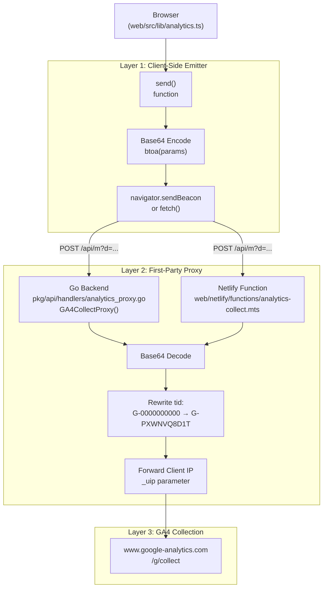
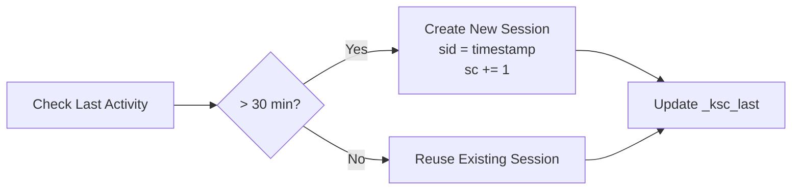
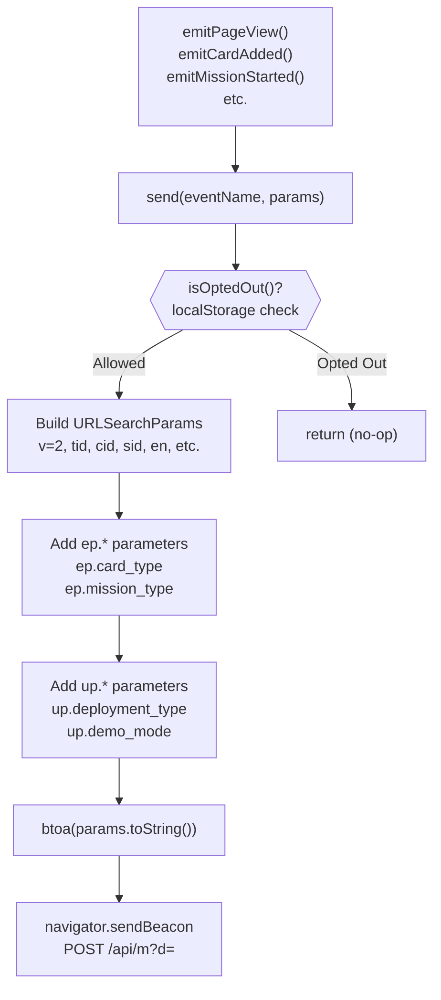
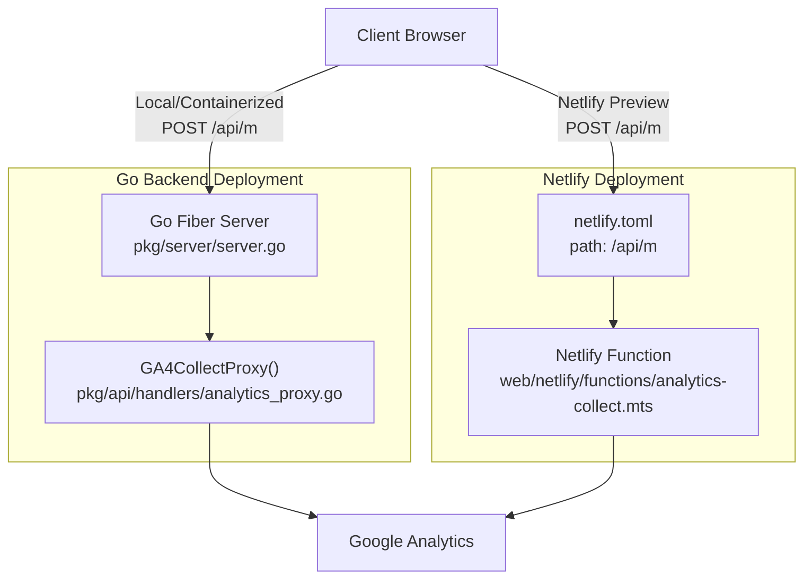
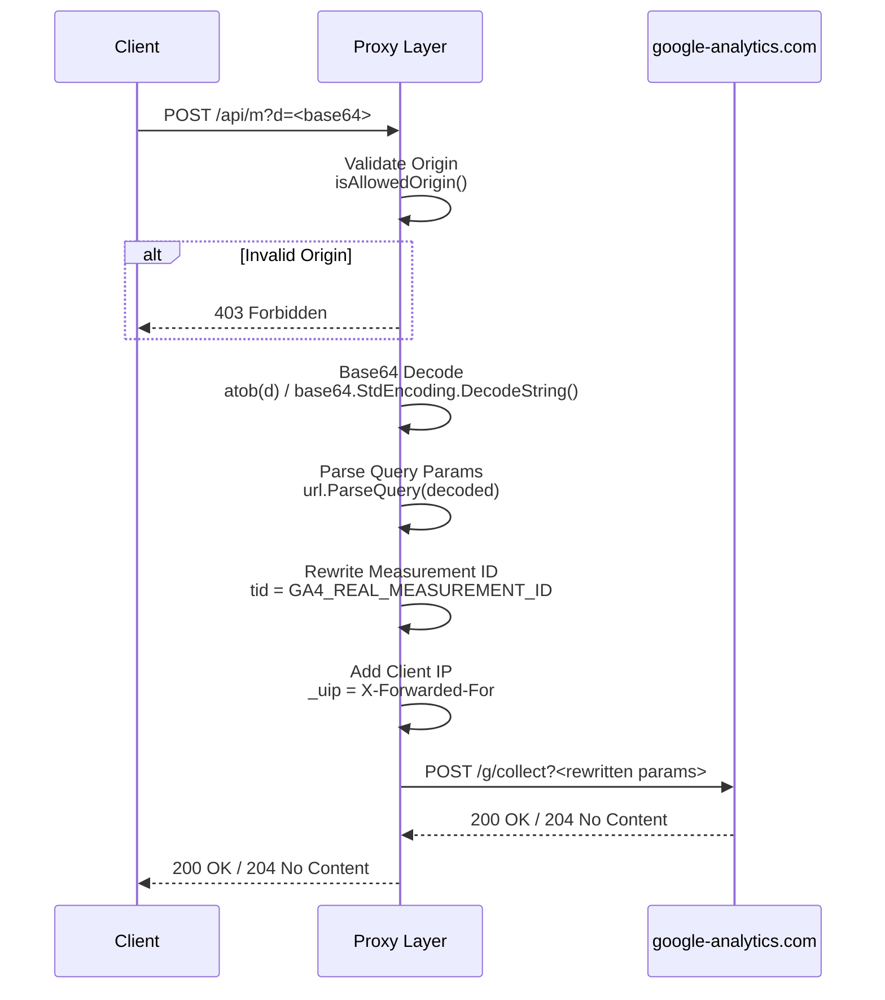
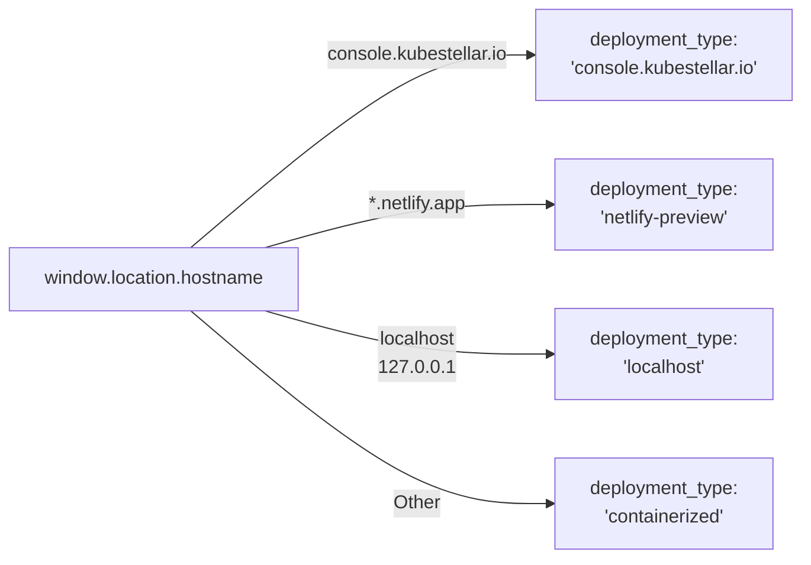
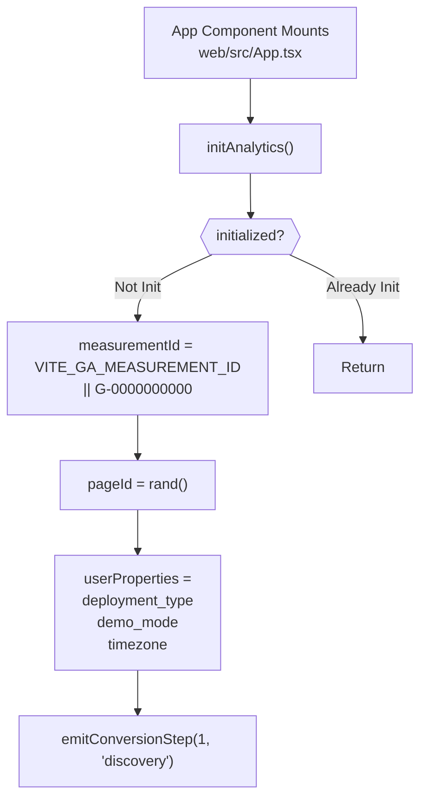

<!-- source: DeepWiki mcp.deepwiki.com · repo kubestellar/console · page 11.1 Analytics Architecture · fetched 2026-10-27 -->

# Analytics Architecture

<details>
<summary>Relevant source files</summary>

The following files were used as context for generating this wiki page:

- [.env.example](.env.example)
- [netlify.toml](netlify.toml)
- [pkg/api/handlers/analytics_proxy.go](pkg/api/handlers/analytics_proxy.go)
- [web/netlify/functions/analytics-collect.mts](web/netlify/functions/analytics-collect.mts)
- [web/package-lock.json](web/package-lock.json)
- [web/package.json](web/package.json)
- [web/src/components/agent/APIKeySettings.tsx](web/src/components/agent/APIKeySettings.tsx)
- [web/src/hooks/useLocalAgent.ts](web/src/hooks/useLocalAgent.ts)
- [web/src/lib/analytics.ts](web/src/lib/analytics.ts)
- [web/vite.config.ts](web/vite.config.ts)

</details>


This document details the analytics system's implementation, which is designed to bypass ad blockers while maintaining user privacy. The system uses a three-layer architecture: a client-side event emitter, a first-party proxy, and Google Analytics 4 (GA4) as the collection endpoint.

For general privacy settings and opt-out mechanisms, see [Privacy & Opt-Out](#11.3). For the specific events tracked throughout the user journey, see [Event Tracking](#11.2).

---

## Purpose and Design Goals

The analytics system addresses three primary challenges:

1. **Ad Blocker Evasion**: Traditional analytics libraries (gtag.js, analytics.js) are blocked by content-based and domain-based filters. The system avoids external scripts entirely and uses a first-party proxy path.

2. **Privacy Preservation**: User identities are anonymized via SHA-256 hashing, and users can opt out completely via `localStorage`.

3. **Source Code Security**: The measurement ID visible in source code is a decoy (`G-0000000000`). The real ID is stored server-side and rewritten by the proxy.

**Sources**: [web/src/lib/analytics.ts:1-11](), [pkg/api/handlers/analytics_proxy.go:43-47]()

---

## Three-Layer Anti-Blocking Architecture

The system implements a defense-in-depth strategy to ensure analytics collection even when multiple blocking mechanisms are active:



**Layer 1 (Client)**: Events are collected and encoded client-side without loading any external scripts. This defeats content-based blockers that scan for `gtag.js`, `analytics.js`, or similar files.

**Layer 2 (Proxy)**: Requests go to `/api/m`, a first-party path on the same domain. This bypasses domain-based filters that block `*.google-analytics.com`. The proxy decodes the base64 payload and rewrites the measurement ID.

**Layer 3 (GA4)**: The proxy forwards sanitized requests to Google's collection endpoint with the correct measurement ID and user's real IP for geolocation.

**Sources**: [web/src/lib/analytics.ts:90-153](), [pkg/api/handlers/analytics_proxy.go:48-120](), [web/netlify/functions/analytics-collect.mts:41-119]()

---

## Client-Side Implementation

### Core State Management

The client maintains persistent identifiers across sessions:

| Identifier | Storage Key | Purpose | Lifecycle |
|------------|-------------|---------|-----------|
| Client ID | `_ksc_cid` | Unique user identifier | Persistent (until cache clear) |
| Session ID | `_ksc_sid` | Current session | 30-minute timeout |
| Session Count | `_ksc_sc` | Number of sessions | Increments on new session |
| Last Activity | `_ksc_last` | Timestamp of last event | Updates on every event |

**Sources**: [web/src/lib/analytics.ts:20-24]()

### Session Management

Sessions use a 30-minute timeout with automatic renewal:



The `getSession()` function handles this logic:

```typescript
// web/src/lib/analytics.ts:64-79
function getSession(): { sid: string; sc: number; isNew: boolean } {
  const now = Date.now()
  const lastActivity = Number(localStorage.getItem(LAST_KEY) || '0')
  let sid = localStorage.getItem(SID_KEY) || ''
  let sc = Number(localStorage.getItem(SC_KEY) || '0')
  const expired = !sid || (now - lastActivity > SESSION_TIMEOUT_MS)

  if (expired) {
    sid = Math.floor(now / 1000).toString()
    sc += 1
    localStorage.setItem(SID_KEY, sid)
    localStorage.setItem(SC_KEY, String(sc))
  }
  localStorage.setItem(LAST_KEY, String(now))
  return { sid, sc, isNew: expired }
}
```

**Sources**: [web/src/lib/analytics.ts:53-79]()

### Event Emission

The `send()` function constructs GA4 Measurement Protocol v2 payloads:



Key parameters in the payload:

- `v=2`: Measurement Protocol version
- `tid`: Measurement ID (decoy in client, rewritten by proxy)
- `cid`: Client ID from `_ksc_cid`
- `sid`: Session ID
- `en`: Event name (e.g., `page_view`, `ksc_card_added`)
- `ep.*`: Event parameters (string values)
- `epn.*`: Event parameters (numeric values)
- `up.*`: User properties (persistent across events)

**Sources**: [web/src/lib/analytics.ts:90-153]()

### Base64 Encoding

The payload is base64-encoded to prevent network-level filters from matching on GA4 parameter patterns:

```typescript
// web/src/lib/analytics.ts:143-146
const encoded = btoa(p.toString())
const url = `${PROXY_PATH}?d=${encodeURIComponent(encoded)}`
```

Example transformation:

```
Before: /api/m?v=2&tid=G-0000000000&cid=123456789.1234567890&en=page_view
After:  /api/m?d=dj0yJnRpZD1HLTAwMDAwMDAwMDAmY2lkPTEyMzQ1Njc4OS4xMjM0NTY3ODkwJmVuPXBhZ2Vfdmlldw%3D%3D
```

Ad blockers that scan for patterns like `tid=G-*` or `en=` in URLs will not match.

**Sources**: [web/src/lib/analytics.ts:143-152]()

---

## Proxy Layer Implementation

### Dual Deployment Architecture

The proxy is implemented twice to support different deployment modes:



**Sources**: [pkg/api/handlers/analytics_proxy.go:1-156](), [web/netlify/functions/analytics-collect.mts:1-124](), [netlify.toml:1-76]()

### Request Processing Flow

Both proxy implementations follow the same sequence:



**Sources**: [pkg/api/handlers/analytics_proxy.go:48-120](), [web/netlify/functions/analytics-collect.mts:41-119]()

### Origin Validation

The proxy restricts which hostnames can send analytics:

| Hostname | Purpose |
|----------|---------|
| `localhost`, `127.0.0.1` | Local development |
| `console.kubestellar.io` | Production domain |
| `*.netlify.app` | PR preview deployments |

```go
// pkg/api/handlers/analytics_proxy.go:19-23
var allowedOrigins = map[string]bool{
	"localhost":               true,
	"127.0.0.1":              true,
	"console.kubestellar.io": true,
}
```

The `isAllowedOrigin()` function checks both `Origin` and `Referer` headers, and also allows requests with neither header (server-to-server or curl).

**Sources**: [pkg/api/handlers/analytics_proxy.go:122-147]()

### Measurement ID Rewriting

The decoy measurement ID (`G-0000000000`) is replaced with the real ID:

```go
// pkg/api/handlers/analytics_proxy.go:55-58
realMeasurementID := os.Getenv("GA4_REAL_MEASUREMENT_ID")
if realMeasurementID == "" {
	realMeasurementID = "G-PXWNVQ8D1T"
}
```

```go
// pkg/api/handlers/analytics_proxy.go:88-93
if realMeasurementID != "" && params.Get("tid") != "" {
	params.Set("tid", realMeasurementID)
}
```

Spammers who scrape the source code and find `G-0000000000` will send hits to a non-existent GA4 property, keeping the real property clean.

**Sources**: [pkg/api/handlers/analytics_proxy.go:55-97](), [.env.example:65-70]()

### IP Forwarding for Geolocation

GA4 requires the user's real IP address for accurate geolocation. The proxy extracts it from standard headers:

```go
// pkg/api/handlers/analytics_proxy.go:74-86
clientIP := c.Get("X-Forwarded-For")
if clientIP != "" {
	if i := strings.Index(clientIP, ","); i != -1 {
		clientIP = strings.TrimSpace(clientIP[:i])
	}
}
if clientIP == "" {
	clientIP = c.Get("X-Real-Ip")
}
if clientIP == "" {
	clientIP = c.IP()
}
```

The IP is then added to the GA4 request as the `_uip` parameter:

```go
// pkg/api/handlers/analytics_proxy.go:88-96
params, err := url.ParseQuery(qs)
if err == nil {
	if realMeasurementID != "" && params.Get("tid") != "" {
		params.Set("tid", realMeasurementID)
	}
	if clientIP != "" {
		params.Set("_uip", clientIP)
	}
	qs = params.Encode()
}
```

**Sources**: [pkg/api/handlers/analytics_proxy.go:74-96]()

---

## Privacy and Security

### Anonymous User IDs

User IDs are SHA-256 hashed before transmission:

```typescript
// web/src/lib/analytics.ts:179-185
async function hashUserId(uid: string): Promise<string> {
  const data = new TextEncoder().encode(`ksc-analytics:${uid}`)
  const hash = await crypto.subtle.digest('SHA-256', data)
  return Array.from(new Uint8Array(hash))
    .map(b => b.toString(16).padStart(2, '0'))
    .join('')
}
```

Example:
- Input: `user@example.com`
- Output: `a1b2c3d4e5f6...` (64-character hex string)

The hash is irreversible and provides anonymity while allowing session tracking.

**Sources**: [web/src/lib/analytics.ts:179-185]()

### Opt-Out Mechanism

Users can disable analytics via the Settings modal. The opt-out state is stored in `localStorage`:

```typescript
// web/src/lib/analytics.ts:198-213
export function setAnalyticsOptOut(optOut: boolean) {
  localStorage.setItem(STORAGE_KEY_ANALYTICS_OPT_OUT, String(optOut))
  window.dispatchEvent(new CustomEvent('kubestellar-settings-changed'))
  if (optOut) {
    // Clear all analytics cookies and localStorage keys
    document.cookie.split(';').forEach(c => {
      const name = c.split('=')[0].trim()
      if (name.startsWith('_ga') || name.startsWith('_ksc')) {
        document.cookie = `${name}=;expires=Thu, 01 Jan 1970 00:00:00 GMT;path=/`
      }
    })
    localStorage.removeItem(CID_KEY)
    localStorage.removeItem(SID_KEY)
    localStorage.removeItem(SC_KEY)
    localStorage.removeItem(LAST_KEY)
  }
}
```

When opted out, the `send()` function becomes a no-op:

```typescript
// web/src/lib/analytics.ts:94
if (!initialized || isOptedOut()) return
```

**Sources**: [web/src/lib/analytics.ts:37-39](), [web/src/lib/analytics.ts:198-217]()

### Decoy Measurement ID

The measurement ID visible in source code is intentionally fake:

```typescript
// web/src/lib/analytics.ts:16-17
const GA_MEASUREMENT_ID = 'G-0000000000'
```

This ID is used as a placeholder during development and is rewritten by the proxy at runtime. Bots that scrape source code and spam the ID will send hits to a non-existent property.

**Sources**: [web/src/lib/analytics.ts:16-17](), [pkg/api/handlers/analytics_proxy.go:55-58]()

---

## Deployment Type Detection

The system automatically detects the deployment environment and includes it in user properties:



```typescript
// web/src/lib/analytics.ts:41-47
function getDeploymentType(): DeploymentType {
  const h = window.location.hostname
  if (h === 'console.kubestellar.io') return 'console.kubestellar.io'
  if (h.includes('netlify.app')) return 'netlify-preview'
  if (h === 'localhost' || h === '127.0.0.1') return 'localhost'
  return 'containerized'
}
```

This property is set during initialization:

```typescript
// web/src/lib/analytics.ts:164-171
const deploymentType = getDeploymentType()
let tz = ''
try { tz = Intl.DateTimeFormat().resolvedOptions().timeZone } catch { /* ignore */ }
userProperties = {
  deployment_type: deploymentType,
  demo_mode: String(isDemoMode()),
  ...(tz && { timezone: tz }),
}
```

**Sources**: [web/src/lib/analytics.ts:41-47](), [web/src/lib/analytics.ts:164-171]()

---

## Initialization and Lifecycle

### Initialization Flow



**Sources**: [web/src/lib/analytics.ts:157-175]()

### Integration with User Authentication

When a user logs in, their ID is hashed and set:

```typescript
// Example from login flow (web/src/components/agent/APIKeySettings.tsx:8)
import { emitApiKeyConfigured, emitConversionStep } from '../../lib/analytics'

// After successful login
await setAnalyticsUserId(user.id)
emitConversionStep(2, 'login', { method: 'github' })
```

**Sources**: [web/src/lib/analytics.ts:187-190]()

### Integration with kc-agent Connection

When the local agent connects, analytics tracks it:

```typescript
// web/src/hooks/useLocalAgent.ts:4
import { emitAgentConnected, emitAgentDisconnected, emitConversionStep } from '../lib/analytics'

// On connection
emitAgentConnected(data.version || 'unknown', data.clusters || 0)
emitConversionStep(3, 'agent', { agent_version: data.version || 'unknown' })

// On cluster detection
if ((data.clusters || 0) > 0) {
  emitConversionStep(4, 'clusters', { cluster_count: String(data.clusters) })
}
```

**Sources**: [web/src/hooks/useLocalAgent.ts:225-239]()

---

## Configuration

### Environment Variables

| Variable | Purpose | Default | Required |
|----------|---------|---------|----------|
| `VITE_GA_MEASUREMENT_ID` | Measurement ID (client-side) | `G-0000000000` | No |
| `GA4_REAL_MEASUREMENT_ID` | Real measurement ID (server-side) | `G-PXWNVQ8D1T` | No |

**Development Setup**:

```bash
# .env file for local development
VITE_GA_MEASUREMENT_ID=G-0000000000
GA4_REAL_MEASUREMENT_ID=G-PXWNVQ8D1T
```

**Production Setup (Netlify)**:

```bash
# Netlify Environment Variables (Dashboard → Site Settings → Environment Variables)
GA4_REAL_MEASUREMENT_ID=G-PXWNVQ8D1T
```

**Production Setup (Go Backend)**:

```bash
# Docker/Helm environment variables
export GA4_REAL_MEASUREMENT_ID=G-PXWNVQ8D1T
./console-server
```

**Sources**: [.env.example:65-70](), [web/vite.config.ts:1-191]()

### Vite Build Configuration

The measurement ID is injected at build time:

```typescript
// web/vite.config.ts:158
measurementId = (import.meta.env.VITE_GA_MEASUREMENT_ID as string | undefined) || GA_MEASUREMENT_ID
```

**Sources**: [web/vite.config.ts:158]()

### Netlify Function Path Mapping

The Netlify Function is mounted at `/api/m`:

```typescript
// web/netlify/functions/analytics-collect.mts:121-123
export const config: Config = {
  path: "/api/m",
};
```

**Sources**: [web/netlify/functions/analytics-collect.mts:121-123]()

### Go Server Route Registration

The Go backend registers the proxy route:

```go
// pkg/server/server.go (route registration)
app.Post("/api/m", handlers.GA4CollectProxy)
```

**Sources**: [pkg/api/handlers/analytics_proxy.go:48-120]()

---

## Summary of Anti-Blocking Techniques

| Technique | Traditional Analytics | KubeStellar Console |
|-----------|----------------------|---------------------|
| External Scripts | ❌ gtag.js loaded from googletagmanager.com | ✅ No external scripts (inline implementation) |
| Collection Domain | ❌ Hits sent to google-analytics.com | ✅ Hits sent to same-origin /api/m |
| URL Parameters | ❌ Visible GA4 patterns (tid=G-*, en=) | ✅ Base64-encoded in single `d` parameter |
| Measurement ID | ❌ Real ID in source code | ✅ Decoy ID in source, real ID server-side |
| IP Address | ❌ Lost behind proxy | ✅ Forwarded via X-Forwarded-For |

This three-layer architecture ensures analytics collection works even with aggressive ad blocking enabled, while maintaining user privacy through anonymization and opt-out support.

**Sources**: [web/src/lib/analytics.ts:1-382](), [pkg/api/handlers/analytics_proxy.go:1-156](), [web/netlify/functions/analytics-collect.mts:1-124]()

---

