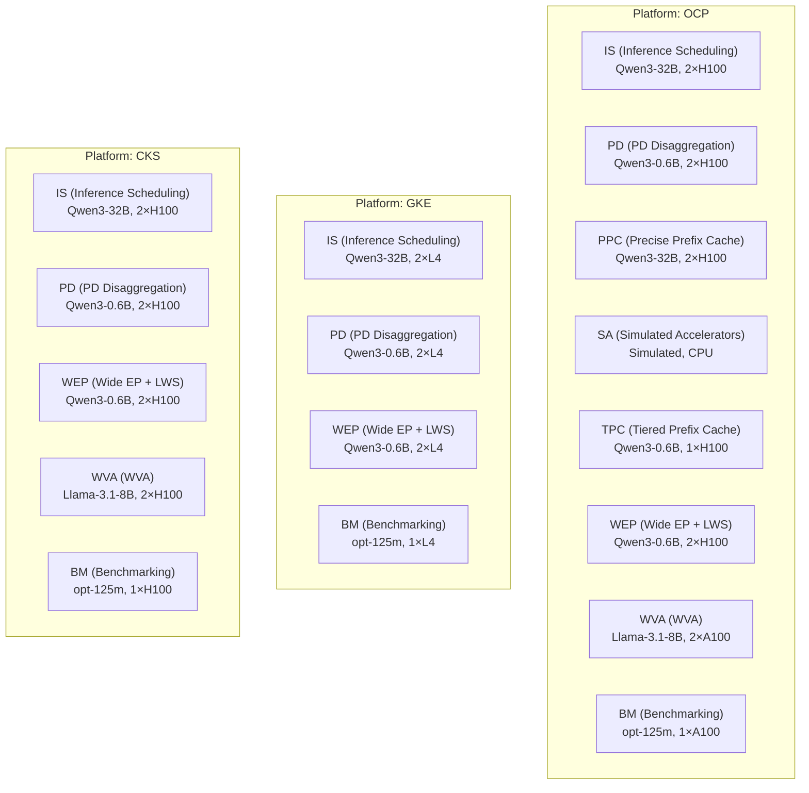
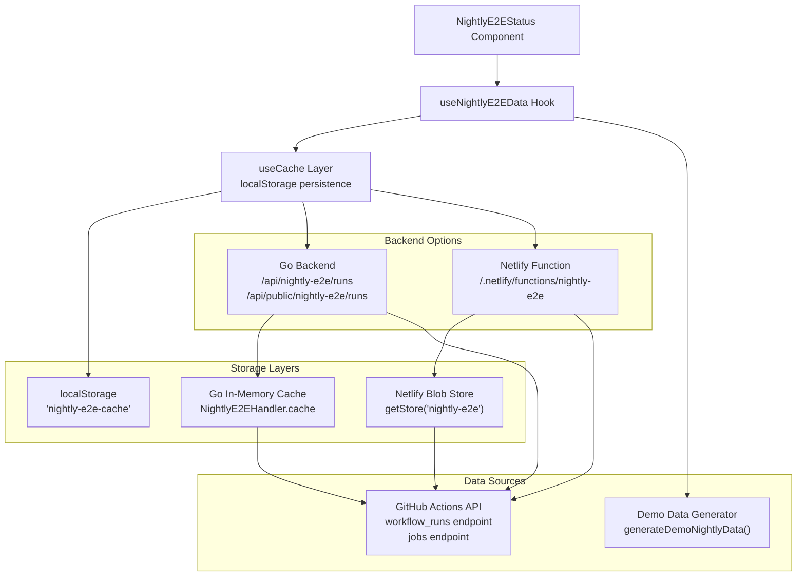
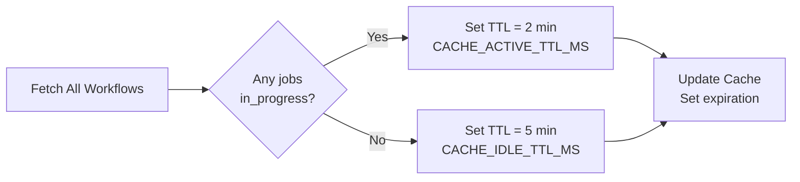
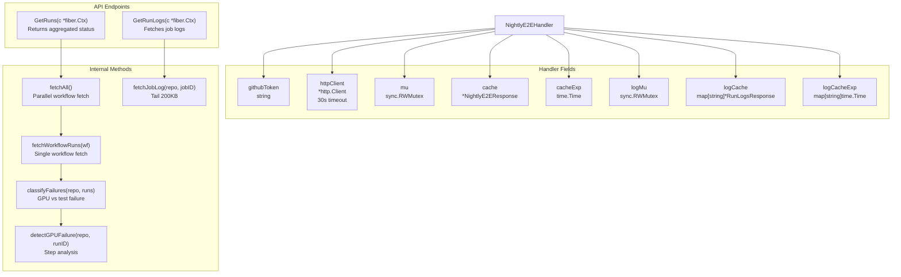
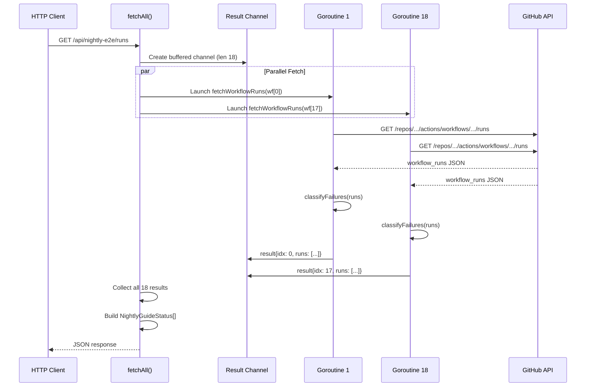
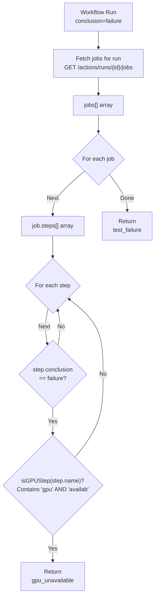
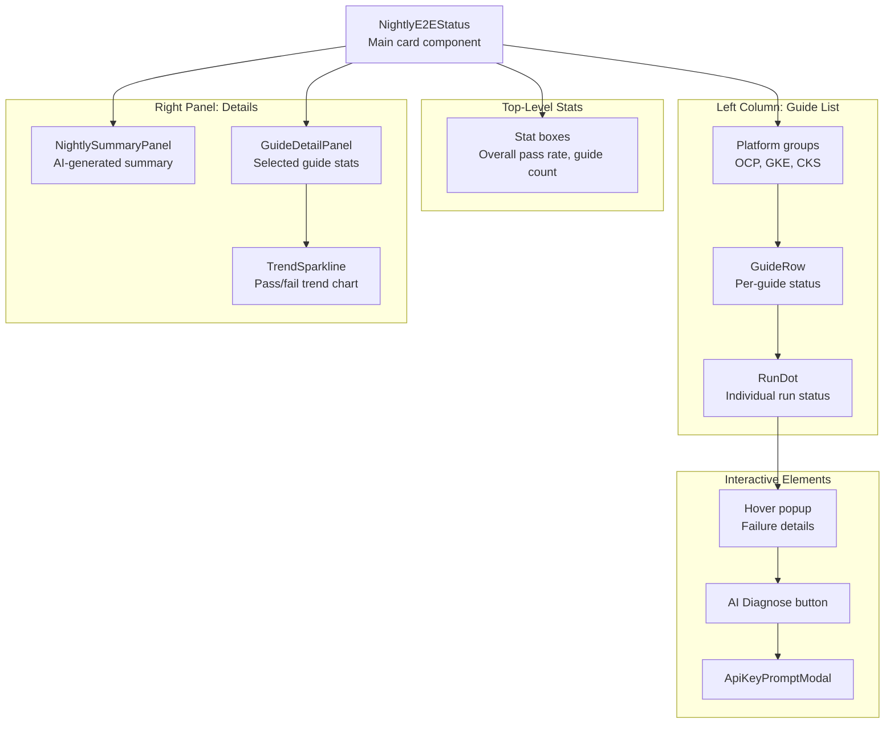
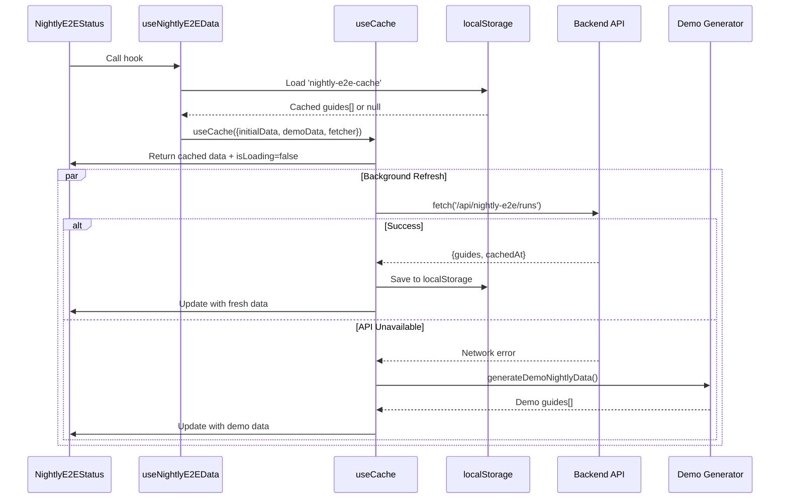
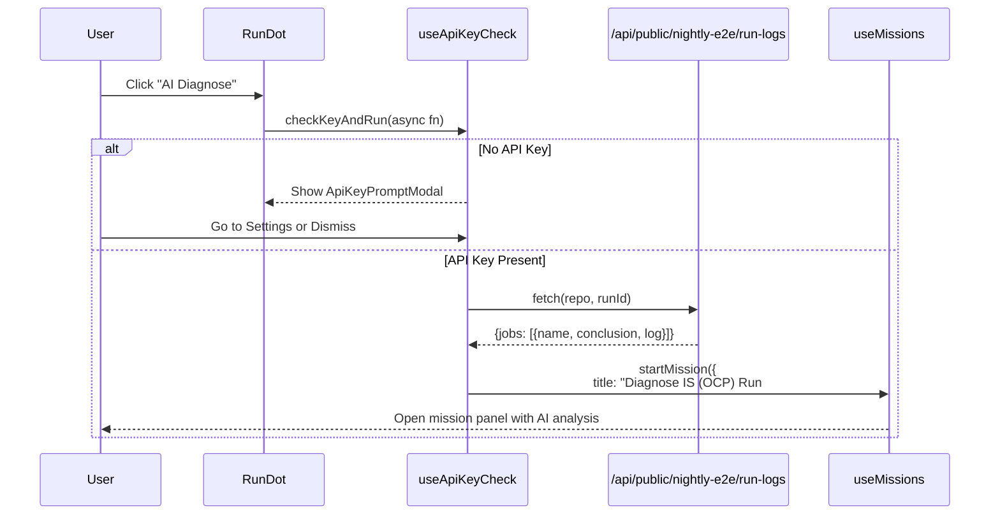
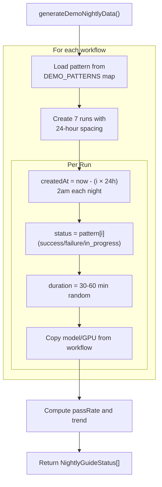

<!-- source: DeepWiki mcp.deepwiki.com · repo kubestellar/console · page 12 Nightly E2E Monitoring · fetched 2026-10-27 -->

# Nightly E2E Monitoring

<details>
<summary>Relevant source files</summary>

The following files were used as context for generating this wiki page:

- [pkg/api/handlers/nightly_e2e.go](pkg/api/handlers/nightly_e2e.go)
- [web/netlify/functions/nightly-e2e.mts](web/netlify/functions/nightly-e2e.mts)
- [web/src/components/cards/llmd/NightlyE2EStatus.tsx](web/src/components/cards/llmd/NightlyE2EStatus.tsx)
- [web/src/config/cards/nightly-e2e-status.ts](web/src/config/cards/nightly-e2e-status.ts)
- [web/src/hooks/useNightlyE2EData.ts](web/src/hooks/useNightlyE2EData.ts)
- [web/src/lib/llmd/nightlyE2EDemoData.ts](web/src/lib/llmd/nightlyE2EDemoData.ts)

</details>


## Purpose and Scope

The Nightly E2E Monitoring system tracks the health of end-to-end workflow runs from GitHub Actions for the `llm-d` project. It monitors 18 workflows across three Kubernetes platforms (OCP, GKE, CKS), provides pass/fail history visualization, classifies failure causes (GPU unavailability vs. test failures), and offers AI-powered diagnosis of failed runs.

This system is specific to llm-d project monitoring. For general CI/CD automation workflows in the KubeStellar Console itself, see [CI/CD Automation System](#7). For analytics tracking of user interactions, see [Analytics System](#11).

---

## Monitored Workflows

The system tracks 18 nightly E2E workflows across three platforms, with each workflow corresponding to a specific llm-d guide. Workflows are defined in both the Go backend and TypeScript implementations to ensure consistency.

### Workflow Configuration Structure



Each workflow definition includes:

| Field | Description | Example |
|-------|-------------|---------|
| `repo` | GitHub repository | `"llm-d/llm-d"` |
| `workflowFile` | YAML filename in `.github/workflows/` | `"nightly-e2e-inference-scheduling-ocp.yaml"` |
| `guide` | Human-readable guide name | `"Inference Scheduling"` |
| `acronym` | Short identifier for UI display | `"IS"` |
| `platform` | Kubernetes platform | `"OCP"`, `"GKE"`, or `"CKS"` |
| `model` | LLM model being tested | `"Qwen3-32B"`, `"Llama-3.1-8B"` |
| `gpuType` | GPU hardware type | `"H100"`, `"A100"`, `"L4"`, `"CPU"` |
| `gpuCount` | Number of GPUs required | `0`, `1`, or `2` |

Sources: [pkg/api/handlers/nightly_e2e.go:111-132](), [web/src/lib/llmd/nightlyE2EDemoData.ts:49-70](), [web/netlify/functions/nightly-e2e.mts:75-96]()

---

## System Architecture

### Data Flow Overview



The system implements a **three-tier fallback strategy**:

1. **Primary**: Fetch from backend API (`/api/nightly-e2e/runs` with auth, then `/api/public/nightly-e2e/runs` fallback)
2. **Cache**: Use localStorage-persisted data from previous successful fetch
3. **Demo Mode**: Generate realistic mock data when backend is unavailable

Sources: [web/src/hooks/useNightlyE2EData.ts:61-162](), [pkg/api/handlers/nightly_e2e.go:95-107]()

### Cache TTL Strategy

The system uses **adaptive cache TTL** based on job status:

| Condition | TTL | Rationale |
|-----------|-----|-----------|
| Jobs in progress | 2 minutes | Frequent updates needed during active runs |
| All jobs idle | 5 minutes | Reduce API calls when no activity |



The `hasInProgressRuns()` function scans all guide runs for `status === "in_progress"` to determine which TTL to apply.

Sources: [pkg/api/handlers/nightly_e2e.go:17-18](), [pkg/api/handlers/nightly_e2e.go:607-616](), [web/netlify/functions/nightly-e2e.mts:15-16](), [web/netlify/functions/nightly-e2e.mts:130-134]()

---

## Backend Implementation

### Go Handler Structure

The `NightlyE2EHandler` manages GitHub API integration with concurrent fetching and failure classification.



### Concurrent Fetching Pattern

The backend fetches all 18 workflows in parallel using goroutines with a result collection channel:



This pattern ensures that slow workflows (404s, network delays) don't block fast ones. Each goroutine writes its result to the channel independently.

Sources: [pkg/api/handlers/nightly_e2e.go:198-259]()

### GitHub API Integration

The handler makes authenticated requests to three GitHub API endpoints:

| Endpoint | Purpose | Response Fields |
|----------|---------|----------------|
| `/repos/{repo}/actions/workflows/{file}/runs` | List recent runs | `id`, `status`, `conclusion`, `created_at`, `updated_at`, `run_number` |
| `/repos/{repo}/actions/runs/{runId}/jobs` | List jobs for failure classification | `jobs[].steps[].name`, `jobs[].steps[].conclusion` |
| `/repos/{repo}/actions/jobs/{jobId}/logs` | Fetch plain-text logs | Raw log output (text/plain) |

The GitHub token is passed via `Authorization: Bearer {token}` header. On Netlify deployments, the token is stored as an environment variable accessible only to serverless functions (never exposed to client).

Sources: [pkg/api/handlers/nightly_e2e.go:261-330](), [pkg/api/handlers/nightly_e2e.go:349-394](), [pkg/api/handlers/nightly_e2e.go:508-556]()

---

## Failure Classification

### GPU Unavailability Detection

The system distinguishes between two failure types to provide actionable intelligence:

1. **GPU Unavailable** (`gpu_unavailable`): Infrastructure issue, not a test regression
2. **Test Failure** (`test_failure`): Actual test failure requiring investigation



The `isGPUStep()` function checks if a step name contains both "gpu" and "availab" (case-insensitive), matching step names like:
- "Check GPU Availability"
- "Wait for GPU resources"
- "Verify GPU node available"

This classification enables the UI to display amber dots for infrastructure issues vs. red dots for test regressions.

Sources: [pkg/api/handlers/nightly_e2e.go:333-394](), [pkg/api/handlers/nightly_e2e.go:396-400]()

---

## Frontend Implementation

### Component Hierarchy



### Data Hook Flow

The `useNightlyE2EData` hook implements a layered fetch strategy with localStorage persistence:



The hook uses `loadCachedData()` at module level to provide synchronous initial data, avoiding loading states when localStorage contains recent data.

Sources: [web/src/hooks/useNightlyE2EData.ts:34-59](), [web/src/hooks/useNightlyE2EData.ts:61-162]()

### Run Status Visualization

Each workflow run is displayed as a colored dot with status-based styling:

| Status | Conclusion | Color | Visual Effect | Meaning |
|--------|-----------|-------|---------------|---------|
| `in_progress` | - | Blue (`bg-blue-400`) | Pulsing animation | Currently running |
| `completed` | `success` | Green (`bg-emerald-400`) | Static | Passed |
| `completed` | `failure` + `gpu_unavailable` | Amber (`bg-amber-400`) | Static | GPU unavailable |
| `completed` | `failure` | Red (`bg-red-400`) | Static | Test failed |
| `completed` | `cancelled` | Slate (`bg-slate-500`) | Static | Manually cancelled |

The `RunDot` component handles hover interactions, showing a popup with failure details and an "AI Diagnose" button for failed runs.

Sources: [web/src/components/cards/llmd/NightlyE2EStatus.tsx:69-251]()

### AI Summary Generation

The `generateNightlySummary()` function produces two-paragraph summaries using pattern detection:

**Paragraph 1: Overall Health**
- Total active guides and pass rate across platforms
- Per-platform breakdown (pass/fail counts, trending info)
- Infrastructure context (models tested, GPU types, average duration)
- GPU failure count (amber dots)

**Paragraph 2: Notable Patterns**
- Best performer (highest pass rate)
- Worst performer (0% with 3+ runs)
- Slowest guide (>1.5× average duration)
- Consecutive streaks (3+ passes/failures)
- Currently running guides

Example output:
> "Across 12 active guides, 10 are currently passing with an average pass rate of 87%. Tests average 42m to complete exercising 3 models (Qwen3-32B, Qwen3-0.6B, Llama-3.1-8B) across 18 H100/L4/A100 GPUs. OCP has 7/8 guides passing (avg 85%) with 1 trending upward. GKE is fully green with all 4 guides passing (avg 95%). 2 recent failures were due to GPU unavailability (shown in amber)."

Sources: [web/src/components/cards/llmd/NightlyE2EStatus.tsx:422-567]()

---

## AI Diagnosis Integration

### Triggering Diagnosis

When a user clicks "AI Diagnose" on a failed run, the system:

1. Checks for API key via `useApiKeyCheck()` hook
2. Fetches job logs from `/api/public/nightly-e2e/run-logs?repo={repo}&runId={id}`
3. Launches a mission via `startMission()` with enriched context



### Log Fetching for Diagnosis

The `/api/public/nightly-e2e/run-logs` endpoint fetches logs for all failed jobs in a run:

1. Query GitHub API for jobs list (`/actions/runs/{id}/jobs`)
2. Filter to jobs with `conclusion === "failure"`
3. Fetch logs concurrently (limit 5 parallel requests via semaphore)
4. Truncate each log to last 200KB (failure info is at tail)
5. Return JSON with job name, conclusion, and log text

The log cache persists for 10 minutes since logs are immutable once a run completes.

Sources: [pkg/api/handlers/nightly_e2e.go:405-504](), [web/src/components/cards/llmd/NightlyE2EStatus.tsx:136-194]()

### Mission Prompt Structure

The AI prompt includes structured context for accurate diagnosis:

```typescript
initialPrompt: `Analyze this failed nightly E2E workflow run and diagnose the root cause.

## Run Context
- Guide: ${guide.guide} (${guide.acronym}) on ${guide.platform}
- Repository: ${guide.repo}
- Workflow: ${guide.workflowFile}
- Run #: ${run.runNumber}
- Failure Reason: ${run.failureReason || 'unknown'}
- Model: ${run.model}, GPU: ${run.gpuCount}x ${run.gpuType}
- GitHub URL: ${run.htmlUrl}

## GitHub Actions Logs
${logsContent}

Please provide:
1. Root cause analysis
2. Classification (test flake, infra issue, GPU problem, code regression)
3. Suggested fix
4. Pattern detection (recurring issue?)`
```

This structured prompt enables the AI to provide actionable recommendations with proper context about the infrastructure environment.

Sources: [web/src/components/cards/llmd/NightlyE2EStatus.tsx:164-183]()

---

## Demo Mode Implementation

### Demo Data Generation

When the backend is unavailable (Netlify preview deployments without GitHub token, local dev without agent), the system generates realistic demo data:



Demo patterns are hardcoded to show realistic scenarios:
- **Stable guides**: All passes (e.g., "PD Disaggregation-OCP")
- **Flaky guides**: Mixed passes/failures (e.g., "WVA-OCP")
- **Regressed guides**: Recent failures (e.g., "Benchmarking-OCP")
- **Running jobs**: Latest run in `in_progress` state (e.g., "Wide EP + LWS-OCP")
- **New workflows**: Empty runs array (CKS platform, no data yet)

This ensures the UI renders correctly in preview deployments without requiring GitHub access.

Sources: [web/src/lib/llmd/nightlyE2EDemoData.ts:73-151]()

### Demo Mode Detection

The hook uses `isDemoFallback` to track whether demo data is being used:

```typescript
isDemoFallback: cacheResult.isLoading ? false : isDemo
```

The loading check prevents showing the "Demo" badge during cache hydration, which would be misleading when real cached data exists. The badge only appears after loading completes and demo data is confirmed as the source.

Sources: [web/src/hooks/useNightlyE2EData.ts:155]()

---

## Card Configuration

The card is registered in the unified card system with the following configuration:

```typescript
{
  type: 'nightly_e2e_status',
  title: 'Nightly E2E Status',
  category: 'ci-cd',
  description: 'llm-d nightly E2E workflow status across OCP and GKE platforms',
  icon: 'TestTube2',
  iconColor: 'text-emerald-400',
  defaultWidth: 12,    // Full width (12/12 grid columns)
  defaultHeight: 5,    // Tall card to show all platforms
  dataSource: { type: 'hook', hook: 'useNightlyE2EData' },
  content: { type: 'custom', component: 'NightlyE2EStatusView' },
  emptyState: { 
    icon: 'TestTube2', 
    title: 'No E2E Data', 
    message: 'Configure a GitHub token to see nightly E2E status', 
    variant: 'info' 
  },
  loadingState: { type: 'custom' },
  isDemoData: false,
  isLive: true,
}
```

The card uses a custom loading state that shows skeleton rows for guide entries and stats boxes, maintaining the expected layout during data fetch.

Sources: [web/src/config/cards/nightly-e2e-status.ts:1-23]()

---

## Deployment Variations

### Go Backend Deployment

Standard deployment using the Go Fiber server:

- **Endpoint**: `/api/nightly-e2e/runs` (authenticated), `/api/public/nightly-e2e/runs` (public fallback)
- **Cache**: In-memory `sync.RWMutex`-protected map
- **Token**: Read from `GITHUB_TOKEN` environment variable at startup
- **Prewarm**: Background goroutine populates cache on handler initialization

### Netlify Serverless Deployment

Edge deployment using Netlify Functions:

- **Endpoint**: `/.netlify/functions/nightly-e2e`
- **Cache**: Netlify Blob Store (`getStore('nightly-e2e')`)
- **Token**: Read from `process.env.GITHUB_TOKEN` (runtime only, Functions scope)
- **Cold Start**: First request triggers full fetch, subsequent requests use blob cache

Both implementations share identical logic for workflow fetching, failure classification, and trend computation, with only the cache storage mechanism differing.

Sources: [pkg/api/handlers/nightly_e2e.go:95-196](), [web/netlify/functions/nightly-e2e.mts:279-357]()

---

