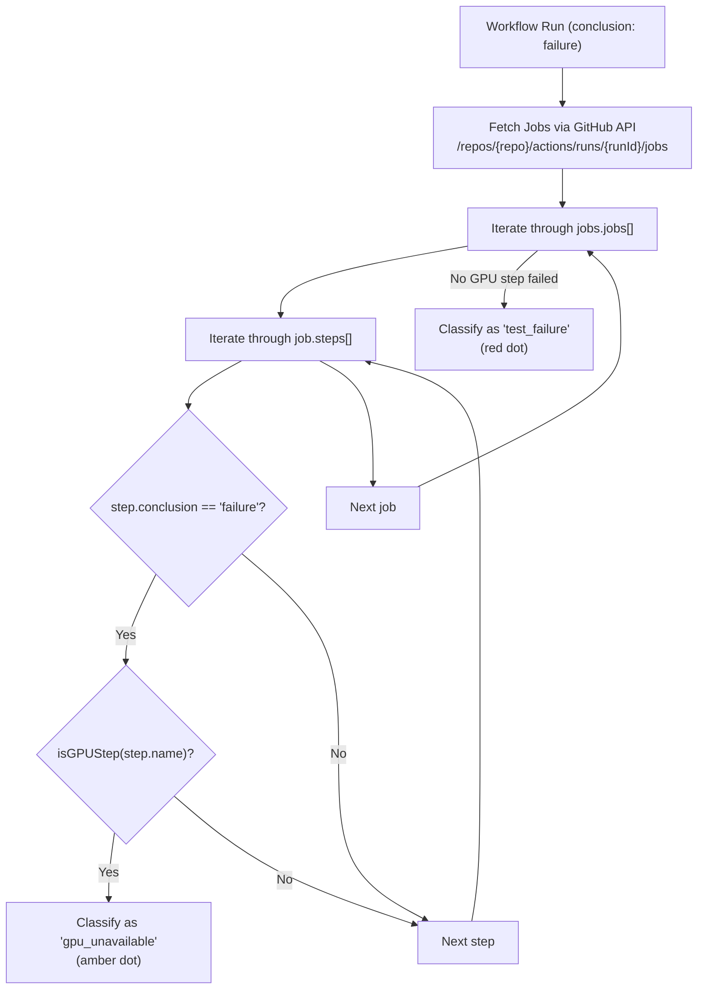
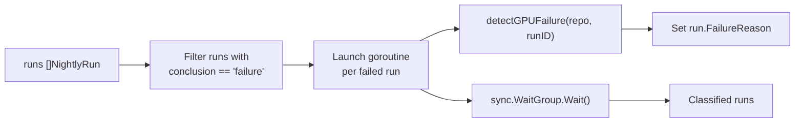
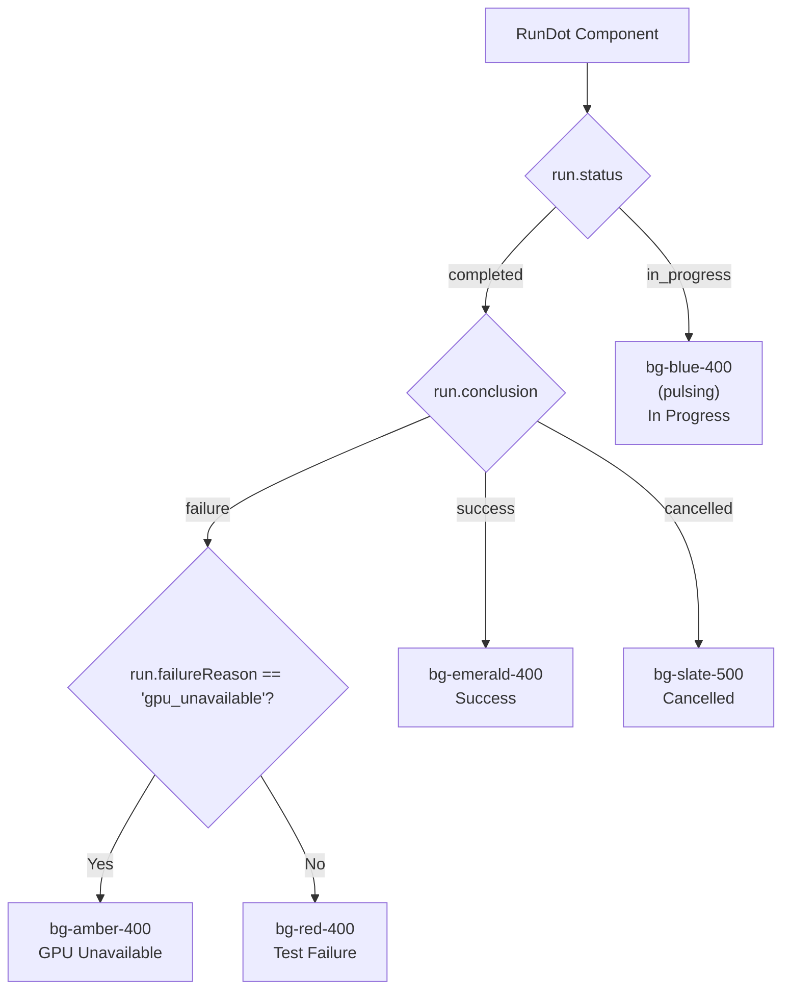
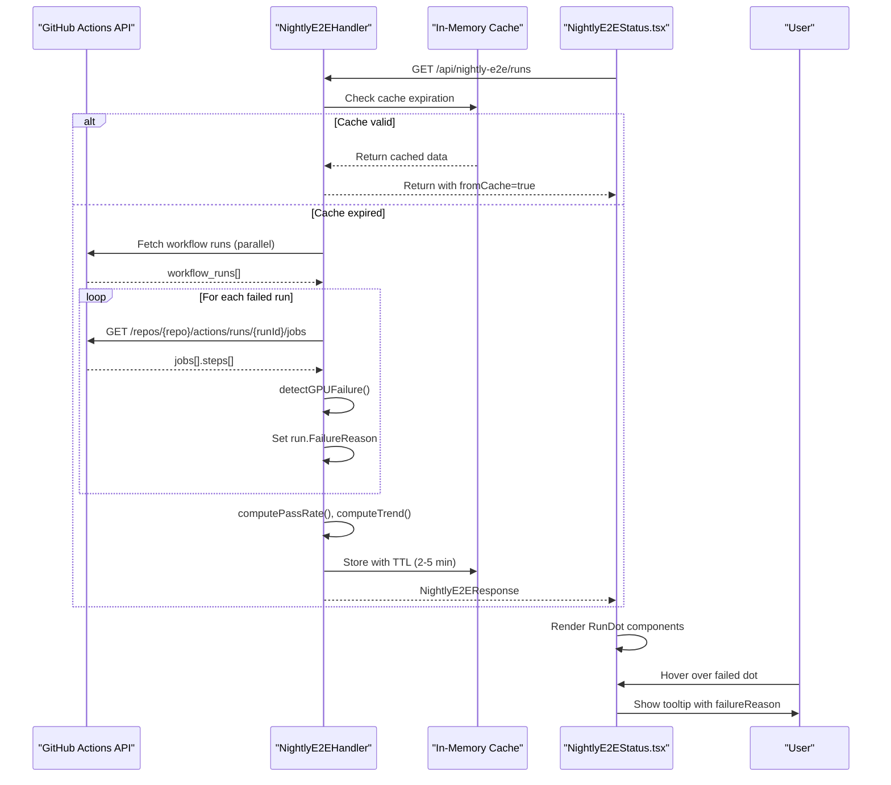

<!-- source: DeepWiki mcp.deepwiki.com · repo kubestellar/console · page 12.2 Failure Detection & Classification · fetched 2026-10-27 -->

# Failure Detection & Classification

<details>
<summary>Relevant source files</summary>

The following files were used as context for generating this wiki page:

- [pkg/api/handlers/nightly_e2e.go](pkg/api/handlers/nightly_e2e.go)
- [web/netlify/functions/nightly-e2e.mts](web/netlify/functions/nightly-e2e.mts)
- [web/src/components/cards/llmd/NightlyE2EStatus.tsx](web/src/components/cards/llmd/NightlyE2EStatus.tsx)
- [web/src/config/cards/nightly-e2e-status.ts](web/src/config/cards/nightly-e2e-status.ts)
- [web/src/hooks/useNightlyE2EData.ts](web/src/hooks/useNightlyE2EData.ts)
- [web/src/lib/llmd/nightlyE2EDemoData.ts](web/src/lib/llmd/nightlyE2EDemoData.ts)

</details>


## Purpose

This document describes the system for detecting and classifying failures in nightly E2E workflow runs. The primary goal is to distinguish between **infrastructure failures** (GPU unavailability) and **actual test failures**, enabling operators to quickly identify systemic infrastructure issues versus code regressions.

GPU-related failures are displayed in amber and tracked separately from red test failures, allowing the monitoring system to answer: "Is this a cluster capacity problem or a test problem?"

For the broader nightly E2E monitoring system architecture, see [Nightly E2E Monitoring](#12). For AI-powered diagnosis of failures, see [AI Diagnosis Integration](#12.3).

---

## Classification Strategy

The system classifies each failed workflow run into one of two categories:

| Failure Type | Constant | Display Color | Meaning |
|-------------|----------|---------------|---------|
| GPU Unavailable | `gpu_unavailable` | Amber | Infrastructure failure - GPU nodes not available in cluster |
| Test Failure | `test_failure` | Red | Actual test failure - code or configuration issue |

Classification occurs by inspecting the GitHub Actions job logs to determine which step failed. If a step containing both "gpu" and "availab" in its name failed, the run is classified as a GPU availability issue. Otherwise, it is classified as a test failure.

**Sources:** [pkg/api/handlers/nightly_e2e.go:22-23](), [pkg/api/handlers/nightly_e2e.go:396-400]()

---

## Classification Decision Flow



**Sources:** [pkg/api/handlers/nightly_e2e.go:332-394]()

---

## Backend Implementation

### NightlyE2EHandler.classifyFailures

The `classifyFailures` method in the Go backend handler processes all failed runs concurrently:



The handler uses a `sync.WaitGroup` to classify all failed runs in parallel, minimizing API latency.

**Sources:** [pkg/api/handlers/nightly_e2e.go:332-346]()

### NightlyE2EHandler.detectGPUFailure

This method performs the actual classification logic:

```go
// Pseudocode representation
func detectGPUFailure(repo string, runID int64) string {
    // 1. Fetch jobs for the run
    GET /repos/{repo}/actions/runs/{runID}/jobs
    
    // 2. Iterate through all jobs and steps
    for each job in jobData.Jobs {
        for each step in job.Steps {
            // 3. Check if step failed and is GPU-related
            if step.Conclusion == "failure" && isGPUStep(step.Name) {
                return "gpu_unavailable"
            }
        }
    }
    
    // 4. Default to test failure if no GPU step failed
    return "test_failure"
}
```

**Sources:** [pkg/api/handlers/nightly_e2e.go:348-394]()

### isGPUStep Pattern Matching

The `isGPUStep` function uses simple string matching to identify GPU availability check steps:

```go
func isGPUStep(name string) bool {
    lower := strings.ToLower(name)
    return strings.Contains(lower, "gpu") && strings.Contains(lower, "availab")
}
```

This matches common step names like:
- "Check GPU Availability"
- "Wait for GPU availability"
- "Verify GPU resources available"

**Sources:** [pkg/api/handlers/nightly_e2e.go:396-400]()

---

## Data Structure

### NightlyRun Type

Each workflow run includes a `FailureReason` field populated by the classification logic:

| Field | Type | Description |
|-------|------|-------------|
| `ID` | `int64` | GitHub run ID |
| `Status` | `string` | `"completed"` or `"in_progress"` |
| `Conclusion` | `*string` | `"success"`, `"failure"`, `"cancelled"`, etc. |
| `FailureReason` | `string` | `"gpu_unavailable"`, `"test_failure"`, or empty |
| `Model` | `string` | LLM model being tested |
| `GPUType` | `string` | GPU type (H100, A100, L4) |
| `GPUCount` | `int` | Number of GPUs required |

**Sources:** [pkg/api/handlers/nightly_e2e.go:42-58]()

---

## Frontend Representation

### Visual Encoding

The `RunDot` component displays failures with color-coded dots:



**Sources:** [web/src/components/cards/llmd/NightlyE2EStatus.tsx:83-96]()

### Hover Tooltip for Failed Runs

When a user hovers over a failed run dot, a portal-rendered tooltip displays detailed information including the failure reason:

**Sources:** [web/src/components/cards/llmd/NightlyE2EStatus.tsx:215-247]()

### Statistics Breakdown

The `GuideDetailPanel` component displays separate statistics for GPU failures and test failures:

```typescript
// Pass rate display grid
<div className="grid grid-cols-6 gap-1.5">
  <StatBox label="Pass" value={passed} color="text-emerald-400" />
  <StatBox label="Fail" value={failed} color="text-red-400" />
  {gpuFails > 0 && <StatBox label="GPU" value={gpuFails} color="text-amber-400" />}
  <StatBox label="Skip" value={cancelled} color="text-slate-400" />
  <StatBox label="Run" value={running} color="text-blue-400" />
</div>
```

The GPU statistics box only appears when `gpuFails > 0`, dynamically adjusting the grid layout.

**Sources:** [web/src/components/cards/llmd/NightlyE2EStatus.tsx:667-681]()

---

## AI Summary Integration

The `generateNightlySummary` function incorporates GPU failure counts into the natural language summary:

```typescript
const gpuFailCount = allWithRuns.flatMap(g => g.runs)
  .filter(r => r.failureReason === 'gpu_unavailable').length

if (gpuFailCount > 0) {
  para1Parts.push(
    `${gpuFailCount} recent failure${gpuFailCount > 1 ? 's were' : ' was'} ` +
    `due to GPU unavailability (shown in amber).`
  )
}
```

This allows the AI-generated summary to distinguish infrastructure issues from test regressions automatically.

**Sources:** [web/src/components/cards/llmd/NightlyE2EStatus.tsx:495-499]()

---

## Complete Data Flow



**Sources:** [pkg/api/handlers/nightly_e2e.go:162-196](), [pkg/api/handlers/nightly_e2e.go:326-330](), [web/src/components/cards/llmd/NightlyE2EStatus.tsx:69-250]()

---

## Caching Strategy

Classification results are cached as part of the workflow run data to avoid repeated GitHub API calls:

| Cache Location | TTL | Trigger |
|---------------|-----|---------|
| Backend in-memory (`h.cache`) | 5 minutes (idle)<br/>2 minutes (active) | Any jobs `in_progress` |
| Frontend localStorage (`nightly-e2e-cache`) | Persists across sessions | Manual refresh |
| Netlify Blob Store | Same as backend | Serverless function |

The `failureReason` field is immutable once a run completes, making it safe to cache indefinitely for completed runs.

**Sources:** [pkg/api/handlers/nightly_e2e.go:17-18](), [web/src/hooks/useNightlyE2EData.ts:21-22]()

---

## Error Handling

If the GitHub API call to fetch jobs fails, the classification defaults to `test_failure`:

```go
resp, err := h.httpClient.Do(req)
if err != nil {
    return failureReasonTest
}
defer resp.Body.Close()

if resp.StatusCode != http.StatusOK {
    return failureReasonTest
}
```

This conservative approach ensures failures are not incorrectly attributed to GPU issues when the actual cause cannot be determined.

**Sources:** [pkg/api/handlers/nightly_e2e.go:362-370]()

---

## Deployment Variants

The classification logic is implemented identically in three locations:

| Deployment | Implementation | File |
|-----------|----------------|------|
| Go Backend | `NightlyE2EHandler.detectGPUFailure` | `pkg/api/handlers/nightly_e2e.go` |
| Netlify Function | `detectGPUFailure` | `web/netlify/functions/nightly-e2e.mts` |
| Demo Mode | Always returns empty `failureReason` | `web/src/lib/llmd/nightlyE2EDemoData.ts` |

The Netlify serverless function ports the Go logic to TypeScript for standalone deployment, maintaining identical behavior.

**Sources:** [web/netlify/functions/nightly-e2e.mts:212-239](), [web/src/lib/llmd/nightlyE2EDemoData.ts:108-151]()

---

## Use Cases

### Operator Workflow

1. **Identify systemic issues**: If multiple guides show amber dots, GPU capacity is insufficient across the platform
2. **Prioritize fixes**: Red dots indicate test regressions requiring immediate investigation
3. **Cluster planning**: Amber dot frequency indicates whether GPU provisioning needs adjustment

### AI Diagnosis Integration

When a user clicks "AI Diagnose" on a failed run, the `failureReason` is included in the AI prompt context:

```typescript
initialPrompt: `Analyze this failed nightly E2E workflow run...
- Failure Reason: ${run.failureReason || 'unknown'}
...`
```

This allows the AI to provide context-aware diagnosis (e.g., "This is a GPU availability issue, not a test bug").

**Sources:** [web/src/components/cards/llmd/NightlyE2EStatus.tsx:164-176]()

---

