<!-- source: DeepWiki mcp.deepwiki.com · repo kubestellar/console · page 12.3 AI Diagnosis Integration · fetched 2026-10-27 -->

# AI Diagnosis Integration

<details>
<summary>Relevant source files</summary>

The following files were used as context for generating this wiki page:

- [pkg/api/handlers/nightly_e2e.go](pkg/api/handlers/nightly_e2e.go)
- [web/netlify/functions/nightly-e2e.mts](web/netlify/functions/nightly-e2e.mts)
- [web/src/components/cards/llmd/NightlyE2EStatus.tsx](web/src/components/cards/llmd/NightlyE2EStatus.tsx)
- [web/src/config/cards/nightly-e2e-status.ts](web/src/config/cards/nightly-e2e-status.ts)
- [web/src/hooks/useNightlyE2EData.ts](web/src/hooks/useNightlyE2EData.ts)
- [web/src/lib/llmd/nightlyE2EDemoData.ts](web/src/lib/llmd/nightlyE2EDemoData.ts)

</details>


## Purpose and Scope

This document details the AI-powered failure diagnosis system integrated into the Nightly E2E monitoring dashboard. It explains how failed workflow runs trigger automated log analysis through AI providers, enabling rapid root cause identification without manual log inspection.

For information about the overall nightly E2E monitoring system, see [Nightly E2E Monitoring](#12). For workflow configuration details, see [Workflow Configuration](#12.1). For failure detection mechanisms, see [Failure Detection & Classification](#12.2).

## Architecture Overview

The AI diagnosis system connects the nightly E2E status UI to AI providers through a three-stage pipeline: user interaction triggers log retrieval, which populates a structured mission prompt sent to the configured AI provider.

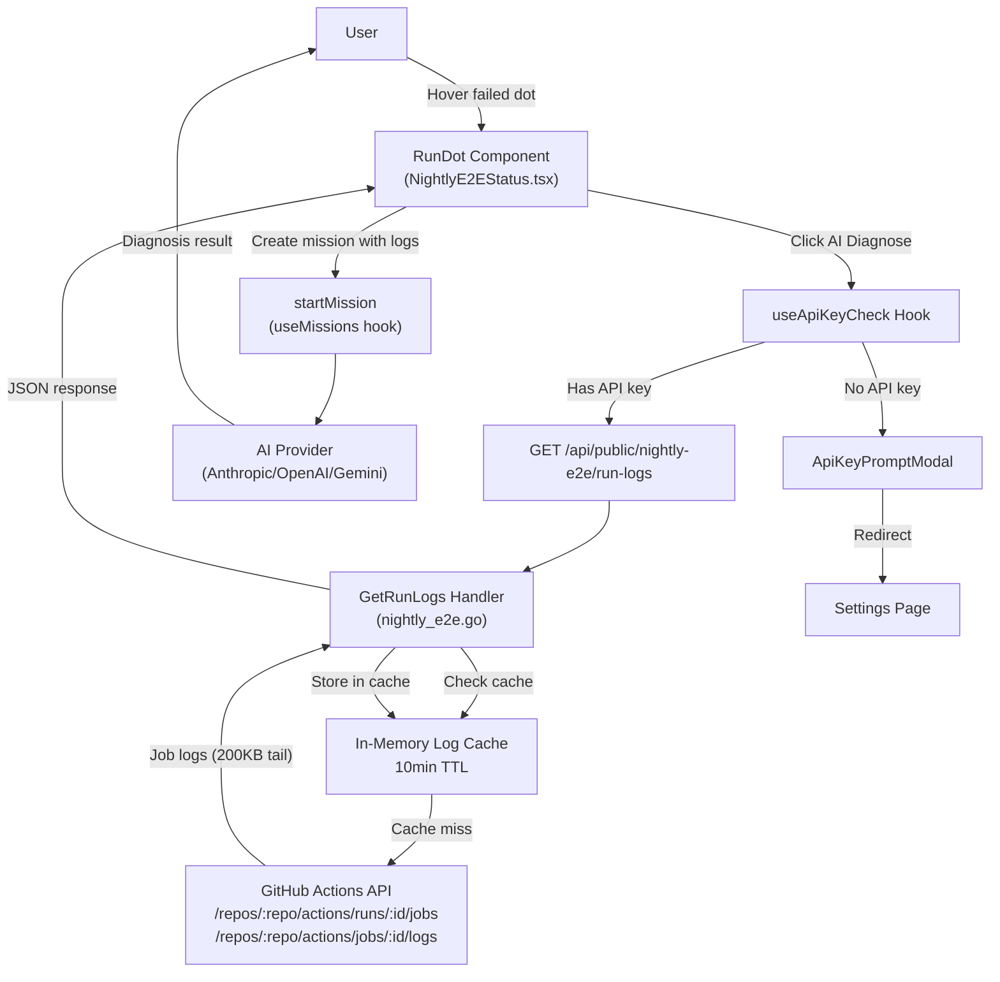

**Sources:** [web/src/components/cards/llmd/NightlyE2EStatus.tsx:1-250](), [pkg/api/handlers/nightly_e2e.go:405-570]()

## Frontend Integration

### RunDot Component Structure

The `RunDot` component renders individual workflow run status indicators and handles AI diagnosis triggering. Each dot represents a single GitHub Actions workflow run with visual indicators for success, failure, GPU unavailability, or in-progress status.

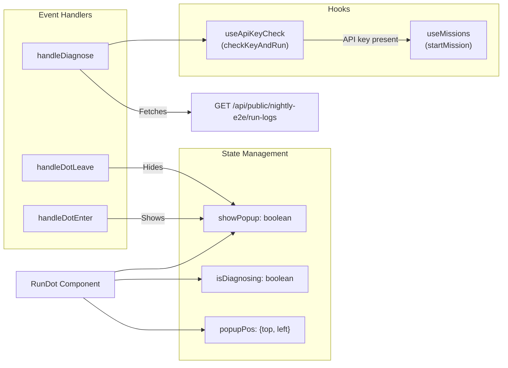

**Sources:** [web/src/components/cards/llmd/NightlyE2EStatus.tsx:69-251]()

### Diagnosis Trigger Flow

When a user clicks the "AI Diagnose" button, the system follows this sequence:

| Step | Action | Code Location |
|------|--------|---------------|
| 1. User clicks button | `onClick={handleDiagnose}` | [NightlyE2EStatus.tsx:233-240]() |
| 2. Check API key | `checkKeyAndRun(async () => {...})` | [NightlyE2EStatus.tsx:141]() |
| 3. Set loading state | `setIsDiagnosing(true)` | [NightlyE2EStatus.tsx:142]() |
| 4. Fetch logs | `fetch(${API_BASE}/api/public/nightly-e2e/run-logs?...)` | [NightlyE2EStatus.tsx:144-147]() |
| 5. Parse response | `const data = await resp.json()` | [NightlyE2EStatus.tsx:150]() |
| 6. Create mission | `startMission({...})` | [NightlyE2EStatus.tsx:160-189]() |
| 7. Clear loading | `setIsDiagnosing(false)` | [NightlyE2EStatus.tsx:190-192]() |

The `handleDiagnose` callback constructs the diagnosis request with full context about the failed run:

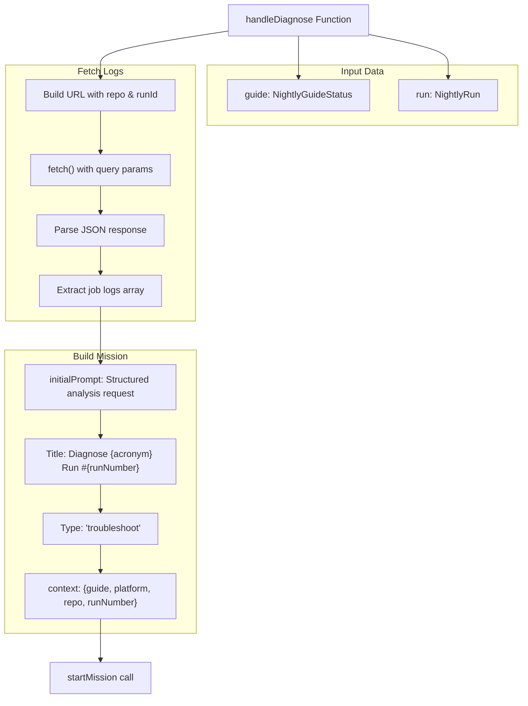

**Sources:** [web/src/components/cards/llmd/NightlyE2EStatus.tsx:136-194]()

### API Key Validation

The diagnosis flow requires an AI provider API key. The `useApiKeyCheck` hook provides validation and user prompting:

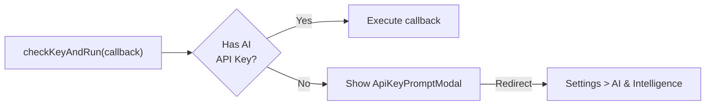

The modal prompts users to configure their API key in settings if not already present. This prevents failed diagnosis attempts and provides clear guidance for setup.

**Sources:** [web/src/components/cards/llmd/NightlyE2EStatus.tsx:20](), [web/src/components/cards/llmd/NightlyE2EStatus.tsx:82](), [web/src/components/cards/llmd/NightlyE2EStatus.tsx:141](), [web/src/components/cards/llmd/NightlyE2EStatus.tsx:248]()

## Log Retrieval System

### Backend Endpoint Architecture

The backend provides the `/api/public/nightly-e2e/run-logs` endpoint to fetch GitHub Actions logs for failed workflow runs. This endpoint is publicly accessible (no JWT required) to support both authenticated dashboard users and Netlify preview deployments.

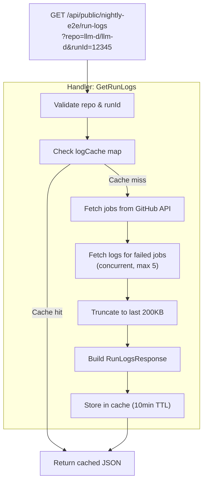

**Sources:** [pkg/api/handlers/nightly_e2e.go:405-504]()

### GitHub API Integration

The handler fetches logs through a multi-step GitHub API interaction:

| API Call | Purpose | Response |
|----------|---------|----------|
| `GET /repos/:repo/actions/runs/:runId/jobs` | List all jobs in the workflow run | Job IDs, names, conclusions |
| `GET /repos/:repo/actions/jobs/:jobId/logs` | Fetch plain-text log for specific job | HTTP 302 redirect to signed URL |
| `GET <signed_url>` | Download actual log content | Plain-text log stream |

The log fetching process uses a custom HTTP client to handle GitHub's redirect pattern:

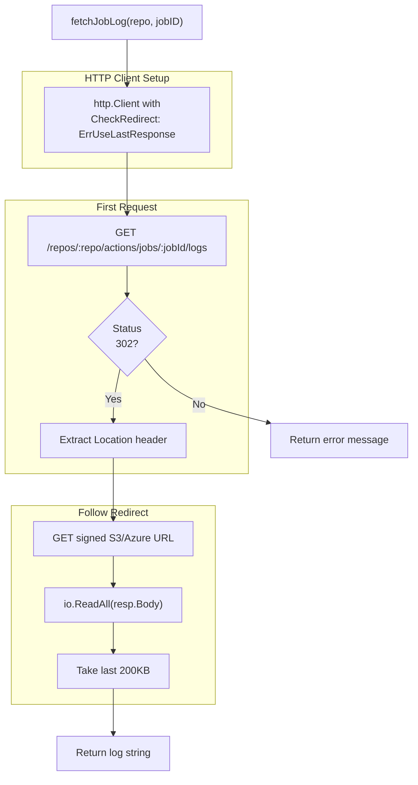

The handler only fetches logs for jobs with `conclusion: "failure"` to minimize API calls and response payload size. Non-failed jobs return empty log strings.

**Sources:** [pkg/api/handlers/nightly_e2e.go:508-570]()

### Caching Strategy

Log caching is critical for performance since GitHub Actions logs are immutable once a workflow run completes. The handler maintains an in-memory cache with read-write locking:

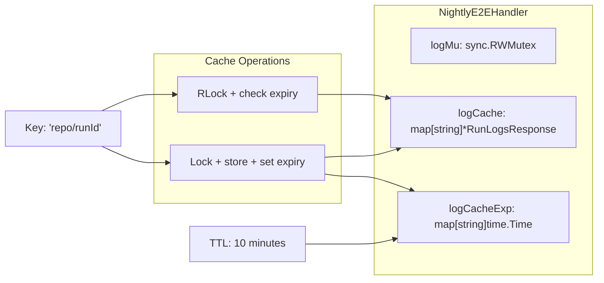

Cache keys use the format `"repo/runId"` (e.g., `"llm-d/llm-d/12345678"`). The 10-minute TTL is sufficient since completed workflow runs never change their logs, and the cache survives handler restarts in containerized deployments.

**Sources:** [pkg/api/handlers/nightly_e2e.go:104-107](), [pkg/api/handlers/nightly_e2e.go:24-28](), [pkg/api/handlers/nightly_e2e.go:417-424](), [pkg/api/handlers/nightly_e2e.go:498-501]()

### Concurrent Log Fetching

The handler fetches logs for multiple failed jobs concurrently using a semaphore pattern to limit simultaneous GitHub API calls:

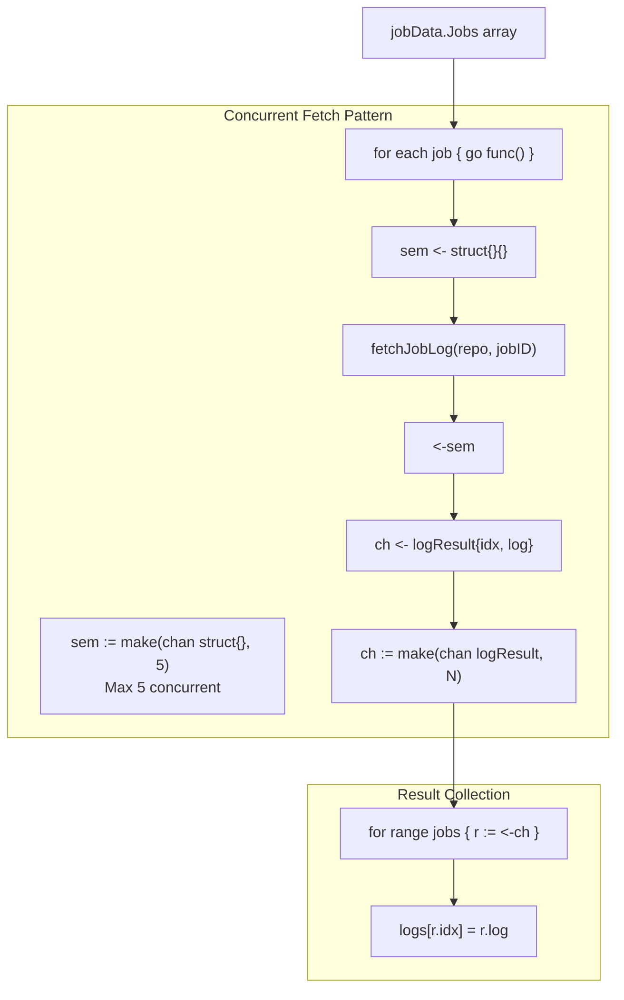

The semaphore (`maxLogFetchJobs = 5`) prevents overwhelming the GitHub API with concurrent requests while maintaining reasonable parallelism for workflows with many failed jobs.

**Sources:** [pkg/api/handlers/nightly_e2e.go:27-28](), [pkg/api/handlers/nightly_e2e.go:463-493]()

## Mission Creation and Prompt Structure

### Mission System Integration

The diagnosis system creates a mission using the `startMission` function from the `useMissions` hook. Missions are specialized AI conversations focused on specific troubleshooting tasks.

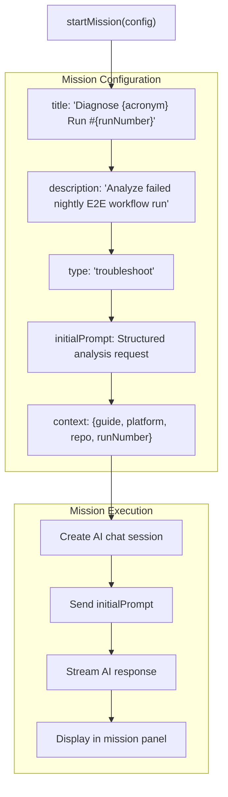

**Sources:** [web/src/components/cards/llmd/NightlyE2EStatus.tsx:160-189]()

### Initial Prompt Structure

The initial prompt provides comprehensive context to enable accurate diagnosis without follow-up questions. The prompt structure follows a five-section format:

| Section | Content | Purpose |
|---------|---------|---------|
| **Objective** | "Analyze this failed nightly E2E workflow run and diagnose the root cause" | Clear task definition |
| **Run Context** | Guide name, acronym, platform, repo, workflow file, run number, model, GPU config | Workflow metadata |
| **Failure Metadata** | `failureReason`, GitHub URL | Known classification |
| **GitHub Actions Logs** | Concatenated job logs with headers | Primary diagnostic data |
| **Expected Output** | 1. Root cause<br/>2. Classification<br/>3. Suggested fix<br/>4. Pattern detection | Structured response format |

Example prompt format:

```
Analyze this failed nightly E2E workflow run and diagnose the root cause.

## Run Context
- Guide: Inference Scheduling (IS) on OCP
- Repository: llm-d/llm-d
- Workflow: nightly-e2e-inference-scheduling-ocp.yaml
- Run #: 142
- Failure Reason: test_failure
- Model: Qwen3-32B, GPU: 2x H100
- GitHub URL: https://github.com/llm-d/llm-d/actions/runs/12345678

## GitHub Actions Logs
### Job: e2e-test (failure)
```
[truncated logs...]
```

Please provide:
1. Root cause analysis
2. Classification (test flake, infra issue, GPU problem, code regression)
3. Suggested fix
4. Pattern detection (recurring issue?)
```

**Sources:** [web/src/components/cards/llmd/NightlyE2EStatus.tsx:164-182]()

### Log Format Processing

The handler processes GitHub Actions logs into a structured format for AI consumption:

```mermaid
graph LR
    RawLogs["Raw job logs from GitHub"]
    
    subgraph "Processing Steps"
        Truncate["Truncate to last 200KB<br/>(readTruncatedLog)"]
        AddHeader["Add '### Job: {name} ({conclusion})'"]
        WrapCode["Wrap in ``` markdown code block"]
        Concatenate["Join with double newline"]
    end
    
    subgraph "Output Structure"
        Header1["### Job: e2e-test (failure)"]
        Log1["```\n[log content]\n```"]
        Header2["### Job: cleanup (success)"]
        Log2["```\n[log content]\n```"]
    end
    
    RawLogs --> Truncate
    Truncate --> AddHeader
    AddHeader --> WrapCode
    WrapCode --> Concatenate
    Concatenate --> Header1
    Header1 --> Log1
    Log1 --> Header2
    Header2 --> Log2
```

The 200KB truncation takes the **tail** of each log since failure information typically appears at the end. Prepending `"...[truncated]\n"` signals to the AI that earlier context is missing.

**Sources:** [web/src/components/cards/llmd/NightlyE2EStatus.tsx:151-157](), [pkg/api/handlers/nightly_e2e.go:558-570]()

### Context Preservation

The mission `context` field preserves key metadata for potential follow-up queries:

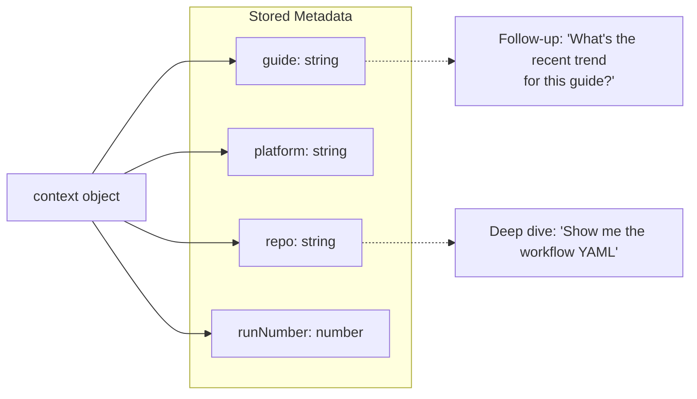

This context enables the AI to answer follow-up questions like "Has this guide been failing consistently?" or "What changed in the last successful run?" without requiring the user to re-provide context.

**Sources:** [web/src/components/cards/llmd/NightlyE2EStatus.tsx:183-188]()

## Response Handling

### Expected AI Response Format

The prompt requests a structured response with four components. The AI provider typically returns markdown-formatted analysis:

```markdown
## Root Cause Analysis
The test failed during the model deployment step because the vLLM container
crashed with OOM (Out Of Memory). The logs show `killed by SIGKILL` after
attempting to load the Qwen3-32B model.

## Classification
**Infrastructure Issue** - GPU memory capacity exceeded model requirements.
Not a test flake or code regression.

## Suggested Fix
1. Increase GPU memory allocation from 2x H100 40GB to 2x H100 80GB
2. Or use quantized model variant (Qwen3-32B-AWQ)
3. Add memory precheck before model load

## Pattern Detection
This is a **new failure** - previous 6 runs passed successfully. Likely caused
by recent model update in commit abc123 that increased memory footprint.
```

The mission UI displays this response with syntax highlighting and allows users to:
- Copy the diagnosis to clipboard
- Continue the conversation with follow-up questions
- Export the full conversation for issue filing

**Sources:** [web/src/components/cards/llmd/NightlyE2EStatus.tsx:178-182]()

### Error Handling

The diagnosis flow includes several error handling paths:

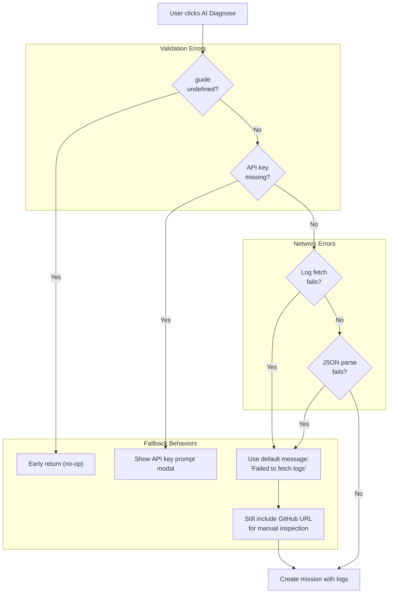

When log fetching fails, the system still creates a mission with a fallback message directing the AI to use the GitHub URL for manual analysis. This ensures users always receive some diagnostic assistance even when automated log retrieval fails.

**Sources:** [web/src/components/cards/llmd/NightlyE2EStatus.tsx:136-194]()

---

