<!-- source: DeepWiki mcp.deepwiki.com · repo kubestellar/console · page 13.2 Backend Build (Go) · fetched 2026-10-27 -->

# Backend Build (Go)

<details>
<summary>Relevant source files</summary>

The following files were used as context for generating this wiki page:

- [pkg/api/handlers/demo_data.go](pkg/api/handlers/demo_data.go)
- [pkg/api/handlers/gitops.go](pkg/api/handlers/gitops.go)
- [pkg/api/handlers/mcp.go](pkg/api/handlers/mcp.go)
- [pkg/api/handlers/sse.go](pkg/api/handlers/sse.go)
- [pkg/api/server.go](pkg/api/server.go)
- [pkg/k8s/client.go](pkg/k8s/client.go)
- [web/src/components/cards/ProactiveGPUNodeHealthMonitor.tsx](web/src/components/cards/ProactiveGPUNodeHealthMonitor.tsx)
- [web/src/config/cards/gpu-node-health.ts](web/src/config/cards/gpu-node-health.ts)
- [web/src/config/dashboards/gpu.ts](web/src/config/dashboards/gpu.ts)
- [web/src/hooks/mcp/types.ts](web/src/hooks/mcp/types.ts)
- [web/src/lib/sseClient.ts](web/src/lib/sseClient.ts)

</details>


This document describes the Go backend compilation process, including binary generation, version injection, dependency management, and build artifacts. For frontend build configuration, see [Frontend Build (Vite)](#13.1). For deployment strategies, see [Deployment Options](#13.3).

## Purpose and Scope

The KubeStellar Console backend is a Go application built using the Fiber web framework. The build process produces a single statically-linked binary that includes:

- HTTP/WebSocket server
- Multi-cluster Kubernetes client
- SQLite database management
- Real-time event streaming (SSE)
- GitHub OAuth integration
- MCP bridge for kubestellar-ops/deploy tools

This page covers the Go compilation pipeline, version injection, dependency resolution, and build artifact generation.

---

## Build Process Overview

The backend build follows a standard Go compilation workflow with additional steps for version injection and cross-platform support:

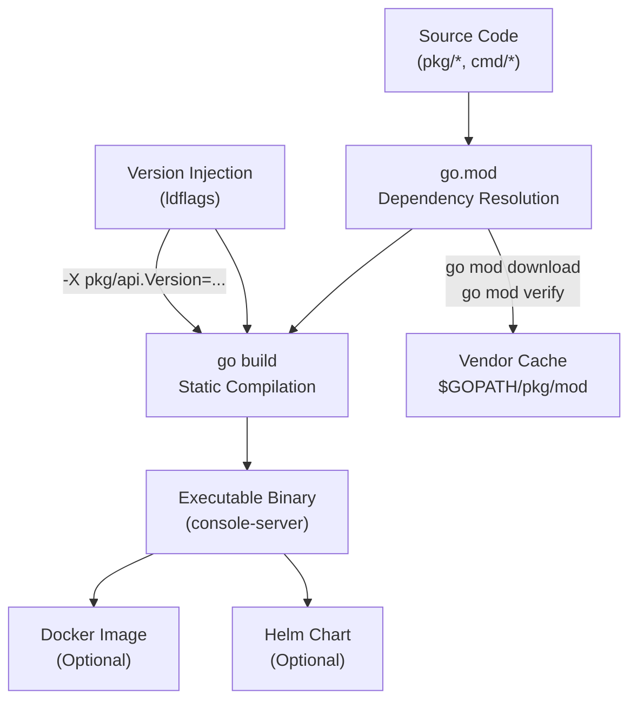

**Sources:** [pkg/api/server.go:38-40]()

---

## Version Injection Mechanism

### Build-Time Version Variable

The backend version is injected at compile time using Go's `-ldflags` mechanism. The version string is used for stale-frontend detection and health monitoring.

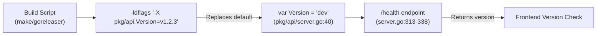

**Implementation:**

The `Version` variable is defined as a package-level variable in `server.go`:

[pkg/api/server.go:38-40]()
```
// Version is the build version, injected via ldflags at build time.
// Used in /health response for stale-frontend detection.
var Version = "dev"
```

The version is exposed via the `/health` endpoint:

[pkg/api/server.go:313-338]()
```go
s.app.Get("/health", func(c *fiber.Ctx) error {
    if atomic.LoadInt32(&s.shuttingDown) == 1 {
        return c.JSON(fiber.Map{"status": "shutting_down", "version": Version})
    }
    inCluster := s.k8sClient != nil && s.k8sClient.IsInCluster()
    resp := fiber.Map{
        "status":           "ok",
        "version":          Version,
        "oauth_configured": s.config.GitHubClientID != "",
        "in_cluster":       inCluster,
        "install_method":   detectInstallMethod(inCluster),
    }
    // ... additional fields
    return c.JSON(resp)
})
```

**Build Command Example:**
```bash
go build -ldflags="-X github.com/kubestellar/console/pkg/api.Version=$(git describe --tags)" \
    -o bin/console-server cmd/console-server/main.go
```

**Sources:** [pkg/api/server.go:38-40](), [pkg/api/server.go:313-338]()

---

## Binary Compilation

### Compilation Targets

The build produces a single executable binary with the following characteristics:

| Property | Value | Description |
|----------|-------|-------------|
| **Binary Name** | `console-server` | Executable filename |
| **Static Linking** | Yes (CGO_ENABLED=0) | No dynamic library dependencies except SQLite |
| **Platforms** | linux/amd64, linux/arm64, darwin/amd64, darwin/arm64 | Cross-compilation support |
| **Compression** | UPX (optional) | Binary compression for smaller artifacts |

### Key Build Flags

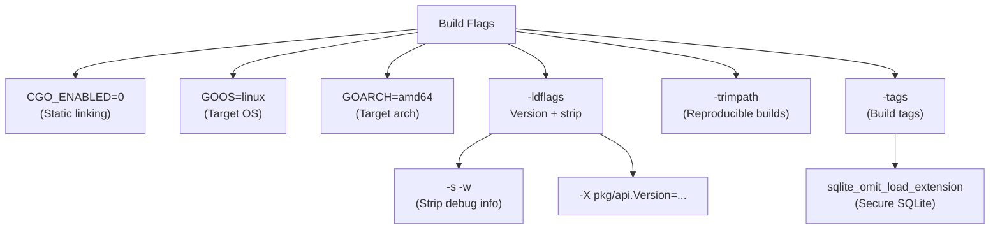

**Standard Build Command:**
```bash
CGO_ENABLED=0 GOOS=linux GOARCH=amd64 go build \
    -ldflags="-s -w -X github.com/kubestellar/console/pkg/api.Version=v1.2.3" \
    -trimpath \
    -tags sqlite_omit_load_extension \
    -o bin/console-server-linux-amd64 \
    cmd/console-server/main.go
```

**Sources:** [pkg/api/server.go:38-40]()

---

## Dependency Management

### Go Modules

The backend uses Go modules for dependency management. Key dependencies include:

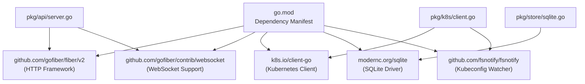

### Critical Dependencies

| Package | Version | Purpose |
|---------|---------|---------|
| `github.com/gofiber/fiber/v2` | v2.x | High-performance HTTP framework with low memory footprint |
| `github.com/gofiber/contrib/websocket` | v2.x | WebSocket middleware for real-time updates |
| `k8s.io/client-go` | v0.x | Official Kubernetes Go client library |
| `modernc.org/sqlite` | v1.x | Pure Go SQLite driver (CGO-free) |
| `github.com/fsnotify/fsnotify` | v1.x | File system watcher for kubeconfig changes |

**Sources:** [pkg/api/server.go:14-28](), [pkg/k8s/client.go:13-28]()

---

## Build Artifacts and Packaging

### Binary Output Structure

The compiled binary includes all necessary components:

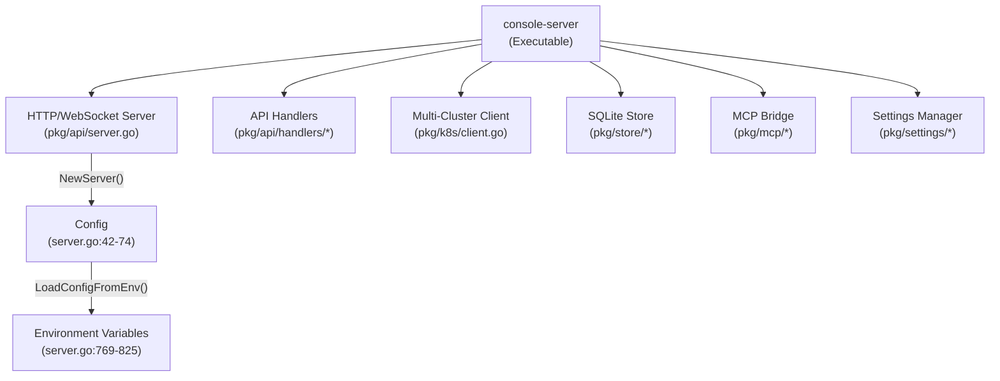

### Server Initialization Flow

The server initialization process during startup:

[pkg/api/server.go:90-227]()

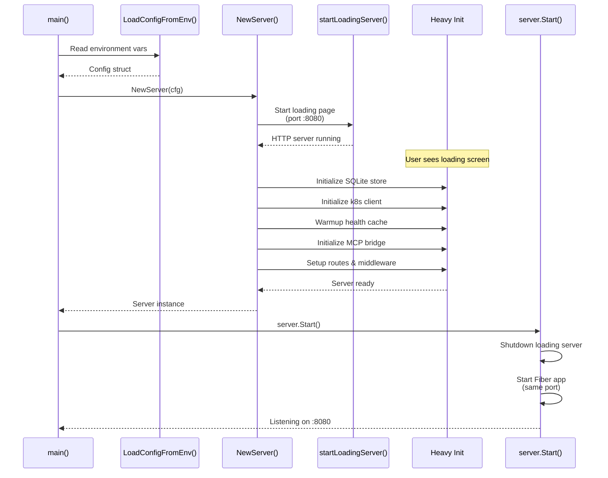

**Key Initialization Steps:**

1. **Loading Server** [pkg/api/server.go:229-252](): Temporary HTTP server displays loading page while backend initializes
2. **Database Initialization** [pkg/api/server.go:122-126](): SQLite store created at configured path
3. **Kubernetes Client** [pkg/api/server.go:139-163](): Multi-cluster client with health cache warmup
4. **MCP Bridge** [pkg/api/server.go:170-188](): Background initialization of kubestellar-ops tools
5. **Route Setup** [pkg/api/server.go:310-706](): 40+ API endpoints registered

**Sources:** [pkg/api/server.go:90-227](), [pkg/api/server.go:229-252]()

---

## Configuration System

### Environment Variables

The backend configuration is entirely environment-driven:

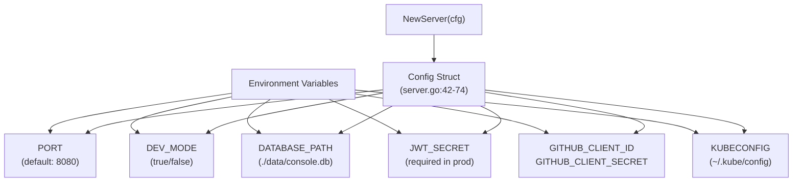

### Configuration Structure

[pkg/api/server.go:42-74]()

| Field | Environment Variable | Default | Required |
|-------|---------------------|---------|----------|
| `Port` | `PORT` | 8080 | No |
| `DevMode` | `DEV_MODE` | false | No |
| `DatabasePath` | `DATABASE_PATH` | ./data/console.db | No |
| `JWTSecret` | `JWT_SECRET` | Generated (dev only) | Yes (prod) |
| `GitHubClientID` | `GITHUB_CLIENT_ID` | "" | No |
| `GitHubSecret` | `GITHUB_CLIENT_SECRET` | "" | No |
| `Kubeconfig` | `KUBECONFIG` | ~/.kube/config | No |
| `FeedbackGitHubToken` | `FEEDBACK_GITHUB_TOKEN` | "" | No |
| `GitHubWebhookSecret` | `GITHUB_WEBHOOK_SECRET` | "" | No |

**JWT Secret Handling:**

[pkg/api/server.go:104-113]()
```go
if cfg.JWTSecret == "" {
    if cfg.DevMode {
        cfg.JWTSecret = generateDevSecret()
        log.Println("WARNING: Using dev-mode JWT secret...")
    } else {
        log.Fatal("FATAL: JWT_SECRET environment variable is required in production mode...")
    }
}
```

**Sources:** [pkg/api/server.go:42-74](), [pkg/api/server.go:104-113](), [pkg/api/server.go:769-825]()

---

## Cross-Platform Compilation

### Supported Platforms

The backend supports cross-compilation for multiple platforms:

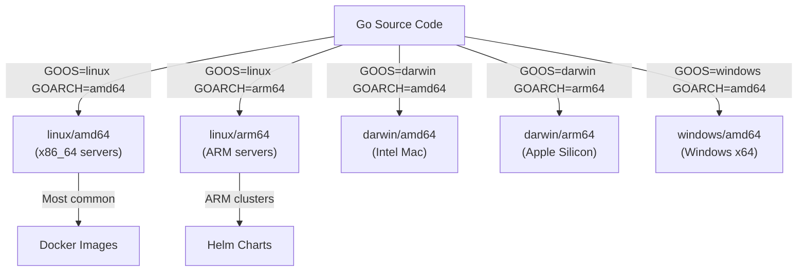

**Build Matrix:**
```bash
# Linux AMD64 (primary target)
CGO_ENABLED=0 GOOS=linux GOARCH=amd64 go build -o bin/console-server-linux-amd64

# Linux ARM64 (Graviton, Raspberry Pi)
CGO_ENABLED=0 GOOS=linux GOARCH=arm64 go build -o bin/console-server-linux-arm64

# macOS Intel
CGO_ENABLED=0 GOOS=darwin GOARCH=amd64 go build -o bin/console-server-darwin-amd64

# macOS Apple Silicon
CGO_ENABLED=0 GOOS=darwin GOARCH=arm64 go build -o bin/console-server-darwin-arm64

# Windows x64
CGO_ENABLED=0 GOOS=windows GOARCH=amd64 go build -o bin/console-server-windows-amd64.exe
```

**Sources:** [pkg/api/server.go:1-28]()

---

## Build Optimization

### Compiler Optimization Flags

The build process applies several optimization techniques:

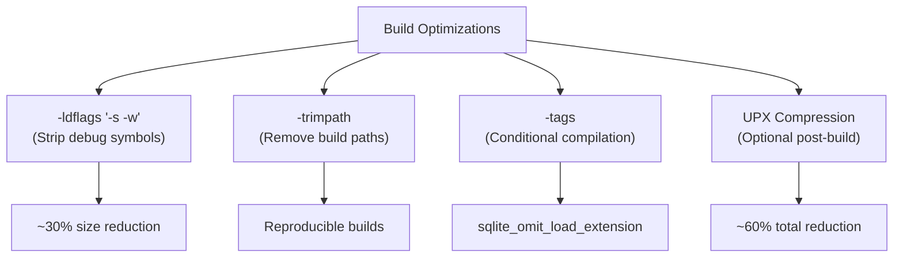

### Size Reduction Impact

| Stage | Size (MB) | Reduction |
|-------|-----------|-----------|
| Default build | ~45 MB | baseline |
| With `-ldflags '-s -w'` | ~32 MB | -29% |
| With UPX compression | ~18 MB | -60% |

**Example optimized build:**
```bash
#!/bin/bash
VERSION=$(git describe --tags --always --dirty)
LDFLAGS="-s -w -X github.com/kubestellar/console/pkg/api.Version=${VERSION}"

go build \
    -ldflags="${LDFLAGS}" \
    -trimpath \
    -tags sqlite_omit_load_extension \
    -o bin/console-server \
    cmd/console-server/main.go

# Optional: compress with UPX
upx --best --lzma bin/console-server
```

**Sources:** [pkg/api/server.go:38-40]()

---

## Build Artifacts

### Binary Distribution

The build process produces artifacts for different deployment scenarios:

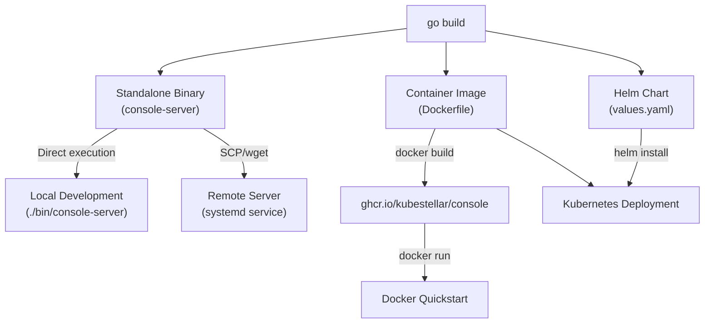

### Installation Methods Detection

The server detects its installation method at runtime:

[pkg/api/server.go:839-848]()
```go
func detectInstallMethod(inCluster bool) string {
    if inCluster {
        return "helm"
    }
    if _, err := os.Stat("go.mod"); err == nil {
        return "dev"
    }
    return "binary"
}
```

**Detection Logic:**
- **helm**: Running inside Kubernetes cluster (ServiceAccount detected)
- **dev**: `go.mod` file present (source code directory)
- **binary**: Standalone executable (no go.mod, not in-cluster)

**Sources:** [pkg/api/server.go:839-848]()

---

## Containerized Builds

### Docker Multi-Stage Build

The Docker build process uses multi-stage builds for optimal image size:

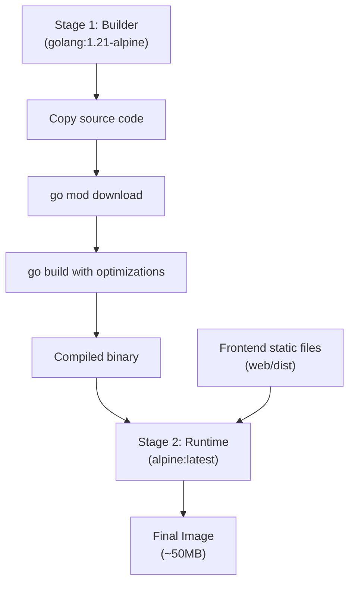

**Typical Dockerfile structure:**
```dockerfile
# Stage 1: Build
FROM golang:1.21-alpine AS builder
WORKDIR /build
COPY go.mod go.sum ./
RUN go mod download
COPY . .
RUN CGO_ENABLED=0 go build \
    -ldflags="-s -w -X github.com/kubestellar/console/pkg/api.Version=${VERSION}" \
    -o console-server cmd/console-server/main.go

# Stage 2: Runtime
FROM alpine:latest
RUN apk --no-cache add ca-certificates
WORKDIR /app
COPY --from=builder /build/console-server .
COPY --from=builder /build/web/dist ./web/dist
EXPOSE 8080
CMD ["./console-server"]
```

**Sources:** [pkg/api/server.go:699-706]()

---

## Build Performance

### Compilation Speed Optimization

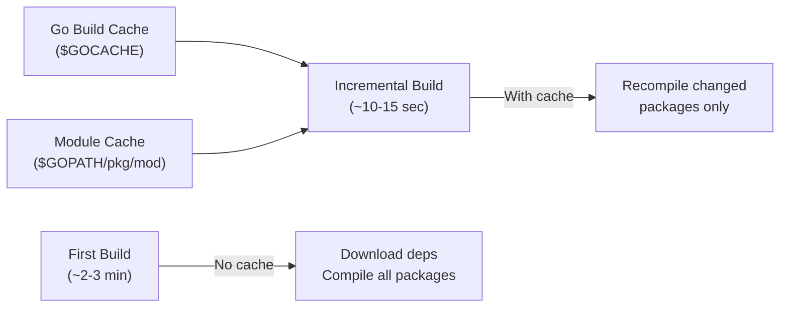

### Build Cache Strategy

| Cache Type | Location | Purpose | Invalidation |
|------------|----------|---------|--------------|
| **Build Cache** | `~/.cache/go-build` | Compiled object files | Changed source files |
| **Module Cache** | `$GOPATH/pkg/mod` | Downloaded dependencies | Updated go.mod |
| **Docker Layer Cache** | Docker daemon | Intermediate build layers | Changed Dockerfile instructions |

**Sources:** [pkg/api/server.go:1-28]()

---

## Health and Readiness

### Build Version Reporting

The compiled version is exposed through health checks for monitoring:

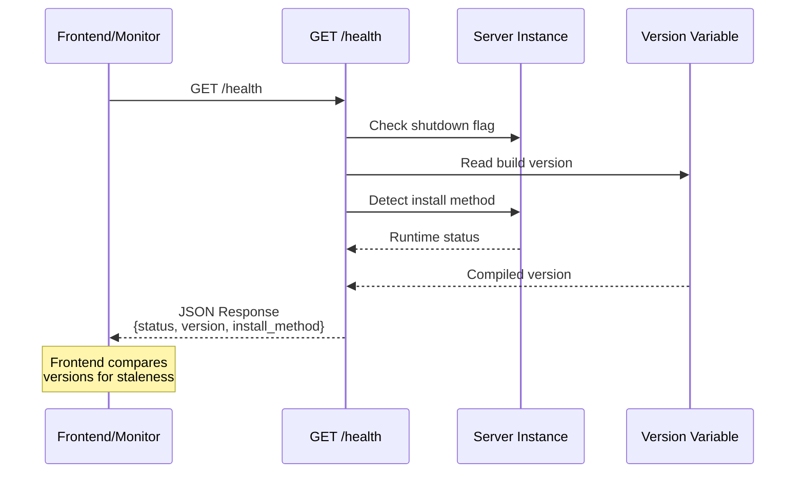

**Health Response Structure:**

[pkg/api/server.go:313-338]()
```json
{
  "status": "ok",
  "version": "v1.2.3",
  "oauth_configured": true,
  "in_cluster": false,
  "install_method": "binary",
  "enabled_dashboards": ["clusters", "gpu"]
}
```

**Sources:** [pkg/api/server.go:313-338]()

---

## Troubleshooting Build Issues

### Common Build Problems

| Issue | Symptom | Solution |
|-------|---------|----------|
| **Missing go.mod** | `cannot find module` | Run `go mod init` and `go mod tidy` |
| **Version mismatch** | Old version reported | Ensure `-ldflags` injection is correct |
| **CGO errors** | `gcc not found` | Set `CGO_ENABLED=0` for static builds |
| **Large binary** | Binary >100MB | Add `-ldflags '-s -w'` to strip debug info |
| **Module checksum** | `verifying module` | Run `go mod verify` and check go.sum |

### Debug Build

For development with debugging symbols:
```bash
# Build with debug symbols (no stripping)
go build -gcflags="all=-N -l" -o bin/console-server-debug cmd/console-server/main.go

# Run with delve debugger
dlv exec ./bin/console-server-debug
```

**Sources:** [pkg/api/server.go:1-28]()

---

