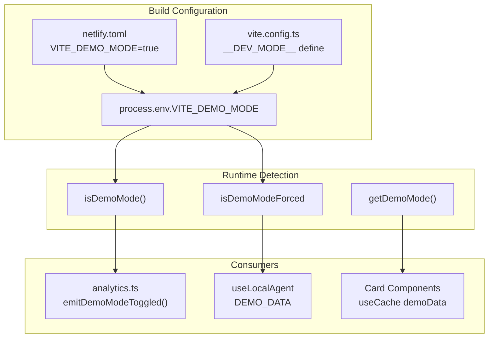
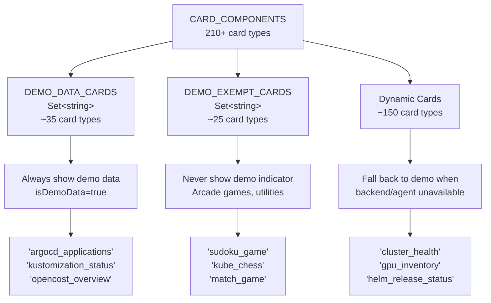
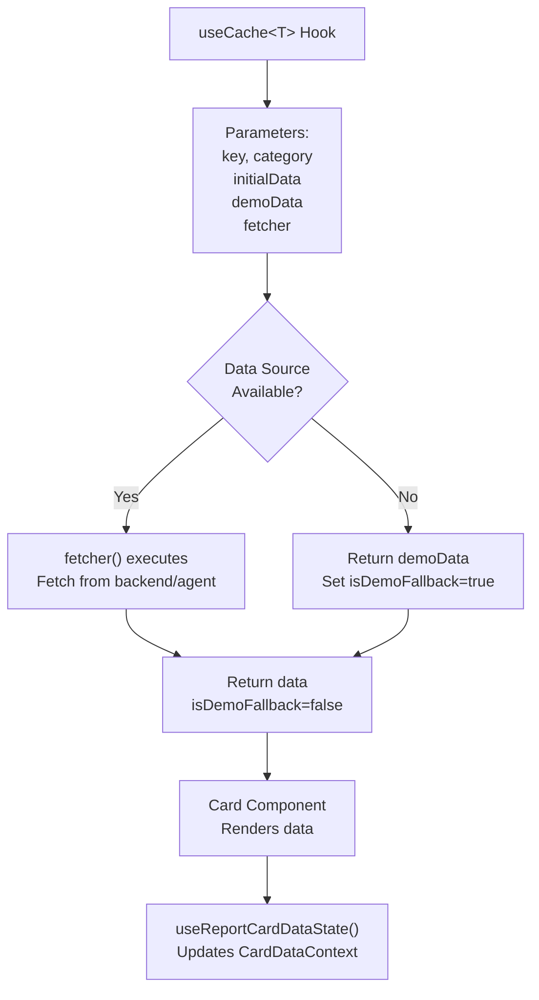
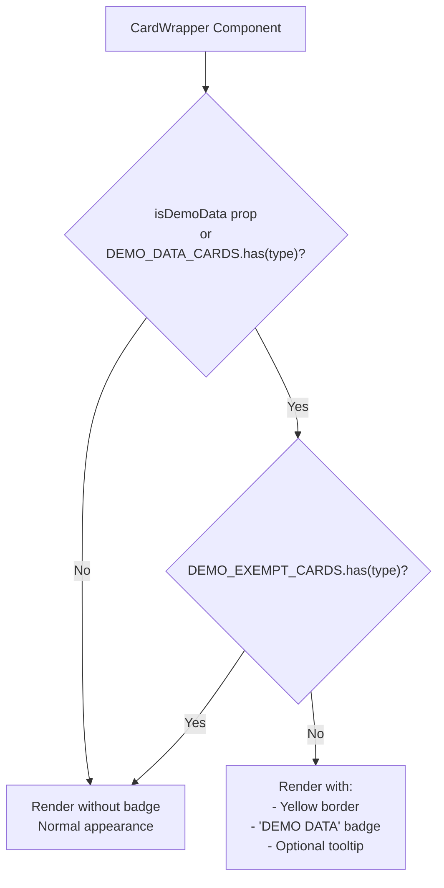
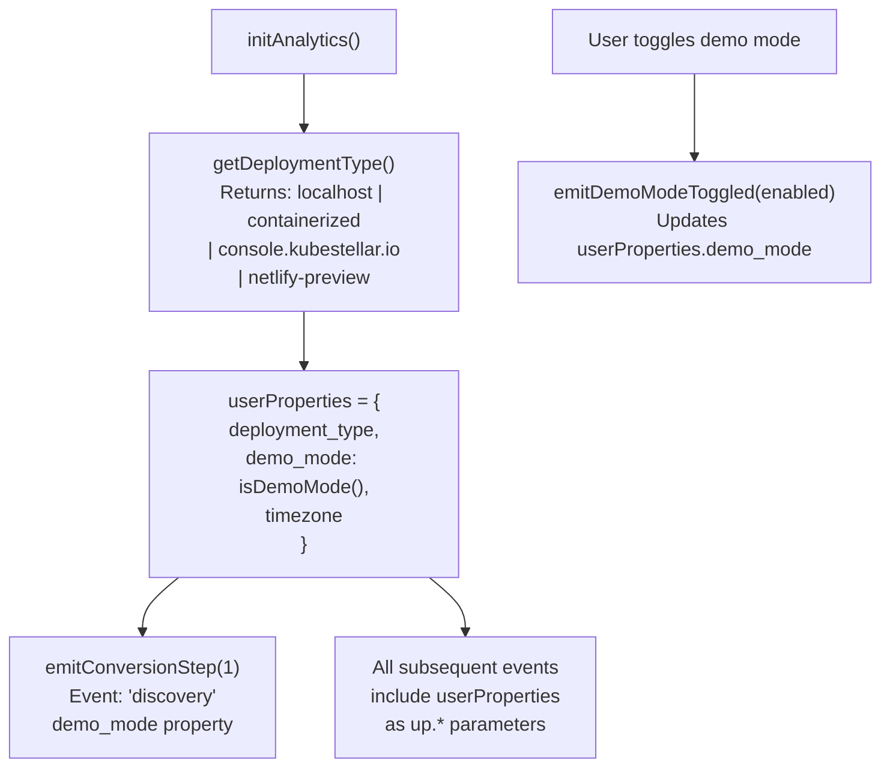

<!-- source: DeepWiki mcp.deepwiki.com · repo kubestellar/console · page 13.4 Demo Mode · fetched 2026-10-27 -->

# Demo Mode

<details>
<summary>Relevant source files</summary>

The following files were used as context for generating this wiki page:

- [.env.example](.env.example)
- [netlify.toml](netlify.toml)
- [pkg/api/handlers/analytics_proxy.go](pkg/api/handlers/analytics_proxy.go)
- [web/netlify/functions/analytics-collect.mts](web/netlify/functions/analytics-collect.mts)
- [web/package-lock.json](web/package-lock.json)
- [web/package.json](web/package.json)
- [web/src/components/agent/APIKeySettings.tsx](web/src/components/agent/APIKeySettings.tsx)
- [web/src/components/cards/cardRegistry.ts](web/src/components/cards/cardRegistry.ts)
- [web/src/components/cards/flatcar_status/demoData.ts](web/src/components/cards/flatcar_status/demoData.ts)
- [web/src/components/cards/flatcar_status/index.tsx](web/src/components/cards/flatcar_status/index.tsx)
- [web/src/components/cards/flatcar_status/useFlatcarStatus.ts](web/src/components/cards/flatcar_status/useFlatcarStatus.ts)
- [web/src/components/cards/flatcar_status/versionUtils.ts](web/src/components/cards/flatcar_status/versionUtils.ts)
- [web/src/components/cards/llmd/index.ts](web/src/components/cards/llmd/index.ts)
- [web/src/components/dashboard/AddCardModal.tsx](web/src/components/dashboard/AddCardModal.tsx)
- [web/src/components/dashboard/templates.ts](web/src/components/dashboard/templates.ts)
- [web/src/components/llmd-benchmarks/LLMdBenchmarks.tsx](web/src/components/llmd-benchmarks/LLMdBenchmarks.tsx)
- [web/src/hooks/useLocalAgent.ts](web/src/hooks/useLocalAgent.ts)
- [web/src/lib/analytics.ts](web/src/lib/analytics.ts)
- [web/src/locales/en/cards.json](web/src/locales/en/cards.json)
- [web/vite.config.ts](web/vite.config.ts)

</details>


## Purpose and Scope

Demo Mode enables the KubeStellar Console to function with mock data when no backend services or Kubernetes clusters are available. This page documents how demo mode is activated, how cards provide demo data, and how the system behaves when real data sources are unavailable. For information about deployment options including containerized and Helm deployments, see [Deployment Options](#13.3). For details on the local agent that provides real cluster data, see [Local Agent (kc-agent)](#2.3).

---

## Overview

Demo Mode serves three primary use cases:

1. **Netlify Preview Deployments** - PR previews deploy as static sites without backend infrastructure
2. **Agent-Unavailable Scenarios** - When `kc-agent` is not running locally, cards fall back to demo data
3. **Evaluation Mode** - Users can explore the UI and features before connecting real clusters

The system implements a multi-tier demo data strategy where some cards always use demo data (e.g., ArgoCD integration without ArgoCD installed), while others dynamically fall back to demo data when their data sources are unavailable.

**Sources:** [netlify.toml:1-76](), [web/src/components/cards/cardRegistry.ts:457-536]()

---

## Demo Mode Activation

### Build-Time Configuration

Demo mode is activated at build time via the `VITE_DEMO_MODE` environment variable:



**Diagram: Demo Mode Configuration Flow**

The `VITE_DEMO_MODE` environment variable is set to `"true"` in three Netlify contexts:

- Production builds (`context.production.environment`)
- PR preview deploys (`context.deploy-preview.environment`)  
- Branch deploys (`context.branch-deploy.environment`)

**Sources:** [netlify.toml:14-75](), [web/vite.config.ts:34-49]()

### Runtime Detection Functions

The codebase provides multiple detection functions for different scenarios:

```typescript
// From web/src/lib/demoMode.ts (implied by usage patterns)
isDemoMode(): boolean          // General-purpose check
isDemoModeForced: boolean      // Constant for forced demo mode
getDemoMode(): boolean         // Used by cache system
```

The local agent immediately transitions to demo mode when `isDemoModeForced` is true:

```typescript
// web/src/hooks/useLocalAgent.ts:70-84
private state: AgentState = isDemoModeForced ? {
  status: 'disconnected',
  health: DEMO_DATA,
  error: 'Demo mode - agent connection skipped',
  // ...
} : {
  status: 'connecting',
  health: null,
  // ...
}
```

**Sources:** [web/src/hooks/useLocalAgent.ts:38-52](), [web/src/hooks/useLocalAgent.ts:99-116](), [web/src/lib/analytics.ts:14-46]()

---

## Card-Level Demo Data Strategy

### Demo Data Classification

Cards are classified into three categories via Sets in `cardRegistry.ts`:



**Diagram: Card Demo Data Classification**

The `DEMO_DATA_CARDS` Set contains card types that always display demo data because their live data sources require specific integrations:

- **GitOps Tools** - ArgoCD, Kustomize (demo until tools are installed)
- **Cost Management** - OpenCost, Kubecost (demo until connected)
- **Security Tools** - Falco, Trivy, Kubescape (demo until detected)
- **AI Agent Platform** - Kagenti cards (demo until kagenti-operator installed)
- **Multi-Cluster Services** - Service Exports/Imports (demo until MCS is installed)

**Sources:** [web/src/components/cards/cardRegistry.ts:473-536]()

### Demo Data Implementation Pattern

Each card that supports demo data follows this pattern:



**Diagram: Card Demo Data Resolution Flow**

Example from the Flatcar status card:

```typescript
// web/src/components/cards/flatcar_status/useFlatcarStatus.ts:131-160
const { data, isLoading, isFailed, consecutiveFailures, isDemoFallback } =
  useCache<FlatcarStatus>({
    key: CACHE_KEY,
    category: 'default',
    initialData: INITIAL_DATA,
    demoData: toDemoStatus(FLATCAR_DEMO_DATA),
    persist: true,
    fetcher: fetchFlatcarStatus,
  })
```

The demo data is defined in a separate file with representative values:

```typescript
// web/src/components/cards/flatcar_status/demoData.ts:22-33
export const FLATCAR_DEMO_DATA: FlatcarDemoData = {
  totalNodes: 24,
  versions: {
    '3815.2.5': 18,
    '3760.1.0': 4,
    '3602.2.3': 2,
  },
  updatingNodes: 2,
  outdatedNodes: 4,
  health: 'degraded',
  lastCheckTime: new Date(Date.now() - 3 * 60 * 1000).toISOString(),
}
```

**Sources:** [web/src/components/cards/flatcar_status/useFlatcarStatus.ts:132-150](), [web/src/components/cards/flatcar_status/demoData.ts:1-34]()

---

## Demo Data for Core Systems

### Local Agent Demo Data

When the agent is unavailable, the `useLocalAgent` hook returns hardcoded demo values:

```typescript
// web/src/hooks/useLocalAgent.ts:39-52
const DEMO_DATA: AgentHealth = {
  status: 'demo',
  version: 'demo',
  clusters: 3,
  hasClaude: false,
  claude: {
    installed: false,
    tokenUsage: {
      session: { input: 0, output: 0 },
      today: { input: 0, output: 0 },
      thisMonth: { input: 0, output: 0 },
    },
  },
}
```

The agent manager checks `isDemoModeForced` at initialization and immediately sets the demo state:

```typescript
// web/src/hooks/useLocalAgent.ts:103-109
if (isDemoModeForced) {
  this.setState({
    status: 'disconnected',
    health: DEMO_DATA,
    error: 'Demo mode - agent connection skipped',
  })
  return
}
```

**Sources:** [web/src/hooks/useLocalAgent.ts:38-52](), [web/src/hooks/useLocalAgent.ts:99-116]()

### Card Registry Demo Classification

The card registry maintains three critical data structures:

| Data Structure | Purpose | Size | Example Cards |
|---------------|---------|------|---------------|
| `CARD_COMPONENTS` | Main registry of all card types | 210+ | All cards |
| `DEMO_DATA_CARDS` | Cards that always use demo data | ~35 | `argocd_applications`, `kyverno_policies`, `kagenti_status` |
| `DEMO_EXEMPT_CARDS` | Cards that never show demo indicators | ~25 | `sudoku_game`, `kube_chess`, `checkers` |

The `DEMO_EXEMPT_CARDS` set prevents arcade games and utilities from displaying the yellow "DEMO DATA" badge, as they have no concept of live vs. demo data:

```typescript
// web/src/components/cards/cardRegistry.ts:542-570
export const DEMO_EXEMPT_CARDS = new Set([
  // All arcade games - never show skeleton, always show game content
  'sudoku_game',
  'checkers',
  'container_tetris',
  'kube_kong',
  // ... (20+ more games)
  'dynamic_card',
  // Cluster admin cards - no demo/live concept
  'maintenance_windows',
  'node_debug',
])
```

**Sources:** [web/src/components/cards/cardRegistry.ts:457-570]()

---

## Visual Indicators

### Demo Data Badge

Cards displaying demo data show a yellow border and badge via `CardWrapper`:



**Diagram: Demo Data Visual Indicator Logic**

The badge rendering logic follows this hierarchy:

1. **Check `DEMO_EXEMPT_CARDS`** - If card type is in the exempt set, never show badge
2. **Check explicit prop** - If `isDemoData={true}` prop passed, show badge
3. **Check registry** - If card type is in `DEMO_DATA_CARDS`, show badge
4. **Check reported state** - If card reports demo state via `useReportCardDataState`, show badge

**Sources:** [web/src/components/cards/cardRegistry.ts:542-570]()

### Agent Connection Status

The agent connection status is displayed in the settings panel with four states:

| Status | Color | Icon | Meaning |
|--------|-------|------|---------|
| `connected` | Green | CheckCircle | Agent responding, real data available |
| `connecting` | Yellow | Loader2 | Initial connection attempt in progress |
| `disconnected` | Red | XCircle | Agent not available, using demo data |
| `degraded` | Orange | AlertTriangle | Health endpoint OK, but data endpoints failing |

**Sources:** [web/src/hooks/useLocalAgent.ts:23-29]()

---

## Analytics Integration

### Demo Mode Tracking

The analytics system tracks demo mode state throughout the user journey:



**Diagram: Demo Mode Analytics Flow**

The analytics system encodes demo mode in three ways:

1. **User Property** - `up.demo_mode` sent with every event
2. **Deployment Type** - `up.deployment_type` distinguishes Netlify previews
3. **Event Parameters** - Specific events like `ksc_demo_mode_toggled` track state changes

```typescript
// web/src/lib/analytics.ts:157-175
export function initAnalytics() {
  // ...
  const deploymentType = getDeploymentType()
  userProperties = {
    deployment_type: deploymentType,
    demo_mode: String(isDemoMode()),
    ...(tz && { timezone: tz }),
  }
  
  emitConversionStep(1, 'discovery', { deployment_type: deploymentType })
}

// web/src/lib/analytics.ts:336-340
export function emitDemoModeToggled(enabled: boolean) {
  send('ksc_demo_mode_toggled', { enabled: String(enabled) })
  userProperties.demo_mode = String(enabled)
}
```

**Sources:** [web/src/lib/analytics.ts:157-175](), [web/src/lib/analytics.ts:336-340](), [web/src/lib/analytics.ts:41-47]()

### Conversion Funnel Impact

Demo mode affects the conversion funnel tracking by skipping steps that require real infrastructure:

| Step | Name | Condition | Emitted In Demo Mode? |
|------|------|-----------|----------------------|
| 1 | `discovery` | Page load | ✅ Yes |
| 2 | `login` | Authentication | ✅ Yes (demo user) |
| 3 | `agent` | kc-agent connected | ❌ No |
| 4 | `clusters` | Real clusters detected | ❌ No |
| 5 | `api_key` | AI API key configured | ❌ No |
| 6 | `github_token` | GitHub token configured | ❌ No |

**Sources:** [web/src/lib/analytics.ts:362-381]()

---

## Netlify Deployment Configuration

### Build Settings

The Netlify configuration enables demo mode for all deployment contexts:

```toml
# netlify.toml:4-18
[build]
  base = "web"
  command = "npm ci && npm run build"
  publish = "dist"

[functions]
  directory = "netlify/functions"
  node_bundler = "esbuild"

[build.environment]
  # Enable demo mode with mock data for Netlify previews
  VITE_DEMO_MODE = "true"
  NODE_VERSION = "20"
```

All three deployment contexts inherit this setting:

```toml
# netlify.toml:62-75
[context.production]
  [context.production.environment]
    VITE_DEMO_MODE = "true"

[context.deploy-preview]
  [context.deploy-preview.environment]
    VITE_DEMO_MODE = "true"

[context.branch-deploy]
  [context.branch-deploy.environment]
    VITE_DEMO_MODE = "true"
```

**Sources:** [netlify.toml:4-18](), [netlify.toml:62-75]()

### Serverless Function Proxying

Netlify Functions provide limited backend functionality for preview deployments:

```toml
# netlify.toml:20-36
[[redirects]]
  from = "/api/nightly-e2e/runs"
  to = "/.netlify/functions/nightly-e2e"
  status = 200

[[redirects]]
  from = "/api/public/nightly-e2e/runs"
  to = "/.netlify/functions/nightly-e2e"
  status = 200

[[redirects]]
  from = "/api/active-users"
  to = "/.netlify/functions/presence"
  status = 200
```

The analytics collection proxy is implemented as a Netlify Function:

```typescript
// web/netlify/functions/analytics-collect.mts:41-119
export default async (req: Request) => {
  // Validate origin
  if (!isAllowedOrigin(req)) {
    return new Response("Forbidden", { status: 403 })
  }

  // Decode base64-encoded payload
  const encoded = url.searchParams.get("d")
  if (encoded) {
    gaParams = new URLSearchParams(atob(encoded))
  }

  // Rewrite measurement ID
  if (realMeasurementId && gaParams.has("tid")) {
    gaParams.set("tid", realMeasurementId)
  }

  // Forward to GA4
  const targetUrl = `https://www.google-analytics.com/g/collect?${gaParams.toString()}`
  // ...
}

export const config: Config = {
  path: "/api/m",
}
```

**Sources:** [netlify.toml:20-36](), [web/netlify/functions/analytics-collect.mts:41-123]()

---

## Summary

Demo Mode is a comprehensive system that enables the KubeStellar Console to function without backend infrastructure. Key architectural elements include:

- **Build-time Configuration** - `VITE_DEMO_MODE` environment variable set in Netlify builds
- **Card-Level Demo Data** - Each card provides representative demo data via `useCache` hook
- **Visual Indicators** - Yellow border and "DEMO DATA" badge on cards using demo data
- **Analytics Integration** - Tracks demo mode state and deployment type in all events
- **Serverless Functions** - Netlify Functions provide limited backend functionality for previews

The system maintains three card classifications (`DEMO_DATA_CARDS`, `DEMO_EXEMPT_CARDS`, and dynamic cards) to control when demo indicators are displayed and when cards fall back to mock data.

**Sources:** [netlify.toml:1-76](), [web/src/components/cards/cardRegistry.ts:457-570](), [web/src/hooks/useLocalAgent.ts:38-116](), [web/src/lib/analytics.ts:157-340]()

---

