<!-- source: DeepWiki mcp.deepwiki.com · repo kubestellar/console · page 14.4 Testing · fetched 2026-10-27 -->

# Testing

<details>
<summary>Relevant source files</summary>

The following files were used as context for generating this wiki page:

- [.env.example](.env.example)
- [.github/ISSUE_TEMPLATE/bug_report.yaml](.github/ISSUE_TEMPLATE/bug_report.yaml)
- [.github/workflows/ai-fix.yml](.github/workflows/ai-fix.yml)
- [.github/workflows/copilot-assigned.yml](.github/workflows/copilot-assigned.yml)
- [.github/workflows/copilot-automation.yml](.github/workflows/copilot-automation.yml)
- [.github/workflows/copilot-build-check.yml](.github/workflows/copilot-build-check.yml)
- [.github/workflows/copilot-pr-monitor.yml](.github/workflows/copilot-pr-monitor.yml)
- [.github/workflows/copilot-recovery.yml](.github/workflows/copilot-recovery.yml)
- [.github/workflows/copilot-setup-steps.yml](.github/workflows/copilot-setup-steps.yml)
- [.github/workflows/triage-command.yml](.github/workflows/triage-command.yml)
- [netlify.toml](netlify.toml)
- [pkg/api/handlers/analytics_proxy.go](pkg/api/handlers/analytics_proxy.go)
- [web/netlify/functions/analytics-collect.mts](web/netlify/functions/analytics-collect.mts)
- [web/package-lock.json](web/package-lock.json)
- [web/package.json](web/package.json)
- [web/src/components/agent/APIKeySettings.tsx](web/src/components/agent/APIKeySettings.tsx)
- [web/src/hooks/useLocalAgent.ts](web/src/hooks/useLocalAgent.ts)
- [web/src/lib/analytics.ts](web/src/lib/analytics.ts)
- [web/vite.config.ts](web/vite.config.ts)

</details>


## Purpose and Scope

This document covers the comprehensive testing infrastructure for the KubeStellar Console, including unit tests, end-to-end tests, performance tests, compliance tests, and automated CI/CD testing workflows. The testing strategy ensures code quality, prevents regressions, validates performance requirements, and enforces compliance standards across the codebase.

For deployment and build configuration, see [Build & Deployment](#13). For CI/CD automation workflows beyond testing, see [CI/CD Automation System](#7).

---

## Testing Architecture Overview

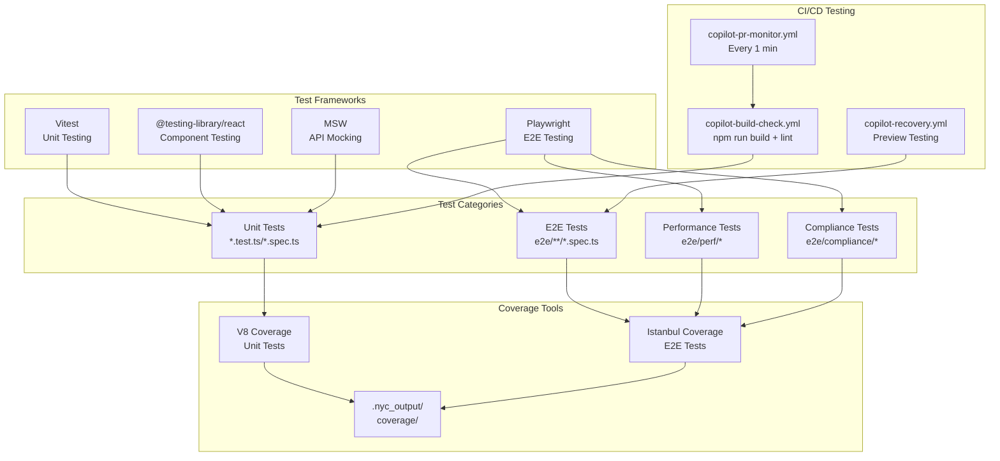

**Sources:**
- [web/package.json:6-39]()
- [web/vite.config.ts:172-190]()
- [.github/workflows/copilot-build-check.yml:1-144]()

---

## Testing Frameworks and Dependencies

### Core Testing Stack

| Framework | Purpose | Configuration |
|-----------|---------|---------------|
| **Vitest** | Unit testing framework | [web/vite.config.ts:172-190]() |
| **Playwright** | E2E browser automation | [web/package.json:72]() |
| **@testing-library/react** | Component testing utilities | [web/package.json:74]() |
| **@testing-library/jest-dom** | DOM assertions | [web/package.json:73]() |
| **@testing-library/user-event** | User interaction simulation | [web/package.json:75]() |
| **MSW** (Mock Service Worker) | API request mocking | [web/package.json:90]() |
| **Istanbul** | E2E code coverage | [web/package.json:86-88]() |
| **V8** | Unit test coverage | [web/vite.config.ts:180]() |
| **@axe-core/playwright** | Accessibility testing | [web/package.json:69]() |

### Coverage Tools

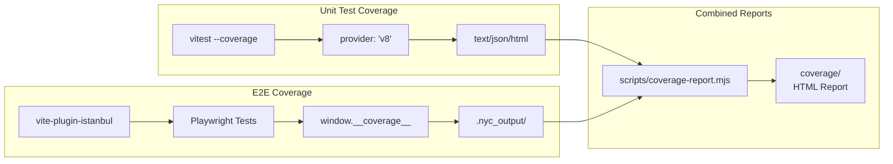

**Sources:**
- [web/package.json:68-102]()
- [web/vite.config.ts:1-191]()

---

## Unit Testing with Vitest

### Configuration

The Vitest configuration is defined in [web/vite.config.ts:172-190]():

```typescript
test: {
  globals: true,
  environment: 'jsdom',
  setupFiles: './src/test/setup.ts',
  css: true,
  include: ['src/**/*.{test,spec}.{ts,tsx}'],
  exclude: ['node_modules', 'e2e/**/*'],
  coverage: {
    provider: 'v8',
    reporter: ['text', 'json', 'html'],
    exclude: [
      'node_modules/',
      'e2e/',
      'src/test/',
      '**/*.test.{ts,tsx}',
      '**/*.spec.{ts,tsx}',
    ],
  },
}
```

### Test Execution Commands

| Command | Purpose | Configuration |
|---------|---------|---------------|
| `npm test` | Run unit tests in watch mode | [web/package.json:12]() |
| `npm run test:ui` | Launch Vitest UI dashboard | [web/package.json:13]() |
| `npm run test:coverage` | Generate coverage report | [web/package.json:14]() |

### Test File Structure

Unit tests follow the pattern `*.test.ts` or `*.spec.ts` and are co-located with source files:

```
src/
├── components/
│   └── MyComponent.tsx
│   └── MyComponent.test.tsx
├── hooks/
│   └── useMyHook.ts
│   └── useMyHook.test.ts
└── lib/
    └── utils.ts
    └── utils.test.ts
```

**Sources:**
- [web/vite.config.ts:172-190]()
- [web/package.json:12-14]()

---

## End-to-End Testing with Playwright

### E2E Test Categories

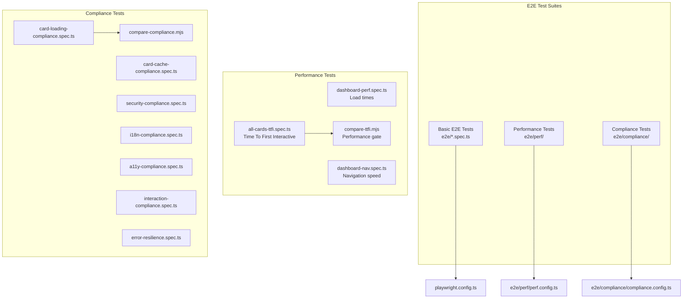

**Sources:**
- [web/package.json:15-35]()

### E2E Test Commands

| Command | Purpose | Script Reference |
|---------|---------|------------------|
| `npm run test:e2e` | Run all E2E tests | [web/package.json:15]() |
| `npm run test:e2e:ui` | Launch Playwright UI | [web/package.json:16]() |
| `npm run test:e2e:headed` | Run with browser visible | [web/package.json:17]() |
| `npm run test:e2e:debug` | Debug mode with inspector | [web/package.json:18]() |
| `npm run test:e2e:chromium` | Test only Chromium | [web/package.json:19]() |
| `npm run test:e2e:firefox` | Test only Firefox | [web/package.json:20]() |
| `npm run test:e2e:webkit` | Test only WebKit/Safari | [web/package.json:21]() |
| `npm run test:e2e:report` | Show HTML test report | [web/package.json:22]() |

### Performance Testing

#### Time To First Interactive (TTFI) Testing

The TTFI test suite measures how quickly each card component becomes interactive after rendering:

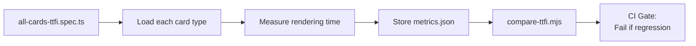

Commands:
- `npm run test:e2e:perf:ttfi` - Run TTFI tests
- `npm run test:e2e:perf:ttfi:gate` - Run tests + enforce performance gate

#### Dashboard Performance Testing

Specific tests for dashboard operations:
- `npm run test:e2e:perf` - Dashboard load performance ([web/package.json:23]())
- `npm run test:e2e:perf:nav` - Navigation performance ([web/package.json:26]())

**Sources:**
- [web/package.json:23-26]()

---

## Compliance Testing

### Compliance Test Matrix

The compliance test suite enforces architectural standards across all card components:

| Test Suite | Purpose | Command | Gate Script |
|------------|---------|---------|-------------|
| **UI Compliance** | Card loading states | `test:e2e:ui-compliance` | `compare-compliance.mjs` |
| **Cache Compliance** | Cache key consistency | `test:e2e:cache-compliance` | - |
| **Security Compliance** | XSS prevention, CSP | `test:e2e:security-compliance` | - |
| **i18n Compliance** | Translation coverage | `test:e2e:i18n-compliance` | - |
| **Accessibility Compliance** | WCAG 2.1 AA standards | `test:e2e:a11y-compliance` | - |
| **Interaction Compliance** | Click handlers, focus | `test:e2e:interaction-compliance` | - |
| **Error Resilience** | Error boundaries | `test:e2e:error-resilience` | - |

### Accessibility Testing

The accessibility compliance test uses `@axe-core/playwright` to validate WCAG standards:

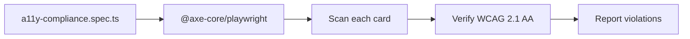

Run with: `npm run test:e2e:a11y-compliance`

### Compliance Gate Enforcement

The `compare-compliance.mjs` script enforces quality gates in CI:

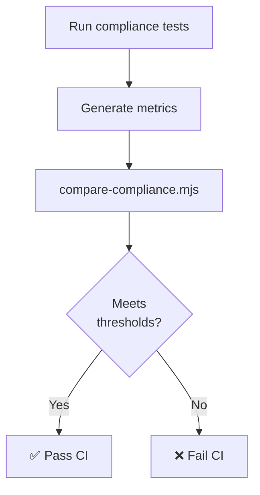

Run with: `npm run test:e2e:ui-compliance:gate`

**Sources:**
- [web/package.json:27-35]()

---

## Coverage Collection and Reporting

### E2E Coverage with Istanbul

E2E coverage is collected using `vite-plugin-istanbul`:

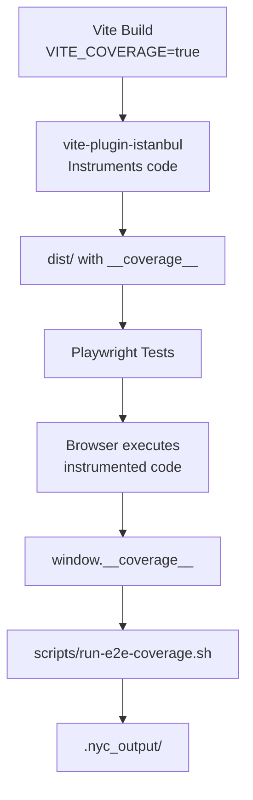

Istanbul configuration in [web/vite.config.ts:52-61]():

```typescript
isE2ECoverage &&
  istanbul({
    include: 'src/*',
    exclude: ['node_modules', 'e2e/**', '**/*.spec.ts', '**/*.test.ts'],
    extension: ['.js', '.ts', '.tsx', '.jsx'],
    requireEnv: false,
    forceBuildInstrument: true,
  })
```

### Coverage Commands

| Command | Purpose | Reference |
|---------|---------|-----------|
| `npm run test:coverage` | Unit test coverage (V8) | [web/package.json:14]() |
| `npm run test:e2e:coverage` | E2E coverage (Istanbul) | [web/package.json:36]() |
| `npm run coverage:report` | Generate combined report | [web/package.json:37]() |
| `npm run coverage:clean` | Clean coverage artifacts | [web/package.json:38]() |

### Combined Coverage Report

The `scripts/coverage-report.mjs` script merges unit and E2E coverage:

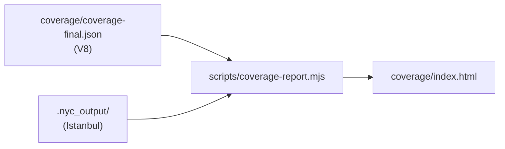

**Sources:**
- [web/vite.config.ts:52-61]()
- [web/package.json:36-38]()

---

## CI/CD Testing Pipeline

### Copilot Build Check Workflow

The `copilot-build-check.yml` workflow runs on every push to `copilot/**` branches:

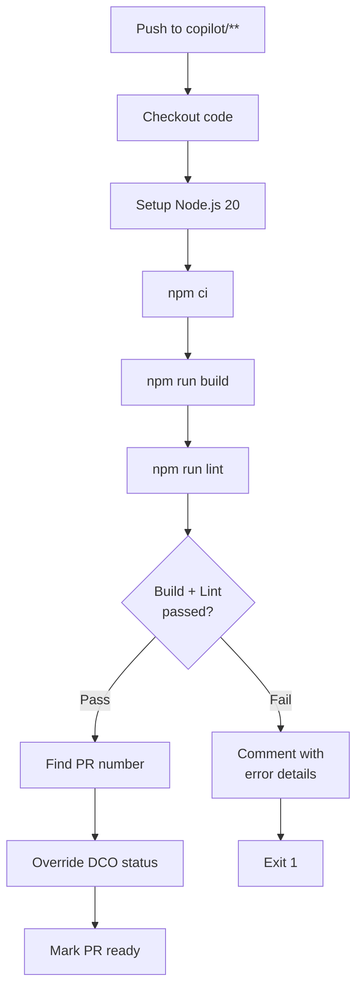

Key features from [.github/workflows/copilot-build-check.yml:1-144]():
- Runs `npm run build` and captures output ([.github/workflows/copilot-build-check.yml:35-39]())
- Runs `npm run lint` and captures output ([.github/workflows/copilot-build-check.yml:41-45]())
- Posts failure details as PR comment ([.github/workflows/copilot-build-check.yml:80-109]())
- Automatically marks PR ready when both pass ([.github/workflows/copilot-build-check.yml:111-137]())

### PR Monitoring Workflow

The `copilot-pr-monitor.yml` workflow runs every minute to monitor Copilot PRs:

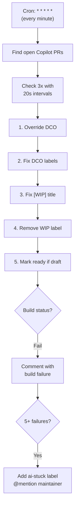

The workflow performs 3 checks with 20-second intervals, providing effective 20-second polling. Key operations from [.github/workflows/copilot-pr-monitor.yml:24-267]():

1. **DCO Override**: Sets commit status to success ([.github/workflows/copilot-pr-monitor.yml:68-78]())
2. **Label Management**: Fixes `dco-signoff:` labels ([.github/workflows/copilot-pr-monitor.yml:82-105]())
3. **Title Cleanup**: Removes `[WIP]` prefix ([.github/workflows/copilot-pr-monitor.yml:107-120]())
4. **Draft Status**: Always marks ready if draft ([.github/workflows/copilot-pr-monitor.yml:135-152]())
5. **Build Monitoring**: Checks both check_runs and status contexts ([.github/workflows/copilot-pr-monitor.yml:154-180]())

### Copilot Recovery Workflow

The `copilot-recovery.yml` workflow handles build failures and preview testing:

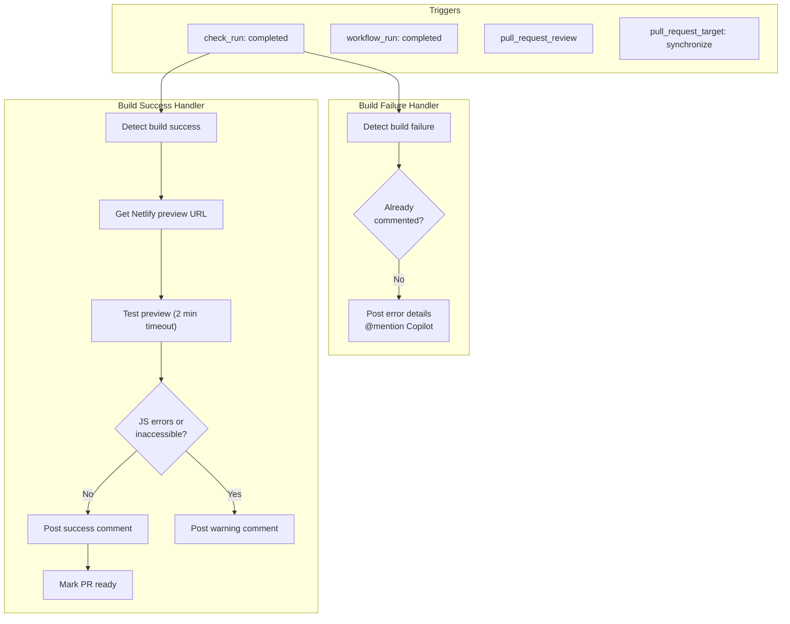

Preview testing implementation from [.github/workflows/copilot-recovery.yml:245-283]():

```yaml
# Wait for Netlify to be ready (up to 2 minutes)
for i in {1..12}; do
  HTTP_CODE=$(curl -s -o /dev/null -w "%{http_code}" "$PREVIEW_URL" --max-time 10 || echo "000")
  echo "Attempt $i: HTTP $HTTP_CODE"
  
  if [ "$HTTP_CODE" == "200" ]; then
    echo "preview_status=success" >> $GITHUB_OUTPUT
    break
  fi
  sleep 10
done
```

The workflow also checks for JavaScript errors by scanning HTML content ([.github/workflows/copilot-recovery.yml:285-292]()).

**Sources:**
- [.github/workflows/copilot-build-check.yml:1-144]()
- [.github/workflows/copilot-pr-monitor.yml:1-267]()
- [.github/workflows/copilot-recovery.yml:1-647]()

---

## Demo Mode Testing

### Demo Mode Configuration

Demo mode provides mock data for testing without backend dependencies:

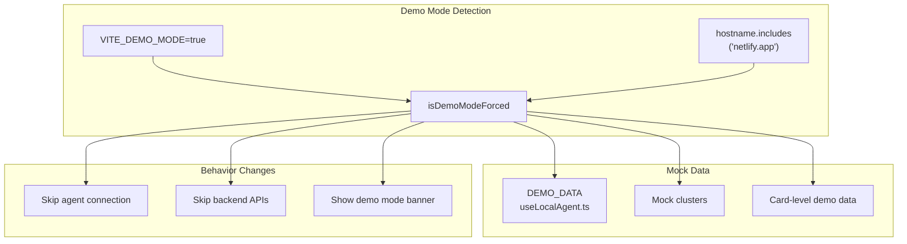

Demo data structure from [web/src/hooks/useLocalAgent.ts:38-52]():

```typescript
const DEMO_DATA: AgentHealth = {
  status: 'demo',
  version: 'demo',
  clusters: 3,
  hasClaude: false,
  claude: {
    installed: false,
    tokenUsage: {
      session: { input: 0, output: 0 },
      today: { input: 0, output: 0 },
      thisMonth: { input: 0, output: 0 },
    },
  },
}
```

Netlify configuration enables demo mode automatically ([netlify.toml:15-18]()):

```toml
[build.environment]
  # Enable demo mode with mock data for Netlify previews
  VITE_DEMO_MODE = "true"
  NODE_VERSION = "20"
```

**Sources:**
- [web/src/hooks/useLocalAgent.ts:38-52]()
- [netlify.toml:15-18]()

---

## Manual Testing Procedures

### Local Development Testing

1. **Start Development Server**
   ```bash
   cd web
   npm run dev
   ```
   Vite dev server runs on `http://localhost:5174` ([web/vite.config.ts:92]())

2. **Start Backend (Optional)**
   ```bash
   go run cmd/console/main.go
   ```
   Backend API runs on `http://localhost:8080`

3. **Test with kc-agent**
   ```bash
   kc-agent
   ```
   Agent runs on `http://localhost:8080` ([web/src/lib/constants.ts]())

### Testing Agent Connection

The agent connection follows a sophisticated state machine in `useLocalAgent`:

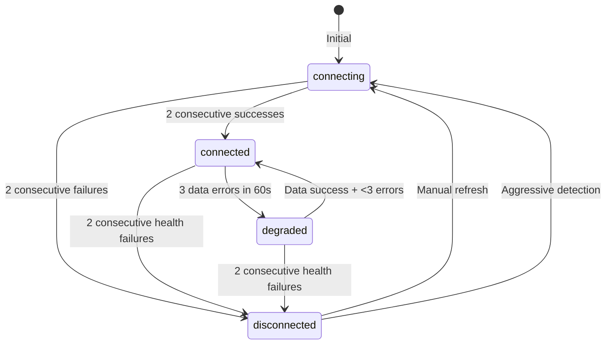

State transitions from [web/src/hooks/useLocalAgent.ts:194-276]():
- **POLL_INTERVAL**: 10 seconds when connected ([web/src/hooks/useLocalAgent.ts:31]())
- **DISCONNECTED_POLL_INTERVAL**: 60 seconds when disconnected ([web/src/hooks/useLocalAgent.ts:32]())
- **FAILURE_THRESHOLD**: 2 consecutive failures ([web/src/hooks/useLocalAgent.ts:33]())
- **SUCCESS_THRESHOLD**: 2 consecutive successes ([web/src/hooks/useLocalAgent.ts:34]())

### Preview Testing

Netlify preview deployments are automatically tested by the recovery workflow:

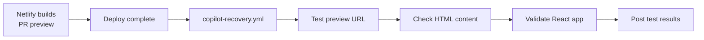

Preview URL pattern: `https://deploy-preview-{PR_NUMBER}.console-deploy-preview.kubestellar.io`

The workflow waits up to 2 minutes for the preview to be ready ([.github/workflows/copilot-recovery.yml:267-277]()).

**Sources:**
- [web/vite.config.ts:91-171]()
- [web/src/hooks/useLocalAgent.ts:31-360]()
- [.github/workflows/copilot-recovery.yml:245-365]()

---

## Test Environment Setup

### Copilot Setup Steps

The `copilot-setup-steps.yml` workflow pre-configures the test environment:

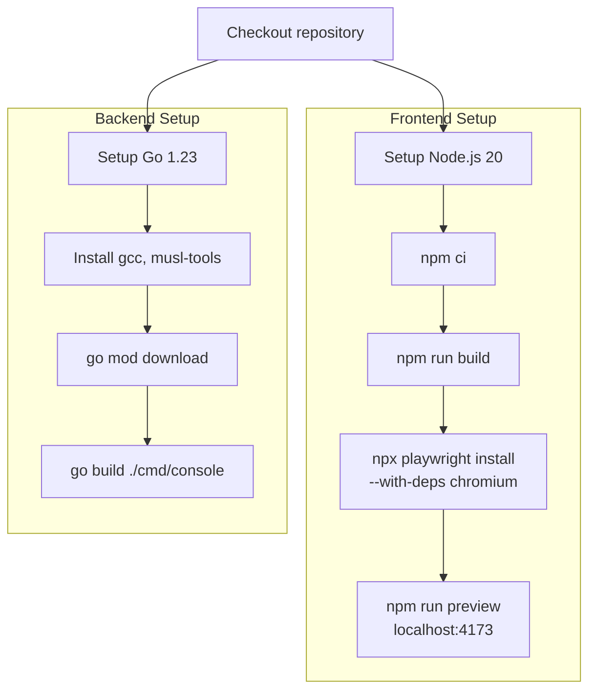

The preview server starts in the background ([.github/workflows/copilot-setup-steps.yml:37-50]()):

```yaml
- name: Start local preview server
  working-directory: web
  run: |
    # Start vite preview in background
    nohup npm run preview -- --host 0.0.0.0 --port 4173 &
    echo "Preview server starting on http://localhost:4173"
    # Wait for it to be ready
    for i in $(seq 1 15); do
      if curl -s -o /dev/null -w "%{http_code}" http://localhost:4173 | grep -q 200; then
        echo "Preview server is ready"
        break
      fi
      sleep 2
    done
```

**Sources:**
- [.github/workflows/copilot-setup-steps.yml:1-69]()

---

## Testing Best Practices

### Component Testing Pattern

1. **Use Testing Library**: Prefer `@testing-library/react` for component tests
2. **Mock External Dependencies**: Use MSW for API mocking
3. **Test User Interactions**: Use `@testing-library/user-event` for realistic interactions
4. **Accessibility**: Include accessibility checks with `@axe-core/playwright`

### E2E Testing Pattern

1. **Page Object Model**: Organize selectors and actions into reusable page objects
2. **Wait for Stability**: Use Playwright's auto-waiting features
3. **Isolate Tests**: Each test should be independent and idempotent
4. **Browser Coverage**: Test across Chromium, Firefox, and WebKit

### Performance Testing Pattern

1. **Establish Baselines**: Store performance metrics in version control
2. **Enforce Gates**: Fail CI if performance regresses beyond thresholds
3. **Measure Real User Metrics**: Focus on TTFI, LCP, CLS
4. **Test on CI Hardware**: Ensure consistent performance measurement

### Coverage Goals

- **Unit Test Coverage**: Target >80% for critical business logic
- **E2E Coverage**: Focus on happy paths and critical user flows
- **Combined Coverage**: Aim for >70% overall code coverage

**Sources:**
- [web/package.json:6-39]()
- [web/vite.config.ts:172-190]()

---

