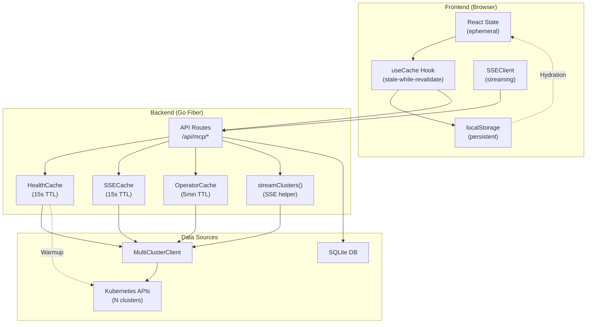
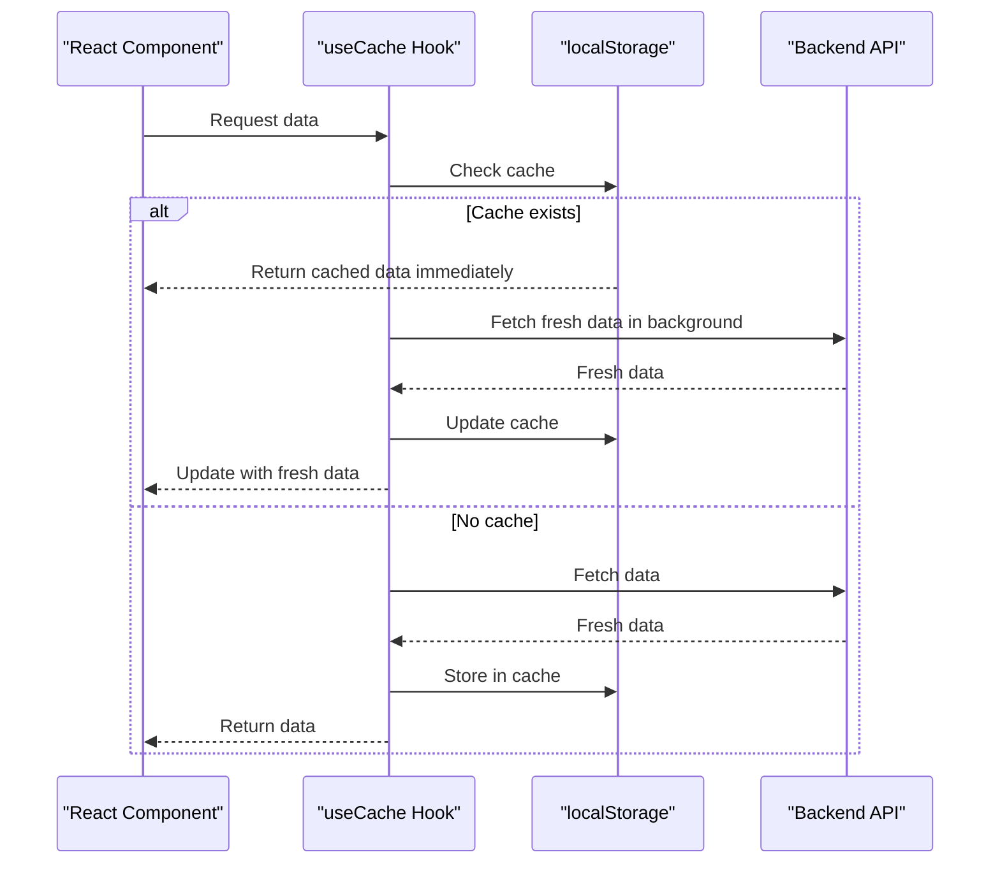
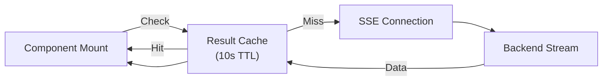
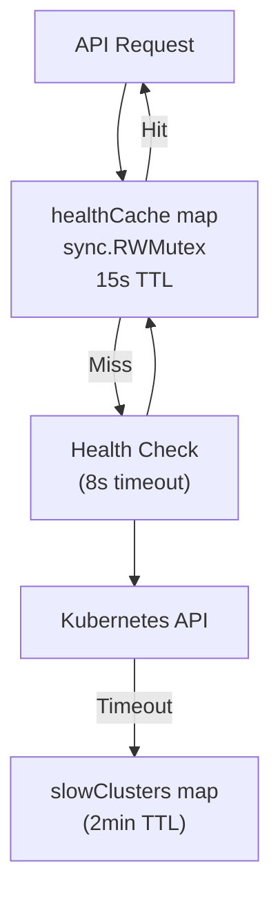
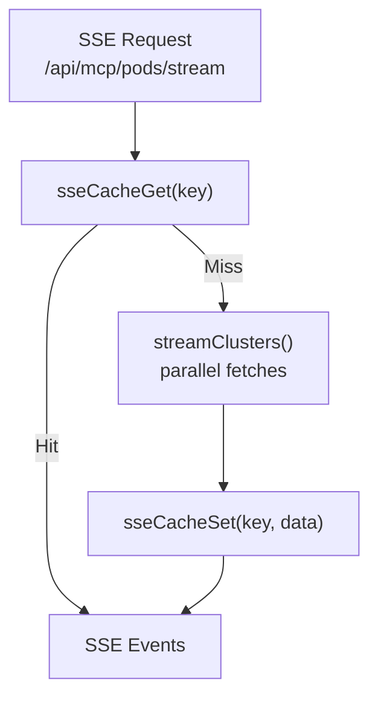
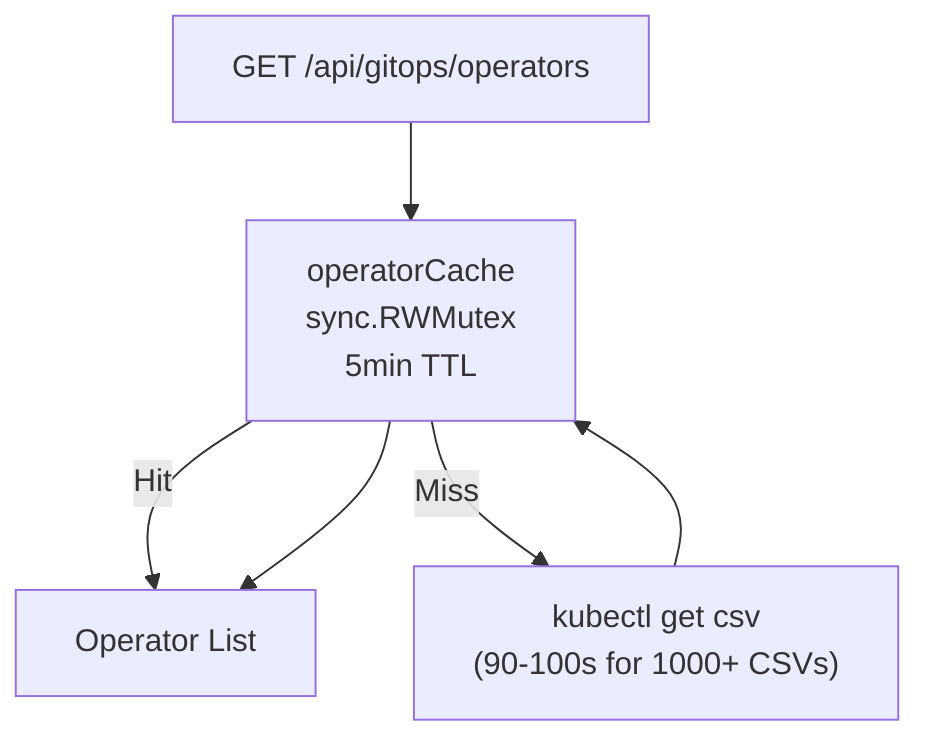
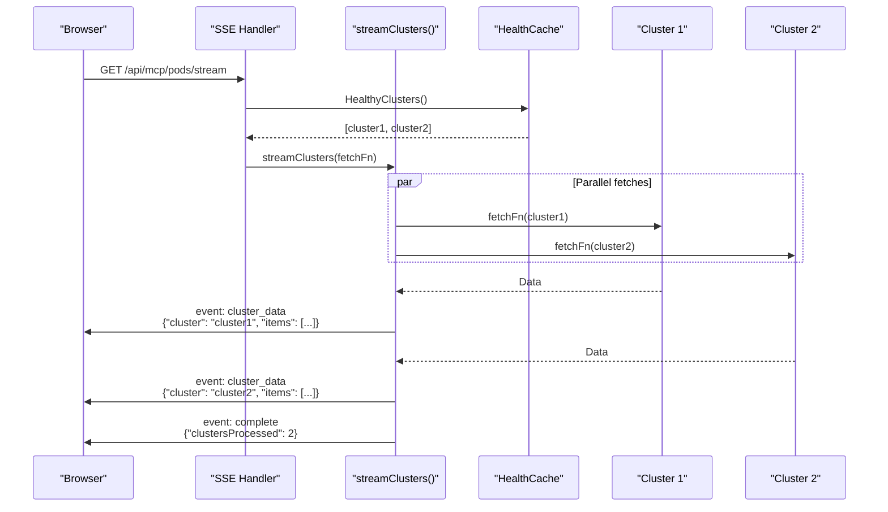
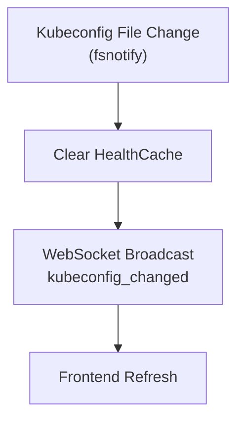
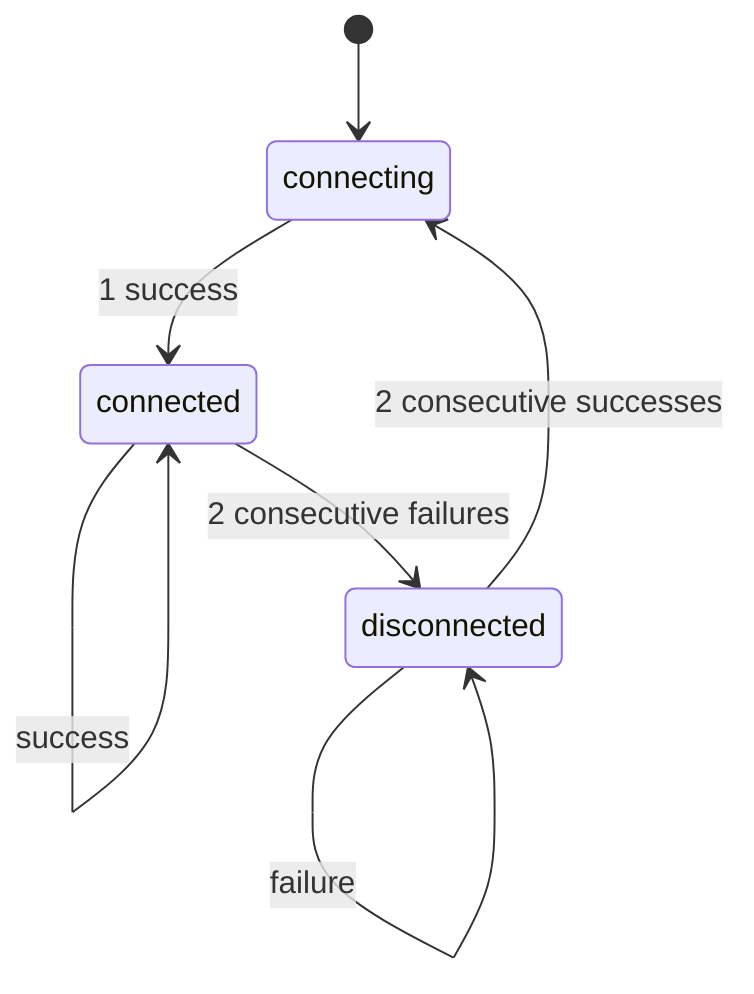
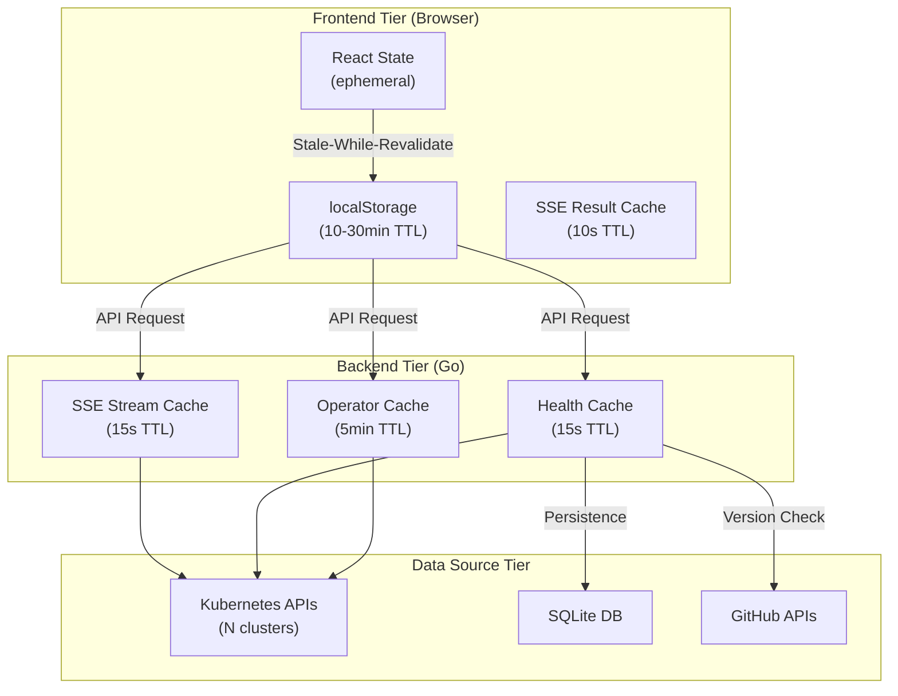

<!-- source: DeepWiki mcp.deepwiki.com · repo kubestellar/console · page 2.4 Data Flow & Caching · fetched 2026-10-27 -->

# Data Flow & Caching

Relevant source files

The following files were used as context for generating this wiki page:

- [.env.example](.env.example)
- [netlify.toml](netlify.toml)
- [pkg/api/handlers/analytics_proxy.go](pkg/api/handlers/analytics_proxy.go)
- [pkg/api/handlers/demo_data.go](pkg/api/handlers/demo_data.go)
- [pkg/api/handlers/gitops.go](pkg/api/handlers/gitops.go)
- [pkg/api/handlers/mcp.go](pkg/api/handlers/mcp.go)
- [pkg/api/handlers/sse.go](pkg/api/handlers/sse.go)
- [pkg/api/server.go](pkg/api/server.go)
- [pkg/k8s/client.go](pkg/k8s/client.go)
- [web/netlify/functions/analytics-collect.mts](web/netlify/functions/analytics-collect.mts)
- [web/package-lock.json](web/package-lock.json)
- [web/package.json](web/package.json)
- [web/src/components/agent/APIKeySettings.tsx](web/src/components/agent/APIKeySettings.tsx)
- [web/src/components/cards/ProactiveGPUNodeHealthMonitor.tsx](web/src/components/cards/ProactiveGPUNodeHealthMonitor.tsx)
- [web/src/components/clusters/ClusterDetailModal.tsx](web/src/components/clusters/ClusterDetailModal.tsx)
- [web/src/components/clusters/Clusters.tsx](web/src/components/clusters/Clusters.tsx)
- [web/src/components/clusters/ResourceDetailModals.tsx](web/src/components/clusters/ResourceDetailModals.tsx)
- [web/src/components/clusters/components/ClusterGrid.tsx](web/src/components/clusters/components/ClusterGrid.tsx)
- [web/src/components/clusters/components/GPUDetailModal.tsx](web/src/components/clusters/components/GPUDetailModal.tsx)
- [web/src/components/ui/CloudProviderIcon.tsx](web/src/components/ui/CloudProviderIcon.tsx)
- [web/src/config/cards/gpu-node-health.ts](web/src/config/cards/gpu-node-health.ts)
- [web/src/config/dashboards/gpu.ts](web/src/config/dashboards/gpu.ts)
- [web/src/hooks/mcp/types.ts](web/src/hooks/mcp/types.ts)
- [web/src/hooks/useLocalAgent.ts](web/src/hooks/useLocalAgent.ts)
- [web/src/hooks/useMCP.ts](web/src/hooks/useMCP.ts)
- [web/src/lib/analytics.ts](web/src/lib/analytics.ts)
- [web/src/lib/sseClient.ts](web/src/lib/sseClient.ts)
- [web/vite.config.ts](web/vite.config.ts)

## Purpose and Scope

This document describes the multi-tier caching strategy and data flow patterns used throughout the KubeStellar Console. It covers frontend caching (React state, localStorage, SWR), backend caching (health cache, SSE cache, operator cache), SSE streaming architecture, and cache invalidation policies. For information about the overall system architecture, see [Architecture](#2). For details on specific API handlers, see [Backend API Handlers](#5).

---

## Overview

The KubeStellar Console implements a **sophisticated multi-tier caching strategy** designed to:
- Minimize latency for cluster health checks across N clusters
- Avoid redundant API calls when multiple users view the same data
- Provide instant UI responses even when backend data is stale
- Gracefully handle slow or offline clusters without blocking

Data flows through three primary patterns:
1. **SSE Push** — Real-time streaming of cluster data (pods, events, metrics)
2. **REST Pull** — Settings, configuration, and historical data
3. **WebSocket Bidirectional** — Update progress, mission results, alerts

---

## Data Flow Architecture

**Sources:** [pkg/api/server.go:1-849](), [pkg/k8s/client.go:1-2047](), [pkg/api/handlers/mcp.go:1-1636](), [pkg/api/handlers/sse.go:1-544](), [web/src/lib/sseClient.ts:1-142](), [web/src/hooks/useMCP.ts:1-4]()

---

## Frontend Caching Strategy

### useCache Pattern

The frontend implements a **stale-while-revalidate** pattern via custom hooks that wrap data fetching:

**Key Implementation:**
- Cache keys use descriptive prefixes: `kc-releases-cache`, `kc-dev-latest-sha`, `nightly-e2e-cache`
- TTL typically 10-30 minutes depending on data volatility
- Optimistic updates for user actions (immediate UI feedback → sync to backend)

**Sources:** [web/src/hooks/useMCP.ts:1-4](), [web/src/lib/sseClient.ts:1-142]()

### localStorage Persistence

Frontend caches persist across sessions using `localStorage`:

| Cache Key | Purpose | TTL |
|-----------|---------|-----|
| `kc-releases-cache` | GitHub releases for update checking | 30 min |
| `kc-dev-latest-sha` | Development build version | 10 min |
| `nightly-e2e-cache` | E2E test status | 10 min |
| `kubestellar-clusters-cards` | Dashboard card layout | Persistent |
| `_ksc_cid` | Analytics client ID | Persistent |

**Sources:** [web/src/lib/analytics.ts:1-382](), [web/src/lib/constants.ts]()

### SSE Result Cache

The frontend SSE client caches streaming results for 10 seconds to avoid duplicate requests during rapid navigation:

**Sources:** [web/src/lib/sseClient.ts:30-37]()

---

## Backend Caching Strategy

### MultiClusterClient Health Cache

The `MultiClusterClient` maintains a **health cache** (15s TTL) to prevent repeated cluster health checks:

**Key Implementation Details:**
- Cache key: cluster name
- TTL: `15 * time.Second` [pkg/k8s/client.go:35]()
- Mutex: `sync.RWMutex` for concurrent access [pkg/k8s/client.go:44-59]()
- Warmup: Probes all clusters on startup to populate cache [pkg/api/server.go:147-151]()
- Slow cluster tracking: Clusters with consecutive timeouts get reduced timeout (3s vs 8s) [pkg/k8s/client.go:40]()

**Critical Function:** `HealthyClusters()` filters out offline clusters using cached health status, preventing blocking on unreachable clusters.

**Sources:** [pkg/k8s/client.go:31-59](), [pkg/api/server.go:139-163]()

### SSE Stream Cache

SSE endpoints cache responses for 15 seconds to avoid redundant multi-cluster queries when multiple users view the same data:

**Implementation:**
- Global cache: `sseCache` map with mutex [pkg/api/handlers/sse.go:48-56]()
- TTL: `15 * time.Second` [pkg/api/handlers/sse.go:45]()
- Cache key: `fmt.Sprintf("%s?%s", endpoint, queryString)`
- Concurrent request deduplication via `inflightRequests` map [web/src/lib/sseClient.ts:32]()

**Sources:** [pkg/api/handlers/sse.go:46-72](), [web/src/lib/sseClient.ts:30-142]()

### Operator Cache

OLM ClusterServiceVersion (CSV) queries are extremely slow (90-100s for 1000+ operators), requiring aggressive caching:

**Configuration:**
- Cache TTL: `5 * time.Minute` [pkg/api/handlers/gitops.go:378]()
- Per-cluster timeout: `180 * time.Second` (3 minutes) [pkg/api/handlers/gitops.go:373]()
- Overall timeout: `200 * time.Second` [pkg/api/handlers/gitops.go:374]()

**Why so aggressive?** CSV queries use jsonpath extraction in kubectl, which becomes a bottleneck at scale. Without caching, the operators page would be unusable.

**Sources:** [pkg/api/handlers/gitops.go:372-379]()

---

## SSE Streaming Architecture

### Generic streamClusters Helper

The backend provides a generic `streamClusters()` helper that streams per-cluster results as SSE events:

**Key Features:**
1. **Skip Offline Clusters**: Uses `HealthyClusters()` to emit `cluster_skipped` events instantly for known-offline clusters [pkg/api/handlers/sse.go:73-171]()
2. **Parallel Fetches**: Spawns goroutines for each healthy cluster [pkg/api/handlers/sse.go:135-141]()
3. **Timeout Management**: Per-cluster timeout (10s) + overall deadline (30s) [pkg/api/handlers/sse.go:36-39]()
4. **Progressive Delivery**: Streams each cluster's data as soon as it arrives, not waiting for all clusters [pkg/api/handlers/sse.go:147-155]()

**Sources:** [pkg/api/handlers/sse.go:73-171]()

### Frontend SSE Client

The frontend `SSEClient` consumes SSE streams and progressively updates the UI:

**Implementation Details:**
- Timeout: 60s [web/src/lib/sseClient.ts:29]()
- In-flight dedup: `inflightRequests` map prevents duplicate concurrent requests [web/src/lib/sseClient.ts:32]()
- Result cache: 10s TTL for rapid re-navigation [web/src/lib/sseClient.ts:34-36]()
- Fallback: Falls back to regular fetch on SSE failure

**Event Handlers:**
- `cluster_data`: Progressive cluster results → `onClusterData(clusterName, items)`
- `cluster_skipped`: Offline cluster notification
- `error`: Error details
- `complete`: Stream summary → `onDone(summary)`

**Sources:** [web/src/lib/sseClient.ts:1-142]()

---

## Cache Invalidation Strategies

### Time-Based Expiration

All caches use TTL-based expiration:

| Cache | TTL | Rationale |
|-------|-----|-----------|
| HealthCache | 15s | Balance between responsiveness and load on K8s API servers |
| SSECache | 15s | Multi-user dedup window (typical card render time) |
| OperatorCache | 5min | CSV queries are extremely slow (90-100s), aggressive caching essential |
| Frontend localStorage | 10-30min | User navigation patterns (don't refetch on every tab switch) |
| SSE Result Cache | 10s | Rapid re-navigation (back/forward browser navigation) |

**Sources:** [pkg/k8s/client.go:35](), [pkg/api/handlers/sse.go:45](), [pkg/api/handlers/gitops.go:378](), [web/src/lib/sseClient.ts:36]()

### Event-Driven Invalidation

Certain events trigger immediate cache invalidation:

**Implementation:**
- File watcher: `fsnotify.Watcher` monitors `~/.kube/config` [pkg/k8s/client.go:54]()
- Callback: `SetOnReload()` triggers broadcast [pkg/api/server.go:152-158]()
- WebSocket event type: `kubeconfig_changed`

**Sources:** [pkg/api/server.go:152-158](), [pkg/k8s/client.go:54]()

### Manual Invalidation

Users can manually refresh data:
- UI "Refresh" buttons send `Cache-Control: no-cache` header
- Per-cluster refresh button triggers individual cluster health check [web/src/components/clusters/components/ClusterGrid.tsx:166-177]()

**Sources:** [web/src/components/clusters/components/ClusterGrid.tsx:165-178]()

---

## Special Cases

### Analytics Proxy Caching

The GA4 analytics proxy **does not cache** events — it forwards them immediately to Google Analytics. However, it implements:

1. **Base64 Encoding**: Payload encoded to bypass network-level filters [pkg/api/handlers/analytics_proxy.go:60-72](), [web/src/lib/analytics.ts:143-146]()
2. **Measurement ID Rewrite**: Decoy ID (`G-0000000000`) → real ID server-side [pkg/api/handlers/analytics_proxy.go:50-58]()
3. **IP Forwarding**: Preserves user's real IP for geolocation [pkg/api/handlers/analytics_proxy.go:75-87]()

**Sources:** [pkg/api/handlers/analytics_proxy.go:1-156](), [web/src/lib/analytics.ts:1-382]()

### Local Agent Polling

The `useLocalAgent` hook implements **hysteresis** to prevent connection flicker:

**Configuration:**
- Poll interval (connected): 10s [web/src/hooks/useLocalAgent.ts:31]()
- Poll interval (disconnected): 60s [web/src/hooks/useLocalAgent.ts:32]()
- Failure threshold: 2 consecutive failures [web/src/hooks/useLocalAgent.ts:33]()
- Success threshold: 2 consecutive successes [web/src/hooks/useLocalAgent.ts:34]()

**Why hysteresis?** Prevents UI flashing when agent briefly times out (e.g., due to temporary network hiccup or GC pause).

**Sources:** [web/src/hooks/useLocalAgent.ts:31-36](), [web/src/hooks/useLocalAgent.ts:194-275]()

---

## Cache Hierarchy Summary

**Priority Order:**
1. Serve from cache **instantly** (avoid loading states)
2. Background refresh in parallel
3. On cache miss, show skeleton while fetching
4. On error, fall back to **stale cache + demo data**

This architecture ensures the UI remains responsive even with slow/offline clusters or network issues.

**Sources:** [pkg/api/server.go:1-849](), [pkg/k8s/client.go:31-59](), [pkg/api/handlers/sse.go:46-72](), [web/src/lib/sseClient.ts:30-142]()

---

