<!-- source: DeepWiki mcp.deepwiki.com · repo kubestellar/console · page 3.2 Dashboard Management · fetched 2026-10-27 -->

# Dashboard Management

<details>
<summary>Relevant source files</summary>

The following files were used as context for generating this wiki page:

- [web/src/App.tsx](web/src/App.tsx)
- [web/src/components/cards/CardWrapper.tsx](web/src/components/cards/CardWrapper.tsx)
- [web/src/components/cards/cardRegistry.ts](web/src/components/cards/cardRegistry.ts)
- [web/src/components/cards/flatcar_status/demoData.ts](web/src/components/cards/flatcar_status/demoData.ts)
- [web/src/components/cards/flatcar_status/index.tsx](web/src/components/cards/flatcar_status/index.tsx)
- [web/src/components/cards/flatcar_status/useFlatcarStatus.ts](web/src/components/cards/flatcar_status/useFlatcarStatus.ts)
- [web/src/components/cards/flatcar_status/versionUtils.ts](web/src/components/cards/flatcar_status/versionUtils.ts)
- [web/src/components/cards/llmd/index.ts](web/src/components/cards/llmd/index.ts)
- [web/src/components/compute/ClusterComparisonPage.tsx](web/src/components/compute/ClusterComparisonPage.tsx)
- [web/src/components/dashboard/AddCardModal.tsx](web/src/components/dashboard/AddCardModal.tsx)
- [web/src/components/dashboard/CustomDashboard.tsx](web/src/components/dashboard/CustomDashboard.tsx)
- [web/src/components/dashboard/Dashboard.tsx](web/src/components/dashboard/Dashboard.tsx)
- [web/src/components/dashboard/templates.ts](web/src/components/dashboard/templates.ts)
- [web/src/components/layout/Layout.tsx](web/src/components/layout/Layout.tsx)
- [web/src/components/llmd-benchmarks/LLMdBenchmarks.tsx](web/src/components/llmd-benchmarks/LLMdBenchmarks.tsx)
- [web/src/hooks/useCertManager.ts](web/src/hooks/useCertManager.ts)
- [web/src/locales/en/cards.json](web/src/locales/en/cards.json)

</details>


## Purpose and Scope

This document describes the dashboard management system in the KubeStellar Console, including the main `Dashboard` and `CustomDashboard` components, card lifecycle management, drag-and-drop functionality, and persistence strategies. This covers the interactive canvas where users arrange and interact with monitoring cards.

For information about individual card components and the card registry, see [Card Components & Registry](#3.1). For pre-configured dashboard templates, see [Dashboard Templates](#3.3). For AI-powered card creation, see [Card Factory & AI Creation](#3.4).

---

## System Overview

The dashboard system provides a flexible, card-based interface for Kubernetes cluster monitoring. Users can arrange cards in a grid layout, add/remove cards, configure card-specific settings, and persist their layouts either locally (main dashboard) or server-side (custom dashboards).

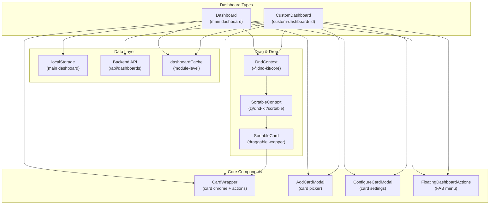

**Sources:** [web/src/components/dashboard/Dashboard.tsx:1-77](), [web/src/components/dashboard/CustomDashboard.tsx:1-154]()

---

## Dashboard vs CustomDashboard

### Main Dashboard

The main dashboard (`Dashboard.tsx`) is the default landing page at route `/`. It stores its card layout in **localStorage** under the key `kubestellar-main-dashboard-cards` for instant restoration across sessions without requiring a backend API.

**Key characteristics:**
- Single shared instance (not user-specific)
- localStorage persistence only
- Fast load from cache (no API roundtrip)
- Default cards defined in [web/src/config/dashboards.ts]()

**Storage strategy:**
```
localStorage['kubestellar-main-dashboard-cards'] → Card[]
dashboardCache (module-level) → { dashboard, cards, timestamp }
```

**Sources:** [web/src/components/dashboard/Dashboard.tsx:60-92]()

### Custom Dashboards

Custom dashboards (`CustomDashboard.tsx`) are user-created dashboard instances accessible at `/custom-dashboard/:id`. They persist their card layout to the **backend API** at `/api/dashboards/:id/cards`, enabling multi-user access and cross-device synchronization.

**Key characteristics:**
- Multiple instances per user
- Backend persistence via API
- Editable name/description
- Shareable via URL
- Can be created from templates

**API endpoints:**
```
GET    /api/dashboards/:id              → Dashboard metadata
GET    /api/dashboards/:id/cards        → Card[] layout
POST   /api/dashboards/:id/cards        → Create card
PUT    /api/dashboards/:id/cards/:cardId → Update card
DELETE /api/dashboards/:id/cards/:cardId → Remove card
DELETE /api/dashboards/:id              → Delete dashboard
```

**Sources:** [web/src/components/dashboard/CustomDashboard.tsx:154-278]()

---

## Card Data Model

```typescript
interface Card {
  id: string                           // Unique identifier (e.g., "card-1234567890")
  card_type: string                    // Registry key (e.g., "cluster_health")
  config: Record<string, unknown>      // Card-specific configuration
  position: {
    x: number                          // Grid position (unused in sortable mode)
    y: number                          // Grid position (unused in sortable mode)
    w: number                          // Width in grid columns (1-12)
    h: number                          // Height (unused in current implementation)
  }
  title?: string                       // Optional custom title
}
```

**Default card widths:**
- Small: 3 columns (25%)
- Medium: 4 columns (33%)
- Large: 6 columns (50%)
- Wide: 8 columns (67%)
- Full: 12 columns (100%)

**Sources:** [web/src/components/dashboard/dashboardUtils.ts](), [web/src/components/cards/CardWrapper.tsx:49-57]()

---

## Drag-and-Drop System

The dashboard uses **@dnd-kit** for accessible, performant drag-and-drop with keyboard navigation support.

### DnD Architecture

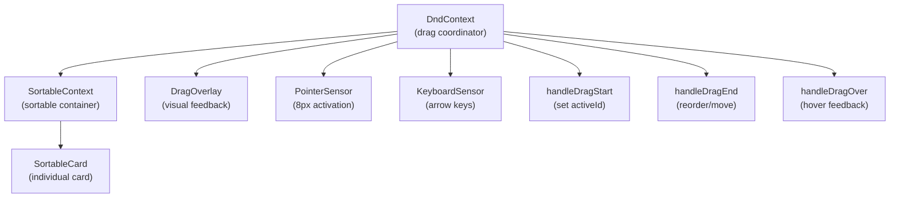

### Drag Event Handlers

**Dashboard.tsx:**
```typescript
// [web/src/components/dashboard/Dashboard.tsx:234-320]()
handleDragStart(event: DragStartEvent) {
  setActiveId(event.active.id as string)
  setIsDragging(true)
}

handleDragEnd(event: DragEndEvent) {
  const { active, over } = event
  
  // Check for cross-dashboard move
  if (String(over.id).startsWith('dashboard-drop-')) {
    moveCardToDashboard(active.id, targetDashboardId)
  }
  
  // Check for workload deploy
  if (active.data.current?.type === 'workload' &&
      String(over.id).startsWith('cluster-group-')) {
    setPendingDeploy({ workloadData, targetClusters })
  }
  
  // Normal reorder
  if (active.id !== over.id) {
    setLocalCards(items => arrayMove(items, oldIndex, newIndex))
  }
}
```

**Sources:** [web/src/components/dashboard/Dashboard.tsx:222-320]()

### Sortable Card Component

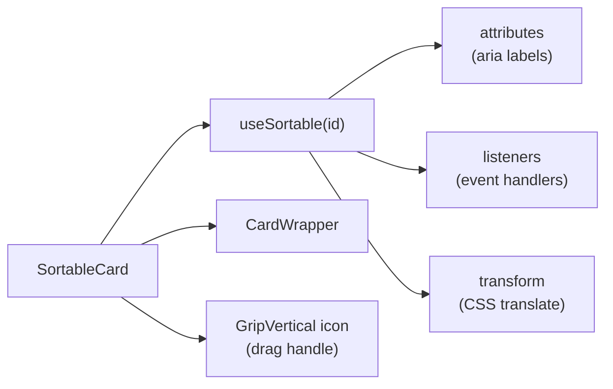

The drag handle is positioned absolutely at `-left-2` and only visible on hover to avoid cluttering the UI:

```typescript
// [web/src/components/dashboard/SharedSortableCard.tsx:44-50]()
<div
  {...attributes}
  {...listeners}
  className="absolute -left-2 top-1/2 -translate-y-1/2 z-10 p-1 rounded 
             cursor-grab active:cursor-grabbing opacity-0 hover:opacity-100 
             transition-opacity bg-secondary/80"
>
  <GripVertical className="w-4 h-4 text-muted-foreground" />
</div>
```

**Sources:** [web/src/components/dashboard/SharedSortableCard.tsx:1-100]()

---

## Card Lifecycle Management

### Adding Cards

The `AddCardModal` component provides a searchable card picker organized by category:

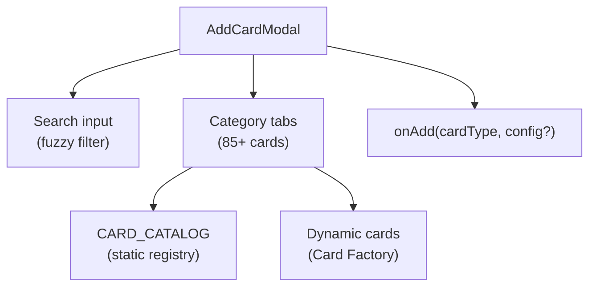

**Card categories:**
- Cluster Admin (12 cards)
- Cluster Health (8 cards)
- Workloads (10 cards)
- Compute (6 cards)
- Storage (2 cards)
- Network (8 cards)
- GitOps (8 cards)
- ArgoCD (3 cards)
- Operators (3 cards)
- Namespaces (5 cards)
- Security & Events (6 cards)
- AI Agents (7 cards)
- Games (24 cards)
- ...and more

**Sources:** [web/src/components/dashboard/AddCardModal.tsx:12-188]()

### Card Actions

Each card provides actions through the `CardWrapper` menu:

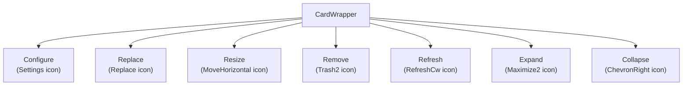

**Action implementations:**

**Configure:** Opens `ConfigureCardModal` to edit card-specific settings (e.g., namespace filter, metric type, refresh interval).

```typescript
// [web/src/components/dashboard/Dashboard.tsx:546-570]()
const handleConfigureCard = useCallback((card: Card) => {
  setSelectedCard(card)
  setIsConfigureCardOpen(true)
  emitCardConfigured(card.card_type)
}, [])

const handleSaveCardConfig = useCallback(async (config: Record<string, unknown>) => {
  if (!selectedCard) return
  const updatedCard = { ...selectedCard, config }
  setLocalCards(prev => prev.map(c => c.id === selectedCard.id ? updatedCard : c))
  recordCardConfigured(selectedCard.id, selectedCard.card_type, config)
}, [selectedCard, recordCardConfigured])
```

**Replace:** Opens `ReplaceCardModal` to swap the card type while preserving position.

**Resize:** Opens submenu with 5 width options (3, 4, 6, 8, 12 columns).

**Remove:** Deletes card and records to history for restoration.

**Sources:** [web/src/components/dashboard/Dashboard.tsx:522-598](), [web/src/components/cards/CardWrapper.tsx:156-171]()

---

## Persistence Strategies

### Main Dashboard Persistence

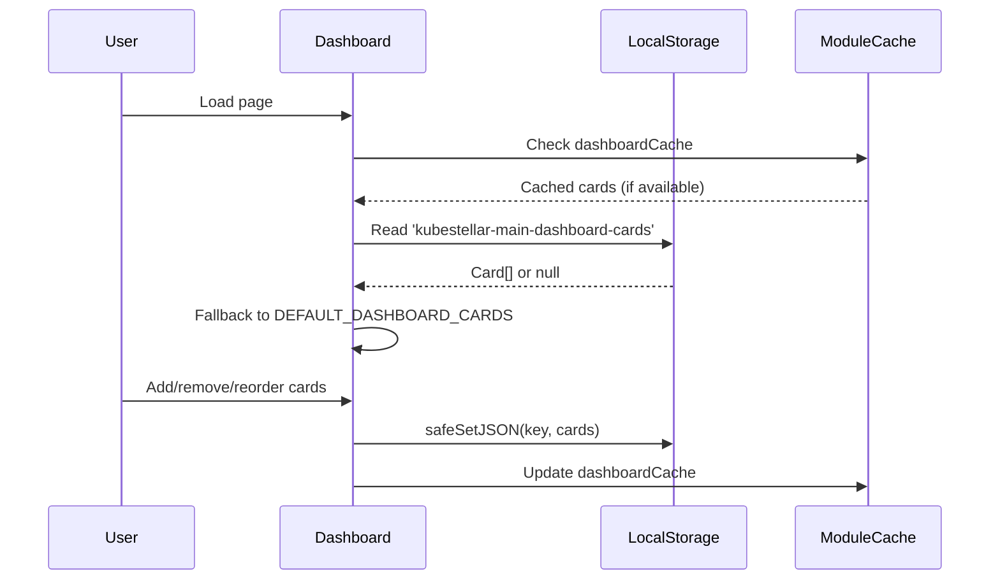

**Cache invalidation:** The main dashboard refreshes cards in the background without blocking the UI. The module-level `dashboardCache` survives navigation to other routes, so returning to the dashboard is instantaneous.

```typescript
// [web/src/components/dashboard/Dashboard.tsx:60-67]()
interface CachedDashboard {
  dashboard: DashboardData | null
  cards: Card[]
  timestamp: number
}
let dashboardCache: CachedDashboard | null = null
```

**Sources:** [web/src/components/dashboard/Dashboard.tsx:433-443]()

### Custom Dashboard Persistence

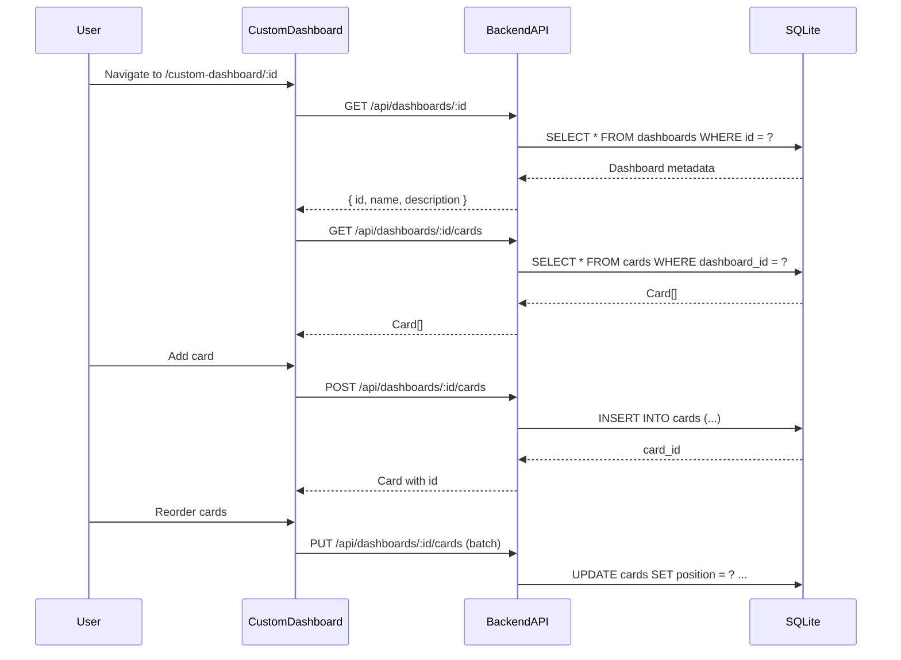

**Optimistic updates:** Card changes are applied immediately to the local state, then synchronized to the backend asynchronously to maintain UI responsiveness.

**Sources:** [web/src/components/dashboard/CustomDashboard.tsx:279-452]()

---

## Stats Overview Integration

Both dashboard types display a `StatsOverview` component with real-time cluster metrics. The stats use a **universal stats provider** pattern with dashboard-specific overrides.

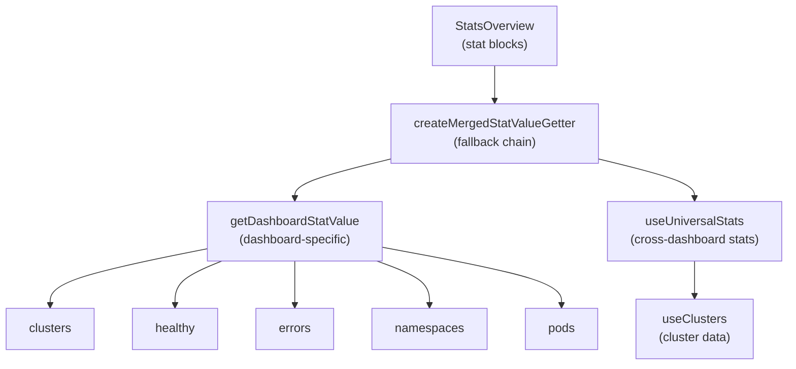

**Dashboard-specific stat implementation:**

```typescript
// [web/src/components/dashboard/Dashboard.tsx:160-177]()
const getDashboardStatValue = useCallback((blockId: string): StatBlockValue => {
  switch (blockId) {
    case 'clusters':
      return { 
        value: clusters.length, 
        sublabel: 'total clusters',
        onClick: () => drillToAllClusters(),
        isClickable: clusters.length > 0
      }
    case 'healthy':
      return { 
        value: healthyClusters,
        sublabel: 'healthy',
        onClick: () => drillToAllClusters('healthy'),
        isClickable: healthyClusters > 0
      }
    // ...
  }
}, [clusters, healthyClusters, ...])
```

The merged getter prioritizes dashboard-specific values, falling back to universal stats for unrecognized block IDs. This allows dashboard-specific customization while sharing common metrics.

**Sources:** [web/src/components/dashboard/Dashboard.tsx:160-183](), [web/src/hooks/useUniversalStats.ts]()

---

## Auto-Refresh System

Dashboards support automatic data refresh with configurable intervals:

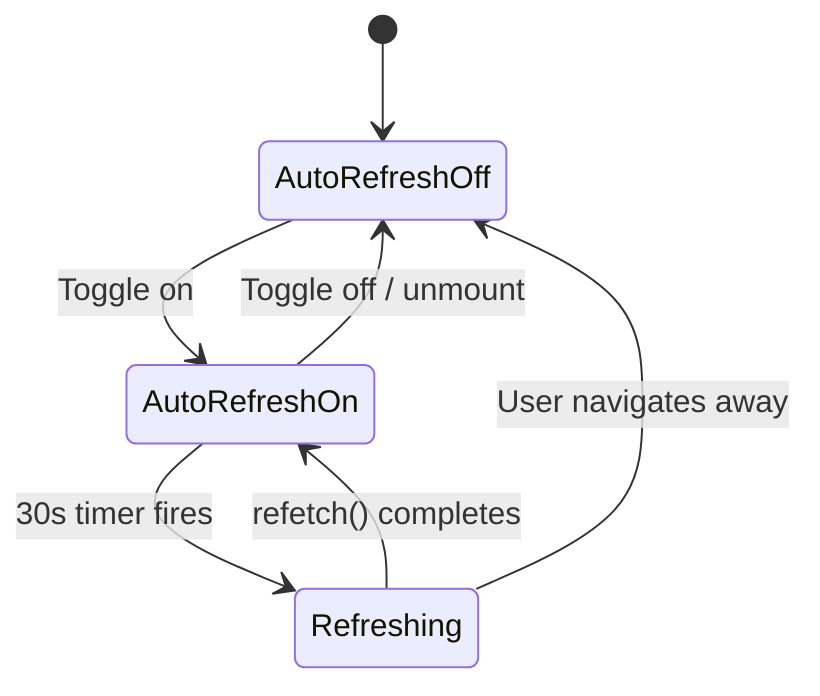

**Implementation:**

```typescript
// [web/src/components/dashboard/Dashboard.tsx:186-210]()
const [autoRefresh, setAutoRefresh] = useState(() => {
  const stored = safeGetItem('dashboard-auto-refresh')
  return stored !== null ? stored === 'true' : true
})

useEffect(() => {
  if (autoRefresh && !isLoading) {
    autoRefreshIntervalRef.current = setInterval(() => {
      refetch()
    }, 30000) // 30 seconds
  }
  return () => {
    if (autoRefreshIntervalRef.current) {
      clearInterval(autoRefreshIntervalRef.current)
    }
  }
}, [autoRefresh, isLoading, refetch])
```

**Refresh indicator:** Uses `useRefreshIndicator` hook to ensure the refresh spinner shows for at least 500ms even if the API responds faster, preventing UI flicker.

**Sources:** [web/src/components/dashboard/Dashboard.tsx:186-210](), [web/src/hooks/useRefreshIndicator.ts]()

---

## Floating Action Buttons

The `FloatingDashboardActions` component provides quick access to common dashboard operations via a FAB menu:

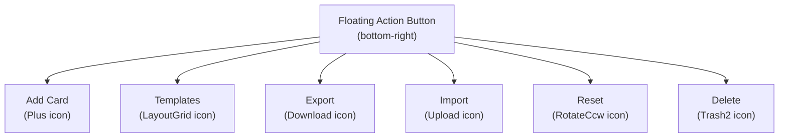

**Actions:**

| Action | Main Dashboard | Custom Dashboard | Description |
|--------|---------------|------------------|-------------|
| **Add Card** | ✓ | ✓ | Opens card picker modal |
| **Templates** | ✓ | ✓ | Apply pre-configured layouts |
| **Export** | ✓ | ✓ | Download dashboard JSON |
| **Import** | ✓ | ✓ | Upload dashboard JSON |
| **Reset** | ✓ | ✗ | Restore default cards |
| **Delete** | ✗ | ✓ | Delete custom dashboard |

**Export format:**
```json
{
  "name": "My Dashboard",
  "description": "Custom monitoring layout",
  "cards": [
    {
      "card_type": "cluster_health",
      "config": {},
      "position": { "w": 4, "h": 2, "x": 0, "y": 0 },
      "title": "Cluster Health"
    }
  ]
}
```

**Sources:** [web/src/components/dashboard/FloatingDashboardActions.tsx]()

---

## Cross-Card Interactions

### Workload Deploy via Drag-and-Drop

Cards can communicate via the **card event bus** to enable complex workflows. The primary use case is deploying workloads by dragging from the `workload_deployment` card onto a cluster group in the `cluster_groups` card:

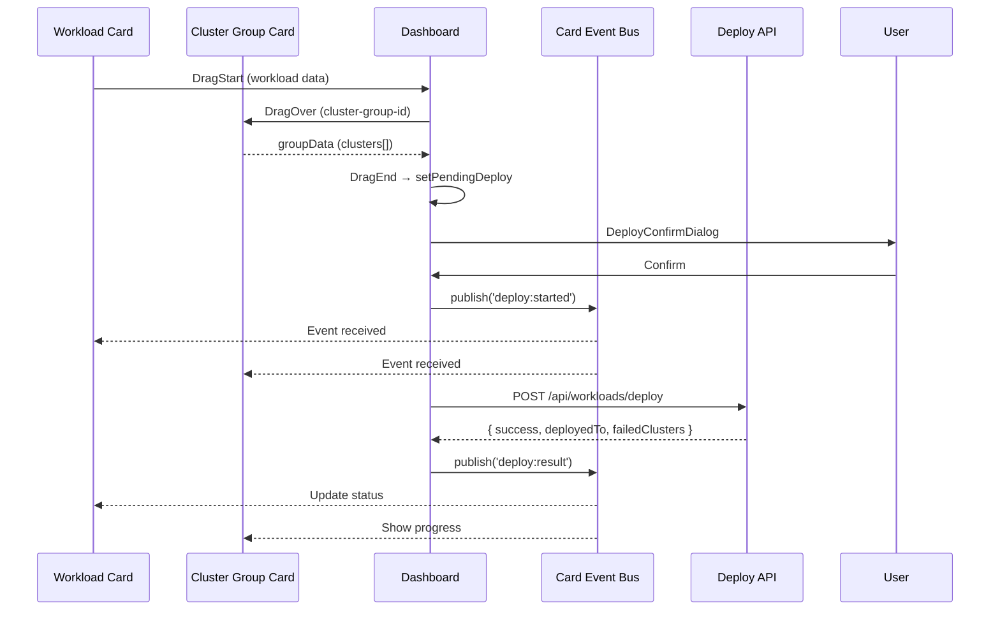

**Draggable workload data:**

```typescript
// [web/src/components/dashboard/Dashboard.tsx:256-283]()
if (
  active.data.current?.type === 'workload' &&
  String(over.id).startsWith('cluster-group-')
) {
  const workloadData = active.data.current.workload as {
    name: string
    namespace: string
    sourceCluster: string
    currentClusters: string[]
  }
  const groupData = over.data.current as {
    groupName: string
    clusters: string[]
  }
  
  setPendingDeploy({
    workloadName: workloadData.name,
    namespace: workloadData.namespace,
    sourceCluster: workloadData.sourceCluster,
    targetClusters: groupData.clusters,
    groupName: groupData.groupName,
  })
}
```

**Sources:** [web/src/components/dashboard/Dashboard.tsx:249-387](), [web/src/lib/cardEvents.tsx]()

---

## Dashboard Templates

Templates are pre-configured dashboard layouts defined in [web/src/components/dashboard/templates.ts](). Users can apply templates to either the main dashboard or custom dashboards via the `TemplatesModal`.

### Template Structure

```typescript
interface DashboardTemplate {
  id: string                    // e.g., "cluster-overview"
  name: string                  // Display name
  description: string           // Purpose description
  icon: string                  // Emoji icon
  category: 'cluster' | 'namespace' | 'workloads' | ...
  cards: Array<{
    card_type: string          // Registry key
    title?: string             // Optional custom title
    config?: Record<string, unknown>
    position: { w: number; h: number }
  }>
}
```

### Available Templates

| Template ID | Cards | Category | Description |
|-------------|-------|----------|-------------|
| `cluster-overview` | 9 | cluster | Health, resources, issues |
| `cluster-resource-tree` | 1 | cluster | Full resource explorer |
| `cluster-comparison` | 4 | cluster | Side-by-side metrics |
| `gpu-dashboard` | 7 | gpu | GPU utilization, inventory |
| `gitops-overview` | 5 | gitops | Helm, Flux, drift detection |
| `security-overview` | 3 | security | Security issues, RBAC |
| `namespace-dashboard` | 5 | namespace | Quotas, RBAC, events |
| `ai-dashboard` | 7 | ai | AI-powered analysis |
| `llm-inference` | 8 | ai | LLM-d stack monitoring |
| `arcade` | 24 | arcade | All game cards |

**Applying a template:**

1. User opens `TemplatesModal` via FAB
2. Selects a template from the grid
3. Dashboard clears existing cards
4. Template cards are added in defined order
5. Changes persist to localStorage or backend API

**Sources:** [web/src/components/dashboard/templates.ts:1-500]()

---

## Keyboard Navigation

Both dashboards support keyboard-based card navigation for accessibility (Phase 2, issue #1151):

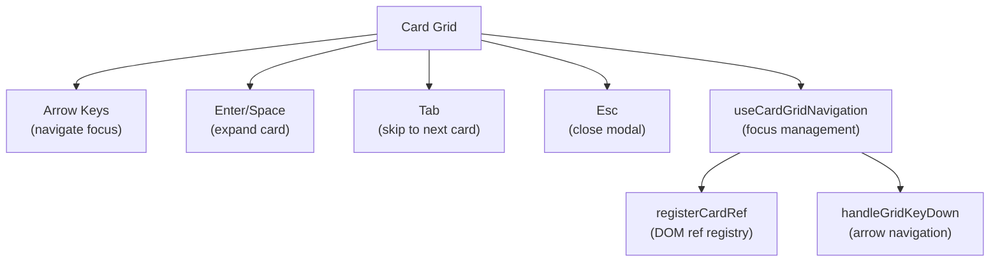

**Implementation:**

```typescript
// [web/src/components/dashboard/Dashboard.tsx:212-220]()
const expandTriggersRef = useRef<Map<string, () => void>>(new Map())
const handleExpandCard = useCallback((cardId: string) => {
  expandTriggersRef.current.get(cardId)?.()
}, [])

const { registerCardRef, handleGridKeyDown } = useCardGridNavigation({
  cards: localCards,
  onExpandCard: handleExpandCard,
})
```

Each card registers an expand trigger callback that the grid calls when the user presses Enter on a focused card.

**Sources:** [web/src/components/dashboard/Dashboard.tsx:212-220](), [web/src/hooks/useCardGridNavigation.ts]()

---

## Error Handling and Resilience

### Progressive Disclosure

Dashboards load cards optimistically from cache to avoid empty states during initial load:

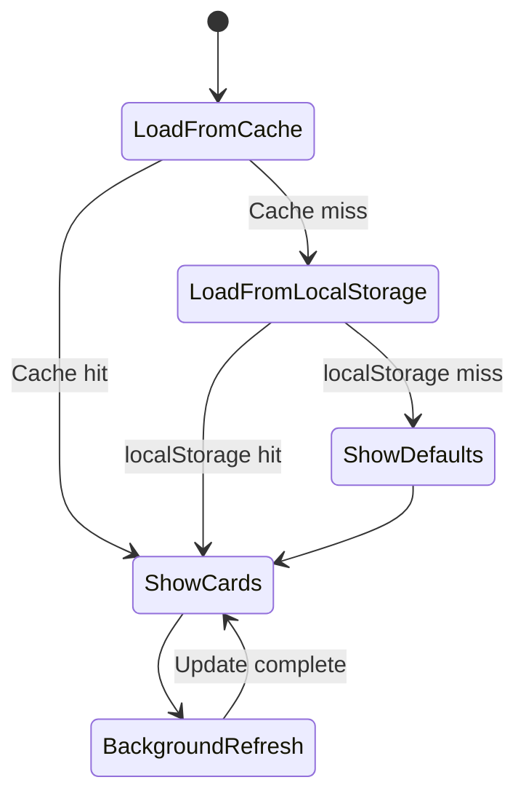

**Priority:**
1. Module-level `dashboardCache` (instant)
2. localStorage (synchronous)
3. Default cards (fallback)
4. Backend API (background refresh for custom dashboards)

**Sources:** [web/src/components/dashboard/Dashboard.tsx:76-92]()

### Failed Card Rendering

If a card type is not found in the registry, `CardWrapper` displays a friendly error message instead of crashing:

```typescript
// [web/src/components/dashboard/CustomDashboard.tsx:80-103]()
const CardComponent = CARD_COMPONENTS[card.card_type]

if (!CardComponent) {
  return (
    <div ref={setNodeRef} style={style} className="relative">
      <CardWrapper
        cardId={card.id}
        cardType={card.card_type}
        title={formatCardTitle(card.card_type)}
        onConfigure={onConfigure}
        onRemove={onRemove}
      >
        <div className="flex items-center justify-center h-full text-muted-foreground">
          {t('drilldown.unknownViewType')}: {card.card_type}
        </div>
      </CardWrapper>
    </div>
  )
}
```

This allows users to remove broken cards without losing the entire dashboard.

**Sources:** [web/src/components/dashboard/CustomDashboard.tsx:80-103]()

### API Error Handling

Backend errors (authentication, network, 500 errors) are caught and display toast notifications without disrupting the UI:

```typescript
// [web/src/components/dashboard/CustomDashboard.tsx:400-420]()
try {
  await api.post(`/api/dashboards/${id}/cards`, newCard)
  setCards((prev) => [...prev, newCard])
  showToast('Card added successfully', 'success')
} catch (error) {
  console.error('Failed to add card:', error)
  if (error instanceof UnauthenticatedError) {
    showToast('Please log in to add cards', 'error')
  } else if (error instanceof BackendUnavailableError) {
    showToast('Backend unavailable - check connection', 'error')
  } else {
    showToast('Failed to add card', 'error')
  }
}
```

**Sources:** [web/src/components/dashboard/CustomDashboard.tsx:390-430]()

---

## Performance Optimizations

### Lazy Card Rendering

Cards use React.lazy() with Suspense boundaries to split the bundle into smaller chunks. The card registry preloads chunks for visible cards on mount:

```typescript
// [web/src/components/cards/cardRegistry.ts:4-20]()
const ClusterHealth = lazy(() => import('./ClusterHealth').then(m => ({ default: m.ClusterHealth })))
const EventStream = lazy(() => import('./EventStream').then(m => ({ default: m.EventStream })))

// Bundle chunking for related cards
const _deployBundle = import('./deploy-bundle')
const DeploymentStatus = lazy(() => _deployBundle.then(m => ({ default: m.DeploymentStatus })))
const DeploymentProgress = lazy(() => _deployBundle.then(m => ({ default: m.DeploymentProgress })))
```

**Chunk prefetching:**
```typescript
// [web/src/components/dashboard/Dashboard.tsx:298-310]()
useEffect(() => {
  if (!isAuthenticated) return
  prefetchCardData()
  prefetchCardChunks(DEFAULT_MAIN_CARD_TYPES)
  if (isDemoMode()) {
    prefetchDemoCardChunks()
  } else {
    setTimeout(prefetchDemoCardChunks, 15_000)
  }
}, [isAuthenticated])
```

**Sources:** [web/src/components/cards/cardRegistry.ts:1-160](), [web/src/components/dashboard/Dashboard.tsx:290-315]()

### Memoized Stat Calculations

Dashboard stats are memoized with `useMemo` and `useCallback` to avoid recalculating on every render:

```typescript
// [web/src/components/dashboard/Dashboard.tsx:153-177]()
const healthyClusters = clusters.filter(c => c.healthy).length
const unhealthyClusters = clusters.filter(c => !c.healthy).length
const totalPods = clusters.reduce((sum, c) => sum + (c.podCount || 0), 0)
const totalNodes = clusters.reduce((sum, c) => sum + (c.nodeCount || 0), 0)

const getDashboardStatValue = useCallback((blockId: string): StatBlockValue => {
  // ... stat calculations
}, [clusters, healthyClusters, unhealthyClusters, totalNodes, totalPods, ...])

const getStatValue = useMemo(
  () => createMergedStatValueGetter(getDashboardStatValue, getUniversalStatValue),
  [getDashboardStatValue, getUniversalStatValue]
)
```

**Sources:** [web/src/components/dashboard/Dashboard.tsx:153-183]()

### Drag Performance

Drag operations update local state synchronously but debounce API persistence to reduce backend load:

```typescript
// [web/src/components/dashboard/Dashboard.tsx:308-313]()
if (active.id !== over.id) {
  const draggedCard = localCards.find(c => c.id === active.id)
  if (draggedCard) emitCardDragged(draggedCard.card_type)
  setLocalCards((items) => {
    const oldIndex = items.findIndex((item) => item.id === active.id)
    const newIndex = items.findIndex((item) => item.id === over.id)
    return arrayMove(items, oldIndex, newIndex)
  })
}
```

The UI updates instantly via `arrayMove`, while persistence happens asynchronously in the next effect cycle.

**Sources:** [web/src/components/dashboard/Dashboard.tsx:305-314]()

---

## Summary

The dashboard management system provides a flexible, performant interface for arranging and interacting with monitoring cards. Key design principles:

- **Dual persistence:** localStorage for main dashboard (instant restore), backend API for custom dashboards (multi-user)
- **Progressive disclosure:** Cards load from cache → localStorage → defaults → API
- **Accessible drag-and-drop:** Keyboard navigation, screen reader support, visual feedback
- **Optimistic updates:** UI changes apply immediately, sync to backend asynchronously
- **Error resilience:** Graceful degradation for missing cards, failed API calls, network issues
- **Cross-card communication:** Event bus enables complex workflows (workload deploy)

The system balances performance (lazy loading, memoization, caching) with flexibility (templates, custom layouts, card configuration) to support both casual monitoring and advanced operations use cases.

**Sources:** [web/src/components/dashboard/Dashboard.tsx](), [web/src/components/dashboard/CustomDashboard.tsx](), [web/src/components/cards/CardWrapper.tsx]()

---

