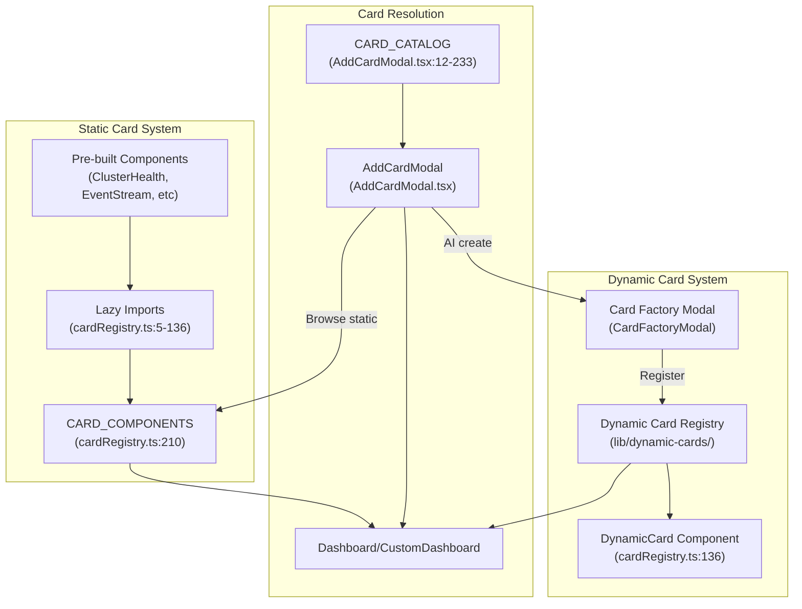
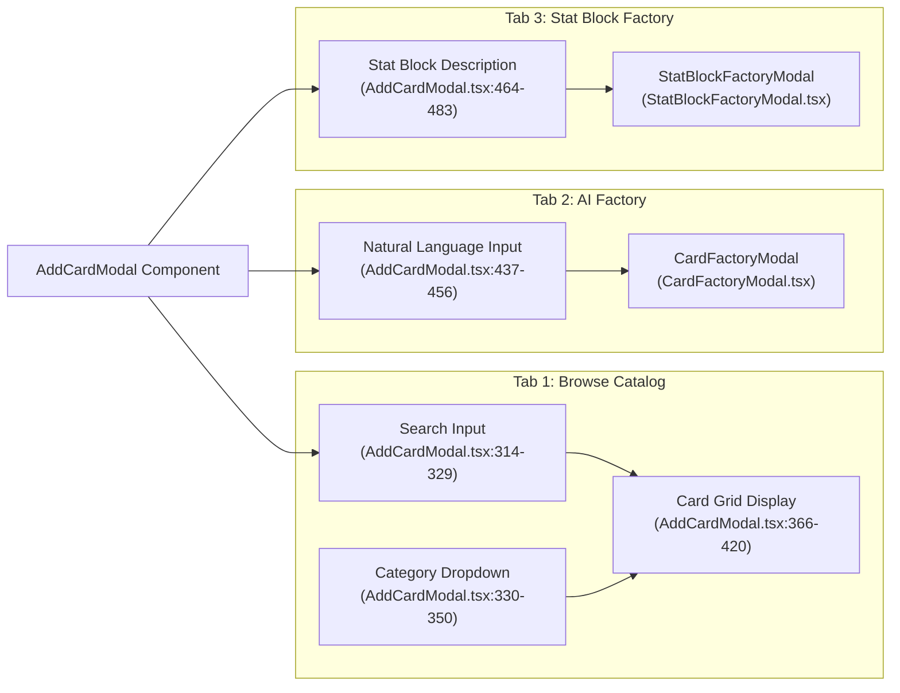
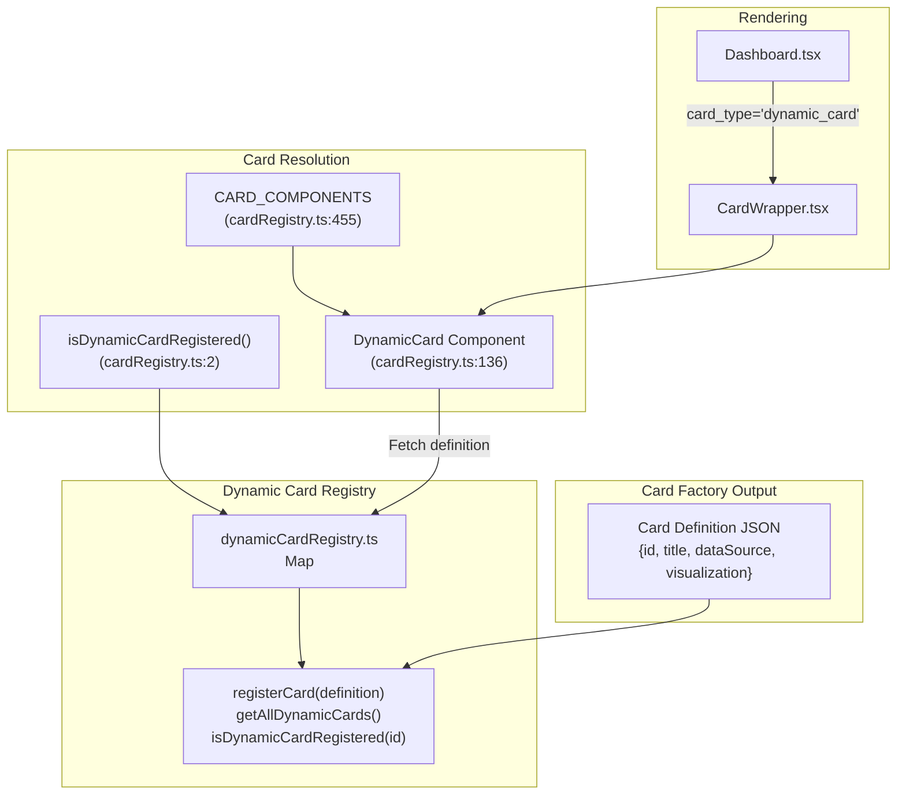
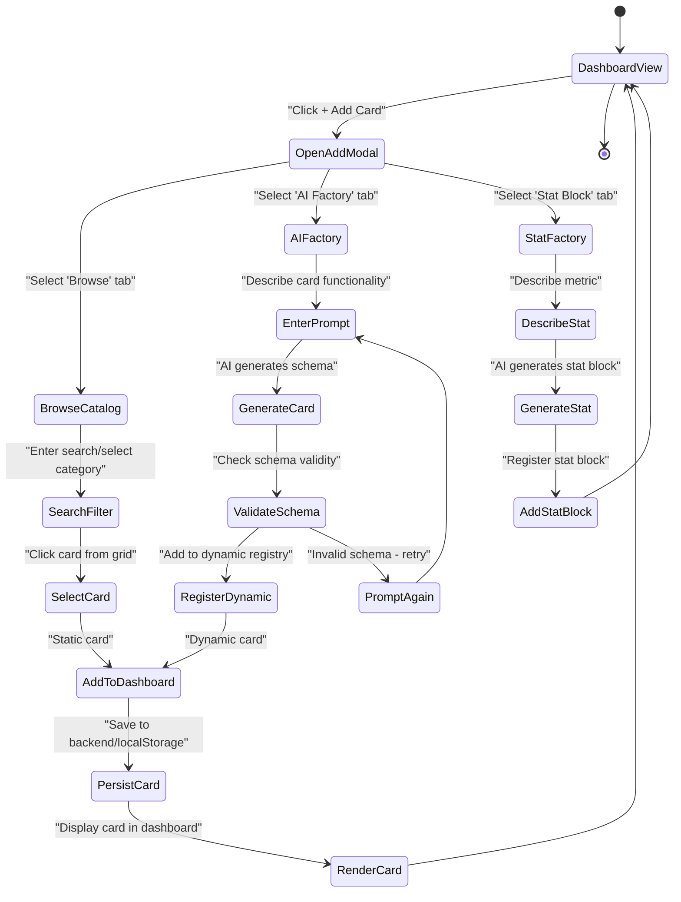

<!-- source: DeepWiki mcp.deepwiki.com · repo kubestellar/console · page 3.4 Card Factory & AI Creation · fetched 2026-10-27 -->

# Card Factory & AI Creation

<details>
<summary>Relevant source files</summary>

The following files were used as context for generating this wiki page:

- [web/src/App.tsx](web/src/App.tsx)
- [web/src/components/cards/CardWrapper.tsx](web/src/components/cards/CardWrapper.tsx)
- [web/src/components/cards/cardRegistry.ts](web/src/components/cards/cardRegistry.ts)
- [web/src/components/cards/flatcar_status/demoData.ts](web/src/components/cards/flatcar_status/demoData.ts)
- [web/src/components/cards/flatcar_status/index.tsx](web/src/components/cards/flatcar_status/index.tsx)
- [web/src/components/cards/flatcar_status/useFlatcarStatus.ts](web/src/components/cards/flatcar_status/useFlatcarStatus.ts)
- [web/src/components/cards/flatcar_status/versionUtils.ts](web/src/components/cards/flatcar_status/versionUtils.ts)
- [web/src/components/cards/llmd/index.ts](web/src/components/cards/llmd/index.ts)
- [web/src/components/compute/ClusterComparisonPage.tsx](web/src/components/compute/ClusterComparisonPage.tsx)
- [web/src/components/dashboard/AddCardModal.tsx](web/src/components/dashboard/AddCardModal.tsx)
- [web/src/components/dashboard/CustomDashboard.tsx](web/src/components/dashboard/CustomDashboard.tsx)
- [web/src/components/dashboard/Dashboard.tsx](web/src/components/dashboard/Dashboard.tsx)
- [web/src/components/dashboard/templates.ts](web/src/components/dashboard/templates.ts)
- [web/src/components/layout/Layout.tsx](web/src/components/layout/Layout.tsx)
- [web/src/components/llmd-benchmarks/LLMdBenchmarks.tsx](web/src/components/llmd-benchmarks/LLMdBenchmarks.tsx)
- [web/src/hooks/useCertManager.ts](web/src/hooks/useCertManager.ts)
- [web/src/locales/en/cards.json](web/src/locales/en/cards.json)

</details>


## Purpose and Scope

This document describes the card creation system in KubeStellar Console, including:
- The static card catalog and registry architecture
- AI-powered card factory for natural language card creation
- Dynamic card registration and runtime component loading
- Stat block factory for custom dashboard metrics

For information about the card rendering system and CardWrapper component, see [Card Components & Registry](#3.1). For dashboard-level card management, see [Dashboard Management](#3.2).

---

## Card Architecture Overview

The console supports two types of cards: **static cards** (pre-built components) and **dynamic cards** (AI-generated at runtime).

### Static Card Registry

All pre-built cards are registered in `CARD_COMPONENTS`:

```typescript
// web/src/components/cards/cardRegistry.ts:210-452
const RAW_CARD_COMPONENTS: Record<string, CardComponent> = {
  cluster_health: ClusterHealth,
  event_stream: EventStream,
  deployment_status: DeploymentStatus,
  // ... 100+ card types
  dynamic_card: DynamicCard,
}
```

Each card is lazy-loaded for code splitting:

```typescript
// web/src/components/cards/cardRegistry.ts:5-136
const ClusterHealth = lazy(() => import('./ClusterHealth').then(m => ({ default: m.ClusterHealth })))
const DynamicCard = lazy(() => import('./DynamicCard').then(m => ({ default: m.DynamicCard })))
```

### Dynamic Card System

Dynamic cards are registered at runtime through `dynamicCardRegistry`:

```typescript
// web/src/components/dashboard/AddCardModal.tsx:7
import { getAllDynamicCards, onRegistryChange } from '../../lib/dynamic-cards'
```

The `DynamicCard` meta-component renders AI-generated card definitions stored in the registry.

**Architecture Diagram: Card Registration Flow**



Sources: [web/src/components/cards/cardRegistry.ts:1-210](), [web/src/components/dashboard/AddCardModal.tsx:1-50](), [web/src/lib/dynamic-cards/dynamicCardRegistry.ts]() (referenced)

---

## Card Catalog System

The card catalog organizes all available cards into categories for browsing.

### CARD_CATALOG Structure

```typescript
// web/src/components/dashboard/AddCardModal.tsx:12-233
const CARD_CATALOG = {
  'Cluster Admin': [
    { type: 'control_plane_health', title: 'Control Plane Health', 
      description: 'API server, scheduler, controller manager, etcd status per cluster', 
      visualization: 'status' },
    // ... more cards
  ],
  'Cluster Health': [...],
  'Workloads': [...],
  'AI Agents': [...],
  // ... 20+ categories
}
```

Each card entry includes:
- `type`: Card type key (must match `CARD_COMPONENTS` key)
- `title`: Display name
- `description`: Detailed explanation of card purpose
- `visualization`: Visual metaphor (`status`, `table`, `timeseries`, `donut`, `gauge`, `bar`, `events`)

### Category Organization

Categories group related functionality:

| Category | Card Count | Purpose |
|----------|-----------|---------|
| Cluster Admin | 12 | Control plane, etcd, webhooks, RBAC explorer |
| Cluster Health | 8 | Health monitoring, metrics, locations |
| Workloads | 12 | Deployments, pods, resource marshalling |
| AI Agents | 7 | Kagenti agent platform cards |
| AI Assistant | 5 | Console AI missions (health check, kubeconfig audit) |
| Security Posture | 7 | OPA, Kyverno, Falco, Trivy, compliance scoring |
| GitOps | 4 | Helm, Kustomize, ArgoCD |
| GPU | 6 | GPU inventory, utilization, workloads |
| AI/ML Workloads | 6 | LLM-d inference, benchmarks, EPP routing |
| Games | 20+ | Arcade game cards (Sudoku, Tetris, Chess, etc.) |

Sources: [web/src/components/dashboard/AddCardModal.tsx:12-233]()

---

## Add Card Modal & User Interface

The `AddCardModal` component provides three ways to add cards to dashboards:

### Modal Tabs



### Tab 1: Catalog Browse

Users can search and filter by category:

```typescript
// web/src/components/dashboard/AddCardModal.tsx:283-305
const filteredCards = useMemo(() => {
  let cards = selectedCategory === 'all'
    ? Object.values(CARD_CATALOG).flat()
    : CARD_CATALOG[selectedCategory] || []

  if (searchQuery) {
    const query = searchQuery.toLowerCase()
    cards = cards.filter(card =>
      card.title.toLowerCase().includes(query) ||
      card.description.toLowerCase().includes(query) ||
      card.type.toLowerCase().includes(query)
    )
  }

  return cards
}, [selectedCategory, searchQuery])
```

The grid displays cards with their visualization badges:

```typescript
// web/src/components/dashboard/AddCardModal.tsx:366-420
<button
  key={card.type}
  onClick={() => handleAddCard(card.type)}
  className="glass p-4 rounded-lg text-left hover:border-purple-500/50"
>
  <div className="flex items-start justify-between mb-2">
    <h3 className="font-medium text-foreground">{card.title}</h3>
    {getVisualizationBadge(card.visualization)}
  </div>
  <p className="text-sm text-muted-foreground">{card.description}</p>
</button>
```

### Tab 2: AI Card Factory

Opens `CardFactoryModal` for natural language card generation:

```typescript
// web/src/components/dashboard/AddCardModal.tsx:437-456
<div className="text-center py-12">
  <Wand2 className="w-16 h-16 text-purple-400 mx-auto mb-4" />
  <h3 className="text-xl font-semibold mb-2">
    {t('dashboard.createCardWithAI')}
  </h3>
  <p className="text-muted-foreground mb-6">
    {t('dashboard.describeCardFunctionality')}
  </p>
  <button
    onClick={() => setIsCardFactoryOpen(true)}
    className="px-6 py-3 bg-purple-500/20 text-purple-400 rounded-lg"
  >
    <Sparkles className="w-4 h-4 mr-2" />
    {t('dashboard.openCardFactory')}
  </button>
</div>
```

### Tab 3: Stat Block Factory

Opens `StatBlockFactoryModal` for creating custom metrics:

```typescript
// web/src/components/dashboard/AddCardModal.tsx:464-483
<div className="text-center py-12">
  <Activity className="w-16 h-16 text-blue-400 mx-auto mb-4" />
  <h3 className="text-xl font-semibold mb-2">
    {t('dashboard.createStatBlock')}
  </h3>
  <p className="text-muted-foreground mb-6">
    {t('dashboard.describeStatMetric')}
  </p>
  <button
    onClick={() => setIsStatBlockFactoryOpen(true)}
    className="px-6 py-3 bg-blue-500/20 text-blue-400 rounded-lg"
  >
    <Activity className="w-4 h-4 mr-2" />
    {t('dashboard.openStatFactory')}
  </button>
</div>
```

Sources: [web/src/components/dashboard/AddCardModal.tsx:240-500]()

---

## AI Card Factory Architecture

The Card Factory uses AI to generate custom cards from natural language descriptions.

**Card Factory Data Flow**

```mermaid
sequenceDiagram
    participant User
    participant AddCardModal
    participant CardFactoryModal
    participant AIProvider["AI Provider<br/>(Anthropic/OpenAI/Gemini)"]
    participant DynamicRegistry["Dynamic Card Registry"]
    participant Dashboard
    
    User->>AddCardModal: "Click 'AI Factory' tab"
    AddCardModal->>CardFactoryModal: "Open modal"
    User->>CardFactoryModal: "Enter card description"
    CardFactoryModal->>AIProvider: "Generate card definition<br/>(prompt + context)"
    AIProvider-->>CardFactoryModal: "Card JSON schema"
    CardFactoryModal->>CardFactoryModal: "Validate schema"
    CardFactoryModal->>DynamicRegistry: "registerCard(definition)"
    DynamicRegistry-->>CardFactoryModal: "Card ID"
    CardFactoryModal->>Dashboard: "addCard(cardId)"
    Dashboard->>DynamicCard: "Render with definition"
```

### Card Factory Modal Implementation

The modal handles:
1. **Natural language input** - User describes desired card functionality
2. **AI prompt construction** - Adds context about available data sources (clusters, pods, deployments, etc.)
3. **Card schema generation** - AI returns structured card definition
4. **Validation** - Ensures generated schema is valid
5. **Dynamic registration** - Adds card to `dynamicCardRegistry`
6. **Dashboard integration** - Card appears in dashboard immediately

### AI Provider Integration

The factory supports multiple AI providers through the local agent:

```typescript
// Referenced from AddCardModal.tsx:7
import { useLocalAgent } from '../../hooks/useLocalAgent'
```

The agent routes requests to:
- **Anthropic Claude** (Claude 3.5 Sonnet)
- **OpenAI** (GPT-4)
- **Google Gemini** (Gemini Pro)

API keys are managed in Settings → AI & Intelligence.

### Dynamic Card Schema

Generated cards follow this structure:

```typescript
interface DynamicCardDefinition {
  id: string
  type: 'dynamic_card'
  title: string
  description: string
  dataSource: {
    endpoint: string        // API endpoint to fetch data
    params?: Record<string, any>
    transform?: string      // JS transform function
  }
  visualization: {
    type: 'table' | 'chart' | 'status' | 'gauge'
    config: Record<string, any>
  }
  refresh?: {
    interval?: number       // Auto-refresh interval (ms)
    onDemand?: boolean      // Manual refresh support
  }
}
```

Sources: [web/src/components/dashboard/AddCardModal.tsx:5-10](), [web/src/lib/dynamic-cards/dynamicCardRegistry.ts]() (referenced)

---

## Stat Block Factory

The Stat Block Factory creates custom metric blocks for the dashboard header stats bar.

### Stats Overview System

Dashboard stats are displayed using `StatsOverview`:

```typescript
// web/src/components/dashboard/Dashboard.tsx:51-57
import { StatsOverview, StatBlockValue } from '../ui/StatsOverview'
import { useUniversalStats, createMergedStatValueGetter } from '../../hooks/useUniversalStats'

// Dashboard-specific stats
const getDashboardStatValue = useCallback((blockId: string): StatBlockValue => {
  switch (blockId) {
    case 'clusters':
      return { value: clusters.length, sublabel: 'total clusters', onClick: () => drillToAllClusters() }
    // ... more stat blocks
  }
}, [clusters, healthyClusters, unhealthyClusters])
```

### Universal Stats Hook

The `useUniversalStats` hook provides cross-dashboard stat values:

```typescript
// web/src/hooks/useUniversalStats.ts (referenced)
export function useUniversalStats() {
  const { deduplicatedClusters } = useClusters()
  
  const getStatValue = useCallback((blockId: string): StatBlockValue => {
    switch (blockId) {
      case 'nodes':
        return { value: totalNodes, sublabel: 'nodes' }
      case 'cpu_cores':
        return { value: totalCpuCores, sublabel: 'CPU cores' }
      // ... universal metrics
    }
  }, [deduplicatedClusters])
  
  return { getStatValue }
}
```

### Merged Stat Value Getter

Dashboards combine dashboard-specific and universal stats:

```typescript
// web/src/components/dashboard/Dashboard.tsx:180-183
const getStatValue = useCallback(
  (blockId: string) => createMergedStatValueGetter(getDashboardStatValue, getUniversalStatValue)(blockId),
  [getDashboardStatValue, getUniversalStatValue]
)
```

The merger tries dashboard-specific getter first, then falls back to universal getter.

### Stat Block Factory Modal

Users describe a metric in natural language, and AI generates:
- Data source query
- Aggregation logic
- Display formatting
- Click action (optional drilldown)

Example flow:
```
User: "Show total GPU memory across all clusters"
AI generates:
  - blockId: "gpu_memory_gb"
  - query: Sum cluster.gpuMemoryGB across all clusters
  - sublabel: "GB GPU memory"
  - onClick: Navigate to GPU dashboard
```

Sources: [web/src/components/dashboard/Dashboard.tsx:51-183](), [web/src/hooks/useUniversalStats.ts]() (referenced), [web/src/components/dashboard/AddCardModal.tsx:6]()

---

## Dynamic Card Registration

Dynamic cards are registered at runtime through the `dynamicCardRegistry`.

### Registration Flow



### Dynamic Card Component

The `DynamicCard` component is a meta-component that renders dynamically registered cards:

```typescript
// web/src/components/cards/cardRegistry.ts:136
const DynamicCard = lazy(() => import('./DynamicCard').then(m => ({ default: m.DynamicCard })))

// web/src/components/cards/cardRegistry.ts:437
const RAW_CARD_COMPONENTS: Record<string, CardComponent> = {
  // ... static cards
  dynamic_card: DynamicCard,
}
```

When rendering, `DynamicCard`:
1. Receives `config` prop containing card ID
2. Looks up definition in `dynamicCardRegistry`
3. Fetches data from specified endpoint
4. Renders using specified visualization type

### Registry Change Notifications

The `AddCardModal` listens for registry changes to update the catalog:

```typescript
// web/src/components/dashboard/AddCardModal.tsx:7-8
import { getAllDynamicCards, onRegistryChange } from '../../lib/dynamic-cards'

// Inside component:
useEffect(() => {
  const unsubscribe = onRegistryChange(() => {
    setDynamicCards(getAllDynamicCards())
  })
  return unsubscribe
}, [])
```

This ensures newly created cards appear in the catalog immediately without page refresh.

Sources: [web/src/components/cards/cardRegistry.ts:2](), [web/src/components/cards/cardRegistry.ts:136-437](), [web/src/components/dashboard/AddCardModal.tsx:7-8]()

---

## Card Creation Workflow

**End-to-End Card Addition Flow**



### Persistence Layer

Cards are persisted differently based on dashboard type:

**Main Dashboard (Dashboard.tsx)**:
```typescript
// web/src/components/dashboard/Dashboard.tsx:70-73
const DASHBOARD_STORAGE_KEY = 'kubestellar-main-dashboard-cards'
const DEFAULT_DASHBOARD_CARDS: Card[] = getDefaultCardsForDashboard('main')
```

Cards stored in `localStorage` for instant restore:
```typescript
// web/src/components/dashboard/Dashboard.tsx:85-92
const [localCards, setLocalCards] = useState<Card[]>(() => {
  if (dashboardCache?.cards?.length) return dashboardCache.cards
  const parsed = safeGetJSON<Card[]>(DASHBOARD_STORAGE_KEY)
  if (parsed && Array.isArray(parsed) && parsed.length > 0) {
    return parsed
  }
  return DEFAULT_DASHBOARD_CARDS
})
```

**Custom Dashboards (CustomDashboard.tsx)**:
```typescript
// web/src/components/dashboard/CustomDashboard.tsx:24
import { api } from '../../lib/api'

// Cards persist to backend via API:
await api.post(`/api/dashboards/${dashboardId}/cards`, cardData)
```

### Card Addition Handler

```typescript
// web/src/components/dashboard/Dashboard.tsx:542-574
const handleAddCard = useCallback(async (cardType: string, config?: Record<string, unknown>) => {
  const size = getDefaultCardSize(cardType)
  const newCard: Card = {
    id: `${cardType}-${Date.now()}`,
    card_type: cardType,
    config: config || {},
    position: { x: 0, y: 0, ...size },
    title: formatCardTitle(cardType),
  }

  // Record in history
  recordCardAdded(
    newCard.id,
    newCard.card_type,
    newCard.title,
    newCard.config,
    dashboard?.id,
    dashboard?.name
  )

  // Add to state (top of dashboard)
  setLocalCards((prev) => [newCard, ...prev])

  // Analytics tracking
  emitCardAdded(cardType)

  // Show confirmation
  showToast(`Added "${newCard.title}" card`, 'success')
}, [dashboard, recordCardAdded, showToast])
```

The `recordCardAdded` function stores the addition in card history for later restoration (see [Card History](#3.1)).

Sources: [web/src/components/dashboard/Dashboard.tsx:70-574](), [web/src/components/dashboard/CustomDashboard.tsx:24]()

---

## Demo Mode & Template Support

### Demo Data Cards

Cards in `DEMO_DATA_CARDS` set always show mock data:

```typescript
// web/src/components/cards/cardRegistry.ts:473-536
export const DEMO_DATA_CARDS = new Set([
  // MCS cards - demo until MCS is installed
  'service_exports',
  'service_imports',
  // Security posture cards - demo until tools are detected
  'falco_alerts',
  'trivy_scan',
  'kubescape_scan',
  // Kagenti cards - demo until kagenti-operator is installed
  'kagenti_status',
  'kagenti_agent_fleet',
  // ... etc
])
```

Cards can also dynamically report demo state via `useReportCardDataState`:

```typescript
// Inside card component:
useReportCardDataState({ 
  isDemoData: shouldUseDemoData, 
  isRefreshing, 
  isFailed 
})
```

### Dashboard Templates

Pre-configured card layouts for common use cases:

```typescript
// web/src/components/dashboard/templates.ts:17-600
export const DASHBOARD_TEMPLATES: DashboardTemplate[] = [
  {
    id: 'cluster-overview',
    name: 'Cluster Overview',
    description: 'Health, resources, and issues across all clusters',
    category: 'cluster',
    cards: [
      { card_type: 'provider_health', position: { w: 4, h: 3 } },
      { card_type: 'cluster_health', position: { w: 4, h: 2 } },
      // ... 9 pre-configured cards
    ],
  },
  // ... 30+ templates
]
```

Templates are applied when creating new custom dashboards:

```typescript
// web/src/components/dashboard/Dashboard.tsx:393-424
const handleCreateDashboardConfirm = async (name: string, template?: DashboardTemplate) => {
  const newDashboard = await createDashboard(name)
  
  if (template && newDashboard.id) {
    const templateCards = template.cards.map((tc, index) => ({
      id: `template-${Date.now()}-${index}`,
      card_type: tc.card_type,
      config: tc.config || {},
      position: { x: 0, y: 0, w: tc.position.w, h: tc.position.h },
      title: tc.title,
    }))
    
    // Add all template cards
    for (const card of templateCards) {
      await api.post(`/api/dashboards/${newDashboard.id}/cards`, card)
    }
  }
}
```

### Templates Modal

The `TemplatesModal` component displays all templates organized by category:

```typescript
// web/src/components/dashboard/TemplatesModal.tsx (referenced in Dashboard.tsx:42)
<TemplatesModal
  isOpen={isTemplatesModalOpen}
  onClose={closeTemplatesModal}
  onApply={handleApplyTemplate}
/>
```

Users can:
1. Browse templates by category (Cluster, Security, GitOps, GPU, AI/ML, Games)
2. Preview card layout
3. Apply template to current dashboard
4. Create new dashboard from template

Sources: [web/src/components/dashboard/templates.ts:17-600](), [web/src/components/dashboard/Dashboard.tsx:393-424](), [web/src/components/cards/cardRegistry.ts:473-536]()

---

## Integration with Dashboard Pages

### DashboardPage Component

Many specialized dashboards use the `DashboardPage` wrapper for consistent card management:

```typescript
// web/src/components/llmd-benchmarks/LLMdBenchmarks.tsx:1-22
import { DashboardPage } from '../../lib/dashboards/DashboardPage'
import { getDefaultCards } from '../../config/dashboards'

export function LLMdBenchmarks() {
  return (
    <DashboardPage
      title="llm-d Benchmarks"
      subtitle="Performance tracking across clouds and accelerators"
      icon="TrendingUp"
      storageKey={BENCHMARKS_CARDS_KEY}
      defaultCards={DEFAULT_BENCHMARKS_CARDS}
      statsType="clusters"
      isLoading={false}
      isRefreshing={false}
    />
  )
}
```

The `DashboardPage` component automatically provides:
- Card addition via `AddCardModal`
- Card removal and configuration
- Auto-refresh controls
- Stats overview bar
- Drag-and-drop reordering
- Persistence to `localStorage` or backend API

### Centralized Default Cards Config

Default cards for each dashboard are defined centrally:

```typescript
// web/src/config/dashboards.ts (referenced)
export function getDefaultCardsForDashboard(dashboardId: string): Card[] {
  switch (dashboardId) {
    case 'main':
      return [
        { card_type: 'console_ai_offline_detection', position: { w: 6, h: 3 } },
        { card_type: 'hardware_health', position: { w: 6, h: 3 } },
        { card_type: 'cluster_health', position: { w: 4, h: 2 } },
        // ... more cards
      ]
    case 'llm-d-benchmarks':
      return [
        { card_type: 'nightly_e2e_status', position: { w: 6, h: 3 } },
        { card_type: 'benchmark_hero', position: { w: 6, h: 3 } },
        // ... benchmark cards
      ]
    // ... more dashboards
  }
}
```

This centralization ensures consistent defaults across dashboard resets and new installations.

Sources: [web/src/components/llmd-benchmarks/LLMdBenchmarks.tsx:1-22](), [web/src/config/dashboards.ts]() (referenced), [web/src/lib/dashboards/DashboardPage.tsx]() (referenced)

---

## Card Prefetching Optimization

To minimize loading spinners, the console prefetches card chunks in the background.

### Chunk Preloaders Map

Each card type has a corresponding chunk import function:

```typescript
// web/src/components/cards/cardRegistry.ts:580-656
const CARD_CHUNK_PRELOADERS: Record<string, () => Promise<unknown>> = {
  cluster_health: () => import('./ClusterHealth'),
  event_stream: () => import('./EventStream'),
  deployment_status: () => import('./deploy-bundle'),  // Barrel import
  llmd_flow: () => import('./llmd'),                  // Barrel import
  // ... 100+ entries
}
```

Note barrel imports like `deploy-bundle` and `llmd` - multiple cards share one chunk.

### Prefetch on Dashboard Load

```typescript
// web/src/components/dashboard/Dashboard.tsx:551-557
useEffect(() => {
  if (localCards.length > 0) {
    const cardTypes = localCards.map(c => c.card_type)
    prefetchCardChunks(cardTypes)
  }
}, [localCards])
```

The `prefetchCardChunks` function triggers imports for all visible cards:

```typescript
// web/src/components/cards/cardRegistry.ts:658-668
export function prefetchCardChunks(cardTypes: string[]): void {
  for (const type of cardTypes) {
    const preloader = CARD_CHUNK_PRELOADERS[type]
    if (preloader) {
      preloader().catch(() => {})  // Fire and forget
    }
  }
}
```

### Demo Card Prefetching

Demo-only cards are prefetched with lower priority:

```typescript
// web/src/App.tsx:306-312
useEffect(() => {
  if (!isAuthenticated) return
  prefetchCardData()
  prefetchCardChunks(DEFAULT_MAIN_CARD_TYPES)
  if (isDemoMode()) {
    prefetchDemoCardChunks()  // Immediate in demo mode
  } else {
    setTimeout(prefetchDemoCardChunks, 15_000)  // 15s delay in live mode
  }
}, [isAuthenticated])
```

This prioritizes chunks for real-data cards over demo-only cards like games and security scanning tools that require external tools.

Sources: [web/src/components/cards/cardRegistry.ts:580-668](), [web/src/components/dashboard/Dashboard.tsx:551-557](), [web/src/App.tsx:299-315]()

---

## Summary

The card factory system provides multiple pathways for adding cards to dashboards:

1. **Browse & Select** - Choose from 100+ pre-built cards organized by category
2. **AI Factory** - Generate custom cards using natural language descriptions
3. **Stat Block Factory** - Create custom metrics for the stats bar
4. **Templates** - Apply pre-configured layouts for common use cases

The architecture separates static cards (pre-built components) from dynamic cards (runtime generated) through a unified registry system. All cards are lazy-loaded for performance, with aggressive prefetching to minimize loading states.

Dynamic cards are registered at runtime and rendered through the `DynamicCard` meta-component, enabling extensibility without code changes. The system supports both `localStorage` persistence (main dashboard) and backend API persistence (custom dashboards).

---

