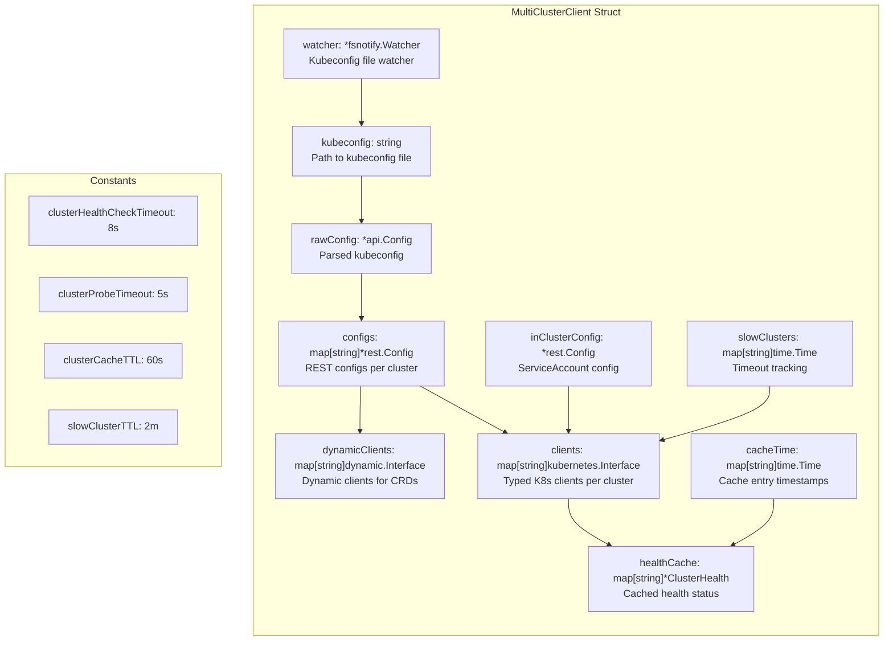
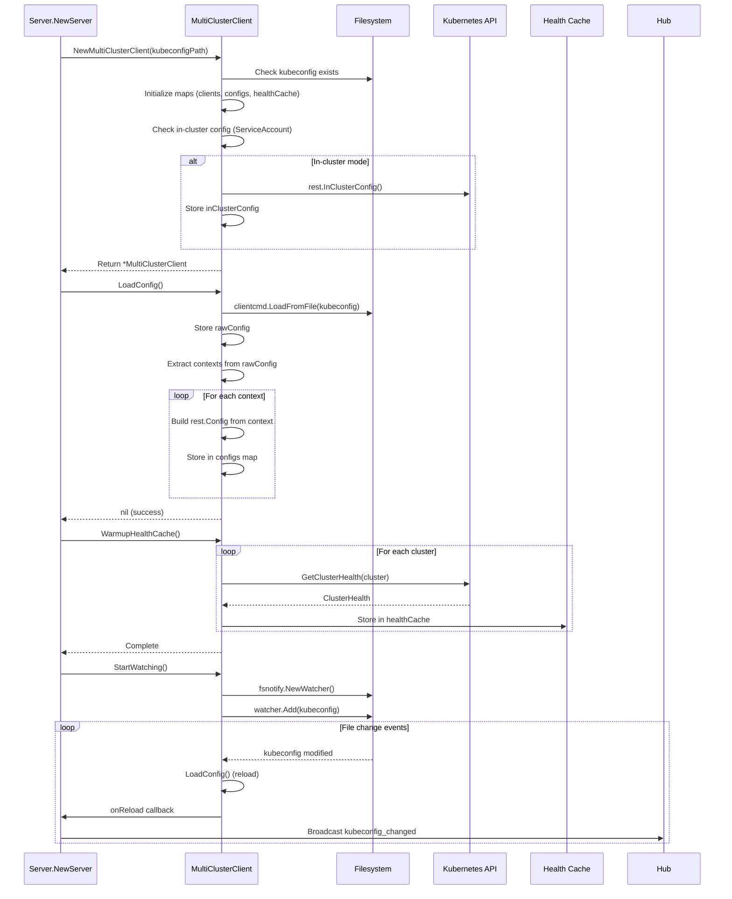
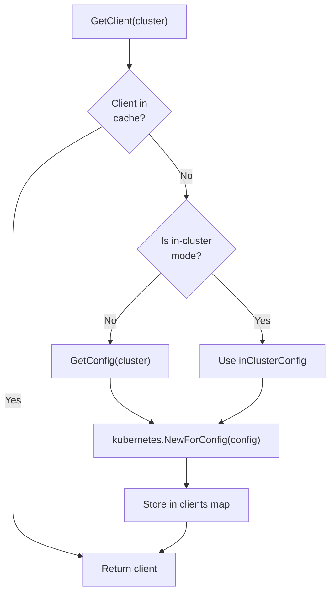
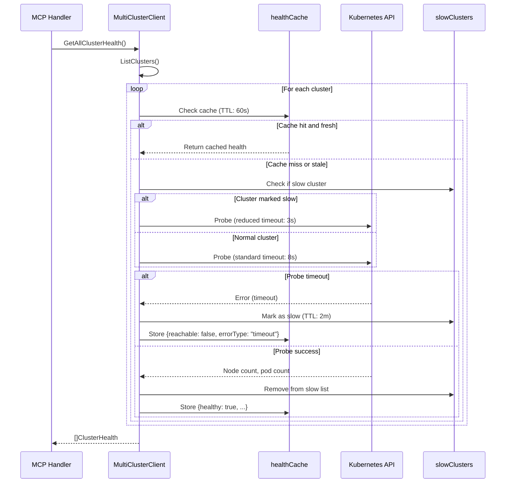
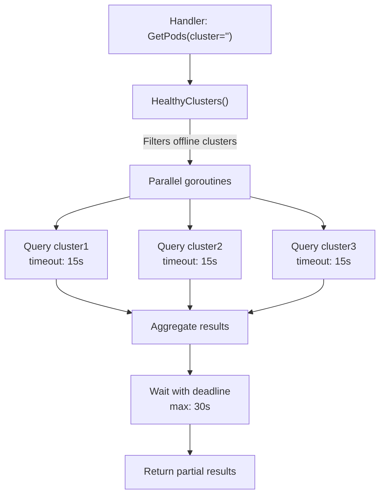
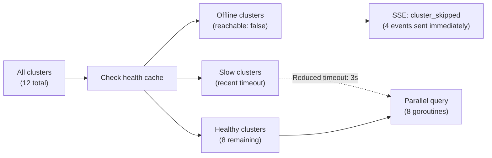
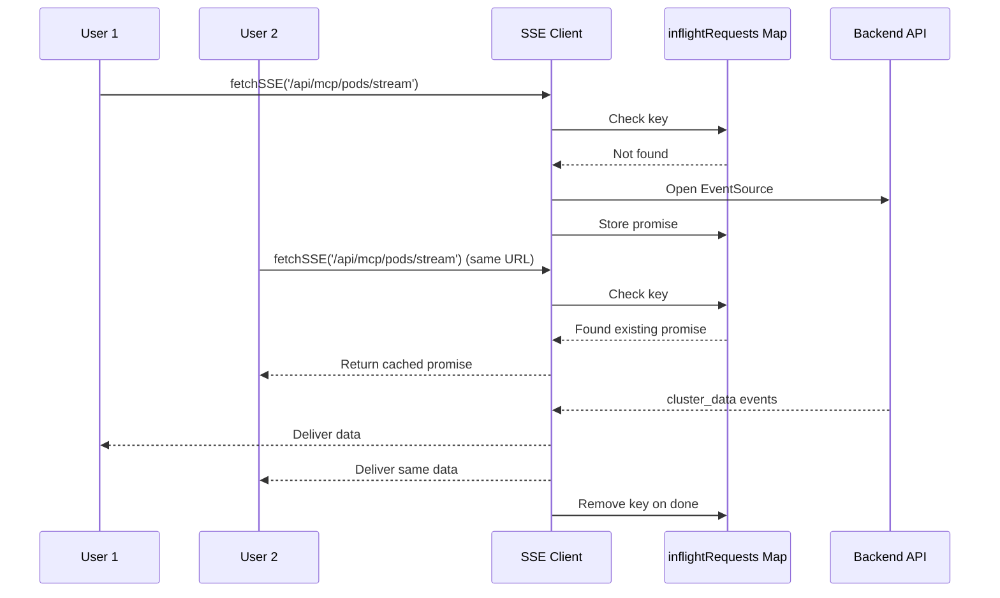
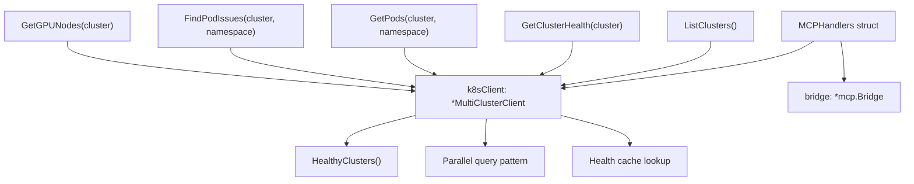
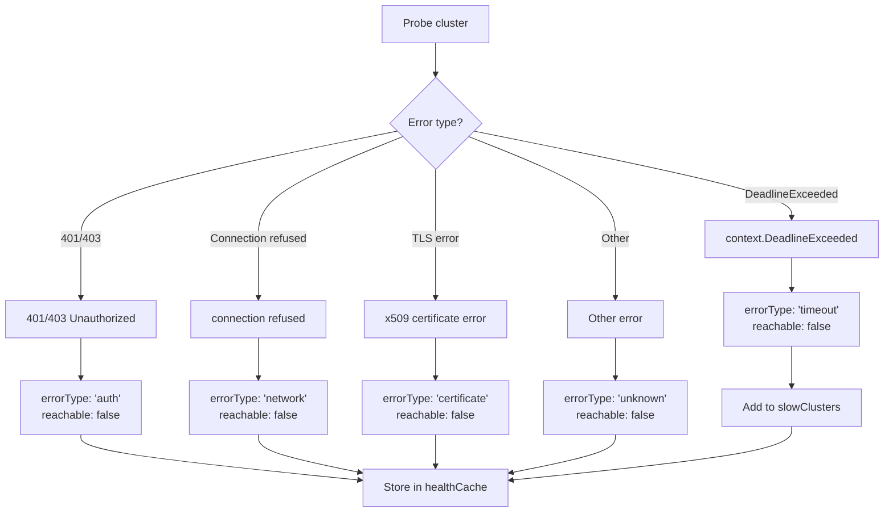

<!-- source: DeepWiki mcp.deepwiki.com · repo kubestellar/console · page 4.1 MultiClusterClient · fetched 2026-10-27 -->

# MultiClusterClient

<details>
<summary>Relevant source files</summary>

The following files were used as context for generating this wiki page:

- [pkg/api/handlers/demo_data.go](pkg/api/handlers/demo_data.go)
- [pkg/api/handlers/gitops.go](pkg/api/handlers/gitops.go)
- [pkg/api/handlers/mcp.go](pkg/api/handlers/mcp.go)
- [pkg/api/handlers/sse.go](pkg/api/handlers/sse.go)
- [pkg/api/server.go](pkg/api/server.go)
- [pkg/k8s/client.go](pkg/k8s/client.go)
- [web/src/components/cards/ProactiveGPUNodeHealthMonitor.tsx](web/src/components/cards/ProactiveGPUNodeHealthMonitor.tsx)
- [web/src/components/clusters/ClusterDetailModal.tsx](web/src/components/clusters/ClusterDetailModal.tsx)
- [web/src/components/clusters/Clusters.tsx](web/src/components/clusters/Clusters.tsx)
- [web/src/components/clusters/ResourceDetailModals.tsx](web/src/components/clusters/ResourceDetailModals.tsx)
- [web/src/components/clusters/components/ClusterGrid.tsx](web/src/components/clusters/components/ClusterGrid.tsx)
- [web/src/components/clusters/components/GPUDetailModal.tsx](web/src/components/clusters/components/GPUDetailModal.tsx)
- [web/src/components/ui/CloudProviderIcon.tsx](web/src/components/ui/CloudProviderIcon.tsx)
- [web/src/config/cards/gpu-node-health.ts](web/src/config/cards/gpu-node-health.ts)
- [web/src/config/dashboards/gpu.ts](web/src/config/dashboards/gpu.ts)
- [web/src/hooks/mcp/types.ts](web/src/hooks/mcp/types.ts)
- [web/src/hooks/useMCP.ts](web/src/hooks/useMCP.ts)
- [web/src/lib/sseClient.ts](web/src/lib/sseClient.ts)

</details>


## Purpose and Scope

The `MultiClusterClient` is the core Kubernetes cluster management component responsible for discovering, connecting to, and querying multiple Kubernetes clusters simultaneously. It provides a unified interface for accessing resources across all configured clusters, implements health monitoring with aggressive caching, and handles both in-cluster (ServiceAccount-based) and external (kubeconfig-based) authentication modes.

This page covers the internal architecture of `MultiClusterClient`, its initialization, health monitoring strategies, and query patterns. For API handler implementations that use this client, see [MCP Handlers](#5.1). For SSE streaming architecture, see [SSE Streaming Architecture](#4.2). For frontend integration, see [Cluster UI Components](#4.3).

---

## Architecture Overview

### MultiClusterClient Structure



**Sources:** [pkg/k8s/client.go:43-59](), [pkg/k8s/client.go:30-41]()

The `MultiClusterClient` maintains separate connection pools for typed and dynamic clients, enabling both standard Kubernetes resource queries and CRD (Custom Resource Definition) access. The health cache prevents redundant health checks, while the slow cluster tracker optimizes timeouts for previously unresponsive clusters.

---

## Initialization and Configuration Loading

### NewMultiClusterClient and LoadConfig Flow



**Sources:** [pkg/k8s/client.go:599-705](), [pkg/api/server.go:139-163]()

The initialization sequence handles both external kubeconfig files and in-cluster ServiceAccount credentials. The kubeconfig watcher enables hot-reloading of cluster configurations without server restarts, broadcasting changes to connected WebSocket clients via the hub.

### Configuration Structure

| Component | Type | Purpose | Source |
|-----------|------|---------|--------|
| `kubeconfig` | `string` | Path to kubeconfig file | Constructor parameter |
| `rawConfig` | `*api.Config` | Parsed kubeconfig with contexts | `clientcmd.LoadFromFile()` |
| `configs` | `map[string]*rest.Config` | Per-cluster REST configs | Built from contexts |
| `clients` | `map[string]kubernetes.Interface` | Typed K8s clients | Lazy-initialized on first use |
| `dynamicClients` | `map[string]dynamic.Interface` | Dynamic clients for CRDs | Lazy-initialized on first use |
| `inClusterConfig` | `*rest.Config` | ServiceAccount config | `rest.InClusterConfig()` |

**Sources:** [pkg/k8s/client.go:43-59](), [pkg/k8s/client.go:599-705]()

---

## Client Management

### Client Creation and Caching



**Sources:** [pkg/k8s/client.go:707-747]()

The client retrieval pattern uses lazy initialization with caching. Clients are created on first access and reused for subsequent queries. The in-cluster mode check enables deployment inside Kubernetes without external kubeconfig files.

### Typed vs Dynamic Clients

| Client Type | Use Case | Creation Method | Example Usage |
|-------------|----------|-----------------|---------------|
| Typed (`kubernetes.Interface`) | Standard K8s resources (Pods, Nodes, Services) | `kubernetes.NewForConfig()` | `GetPods()`, `GetNodes()`, `GetDeployments()` |
| Dynamic (`dynamic.Interface`) | CRDs and custom resources | `dynamic.NewForConfig()` | OLM CSVs, Argo Workflows, Flux Kustomizations |

**Sources:** [pkg/k8s/client.go:749-799]()

Dynamic clients are essential for querying Operator Lifecycle Manager (OLM) resources, GitOps controllers (Argo CD, Flux), and other custom resources that don't have typed client support.

---

## Health Monitoring and Caching

### Health Check Architecture



**Sources:** [pkg/k8s/client.go:803-917](), [pkg/k8s/client.go:30-41]()

The health caching strategy prevents the UI from blocking on slow or offline clusters. The 60-second cache TTL balances freshness with performance, while the slow cluster tracker reduces wasted time on consecutive timeouts.

### ClusterHealth Structure

```go
type ClusterHealth struct {
    Cluster      string   `json:"cluster"`
    Healthy      bool     `json:"healthy"`
    Reachable    bool     `json:"reachable"`
    LastSeen     string   `json:"lastSeen,omitempty"`
    ErrorType    string   `json:"errorType,omitempty"`    // timeout, auth, network, certificate
    ErrorMessage string   `json:"errorMessage,omitempty"`
    APIServer    string   `json:"apiServer,omitempty"`
    NodeCount    int      `json:"nodeCount"`
    ReadyNodes   int      `json:"readyNodes"`
    PodCount     int      `json:"podCount"`
    CpuCores     int      `json:"cpuCores"`
    MemoryBytes  int64    `json:"memoryBytes"`
    MemoryGB     float64  `json:"memoryGB"`
    // ... resource usage fields
}
```

**Sources:** [pkg/k8s/client.go:140-169]()

The `errorType` field enables precise error classification for UI display: token expiration (`auth`), network issues (`network`), TLS problems (`certificate`), or general timeouts (`timeout`).

---

## Resource Query Methods

### Multi-Cluster Query Pattern



**Sources:** [pkg/api/handlers/mcp.go:196-259](), [pkg/k8s/client.go:919-1007]()

The multi-cluster query pattern uses `HealthyClusters()` to skip known-offline clusters immediately, avoiding 30+ second timeouts. Parallel goroutines query healthy clusters concurrently, with a 30-second overall deadline to prevent indefinite blocking.

### Query Method Taxonomy

| Method | Purpose | Single Cluster | Multi-Cluster | SSE Streaming |
|--------|---------|----------------|---------------|---------------|
| `GetPods()` | List pods in namespace | ✓ | ✓ | `GetPodsStream()` |
| `FindPodIssues()` | Detect failing pods | ✓ | ✓ | `FindPodIssuesStream()` |
| `GetDeployments()` | List deployments | ✓ | ✓ | `GetDeploymentsStream()` |
| `GetNodes()` | List cluster nodes | ✓ | ✓ | `GetNodesStream()` |
| `GetGPUNodes()` | List GPU-enabled nodes | ✓ | ✓ | `GetGPUNodesStream()` |
| `GetEvents()` | Fetch cluster events | ✓ | ✓ | `GetEventsStream()` |
| `GetServices()` | List services | ✓ | ✓ | `GetServicesStream()` |

**Sources:** [pkg/k8s/client.go:1009-1891](), [pkg/api/handlers/sse.go:229-440]()

SSE streaming variants are available for all heavy queries, enabling progressive rendering in the UI as each cluster's data arrives. See [SSE Streaming Architecture](#4.2) for implementation details.

---

## Performance Optimizations

### HealthyClusters() Filter



**Sources:** [pkg/k8s/client.go:919-1007](), [pkg/api/handlers/sse.go:80-202]()

The `HealthyClusters()` method filters out unreachable clusters based on cached health data, preventing wasted goroutines and timeouts. Offline clusters are immediately reported via SSE `cluster_skipped` events, ensuring the frontend knows why certain clusters are missing.

### Caching Strategy

| Cache Type | TTL | Eviction | Purpose |
|------------|-----|----------|---------|
| Health Cache | 60s | Time-based | Avoid redundant cluster probes |
| SSE Response Cache | 15s | Time-based | Serve repeated UI navigation |
| Operator Cache | 5min | Time-based | Reduce slow CSV queries (90-100s) |
| Slow Cluster Tracker | 2min | Time-based | Apply reduced timeouts |

**Sources:** [pkg/k8s/client.go:35](), [pkg/api/handlers/sse.go:44](), [pkg/api/handlers/gitops.go:378]()

The health cache is critical for UI responsiveness. Without it, the `/api/mcp/clusters` endpoint would block for 8+ seconds per cluster on every page load. With the cache, subsequent loads return instantly from memory.

### In-Flight Request Deduplication



**Sources:** [web/src/lib/sseClient.ts:32-79]()

Frontend-side deduplication prevents duplicate concurrent SSE requests when multiple components or users request the same data simultaneously. This optimization is especially important for heavy queries like operator lists (1000+ CSVs).

---

## Integration with API Layer

### MCP Handlers Usage



**Sources:** [pkg/api/handlers/mcp.go:50-62](), [pkg/api/handlers/mcp.go:100-196]()

The `MCPHandlers` struct wraps `MultiClusterClient` and provides the bridge between HTTP routes and cluster queries. All MCP endpoints follow the pattern: check demo mode → try MCP bridge → fallback to `MultiClusterClient`.

### Route Registration

| Route | Handler Method | MCC Method(s) Used | Purpose |
|-------|---------------|-------------------|---------|
| `GET /api/mcp/clusters` | `ListClusters()` | `ListClusters()`, `GetCachedHealth()` | Cluster discovery |
| `GET /api/mcp/clusters/health` | `GetAllClusterHealth()` | `GetAllClusterHealth()` | Full health refresh |
| `GET /api/mcp/clusters/:cluster/health` | `GetClusterHealth()` | `GetClusterHealth(cluster)` | Single cluster health |
| `GET /api/mcp/pods` | `GetPods()` | `HealthyClusters()`, `GetPods()` | Multi-cluster pod list |
| `GET /api/mcp/pods/stream` | `GetPodsStream()` | `HealthyClusters()`, `GetPods()` | SSE pod streaming |
| `GET /api/mcp/gpu-nodes` | `GetGPUNodes()` | `HealthyClusters()`, `GetGPUNodes()` | GPU node inventory |

**Sources:** [pkg/api/server.go:494-548](), [pkg/api/handlers/mcp.go:100-374]()

All routes are protected by JWT authentication middleware. Demo mode overrides are checked first to enable Netlify preview deployments without cluster access.

---

## Error Handling and Resilience

### Error Classification



**Sources:** [pkg/k8s/client.go:803-917]()

Error classification enables the UI to display appropriate messages and recovery actions. Token expiration (`auth`) shows a different icon and message than network issues (`network` or `timeout`). See [Cloud Provider Detection](#4.4) for UI error display.

### Slow Cluster Tracking

```go
// IsSlow checks if a cluster recently timed out
func (m *MultiClusterClient) IsSlow(cluster string) bool {
    m.mu.RLock()
    defer m.mu.RUnlock()
    if t, ok := m.slowClusters[cluster]; ok {
        return time.Since(t) < slowClusterTTL  // 2 minutes
    }
    return false
}

// MarkSlow records a cluster timeout
func (m *MultiClusterClient) MarkSlow(cluster string) {
    m.mu.Lock()
    defer m.mu.Unlock()
    if m.slowClusters == nil {
        m.slowClusters = make(map[string]time.Time)
    }
    m.slowClusters[cluster] = time.Now()
}
```

**Sources:** [pkg/k8s/client.go:1923-1947]()

Slow cluster tracking prevents repeated 8-second timeouts. Once a cluster times out, subsequent queries use a 3-second timeout for the next 2 minutes, reducing wasted time by 5 seconds per query.

---

## Testing and Injection

### Test Helper Methods

```go
// SetClient injects a typed client for testing
func (m *MultiClusterClient) SetClient(cluster string, client kubernetes.Interface) {
    m.mu.Lock()
    defer m.mu.Unlock()
    if m.clients == nil {
        m.clients = make(map[string]kubernetes.Interface)
    }
    m.clients[cluster] = client
}

// SetDynamicClient injects a dynamic client for testing
func (m *MultiClusterClient) SetDynamicClient(cluster string, client dynamic.Interface) {
    m.mu.Lock()
    defer m.mu.Unlock()
    if m.dynamicClients == nil {
        m.dynamicClients = make(map[string]dynamic.Interface)
    }
    m.dynamicClients[cluster] = client
}
```

**Sources:** [pkg/k8s/client.go:68-86]()

Test injection methods enable unit testing of handlers without real Kubernetes clusters. Mock clients can be injected to verify query patterns, error handling, and parallel execution logic.

---

## Summary

The `MultiClusterClient` implements a sophisticated multi-cluster management system with aggressive caching, intelligent error handling, and performance optimizations. Key architectural decisions include:

1. **Dual client types**: Typed clients for standard resources, dynamic clients for CRDs
2. **60-second health cache**: Prevents UI blocking on slow/offline clusters
3. **Slow cluster tracking**: Reduces wasted time on repeated timeouts
4. **HealthyClusters() filter**: Skips known-offline clusters before querying
5. **Hot-reload support**: Watches kubeconfig file for changes without server restart
6. **In-cluster mode**: Supports ServiceAccount-based auth for K8s deployments

Performance optimizations like SSE streaming, response caching, and in-flight request deduplication enable the UI to remain responsive even with 10+ clusters, including several that are offline or slow. The error classification system provides precise diagnostics for authentication failures, network issues, and certificate problems, enabling users to take appropriate corrective action.

**Sources:** [pkg/k8s/client.go:1-1947](), [pkg/api/handlers/mcp.go:1-1100](), [pkg/api/handlers/sse.go:1-440]()

---

