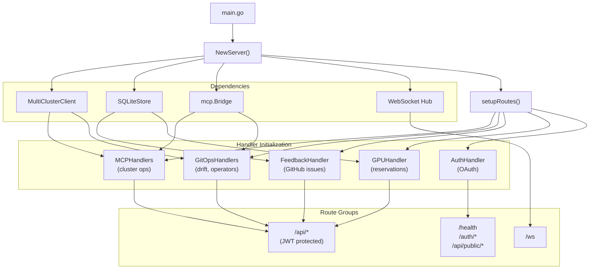
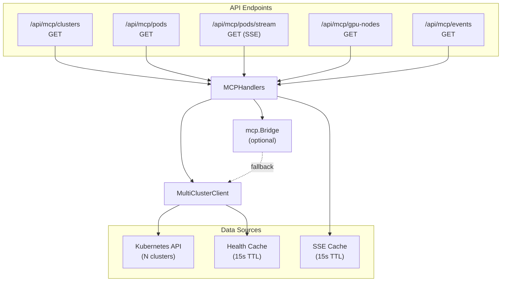
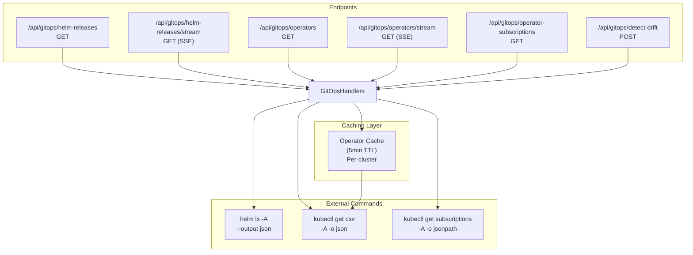
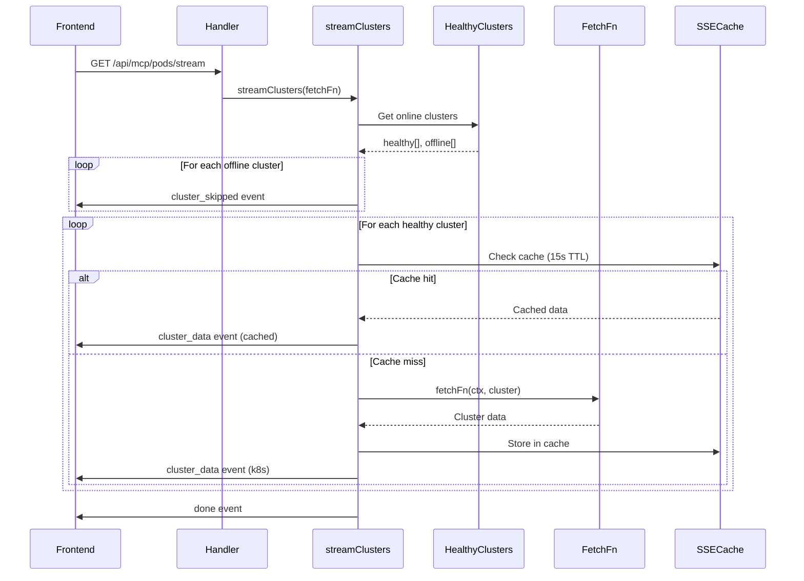
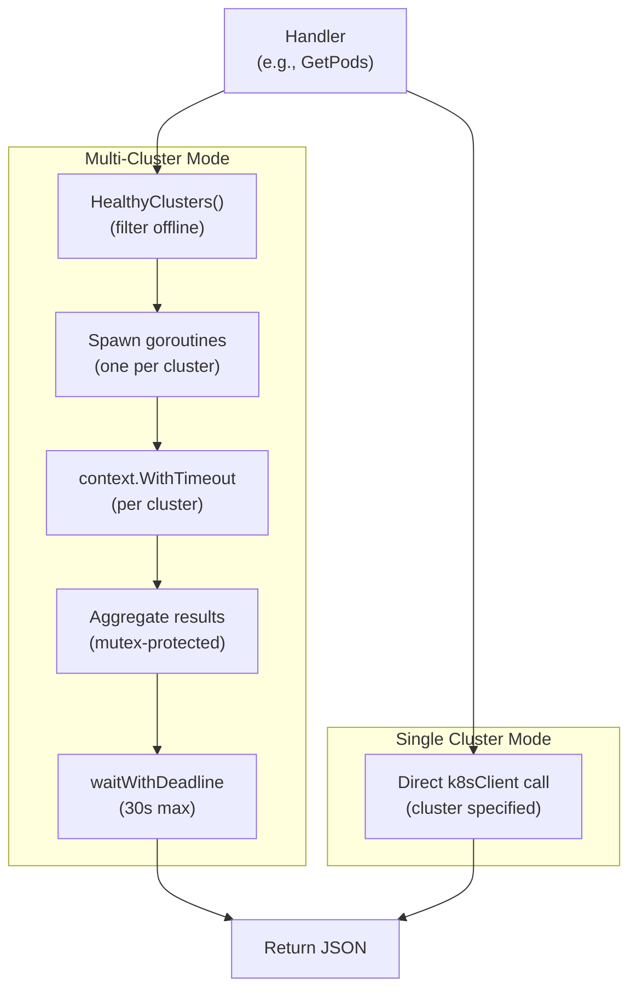
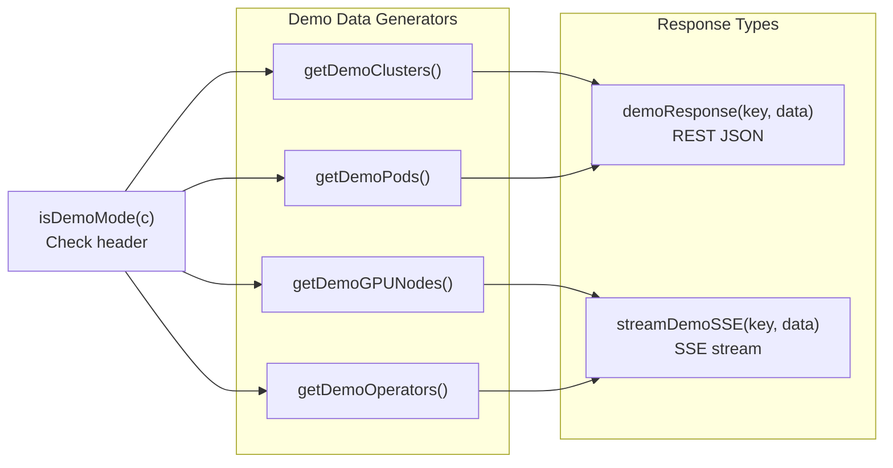

<!-- source: DeepWiki mcp.deepwiki.com · repo kubestellar/console · page 5 Backend API Handlers · fetched 2026-10-27 -->

# Backend API Handlers

<details>
<summary>Relevant source files</summary>

The following files were used as context for generating this wiki page:

- [pkg/api/handlers/demo_data.go](pkg/api/handlers/demo_data.go)
- [pkg/api/handlers/gitops.go](pkg/api/handlers/gitops.go)
- [pkg/api/handlers/mcp.go](pkg/api/handlers/mcp.go)
- [pkg/api/handlers/sse.go](pkg/api/handlers/sse.go)
- [pkg/api/server.go](pkg/api/server.go)
- [pkg/k8s/client.go](pkg/k8s/client.go)
- [web/src/components/cards/ProactiveGPUNodeHealthMonitor.tsx](web/src/components/cards/ProactiveGPUNodeHealthMonitor.tsx)
- [web/src/config/cards/gpu-node-health.ts](web/src/config/cards/gpu-node-health.ts)
- [web/src/config/dashboards/gpu.ts](web/src/config/dashboards/gpu.ts)
- [web/src/hooks/mcp/types.ts](web/src/hooks/mcp/types.ts)
- [web/src/lib/sseClient.ts](web/src/lib/sseClient.ts)

</details>


## Purpose and Scope

This document describes the backend API handler architecture in the KubeStellar Console. It covers how HTTP/SSE endpoints are organized into handler groups, how they interact with the Kubernetes multi-cluster client, and how data flows from clusters to the frontend. For general backend architecture, see [Backend Architecture](#2.2). For the multi-cluster client implementation, see [MultiClusterClient](#4.1).

---

## Handler Architecture Overview

The backend uses Go Fiber as the HTTP framework and organizes API endpoints into domain-specific handler groups. Each handler group encapsulates business logic for a specific area (cluster management, GitOps, GPU monitoring, etc.) and delegates Kubernetes operations to the `MultiClusterClient`.

### Handler Registration Flow



**Sources:** [pkg/api/server.go:94-227](), [pkg/api/server.go:310-706]()

---

## Route Registration and Middleware

Routes are registered in `setupRoutes()` with a three-tier security model:

| Route Prefix | Authentication | Use Case |
|-------------|----------------|----------|
| `/health` | None | Health checks, version detection |
| `/auth/*` | None | OAuth login/callback |
| `/api/public/*` | None | Desktop widget data (nightly E2E status) |
| `/api/*` | JWT required | All authenticated operations |
| `/ws` | JWT via query param | WebSocket real-time updates |

### Middleware Stack

```mermaid
graph LR
    Request["HTTP Request"]
    Recovery["recover.New()"]
    Logger["logger.New()"]
    CORS["cors.New()"]
    JWTAuth["middleware.JWTAuth"]
    Handler["Route Handler"]
    
    Request --> Recovery
    Recovery --> Logger
    Logger --> CORS
    CORS --> JWTAuth
    JWTAuth --> Handler
    
    style JWTAuth fill:#333
```



**Sources:** [pkg/api/server.go:254-271](), [pkg/api/server.go:413]()

JWT authentication is applied to the `/api` route group, extracting and validating tokens from the `Authorization: Bearer <token>` header. The middleware injects user context into `fiber.Locals` for downstream handlers to access.

---

## Handler Groups

### MCP Handlers

The `MCPHandlers` struct provides multi-cluster Kubernetes data aggregation. It delegates to either the MCP bridge (for enhanced kubestellar-ops functionality) or the direct `MultiClusterClient` (for standard kubectl operations).



**Sources:** [pkg/api/handlers/mcp.go:50-62](), [pkg/api/server.go:406-548]()

#### REST vs SSE Variants

Most MCP endpoints have two variants:

| Type | Endpoint | Behavior |
|------|----------|----------|
| REST | `/api/mcp/pods` | Waits for all clusters (up to 30s), returns JSON array |
| SSE | `/api/mcp/pods/stream` | Streams per-cluster results as they arrive |

The SSE variant is preferred for UI as it provides progressive rendering and skips offline clusters instantly.

**Sources:** [pkg/api/handlers/mcp.go:197-259](), [pkg/api/handlers/sse.go:229-249]()

#### Demo Mode Detection

All MCP handlers check for the `X-Demo-Mode: true` header. When detected, they immediately return demo data without attempting cluster connections:

```go
if isDemoMode(c) {
    return demoResponse(c, "pods", getDemoPods())
}
```

**Sources:** [pkg/api/handlers/mcp.go:103-105](), [pkg/api/handlers/demo_data.go:11-13]()

---

### GitOps Handlers

The `GitOpsHandlers` struct provides GitOps drift detection and tracks Helm releases, Flux Kustomizations, and OLM operators.



**Sources:** [pkg/api/handlers/gitops.go:33-45](), [pkg/api/server.go:551-566]()

#### Operator Cache Strategy

OLM `ClusterServiceVersion` (CSV) queries are extremely slow for clusters with 1000+ operators (90-100 seconds). The handler implements aggressive caching:

1. **Per-cluster cache** with 5-minute TTL
2. **Background refresh** populates cache asynchronously
3. **Transient error retry** with 2-second delay
4. **Permanent error caching** (cluster lacks OLM) to avoid repeated failures

**Sources:** [pkg/api/handlers/gitops.go:373-398](), [pkg/api/handlers/gitops.go:538-588]()

The fetch operation uses `kubectl get csv -A -o json` (not jsonpath) for better performance with large result sets:

```go
args := []string{"get", "csv", "-A", "-o", "json", "--request-timeout=0"}
```

**Sources:** [pkg/api/handlers/gitops.go:597]()

---

### GPU Management

GPU-related endpoints are split across two handler groups:

#### GPUHandler (Reservations)

Manages GPU resource quotas and reservations stored in SQLite:

- `POST /api/gpu/reservations` - Create reservation
- `GET /api/gpu/reservations` - List reservations
- `PUT /api/gpu/reservations/:id` - Update reservation
- `DELETE /api/gpu/reservations/:id` - Delete reservation

**Sources:** [pkg/api/server.go:650-655]()

#### MCPHandlers (Node Health)

Provides GPU node health monitoring via Kubernetes API:

- `GET /api/mcp/gpu-nodes` - List GPU nodes with capacity/allocation
- `GET /api/mcp/gpu-nodes/health` - Proactive health checks
- `GET /api/mcp/gpu-nodes/health/cronjob` - CronJob status
- `POST /api/mcp/gpu-nodes/health/cronjob` - Install health checker
- `DELETE /api/mcp/gpu-nodes/health/cronjob` - Uninstall health checker

**Sources:** [pkg/api/handlers/mcp.go:324-527](), [pkg/api/server.go:506-511]()

---

## SSE Streaming Architecture

Server-Sent Events (SSE) enable progressive rendering of multi-cluster data. The generic `streamClusters` helper implements the streaming pattern used by all SSE endpoints.

### Streaming Flow



**Sources:** [pkg/api/handlers/sse.go:73-202]()

### Event Types

| Event | Description | Data |
|-------|-------------|------|
| `connected` | Stream initialized | `{"status": "streaming"}` |
| `cluster_skipped` | Cluster offline | `{"cluster": "...", "reason": "offline"}` |
| `cluster_data` | Per-cluster results | `{"cluster": "...", "pods": [...], "source": "k8s\|cache"}` |
| `done` | Stream complete | `{"totalClusters": N, "completedClusters": M}` |

**Sources:** [pkg/api/handlers/sse.go:25-33]()

### Performance Optimizations

1. **Health-based filtering**: Only spawns goroutines for healthy/unknown clusters
2. **15-second cache**: Serves cached results instantly on re-navigation
3. **Slow cluster tracking**: Reduces timeout (3s) for clusters that recently timed out
4. **In-flight deduplication**: Frontend prevents concurrent requests to same URL

**Sources:** [pkg/api/handlers/sse.go:36-46](), [web/src/lib/sseClient.ts:31-36]()

---

## Multi-Cluster Data Aggregation

All multi-cluster handlers follow a common pattern:



**Sources:** [pkg/api/handlers/mcp.go:217-248]()

### Timeout Strategy

| Timeout | Value | Purpose |
|---------|-------|---------|
| `mcpDefaultTimeout` | 15s | Standard operations (pods, nodes, events) |
| `mcpExtendedTimeout` | 30s | Heavy operations (deployments, GPU queries) |
| `maxResponseDeadline` | 30s | Overall request deadline (REST endpoints) |
| `sseOverallDeadline` | 30s | SSE stream deadline |
| `ssePerClusterTimeout` | 10s | Per-cluster timeout (SSE) |

**Sources:** [pkg/api/handlers/mcp.go:15-29](), [pkg/api/handlers/sse.go:36-42]()

The `waitWithDeadline` helper ensures REST endpoints return within 30 seconds even if some clusters are slow:

```go
func waitWithDeadline(wg *sync.WaitGroup, deadline time.Duration) bool {
    done := make(chan struct{})
    go func() {
        wg.Wait()
        close(done)
    }()
    select {
    case <-done:
        return false  // All completed
    case <-time.After(deadline):
        return true   // Deadline hit (partial results)
    }
}
```

**Sources:** [pkg/api/handlers/mcp.go:31-48]()

---

## Demo Mode Implementation

Demo mode allows the frontend to render UI without cluster access (used in Netlify preview deployments). Handlers detect the `X-Demo-Mode: true` header and return pre-defined demo data.

### Demo Data Functions



**Sources:** [pkg/api/handlers/demo_data.go:8-307](), [pkg/api/handlers/sse.go:204-223]()

Demo data is curated to showcase all UI states (healthy/unhealthy clusters, pod issues, GPU nodes, etc.) and matches the frontend's TypeScript types.

---

## Handler Dependencies

### MultiClusterClient Integration

Handlers interact with `MultiClusterClient` for Kubernetes operations:

```go
type MCPHandlers struct {
    bridge    *mcp.Bridge
    k8sClient *k8s.MultiClusterClient
}
```

Common operations:
- `k8sClient.HealthyClusters(ctx)` - Get online clusters
- `k8sClient.GetPods(ctx, cluster, namespace)` - Query pods
- `k8sClient.GetGPUNodes(ctx, cluster)` - Query GPU nodes
- `k8sClient.GetClusterHealth(ctx, cluster)` - Get health status

**Sources:** [pkg/api/handlers/mcp.go:50-62]()

### MCP Bridge Fallback

The MCP bridge provides enhanced functionality via kubestellar-ops tools. Handlers try the bridge first, then fall back to `MultiClusterClient`:

```go
if h.bridge != nil {
    pods, err := h.bridge.GetPods(ctx, cluster, namespace, labelSelector)
    if err == nil {
        return c.JSON(fiber.Map{"pods": pods, "source": "mcp"})
    }
    log.Printf("MCP bridge GetPods failed, falling back: %v", err)
}
// Fall back to direct k8s client
pods, err := h.k8sClient.GetPods(ctx, cluster, namespace)
```

**Sources:** [pkg/api/handlers/mcp.go:209-216]()

---

## Error Handling and Resilience

### Circuit Breaker Pattern

The operator cache implements permanent error caching to avoid repeated failures:

```go
type errPermanent struct{ error }

// Permanent errors (cluster lacks OLM) — cache empty result
if _, ok := err.(errPermanent); ok {
    operatorCacheData[cacheKey] = &operatorCacheEntry{
        operators: []Operator{},
        fetchedAt: time.Now(),
    }
    return []Operator{}
}
```

**Sources:** [pkg/api/handlers/gitops.go:556-564](), [pkg/api/handlers/gitops.go:590-591]()

### Transient Error Retry

GitOps handlers retry once for transient errors (HTTP/2 stream errors, connection resets):

```go
operators, err := h.fetchOperatorsFromCluster(ctx, cluster)
if err != nil {
    if _, ok := err.(errPermanent); ok {
        // Cache and return
    }
    // Retry for transient errors
    if ctx.Err() == nil {
        log.Printf("Retrying operator fetch for cluster %s", cluster)
        time.Sleep(gitopsRetryDelay)
        operators, err = h.fetchOperatorsFromCluster(ctx, cluster)
    }
}
```

**Sources:** [pkg/api/handlers/gitops.go:554-572]()

### Graceful Degradation

REST endpoints return partial results if some clusters timeout, ensuring the UI remains responsive:

```go
waitWithDeadline(&wg, maxResponseDeadline)
return c.JSON(fiber.Map{"pods": allPods, "source": "k8s"})
```

**Sources:** [pkg/api/handlers/mcp.go:247-248]()

---

