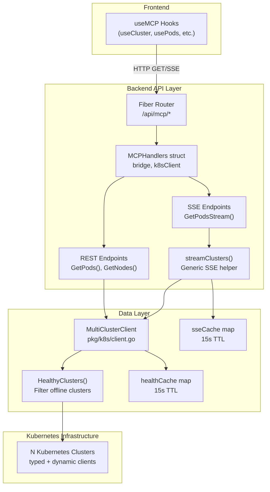
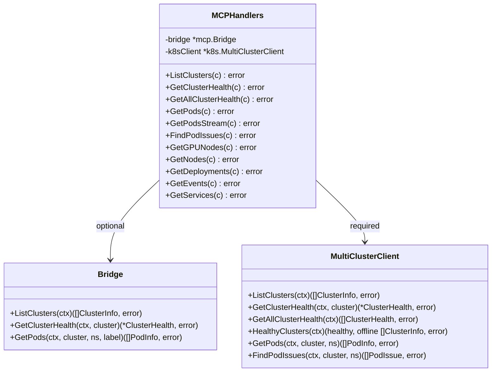
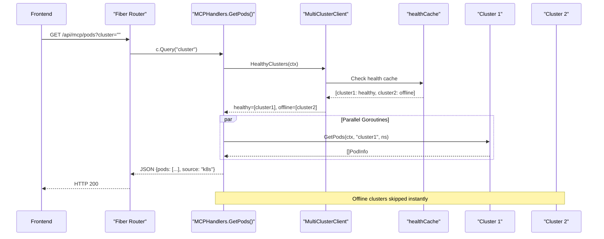
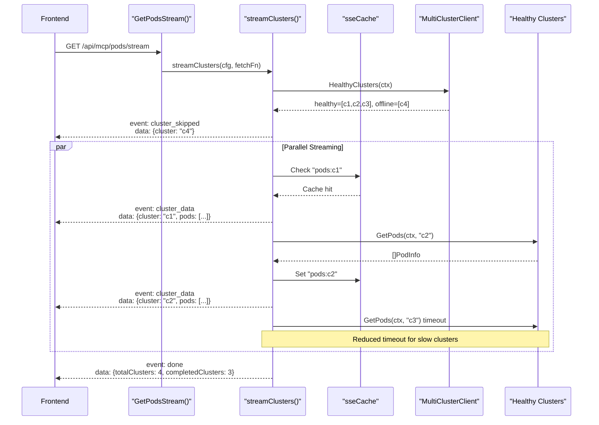
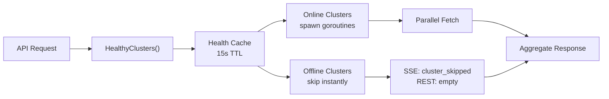
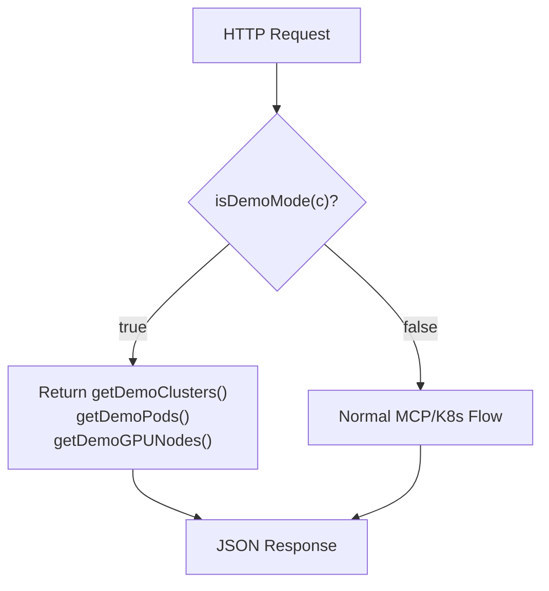

<!-- source: DeepWiki mcp.deepwiki.com · repo kubestellar/console · page 5.1 MCP Handlers · fetched 2026-10-27 -->

# MCP Handlers

<details>
<summary>Relevant source files</summary>

The following files were used as context for generating this wiki page:

- [pkg/api/handlers/demo_data.go](pkg/api/handlers/demo_data.go)
- [pkg/api/handlers/gitops.go](pkg/api/handlers/gitops.go)
- [pkg/api/handlers/mcp.go](pkg/api/handlers/mcp.go)
- [pkg/api/handlers/sse.go](pkg/api/handlers/sse.go)
- [pkg/api/server.go](pkg/api/server.go)
- [pkg/k8s/client.go](pkg/k8s/client.go)
- [web/src/components/cards/ProactiveGPUNodeHealthMonitor.tsx](web/src/components/cards/ProactiveGPUNodeHealthMonitor.tsx)
- [web/src/components/clusters/ClusterDetailModal.tsx](web/src/components/clusters/ClusterDetailModal.tsx)
- [web/src/components/clusters/Clusters.tsx](web/src/components/clusters/Clusters.tsx)
- [web/src/components/clusters/ResourceDetailModals.tsx](web/src/components/clusters/ResourceDetailModals.tsx)
- [web/src/components/clusters/components/ClusterGrid.tsx](web/src/components/clusters/components/ClusterGrid.tsx)
- [web/src/components/clusters/components/GPUDetailModal.tsx](web/src/components/clusters/components/GPUDetailModal.tsx)
- [web/src/components/ui/CloudProviderIcon.tsx](web/src/components/ui/CloudProviderIcon.tsx)
- [web/src/config/cards/gpu-node-health.ts](web/src/config/cards/gpu-node-health.ts)
- [web/src/config/dashboards/gpu.ts](web/src/config/dashboards/gpu.ts)
- [web/src/hooks/mcp/types.ts](web/src/hooks/mcp/types.ts)
- [web/src/hooks/useMCP.ts](web/src/hooks/useMCP.ts)
- [web/src/lib/sseClient.ts](web/src/lib/sseClient.ts)

</details>


## Purpose and Scope

MCP Handlers are the backend API layer responsible for aggregating and streaming Kubernetes resource data from multiple clusters. They provide REST and Server-Sent Events (SSE) endpoints that expose cluster information, pods, deployments, nodes, GPU resources, and health metrics to the frontend.

This document covers the `MCPHandlers` implementation, request routing, data aggregation patterns, and performance optimizations. For GitOps-specific operations (drift detection, Helm releases, operators), see [GitOps Handlers](#5.2). For GPU reservation management, see [GPU Management](#5.3).

**Sources:** [pkg/api/handlers/mcp.go:1-62](), [pkg/api/server.go:406-548]()

---

## Architecture Overview

The MCP handlers sit between the frontend and the MultiClusterClient, providing HTTP endpoints that aggregate data from N clusters in parallel.



**Sources:** [pkg/api/handlers/mcp.go:50-62](), [pkg/api/handlers/sse.go:73-202](), [pkg/k8s/client.go:43-59]()

---

## Handler Structure

The `MCPHandlers` struct holds references to the MCP bridge and Kubernetes client, providing a unified interface for multi-cluster operations.



The handlers implement a **fallback pattern**: try MCP bridge first (if available), then fall back to direct Kubernetes client access.

**Sources:** [pkg/api/handlers/mcp.go:50-62](), [pkg/k8s/client.go:600-800]()

---

## Request Flow Patterns

### REST Endpoint Pattern

REST endpoints aggregate data synchronously with a 30-second overall timeout. Clusters that exceed the timeout are excluded from the response.



**Sources:** [pkg/api/handlers/mcp.go:197-259](), [pkg/api/handlers/mcp.go:19-48]()

### SSE Streaming Pattern

SSE endpoints stream per-cluster results incrementally, providing progressive rendering in the UI.



**Sources:** [pkg/api/handlers/sse.go:73-202](), [pkg/api/handlers/sse.go:229-249]()

---

## Core MCP Endpoints

The handlers expose a consistent REST + SSE API pattern across all resource types.

| Route | Handler Method | Description | SSE Variant |
|-------|---------------|-------------|-------------|
| `/api/mcp/clusters` | `ListClusters()` | List all clusters with health | No |
| `/api/mcp/clusters/health` | `GetAllClusterHealth()` | Aggregate health for all clusters | No |
| `/api/mcp/clusters/:cluster/health` | `GetClusterHealth()` | Single cluster health | No |
| `/api/mcp/pods` | `GetPods()` | Get pods (all clusters or filtered) | `/stream` |
| `/api/mcp/pod-issues` | `FindPodIssues()` | Find unhealthy pods | `/stream` |
| `/api/mcp/deployments` | `GetDeployments()` | Get deployments | `/stream` |
| `/api/mcp/deployment-issues` | `FindDeploymentIssues()` | Find failing deployments | `/stream` |
| `/api/mcp/nodes` | `GetNodes()` | Get cluster nodes | `/stream` |
| `/api/mcp/gpu-nodes` | `GetGPUNodes()` | Get GPU-enabled nodes | `/stream` |
| `/api/mcp/gpu-nodes/health` | `GetGPUNodeHealth()` | GPU node health checks | `/stream` |
| `/api/mcp/events` | `GetEvents()` | Kubernetes events | `/stream` |
| `/api/mcp/events/warnings` | `GetWarningEvents()` | Warning/error events only | `/stream` |
| `/api/mcp/services` | `GetServices()` | Get services | `/stream` |
| `/api/mcp/jobs` | `GetJobs()` | Get batch jobs | `/stream` |
| `/api/mcp/configmaps` | `GetConfigMaps()` | Get ConfigMaps | `/stream` |
| `/api/mcp/secrets` | `GetSecrets()` | Get Secrets | `/stream` |

**Query Parameters:**
- `cluster`: Filter to specific cluster (empty = all clusters)
- `namespace`: Filter to specific namespace
- `labelSelector`: Kubernetes label selector (pods only)
- `limit`: Result limit (events)

**Sources:** [pkg/api/server.go:495-548](), [pkg/api/handlers/mcp.go:100-600]()

---

## Multi-Cluster Aggregation

### Parallel Goroutine Pattern

REST endpoints spawn one goroutine per healthy cluster, aggregating results with a mutex.

```go
// Simplified pattern from GetPods()
clusters, _, err := h.k8sClient.HealthyClusters(c.Context())

var wg sync.WaitGroup
var mu sync.Mutex
var allPods []k8s.PodInfo

for _, cl := range clusters {
    wg.Add(1)
    go func(clusterName string) {
        defer wg.Done()
        ctx, cancel := context.WithTimeout(c.Context(), mcpExtendedTimeout)
        defer cancel()

        pods, err := h.k8sClient.GetPods(ctx, clusterName, namespace)
        if err == nil && len(pods) > 0 {
            mu.Lock()
            allPods = append(allPods, pods...)
            mu.Unlock()
        }
    }(cl.Name)
}

waitWithDeadline(&wg, maxResponseDeadline)
return c.JSON(fiber.Map{"pods": allPods, "source": "k8s"})
```

The `waitWithDeadline()` helper returns early after 30 seconds, sending partial results if some clusters haven't responded.

**Sources:** [pkg/api/handlers/mcp.go:220-248](), [pkg/api/handlers/mcp.go:36-48]()

### SSE Progressive Streaming

The `streamClusters()` helper provides a generic SSE aggregation pattern:

```go
// Simplified from streamClusters()
func streamClusters(
    c *fiber.Ctx,
    h *MCPHandlers,
    cfg sseClusterStreamConfig,
    fetchFn func(ctx context.Context, clusterName string) (interface{}, error),
) error {
    healthy, offline, _ := h.k8sClient.HealthyClusters(c.Context())

    c.Context().SetBodyStreamWriter(func(w *bufio.Writer) {
        // Instantly emit skipped events for offline clusters
        for _, cl := range offline {
            writeSSEEvent(w, "cluster_skipped", fiber.Map{
                "cluster": cl.Name,
                "reason":  "offline",
            })
        }

        // Spawn goroutines only for healthy clusters
        for _, cl := range healthy {
            // Check cache first
            if cached := sseCacheGet(cacheKey); cached != nil {
                writeSSEEvent(w, "cluster_data", fiber.Map{
                    "cluster": cl.Name,
                    dataKey:   cached,
                    "source":  "cache",
                })
                continue
            }

            go func(clusterName string) {
                data, err := fetchFn(ctx, clusterName)
                if err == nil {
                    sseCacheSet(cacheKey, data)
                    writeSSEEvent(w, "cluster_data", fiber.Map{
                        "cluster": clusterName,
                        dataKey:   data,
                        "source":  "k8s",
                    })
                }
            }(cl.Name)
        }

        // Wait for all or timeout
        select {
        case <-done:
        case <-time.After(sseOverallDeadline):
        }

        writeSSEEvent(w, "done", fiber.Map{
            "totalClusters":     len(healthy) + len(offline),
            "completedClusters": completedClusters,
        })
    })
}
```

**Sources:** [pkg/api/handlers/sse.go:73-202]()

---

## Performance Optimizations

### Health-Based Cluster Filtering

The `HealthyClusters()` method instantly filters offline clusters without spawning goroutines, based on a 15-second health cache.



This prevents 30+ second timeouts when a cluster is known to be unreachable.

**Sources:** [pkg/k8s/client.go:1642-1722](), [pkg/api/handlers/sse.go:91-114]()

### Multi-Tier Caching

| Cache Type | TTL | Scope | Purpose |
|-----------|-----|-------|---------|
| `healthCache` | 15s | MultiClusterClient | Cluster reachability status |
| `sseCache` | 15s | SSE handlers | Per-cluster SSE responses |
| Browser localStorage | 10s | Frontend | UI-level result cache |

**Slow Cluster Tracking:** Clusters that timeout are marked with `MarkSlow()` and receive reduced timeouts (3s instead of 10s) on subsequent requests for 2 minutes.

**Sources:** [pkg/api/handlers/sse.go:44-71](), [pkg/k8s/client.go:40-41](), [web/src/lib/sseClient.ts:35-37]()

### Timeout Strategy

```go
const (
    maxResponseDeadline  = 30 * time.Second  // Overall REST timeout
    mcpDefaultTimeout    = 15 * time.Second  // Per-cluster REST timeout
    mcpExtendedTimeout   = 30 * time.Second  // Heavy operations (GPU queries)
    sseOverallDeadline   = 30 * time.Second  // Overall SSE timeout
    ssePerClusterTimeout = 10 * time.Second  // Per-cluster SSE timeout
    sseSlowClusterTimeout = 3 * time.Second  // Reduced timeout for slow clusters
)
```

The `waitWithDeadline()` helper allows goroutines to continue running in the background after the deadline, but sends whatever data has been collected so far.

**Sources:** [pkg/api/handlers/mcp.go:15-30](), [pkg/api/handlers/sse.go:36-42](), [pkg/api/handlers/mcp.go:36-48]()

---

## Demo Mode

Demo mode allows the UI to function without cluster access (e.g., Netlify preview deployments). Handlers detect demo mode via the `X-Demo-Mode: true` header and return synthetic data immediately.



Demo data is defined in `pkg/api/handlers/demo_data.go` with 12 synthetic clusters representing different cloud providers.

**Demo Clusters:**
- `kind-local`, `minikube`, `k3s-edge` — Local development
- `eks-prod-us-east-1` — AWS EKS
- `gke-staging` — Google GKE
- `aks-dev-westeu` — Azure AKS
- `openshift-prod` — Red Hat OpenShift
- `oci-oke-phoenix` — Oracle OKE
- `alibaba-ack-shanghai` — Alibaba Cloud
- `do-nyc1-prod` — DigitalOcean
- `rancher-mgmt` — Rancher
- `vllm-gpu-cluster` — GPU cluster with A100s

**Sources:** [pkg/api/handlers/demo_data.go:8-31](), [pkg/api/handlers/mcp.go:103-106]()

---

## Authentication and Authorization

All MCP endpoints require JWT authentication via the `middleware.JWTAuth()` middleware applied at the route group level:

```go
// From server.go
api := s.app.Group("/api", middleware.JWTAuth(s.config.JWTSecret))

api.Get("/mcp/clusters", mcpHandlers.ListClusters)
api.Get("/mcp/pods", mcpHandlers.GetPods)
// ... all other MCP routes
```

**RBAC:** Kubernetes-level RBAC is enforced by the underlying `MultiClusterClient`, which uses the credentials from `~/.kube/config` or in-cluster ServiceAccount. Users only see resources they have `get`/`list` permissions for in each cluster.

**Sources:** [pkg/api/server.go:412-413](), [pkg/api/server.go:495-530]()

---

## Error Handling

### Graceful Degradation

MCP handlers implement multiple fallback layers:

1. **Try MCP bridge first** (if configured)
2. **Fall back to direct Kubernetes client**
3. **Return partial results** on timeout (REST) or send what's available (SSE)
4. **Skip offline clusters** instantly via health cache
5. **Return demo data** if `X-Demo-Mode` header present

```go
// Pattern from GetPods()
if h.bridge != nil {
    pods, err := h.bridge.GetPods(c.Context(), cluster, namespace, labelSelector)
    if err == nil {
        return c.JSON(fiber.Map{"pods": pods, "source": "mcp"})
    }
    log.Printf("MCP bridge GetPods failed, falling back: %v", err)
}

if h.k8sClient != nil {
    // Fall back to direct k8s access
    pods, err := h.k8sClient.GetPods(c.Context(), cluster, namespace)
    if err != nil {
        return c.Status(500).JSON(fiber.Map{"error": err.Error()})
    }
    return c.JSON(fiber.Map{"pods": pods, "source": "k8s"})
}

return c.Status(503).JSON(fiber.Map{"error": "No cluster access available"})
```

**Sources:** [pkg/api/handlers/mcp.go:208-259]()

### Timeout Error Classification

The `MultiClusterClient` categorizes errors for better UI feedback:

| Error Type | Cause | User Message |
|-----------|-------|--------------|
| `timeout` | API server didn't respond in 8s | "Cluster unreachable (timeout)" |
| `auth` | Invalid kubeconfig credentials | "Authentication failed (expired token)" |
| `network` | DNS resolution / connection refused | "Network error" |
| `certificate` | TLS certificate validation failed | "Certificate error" |
| `unknown` | Other errors | Generic error message |

The error type is stored in `ClusterHealth.ErrorType` and displayed in the UI.

**Sources:** [pkg/k8s/client.go:139-148](), [web/src/components/clusters/ClusterGrid.tsx:62-64]()

---

## Frontend Integration

### SSE Client Library

The frontend uses a dedicated SSE client library that handles connection management, caching, and deduplication:

```typescript
// From sseClient.ts
export function fetchSSE<T>(options: SSEFetchOptions<T>): Promise<T[]> {
  const { url, params, onClusterData, onDone, itemsKey } = options
  
  // Check result cache (10s TTL)
  const cached = resultCache.get(fullUrl)
  if (cached && Date.now() - cached.at < RESULT_CACHE_TTL) {
    // Replay cached data via callbacks
    for (const [cluster, clusterItems] of byCluster) {
      onClusterData(cluster, clusterItems)
    }
    return Promise.resolve(items)
  }
  
  // Dedup: if same URL is already in-flight, return existing promise
  if (inflightRequests.has(fullUrl)) {
    return inflightRequests.get(fullUrl)
  }
  
  // Open SSE connection
  const eventSource = new EventSource(fullUrl)
  
  eventSource.addEventListener('cluster_data', (event) => {
    const data = JSON.parse(event.data)
    const items = data[itemsKey] || []
    onClusterData(data.cluster, items)
  })
  
  eventSource.addEventListener('done', () => {
    eventSource.close()
    resolve(accumulated)
  })
}
```

**Sources:** [web/src/lib/sseClient.ts:42-151]()

### Hook Pattern

Frontend hooks abstract SSE vs REST differences:

```typescript
// From useMCP hooks
export function usePods(cluster?: string, namespace?: string) {
  const [pods, setPods] = useState<PodInfo[]>([])
  const [isLoading, setIsLoading] = useState(true)

  useEffect(() => {
    if (isStreamingEnabled) {
      // SSE streaming
      fetchSSE({
        url: '/api/mcp/pods/stream',
        params: { cluster, namespace },
        onClusterData: (clusterName, clusterPods) => {
          setPods(prev => [...prev, ...clusterPods])
        },
        onDone: () => setIsLoading(false),
        itemsKey: 'pods',
      })
    } else {
      // REST fallback
      fetch('/api/mcp/pods?' + params)
        .then(res => res.json())
        .then(data => setPods(data.pods))
    }
  }, [cluster, namespace])

  return { pods, isLoading }
}
```

**Sources:** [web/src/hooks/mcp/types.ts:1-44](), [web/src/lib/sseClient.ts:14-27]()

---

## Summary

The MCP Handlers provide a high-performance, fault-tolerant API layer for multi-cluster Kubernetes operations:

- **Dual Protocols:** REST for simple queries, SSE for progressive rendering
- **Smart Filtering:** Skip offline clusters instantly via health cache
- **Multi-Tier Caching:** 15s backend + 10s frontend = sub-second loads
- **Graceful Degradation:** MCP bridge → K8s client → demo data fallbacks
- **Timeout Management:** 30s overall, 10s per-cluster, 3s for slow clusters
- **Progressive Streaming:** Results appear as each cluster responds (SSE)

This architecture enables the UI to display hundreds of pods across dozens of clusters with sub-second initial render times, even when some clusters are offline or slow.

**Sources:** [pkg/api/handlers/mcp.go:1-900](), [pkg/api/handlers/sse.go:1-400](), [pkg/k8s/client.go:1-3000]()

---

