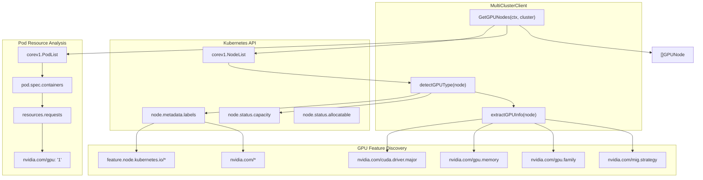
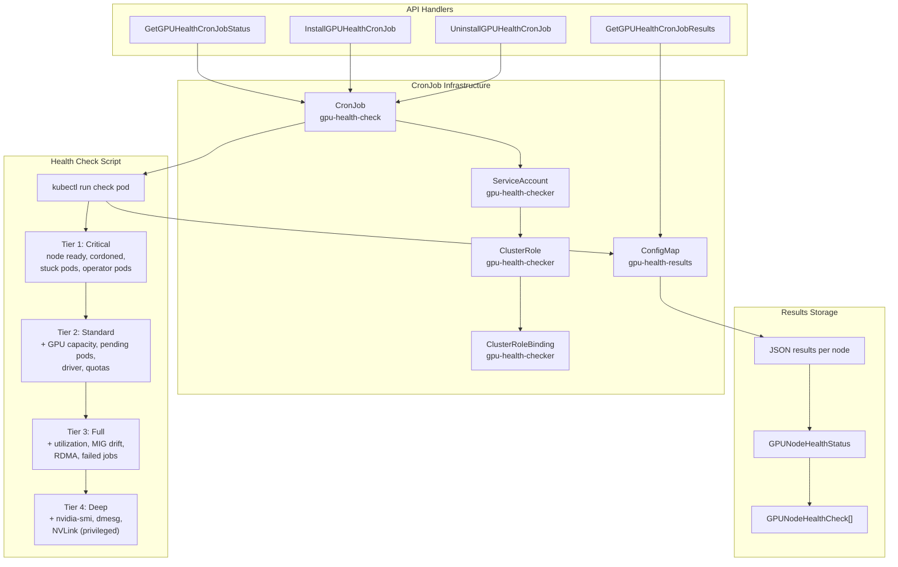
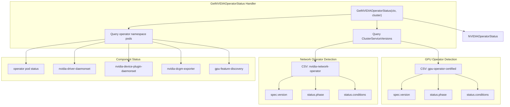

<!-- source: DeepWiki mcp.deepwiki.com · repo kubestellar/console · page 5.3 GPU Management · fetched 2026-10-27 -->

# GPU Management

<details>
<summary>Relevant source files</summary>

The following files were used as context for generating this wiki page:

- [pkg/api/handlers/demo_data.go](pkg/api/handlers/demo_data.go)
- [pkg/api/handlers/gitops.go](pkg/api/handlers/gitops.go)
- [pkg/api/handlers/mcp.go](pkg/api/handlers/mcp.go)
- [pkg/api/handlers/sse.go](pkg/api/handlers/sse.go)
- [pkg/api/server.go](pkg/api/server.go)
- [pkg/k8s/client.go](pkg/k8s/client.go)
- [web/src/components/cards/ProactiveGPUNodeHealthMonitor.tsx](web/src/components/cards/ProactiveGPUNodeHealthMonitor.tsx)
- [web/src/components/clusters/ClusterDetailModal.tsx](web/src/components/clusters/ClusterDetailModal.tsx)
- [web/src/components/clusters/Clusters.tsx](web/src/components/clusters/Clusters.tsx)
- [web/src/components/clusters/ResourceDetailModals.tsx](web/src/components/clusters/ResourceDetailModals.tsx)
- [web/src/components/clusters/components/ClusterGrid.tsx](web/src/components/clusters/components/ClusterGrid.tsx)
- [web/src/components/clusters/components/GPUDetailModal.tsx](web/src/components/clusters/components/GPUDetailModal.tsx)
- [web/src/components/ui/CloudProviderIcon.tsx](web/src/components/ui/CloudProviderIcon.tsx)
- [web/src/config/cards/gpu-node-health.ts](web/src/config/cards/gpu-node-health.ts)
- [web/src/config/dashboards/gpu.ts](web/src/config/dashboards/gpu.ts)
- [web/src/hooks/mcp/types.ts](web/src/hooks/mcp/types.ts)
- [web/src/hooks/useMCP.ts](web/src/hooks/useMCP.ts)
- [web/src/lib/sseClient.ts](web/src/lib/sseClient.ts)

</details>


## Purpose and Scope

This document describes the GPU management subsystem within the KubeStellar Console backend, which provides detection, monitoring, and health checking for GPU-accelerated Kubernetes nodes across multiple clusters. The system supports NVIDIA GPUs, AMD GPUs, Intel accelerators (Gaudi AIU, XPU), and Google TPUs.

For general cluster health monitoring, see [#4.1](#4.1). For workload deployment to GPU nodes, see [#5.1](#5.1). For frontend GPU visualization components, see [#3.1](#3.1).

---

## GPU Node Detection

The GPU detection system automatically identifies nodes with accelerator resources by querying node labels and capacity fields set by device plugins and feature discovery components.

### Supported Accelerator Types

| Accelerator Type | Resource Key | Manufacturer | Detection Label Pattern |
|-----------------|--------------|--------------|------------------------|
| GPU (NVIDIA) | `nvidia.com/gpu` | NVIDIA | `nvidia.com/*`, `feature.node.kubernetes.io/pci-10de.present` |
| GPU (AMD) | `amd.com/gpu` | AMD | `amd.com/*` |
| TPU (Google) | `google.com/tpu` | Google | `cloud.google.com/gke-tpu-*` |
| AIU (Intel Gaudi) | `habana.ai/gaudi` | Intel | `habana.ai/*` |
| XPU (Intel) | `gpu.intel.com/i915` | Intel | `gpu.intel.com/*` |

**Sources:** [pkg/k8s/client.go:233-241](), [web/src/hooks/mcp/types.ts:163-165]()

### Detection Architecture



**Diagram: GPU Node Detection Pipeline**

The detection logic queries all nodes in a cluster and filters for GPU resource capacity. For each GPU node, it extracts the accelerator type, count, allocated count (by summing pod GPU requests), and enhanced metadata from GPU Feature Discovery labels.

**Sources:** [pkg/k8s/client.go:1279-1454]()

### GPU Type Detection Logic

The `detectGPUType()` function implements a priority-based detection algorithm:

1. **NVIDIA Detection**: Checks for `nvidia.com/gpu` capacity or NFD PCI vendor label `feature.node.kubernetes.io/pci-10de.present` (0x10de = NVIDIA PCI vendor ID)
2. **AMD Detection**: Checks for `amd.com/gpu` capacity
3. **Intel Gaudi Detection**: Checks for `habana.ai/gaudi` capacity
4. **Intel XPU Detection**: Checks for `gpu.intel.com/i915` capacity  
5. **Google TPU Detection**: Checks for `google.com/tpu` capacity or GKE TPU accelerator labels
6. **Unknown**: Falls back to generic "GPU" if capacity exists but vendor cannot be determined

**Sources:** [pkg/k8s/client.go:1476-1564]()

### Enhanced GPU Metadata Extraction

For NVIDIA GPUs, the system extracts additional metadata from GPU Feature Discovery labels:

```go
// GPU memory in MB from nvidia.com/gpu.memory label
gpuMemoryMB := extractGPUMemoryMB(node)

// GPU architecture family (ampere, hopper, volta, etc.)
gpuFamily := node.Labels["nvidia.com/gpu.family"]

// CUDA driver version (major.minor)
cudaDriverVersion := node.Labels["nvidia.com/cuda.driver.major"] + "." + 
                     node.Labels["nvidia.com/cuda.driver.minor"]

// CUDA runtime version
cudaRuntimeVersion := node.Labels["nvidia.com/cuda.runtime.major"] + "." +
                      node.Labels["nvidia.com/cuda.runtime.minor"]

// MIG capability and strategy
migCapable := node.Labels["nvidia.com/mig.capable"] == "true"
migStrategy := node.Labels["nvidia.com/mig.strategy"]
```

This metadata enables the frontend to display detailed GPU specifications without additional API calls.

**Sources:** [pkg/k8s/client.go:1606-1659]()

---

## GPU Health Monitoring System

The GPU health monitoring system provides proactive detection of GPU node issues through automated health checks executed via Kubernetes CronJobs. This system runs independently of user queries to continuously monitor GPU infrastructure.

### Health Check Architecture



**Diagram: GPU Health Monitoring Infrastructure**

**Sources:** [pkg/k8s/client.go:345-357](), [pkg/api/handlers/mcp.go:507-586]()

### Health Check Tiers

The health check system supports four tiers of increasing depth and intrusiveness:

| Tier | Name | Checks Performed | RBAC Requirements |
|------|------|-----------------|-------------------|
| 1 | Critical | Node ready, cordoned status, stuck pods, GPU operator pods, GPU reset events | Standard read-only |
| 2 | Standard (default) | Tier 1 + GPU capacity verification, pending pods, driver status, node conditions, resource quotas | Standard read-only |
| 3 | Full | Tier 2 + GPU utilization (DCGM), MIG configuration drift, RDMA/InfiniBand status, failed GPU jobs, evicted pods | Read-only + metrics API |
| 4 | Deep | Tier 3 + `nvidia-smi` output, `dmesg` GPU errors, NVLink topology, ECC error counts | Privileged access |

Users can configure the tier level during CronJob installation. Higher tiers provide more detailed diagnostics but require elevated permissions and incur higher overhead.

**Sources:** [web/src/components/cards/ProactiveGPUNodeHealthMonitor.tsx:30-35]()

### CronJob Management API

#### Installation

The `InstallGPUHealthCronJob` handler creates the CronJob infrastructure:

```go
POST /api/mcp/gpu-nodes/health/cronjob
Query Parameters:
  - cluster: string (required)
  - schedule: string (default: "*/5 * * * *")
  - namespace: string (default: "nvidia-gpu-operator")
  - tier: int (1-4, default: 2)
```

The installation process:
1. Checks RBAC permissions via `SelfSubjectAccessReview` for CronJob creation
2. Creates `ServiceAccount`, `ClusterRole`, `ClusterRoleBinding` for health checker
3. Creates `CronJob` with embedded health check script
4. Creates `ConfigMap` to store results
5. Returns status with installation version number

**Sources:** [pkg/k8s/client.go:1984-2171]()

#### Status Query

The `GetGPUHealthCronJobStatus` handler returns installation and execution status:

```go
GET /api/mcp/gpu-nodes/health/cronjob?cluster={name}

Response: {
  "installed": true,
  "cluster": "vllm-d",
  "namespace": "nvidia-gpu-operator",
  "schedule": "*/5 * * * *",
  "tier": 2,
  "version": 2,
  "updateAvailable": false,
  "lastRun": "2024-01-15T10:30:00Z",
  "lastResult": "success",
  "nextRun": "2024-01-15T10:35:00Z",
  "canInstall": true,
  "activeJobs": 0,
  "failedJobs": 0,
  "successJobs": 12,
  "lastResults": [...]
}
```

**Sources:** [pkg/k8s/client.go:2173-2275]()

#### Results Retrieval

The `GetGPUHealthCronJobResults` handler parses the results ConfigMap:

```go
GET /api/mcp/gpu-nodes/health/cronjob/results?cluster={name}

Response: {
  "results": [
    {
      "nodeName": "gpu-node-01",
      "status": "healthy",
      "checks": [
        {"name": "node_ready", "passed": true},
        {"name": "scheduling", "passed": true},
        {"name": "gpu-feature-discovery", "passed": true},
        {"name": "nvidia-device-plugin", "passed": true},
        {"name": "dcgm-exporter", "passed": true},
        {"name": "stuck_pods", "passed": true},
        {"name": "gpu_events", "passed": true}
      ],
      "issues": []
    },
    {
      "nodeName": "gpu-node-02",
      "status": "degraded",
      "checks": [
        {"name": "node_ready", "passed": true},
        {"name": "dcgm-exporter", "passed": false, "message": "CrashLoopBackOff (5 restarts)"}
      ],
      "issues": ["DCGM Exporter pod restarting"]
    }
  ]
}
```

The ConfigMap stores results as JSON, with each node's health status persisted until the next check execution.

**Sources:** [pkg/k8s/client.go:2277-2382]()

### Real-Time Health Status API

The `GetGPUNodeHealth` handler performs on-demand health checks without requiring CronJob installation:

```go
GET /api/mcp/gpu-nodes/health?cluster={name}

Response: {
  "nodes": [
    {
      "nodeName": "gpu-node-01",
      "cluster": "prod-cluster",
      "status": "healthy",
      "gpuCount": 8,
      "gpuType": "NVIDIA A100",
      "checks": [
        {"name": "node_ready", "passed": true},
        {"name": "gpu-feature-discovery", "passed": true},
        ...
      ],
      "issues": [],
      "stuckPods": 0,
      "checkedAt": "2024-01-15T10:35:42Z"
    }
  ]
}
```

This API performs basic health checks synchronously:
- Node ready condition
- Cordoned status (unschedulable nodes)
- GPU operator pod status (gpu-feature-discovery, nvidia-device-plugin, dcgm-exporter)
- Stuck pods on GPU nodes (ImagePullBackOff, CrashLoopBackOff, etc.)
- GPU-related warning events (last 5 minutes)

**Sources:** [pkg/k8s/client.go:1661-1794](), [pkg/api/handlers/mcp.go:376-446]()

---

## GPU Reservation System

The GPU reservation system (placeholder for future implementation) provides a resource allocation layer on top of Kubernetes `ResourceQuotas`. This allows administrators to reserve GPU resources for specific users or teams.

### Reservation Data Model

```go
type GPUReservation struct {
    ID          string    `json:"id"`
    Cluster     string    `json:"cluster"`
    Namespace   string    `json:"namespace"`
    GPUCount    int       `json:"gpuCount"`
    GPUType     string    `json:"gpuType,omitempty"`
    Owner       string    `json:"owner"`
    StartTime   time.Time `json:"startTime"`
    EndTime     time.Time `json:"endTime"`
    Status      string    `json:"status"` // pending, active, expired
    Description string    `json:"description,omitempty"`
}
```

Reservations are stored in the SQLite database and mapped to `ResourceQuotas` in the target namespace.

**Sources:** [pkg/api/handlers/gpu.go:1-100]() (referenced but not in provided files)

---

## NVIDIA Operator Integration

The system detects and monitors NVIDIA GPU Operator and Network Operator installations to provide visibility into GPU infrastructure health.

### Operator Status Detection



**Diagram: NVIDIA Operator Status Detection Pipeline**

**Sources:** [pkg/k8s/client.go:1796-1982](), [pkg/api/handlers/mcp.go:511-590]()

### Operator Status Response

```go
type NVIDIAOperatorStatus struct {
    Cluster         string              `json:"cluster"`
    GPUOperator     *GPUOperatorInfo    `json:"gpuOperator,omitempty"`
    NetworkOperator *NetworkOperatorInfo `json:"networkOperator,omitempty"`
}

type GPUOperatorInfo struct {
    Installed      bool                `json:"installed"`
    Version        string              `json:"version,omitempty"`
    State          string              `json:"state,omitempty"`
    Ready          bool                `json:"ready"`
    Components     []OperatorComponent `json:"components,omitempty"`
    DriverVersion  string              `json:"driverVersion,omitempty"`
    CUDAVersion    string              `json:"cudaVersion,omitempty"`
    Namespace      string              `json:"namespace,omitempty"`
}
```

The operator status is used by the frontend to:
- Verify GPU infrastructure is properly installed
- Display driver and CUDA versions
- Show component health (device plugin, DCGM, etc.)
- Alert on operator upgrade availability

**Sources:** [web/src/hooks/mcp/types.ts:228-259]()

---

## API Endpoints

### GPU Node Endpoints

| Endpoint | Method | Description | Handler |
|----------|--------|-------------|---------|
| `/api/mcp/gpu-nodes` | GET | List GPU nodes across clusters | `GetGPUNodes` |
| `/api/mcp/gpu-nodes/stream` | GET | Stream GPU nodes via SSE | `GetGPUNodesStream` |
| `/api/mcp/gpu-nodes/health` | GET | Get GPU node health status | `GetGPUNodeHealth` |
| `/api/mcp/gpu-nodes/health/stream` | GET | Stream GPU health via SSE | `GetGPUNodeHealthStream` |

**Sources:** [pkg/api/server.go:506-510](), [pkg/api/server.go:541-542]()

### GPU Health CronJob Endpoints

| Endpoint | Method | Description | Handler |
|----------|--------|-------------|---------|
| `/api/mcp/gpu-nodes/health/cronjob` | GET | Get CronJob installation status | `GetGPUHealthCronJobStatus` |
| `/api/mcp/gpu-nodes/health/cronjob` | POST | Install/update health check CronJob | `InstallGPUHealthCronJob` |
| `/api/mcp/gpu-nodes/health/cronjob` | DELETE | Uninstall health check CronJob | `UninstallGPUHealthCronJob` |
| `/api/mcp/gpu-nodes/health/cronjob/results` | GET | Get latest health check results | `GetGPUHealthCronJobResults` |

**Sources:** [pkg/api/server.go:507-510]()

### NVIDIA Operator Endpoints

| Endpoint | Method | Description | Handler |
|----------|--------|-------------|---------|
| `/api/mcp/nvidia-operators` | GET | Get NVIDIA operator status | `GetNVIDIAOperatorStatus` |
| `/api/mcp/nvidia-operators/stream` | GET | Stream operator status via SSE | `GetNVIDIAOperatorStatusStream` |

**Sources:** [pkg/api/server.go:511](), [pkg/api/server.go:547]()

### SSE Streaming Implementation

All GPU endpoints support SSE streaming for progressive result delivery:

```go
// Example: GPU nodes streaming
GET /api/mcp/gpu-nodes/stream?cluster=prod

// SSE events:
event: cluster_data
data: {"cluster":"prod","nodes":[...],"source":"k8s"}

event: cluster_data  
data: {"cluster":"staging","nodes":[...],"source":"k8s"}

event: done
data: {"totalClusters":2,"completedClusters":2}
```

The SSE implementation uses the generic `streamClusters` helper which:
1. Skips offline clusters immediately (emits `cluster_skipped` events)
2. Checks response cache (15s TTL) for instant serving
3. Applies reduced timeout (3s) to clusters marked as slow
4. Streams results as they arrive (no blocking)
5. Enforces 30s overall deadline

**Sources:** [pkg/api/handlers/sse.go:73-202](), [pkg/api/handlers/sse.go:426-459]()

---

## Frontend Components

### GPU Detail Modal

The `GPUDetailModal` component provides a comprehensive view of GPU resources:

- **GPU Type Breakdown**: Groups GPUs by model (A100, H100, V100, etc.)
- **Cluster Distribution**: Shows GPU allocation per cluster
- **Manufacturer Breakdown**: Aggregates by vendor (NVIDIA, AMD, Intel, Google)
- **Specifications**: Displays total memory, CUDA versions, MIG capability
- **Utilization Gauge**: Shows allocated vs. available GPUs

**Sources:** [web/src/components/clusters/components/GPUDetailModal.tsx:1-350]()

### Proactive GPU Health Monitor Card

The `ProactiveGPUNodeHealthMonitor` card displays real-time health status:

- **CronJob Management Panel**: Install/uninstall health checks per cluster
- **Tier Selection**: Configure check depth (1-4)
- **Node Health List**: Sortable, paginated list of GPU nodes
- **Check Details**: Expandable per-node health check results
- **Status Badges**: Color-coded health indicators (healthy, degraded, unhealthy)

The card integrates with the `useCachedGPUNodeHealth` and `useGPUHealthCronJob` hooks for efficient data fetching and caching.

**Sources:** [web/src/components/cards/ProactiveGPUNodeHealthMonitor.tsx:1-500]()

### Data Hooks

GPU data is fetched via specialized hooks:

```typescript
// GPU nodes with allocation
const { nodes, isLoading, error, refetch } = useGPUNodes(cluster)

// GPU health status
const { nodes: healthNodes } = useGPUNodeHealth(cluster)

// NVIDIA operator status
const { status, isLoading } = useNVIDIAOperators(cluster)

// CronJob management
const { status, install, uninstall, refetch } = useGPUHealthCronJob(cluster)
```

All hooks support SSE streaming for progressive updates and implement 10s frontend cache TTL to minimize redundant requests.

**Sources:** [web/src/hooks/useCachedData.ts:1-200]() (not provided but referenced in component)

---

## Performance Optimizations

### Multi-Tier Caching

The GPU system implements a three-tier caching strategy:

1. **Backend Health Cache** (15s TTL): GPU node queries cache results in `k8sClient.healthCache`
2. **SSE Response Cache** (15s TTL): Streaming endpoints cache full responses in `sseCache`
3. **Frontend Hook Cache** (10s TTL): React hooks maintain in-memory cache with SWR pattern

This reduces cluster load and improves perceived performance, especially for large GPU clusters with hundreds of nodes.

**Sources:** [pkg/api/handlers/sse.go:44-71](), [web/src/lib/sseClient.ts:34-36]()

### Slow Cluster Handling

The `MultiClusterClient` tracks clusters that exceed 5s response time in the `slowClusters` map. Subsequent requests to slow clusters use a reduced timeout (3s) to prevent cascade failures.

**Sources:** [pkg/k8s/client.go:58](), [pkg/api/handlers/sse.go:138-143]()

### Parallel Queries with Deadline

Multi-cluster GPU queries spawn goroutines per cluster with individual timeouts, but enforce a 30s overall deadline. Slow clusters don't block fast ones, and partial results are returned if the deadline is reached.

**Sources:** [pkg/api/handlers/mcp.go:344-363]()

---

