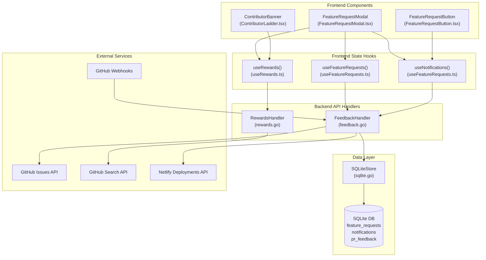
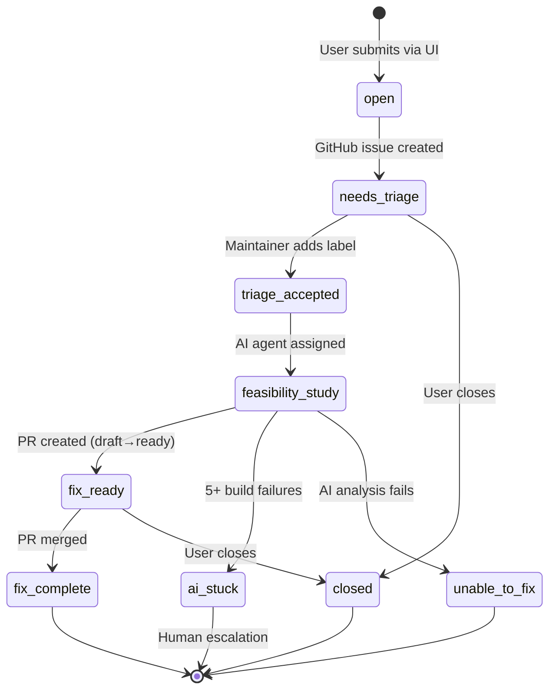
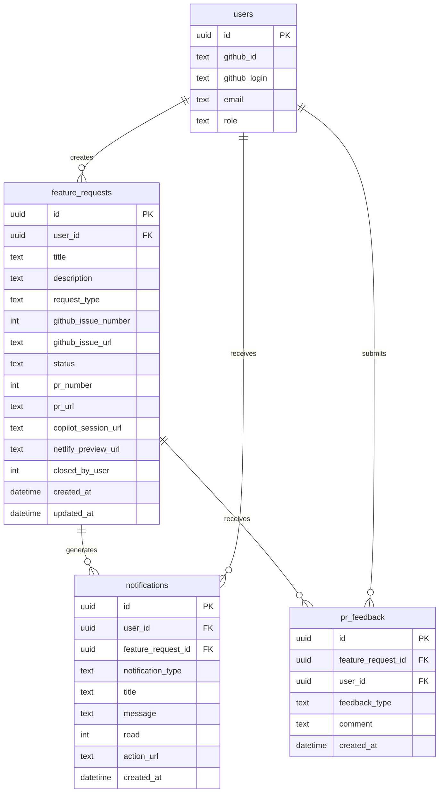
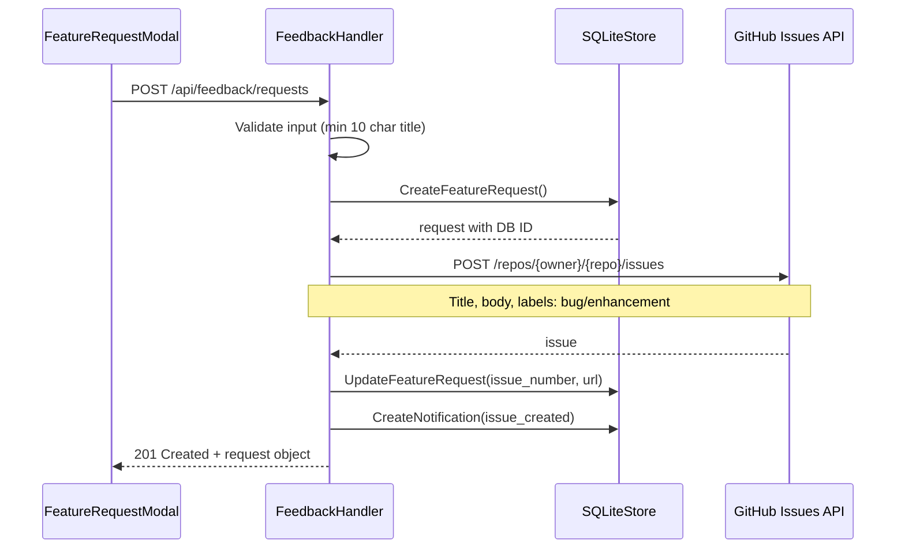
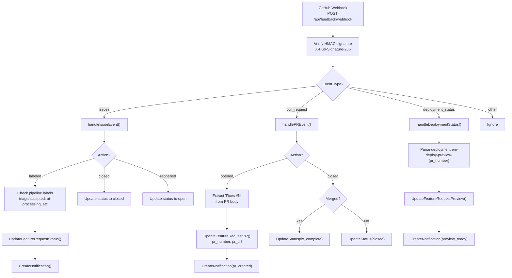
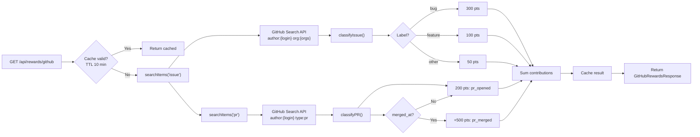

<!-- source: DeepWiki mcp.deepwiki.com · repo kubestellar/console · page 6 Feedback & Rewards System · fetched 2026-10-27 -->

# Feedback & Rewards System

<details>
<summary>Relevant source files</summary>

The following files were used as context for generating this wiki page:

- [pkg/api/handlers/feedback.go](pkg/api/handlers/feedback.go)
- [pkg/api/handlers/gpu.go](pkg/api/handlers/gpu.go)
- [pkg/api/handlers/rewards.go](pkg/api/handlers/rewards.go)
- [pkg/models/feedback.go](pkg/models/feedback.go)
- [pkg/models/gpu.go](pkg/models/gpu.go)
- [pkg/store/sqlite.go](pkg/store/sqlite.go)
- [pkg/store/store.go](pkg/store/store.go)
- [web/src/components/charts/BarChart.tsx](web/src/components/charts/BarChart.tsx)
- [web/src/components/charts/PieChart.tsx](web/src/components/charts/PieChart.tsx)
- [web/src/components/feedback/FeatureRequestButton.tsx](web/src/components/feedback/FeatureRequestButton.tsx)
- [web/src/components/feedback/FeatureRequestModal.tsx](web/src/components/feedback/FeatureRequestModal.tsx)
- [web/src/hooks/useFeatureRequests.ts](web/src/hooks/useFeatureRequests.ts)
- [web/src/hooks/useGPUReservations.ts](web/src/hooks/useGPUReservations.ts)

</details>


## Purpose and Scope

The Feedback & Rewards System enables users to submit bug reports and feature requests directly from the Console UI, automatically creating GitHub issues and tracking their lifecycle through AI-assisted resolution. The system integrates with the CI/CD automation pipeline (see [CI/CD Automation System](#7)) to monitor issue triage, AI fix generation, PR creation, and deployment status. Additionally, it tracks GitHub contributions across repositories and awards points to incentivize community participation.

This document covers:
- Feature request submission and lifecycle tracking
- GitHub webhook integration for real-time status updates
- Contribution rewards based on GitHub activity
- SQLite data persistence for offline resilience

For information about the CI/CD workflows that process these issues, see [CI/CD Automation System](#7).

---

## System Architecture



**Architecture Components:**

| Component | Responsibility | Key Files |
|-----------|---------------|-----------|
| `FeatureRequestModal` | Submit/view feature requests, display status updates | [web/src/components/feedback/FeatureRequestModal.tsx:80-2073]() |
| `useFeatureRequests` | Manage feature request state, polling, mutations | [web/src/hooks/useFeatureRequests.ts:230-364]() |
| `FeedbackHandler` | Process submissions, create GitHub issues, handle webhooks | [pkg/api/handlers/feedback.go:30-1240]() |
| `RewardsHandler` | Fetch GitHub contributions, calculate points | [pkg/api/handlers/rewards.go:72-347]() |
| `SQLiteStore` | Persist feature requests, notifications, feedback | [pkg/store/sqlite.go:119-162]() |

**Sources:** [web/src/components/feedback/FeatureRequestModal.tsx:1-2073](), [pkg/api/handlers/feedback.go:1-1240](), [pkg/api/handlers/rewards.go:1-347](), [pkg/store/sqlite.go:1-1088]()

---

## Feature Request Lifecycle

### State Machine



**Request Status Types:**

| Status | Label | Description | Notification Type |
|--------|-------|-------------|-------------------|
| `open` | Open | Initial state after submission | `issue_created` |
| `needs_triage` | Needs Triage | Awaiting maintainer review | - |
| `triage_accepted` | Triage Accepted | Queued for AI analysis | `triage_accepted` |
| `feasibility_study` | AI Working | Copilot agent analyzing/coding | `feasibility_study` |
| `fix_ready` | Fix Ready | PR created and passing checks | `fix_ready` |
| `fix_complete` | Fix Complete | PR merged to main | `fix_complete` |
| `unable_to_fix` | Needs Human Review | AI cannot resolve | `unable_to_fix` |
| `closed` | Closed | User or maintainer closed | `closed` |

**Status Label Mapping** (GitHub labels → internal status):

```
triage/accepted        → triage_accepted
ai-processing          → feasibility_study
ai-awaiting-fix        → feasibility_study
ai-pr-draft            → fix_ready
ai-pr-ready            → fix_ready
ai-processing-complete → fix_complete
ai-stuck               → ai_stuck (not shown in queue)
unable-to-fix          → unable_to_fix
```

**Sources:** [pkg/models/feedback.go:20-30](), [web/src/hooks/useFeatureRequests.ts:13](), [pkg/api/handlers/feedback.go:935-947]()

---

## Data Models and Database Schema

### Core Models

**FeatureRequest:**

```go
type FeatureRequest struct {
    ID                uuid.UUID
    UserID            uuid.UUID
    Title             string
    Description       string
    RequestType       RequestType  // "bug" | "feature"
    GitHubIssueNumber *int
    Status            RequestStatus
    PRNumber          *int
    PRURL             string
    CopilotSessionURL string
    NetlifyPreviewURL string
    LatestComment     string
    ClosedByUser      bool
    CreatedAt         time.Time
    UpdatedAt         *time.Time
}
```

**Notification:**

```go
type Notification struct {
    ID               uuid.UUID
    UserID           uuid.UUID
    FeatureRequestID *uuid.UUID
    NotificationType NotificationType
    Title            string
    Message          string
    Read             bool
    ActionURL        string
    CreatedAt        time.Time
}
```

**PRFeedback:**

```go
type PRFeedback struct {
    ID               uuid.UUID
    FeatureRequestID uuid.UUID
    UserID           uuid.UUID
    FeedbackType     FeedbackType  // "positive" | "negative"
    Comment          string
    CreatedAt        time.Time
}
```

**Sources:** [pkg/models/feedback.go:56-121]()

### Database Schema



**Indexes:**
- `idx_feature_requests_user` on `feature_requests(user_id)`
- `idx_feature_requests_status` on `feature_requests(status)`
- `idx_pr_feedback_request` on `pr_feedback(feature_request_id)`
- `idx_notifications_user` on `notifications(user_id, read)`

**Sources:** [pkg/store/sqlite.go:119-162](), [pkg/models/feedback.go:56-121]()

---

## GitHub Integration

### Issue Creation Flow



**Issue Body Template** (constructed in `createGitHubIssue`):

```markdown
**Type:** Bug | Feature Request
**Submitted by:** @{github_login}

## Description
{user_description}

---
_This issue was automatically created via KubeStellar Console._
_Request ID: {uuid}_
```

**Labels Applied:**
- `bug` for bug reports → awards 300 points
- `enhancement` for feature requests → awards 100 points
- Auto-assigned to repository for triage

**Sources:** [pkg/api/handlers/feedback.go:58-131](), [pkg/api/handlers/feedback.go:1076-1147]()

### Webhook Event Processing



**Webhook Handler Signature:**

```go
func (h *FeedbackHandler) HandleGitHubWebhook(c *fiber.Ctx) error {
    signature := c.Get("X-Hub-Signature-256")
    if !h.verifyWebhookSignature(c.Body(), signature) {
        return fiber.NewError(fiber.StatusUnauthorized, "Invalid webhook signature")
    }
    
    eventType := c.Get("X-GitHub-Event")
    // Route to specific handler...
}
```

**Pipeline Label Processing:**

| GitHub Label | Status Update | Notification |
|--------------|---------------|--------------|
| `triage/accepted` | `triage_accepted` | "A maintainer has accepted this issue" |
| `ai-processing` | `feasibility_study` | "AI is analyzing this issue" |
| `ai-awaiting-fix` | `feasibility_study` | "AI is working on a fix" |
| `ai-pr-draft` | `fix_ready` | "A draft PR has been created" |
| `ai-pr-ready` | `fix_ready` | "A PR is ready for review" |
| `ai-processing-complete` | `fix_complete` | "AI processing is complete" |

**Sources:** [pkg/api/handlers/feedback.go:896-922](), [pkg/api/handlers/feedback.go:935-1022]()

### Netlify Preview Detection

The system monitors Netlify preview deployments for PRs to provide users with live preview links:

**Preview Status Endpoint:**

```
GET /api/feedback/preview/{pr_number}
```

**Preview Detection Logic:**

1. Query GitHub Deployments API for environment `deploy-preview-{pr_number}`
2. Fetch latest deployment status
3. Return status:
   - `pending`: Deployment not found or in progress
   - `ready`: Deployment succeeded, includes `preview_url`
   - `error`: Deployment failed

**Preview Warmup:** Frontend waits 30 seconds after status changes to `ready` before displaying the link, allowing Netlify routes to fully initialize.

**Sources:** [pkg/api/handlers/feedback.go:312-407](), [web/src/components/feedback/FeatureRequestModal.tsx:28]()

---

## Rewards System

### GitHub Contribution Tracking

The rewards system fetches all GitHub activity across configured organizations and calculates points based on contribution type.

**Point Values:**

| Contribution Type | Points | Criteria |
|-------------------|--------|----------|
| Bug Issue | 300 | Issue labeled `bug` |
| Feature Issue | 100 | Issue labeled `enhancement`, `feature` |
| Other Issue | 50 | Issue without bug/feature label |
| PR Opened | 200 | Any PR opened |
| PR Merged | 500 | PR successfully merged |

**Rewards Calculation Flow:**



**API Response Structure:**

```go
type GitHubRewardsResponse struct {
    TotalPoints   int                  // Sum of all contribution points
    Contributions []GitHubContribution // Detailed list
    Breakdown     RewardsBreakdown     // Count by type
    CachedAt      string               // ISO 8601 timestamp
    FromCache     bool                 // Cache hit indicator
}

type RewardsBreakdown struct {
    BugIssues     int
    FeatureIssues int
    OtherIssues   int
    PRsOpened     int
    PRsMerged     int
}
```

**Sources:** [pkg/api/handlers/rewards.go:18-29](), [pkg/api/handlers/rewards.go:91-205]()

### Search Implementation

**GitHub Search Query Construction:**

```go
// Issues: author:{login} {orgs} type:issue
query := fmt.Sprintf("author:%s %s type:issue", login, h.orgs)

// PRs: author:{login} {orgs} type:pr
query := fmt.Sprintf("author:%s %s type:pr", login, h.orgs)
```

**Organization Filter Format:**

```
"org:kubestellar org:llm-d"
```

**Pagination:** Fetches up to 10 pages × 100 items = 1000 results (GitHub Search API limit).

**Sources:** [pkg/api/handlers/rewards.go:231-280]()

### Frontend Rewards Display

The `ContributorBanner` component displays user level, progress, and recent contributions in the Updates tab of the `FeatureRequestModal`.

**Level Calculation:**

```typescript
const levelThresholds = [0, 500, 1500, 3000, 5000, 8000, 12000, 20000]
const level = levelThresholds.findIndex((threshold, i) => 
  points < (levelThresholds[i + 1] || Infinity)
) + 1
```

**Rank Titles:**

| Level | Points Required | Rank Title |
|-------|----------------|------------|
| 1 | 0 | Newcomer |
| 2 | 500 | Contributor |
| 3 | 1,500 | Regular |
| 4 | 3,000 | Dedicated |
| 5 | 5,000 | Expert |
| 6 | 8,000 | Master |
| 7 | 12,000 | Legend |
| 8 | 20,000+ | Mythic |

**Sources:** [web/src/components/rewards/ContributorLadder.tsx:1-300](), [web/src/components/feedback/FeatureRequestModal.tsx:470]()

---

## Frontend Components

### FeatureRequestModal

The main UI for submitting and tracking feature requests. Supports two tabs: Submit and Updates.

**Key Features:**

| Feature | Implementation | Lines |
|---------|---------------|-------|
| Dual tab interface | Submit vs Updates | [80-445]() |
| Demo mode detection | OAuth prompt vs install instructions | [148-157]() |
| Status-based UI | Color-coded badges, blurred untriaged items | [61-78]() |
| Real-time polling | 30s interval for pending requests | [267-281]() |
| Unread notifications | Badge count with clear action | [439-443]() |
| Preview link checking | On-demand Netlify status | [121-136]() |

**Submit Tab Validation:**

```typescript
// Frontend validation (aligned with backend)
if (extractedTitle.length < 10) {
  setError('Title (first line) must be at least 10 characters')
  return
}
if (extractedDesc.length < 20) {
  setError('Description must be at least 20 characters')
  return
}
if (extractedDesc.split(/\s+/).filter(Boolean).length < 3) {
  setError('Description must contain at least 3 words')
  return
}
```

**Sources:** [web/src/components/feedback/FeatureRequestModal.tsx:80-2073]()

### Request Queue Display

The Updates tab shows all feature requests (user's own + others), with privacy protections for untriaged items:

**Ownership Detection:**

```typescript
const isOwnedByUser = request.github_login
  ? request.github_login === currentGitHubLogin
  : request.user_id === currentGitHubLogin
```

**Untriaged Item Blurring:**

```typescript
const shouldBlur = !isTriaged(request.status) && !isOwnedByUser
// Apply blur-sm class to title and description
```

**Notification Badges:** Each request shows unread update count with click-to-clear functionality.

**Sources:** [web/src/components/feedback/FeatureRequestModal.tsx:513-645]()

---

## Backend API Endpoints

### Feedback Endpoints

| Method | Path | Handler | Description |
|--------|------|---------|-------------|
| `POST` | `/api/feedback/requests` | `CreateFeatureRequest` | Submit bug/feature |
| `GET` | `/api/feedback/requests` | `ListFeatureRequests` | User's triaged requests |
| `GET` | `/api/feedback/queue` | `ListAllFeatureRequests` | All requests (GitHub source) |
| `GET` | `/api/feedback/requests/:id` | `GetFeatureRequest` | Single request detail |
| `POST` | `/api/feedback/requests/:id/request-update` | `RequestUpdate` | Ping issue for status |
| `POST` | `/api/feedback/requests/:id/close` | `CloseRequest` | Close issue |
| `POST` | `/api/feedback/requests/:id/feedback` | `SubmitFeedback` | Thumbs up/down on PR |
| `GET` | `/api/feedback/preview/:pr_number` | `CheckPreviewStatus` | Netlify deploy status |
| `POST` | `/api/feedback/webhook` | `HandleGitHubWebhook` | Process GitHub events |

**Validation Rules (Backend):**

```go
// Title: 10-200 characters
if input.Title == "" || len(input.Title) < 10 {
    return fiber.NewError(fiber.StatusBadRequest, "Title must be at least 10 characters")
}

// Description: 20-5000 characters, minimum 3 words
if input.Description == "" || len(input.Description) < 20 {
    return fiber.NewError(fiber.StatusBadRequest, "Description must be at least 20 characters")
}
if len(strings.Fields(input.Description)) < 3 {
    return fiber.NewError(fiber.StatusBadRequest, "Description must contain at least 3 words")
}

// Request type: "bug" or "feature" only
if input.RequestType != models.RequestTypeBug && input.RequestType != models.RequestTypeFeature {
    return fiber.NewError(fiber.StatusBadRequest, "Request type must be 'bug' or 'feature'")
}
```

**Sources:** [pkg/api/handlers/feedback.go:58-817]()

### Rewards Endpoints

| Method | Path | Handler | Description |
|--------|------|---------|-------------|
| `GET` | `/api/rewards/github` | `GetGitHubRewards` | User's contribution points |

**Token Resolution:** Prefers user's personal GitHub token from settings over server PAT for rate limiting.

**Cache Strategy:**
- TTL: 10 minutes
- Stale-while-revalidate: Return stale cache on API failure
- Cache key: GitHub login

**Sources:** [pkg/api/handlers/rewards.go:91-144]()

### Notification Endpoints

| Method | Path | Handler | Description |
|--------|------|---------|-------------|
| `GET` | `/api/notifications` | `GetNotifications` | User's notifications (limit 50) |
| `GET` | `/api/notifications/unread-count` | `GetUnreadCount` | Unread notification count |
| `POST` | `/api/notifications/:id/read` | `MarkNotificationRead` | Mark single as read |
| `POST` | `/api/notifications/read-all` | `MarkAllNotificationsRead` | Mark all as read |

**Sources:** [pkg/api/handlers/feedback.go:820-893]()

---

## Data Persistence

### SQLite Store Operations

**Feature Request Methods:**

```go
// Core CRUD
CreateFeatureRequest(request *models.FeatureRequest) error
GetFeatureRequest(id uuid.UUID) (*models.FeatureRequest, error)
GetFeatureRequestByIssueNumber(issueNumber int) (*models.FeatureRequest, error)
GetUserFeatureRequests(userID uuid.UUID) ([]models.FeatureRequest, error)
GetAllFeatureRequests() ([]models.FeatureRequest, error)

// Status updates
UpdateFeatureRequest(request *models.FeatureRequest) error
UpdateFeatureRequestStatus(id uuid.UUID, status models.RequestStatus) error
CloseFeatureRequest(id uuid.UUID, closedByUser bool) error

// Metadata updates
UpdateFeatureRequestPR(id uuid.UUID, prNumber int, prURL string) error
UpdateFeatureRequestPreview(id uuid.UUID, previewURL string) error
UpdateFeatureRequestLatestComment(id uuid.UUID, comment string) error
```

**Notification Methods:**

```go
CreateNotification(notification *models.Notification) error
GetUserNotifications(userID uuid.UUID, limit int) ([]models.Notification, error)
GetUnreadNotificationCount(userID uuid.UUID) (int, error)
MarkNotificationRead(id uuid.UUID) error
MarkAllNotificationsRead(userID uuid.UUID) error
```

**PRFeedback Methods:**

```go
CreatePRFeedback(feedback *models.PRFeedback) error
GetPRFeedback(featureRequestID uuid.UUID) ([]models.PRFeedback, error)
```

**Sources:** [pkg/store/store.go:60-83](), [pkg/store/sqlite.go:776-1019]()

### Schema Migration

The database schema is automatically created on startup via `SQLiteStore.migrate()`. Column additions are handled via best-effort migrations:

```go
migrations := []string{
    "ALTER TABLE users ADD COLUMN role TEXT DEFAULT 'viewer'",
    "ALTER TABLE users ADD COLUMN slack_id TEXT",
    "ALTER TABLE feature_requests ADD COLUMN closed_by_user INTEGER DEFAULT 0",
}
for _, migration := range migrations {
    // Ignore errors - column may already exist
    s.db.Exec(migration)
}
```

**Sources:** [pkg/store/sqlite.go:36-203]()

---

## Demo Mode Behavior

Both frontend and backend support demo mode for public preview deployments:

**Frontend Detection:**

```typescript
function isDemoUser(): boolean {
  const token = localStorage.getItem(STORAGE_KEY_TOKEN)
  return !token || token === 'demo-token'
}
```

**Demo Data:** Uses static mock data for feature requests, notifications, and rewards when no backend is available.

**UI Differences:**
- Login prompt shows "Get Your Own Console" instead of OAuth
- Actions (submit, close, request update) are disabled
- Demo badge displayed in modal header
- Refresh operations use local state only

**Sources:** [web/src/hooks/useFeatureRequests.ts:5-9](), [web/src/components/feedback/FeatureRequestModal.tsx:148-157]()

---

