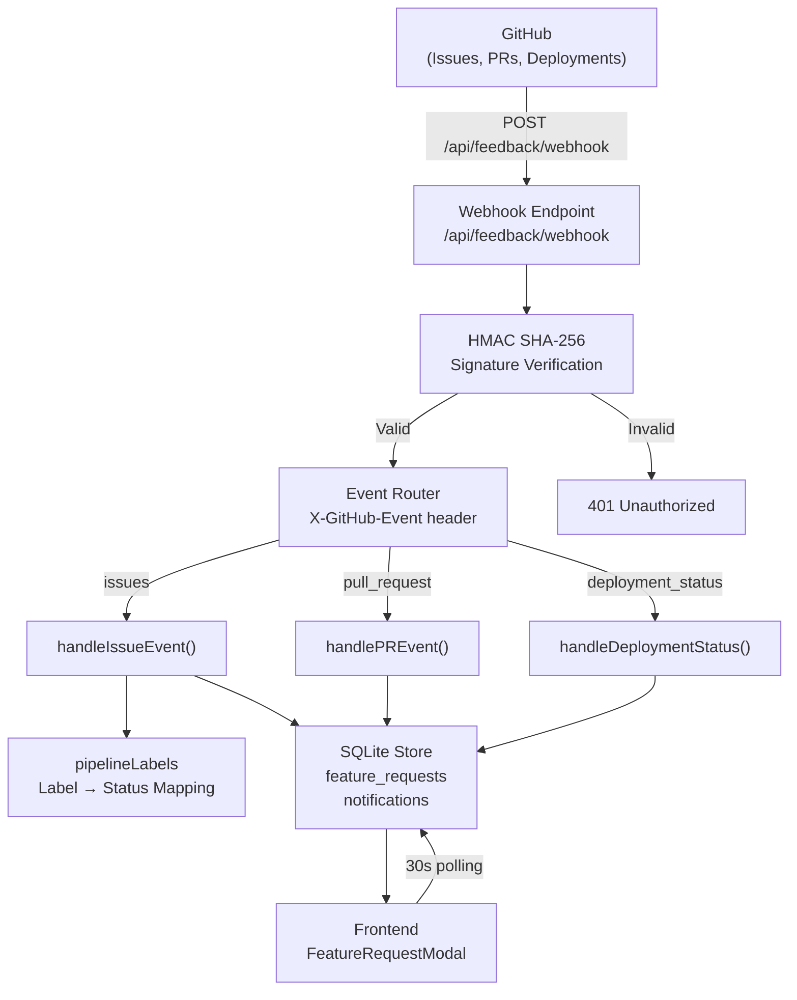
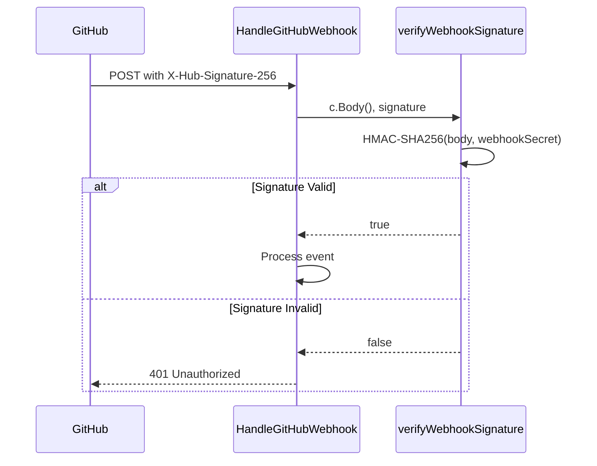
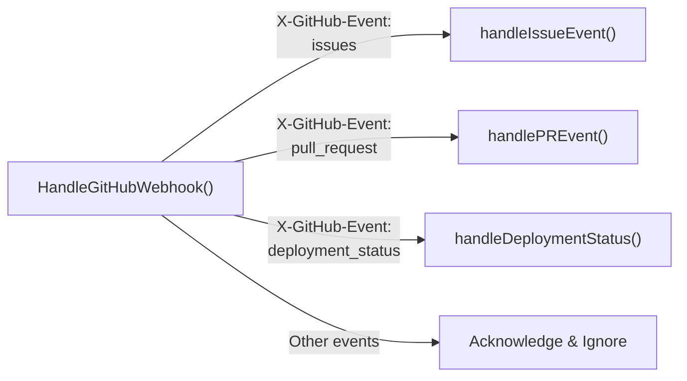
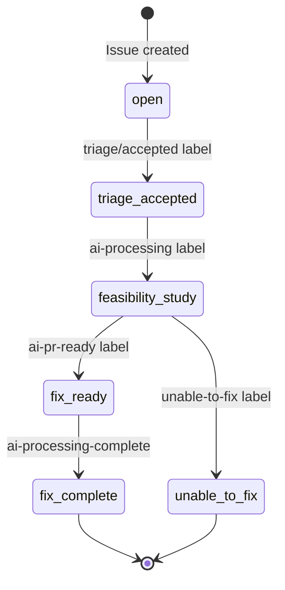
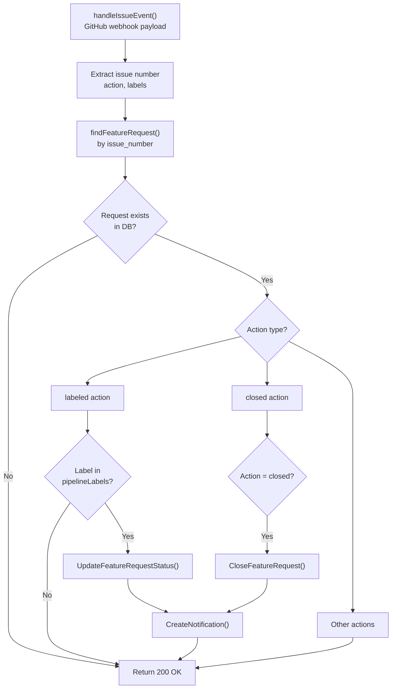
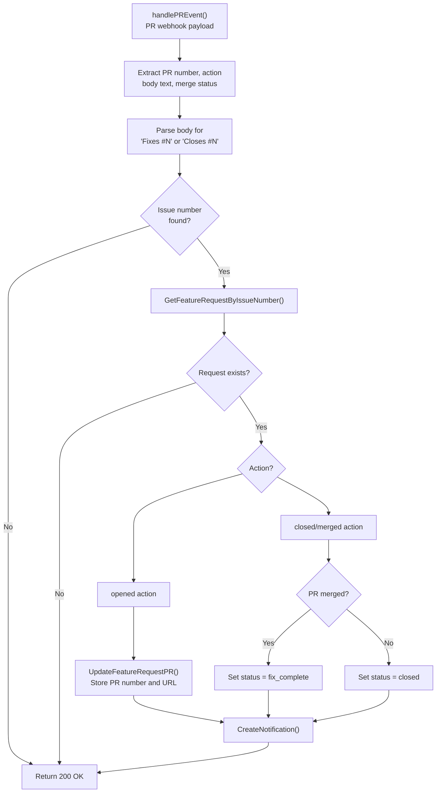
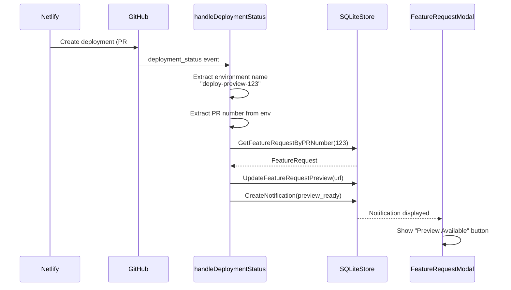
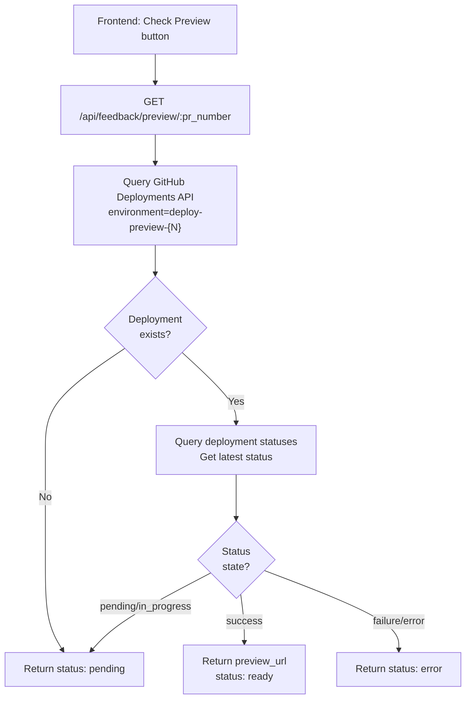
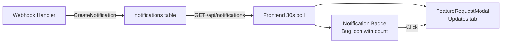

<!-- source: DeepWiki mcp.deepwiki.com · repo kubestellar/console · page 6.2 GitHub Webhook Integration · fetched 2026-10-27 -->

# GitHub Webhook Integration

<details>
<summary>Relevant source files</summary>

The following files were used as context for generating this wiki page:

- [pkg/api/handlers/feedback.go](pkg/api/handlers/feedback.go)
- [pkg/api/handlers/gpu.go](pkg/api/handlers/gpu.go)
- [pkg/api/handlers/rewards.go](pkg/api/handlers/rewards.go)
- [pkg/models/feedback.go](pkg/models/feedback.go)
- [pkg/models/gpu.go](pkg/models/gpu.go)
- [pkg/store/sqlite.go](pkg/store/sqlite.go)
- [pkg/store/store.go](pkg/store/store.go)
- [web/src/components/charts/BarChart.tsx](web/src/components/charts/BarChart.tsx)
- [web/src/components/charts/PieChart.tsx](web/src/components/charts/PieChart.tsx)
- [web/src/components/feedback/FeatureRequestButton.tsx](web/src/components/feedback/FeatureRequestButton.tsx)
- [web/src/components/feedback/FeatureRequestModal.tsx](web/src/components/feedback/FeatureRequestModal.tsx)
- [web/src/hooks/useFeatureRequests.ts](web/src/hooks/useFeatureRequests.ts)
- [web/src/hooks/useGPUReservations.ts](web/src/hooks/useGPUReservations.ts)

</details>


## Purpose and Scope

This document describes the GitHub webhook integration that enables real-time tracking of issue and pull request lifecycle events. When users submit feature requests or bug reports through the Console UI, GitHub issues are created. Webhooks provide asynchronous notifications when maintainers triage issues, when the AI coding agent creates PRs, when builds complete, and when PRs are merged.

For the overall feature request submission flow, see [Feature Request Flow](#6.1). For how contributions are scored, see [Rewards & Contribution Tracking](#6.3). For database schema details, see [Data Persistence](#6.4).

---

## Architecture Overview

The webhook system connects GitHub issue/PR events to user notifications in the Console. GitHub sends webhook payloads to the backend API, which validates signatures, processes events, updates database records, and creates notifications for affected users.



**Sources:** [pkg/api/handlers/feedback.go:896-922](), [web/src/hooks/useFeatureRequests.ts:267-281]()

---

## Webhook Endpoint

### Route Configuration

The webhook endpoint is registered at `/api/feedback/webhook` and accepts POST requests from GitHub.

| Method | Path | Handler | Auth |
|--------|------|---------|------|
| `POST` | `/api/feedback/webhook` | `FeedbackHandler.HandleGitHubWebhook` | HMAC signature |

**Sources:** [pkg/api/handlers/feedback.go:896]()

### Signature Verification

GitHub signs webhook payloads using HMAC-SHA256 with the configured secret. The handler verifies the signature from the `X-Hub-Signature-256` header before processing.



The verification logic compares the computed HMAC against the provided signature using constant-time comparison to prevent timing attacks.

**Sources:** [pkg/api/handlers/feedback.go:898-903](), [pkg/api/handlers/feedback.go:1234-1254]()

---

## Event Type Routing

The handler examines the `X-GitHub-Event` header to route to specialized event processors. Unsupported events are acknowledged but ignored.



### Supported Event Types

| Event | Trigger | Actions |
|-------|---------|---------|
| `issues` | Label changes, state changes, comments | Update status, create notifications |
| `pull_request` | PR opened/closed/merged, draft status | Link PR to issue, track merge status |
| `deployment_status` | Netlify preview deploy | Update preview URL |

**Sources:** [pkg/api/handlers/feedback.go:911-921]()

---

## Issue Event Processing

### Label-Based State Machine

Issue labels drive the status lifecycle. The `pipelineLabels` map defines transitions from GitHub labels to internal `RequestStatus` values.



**Label Mapping Table:**

| GitHub Label | Internal Status | Notification Type | Description |
|-------------|----------------|-------------------|-------------|
| `triage/accepted` | `triage_accepted` | `triage_accepted` | Maintainer approved for AI processing |
| `ai-processing` | `feasibility_study` | `feasibility_study` | AI agent analyzing issue |
| `ai-awaiting-fix` | `feasibility_study` | `feasibility_study` | AI working on code fix |
| `ai-pr-draft` | `fix_ready` | `fix_ready` | Draft PR created |
| `ai-pr-ready` | `fix_ready` | `fix_ready` | PR ready for review |
| `ai-processing-complete` | `fix_complete` | `fix_complete` | PR merged |
| `unable-to-fix` | `unable_to_fix` | `unable_to_fix` | Requires human intervention |

**Sources:** [pkg/api/handlers/feedback.go:936-947]()

### Issue Event Handler Flow



The handler only processes issues that have a corresponding database record (created when the user submitted the request). This prevents random GitHub issues from creating notifications.

**Sources:** [pkg/api/handlers/feedback.go:949-1034]()

---

## Pull Request Event Processing

### PR Linking

When a PR is created with `Fixes #N` or `Closes #N` in the body, the webhook handler extracts the issue number and links the PR to the corresponding feature request.



### PR Actions Handled

| Action | Database Update | Notification Created |
|--------|----------------|---------------------|
| `opened` | Store `pr_number`, `pr_url` | `pr_created` |
| `reopened` | Store `pr_number`, `pr_url` | `pr_created` |
| `closed` (merged) | Set `status = fix_complete` | `pr_merged` |
| `closed` (not merged) | Set `status = closed` | `pr_closed` |

**Sources:** [pkg/api/handlers/feedback.go:1036-1170]()

---

## Deployment Status Tracking

### Netlify Preview Detection

When Netlify deploys a preview for a PR, GitHub sends a `deployment_status` webhook. The handler extracts the preview URL and stores it in the database.



The handler parses the deployment environment name (format: `deploy-preview-{PR_NUMBER}`) to find the associated feature request. Preview URLs are only stored when the deployment status is `success`.

**Sources:** [pkg/api/handlers/feedback.go:1172-1232]()

---

## On-Demand Preview Status Check

In addition to webhook-driven updates, the frontend can check preview status on-demand using the `/api/feedback/preview/:pr_number` endpoint. This queries the GitHub Deployments API directly.

### CheckPreviewStatus Flow



This ensures the frontend shows accurate preview availability, accounting for the warmup period after Netlify completes the deploy.

**Sources:** [pkg/api/handlers/feedback.go:315-407](), [web/src/components/feedback/FeatureRequestModal.tsx:121-136]()

---

## Notification Creation

### Notification Types and Triggers

Each webhook event that updates a feature request status creates a corresponding notification for the user.

| Notification Type | Trigger | Title Format | Action URL |
|------------------|---------|--------------|------------|
| `issue_created` | Issue created | "Issue #N Created" | GitHub issue URL |
| `triage_accepted` | `triage/accepted` label | "Triage Accepted: {title}" | GitHub issue URL |
| `feasibility_study` | `ai-processing` label | "AI Analyzing: {title}" | GitHub issue URL |
| `fix_ready` | `ai-pr-ready` label | "PR Ready: {title}" | GitHub PR URL |
| `preview_ready` | Netlify deploy success | "Preview Available: {title}" | Netlify preview URL |
| `fix_complete` | PR merged | "Merged: {title}" | GitHub PR URL |
| `pr_closed` | PR closed without merge | "PR Closed: {title}" | GitHub PR URL |
| `unable_to_fix` | `unable-to-fix` label | "Needs Human Review: {title}" | GitHub issue URL |

**Sources:** [pkg/api/handlers/feedback.go:120-128](), [pkg/api/handlers/feedback.go:1018-1028](), [pkg/models/feedback.go:40-54]()

### Notification Delivery

Notifications are stored in the `notifications` table and delivered to the frontend via:
1. **Polling:** Frontend polls `/api/notifications` every 30 seconds
2. **Badge:** Unread count displayed on the feedback button
3. **Modal:** Notifications displayed in the "Updates" tab of the feature request modal



**Sources:** [web/src/hooks/useFeatureRequests.ts:453-466](), [web/src/components/feedback/FeatureRequestButton.tsx:1-41](), [web/src/components/feedback/FeatureRequestModal.tsx:86-94]()

---

## Queue Synchronization

The webhook-driven notifications complement the GitHub API-based queue system. The queue endpoint (`/api/feedback/queue`) fetches all issues created by the logged-in user and computes status from current labels, while webhooks provide real-time push updates.

### Dual Data Sources

| Data Source | Update Frequency | Purpose |
|-------------|-----------------|---------|
| GitHub API (`/api/feedback/queue`) | 30s poll + manual refresh | Authoritative issue state |
| Webhooks + Notifications | Real-time push | Instant user alerts |
| SQLite `feature_requests` table | Updated by webhooks | Historical tracking |

The frontend displays the queue (from GitHub API) and overlays notification badges for items with unread updates.

**Sources:** [pkg/api/handlers/feedback.go:200-310](), [web/src/hooks/useFeatureRequests.ts:239-260]()

---

## Security Considerations

### Webhook Signature Validation

All webhook payloads must include a valid `X-Hub-Signature-256` header. The signature is computed as:

```
HMAC-SHA256(payload, webhookSecret)
```

The handler uses constant-time comparison (`hmac.Equal`) to prevent timing attacks.

**Sources:** [pkg/api/handlers/feedback.go:1234-1254]()

### Request Ownership

The webhook handler only updates feature requests that already exist in the database. This prevents:
- Random GitHub issues from creating notifications
- Users seeing issues they didn't submit
- Spam or abuse through arbitrary issue creation

When displaying the queue, untriaged issues not owned by the current user are redacted (title/description replaced with placeholders).

**Sources:** [pkg/api/handlers/feedback.go:278-286](), [pkg/api/handlers/feedback.go:927-933]()

### Webhook Configuration

The webhook secret is configured via environment variable `GITHUB_WEBHOOK_SECRET` and passed to the `FeedbackHandler` during initialization.

```go
type FeedbackConfig struct {
    GitHubToken   string // PAT for creating issues
    WebhookSecret string // Secret for validating webhooks
    RepoOwner     string // e.g., "kubestellar"
    RepoName      string // e.g., "console"
}
```

**Sources:** [pkg/api/handlers/feedback.go:39-45]()

---

## Code Entity Reference

### Key Types and Functions

| Entity | Location | Purpose |
|--------|----------|---------|
| `FeedbackHandler.HandleGitHubWebhook()` | [feedback.go:896]() | Main webhook entry point |
| `FeedbackHandler.verifyWebhookSignature()` | [feedback.go:1234]() | HMAC validation |
| `FeedbackHandler.handleIssueEvent()` | [feedback.go:949]() | Process issue webhooks |
| `FeedbackHandler.handlePREvent()` | [feedback.go:1036]() | Process PR webhooks |
| `FeedbackHandler.handleDeploymentStatus()` | [feedback.go:1172]() | Process Netlify deploys |
| `pipelineLabels` | [feedback.go:936]() | Label → status mapping |
| `FeatureRequest` | [models/feedback.go:57]() | Database model |
| `Notification` | [models/feedback.go:86]() | Notification model |
| `NotificationType` | [models/feedback.go:41]() | Notification type enum |

**Sources:** [pkg/api/handlers/feedback.go:1-1254](), [pkg/models/feedback.go:1-121]()

---

## Frontend Integration

### Notification Display

The `FeatureRequestModal` component displays notifications in the "Updates" tab, grouped by feature request. Clicking a notification badge marks all notifications for that request as read.

```typescript
// Unread notification count for a specific feature request
const requestUnreadCount = getUnreadCountForRequest(request.id)

// Mark all notifications for a request as read
markRequestNotificationsAsRead(request.id)
```

**Sources:** [web/src/components/feedback/FeatureRequestModal.tsx:374-379](), [web/src/components/feedback/FeatureRequestModal.tsx:552-563](), [web/src/hooks/useFeatureRequests.ts:375-412]()

### Preview URL Handling

Preview URLs from webhooks are displayed with a warmup period. The frontend waits 30 seconds after the preview becomes available before showing the "Preview Available" button, allowing Netlify's routes to warm up.

```typescript
const PREVIEW_WARMUP_SECONDS = 30
const secondsSinceReady = (Date.now() - readyAt.getTime()) / 1000
const isWarmingUp = secondsSinceReady < PREVIEW_WARMUP_SECONDS
```

**Sources:** [web/src/components/feedback/FeatureRequestModal.tsx:28](), [web/src/components/feedback/FeatureRequestModal.tsx:739-741]()

---

