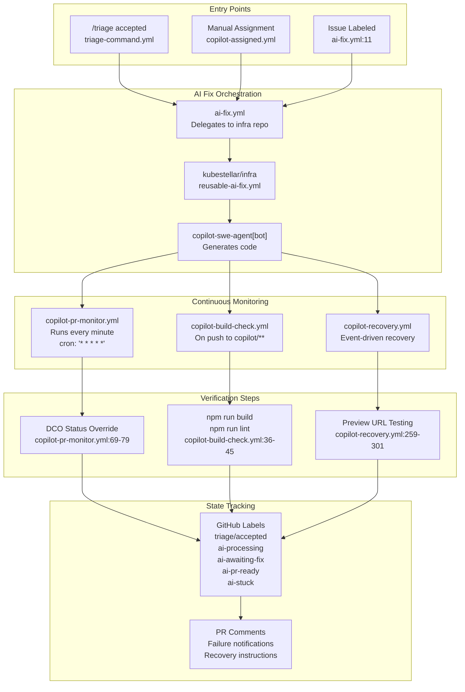
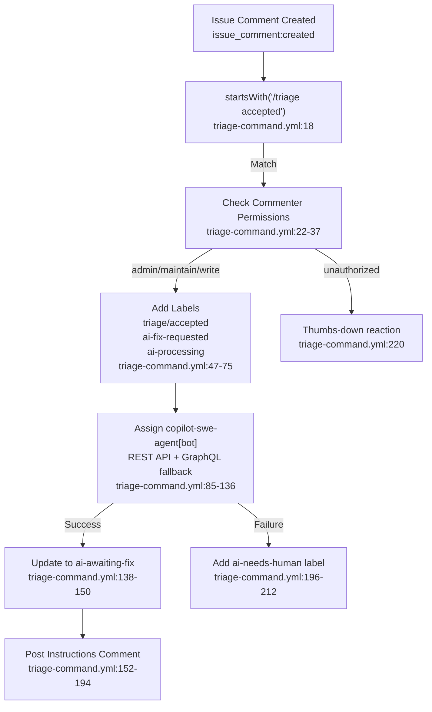
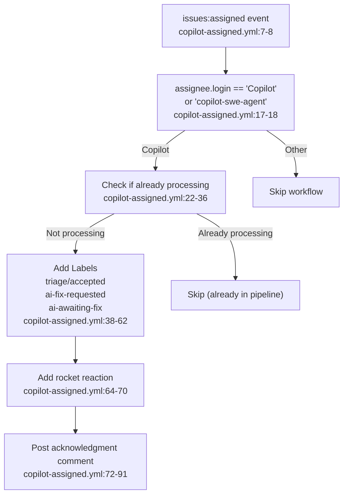
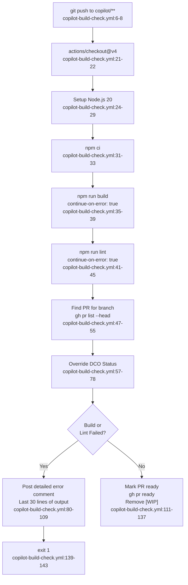
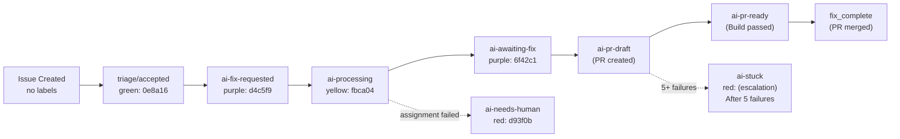
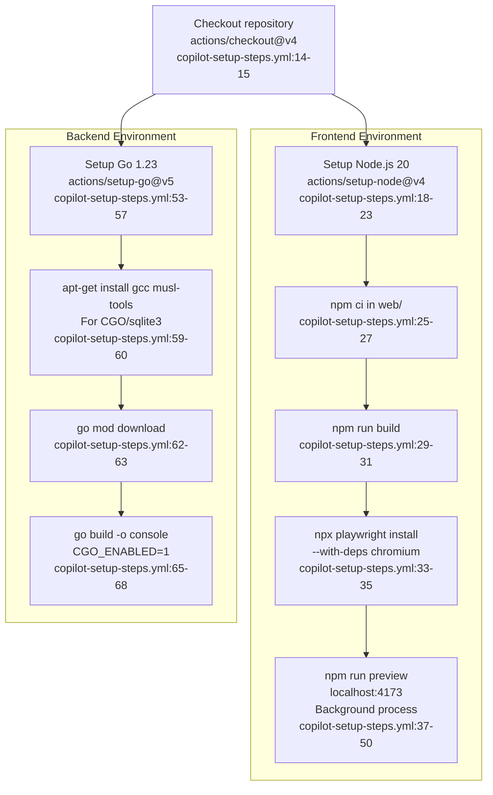
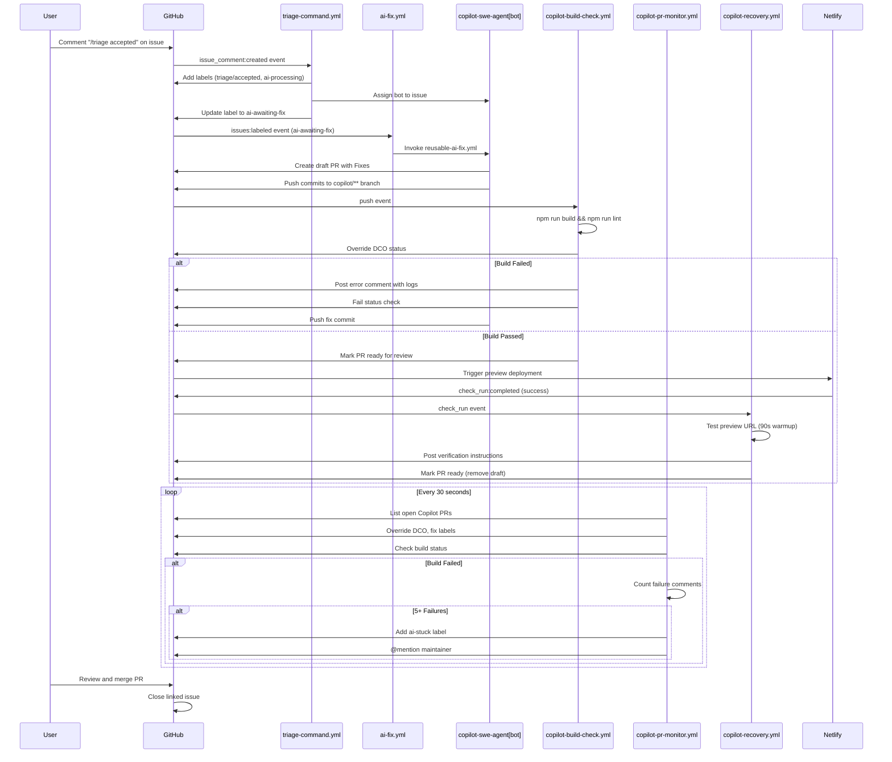

<!-- source: DeepWiki mcp.deepwiki.com · repo kubestellar/console · page 7 CI/CD Automation System · fetched 2026-10-27 -->

# CI/CD Automation System

<details>
<summary>Relevant source files</summary>

The following files were used as context for generating this wiki page:

- [.github/ISSUE_TEMPLATE/bug_report.yaml](.github/ISSUE_TEMPLATE/bug_report.yaml)
- [.github/workflows/ai-fix.yml](.github/workflows/ai-fix.yml)
- [.github/workflows/copilot-assigned.yml](.github/workflows/copilot-assigned.yml)
- [.github/workflows/copilot-automation.yml](.github/workflows/copilot-automation.yml)
- [.github/workflows/copilot-build-check.yml](.github/workflows/copilot-build-check.yml)
- [.github/workflows/copilot-pr-monitor.yml](.github/workflows/copilot-pr-monitor.yml)
- [.github/workflows/copilot-recovery.yml](.github/workflows/copilot-recovery.yml)
- [.github/workflows/copilot-setup-steps.yml](.github/workflows/copilot-setup-steps.yml)
- [.github/workflows/triage-command.yml](.github/workflows/triage-command.yml)

</details>


## Purpose and Scope

This document describes the CI/CD automation system that implements an **autonomous issue resolution pipeline** using GitHub Copilot as a code generation agent. The system automates the entire lifecycle from issue triage through code fix generation, build verification, preview testing, and deployment monitoring.

The automation achieves a 95.71 importance score in the codebase and consists of 8 GitHub Actions workflows that handle:
- Issue triage via command or manual assignment
- AI-powered code fix generation
- Continuous PR monitoring (every minute)
- Build/lint verification
- Netlify preview deployment testing
- Failure recovery and human escalation

For information about the backend API handlers that receive GitHub webhooks from this system, see [GitHub Webhook Integration](#6.2). For details on the SQLite schema used to persist CI/CD state, see [Data Persistence](#6.4).

---

## System Architecture

The CI/CD automation system operates as a state machine driven by GitHub labels, with multiple workflows coordinating to manage the complete issue-to-PR lifecycle.



**Sources:** [.github/workflows/triage-command.yml:1-225](), [.github/workflows/copilot-assigned.yml:1-92](), [.github/workflows/ai-fix.yml:1-27](), [.github/workflows/copilot-pr-monitor.yml:1-264](), [.github/workflows/copilot-build-check.yml:1-144](), [.github/workflows/copilot-recovery.yml:1-652]()

---

## Issue Triage Entry Points

The automation system provides two entry points for triggering AI-powered issue resolution:

| Entry Point | Workflow | Trigger | Use Case |
|-------------|----------|---------|----------|
| **Path A** | `triage-command.yml` | `/triage accepted` comment | Maintainer-initiated triage |
| **Path B** | `copilot-assigned.yml` | Manual assignment via UI | Direct Copilot assignment |

Both paths converge by adding the same label set: `triage/accepted`, `ai-fix-requested`, `ai-awaiting-fix`.

### Path A: Triage Command Workflow

The `triage-command.yml` workflow handles the `/triage accepted` command:



**Key Implementation Details:**

- **Permission Check** [.github/workflows/triage-command.yml:22-37](): Uses `gh api repos/$REPO/collaborators/$COMMENTER/permission` to verify the commenter has `admin`, `maintain`, or `write` access
- **Dual Assignment Strategy** [.github/workflows/triage-command.yml:85-136](): Attempts REST API first, falls back to GraphQL with `GraphQL-Features: issues_copilot_assignment_api_support` header
- **Label Lifecycle** [.github/workflows/triage-command.yml:47-75](): Removes `needs-triage` and `help wanted`, adds automation labels

**Sources:** [.github/workflows/triage-command.yml:1-225]()

### Path B: Manual Assignment Workflow

The `copilot-assigned.yml` workflow handles manual Copilot assignment:



**Idempotency Check** [.github/workflows/copilot-assigned.yml:22-36](): The workflow checks for existing labels (`ai-processing`, `ai-awaiting-fix`, `ai-pr-draft`, `ai-pr-ready`) to avoid duplicate processing.

**Sources:** [.github/workflows/copilot-assigned.yml:1-92]()

---

## AI Fix Workflow Delegation

The `ai-fix.yml` workflow serves as a lightweight delegator to a reusable workflow in the `kubestellar/infra` repository:

```yaml
# .github/workflows/ai-fix.yml
jobs:
  ai-fix:
    uses: kubestellar/infra/.github/workflows/reusable-ai-fix.yml@main
    with:
      issue_number: ${{ github.event.inputs.issue_number || '' }}
    secrets:
      token: ${{ secrets.GITHUB_TOKEN }}
```

**Trigger Conditions** [.github/workflows/ai-fix.yml:3-13]():
- `workflow_dispatch` with manual `issue_number` input
- `issues:labeled` event when specific labels are added
- `pull_request_target:opened` when Copilot creates a draft PR

The actual code generation happens in `kubestellar/infra/.github/workflows/reusable-ai-fix.yml`, which:
1. Fetches the issue description and comments
2. Invokes Copilot coding agent with workspace context
3. Monitors the agent's code generation process
4. Creates a draft PR with `Fixes #N` linkage

**Sources:** [.github/workflows/ai-fix.yml:1-27]()

---

## Continuous PR Monitoring System

The `copilot-pr-monitor.yml` workflow implements aggressive monitoring with **2 checks per minute** (runs every minute, performs 2 checks with 30s interval).

### Monitoring Architecture

```mermaid
graph TB
    Cron["Cron Schedule<br/>cron: '* * * * *'<br/>copilot-pr-monitor.yml:6"]
    FindPRs["Find Open Copilot PRs<br/>pulls.list state='open'<br/>copilot-pr-monitor.yml:38-49"]
    
    subgraph "Idempotent Operations (for each PR)"
        OverrideDCO["Override DCO Status<br/>createCommitStatus<br/>context: 'dco'<br/>copilot-pr-monitor.yml:69-79"]
        FixLabels["Fix DCO Labels<br/>Remove 'dco-signoff: no'<br/>Add 'dco-signoff: yes'<br/>copilot-pr-monitor.yml:82-105"]
        FixTitle["Remove [WIP] from title<br/>copilot-pr-monitor.yml:108-120"]
        RemoveWIPLabel["Remove work-in-progress label<br/>copilot-pr-monitor.yml:123-133"]
        MarkReady["Mark draft PR ready<br/>markPullRequestReadyForReview<br/>copilot-pr-monitor.yml:136-152"]
    end
    
    subgraph "Build Status Detection"
        CheckRuns["listForRef check_runs<br/>copilot-pr-monitor.yml:155-159"]
        StatusAPI["getCombinedStatusForRef<br/>copilot-pr-monitor.yml:161-165"]
        DetectFailure["Detect Netlify failure<br/>copilot-pr-monitor.yml:168-179"]
    end
    
    subgraph "Failure Handling"
        CheckDuplicate["Check if already commented<br/>copilot-pr-monitor.yml:186-197"]
        PostComment["Post build failure comment<br/>@Copilot notification<br/>copilot-pr-monitor.yml:200-216"]
        CountFailures["Count failure comments<br/>copilot-pr-monitor.yml:200-202"]
        Escalate["Add ai-stuck label<br/>@clubanderson mention<br/>After 5 failures<br/>copilot-pr-monitor.yml:219-232"]
    end
    
    Cron --> FindPRs
    FindPRs --> OverrideDCO
    OverrideDCO --> FixLabels
    FixLabels --> FixTitle
    FixTitle --> RemoveWIPLabel
    RemoveWIPLabel --> MarkReady
    
    MarkReady --> CheckRuns
    CheckRuns --> StatusAPI
    StatusAPI --> DetectFailure
    DetectFailure -->|Failure| CheckDuplicate
    CheckDuplicate -->|Not commented| PostComment
    PostComment --> CountFailures
    CountFailures -->|5+ failures| Escalate
```



**Polling Strategy** [.github/workflows/copilot-pr-monitor.yml:24-263]():

```javascript
// Run 2 times with 30s interval
core.info('=== Check 1/2 ===');
await checkPRs();

await sleep(30000);
core.info('=== Check 2/2 ===');
await checkPRs();
```

This provides effective **30-second polling** while respecting GitHub Actions' 1-minute cron minimum.

### DCO Override Mechanism

Every PR check unconditionally overrides the DCO (Developer Certificate of Origin) check for Copilot PRs:

```javascript
// Always override DCO - copilot-pr-monitor.yml:69-79
await github.rest.repos.createCommitStatus({
  owner: context.repo.owner,
  repo: context.repo.repo,
  sha: headSha,
  state: 'success',
  context: 'dco',
  description: 'DCO waived for Copilot'
});
```

**Sources:** [.github/workflows/copilot-pr-monitor.yml:1-264]()

---

## Build Verification Pipeline

The `copilot-build-check.yml` workflow runs on **every push** to `copilot/**` branches and performs synchronous build/lint verification.

### Build Check Flow



### Build Output Capture

Build and lint outputs are captured to temporary files for error reporting:

```bash
# copilot-build-check.yml:36-44
npm run build 2>&1 | tee /tmp/build-output.txt
npm run lint 2>&1 | tee /tmp/lint-output.txt

# Extract last 30 lines for comment
BUILD_LOG=$(tail -30 /tmp/build-output.txt)
```

### Automatic PR Ready Transition

When both build and lint pass, the workflow automatically:

1. **Marks PR Ready** [.github/workflows/copilot-build-check.yml:112-123](): Uses `gh pr ready` with `CONSOLE_AUTO` PAT to modify Copilot-created PRs
2. **Removes [WIP] Tag** [.github/workflows/copilot-build-check.yml:125-131](): Strips `[WIP]` prefix from PR title
3. **Cleans Labels** [.github/workflows/copilot-build-check.yml:133-136](): Removes `do-not-merge/work-in-progress` label

**Sources:** [.github/workflows/copilot-build-check.yml:1-144]()

---

## Recovery System

The `copilot-recovery.yml` workflow provides event-driven recovery for various failure scenarios. It uses **concurrency control** to prevent duplicate processing:

```yaml
# copilot-recovery.yml:33-35
concurrency:
  group: copilot-recovery-${{ github.event.check_run.pull_requests[0].number || ... }}
  cancel-in-progress: true
```

### Recovery Job Matrix

| Job Name | Trigger Event | Purpose | Implementation |
|----------|---------------|---------|----------------|
| `gate` | All events | Prevents "no jobs run" failure | [copilot-recovery.yml:41-44]() |
| `override-dco-for-bots` | `check_run.name == 'dco'` + failure | Override DCO for bots | [copilot-recovery.yml:47-95]() |
| `handle-build-failure` | `check_run.conclusion == 'failure'` | Post detailed error messages | [copilot-recovery.yml:99-201]() |
| `handle-build-success` | `check_run.conclusion == 'success'` | Test Netlify preview | [copilot-recovery.yml:205-388]() |
| `handle-workflow-completion` | `workflow_run` | Handle complex build pipelines | [copilot-recovery.yml:391-437]() |
| `handle-review-feedback` | `pull_request_review` | Notify Copilot of reviews | [copilot-recovery.yml:440-496]() |
| `manual-preview-test` | `workflow_dispatch` | Manual preview testing | [copilot-recovery.yml:499-583]() |
| `request-copilot-preview-test` | `pull_request_target:synchronize` | Request verification after push | [copilot-recovery.yml:586-651]() |

### Build Failure Detection

The workflow filters out noise from Netlify sub-checks:

```yaml
# copilot-recovery.yml:100-106
if: |
  github.event_name == 'check_run' &&
  github.event.check_run.conclusion == 'failure' &&
  github.event.check_run.name != 'dco' &&
  !contains(github.event.check_run.name, 'Header rules') &&
  !contains(github.event.check_run.name, 'Redirect rules') &&
  !contains(github.event.check_run.name, 'Pages changed')
```

### Deduplication Strategy

Before posting failure comments, the workflow checks if it already commented on the same commit:

```bash
# copilot-recovery.yml:145-156
EXISTING=$(gh api repos/$REPO/issues/$PR_NUM/comments \
  --jq "[.[] | select(.body | contains(\"Build Failure Detected\") and contains(\"$HEAD_SHA\"))] | length")

if [ "$EXISTING" -gt "0" ]; then
  echo "Already commented on build failure for commit $HEAD_SHA"
  echo "should_comment=false" >> $GITHUB_OUTPUT
fi
```

**Sources:** [.github/workflows/copilot-recovery.yml:1-652]()

---

## Netlify Preview Testing

The recovery system includes sophisticated preview deployment testing with **90-second warmup period**:

### Preview Test Flow

```mermaid
graph TB
    BuildSuccess["Netlify check_run success<br/>contains 'kubestellarconsole'<br/>copilot-recovery.yml:207-209"]
    GetPRInfo["Extract PR number and author<br/>copilot-recovery.yml:212-243"]
    
    ConstructURL["Construct preview URL<br/>deploy-preview-{PR}.console-deploy-preview.kubestellar.io<br/>copilot-recovery.yml:246-257"]
    
    WaitLoop["Wait up to 2 minutes<br/>12 attempts x 10s<br/>copilot-recovery.yml:268-277"]
    HTTPCheck["curl -s -o /dev/null -w '%{http_code}'<br/>copilot-recovery.yml:269"]
    
    CheckJS["Check for JS errors<br/>grep 'chunk.*failed\|module.*error'<br/>copilot-recovery.yml:285-292"]
    CheckRender["Check for React root<br/>grep 'id=\"root\"' && length > 5000<br/>copilot-recovery.yml:295-300"]
    
    PostStatus["Post status notification<br/>@copilot instructions<br/>copilot-recovery.yml:302-365"]
    AutoReady["Mark PR ready for review<br/>markPullRequestReadyForReview<br/>copilot-recovery.yml:367-388"]
    
    BuildSuccess --> GetPRInfo
    GetPRInfo --> ConstructURL
    ConstructURL --> WaitLoop
    WaitLoop --> HTTPCheck
    HTTPCheck -->|200| CheckJS
    HTTPCheck -->|!= 200| WaitLoop
    CheckJS --> CheckRender
    CheckRender --> PostStatus
    PostStatus --> AutoReady
```

### Preview URL Construction

The workflow uses a custom domain to avoid Playwright blocking issues:

```bash
# copilot-recovery.yml:254
PREVIEW_URL="https://deploy-preview-${PR_NUM}.console-deploy-preview.kubestellar.io"
```

This domain is an alias for `*.netlify.app` but isn't blocked by default Playwright rules.

### Health Check Criteria

The preview is considered healthy when:

1. **HTTP 200 Response** [copilot-recovery.yml:269-277](): `curl` returns status code 200
2. **No JS Errors** [copilot-recovery.yml:285-292](): Page HTML doesn't contain `chunk.*failed`, `module.*error`, or `syntax.*error`
3. **App Renders** [copilot-recovery.yml:295-300](): HTML contains `id="root"` and is larger than 5KB

### Copilot Verification Request

After successful build, the workflow posts instructions for Copilot to verify the preview:

```markdown
# copilot-recovery.yml:352-359
@copilot **Please verify the preview works:**

1. Fetch the preview URL: `curl -s $PREVIEW_URL`
2. Verify it returns HTML with `<div id="root">`
3. Check there are no error messages in the HTML
4. Report your findings in a comment

Once verified, the PR is ready for human review.
```

**Sources:** [.github/workflows/copilot-recovery.yml:205-388]()

---

## State Machine and Label System

The automation uses GitHub labels as a **state machine** to track issue and PR lifecycle. The label taxonomy enables precise orchestration across multiple workflows.

### Label Taxonomy



### Label Lifecycle Table

| Label | Added By | Purpose | Transition |
|-------|----------|---------|------------|
| `triage/accepted` | triage-command.yml, copilot-assigned.yml | Issue triaged by maintainer | Entry to automation |
| `ai-fix-requested` | triage-command.yml, copilot-assigned.yml | AI fix has been requested | Triggers ai-fix.yml |
| `ai-processing` | triage-command.yml | Copilot assignment in progress | Temporary state |
| `ai-awaiting-fix` | triage-command.yml:146, copilot-assigned.yml:60 | Copilot actively working | Replaced by ai-pr-draft |
| `ai-pr-draft` | (External: reusable-ai-fix.yml) | Draft PR created | Replaced by ai-pr-ready |
| `ai-pr-ready` | (External: reusable-ai-fix.yml) | Build passed, ready for review | Final automation state |
| `ai-stuck` | copilot-pr-monitor.yml:219-224 | 5+ build failures, needs human | Circuit breaker |
| `ai-needs-human` | triage-command.yml:210 | Copilot assignment failed | Manual intervention |

### State Transition Logic

**Triage → Processing** [.github/workflows/triage-command.yml:70-73]():
```yaml
gh issue edit "$ISSUE" --repo "$REPO" \
  --add-label "triage/accepted" \
  --add-label "ai-fix-requested" \
  --add-label "ai-processing"
```

**Processing → Awaiting Fix** [.github/workflows/triage-command.yml:146-148]():
```yaml
gh issue edit "$ISSUE" --repo "$REPO" --remove-label "ai-processing"
gh issue edit "$ISSUE" --repo "$REPO" --add-label "ai-awaiting-fix"
```

**Circuit Breaker** [.github/workflows/copilot-pr-monitor.yml:219-232]():
```javascript
// After 5 build failures
if (failureCount >= 5 && !labels.includes('ai-stuck')) {
  await github.rest.issues.addLabels({
    owner: context.repo.owner,
    repo: context.repo.repo,
    issue_number: prNumber,
    labels: ['ai-stuck']
  });
  await github.rest.issues.createComment({
    body: `## Needs Human Help\n\n@clubanderson PR has ${failureCount + 1} build failures. Copilot needs help.`
  });
}
```

**Sources:** [.github/workflows/triage-command.yml:47-150](), [.github/workflows/copilot-assigned.yml:38-62](), [.github/workflows/copilot-pr-monitor.yml:219-232]()

---

## Copilot Environment Setup

The `copilot-setup-steps.yml` workflow pre-configures the Copilot coding agent's Ubuntu VM with all necessary build tools. This eliminates the need for Copilot to manually install dependencies.

### Setup Configuration



### Preview Server Background Process

The workflow starts a Vite preview server in the background so Copilot can test against `localhost:4173`:

```bash
# copilot-setup-steps.yml:39-50
nohup npm run preview -- --host 0.0.0.0 --port 4173 &
echo "Preview server starting on http://localhost:4173"

# Wait for it to be ready
for i in $(seq 1 15); do
  if curl -s -o /dev/null -w "%{http_code}" http://localhost:4173 | grep -q 200; then
    echo "Preview server is ready"
    break
  fi
  sleep 2
done
```

### Available Commands

After setup, Copilot can execute:

| Command | Working Directory | Purpose |
|---------|-------------------|---------|
| `npm run build` | `web/` | Compile TypeScript + Vite |
| `npm run lint` | `web/` | ESLint verification |
| `npm run preview` | `web/` | Local preview server |
| `npx playwright test` | `web/` | E2E tests with Chromium |
| `go build ./cmd/console` | Repository root | Compile Go binary |
| `go test ./...` | Repository root | Run Go tests |

**Sources:** [.github/workflows/copilot-setup-steps.yml:1-69]()

---

## Integration Points

### GitHub Webhook Reception

The backend receives webhook events from GitHub Actions workflows via the Feedback System handlers. Key integration points:

- **Issue Creation**: User submits feature request → backend creates GitHub issue → applies `needs-triage` label
- **Webhook Processing**: GitHub sends webhook on issue label changes → backend updates SQLite database
- **PR Status Tracking**: Netlify deployment webhooks → backend tracks preview URL → displays in UI

For webhook handler implementation, see [GitHub Webhook Integration](#6.2).

### SQLite Persistence

The automation state is persisted in SQLite for offline resilience:

```sql
-- Schema tables used by CI/CD system
CREATE TABLE feature_requests (
  id INTEGER PRIMARY KEY,
  github_issue_number INTEGER,
  status TEXT, -- 'open', 'triage_accepted', 'ai_processing', etc.
  ...
);

CREATE TABLE pr_feedback (
  id INTEGER PRIMARY KEY,
  pr_number INTEGER,
  build_status TEXT,
  preview_url TEXT,
  ...
);
```

For complete schema, see [Data Persistence](#6.4).

### Issue Template Integration

The `bug_report.yaml` issue template pre-populates issue fields that Copilot uses for code generation:

```yaml
# .github/ISSUE_TEMPLATE/bug_report.yaml:15-23
- type: textarea
  id: description
  attributes:
    label: Describe the bug
    description: Please provide a clear and concise description of the bug.
  validations:
    required: true
```

Copilot parses these structured fields to understand the requested fix.

**Sources:** [.github/ISSUE_TEMPLATE/bug_report.yaml:1-82]()

---

## Workflow Execution Summary

### Complete Automation Flow



### Workflow Coordination Matrix

| Workflow | Trigger | Frequency | Responsibility | Concurrency |
|----------|---------|-----------|----------------|-------------|
| `triage-command.yml` | `/triage accepted` comment | On-demand | Issue triage and Copilot assignment | None |
| `copilot-assigned.yml` | Manual bot assignment | On-demand | Alternative entry point | None |
| `ai-fix.yml` | Label added / PR opened | On-demand | Delegates to reusable workflow | None |
| `copilot-pr-monitor.yml` | Cron schedule | Every 30s (2x per minute) | DCO, labels, build status, escalation | None |
| `copilot-build-check.yml` | Push to `copilot/**` | Per-commit | Synchronous build/lint | Per-branch |
| `copilot-recovery.yml` | 7 different events | Event-driven | Netlify testing, review notifications | Per-PR |
| `copilot-setup-steps.yml` | Manual trigger | Once per workspace | Environment pre-configuration | None |

**Sources:** All workflow files listed above

---

## Key Design Patterns

### 1. Idempotent Operations

All workflows perform idempotent operations to handle re-execution safely:

- **DCO Override**: Applied unconditionally on every check
- **Label Cleanup**: Removes/adds labels without checking current state
- **Draft→Ready**: GraphQL mutation is idempotent

### 2. Deduplication

Workflows avoid duplicate comments using commit SHA tracking:

```bash
# Check if already commented on this commit
EXISTING=$(gh api repos/$REPO/issues/$PR_NUM/comments \
  --jq "[.[] | select(.body | contains(\"Build Failure\") and contains(\"$HEAD_SHA\"))] | length")
```

### 3. Circuit Breaker

The system escalates to human intervention after 5 consecutive build failures:

```javascript
if (failureCount >= 5 && !labels.includes('ai-stuck')) {
  // Add ai-stuck label and @mention maintainer
}
```

### 4. Graceful Degradation

Fallback strategies handle API failures:

- REST API assignment → GraphQL API fallback
- Primary token → CONSOLE_AUTO PAT fallback
- Structured comment → Plain text fallback

### 5. Event Filtering

Workflows filter out noise to avoid duplicate processing:

```yaml
# Ignore Netlify sub-checks
if: |
  !contains(github.event.check_run.name, 'Header rules') &&
  !contains(github.event.check_run.name, 'Redirect rules')
```

**Sources:** [.github/workflows/copilot-pr-monitor.yml:24-263](), [.github/workflows/copilot-recovery.yml:139-156](), [.github/workflows/triage-command.yml:85-136]()

---

## Performance Characteristics

| Metric | Value | Implementation |
|--------|-------|----------------|
| **Triage Latency** | < 10 seconds | GitHub Actions cold start + API calls |
| **PR Monitoring Frequency** | 30 seconds | Cron + 2x internal checks |
| **Build Verification** | < 3 minutes | npm ci + build + lint |
| **Netlify Test Timeout** | 2 minutes | 12 retries × 10s interval |
| **Escalation Threshold** | 5 failures | Circuit breaker trigger |
| **Concurrent PRs** | Unlimited | Workflows run in parallel |
| **Manual Override** | < 1 second | Direct API status update |

The system is optimized for **low latency** and **high reliability** with multiple retry mechanisms and fallback strategies.

**Sources:** [.github/workflows/copilot-pr-monitor.yml:4-6](), [.github/workflows/copilot-recovery.yml:268-277](), [.github/workflows/copilot-build-check.yml:31-45]()

---

