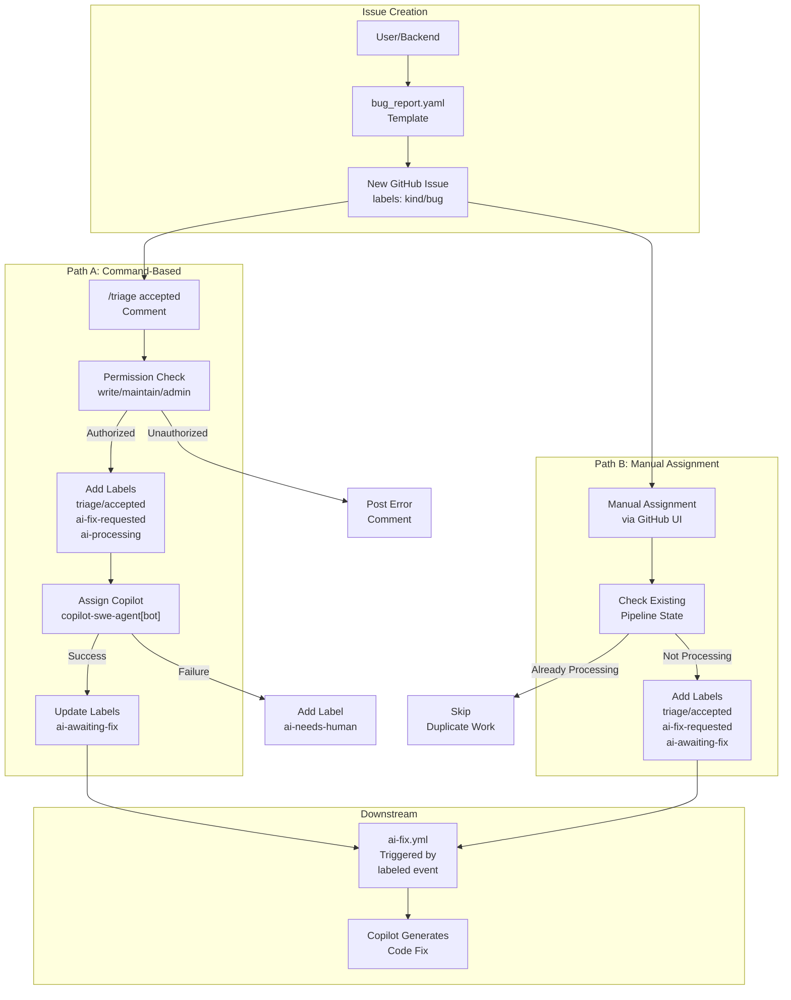
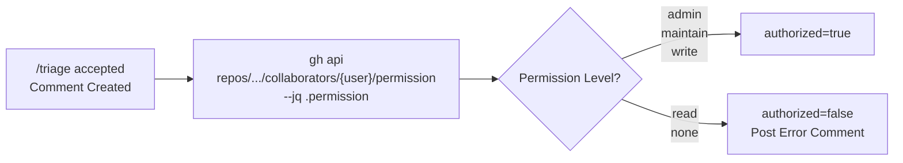
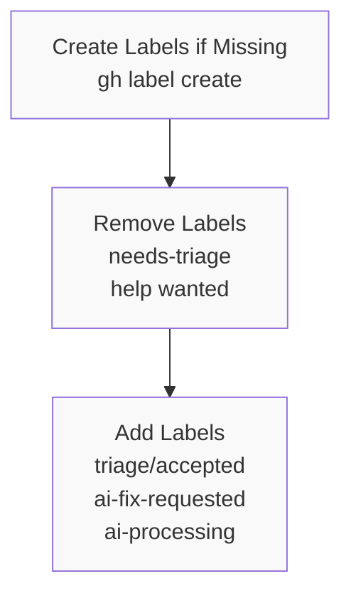
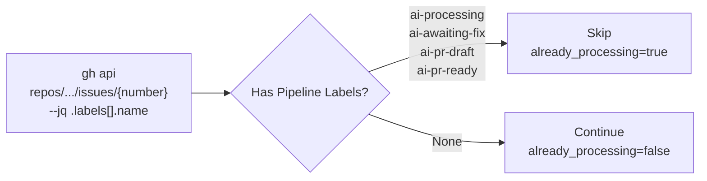
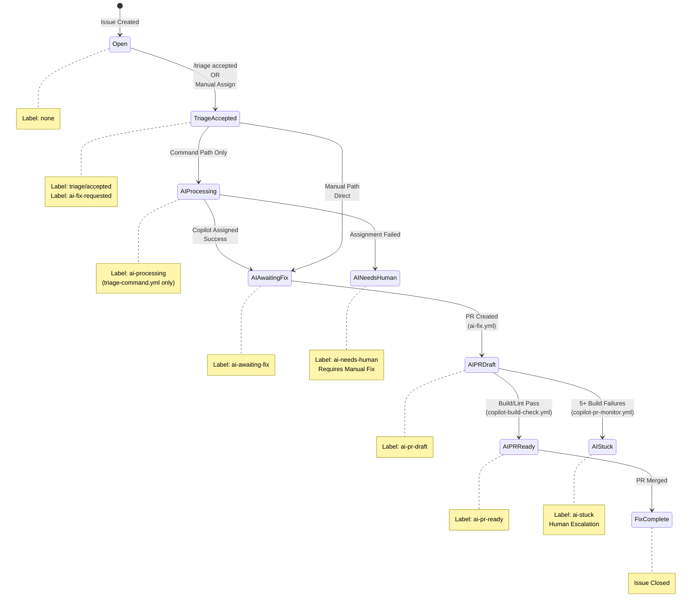
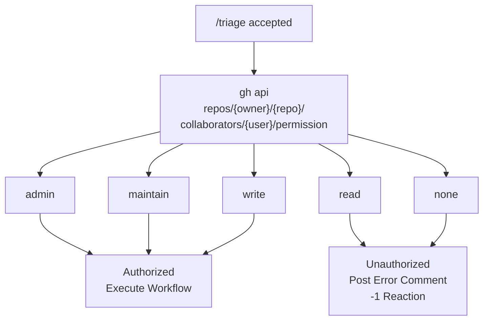
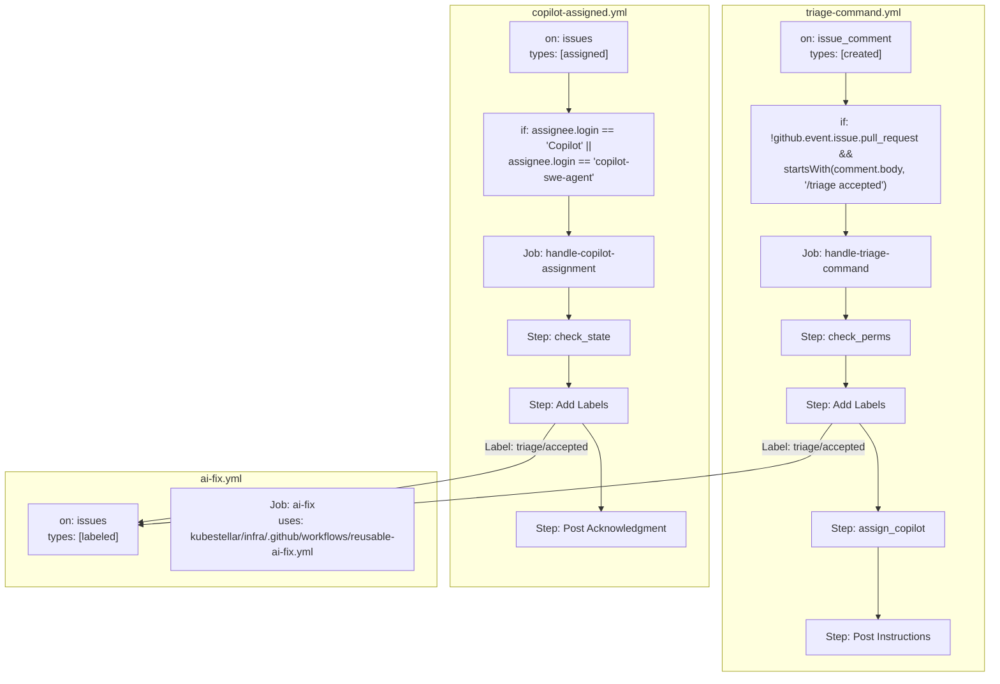

<!-- source: DeepWiki mcp.deepwiki.com · repo kubestellar/console · page 7.1 Issue Triage & Assignment · fetched 2026-10-27 -->

# Issue Triage & Assignment

<details>
<summary>Relevant source files</summary>

The following files were used as context for generating this wiki page:

- [.github/ISSUE_TEMPLATE/bug_report.yaml](.github/ISSUE_TEMPLATE/bug_report.yaml)
- [.github/workflows/ai-fix.yml](.github/workflows/ai-fix.yml)
- [.github/workflows/copilot-assigned.yml](.github/workflows/copilot-assigned.yml)
- [.github/workflows/copilot-automation.yml](.github/workflows/copilot-automation.yml)
- [.github/workflows/copilot-build-check.yml](.github/workflows/copilot-build-check.yml)
- [.github/workflows/copilot-pr-monitor.yml](.github/workflows/copilot-pr-monitor.yml)
- [.github/workflows/copilot-recovery.yml](.github/workflows/copilot-recovery.yml)
- [.github/workflows/copilot-setup-steps.yml](.github/workflows/copilot-setup-steps.yml)
- [.github/workflows/triage-command.yml](.github/workflows/triage-command.yml)

</details>


## Purpose and Scope

This document describes the issue triage and assignment mechanisms that trigger the AI-driven issue resolution pipeline. It covers the two entry points for engaging GitHub Copilot to automatically fix issues: the `/triage accepted` command workflow and manual Copilot assignment. For information about what happens after Copilot is assigned (the actual fix generation), see [AI Fix Workflow](#7.2). For details about continuous monitoring of Copilot PRs, see [PR Monitoring & Recovery](#7.3).

## Overview

The KubeStellar Console implements an automated issue resolution pipeline that begins with issue triage. The system provides two paths for assigning Copilot to work on issues:

| Path | Trigger | Workflow File | Use Case |
|------|---------|---------------|----------|
| **Path A** | `/triage accepted` comment | `triage-command.yml` | Maintainers explicitly approve issue for AI processing |
| **Path B** | Manual Copilot assignment | `copilot-assigned.yml` | Direct assignment via GitHub UI |

Both paths converge by adding the same set of labels to the issue, enabling unified downstream processing through the [AI Fix Workflow](#7.2).

**Sources:** [.github/workflows/triage-command.yml:1-3](), [.github/workflows/copilot-assigned.yml:1-4]()

## Triage Flow Architecture



**Sources:** [.github/workflows/triage-command.yml:1-225](), [.github/workflows/copilot-assigned.yml:1-92](), [.github/workflows/ai-fix.yml:10-14]()

## Path A: Triage Command Workflow

### Trigger Mechanism

The `triage-command.yml` workflow activates on `issue_comment` events with type `created` and validates that the comment starts with `/triage accepted` and occurs on an issue (not a pull request).

**Sources:** [.github/workflows/triage-command.yml:6-18]()

### Permission Verification



The workflow queries the GitHub API to retrieve the commenter's permission level using the endpoint `/repos/{owner}/{repo}/collaborators/{username}/permission`. Only users with `admin`, `maintain`, or `write` permissions are authorized to trigger triage.

**Sources:** [.github/workflows/triage-command.yml:22-37]()

### Label Management

Upon successful authorization, the workflow performs the following label operations:



**Label Creation** [.github/workflows/triage-command.yml:55-63]():
- `triage/accepted` (color: `0e8a16`) - "Issue has been triaged and accepted"
- `ai-fix-requested` (color: `d4c5f9`) - "AI fix has been requested"
- `ai-processing` (color: `fbca04`) - "AI is currently processing this issue"
- `ai-awaiting-fix` (color: `6f42c1`) - "Copilot is working on a fix"

**Label Removal** [.github/workflows/triage-command.yml:66-67]():
- `needs-triage` - Removed when triage completes
- `help wanted` - Removed as Copilot will handle the issue

**Sources:** [.github/workflows/triage-command.yml:47-75]()

### Copilot Assignment

The workflow attempts to assign `copilot-swe-agent[bot]` to the issue using two methods with fallback:

#### Primary Method: REST API

[.github/workflows/triage-command.yml:95-105]()

```
POST /repos/{owner}/{repo}/issues/{issue_number}/assignees
{
  "assignees": ["copilot-swe-agent[bot]"],
  "agent_assignment": {
    "target_repo": "{owner}/{repo}",
    "base_branch": "main"
  }
}
```

This endpoint uses the `CONSOLE_AUTO` secret (a GitHub Personal Access Token with enhanced permissions) to bypass normal bot assignment restrictions.

#### Fallback Method: GraphQL API

If REST fails, the workflow executes a GraphQL query to find the Copilot bot's node ID and assigns it via mutation [.github/workflows/triage-command.yml:113-136]():

```graphql
query {
  repository(owner: "...", name: "...") {
    suggestedActors(first: 1, capabilities: [COPILOT_CHAT_AGENT]) {
      nodes { id login }
    }
  }
}

mutation {
  addAssigneesToAssignable(input: {
    assignableId: "...",
    assigneeIds: ["..."]
  }) {
    assignable {
      ... on Issue {
        assignees(first: 5) { nodes { login } }
      }
    }
  }
}
```

**GraphQL Feature Header:** `GraphQL-Features: issues_copilot_assignment_api_support,coding_agent_model_selection`

**Sources:** [.github/workflows/triage-command.yml:85-136]()

### State Transitions After Assignment

Upon successful Copilot assignment, the workflow transitions the issue state:

[.github/workflows/triage-command.yml:138-150]()

```
Remove: ai-processing
Add:    ai-awaiting-fix
```

This state change signals that the issue has moved from "being triaged" to "waiting for Copilot to generate a fix."

**Sources:** [.github/workflows/triage-command.yml:138-150]()

### Instructions Comment

The workflow posts a comment to the issue providing Copilot with context and instructions [.github/workflows/triage-command.yml:152-194]():

| Section | Content |
|---------|---------|
| **Instructions** | 5-step process: Read issue → Explore codebase → Implement changes → Create PR → Follow style |
| **Build & Lint** | Commands for verification: `npm run build`, `npm run lint`, preview server URL |
| **Testing** | Playwright testing instructions with Netlify preview URLs |
| **Guidelines** | Language-specific guidelines (TypeScript for frontend, Go for backend) |

**Sources:** [.github/workflows/triage-command.yml:152-194]()

### Failure Handling

If Copilot assignment fails, the workflow [.github/workflows/triage-command.yml:196-212]():

1. Creates and adds the `ai-needs-human` label (color: `d93f0b`)
2. Removes the `ai-processing` label
3. Emits a warning to GitHub Actions logs

The issue remains open with the `ai-needs-human` label for manual intervention.

**Sources:** [.github/workflows/triage-command.yml:196-212]()

## Path B: Manual Copilot Assignment

### Trigger Mechanism

The `copilot-assigned.yml` workflow triggers on the `issues` event with type `assigned`. It only processes assignments where the assignee is `Copilot` or `copilot-swe-agent`.

**Sources:** [.github/workflows/copilot-assigned.yml:6-18]()

### Duplicate Detection

Before adding labels, the workflow checks if the issue is already in the processing pipeline [.github/workflows/copilot-assigned.yml:22-36]():



This prevents duplicate comments and label thrashing when Copilot is re-assigned to an issue already being processed.

**Sources:** [.github/workflows/copilot-assigned.yml:22-36]()

### Label Application

If the issue is not already processing, the workflow adds [.github/workflows/copilot-assigned.yml:38-62]():

- `triage/accepted`
- `ai-fix-requested`
- `ai-awaiting-fix`

Note that `ai-processing` is **not** added in this path, since Copilot is directly assigned and doesn't need the intermediate "processing triage request" state.

**Sources:** [.github/workflows/copilot-assigned.yml:38-62]()

### Acknowledgment Comment

The workflow posts a standardized comment [.github/workflows/copilot-assigned.yml:72-91]() listing the 5-step process Copilot will follow:

1. Analyze the issue description
2. Explore the codebase for context
3. Implement a fix and create a PR
4. Run build/lint verification via `copilot-setup-steps.yml`
5. Test the Netlify preview deployment

**Sources:** [.github/workflows/copilot-assigned.yml:72-91]()

## Label-Based State Machine

The issue triage system uses GitHub labels as a state machine to track progression through the pipeline:



### Label Definitions

| Label | Color | Description | Added By |
|-------|-------|-------------|----------|
| `triage/accepted` | `0e8a16` | Issue has been triaged and accepted | Both paths |
| `ai-fix-requested` | `d4c5f9` | AI fix has been requested | Both paths |
| `ai-processing` | `fbca04` | AI is currently processing this issue | Path A only |
| `ai-awaiting-fix` | `6f42c1` | Copilot is working on a fix | Both paths (final) |
| `ai-pr-draft` | N/A | Copilot has created a draft PR | `ai-fix.yml` |
| `ai-pr-ready` | N/A | PR is ready for human review | `copilot-build-check.yml` |
| `ai-needs-human` | `d93f0b` | AI automation unavailable - needs human intervention | Assignment failure handler |
| `ai-stuck` | N/A | Human escalation after repeated failures | `copilot-pr-monitor.yml` |

**Sources:** [.github/workflows/triage-command.yml:55-63](), [.github/workflows/copilot-assigned.yml:47-54]()

## Authorization System

### Permission Levels

The triage command uses GitHub's permission model:



**API Endpoint:** `/repos/{owner}/{repo}/collaborators/{username}/permission`

**Response Format:**
```json
{
  "permission": "admin" | "maintain" | "write" | "read" | "none"
}
```

**Sources:** [.github/workflows/triage-command.yml:22-37]()

### Unauthorized User Handling

When an unauthorized user attempts to use the `/triage` command, the workflow [.github/workflows/triage-command.yml:214-224]():

1. Adds a thumbs-down reaction (`-1`) to the comment
2. Posts an explanatory comment: "The `/triage accepted` command requires write access to this repository."
3. Does not add any labels or trigger any downstream workflows

**Sources:** [.github/workflows/triage-command.yml:214-224]()

## Integration with Downstream Workflows

### AI Fix Workflow Trigger

Both triage paths result in the `labeled` event being emitted with the label `triage/accepted`, which triggers the `ai-fix.yml` workflow [.github/workflows/ai-fix.yml:10-14]():

```yaml
on:
  issues:
    types: [labeled]
```

The `ai-fix.yml` workflow delegates to a reusable workflow in the `kubestellar/infra` repository that handles the actual code generation.

**Sources:** [.github/workflows/ai-fix.yml:10-14](), [.github/workflows/ai-fix.yml:21-26]()

### Build Verification Integration

Once Copilot creates a PR, the following workflows begin monitoring:

- `copilot-build-check.yml` - Runs on every push to `copilot/**` branches [.github/workflows/copilot-build-check.yml:6-8]()
- `copilot-pr-monitor.yml` - Polls every minute for status updates [.github/workflows/copilot-pr-monitor.yml:4-6]()
- `copilot-recovery.yml` - Responds to check runs, workflow runs, and review feedback [.github/workflows/copilot-recovery.yml:3-14]()

**Sources:** [.github/workflows/copilot-build-check.yml:1-8](), [.github/workflows/copilot-pr-monitor.yml:1-6](), [.github/workflows/copilot-recovery.yml:1-14]()

## Code Entity Mapping

### Workflow File Structure



**Sources:** [.github/workflows/triage-command.yml:6-18](), [.github/workflows/copilot-assigned.yml:6-18](), [.github/workflows/ai-fix.yml:3-26]()

### Secret Requirements

| Secret Name | Used By | Purpose |
|-------------|---------|---------|
| `GITHUB_TOKEN` | All workflows | Default GitHub Actions token for API operations |
| `CONSOLE_AUTO` | `triage-command.yml`, `copilot-pr-monitor.yml`, `copilot-build-check.yml` | Personal Access Token with enhanced permissions for Copilot assignment and PR modifications |

The `CONSOLE_AUTO` token is required because the default `GITHUB_TOKEN` cannot assign bot users or modify certain PR properties like draft status.

**Sources:** [.github/workflows/triage-command.yml:89](), [.github/workflows/copilot-build-check.yml:114](), [.github/workflows/copilot-pr-monitor.yml:27]()

---

