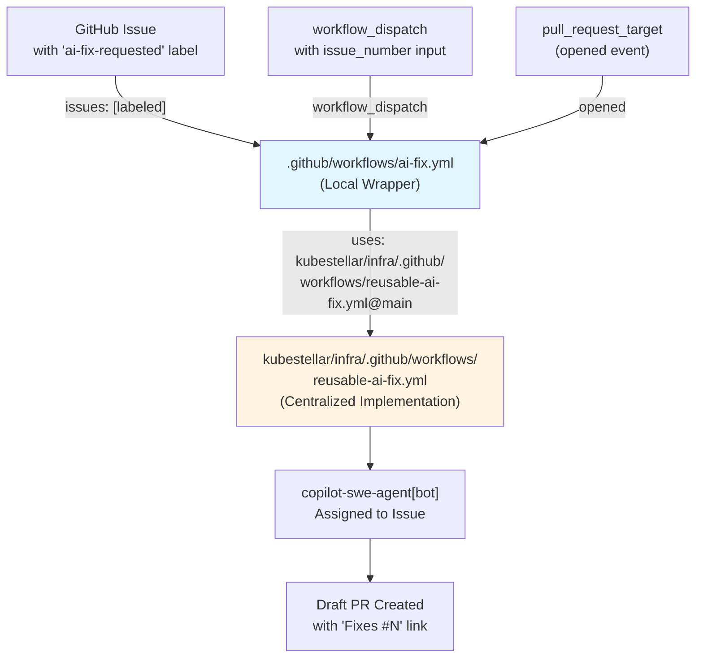
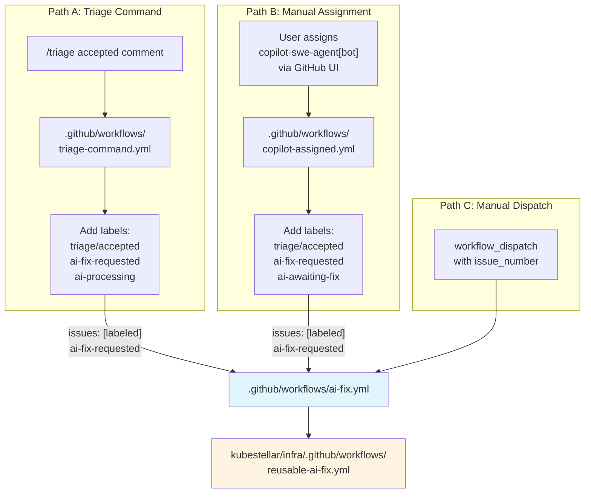
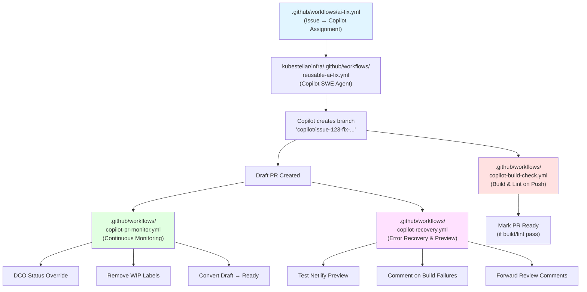
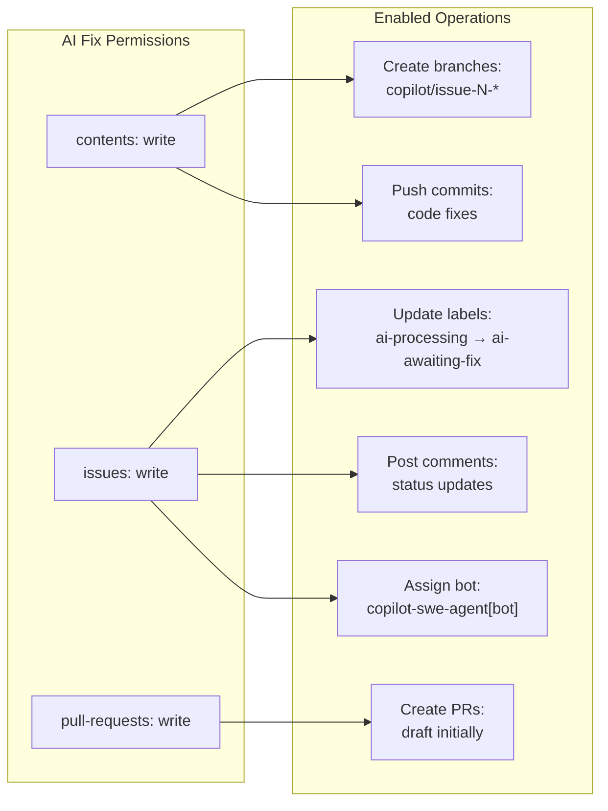
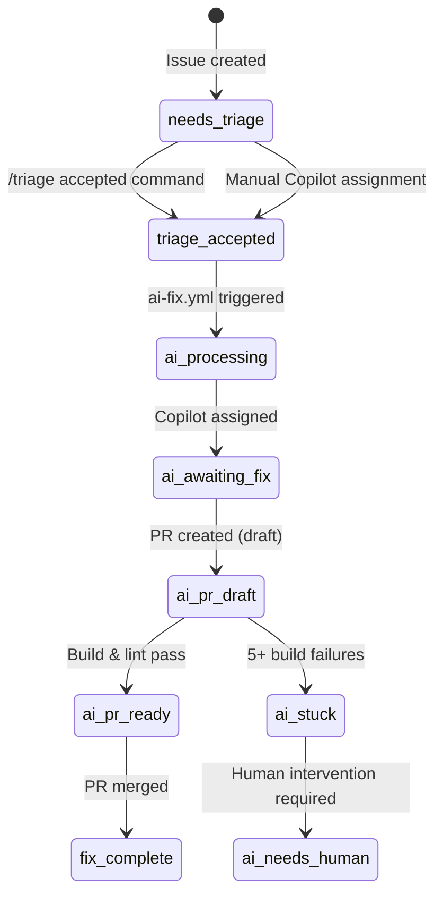
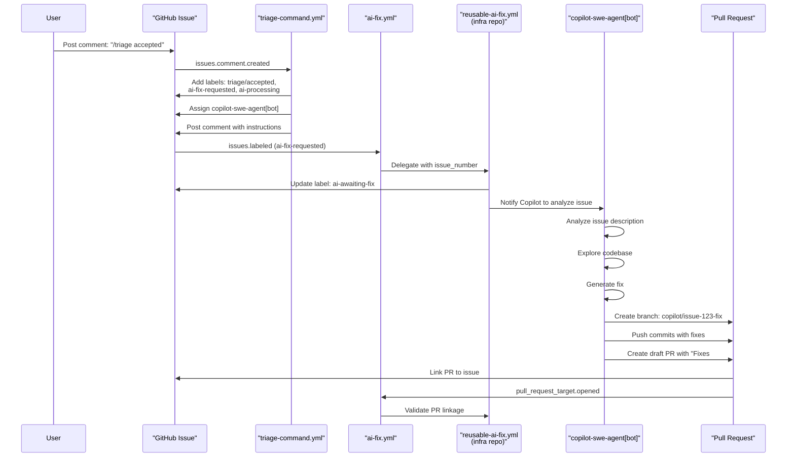

<!-- source: DeepWiki mcp.deepwiki.com · repo kubestellar/console · page 7.2 AI Fix Workflow · fetched 2026-10-27 -->

# AI Fix Workflow

<details>
<summary>Relevant source files</summary>

The following files were used as context for generating this wiki page:

- [.github/ISSUE_TEMPLATE/bug_report.yaml](.github/ISSUE_TEMPLATE/bug_report.yaml)
- [.github/workflows/ai-fix.yml](.github/workflows/ai-fix.yml)
- [.github/workflows/copilot-assigned.yml](.github/workflows/copilot-assigned.yml)
- [.github/workflows/copilot-automation.yml](.github/workflows/copilot-automation.yml)
- [.github/workflows/copilot-build-check.yml](.github/workflows/copilot-build-check.yml)
- [.github/workflows/copilot-pr-monitor.yml](.github/workflows/copilot-pr-monitor.yml)
- [.github/workflows/copilot-recovery.yml](.github/workflows/copilot-recovery.yml)
- [.github/workflows/copilot-setup-steps.yml](.github/workflows/copilot-setup-steps.yml)
- [.github/workflows/triage-command.yml](.github/workflows/triage-command.yml)

</details>


## Purpose and Scope

This document describes the core AI Fix Workflow that generates automated code fixes from GitHub issue descriptions. This workflow serves as the central orchestration point that delegates to the reusable AI fix implementation in the `kubestellar/infra` repository. For information about how issues are triaged before entering this workflow, see [Issue Triage & Assignment](#7.1). For details on continuous PR monitoring, build verification, and recovery mechanisms, see [PR Monitoring & Recovery](#7.3), [Build Verification Pipeline](#7.4), and [Netlify Preview Testing](#7.5).

The AI Fix Workflow accepts an issue number and triggers GitHub Copilot to analyze the issue, implement a fix, and create a pull request. It integrates with multiple upstream trigger mechanisms and downstream automation workflows to form a complete autonomous issue resolution pipeline.

---

## Workflow Architecture

The AI Fix Workflow is implemented as a lightweight wrapper that delegates to a centralized reusable workflow. This design allows multiple KubeStellar repositories to share the same AI fix logic while maintaining repository-specific configurations.

### Workflow File Structure



**Diagram: AI Fix Workflow Delegation Architecture**

Sources: [.github/workflows/ai-fix.yml:1-27]()

---

## Trigger Mechanisms

The AI Fix Workflow can be triggered through three distinct mechanisms, each serving different use cases in the automation pipeline.

### Trigger Types

| Trigger Event | Source | Use Case | Issue Number Source |
|---------------|--------|----------|-------------------|
| `issues: [labeled]` | Automatic | Issue receives `ai-fix-requested` label from triage workflow | `github.event.issue.number` |
| `workflow_dispatch` | Manual | Developer manually triggers fix for specific issue | `github.event.inputs.issue_number` |
| `pull_request_target: [opened]` | Automatic | Copilot creates PR, workflow validates linkage | Extracted from PR body `Fixes #N` |

### Trigger Flow Diagram



**Diagram: AI Fix Workflow Trigger Paths**

Sources: [.github/workflows/ai-fix.yml:3-13](), [.github/workflows/triage-command.yml:1-225](), [.github/workflows/copilot-assigned.yml:1-92]()

---

## Workflow Implementation

### Wrapper Workflow Definition

The local wrapper workflow in the console repository is minimal, serving only to map trigger events to the reusable workflow's input parameters and forward required secrets.

```yaml
# .github/workflows/ai-fix.yml
name: AI Fix with Copilot

on:
  workflow_dispatch:
    inputs:
      issue_number:
        description: Issue number to assign to Copilot
        required: true
        type: string
  issues:
    types: [labeled]
  pull_request_target:
    types: [opened]
```

**Workflow Triggers:**
- [.github/workflows/ai-fix.yml:3-13]()

The workflow requires elevated permissions to modify issues, create branches, and push commits on behalf of the Copilot bot:

| Permission | Level | Purpose |
|------------|-------|---------|
| `contents` | `write` | Create branches, push commits |
| `issues` | `write` | Update labels, post comments |
| `pull-requests` | `write` | Create PRs, modify PR metadata |

Sources: [.github/workflows/ai-fix.yml:15-18]()

### Reusable Workflow Delegation

The wrapper delegates all logic to a centralized reusable workflow maintained in the `kubestellar/infra` repository. This ensures consistent AI fix behavior across all KubeStellar projects.

```yaml
jobs:
  ai-fix:
    uses: kubestellar/infra/.github/workflows/reusable-ai-fix.yml@main
    with:
      issue_number: ${{ github.event.inputs.issue_number || '' }}
    secrets:
      token: ${{ secrets.GITHUB_TOKEN }}
```

**Key Implementation Details:**
- The workflow always references the `@main` branch of the infra repository to get the latest AI fix logic
- The `issue_number` input is optional - if not provided via `workflow_dispatch`, the reusable workflow extracts it from the triggering event context
- The `GITHUB_TOKEN` is passed as a secret to allow the reusable workflow to perform authenticated API operations

Sources: [.github/workflows/ai-fix.yml:20-26]()

---

## Input Parameters and Secrets

### Input Parameter: issue_number

The `issue_number` parameter determines which GitHub issue the AI agent should analyze and fix.

**Parameter Resolution Priority:**
1. **Explicit workflow_dispatch input**: `github.event.inputs.issue_number` - highest priority, used for manual triggers
2. **Issue label event**: `github.event.issue.number` - used when triggered by `issues: [labeled]`
3. **PR opened event**: Extracted from PR body - used when Copilot creates a PR and this workflow validates the issue linkage

**Conditional Expression:**
```yaml
issue_number: ${{ github.event.inputs.issue_number || '' }}
```

If the input is empty, the reusable workflow performs context detection to determine the issue number from the event payload.

Sources: [.github/workflows/ai-fix.yml:24]()

### Secret: token

The `token` secret provides authentication for GitHub API operations performed by the reusable workflow.

**Token Usage:**
- Creating and modifying issue comments
- Adding/removing labels
- Assigning the `copilot-swe-agent[bot]` to issues
- Creating branches and pushing commits
- Creating pull requests

**Token Type:** `GITHUB_TOKEN` - automatically generated GitHub Actions token with repository-scoped permissions

Sources: [.github/workflows/ai-fix.yml:26]()

---

## Integration with Pipeline Workflows

The AI Fix Workflow is the entry point to a multi-stage automation pipeline. Once the reusable workflow assigns Copilot to the issue, several downstream workflows activate to monitor and assist the fix process.

### Pipeline Workflow Integration



**Diagram: AI Fix Workflow Integration with Pipeline**

The AI Fix Workflow itself is stateless - it simply delegates to the reusable workflow and exits. The responsibility for monitoring the fix process and handling errors is distributed across specialized workflows:

- **copilot-build-check.yml**: Triggered on every push to `copilot/**` branches - see [Build Verification Pipeline](#7.4)
- **copilot-pr-monitor.yml**: Runs every minute via cron schedule - see [PR Monitoring & Recovery](#7.3)
- **copilot-recovery.yml**: Event-driven responses to check failures, workflow completions, and code reviews - see [PR Monitoring & Recovery](#7.3)

Sources: [.github/workflows/ai-fix.yml:20-26](), [.github/workflows/copilot-build-check.yml:1-144](), [.github/workflows/copilot-pr-monitor.yml:1-264](), [.github/workflows/copilot-recovery.yml:1-652]()

---

## Workflow Permissions Model

The AI Fix Workflow requires broad write permissions to enable the Copilot agent to perform autonomous development tasks. The permission model balances automation capabilities with security constraints.

### Permission Breakdown



**Diagram: AI Fix Workflow Permission Model**

**Security Considerations:**
- The workflow uses `pull_request_target` instead of `pull_request` to ensure it runs in the context of the base repository, preventing fork-based privilege escalation
- The `GITHUB_TOKEN` is scoped to the repository and has time-limited validity
- The reusable workflow in `kubestellar/infra` is trusted code maintained by the KubeStellar organization

Sources: [.github/workflows/ai-fix.yml:15-18]()

---

## State Transitions and Labels

While the AI Fix Workflow itself doesn't directly manage state transitions (this is handled by the reusable workflow and downstream monitoring workflows), it's important to understand the label lifecycle that the workflow initiates.

### Label State Machine



**Diagram: AI Fix State Machine via Labels**

**Labels Applied by AI Fix Workflow:**
- `triage/accepted` - Issue has been triaged and accepted for automated fix
- `ai-fix-requested` - Triggers the AI fix workflow (applied by triage workflow)
- `ai-processing` - AI fix workflow is running (transitional state)
- `ai-awaiting-fix` - Copilot has been assigned and is analyzing the issue

**Labels Applied by Downstream Workflows:**
- `ai-pr-draft` - Copilot has created a draft PR
- `ai-pr-ready` - PR is ready for human review (build/lint passed)
- `fix_complete` - PR has been merged
- `ai-stuck` - Multiple build failures, needs human help
- `ai-needs-human` - Copilot assignment failed, manual intervention required

For complete state machine documentation including recovery states, see [State Machine & Labels](#7.6).

Sources: [.github/workflows/triage-command.yml:48-76](), [.github/workflows/copilot-assigned.yml:38-62](), [.github/workflows/copilot-pr-monitor.yml:217-234]()

---

## Event Flow Example

The following sequence diagram illustrates a complete successful AI fix workflow from issue triage to PR creation.



**Diagram: Successful AI Fix Event Sequence**

**Timeline Breakdown:**
1. **T+0s**: User posts `/triage accepted` comment
2. **T+2-5s**: Triage workflow adds labels and assigns Copilot
3. **T+5-10s**: AI Fix Workflow triggered by label event
4. **T+10-15s**: Reusable workflow delegates to Copilot agent
5. **T+2-10min**: Copilot analyzes issue and generates fix (variable time)
6. **T+10min+**: Copilot creates PR, downstream workflows activate

Sources: [.github/workflows/triage-command.yml:1-225](), [.github/workflows/ai-fix.yml:1-27]()

---

## Manual Workflow Dispatch

For debugging or special cases, developers can manually trigger the AI Fix Workflow via the GitHub Actions UI or `gh` CLI.

### GitHub Actions UI

1. Navigate to **Actions** → **AI Fix with Copilot**
2. Click **Run workflow**
3. Select branch: `main`
4. Enter issue number (e.g., `123`)
5. Click **Run workflow**

### GitHub CLI

```bash
gh workflow run ai-fix.yml \
  --repo kubestellar/console \
  --ref main \
  --field issue_number=123
```

**Use Cases for Manual Dispatch:**
- Re-trigger AI fix after manual label cleanup
- Force AI fix for issues that bypassed triage
- Testing AI fix workflow with specific issue configurations
- Emergency fix trigger when automatic label detection fails

Sources: [.github/workflows/ai-fix.yml:4-9]()

---

## Workflow Dependencies

The AI Fix Workflow depends on external repositories and GitHub features that must be available for successful execution.

### External Dependencies

| Dependency | Location | Purpose |
|------------|----------|---------|
| `reusable-ai-fix.yml` | `kubestellar/infra/.github/workflows/` | Core AI fix implementation |
| `copilot-swe-agent[bot]` | GitHub Copilot | AI agent that generates fixes |
| `GITHUB_TOKEN` | GitHub Actions | Authentication for API operations |

### Runtime Requirements

- **GitHub Copilot Enterprise**: The workflow requires Copilot agent assignment capabilities
- **Repository Access**: The workflow must have access to the `kubestellar/infra` repository to call the reusable workflow
- **Branch Permissions**: The bot account must be able to create `copilot/**` branches
- **Issue Access**: The specified issue must exist and be accessible

**Failure Modes:**
- **Reusable workflow not found**: Workflow fails if `kubestellar/infra` is private or the workflow file is moved/deleted
- **Copilot unavailable**: If Copilot bot cannot be assigned (organization settings, rate limits), the workflow falls back to `@Copilot` mentions and adds `ai-needs-human` label
- **Invalid issue number**: Workflow logs error and exits if the issue doesn't exist

Sources: [.github/workflows/ai-fix.yml:22-26](), [.github/workflows/triage-command.yml:196-213]()

---

## Monitoring and Observability

The AI Fix Workflow itself has minimal logging, but its execution can be monitored through GitHub's workflow run interface and issue/PR comments.

### Workflow Run Logs

Access logs via:
- **GitHub UI**: Actions → AI Fix with Copilot → Select run
- **GitHub CLI**: `gh run view <run-id> --repo kubestellar/console`

**Log Sections:**
- `Set up job`: Runner initialization
- `ai-fix`: Reusable workflow call (expands to show nested steps)
- `Complete job`: Cleanup and status

### Issue and PR Comments

The workflow generates automatic comments on issues and PRs to provide visibility into the automation status:

- **Issue comment**: Posted by triage workflow confirming AI fix trigger
- **PR comment**: Posted by reusable workflow when PR is created
- **Build failure comments**: Posted by monitoring workflows when errors occur

For comprehensive monitoring of the entire pipeline, see [PR Monitoring & Recovery](#7.3).

Sources: [.github/workflows/ai-fix.yml:1-27](), [.github/workflows/triage-command.yml:152-195]()

---

