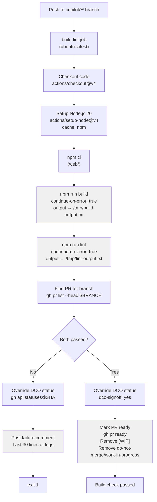
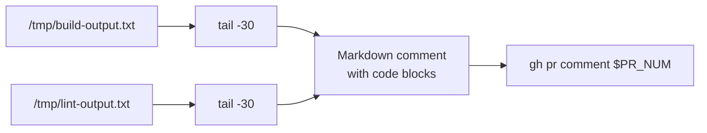
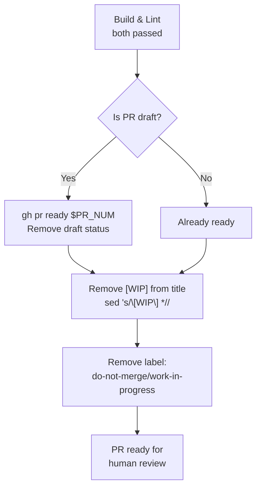
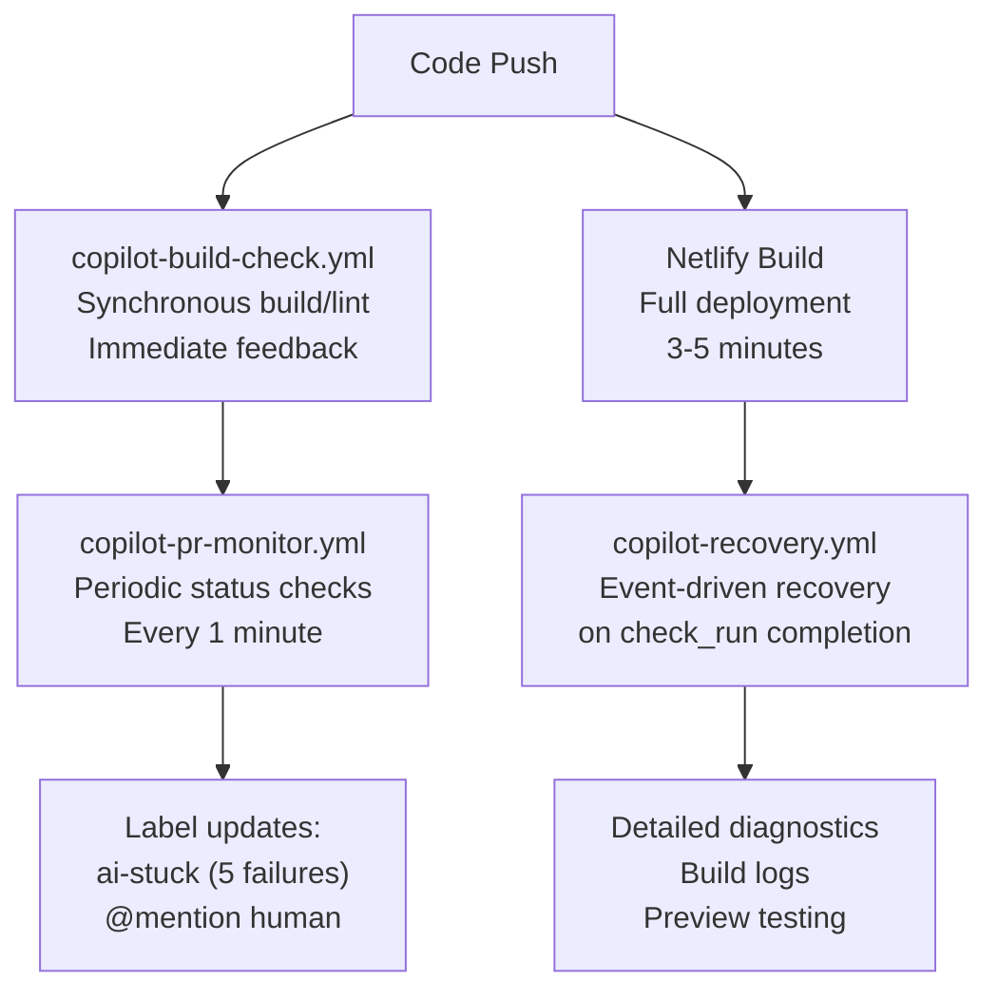

<!-- source: DeepWiki mcp.deepwiki.com · repo kubestellar/console · page 7.4 Build Verification Pipeline · fetched 2026-10-27 -->

# Build Verification Pipeline

<details>
<summary>Relevant source files</summary>

The following files were used as context for generating this wiki page:

- [.github/ISSUE_TEMPLATE/bug_report.yaml](.github/ISSUE_TEMPLATE/bug_report.yaml)
- [.github/workflows/ai-fix.yml](.github/workflows/ai-fix.yml)
- [.github/workflows/copilot-assigned.yml](.github/workflows/copilot-assigned.yml)
- [.github/workflows/copilot-automation.yml](.github/workflows/copilot-automation.yml)
- [.github/workflows/copilot-build-check.yml](.github/workflows/copilot-build-check.yml)
- [.github/workflows/copilot-pr-monitor.yml](.github/workflows/copilot-pr-monitor.yml)
- [.github/workflows/copilot-recovery.yml](.github/workflows/copilot-recovery.yml)
- [.github/workflows/copilot-setup-steps.yml](.github/workflows/copilot-setup-steps.yml)
- [.github/workflows/triage-command.yml](.github/workflows/triage-command.yml)

</details>


## Purpose and Scope

The Build Verification Pipeline provides automated quality gates for AI-generated code changes in Copilot branches. This workflow executes build and lint checks on every push to `copilot/**` branches, ensuring TypeScript compilation succeeds and code meets style standards before preview deployment.

For monitoring build status across multiple PRs, see [PR Monitoring & Recovery](#7.3). For testing deployed previews, see [Netlify Preview Testing](#7.5).

**Sources**: [.github/workflows/copilot-build-check.yml:1-144]()

---

## Workflow Architecture



**Workflow: copilot-build-check.yml**

This diagram shows the execution flow from code push through build verification to PR status updates.

**Sources**: [.github/workflows/copilot-build-check.yml:1-144]()

---

## Build and Lint Execution

### Trigger Configuration

The workflow triggers on any push to branches matching the `copilot/**` pattern:

```yaml
on:
  push:
    branches:
      - 'copilot/**'
```

**Sources**: [.github/workflows/copilot-build-check.yml:5-8]()

### Environment Setup

Node.js 20 is configured with npm cache enabled to accelerate dependency installation:

| Step | Action | Configuration |
|------|--------|---------------|
| Checkout | `actions/checkout@v4` | Default ref (pushed branch) |
| Node.js | `actions/setup-node@v4` | Version 20, npm cache |
| Dependencies | `npm ci` | Working directory: `web/` |

**Sources**: [.github/workflows/copilot-build-check.yml:21-33]()

### Build Execution

The build step executes `npm run build` in the `web/` directory with output captured to `/tmp/build-output.txt`:

```yaml
- name: Build
  id: build
  working-directory: web
  run: npm run build 2>&1 | tee /tmp/build-output.txt
  continue-on-error: true
```

The `continue-on-error: true` flag prevents workflow termination on build failure, allowing the lint step to run and comprehensive error reporting.

**Sources**: [.github/workflows/copilot-build-check.yml:35-39]()

### Lint Execution

Similarly, lint executes with captured output:

```yaml
- name: Lint
  id: lint
  working-directory: web
  run: npm run lint 2>&1 | tee /tmp/lint-output.txt
  continue-on-error: true
```

**Sources**: [.github/workflows/copilot-build-check.yml:41-45]()

---

## PR Association and DCO Override

### Finding the Associated PR

The workflow uses `gh pr list` to find the PR for the current branch:

```bash
BRANCH="${GITHUB_REF#refs/heads/}"
PR_NUM=$(gh pr list --repo "${{ github.repository }}" \
  --head "$BRANCH" --state open --json number --jq '.[0].number' 2>/dev/null || echo "")
```

The PR number is stored in `steps.find_pr.outputs.pr_number` for subsequent steps.

**Sources**: [.github/workflows/copilot-build-check.yml:47-55]()

### DCO Status Override

For Copilot-generated PRs, the DCO (Developer Certificate of Origin) check is automatically overridden using the GitHub Status API:

```bash
gh api repos/${{ github.repository }}/statuses/$SHA \
  -f state=success \
  -f context=dco \
  -f description="DCO waived for Copilot" \
  -f target_url="https://github.com/kubestellar/console/blob/master/CONTRIBUTING.md"
```

Additionally, DCO labels are corrected:
- Remove `dco-signoff: no` label
- Add `dco-signoff: yes` label

This occurs regardless of build/lint outcome to prevent DCO from blocking automated fixes.

**Sources**: [.github/workflows/copilot-build-check.yml:57-78]()

---

## Failure Handling and Feedback

### Failure Detection

Build or lint failures are detected through step outcome checks:

```yaml
if: (steps.build.outcome == 'failure' || steps.lint.outcome == 'failure') && steps.find_pr.outputs.pr_number != ''
```

**Sources**: [.github/workflows/copilot-build-check.yml:81]()

### Error Report Generation

When failures occur, the last 30 lines of each log file are extracted and posted as a PR comment:



**Error Report Structure**:

```markdown
## ❌ Build/Lint Failed

@copilot Your latest push failed verification.

### Build: FAILED
```
<error logs>
```

### Lint: FAILED
```
<error logs>
```

**Fix these errors and push again.** Do not mark this PR as ready until both pass.
```

**Sources**: [.github/workflows/copilot-build-check.yml:80-109]()

### Failure Action

The workflow explicitly fails after posting the comment:

```yaml
- name: Fail the check if build or lint failed
  if: steps.build.outcome == 'failure' || steps.lint.outcome == 'failure'
  run: |
    echo "Build: ${{ steps.build.outcome }}, Lint: ${{ steps.lint.outcome }}"
    exit 1
```

This failure triggers downstream monitoring in [copilot-pr-monitor.yml:154-251](), which counts consecutive failures and escalates after 5 attempts.

**Sources**: [.github/workflows/copilot-build-check.yml:139-143]()

---

## Success Actions and PR Readiness

### Automatic PR Preparation

When both build and lint pass, the workflow automatically prepares the PR for review:



**Automatic PR Preparation Flow**

**Sources**: [.github/workflows/copilot-build-check.yml:111-137]()

### Draft Status Removal

The workflow uses the GitHub CLI to mark the PR ready:

```bash
IS_DRAFT=$(gh pr view "$PR_NUM" --repo "${{ github.repository }}" --json isDraft --jq '.isDraft')
if [ "$IS_DRAFT" = "true" ]; then
  gh pr ready "$PR_NUM" --repo "${{ github.repository }}"
  echo "Marked PR #$PR_NUM as ready for review"
fi
```

**Token Requirements**: This operation uses `secrets.CONSOLE_AUTO` (a PAT with elevated permissions) because the standard `GITHUB_TOKEN` cannot modify PRs created by bots.

**Sources**: [.github/workflows/copilot-build-check.yml:114-123]()

### Title Cleanup

WIP indicators are removed from PR titles:

```bash
TITLE=$(gh pr view "$PR_NUM" --repo "${{ github.repository }}" --json title --jq '.title')
if echo "$TITLE" | grep -q '\[WIP\]'; then
  NEW_TITLE=$(echo "$TITLE" | sed 's/\[WIP\] *//')
  gh pr edit "$PR_NUM" --repo "${{ github.repository }}" --title "$NEW_TITLE"
  echo "Removed [WIP] from title"
fi
```

**Sources**: [.github/workflows/copilot-build-check.yml:126-131]()

### Label Management

The `do-not-merge/work-in-progress` label is removed if present:

```bash
gh pr edit "$PR_NUM" --repo "${{ github.repository }}" \
  --remove-label "do-not-merge/work-in-progress" 2>/dev/null || true
```

**Sources**: [.github/workflows/copilot-build-check.yml:134-135]()

---

## Integration with CI/CD Pipeline

### Coordination with PR Monitor

The build check workflow operates synchronously on each push, while [copilot-pr-monitor.yml:1-264]() runs on a 1-minute schedule. The monitor detects build failures through GitHub Check Runs and Status APIs, creating a feedback loop:

| Workflow | Trigger | Action |
|----------|---------|--------|
| `copilot-build-check.yml` | Push to branch | Run build/lint, post immediate feedback |
| `copilot-pr-monitor.yml` | Every 1 minute | Check status, count failures, escalate after 5 |

**Sources**: [.github/workflows/copilot-build-check.yml:1-144](), [.github/workflows/copilot-pr-monitor.yml:154-251]()

### Escalation to Recovery Workflow

When builds fail, [copilot-recovery.yml:97-202]() handles additional recovery actions:
- Parses detailed error messages from check runs
- Extracts failure summaries from Netlify logs
- Posts diagnostic comments with actionable instructions

**Sources**: [.github/workflows/copilot-recovery.yml:97-202]()

### Comparison with Other Build Checks



**Build Verification Ecosystem**

The build check workflow provides fast feedback (30-60 seconds), while Netlify builds run in parallel (3-5 minutes) for full deployment verification.

**Sources**: [.github/workflows/copilot-build-check.yml:1-144](), [.github/workflows/copilot-pr-monitor.yml:1-264](), [.github/workflows/copilot-recovery.yml:1-652]()

---

## Permissions and Security

### Required Permissions

The workflow declares minimal permissions required for its operations:

```yaml
permissions:
  contents: read        # Read code
  pull-requests: write  # Comment and modify PRs
  issues: write         # Update issue labels
  statuses: write       # Override DCO status
```

**Sources**: [.github/workflows/copilot-build-check.yml:10-14]()

### Token Usage

| Operation | Token | Reason |
|-----------|-------|--------|
| Read PR data | `GITHUB_TOKEN` | Standard workflow token |
| Comment on PR | `GITHUB_TOKEN` | Standard workflow token |
| Mark PR ready | `CONSOLE_AUTO` | PAT required for bot PRs |
| Override DCO | `GITHUB_TOKEN` | Status API accessible to workflows |

The `CONSOLE_AUTO` secret is a Personal Access Token with broader permissions, necessary because `GITHUB_TOKEN` cannot modify resources created by GitHub Apps (including Copilot).

**Sources**: [.github/workflows/copilot-build-check.yml:114]()

---

## Execution Timing and Performance

### Typical Execution Duration

| Phase | Duration |
|-------|----------|
| Checkout + setup | 10-15 seconds |
| npm ci | 20-30 seconds |
| npm run build | 15-25 seconds |
| npm run lint | 5-10 seconds |
| PR operations | 5-10 seconds |
| **Total** | **55-90 seconds** |

The workflow completes significantly faster than Netlify deployment (3-5 minutes), providing early feedback to the AI agent.

**Sources**: [.github/workflows/copilot-build-check.yml:21-143]()

### Caching Strategy

Node.js setup includes npm cache acceleration:

```yaml
- name: Setup Node.js 20
  uses: actions/setup-node@v4
  with:
    node-version: "20"
    cache: "npm"
    cache-dependency-path: web/package-lock.json
```

This reduces `npm ci` duration from ~60 seconds to ~20 seconds on cache hits.

**Sources**: [.github/workflows/copilot-build-check.yml:24-29]()

---

