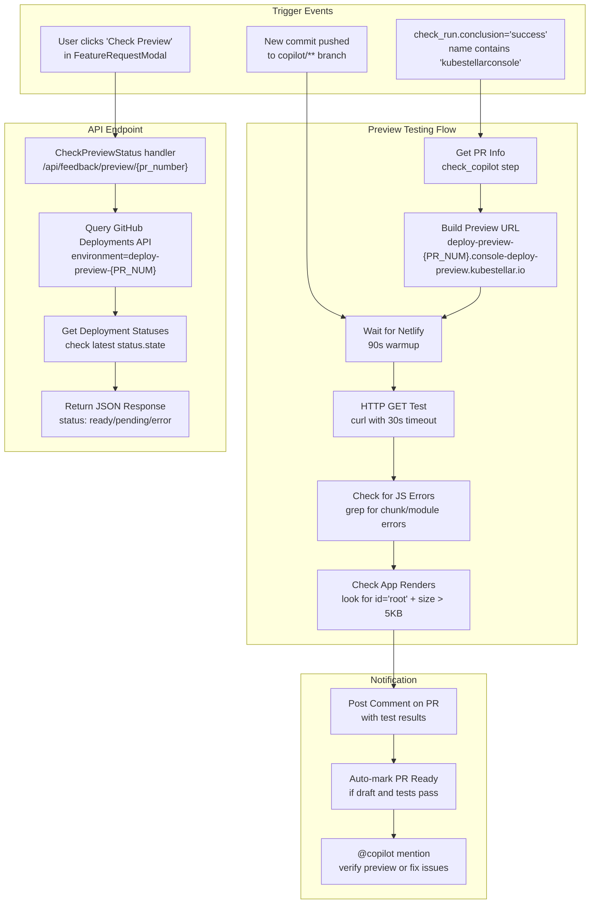
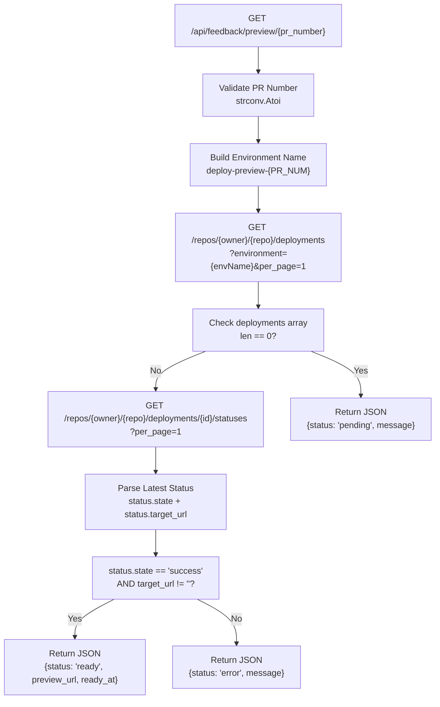
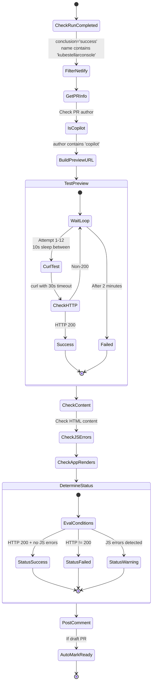
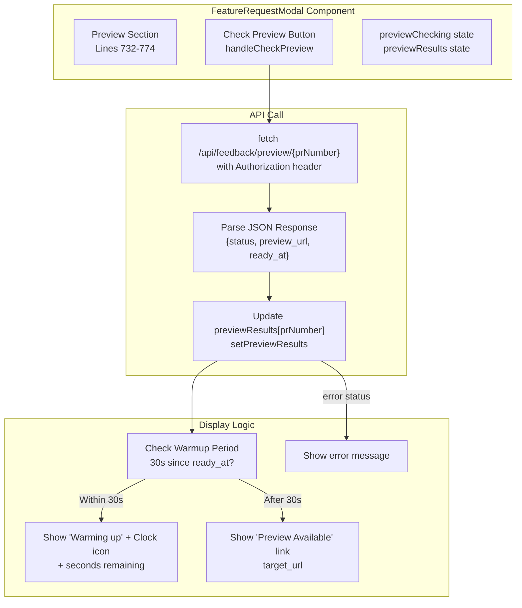
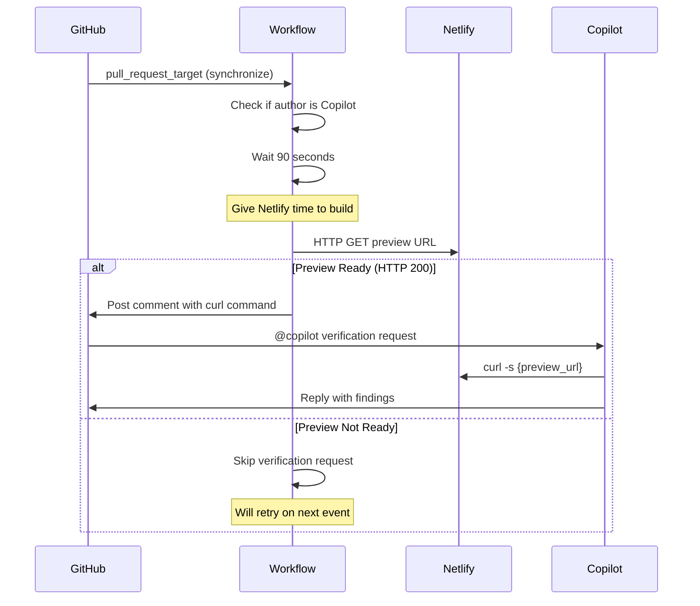
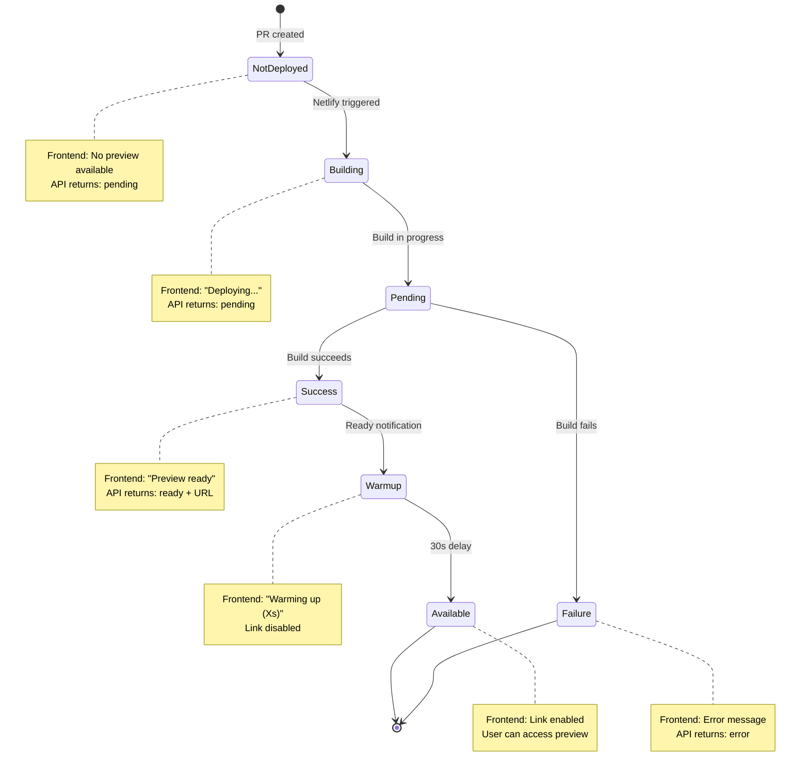

<!-- source: DeepWiki mcp.deepwiki.com · repo kubestellar/console · page 7.5 Netlify Preview Testing · fetched 2026-10-27 -->

# Netlify Preview Testing

<details>
<summary>Relevant source files</summary>

The following files were used as context for generating this wiki page:

- [.github/ISSUE_TEMPLATE/bug_report.yaml](.github/ISSUE_TEMPLATE/bug_report.yaml)
- [.github/workflows/ai-fix.yml](.github/workflows/ai-fix.yml)
- [.github/workflows/copilot-assigned.yml](.github/workflows/copilot-assigned.yml)
- [.github/workflows/copilot-automation.yml](.github/workflows/copilot-automation.yml)
- [.github/workflows/copilot-build-check.yml](.github/workflows/copilot-build-check.yml)
- [.github/workflows/copilot-pr-monitor.yml](.github/workflows/copilot-pr-monitor.yml)
- [.github/workflows/copilot-recovery.yml](.github/workflows/copilot-recovery.yml)
- [.github/workflows/copilot-setup-steps.yml](.github/workflows/copilot-setup-steps.yml)
- [.github/workflows/triage-command.yml](.github/workflows/triage-command.yml)
- [pkg/api/handlers/feedback.go](pkg/api/handlers/feedback.go)
- [pkg/api/handlers/gpu.go](pkg/api/handlers/gpu.go)
- [pkg/api/handlers/rewards.go](pkg/api/handlers/rewards.go)
- [pkg/models/feedback.go](pkg/models/feedback.go)
- [pkg/models/gpu.go](pkg/models/gpu.go)
- [pkg/store/sqlite.go](pkg/store/sqlite.go)
- [pkg/store/store.go](pkg/store/store.go)
- [web/src/components/charts/BarChart.tsx](web/src/components/charts/BarChart.tsx)
- [web/src/components/charts/PieChart.tsx](web/src/components/charts/PieChart.tsx)
- [web/src/components/feedback/FeatureRequestButton.tsx](web/src/components/feedback/FeatureRequestButton.tsx)
- [web/src/components/feedback/FeatureRequestModal.tsx](web/src/components/feedback/FeatureRequestModal.tsx)
- [web/src/hooks/useFeatureRequests.ts](web/src/hooks/useFeatureRequests.ts)
- [web/src/hooks/useGPUReservations.ts](web/src/hooks/useGPUReservations.ts)

</details>


## Purpose and Scope

This page documents the automated Netlify preview deployment testing system that validates pull requests created by the Copilot coding agent. The system checks deploy status via GitHub Deployments API, performs HTTP availability tests, detects JavaScript errors, and notifies the agent of results.

For information about the broader PR monitoring system, see [PR Monitoring & Recovery](#7.3). For build verification before deployment, see [Build Verification Pipeline](#7.4).

---

## System Overview

The Netlify preview testing system operates in two modes:

1. **Automated Testing**: Triggered when build checks succeed, tests preview availability and reports results
2. **On-Demand Checking**: Frontend users can manually check preview status for any PR via API endpoint

The system uses GitHub's Deployments API as the source of truth for Netlify deploy status, avoiding premature "Preview Available" notifications.



**Sources:** [.github/workflows/copilot-recovery.yml:205-389](), [pkg/api/handlers/feedback.go:312-407](), [web/src/components/feedback/FeatureRequestModal.tsx:121-136]()

---

## Preview URL Format

Netlify preview deployments use a deterministic URL format based on PR number:

| Component | Format | Example |
|-----------|--------|---------|
| Base URL | `deploy-preview-{PR_NUM}` | `deploy-preview-123` |
| Custom Domain | `.console-deploy-preview.kubestellar.io` | Full subdomain |
| Complete URL | `https://deploy-preview-{PR_NUM}.console-deploy-preview.kubestellar.io` | `https://deploy-preview-123.console-deploy-preview.kubestellar.io` |

**Rationale:** Custom domain used instead of `*.netlify.app` because Playwright and some corporate proxies block `netlify.app` domains.

**Sources:** [.github/workflows/copilot-recovery.yml:254](), [.github/workflows/copilot-recovery.yml:619]()

---

## GitHub Deployments API Integration

### Backend Handler: `CheckPreviewStatus`

The backend provides an on-demand preview status check via `/api/feedback/preview/{pr_number}` that queries GitHub's Deployments API.



**Key Status Values:**

| GitHub State | Returned Status | Frontend Behavior |
|--------------|-----------------|-------------------|
| `success` | `ready` | Show "Preview Available" with link |
| `pending` | `pending` | Show "Deploying..." with spinner |
| `failure` / `error` | `error` | Show error message |
| No deployment | `pending` | Show "No deployment found yet" |

**Sources:** [pkg/api/handlers/feedback.go:312-407]()

### Handler Implementation Details

The `CheckPreviewStatus` function implements a two-step API query:

1. **Query Deployments Endpoint** [feedback.go:328-357]():
   - Filters by environment name: `deploy-preview-{pr_number}`
   - Requests only 1 result (`per_page=1`) for efficiency
   - Returns early with `pending` if no deployment exists

2. **Query Deployment Statuses** [feedback.go:360-393]():
   - Fetches latest status for the deployment
   - Checks `state` field: `success`, `failure`, `error`, `pending`
   - Extracts `target_url` (the actual Netlify preview URL)
   - Returns `ready_at` timestamp from `created_at`

**Authorization:** Uses `h.githubToken` (backend GitHub PAT) for API requests [feedback.go:336](), [feedback.go:368]().

**Sources:** [pkg/api/handlers/feedback.go:312-407]()

---

## Automated Preview Testing Workflow

### Workflow: `handle-build-success`

Triggered by `check_run` events when Netlify checks complete successfully.



**Sources:** [.github/workflows/copilot-recovery.yml:205-389]()

### Test Implementation Details

The automated test performs three checks on the preview deployment:

#### 1. HTTP Availability Test [copilot-recovery.yml:266-282]()

```bash
# Retry logic: 12 attempts with 10s sleep = 2 minutes max wait
for i in {1..12}; do
  HTTP_CODE=$(curl -s -o /dev/null -w "%{http_code}" "$PREVIEW_URL" --max-time 10 || echo "000")
  if [ "$HTTP_CODE" == "200" ]; then
    preview_status=success
    break
  fi
  sleep 10
done
```

#### 2. JavaScript Error Detection [copilot-recovery.yml:285-292]()

```bash
CONTENT=$(curl -s "$PREVIEW_URL" --max-time 30 || echo "")
if echo "$CONTENT" | grep -qi "chunk.*failed|module.*error|syntax.*error"; then
  js_errors=true
fi
```

Detects common Vite/React error patterns indicating build problems.

#### 3. React App Rendering Check [copilot-recovery.yml:294-300]()

```bash
if echo "$CONTENT" | grep -q 'id="root"' && [ ${#CONTENT} -gt 5000 ]; then
  app_renders=true
else
  app_renders=maybe
fi
```

Verifies the React mount point exists and HTML size exceeds 5KB (indicates hydration occurred).

**Sources:** [.github/workflows/copilot-recovery.yml:259-301]()

---

## Status Notification System

### Notification Comment Template

The workflow posts a structured comment on the PR with test results [copilot-recovery.yml:302-365]():

| Test Result | Emoji | Status Message | Action Required |
|-------------|-------|----------------|-----------------|
| All pass | ✅ | "Preview is accessible and appears healthy" | Copilot verifies preview |
| HTTP fail | ❌ | "Preview URL is not accessible" | Copilot investigates deployment |
| JS errors | ⚠️ | "JavaScript errors were detected" | Copilot fixes runtime errors |

**Comment Structure:**

```markdown
## {STATUS_EMOJI} Build & Preview Status

**Netlify Preview:** {PREVIEW_URL}

### Automated Test Results
- **Preview accessible:** {✅/❌}
- **JavaScript errors:** {✅/⚠️}
- **App renders:** {✅/⚠️}

@copilot {ACTION_MESSAGE}
```

**Sources:** [.github/workflows/copilot-recovery.yml:314-363]()

### Auto-Mark PR Ready

If tests pass and PR is in draft state, the workflow automatically marks it ready for review [copilot-recovery.yml:367-388]():

1. Uses GraphQL mutation `markPullRequestReadyForReview`
2. Requires `pr.node_id` from PR data
3. Uses `CONSOLE_AUTO` PAT (fallback to `GITHUB_TOKEN`)

**Sources:** [.github/workflows/copilot-recovery.yml:367-388]()

---

## Frontend Preview Checking

### User-Triggered Preview Check

The `FeatureRequestModal` component allows users to manually check preview status for any PR.



**Sources:** [web/src/components/feedback/FeatureRequestModal.tsx:121-136](), [web/src/components/feedback/FeatureRequestModal.tsx:732-774]()

### Warmup Period Handling

The frontend implements a 30-second warmup delay after deployment succeeds [FeatureRequestModal.tsx:28]():

```typescript
const PREVIEW_WARMUP_SECONDS = 30 // Delay before showing preview link (Netlify route warmup)
```

**Purpose:** Netlify's edge routing takes ~30 seconds to propagate after deployment status changes to `success`. Showing the link immediately results in 404 errors.

**Implementation** [FeatureRequestModal.tsx:738-774]():

1. Parse `ready_at` timestamp from API response
2. Calculate `secondsSinceReady = (Date.now() - readyAt) / 1000`
3. If `secondsSinceReady < PREVIEW_WARMUP_SECONDS`:
   - Show "Warming up..." with Clock icon
   - Display countdown: `${30 - secondsSinceReady}s`
4. After warmup period:
   - Show "Preview Available" with ExternalLink icon
   - Enable clickable link to preview URL

**Sources:** [web/src/components/feedback/FeatureRequestModal.tsx:28](), [web/src/components/feedback/FeatureRequestModal.tsx:738-774]()

---

## Manual Preview Testing Workflow

### Workflow: `request-copilot-preview-test`

Automatically requests Copilot to verify preview after new commits are pushed [copilot-recovery.yml:586-651]().



**Comment Template** [copilot-recovery.yml:628-647]():

```markdown
## 🔍 Preview Ready - Verification Required

@copilot New commit detected. Please verify the preview deployment:

1. **Fetch the preview:**
   curl -s {PREVIEW_URL}

2. **Verify the response contains:**
   - `<div id="root">` (React mount point)
   - JavaScript and CSS bundle references
   - No error messages

3. **Report your findings** confirming the preview works.
```

**Sources:** [.github/workflows/copilot-recovery.yml:586-651]()

---

## Manual Test Dispatch

### Workflow: `manual-preview-test`

Maintainers can trigger preview testing manually via `workflow_dispatch` [copilot-recovery.yml:499-583]().

**Inputs:**

| Parameter | Type | Required | Description |
|-----------|------|----------|-------------|
| `pr_number` | string | Yes | PR number to test |
| `test_preview` | boolean | No | Run preview test (default: true) |

**Usage:**

```bash
gh workflow run copilot-recovery.yml \
  -f pr_number=123 \
  -f test_preview=true
```

The workflow performs identical tests to automated testing but posts results regardless of PR author.

**Sources:** [.github/workflows/copilot-recovery.yml:16-25](), [.github/workflows/copilot-recovery.yml:499-583]()

---

## Error Detection Patterns

### JavaScript Error Patterns

The system detects common Vite/Webpack chunk loading failures:

| Pattern | Meaning | Typical Cause |
|---------|---------|---------------|
| `chunk.*failed` | Chunk loading failed | Missing/corrupt build output |
| `module.*error` | Module resolution error | Import path error, missing export |
| `syntax.*error` | Syntax error in JS | TypeScript compilation error leaked through |

**Detection Logic** [copilot-recovery.yml:287-289]():

```bash
if echo "$CONTENT" | grep -qi "chunk.*failed\|module.*error\|syntax.*error"; then
  js_errors=true
fi
```

### React Rendering Check

Verifies the React app successfully hydrated:

```bash
if echo "$CONTENT" | grep -q 'id="root"' && [ ${#CONTENT} -gt 5000 ]; then
  app_renders=true
fi
```

**Thresholds:**
- Presence of `<div id="root">` in HTML
- Content size > 5KB (indicates React rendered content, not just skeleton)

**Sources:** [.github/workflows/copilot-recovery.yml:285-300]()

---

## Preview Status State Machine



**Sources:** [pkg/api/handlers/feedback.go:390-406](), [web/src/components/feedback/FeatureRequestModal.tsx:738-774]()

---

## Integration with Feedback System

Preview status integrates with the feature request tracking system:

1. **Preview URL Storage** [feedback.go:226](): 
   - `QueueItem` struct includes `PreviewURL string` field
   - Populated on-demand via `CheckPreviewStatus` endpoint

2. **Frontend Display** [FeatureRequestModal.tsx:732-774]():
   - Preview section only shown for `fix_ready` or `fix_complete` status
   - Check button triggers API call to backend
   - Results cached in `previewResults` state

3. **Notification Lifecycle**:
   - No automatic notification when preview becomes ready
   - User-triggered checks via "Check Preview" button
   - Or automated workflow comment after build success

**Sources:** [pkg/api/handlers/feedback.go:193](), [web/src/components/feedback/FeatureRequestModal.tsx:732-774]()

---

## Summary

The Netlify preview testing system provides multi-layered verification of PR deployments:

1. **Backend API** (`CheckPreviewStatus`): Authoritative status via GitHub Deployments API
2. **Automated Workflow** (`handle-build-success`): Tests HTTP availability, JS errors, React rendering
3. **Frontend UI**: User-triggered checks with warmup period handling
4. **Manual Dispatch**: Maintainer-triggered testing for debugging

This ensures Copilot-generated PRs are fully functional before human review, with automatic escalation when issues are detected.

**Key Files:**
- [.github/workflows/copilot-recovery.yml:205-651]()
- [pkg/api/handlers/feedback.go:312-407]()
- [web/src/components/feedback/FeatureRequestModal.tsx:121-136]()
- [web/src/components/feedback/FeatureRequestModal.tsx:732-774]()

---

