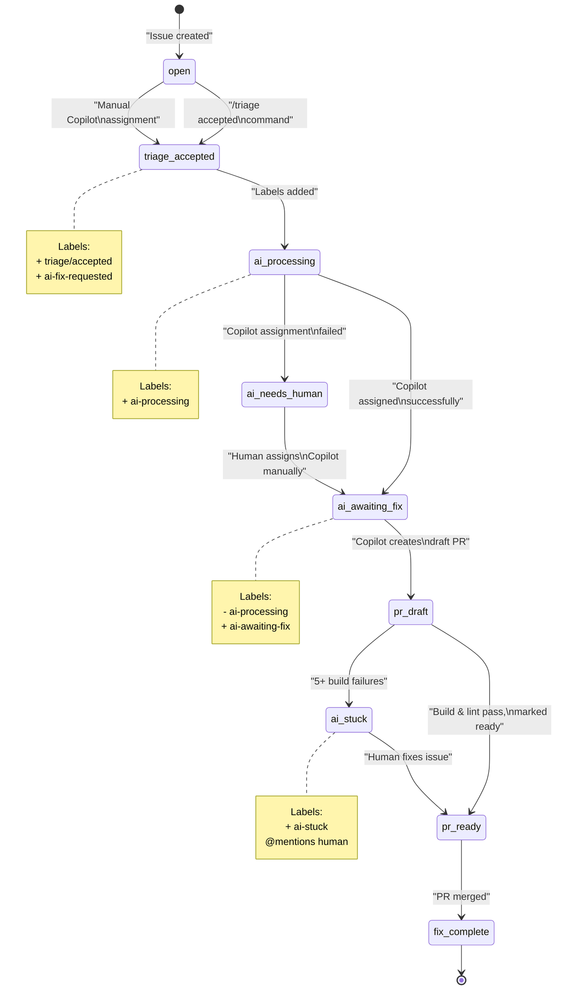
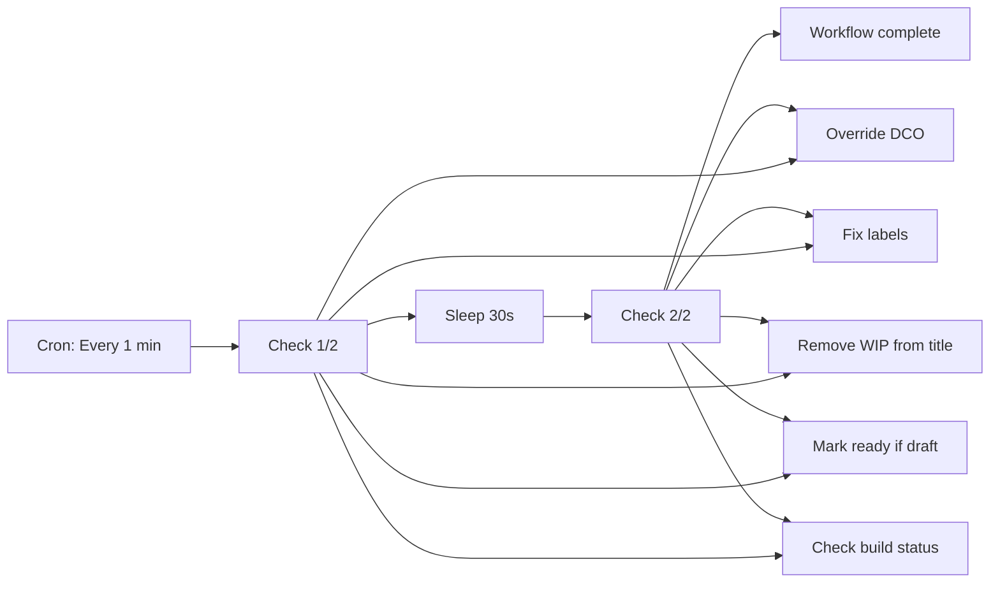
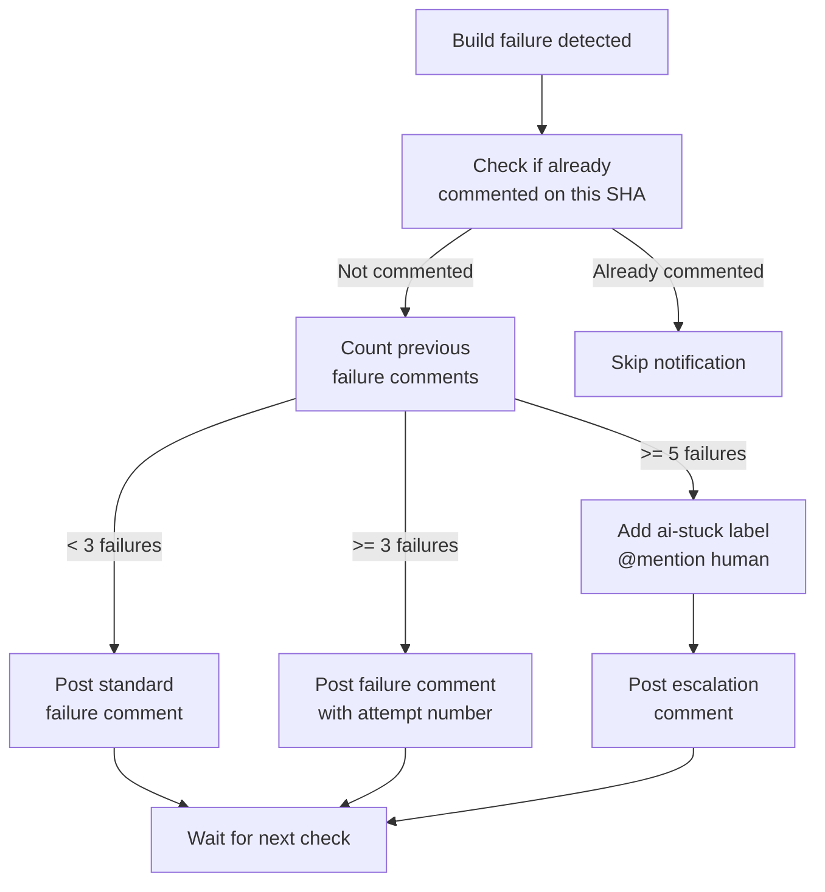
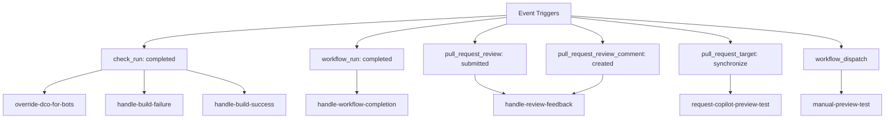
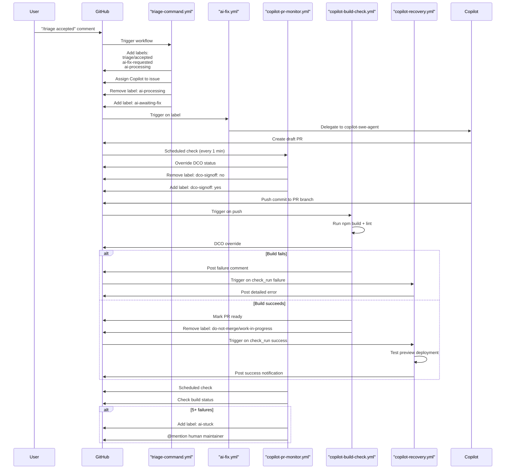

<!-- source: DeepWiki mcp.deepwiki.com · repo kubestellar/console · page 7.6 State Machine & Labels · fetched 2026-10-27 -->

# State Machine & Labels

<details>
<summary>Relevant source files</summary>

The following files were used as context for generating this wiki page:

- [.github/ISSUE_TEMPLATE/bug_report.yaml](.github/ISSUE_TEMPLATE/bug_report.yaml)
- [.github/workflows/ai-fix.yml](.github/workflows/ai-fix.yml)
- [.github/workflows/copilot-assigned.yml](.github/workflows/copilot-assigned.yml)
- [.github/workflows/copilot-automation.yml](.github/workflows/copilot-automation.yml)
- [.github/workflows/copilot-build-check.yml](.github/workflows/copilot-build-check.yml)
- [.github/workflows/copilot-pr-monitor.yml](.github/workflows/copilot-pr-monitor.yml)
- [.github/workflows/copilot-recovery.yml](.github/workflows/copilot-recovery.yml)
- [.github/workflows/copilot-setup-steps.yml](.github/workflows/copilot-setup-steps.yml)
- [.github/workflows/triage-command.yml](.github/workflows/triage-command.yml)

</details>


This document describes the label-based state machine that orchestrates the automated issue resolution pipeline in KubeStellar Console. The system uses GitHub issue and PR labels as distributed state variables to coordinate multiple workflows that track issues from triage through AI-powered fixes to deployment.

For information about the broader CI/CD automation system, see [CI/CD Automation System](#7). For details on specific workflow implementations, see [Issue Triage & Assignment](#7.1), [PR Monitoring & Recovery](#7.3), and [Build Verification Pipeline](#7.4).

## Purpose and Architecture

The state machine manages the lifecycle of issues being processed by the Copilot coding agent. Rather than using a centralized database or persistent state store, the system leverages GitHub's native label system as a distributed state machine. Each label represents a distinct state or property of an issue/PR, and workflows react to label changes to trigger appropriate actions.

This architecture enables:
- **Idempotent operations**: Workflows can run repeatedly without side effects
- **Observable state**: Current status is visible in GitHub UI
- **Event-driven coordination**: Multiple workflows coordinate via label changes
- **Human oversight**: Maintainers can inspect and modify state at any time

Sources: [Diagram 4 from high-level diagrams], [.github/workflows/triage-command.yml:1-225](), [.github/workflows/copilot-pr-monitor.yml:1-264]()

## State Labels

The following labels define the primary states in the issue/PR lifecycle:

| Label | Color | Description | Set By | Removed By |
|-------|-------|-------------|--------|------------|
| `needs-triage` | - | New issue awaiting triage | Backend on issue creation | `triage-command.yml` |
| `triage/accepted` | `0e8a16` (green) | Issue has been triaged and accepted | `triage-command.yml`, `copilot-assigned.yml` | - |
| `ai-fix-requested` | `d4c5f9` (purple) | AI fix has been requested | `triage-command.yml`, `copilot-assigned.yml` | - |
| `ai-processing` | `fbca04` (yellow) | AI is currently processing the issue | `triage-command.yml` | `triage-command.yml` after Copilot assignment |
| `ai-awaiting-fix` | `6f42c1` (purple) | Copilot is working on a fix | `triage-command.yml`, `copilot-assigned.yml` | When PR is created |
| `ai-pr-draft` | - | Draft PR has been created | Implicitly by draft PR status | When PR marked ready |
| `ai-pr-ready` | - | PR is ready for human review | `copilot-build-check.yml`, `copilot-pr-monitor.yml` | - |
| `ai-stuck` | `d93f0b` (red) | AI automation stuck, needs human help | `copilot-pr-monitor.yml` after 5+ failures | Human intervention |
| `ai-needs-human` | `d93f0b` (red) | AI automation unavailable | `triage-command.yml` on assignment failure | Human intervention |
| `do-not-merge/work-in-progress` | - | PR is work in progress | GitHub default | `copilot-pr-monitor.yml` |
| `dco-signoff: yes` | - | DCO check passed | `copilot-pr-monitor.yml`, `copilot-build-check.yml` | - |
| `dco-signoff: no` | - | DCO check failed | GitHub DCO app | `copilot-pr-monitor.yml` |

Sources: [.github/workflows/triage-command.yml:55-63](), [.github/workflows/copilot-assigned.yml:47-54](), [.github/workflows/copilot-pr-monitor.yml:219-225]()

## State Transitions



**State Transition Diagram**

Sources: [.github/workflows/triage-command.yml:1-225](), [.github/workflows/copilot-assigned.yml:1-92](), [.github/workflows/copilot-pr-monitor.yml:217-233]()

## Entry Points

The state machine has two primary entry points that initialize the automated pipeline:

### Path A: Triage Command

The `/triage accepted` command is the primary entry point, typically used by maintainers who have write access to the repository.

**Workflow**: `triage-command.yml`

**Trigger**: Issue comment containing `/triage accepted`

**Actions**:
1. Verify commenter has write permission ([.github/workflows/triage-command.yml:22-37]())
2. React to command with 👍 ([.github/workflows/triage-command.yml:39-45]())
3. Remove `needs-triage` and `help wanted` labels ([.github/workflows/triage-command.yml:66-67]())
4. Add `triage/accepted`, `ai-fix-requested`, `ai-processing` labels ([.github/workflows/triage-command.yml:70-73]())
5. Add 🚀 reaction to issue ([.github/workflows/triage-command.yml:77-83]())
6. Assign `copilot-swe-agent[bot]` to the issue ([.github/workflows/triage-command.yml:85-136]())
7. Transition to `ai-awaiting-fix` on successful assignment ([.github/workflows/triage-command.yml:138-150]())
8. Post instructions comment for Copilot ([.github/workflows/triage-command.yml:152-194]())

**Fallback**: If Copilot assignment fails, adds `ai-needs-human` label instead ([.github/workflows/triage-command.yml:196-212]())

Sources: [.github/workflows/triage-command.yml:1-225]()

### Path B: Manual Assignment

Users can manually assign the Copilot agent to an issue via GitHub's UI, bypassing the command interface.

**Workflow**: `copilot-assigned.yml`

**Trigger**: Issue assigned to `Copilot` or `copilot-swe-agent`

**Actions**:
1. Check if issue is already in pipeline ([.github/workflows/copilot-assigned.yml:22-36]())
2. If not already processing:
   - Add `triage/accepted`, `ai-fix-requested`, `ai-awaiting-fix` labels ([.github/workflows/copilot-assigned.yml:38-62]())
   - Add 🚀 reaction ([.github/workflows/copilot-assigned.yml:64-70]())
   - Post acknowledgment comment ([.github/workflows/copilot-assigned.yml:72-91]())

**Idempotency**: Skips all actions if issue already has pipeline labels to avoid duplicate processing ([.github/workflows/copilot-assigned.yml:31-36]())

Sources: [.github/workflows/copilot-assigned.yml:1-92]()

## Continuous Monitoring

Once an issue enters the pipeline, the `copilot-pr-monitor.yml` workflow continuously monitors Copilot PRs to ensure they progress through the state machine.

### Monitoring Loop

**Schedule**: Runs every minute via cron ([.github/workflows/copilot-pr-monitor.yml:4-6]())

**Internal polling**: Performs 2 checks with 30-second intervals ([.github/workflows/copilot-pr-monitor.yml:256-261]())

**Effective polling rate**: 30 seconds



**Monitoring Loop Architecture**

Sources: [.github/workflows/copilot-pr-monitor.yml:1-264]()

### Idempotent Operations

The monitor performs the following operations on every check, designed to be safely repeated:

#### 1. DCO Override

Automatically overrides DCO (Developer Certificate of Origin) checks for Copilot PRs since the bot cannot sign commits.

```javascript
// Set DCO status to success
await github.rest.repos.createCommitStatus({
  owner: context.repo.owner,
  repo: context.repo.repo,
  sha: headSha,
  state: 'success',
  context: 'dco',
  description: 'DCO waived for Copilot'
});
```

Sources: [.github/workflows/copilot-pr-monitor.yml:68-79]()

#### 2. Label Fixing

Ensures DCO-related labels are correct:
- Removes `dco-signoff: no` if present ([.github/workflows/copilot-pr-monitor.yml:83-93]())
- Adds `dco-signoff: yes` if missing ([.github/workflows/copilot-pr-monitor.yml:95-105]())

#### 3. Title Cleanup

Removes `[WIP]` prefix from PR titles and adds bug emoji if needed ([.github/workflows/copilot-pr-monitor.yml:107-120]())

#### 4. Work-in-Progress Label Removal

Always removes `do-not-merge/work-in-progress` label ([.github/workflows/copilot-pr-monitor.yml:122-133]())

#### 5. Draft Status Transition

Marks draft PRs as ready for review using GraphQL mutation ([.github/workflows/copilot-pr-monitor.yml:135-152]())

```javascript
await github.graphql(`
  mutation($prId: ID!) {
    markPullRequestReadyForReview(input: {pullRequestId: $prId}) {
      pullRequest { id }
    }
  }
`, { prId: pr.node_id });
```

Sources: [.github/workflows/copilot-pr-monitor.yml:68-152]()

## Build Failure Detection and Escalation

The monitoring system detects build failures and implements an escalation strategy to prevent infinite loops.

### Failure Detection

The monitor checks both `check_runs` and `status` contexts for Netlify build failures:

```javascript
// Check check_runs for failures
const netlifyCheckFailed = checkRuns.check_runs.find(cr =>
  cr.name && (cr.name.toLowerCase().includes('netlify') || 
              cr.name.toLowerCase().includes('kubestellar')) &&
  cr.conclusion === 'failure'
);

// Check status contexts for failures (Netlify uses this)
const netlifyStatusFailed = statusData.statuses.find(s =>
  s.context && s.context.toLowerCase().includes('netlify') &&
  s.state === 'failure'
);
```

Sources: [.github/workflows/copilot-pr-monitor.yml:154-180]()

### Escalation Strategy



**Build Failure Escalation Flow**

Sources: [.github/workflows/copilot-pr-monitor.yml:182-234]()

### Failure Notification

For each unique commit SHA with a build failure, the monitor posts a detailed comment:

**Standard notification (attempts 1-2)**:
```markdown
## Build Failed (SHA)

@Copilot The build failed. Fix the error.

**Logs:** [Build URL]
```

**Warning notification (attempts 3-4)**:
```markdown
## Build Failed (SHA)

@Copilot The build failed. Fix the error.

**Logs:** [Build URL]

**Attempt #N** - Review build logs carefully.
```

**Escalation notification (attempt 5+)**:
```markdown
## Needs Human Help

@clubanderson PR has N build failures. Copilot needs help.
```

The system adds the `ai-stuck` label after 5 consecutive failures ([.github/workflows/copilot-pr-monitor.yml:219-233]()).

Sources: [.github/workflows/copilot-pr-monitor.yml:199-233]()

## Build Verification Pipeline

The `copilot-build-check.yml` workflow provides immediate build and lint verification on every commit pushed to Copilot branches.

### Trigger and Execution

**Trigger**: Push to any `copilot/**` branch ([.github/workflows/copilot-build-check.yml:6-8]())

**Execution flow**:
1. Checkout code ([.github/workflows/copilot-build-check.yml:21-22]())
2. Setup Node.js 20 with npm cache ([.github/workflows/copilot-build-check.yml:24-29]())
3. Install dependencies ([.github/workflows/copilot-build-check.yml:31-33]())
4. Run `npm run build` (continue on error) ([.github/workflows/copilot-build-check.yml:35-39]())
5. Run `npm run lint` (continue on error) ([.github/workflows/copilot-build-check.yml:41-45]())
6. Find associated PR ([.github/workflows/copilot-build-check.yml:47-55]())
7. Override DCO status for the commit ([.github/workflows/copilot-build-check.yml:57-78]())
8. Post detailed error messages on failure ([.github/workflows/copilot-build-check.yml:80-109]())
9. Mark PR ready when both checks pass ([.github/workflows/copilot-build-check.yml:111-137]())
10. Fail the workflow if either check failed ([.github/workflows/copilot-build-check.yml:139-143]())

Sources: [.github/workflows/copilot-build-check.yml:1-144]()

### Error Reporting

When build or lint fails, the workflow posts a structured comment with the last 30 lines of error output:

```markdown
## ❌ Build/Lint Failed

@copilot Your latest push failed verification.

### Build: FAILED
```
[last 30 lines of build output]
```

### Lint: Passed ✅

**Fix these errors and push again.** Do not mark this PR as ready until both pass.
```

Sources: [.github/workflows/copilot-build-check.yml:80-109]()

### Automatic PR Ready Transition

When both build and lint pass, the workflow automatically:
1. Marks the PR ready for review if currently draft ([.github/workflows/copilot-build-check.yml:119-123]())
2. Removes `[WIP]` from the title ([.github/workflows/copilot-build-check.yml:125-131]())
3. Removes `do-not-merge/work-in-progress` label ([.github/workflows/copilot-build-check.yml:133-135]())

This requires the `CONSOLE_AUTO` PAT token to modify PRs created by Copilot ([.github/workflows/copilot-build-check.yml:114]()).

Sources: [.github/workflows/copilot-build-check.yml:111-137]()

## Recovery Workflows

The `copilot-recovery.yml` workflow handles various event-driven recovery scenarios beyond continuous monitoring.

### Trigger Events



**Recovery Workflow Event Architecture**

Sources: [.github/workflows/copilot-recovery.yml:1-652]()

### Job 1: DCO Override for Bots

**Trigger**: `check_run` completed with `dco` failure ([.github/workflows/copilot-recovery.yml:48-51]())

**Actions**:
1. Extract PR number from check run ([.github/workflows/copilot-recovery.yml:59-64]())
2. Verify PR author is a bot ([.github/workflows/copilot-recovery.yml:66-75]())
3. Set GitHub status to success ([.github/workflows/copilot-recovery.yml:85-90]())
4. Post Prow override command ([.github/workflows/copilot-recovery.yml:93]())

Sources: [.github/workflows/copilot-recovery.yml:46-95]()

### Job 2: Build Failure Handler

**Trigger**: `check_run` completed with failure (excluding DCO and Netlify sub-checks) ([.github/workflows/copilot-recovery.yml:100-106]())

**Actions**:
1. Extract PR information ([.github/workflows/copilot-recovery.yml:109-137]())
2. Check if already commented on this commit SHA ([.github/workflows/copilot-recovery.yml:139-156]())
3. Post detailed failure comment if not already notified ([.github/workflows/copilot-recovery.yml:158-201]())

The comment includes:
- Check name and URL
- Commit SHA
- Error summary from check output (last 500 chars) ([.github/workflows/copilot-recovery.yml:169]())
- Action steps for Copilot ([.github/workflows/copilot-recovery.yml:186-196]())

Sources: [.github/workflows/copilot-recovery.yml:98-202]()

### Job 3: Build Success Handler

**Trigger**: `check_run` completed with success for Netlify-related checks ([.github/workflows/copilot-recovery.yml:206-209]())

**Actions**:
1. Get PR info and extract linked issue number ([.github/workflows/copilot-recovery.yml:212-243]())
2. Generate Netlify preview URL using custom domain ([.github/workflows/copilot-recovery.yml:245-257]())
3. Test preview deployment with retries ([.github/workflows/copilot-recovery.yml:259-301]())
4. Post status notification with test results ([.github/workflows/copilot-recovery.yml:302-365]())
5. Auto-mark PR ready for review if draft ([.github/workflows/copilot-recovery.yml:367-388]())

```bash
# Netlify preview URL format
PREVIEW_URL="https://deploy-preview-${PR_NUM}.console-deploy-preview.kubestellar.io"
```

Sources: [.github/workflows/copilot-recovery.yml:203-389]()

### Job 4: Workflow Completion Handler

**Trigger**: `workflow_run` completed (for complex build pipelines) ([.github/workflows/copilot-recovery.yml:391-393]())

**Actions**:
1. Find PR for the commit SHA ([.github/workflows/copilot-recovery.yml:405-410]())
2. Verify PR is from Copilot ([.github/workflows/copilot-recovery.yml:412-420]())
3. Post failure comment if workflow failed ([.github/workflows/copilot-recovery.yml:422-436]())

Sources: [.github/workflows/copilot-recovery.yml:390-437]()

### Job 5: Code Review Feedback Handler

**Trigger**: PR review submitted with `changes_requested` or review comment created ([.github/workflows/copilot-recovery.yml:441-443]())

**Actions**:
1. Verify PR is from Copilot ([.github/workflows/copilot-recovery.yml:446-459]())
2. Extract review/comment body ([.github/workflows/copilot-recovery.yml:468-476]())
3. Post notification to Copilot with instructions ([.github/workflows/copilot-recovery.yml:478-496]())

Sources: [.github/workflows/copilot-recovery.yml:439-497]()

### Job 6: Preview Test Request on Sync

**Trigger**: New commits pushed to Copilot PR ([.github/workflows/copilot-recovery.yml:586-588]())

**Actions**:
1. Verify PR is from Copilot ([.github/workflows/copilot-recovery.yml:590-605]())
2. Wait 90 seconds for Netlify deploy ([.github/workflows/copilot-recovery.yml:607-611]())
3. Test preview accessibility ([.github/workflows/copilot-recovery.yml:624-625]())
4. Request Copilot to verify preview with `curl` command ([.github/workflows/copilot-recovery.yml:628-651]())

Sources: [.github/workflows/copilot-recovery.yml:585-652]()

## Label Creation and Management

Labels are created lazily when first needed by each workflow. The label creation commands use the `--repo` and `--color` flags with `2>/dev/null || true` to silently skip if the label already exists.

### Label Creation Pattern

```bash
gh label create "triage/accepted" \
  --repo "$REPO" \
  --color "0e8a16" \
  --description "Issue has been triaged and accepted" \
  2>/dev/null || true
```

Sources: [.github/workflows/triage-command.yml:55-63](), [.github/workflows/copilot-assigned.yml:47-54]()

### Label Modification Pattern

Labels are added and removed using `gh issue edit` or `gh pr edit`:

```bash
# Remove multiple labels
gh issue edit "$ISSUE" --repo "$REPO" \
  --remove-label "needs-triage" \
  2>/dev/null || true

gh issue edit "$ISSUE" --repo "$REPO" \
  --remove-label "help wanted" \
  2>/dev/null || true

# Add multiple labels
gh issue edit "$ISSUE" --repo "$REPO" \
  --add-label "triage/accepted" \
  --add-label "ai-fix-requested" \
  --add-label "ai-processing"
```

Sources: [.github/workflows/triage-command.yml:65-73]()

## State Observability

The current state of any issue or PR in the pipeline can be determined by examining its labels:

| Label Combination | Interpretation | Next Expected Action |
|-------------------|----------------|---------------------|
| `needs-triage` | New issue awaiting human triage | Maintainer reviews issue |
| `triage/accepted` + `ai-processing` | Issue triaged, waiting for Copilot assignment | Copilot agent assignment in progress |
| `triage/accepted` + `ai-awaiting-fix` | Copilot assigned, working on fix | Copilot creates PR |
| PR with `do-not-merge/work-in-progress` | Draft PR, work in progress | Build checks must pass |
| PR without WIP label, not draft | PR ready for review | Human reviews code |
| `ai-stuck` | Build failures exceeded threshold | Human intervention required |
| `ai-needs-human` | Automation failed to start | Manual Copilot assignment needed |

Sources: [.github/workflows/triage-command.yml:1-225](), [.github/workflows/copilot-pr-monitor.yml:1-264]()

## Concurrency Control

Workflows use concurrency groups to prevent race conditions when processing the same PR:

```yaml
concurrency:
  group: copilot-recovery-${{ github.event.check_run.pull_requests[0].number || github.event.pull_request.number || github.event.workflow_run.head_sha || github.sha }}
  cancel-in-progress: true
```

This ensures only one instance of a workflow processes a given PR at a time, with newer runs canceling older ones ([.github/workflows/copilot-recovery.yml:33-35]()).

Sources: [.github/workflows/copilot-recovery.yml:33-35](), [.github/workflows/copilot-automation.yml:19-21]()

## Gate Job Pattern

To prevent GitHub from sending noisy failure notifications when a workflow has no applicable jobs to run, the recovery workflow includes a "gate" job that always executes:

```yaml
gate:
  runs-on: ubuntu-latest
  steps:
    - run: echo "Event ${{ github.event_name }} received"
```

This ensures at least one job completes successfully, preventing the "No jobs were run" error that triggers email notifications ([.github/workflows/copilot-recovery.yml:41-44]()).

Sources: [.github/workflows/copilot-recovery.yml:37-44]()

## Label-Based Coordination Example

The following sequence diagram illustrates how labels coordinate the automated pipeline across multiple workflows:



**Label-Based Workflow Coordination**

Sources: [.github/workflows/triage-command.yml:1-225](), [.github/workflows/copilot-pr-monitor.yml:1-264](), [.github/workflows/copilot-build-check.yml:1-144](), [.github/workflows/copilot-recovery.yml:1-652]()

---

