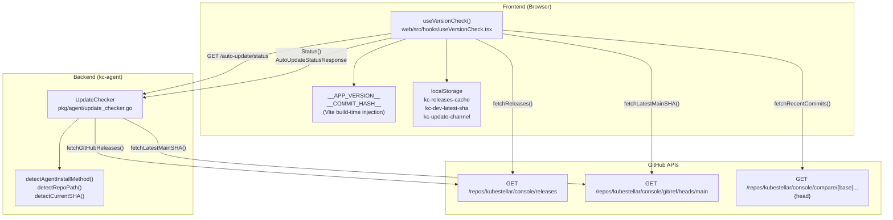
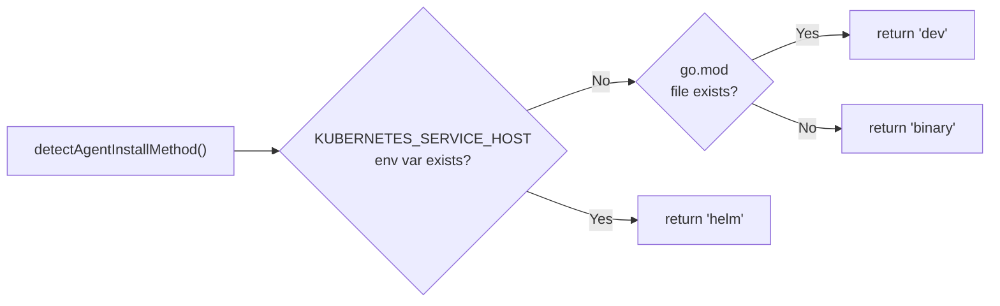
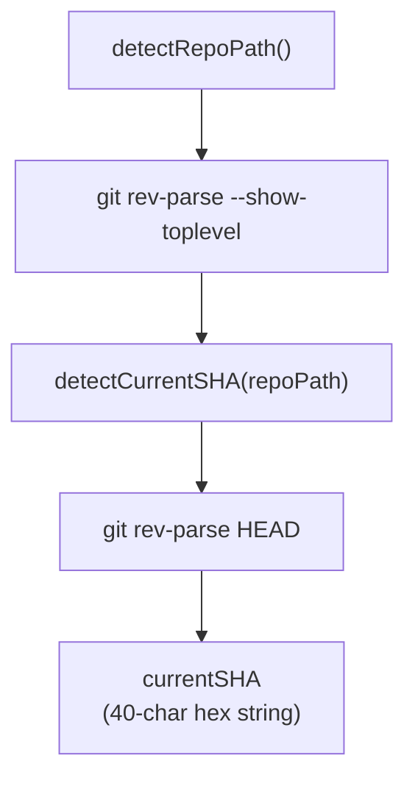
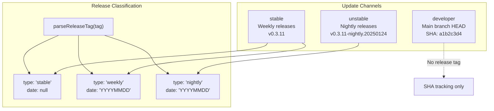
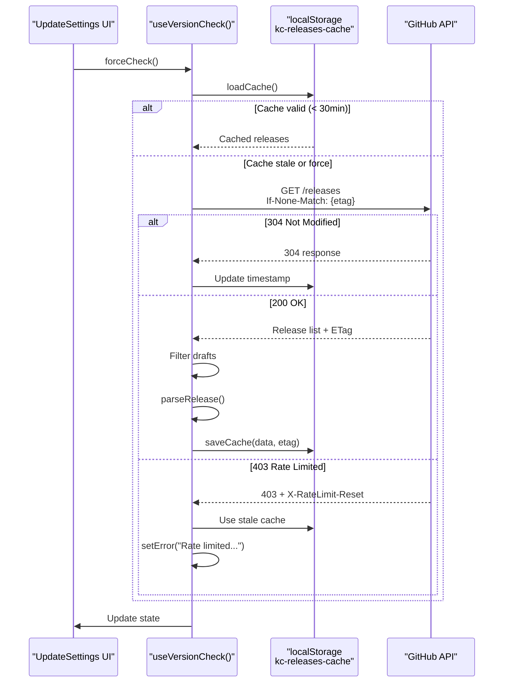
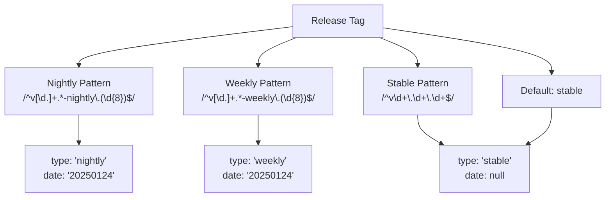
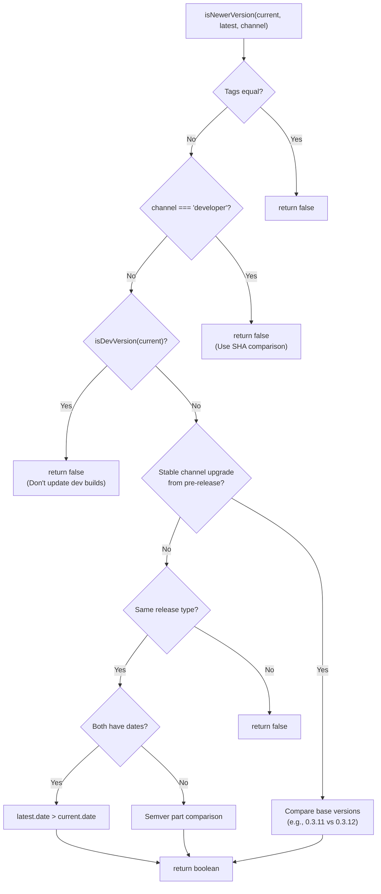
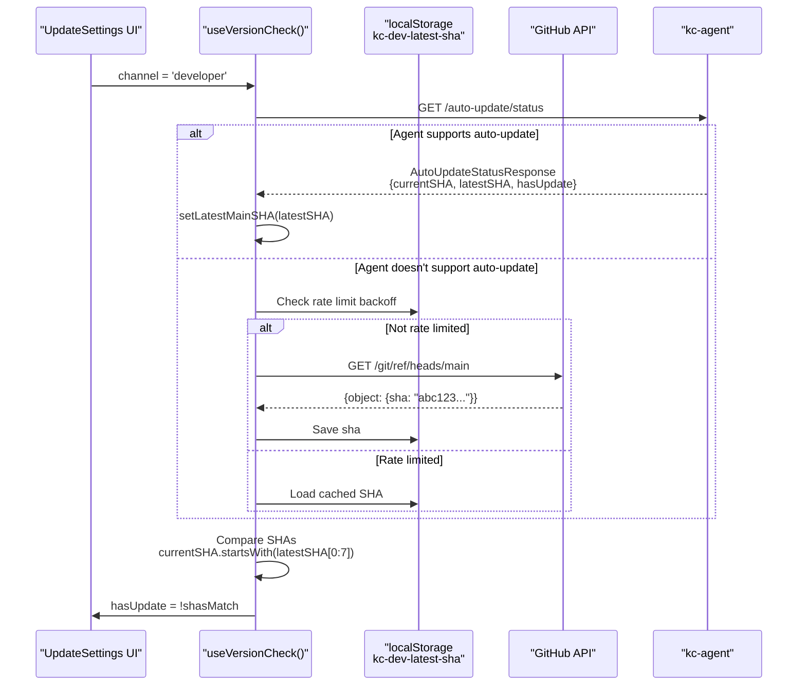
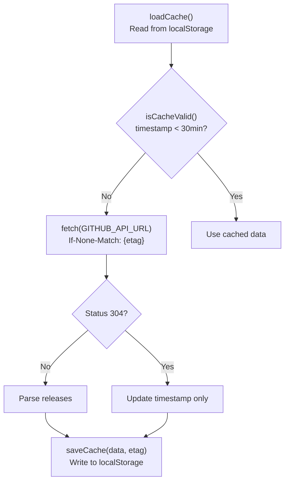
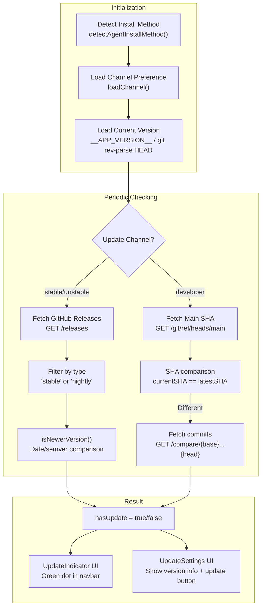

<!-- source: DeepWiki mcp.deepwiki.com · repo kubestellar/console · page 8.1 Version Detection & Checking · fetched 2026-10-27 -->

# Version Detection & Checking

<details>
<summary>Relevant source files</summary>

The following files were used as context for generating this wiki page:

- [pkg/agent/update_checker.go](pkg/agent/update_checker.go)
- [pkg/settings/types.go](pkg/settings/types.go)
- [web/src/components/layout/navbar/UpdateIndicator.tsx](web/src/components/layout/navbar/UpdateIndicator.tsx)
- [web/src/components/settings/Settings.tsx](web/src/components/settings/Settings.tsx)
- [web/src/components/settings/UpdateSettings.tsx](web/src/components/settings/UpdateSettings.tsx)
- [web/src/components/settings/sections/AnalyticsSection.tsx](web/src/components/settings/sections/AnalyticsSection.tsx)
- [web/src/components/settings/sections/index.ts](web/src/components/settings/sections/index.ts)
- [web/src/components/updates/UpdateProgressBanner.tsx](web/src/components/updates/UpdateProgressBanner.tsx)
- [web/src/hooks/useUpdateProgress.ts](web/src/hooks/useUpdateProgress.ts)
- [web/src/hooks/useVersionCheck.tsx](web/src/hooks/useVersionCheck.tsx)
- [web/src/types/updates.ts](web/src/types/updates.ts)

</details>


## Purpose and Scope

This document describes the **version detection and update checking system** in the KubeStellar Console. The system determines the currently running version, identifies the installation method (dev/binary/helm), checks for updates from GitHub releases, and compares versions to determine if an update is available.

This page covers **detection and checking only**. For auto-update execution, see [Auto-Update Execution](#8.2). For the UI components and progress tracking, see [Update UI & Progress](#8.3).

---

## System Architecture

The version detection system operates in **two layers**:

1. **Frontend (Browser)**: `useVersionCheck` hook reads build-time constants, fetches GitHub releases, and manages caching via localStorage
2. **Backend (kc-agent)**: `UpdateChecker` detects install method, queries git repository status, and polls GitHub API for SHA updates

The frontend can operate independently for simple version checks, but connects to kc-agent for advanced features like uncommitted change detection and auto-update orchestration.



**Sources**: [web/src/hooks/useVersionCheck.tsx:1-1090](), [pkg/agent/update_checker.go:1-888]()

---

## Install Method Detection

The system supports three installation methods, each with different update strategies:

| Install Method | Detection Logic | Update Strategy | Config Persistence |
|---|---|---|---|
| `dev` | `go.mod` present OR localhost hostname | `git pull` + `npm run build` + `go build` | Git repository |
| `binary` | No `go.mod`, not in Kubernetes | Download new binary, replace, restart | N/A |
| `helm` | `KUBERNETES_SERVICE_HOST` env var set | External (helm upgrade) — auto-update disabled | Helm values |

### Backend Detection

The kc-agent detects the install method on startup:



**Sources**: [pkg/agent/update_checker.go:688-696]()

### Frontend Detection

The frontend initializes `installMethod` state based on hostname and later syncs with backend:

- **localhost/127.0.0.1**: Always `dev` mode (running from source)
- **Otherwise**: `unknown` until backend `/health` endpoint reports `install_method`

**Sources**: [web/src/hooks/useVersionCheck.tsx:275-279](), [web/src/hooks/useVersionCheck.tsx:310-341]()

---

## Current Version Detection

### Build-Time Version Injection

The frontend receives version information via **Vite build-time variable substitution**:

- `__APP_VERSION__`: Semantic version string (e.g., `v0.3.11-nightly.20250124`)
- `__COMMIT_HASH__`: Full git commit SHA (40 characters)

These are injected during `npm run build` and frozen at compile time.

**Sources**: [web/src/hooks/useVersionCheck.tsx:16-17](), [web/src/hooks/useVersionCheck.tsx:290-304]()

### Backend Version Detection

For `dev` installations, kc-agent determines version from the git repository:



**Sources**: [pkg/agent/update_checker.go:698-718]()

The backend tracks:
- `currentVersion`: From `Version` constant (set at build time)
- `currentSHA`: Live query from git HEAD
- `repoPath`: Git repository root directory

**Sources**: [pkg/agent/update_checker.go:80-95]()

---

## Update Channels

The system supports three update channels with different release tracking strategies:



**Sources**: [web/src/types/updates.ts:1-26](), [web/src/hooks/useVersionCheck.tsx:36-54]()

### Channel Selection Persistence

The user's channel preference is stored in **localStorage** and synchronized to kc-agent:

**Storage Keys**:
- `kc-update-channel` (localStorage): `'stable' | 'unstable' | 'developer'`
- Backend: `UpdateChecker.channel` field

**Default Channel Logic**:
- **localhost/127.0.0.1**: `developer` (notify of main branch commits)
- **Otherwise**: `stable` (weekly releases only)

**Sources**: [web/src/hooks/useVersionCheck.tsx:217-227](), [web/src/hooks/useVersionCheck.tsx:496-511]()

---

## GitHub Release Checking

### API Endpoints

The system queries three GitHub API endpoints:

| Endpoint | Purpose | Cache Strategy |
|---|---|---|
| `/repos/kubestellar/console/releases` | Fetch all releases | 30min TTL + ETag conditional requests |
| `/repos/kubestellar/console/git/ref/heads/main` | Fetch latest main SHA | 15min backoff on rate limit |
| `/repos/kubestellar/console/compare/{base}...{head}` | Fetch commits between SHAs | On-demand, rate-limit aware |

**Sources**: [web/src/hooks/useVersionCheck.tsx:19-22](), [pkg/agent/update_checker.go:24-26]()

### Release Fetching Flow



**Sources**: [web/src/hooks/useVersionCheck.tsx:564-650]()

### Rate Limiting Handling

When GitHub returns **403 Forbidden** or **429 Too Many Requests**, the system:

1. Extracts `X-RateLimit-Reset` header (Unix timestamp)
2. Stores backoff period in `localStorage['kc-github-rate-limit-until']`
3. Uses cached data for subsequent requests until backoff expires
4. Suggests adding GitHub Personal Access Token in Settings

**Sources**: [web/src/hooks/useVersionCheck.tsx:415-423](), [web/src/hooks/useVersionCheck.tsx:600-608]()

---

## Release Parsing and Classification

### Tag Pattern Recognition

The `parseReleaseTag()` function extracts release type and date from version tags using regex:



**Examples**:
- `v0.3.11-nightly.20250124` → `{ type: 'nightly', date: '20250124' }`
- `v0.3.11-weekly.20250127` → `{ type: 'weekly', date: '20250127' }`
- `v0.3.11` → `{ type: 'stable', date: null }`

**Sources**: [web/src/hooks/useVersionCheck.tsx:36-54]()

### Parsed Release Structure

Each GitHub release is normalized into a `ParsedRelease` object:

```typescript
interface ParsedRelease {
  tag: string              // v0.3.11-nightly.20250124
  version: string          // Same as tag
  type: ReleaseType        // 'nightly' | 'weekly' | 'stable'
  date: string | null      // '20250124' or null
  publishedAt: Date        // ISO 8601 timestamp
  releaseNotes: string     // Markdown body
  url: string              // GitHub release page URL
}
```

**Sources**: [web/src/types/updates.ts:44-52](), [web/src/hooks/useVersionCheck.tsx:59-70]()

---

## Version Comparison Logic

### Channel-Specific Comparison

The `isNewerVersion()` function determines if an update is available using **channel-aware logic**:



**Key Rules**:
1. **Developer channel**: Always returns `false` (SHA comparison happens elsewhere)
2. **Dev versions**: Never show updates (e.g., `0.1.0`, `unknown`, `dev`)
3. **Stable upgrade path**: If current is pre-release and latest is stable, compare base versions
4. **Same type**: Only compare nightly-to-nightly or weekly-to-weekly
5. **Date comparison**: For dated releases, compare `YYYYMMDD` strings
6. **Semver fallback**: For undated releases, compare version parts numerically

**Sources**: [web/src/hooks/useVersionCheck.tsx:115-177]()

### Dev Version Detection

A version is considered "dev" if:
- Version string is `unknown` or `dev`
- Simple semver without `v` prefix (e.g., `0.1.0` vs `v0.1.0`)
- Parsed as `stable` type but doesn't start with `v`

Dev versions are excluded from update notifications to avoid false positives during local development.

**Sources**: [web/src/hooks/useVersionCheck.tsx:98-106]()

---

## SHA-Based Tracking (Developer Channel)

For installations running from source, the system tracks **main branch HEAD SHA** instead of release tags:

### Frontend SHA Tracking



**Sources**: [web/src/hooks/useVersionCheck.tsx:346-372](), [web/src/hooks/useVersionCheck.tsx:379-436]()

### Backend SHA Polling

The kc-agent `UpdateChecker` periodically fetches the latest main SHA:

**Check Intervals**:
- Developer channel: 5 minutes
- Release channels: 60 minutes

**Flow**:
1. `fetchLatestMainSHA()` queries GitHub API
2. Compare returned SHA with `currentSHA` (from `git rev-parse HEAD`)
3. If different and no uncommitted changes, trigger `executeDeveloperUpdate()`

**Sources**: [pkg/agent/update_checker.go:19-21](), [pkg/agent/update_checker.go:240-272](), [pkg/agent/update_checker.go:720-737]()

### Recent Commits Fetching

When SHAs differ, the UI fetches the **list of commits** between current and latest using the GitHub Compare API:

**Endpoint**: `GET /repos/kubestellar/console/compare/{currentSHA}...{latestSHA}`

**Data Extracted**:
- Commit SHA (first 7 chars displayed)
- Commit message (first line only)
- Author name
- Timestamp

This powers the "Recent Commits" collapsible list in UpdateSettings UI.

**Sources**: [web/src/hooks/useVersionCheck.tsx:442-491](), [web/src/components/settings/UpdateSettings.tsx:840-885]()

---

## Caching Strategy

The system implements **multi-tier caching** to minimize GitHub API calls:

### Frontend Cache Structure

```typescript
interface ReleasesCache {
  data: GitHubRelease[]    // Full release list from GitHub
  timestamp: number        // Date.now() when cached
  etag: string | null      // ETag header from last response
}
```

**Storage Key**: `kc-releases-cache`

**TTL**: 30 minutes (`CACHE_TTL_MS`)

**Sources**: [web/src/types/updates.ts:55-61](), [web/src/hooks/useVersionCheck.tsx:23]()

### Cache Operations



**Sources**: [web/src/hooks/useVersionCheck.tsx:182-211](), [web/src/hooks/useVersionCheck.tsx:564-650]()

### ETag Conditional Requests

The system uses **HTTP ETag** headers to avoid re-downloading unchanged data:

1. First request: No `If-None-Match` header, receive full data + `ETag: "abc123"`
2. Cache saved with etag
3. Subsequent request: `If-None-Match: "abc123"`
4. GitHub responds:
   - **304 Not Modified**: Data unchanged, update timestamp only
   - **200 OK + new ETag**: Data changed, update cache with new data

**Sources**: [web/src/hooks/useVersionCheck.tsx:579-619]()

### SHA Cache

Developer channel SHA is cached separately to survive rate limits:

**Storage Key**: `kc-dev-latest-sha`

**No TTL**: Persists until overwritten

**Rate Limit Backoff**: `kc-github-rate-limit-until` (Unix timestamp)

When rate limited, the system:
- Stops API calls until backoff expires
- Serves cached SHA for `hasUpdate` calculation
- Shows user a message to add GitHub token for higher limits

**Sources**: [web/src/hooks/useVersionCheck.tsx:26](), [web/src/hooks/useVersionCheck.tsx:381-423]()

---

## Auto-Update Status Integration

For installations with kc-agent support, the frontend queries `/auto-update/status` for comprehensive update information:

### AutoUpdateStatus Response

```typescript
interface AutoUpdateStatus {
  installMethod: InstallMethod           // 'dev' | 'binary' | 'helm'
  repoPath: string                       // /home/user/kubestellar/console
  currentSHA: string                     // abc123def456... (40 chars)
  latestSHA: string                      // def789abc012... (40 chars)
  hasUpdate: boolean                     // true if latestSHA != currentSHA
  hasUncommittedChanges: boolean         // git status --porcelain output
  autoUpdateEnabled: boolean             // User preference
  channel: UpdateChannel                 // 'stable' | 'unstable' | 'developer'
  lastUpdateTime: string | null          // ISO 8601 timestamp
  lastUpdateResult: string | null        // Error message if last update failed
}
```

**Backend Endpoint**: `GET http://localhost:8081/auto-update/status`

**Sources**: [web/src/types/updates.ts:84-95](), [pkg/agent/update_checker.go:61-72](), [pkg/agent/update_checker.go:136-166]()

### Status Polling

The frontend polls this endpoint every 60 seconds when `agentSupportsAutoUpdate` is true:

**Poll Interval**: 60000ms (`AUTO_UPDATE_POLL_MS`)

**Purpose**:
- Detect uncommitted changes (blocks auto-update)
- Sync hasUpdate flag with backend's git queries
- Display last update error to user

**Sources**: [web/src/hooks/useVersionCheck.tsx:25](), [web/src/hooks/useVersionCheck.tsx:346-372]()

---

## Update Detection Summary

The complete update detection flow integrates all components:



**Sources**: [web/src/hooks/useVersionCheck.tsx:1-1090](), [pkg/agent/update_checker.go:1-888](), [web/src/components/layout/navbar/UpdateIndicator.tsx:1-91](), [web/src/components/settings/UpdateSettings.tsx:1-886]()

---

