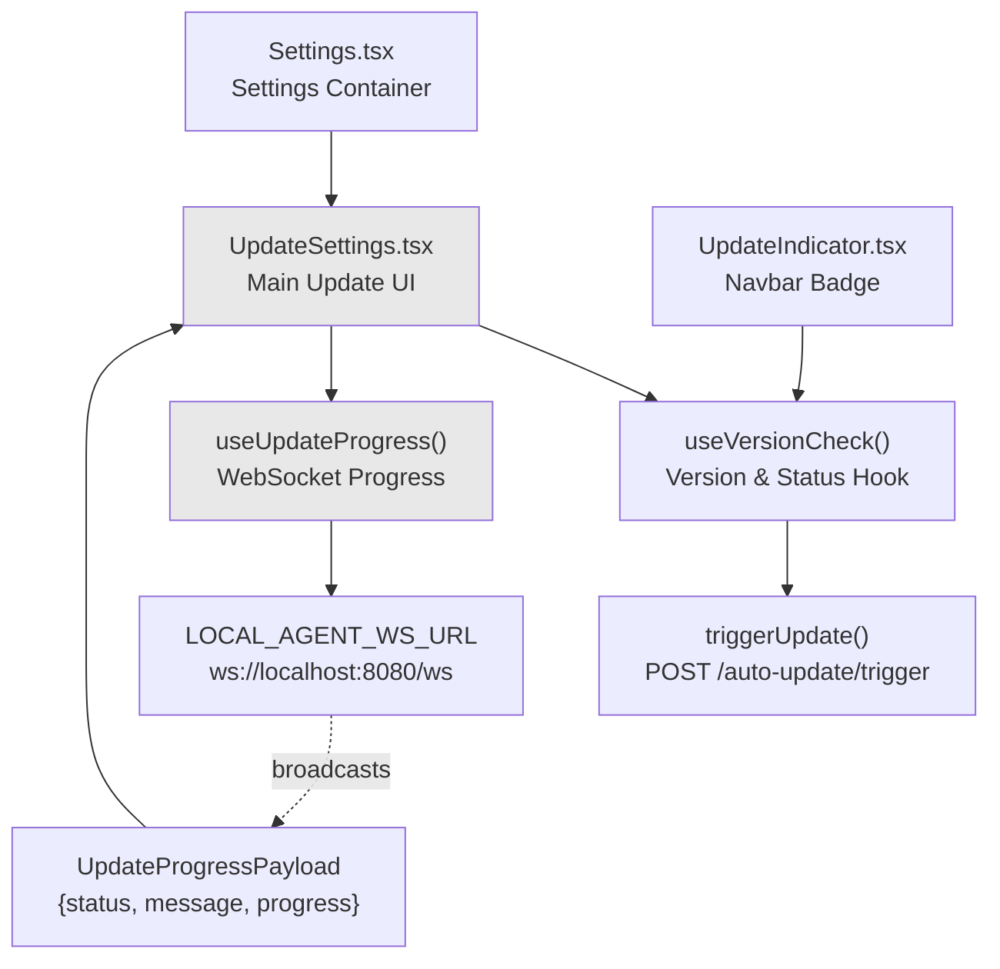
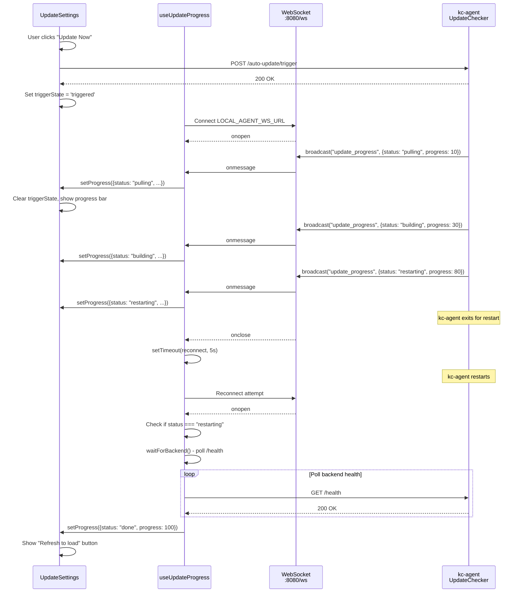
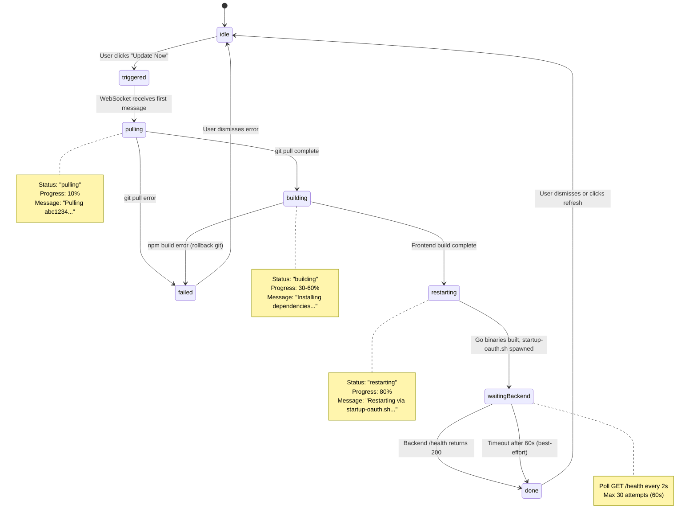
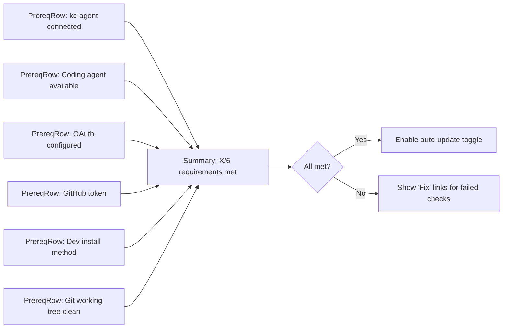
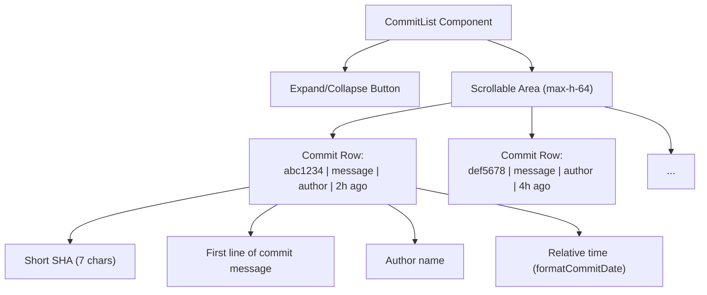
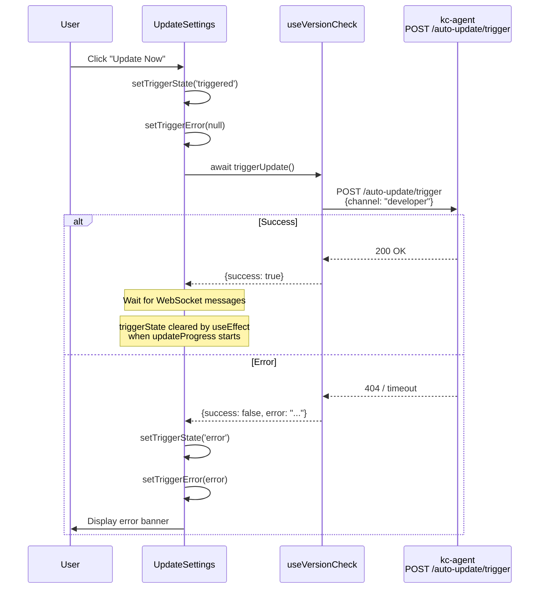
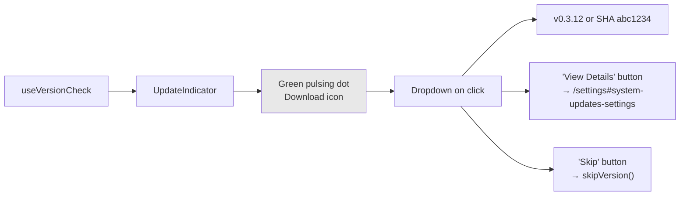

<!-- source: DeepWiki mcp.deepwiki.com · repo kubestellar/console · page 8.3 Update UI & Progress · fetched 2026-10-27 -->

# Update UI & Progress

<details>
<summary>Relevant source files</summary>

The following files were used as context for generating this wiki page:

- [pkg/agent/update_checker.go](pkg/agent/update_checker.go)
- [pkg/settings/types.go](pkg/settings/types.go)
- [web/src/components/layout/navbar/UpdateIndicator.tsx](web/src/components/layout/navbar/UpdateIndicator.tsx)
- [web/src/components/settings/Settings.tsx](web/src/components/settings/Settings.tsx)
- [web/src/components/settings/UpdateSettings.tsx](web/src/components/settings/UpdateSettings.tsx)
- [web/src/components/settings/sections/AnalyticsSection.tsx](web/src/components/settings/sections/AnalyticsSection.tsx)
- [web/src/components/settings/sections/index.ts](web/src/components/settings/sections/index.ts)
- [web/src/components/updates/UpdateProgressBanner.tsx](web/src/components/updates/UpdateProgressBanner.tsx)
- [web/src/hooks/useUpdateProgress.ts](web/src/hooks/useUpdateProgress.ts)
- [web/src/hooks/useVersionCheck.tsx](web/src/hooks/useVersionCheck.tsx)
- [web/src/types/updates.ts](web/src/types/updates.ts)

</details>


This document describes the user interface components and real-time progress tracking system for software updates. The UI displays update availability, channels, prerequisites, and provides interactive controls for triggering updates with live progress feedback via WebSocket.

For version detection and update checking logic, see [Version Detection & Checking](#8.1). For auto-update execution strategies, see [Auto-Update Execution](#8.2). For rollback mechanisms, see [Rollback & Recovery](#8.4).

---

## Purpose and Scope

The Update UI & Progress system provides visual feedback and controls for managing software updates across three deployment channels (stable, unstable, developer). It consists of frontend components that display update status, accept user input for channel selection and manual triggers, and stream real-time progress updates via WebSocket during the update process.

**Key Responsibilities:**
- Display current version, commit hash, and channel selection
- Show available updates with release notes
- Validate environment prerequisites for developer channel
- Provide manual "Update Now" trigger
- Stream progress updates (pulling → building → restarting → done/failed)
- Handle update completion with refresh prompts

---

## Component Architecture

The update UI is organized into several cooperating components, with `UpdateSettings` as the primary container and `useUpdateProgress` providing WebSocket-based progress streaming.



**Sources:** [web/src/components/settings/UpdateSettings.tsx:1-886](), [web/src/hooks/useUpdateProgress.ts:1-100](), [web/src/components/layout/navbar/UpdateIndicator.tsx:1-91]()

---

## UpdateSettings Component Structure

The `UpdateSettings` component ([web/src/components/settings/UpdateSettings.tsx:60-785]()) is the primary UI for update management. It displays version information, channel selection, prerequisites, and orchestrates the update flow.

### State Management

| State Variable | Type | Purpose |
|---------------|------|---------|
| `updateProgress` | `UpdateProgress \| null` | WebSocket-streamed progress from `useUpdateProgress` hook |
| `triggerState` | `'idle' \| 'triggered' \| 'error'` | Client-side trigger button state before WebSocket takes over |
| `triggerError` | `string \| null` | Error message if trigger API call fails |
| `countdown` | `number` | Countdown timer (60s estimated duration) during updates |
| `channelDropdownOpen` | `boolean` | Channel selector dropdown visibility |
| `showReleaseNotes` | `boolean` | Release notes expansion toggle |

**Sources:** [web/src/components/settings/UpdateSettings.tsx:84-118]()

### Data Flow from useVersionCheck

`UpdateSettings` consumes data from `useVersionCheck` hook:

```typescript
const {
  currentVersion,      // e.g., "v0.3.11-nightly.20250124"
  commitHash,          // Git SHA of current build
  channel,             // 'stable' | 'unstable' | 'developer'
  setChannel,          // Update channel preference
  latestRelease,       // Latest release for current channel
  hasUpdate,           // Boolean: update available
  isChecking,          // Boolean: checking GitHub API
  autoUpdateStatus,    // From kc-agent: currentSHA, latestSHA, hasUncommittedChanges
  installMethod,       // 'dev' | 'binary' | 'helm'
  agentConnected,      // Boolean: kc-agent connectivity
  hasCodingAgent,      // Boolean: Claude Code / coding agent available
  latestMainSHA,       // Latest main branch commit
  recentCommits,       // Array of commits between current and latest
  triggerUpdate,       // Function: POST /auto-update/trigger
}
```

**Sources:** [web/src/components/settings/UpdateSettings.tsx:62-82]()

---

## Update Progress Tracking System

Real-time progress updates are broadcast by kc-agent via WebSocket using the `update_progress` message type. The `useUpdateProgress` hook ([web/src/hooks/useUpdateProgress.ts:13-99]()) establishes a dedicated WebSocket connection and exposes progress state.

### WebSocket Message Protocol



**Sources:** [web/src/hooks/useUpdateProgress.ts:45-94](), [pkg/agent/update_checker.go:52-58]()

### UpdateProgress Interface

The `UpdateProgress` type ([web/src/types/updates.ts:74-79]()) defines the structure of progress payloads:

```typescript
interface UpdateProgress {
  status: 'idle' | 'checking' | 'pulling' | 'building' | 'restarting' | 'done' | 'failed'
  message: string              // e.g., "Pulling abc1234 from main..."
  progress: number             // 0-100 percentage
  error?: string               // Optional error details
}
```

**Go Equivalent:** `UpdateProgressPayload` in [pkg/agent/update_checker.go:53-58]()

**Sources:** [web/src/types/updates.ts:74-79](), [pkg/agent/update_checker.go:52-58]()

---

## Progress Status State Machine

Update progress follows a linear state machine, with failure and rollback paths:



**Sources:** [pkg/agent/update_checker.go:274-352](), [web/src/hooks/useUpdateProgress.ts:27-43]()

---

## Update UI Sections

### Channel Selection Dropdown

The channel dropdown ([web/src/components/settings/UpdateSettings.tsx:256-306]()) allows users to switch between three update channels:

| Channel | Label Key | Description | Visibility |
|---------|-----------|-------------|------------|
| `stable` | `settings.updates.stable` | Weekly releases (production) | Always visible |
| `unstable` | `settings.updates.unstable` | Nightly releases (latest features) | Always visible |
| `developer` | `settings.updates.developer` | Main branch commits (git pull + rebuild) | Only for `installMethod === 'dev'` |

The dropdown filters out developer channel for non-dev installs:

```typescript
const visibleChannels = CHANNEL_OPTIONS.filter(
  (o) => !o.devOnly || installMethod === 'dev'
)
```

**Sources:** [web/src/components/settings/UpdateSettings.tsx:87-109]()

---

### Developer Channel Prerequisites

When `channel === 'developer'`, the UI displays an environment prerequisites checklist ([web/src/components/settings/UpdateSettings.tsx:308-389]()):



Each `PrereqRow` component ([web/src/components/settings/UpdateSettings.tsx:788-838]()) displays:
- Icon (e.g., `Terminal`, `Bot`, `Shield`)
- Label (e.g., "kc-agent")
- Status: green check + "Connected" or red X + "Not running"
- Optional "Fix" link (scrolls to relevant settings section)

**Sources:** [web/src/components/settings/UpdateSettings.tsx:308-389](), [web/src/components/settings/UpdateSettings.tsx:788-838]()

---

### Version Status Display

The version status panel ([web/src/components/settings/UpdateSettings.tsx:524-603]()) shows:

**For Release Channels (stable/unstable):**
- Current Version: `v0.3.11-nightly.20250124`
- Commit Hash: `abc1234` (truncated)
- Latest Available: `v0.3.12` (from GitHub Releases API)
- Status: "Update available" (green) or "Up to date" (gray)

**For Developer Channel:**
- Current Version: `0.1.0` (dev build)
- Current SHA: `abc1234` (7-char truncated)
- Latest SHA: `def5678` (from GitHub main ref)
- Status: Compares SHAs with visual pulse animation when they match

```typescript
const shasMatch = isDeveloperChannel && 
  currentSHA && latestSHA && 
  currentSHA.startsWith(latestSHA.slice(0, 7))
```

When SHAs match, both display with green pulsing animation via `animate-pulse-once` class.

**Sources:** [web/src/components/settings/UpdateSettings.tsx:524-603](), [web/src/components/settings/UpdateSettings.tsx:213-217]()

---

### Recent Commits List (Developer Channel)

For developer channel, when `recentCommits.length > 0`, a collapsible `CommitList` component ([web/src/components/settings/UpdateSettings.tsx:841-885]()) displays commits between current and latest SHA:



Commits are fetched via GitHub Compare API: `GET /repos/kubestellar/console/compare/{currentSHA}...{latestSHA}`, limited to last 20, reversed (newest first).

**Sources:** [web/src/components/settings/UpdateSettings.tsx:606-608](), [web/src/components/settings/UpdateSettings.tsx:841-885](), [web/src/hooks/useVersionCheck.tsx:442-491]()

---

## Update Progress Banner

During an update, `UpdateSettings` displays a progress banner ([web/src/components/settings/UpdateSettings.tsx:458-481]()):

```typescript
{isUpdating && (
  <div className="mb-4 p-4 rounded-lg bg-blue-500/10 border border-blue-500/20">
    <div className="flex items-center gap-3 mb-2">
      <Loader2 className="w-4 h-4 text-blue-400 animate-spin" />
      <p className="text-sm font-medium text-blue-400">
        {updateProgress?.message ?? t('settings.updates.startingUpdate')}
      </p>
    </div>
    <div className="w-full bg-secondary rounded-full h-2">
      <div
        className="bg-blue-500 h-2 rounded-full transition-all duration-500"
        style={{ width: `${updateProgress?.progress ?? INITIAL_PROGRESS_PCT}%` }}
      />
    </div>
    <div className="flex items-center justify-between mt-2">
      <p className="text-xs text-blue-400/60">{t('settings.updates.doNotNavigate')}</p>
      <p className="text-xs text-blue-400/60 tabular-nums">
        {countdown > 0
          ? t('settings.updates.estimatedRemaining', { seconds: countdown })
          : t('settings.updates.almostDone')}
      </p>
    </div>
  </div>
)}
```

**Progress Bar Animation:**
- Initial: 5% (`INITIAL_PROGRESS_PCT`) when trigger is clicked but WebSocket hasn't responded
- Updates smoothly via `transition-all duration-500` as WebSocket messages arrive
- Final: 100% when status reaches "done"

**Countdown Timer:**
- Starts at 60 seconds (`ESTIMATED_UPDATE_SECS`)
- Ticks down every 1 second (`COUNTDOWN_TICK_MS`)
- Resets when `isUpdating` transitions from false → true

**Sources:** [web/src/components/settings/UpdateSettings.tsx:32-42](), [web/src/components/settings/UpdateSettings.tsx:203-211](), [web/src/components/settings/UpdateSettings.tsx:458-481]()

---

## Update Complete/Failed Notifications

After completion, persistent notifications replace the progress banner:

### Success Notification

```typescript
{updateProgress?.status === 'done' && (
  <div className="mb-4 p-3 rounded-lg bg-green-500/10 border border-green-500/20">
    <div className="flex items-center justify-between">
      <div className="flex items-center gap-2">
        <Check className="w-4 h-4 text-green-400" />
        <div>
          <p className="text-sm text-green-400">{updateProgress.message}</p>
          <button onClick={() => window.location.reload()}>
            {t('settings.updates.refreshToLoad')}
          </button>
        </div>
      </div>
      <button onClick={dismissProgress}>
        <X className="w-4 h-4" />
      </button>
    </div>
  </div>
)}
```

The "Refresh to load" button performs `window.location.reload()` to load the new frontend code. This is necessary because:
1. kc-agent and backend have restarted with new binaries
2. Frontend static files (`web/dist`) were rebuilt during the update
3. Browser needs to fetch new JS bundles and reload React app

**Sources:** [web/src/components/settings/UpdateSettings.tsx:484-504]()

### Failure Notification

```typescript
{updateProgress?.status === 'failed' && (
  <div className="mb-4 p-3 rounded-lg bg-red-500/10 border border-red-500/20">
    <div className="flex items-start justify-between">
      <div className="flex items-center gap-2">
        <AlertTriangle className="w-4 h-4 text-red-400 shrink-0" />
        <div>
          <p className="text-sm text-red-400">{updateProgress.message}</p>
          {updateProgress.error && (
            <p className="text-xs text-red-400/70 mt-1">{updateProgress.error}</p>
          )}
        </div>
      </div>
      <button onClick={dismissProgress}>
        <X className="w-4 h-4" />
      </button>
    </div>
  </div>
)}
```

Error messages come from kc-agent rollback logic. Examples:
- "git pull failed: merge conflict"
- "Frontend build failed, rolled back"
- "Go build failed, rolled back"
- "New version failed health check, rolled back"

**Sources:** [web/src/components/settings/UpdateSettings.tsx:505-522]()

---

## Manual Update Trigger Flow

When the "Update Now" button is clicked ([web/src/components/settings/UpdateSettings.tsx:613-637]()):



**Button Disabled States:**
- `isWsUpdating`: WebSocket shows active update
- `triggerState === 'triggered'`: Local trigger in flight
- `!hasUpdate`: No update available
- `!agentConnected`: kc-agent offline
- `isHelmInstall`: Helm deployments must update via `helm upgrade`

**Sources:** [web/src/components/settings/UpdateSettings.tsx:610-637](), [web/src/hooks/useVersionCheck.tsx:537-560]()

---

## WebSocket Reconnection During Restart

The `useUpdateProgress` hook handles WebSocket disconnection during the restart phase:

```typescript
ws.onopen = () => {
  // If we reconnected while showing "restarting", kc-agent is back
  // but backend may still be building. Wait for it.
  const cur = progressRef.current
  if (cur && cur.status === 'restarting') {
    waitForBackend()
  }
}

async function waitForBackend() {
  setProgress({ status: 'restarting', message: 'Waiting for backend to come up...', progress: 90 })
  for (let i = 0; i < BACKEND_POLL_MAX; i++) {
    try {
      const resp = await fetch('/health', { cache: 'no-store' })
      if (resp.ok) {
        setProgress({ status: 'done', message: 'Update complete — restart successful', progress: 100 })
        return
      }
    } catch {
      // Backend not ready yet
    }
    await new Promise(r => setTimeout(r, BACKEND_POLL_MS))
  }
  // Timed out — show done anyway
  setProgress({ status: 'done', message: 'Update complete — restart successful', progress: 100 })
}
```

**Polling Strategy:**
- Poll interval: 2 seconds (`BACKEND_POLL_MS`)
- Max attempts: 30 (~60 seconds total)
- Target: `GET /health` on same origin (backend server)

This ensures the "Update complete" message only appears when the backend is actually ready, preventing users from refreshing into a broken state.

**Sources:** [web/src/hooks/useUpdateProgress.ts:5-7](), [web/src/hooks/useUpdateProgress.ts:27-43](), [web/src/hooks/useUpdateProgress.ts:50-56]()

---

## Navbar Update Indicator

The `UpdateIndicator` component ([web/src/components/layout/navbar/UpdateIndicator.tsx:8-90]()) displays a badge in the navbar when updates are available:



**Visibility Logic:**
```typescript
if (!hasUpdate) return null

// Developer channel check
const isDeveloperUpdate = channel === 'developer' && hasUpdate
const devSHA = autoUpdateStatus?.latestSHA ?? latestMainSHA

if (!isDeveloperUpdate && !latestRelease) return null
```

Clicking "View Details" navigates to Settings with hash anchor: `/settings#system-updates-settings`, triggering scroll and highlight effect.

**Sources:** [web/src/components/layout/navbar/UpdateIndicator.tsx:8-90]()

---

## Visual Spinning Guarantee for Check Button

The "Check Now" button includes visual spinning logic to ensure at least one full rotation ([web/src/components/settings/UpdateSettings.tsx:121-142]()):

```typescript
const MIN_SPIN_DURATION = 1000 // ms

useEffect(() => {
  if (isChecking) {
    setIsVisuallySpinning(true)
    spinStartRef.current = Date.now()
  } else if (spinStartRef.current !== null) {
    const elapsed = Date.now() - spinStartRef.current
    const remaining = Math.max(0, MIN_SPIN_DURATION - elapsed)
    if (remaining > 0) {
      const timeout = setTimeout(() => {
        setIsVisuallySpinning(false)
        spinStartRef.current = null
      }, remaining)
      return () => clearTimeout(timeout)
    } else {
      setIsVisuallySpinning(false)
      spinStartRef.current = null
    }
  }
}, [isChecking])
```

This ensures the icon completes a full rotation even if the GitHub API responds in <1 second, providing better visual feedback to users (matches card refresh behavior).

**Sources:** [web/src/components/settings/UpdateSettings.tsx:32-33](), [web/src/components/settings/UpdateSettings.tsx:121-142]()

---

## Summary Table: Progress Status Mapping

| Status | Progress % | Message Example | UI State |
|--------|-----------|-----------------|----------|
| `idle` | 0 | — | No banner shown |
| `triggered` | 5 | "Starting update..." | Client-side, before WebSocket |
| `pulling` | 10 | "Pulling abc1234 from main..." | Blue banner, spinner |
| `building` | 30-60 | "Installing dependencies..." | Blue banner, spinner |
| `restarting` | 80 | "Restarting via startup-oauth.sh..." | Blue banner, spinner |
| `restarting` | 90 | "Waiting for backend to come up..." | Blue banner, spinner |
| `done` | 100 | "Update complete — restart successful" | Green banner, "Refresh" button |
| `failed` | varies | "git pull failed: merge conflict" | Red banner, error details |

**Sources:** [web/src/types/updates.ts:74-79](), [pkg/agent/update_checker.go:274-352]()

---

